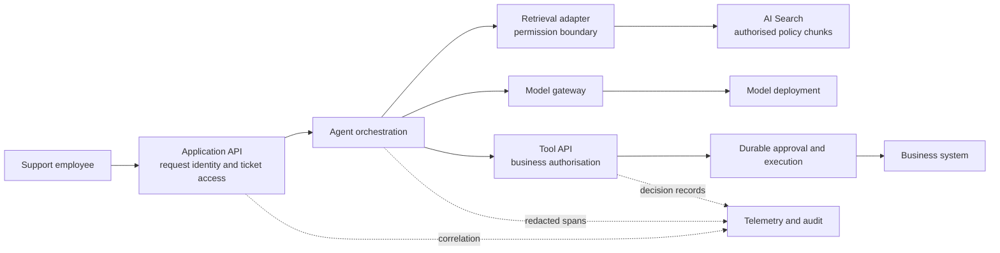

# F01 — Reference architecture and Well-Architected design

[Capability builds and exact checklist targets](capability-builds.md#build-contract)

Design a support-ticket assistant that retrieves permitted policy documents, proposes an action and routes sensitive actions for approval. The architecture must explain who can do what, which service owns each decision, how failures recover and what evidence makes it fit for use.

**Status:** learning material; no deployment or measured results asserted. Architecture target **3**, current score **unassessed**. Requirements: architecture items 1, 2, 9 and 14. Start here with a draft, then return after F05–F09 to replace assumptions with measurements.

## Prerequisites and outcomes

Know HTTP request/response, Azure resources and resource groups, basic identities and the distinction between an agent and a model. By the end, draw and defend a request path, allocate an NFR budget, explain the five WAF pillars through concrete decisions and produce an architecture handover pack. The target is a coherent workload, not familiarity with every Azure service.

## 1. Begin with a bounded problem

The example user is a support employee reviewing a refund request. The assistant may retrieve current policy and draft a response. It cannot decide that a user has access to a ticket, grant itself a permission, or execute a refund merely because generated text says it should. The business API owns those decisions.

Start with a read-only assistant. Add a refund proposal only when retrieval quality and identity boundaries are understood. A durable approval path is a later extension; it needs a business owner, expiry and replay behaviour. This keeps the first build useful without hiding the harder action-taking requirements.

For discovery, record the users, decision being assisted, authoritative data, prohibited actions, data sensitivity and acceptable failure. “Answers questions” is insufficient: a policy answer with the wrong customer's data is a failed request even when the prose is accurate.

## 2. Reference request path

This is a proposed workload design, not a claim that all service combinations share one networking or authentication configuration. Resolve the deployment details in F02–F06.

1. The application authenticates the employee and establishes the tenant, user and requested ticket. It authorises ticket access before retrieving private context.
2. Retrieval uses a validated identity context and trusted permission rules. A user-supplied filter is not the access-control policy.
3. The model receives the minimum permitted context. Retrieved text is evidence, not instructions that can change tool permissions.
4. A proposed action is checked by the tool API against current business state. Where approval is required, execution waits for an authorised approver and revalidates preconditions after the wait.
5. A correlation identifier connects retrieval, model, tool and outcome records. Audit decisions and diagnostic logs have different retention and access needs.

A model gateway and a tool gateway can be separate API surfaces even when one APIM instance hosts both. Label the caller and backend audience independently; do not assume a token suitable for the agent is suitable for Search or a business API.

## 3. Component decisions and ownership

Complete this matrix for the actual deployment. “Private” must mean a documented path and ingress policy, not an icon in a diagram.

| Component | Identity and authorisation question | Network and residency question | Evidence and owner |
|---|---|---|---|
| Application API | Who may read this ticket? | How do users reach it; where is session data processed? | Access decision and request ID; workload team |
| Agent runtime | Which principal calls each dependency? | Managed service or owned compute; supported private paths and egress? | Version/configuration and tool spans; workload/AI platform |
| Search | Which documents can this user retrieve? | Endpoint, DNS, index region and ingestion path? | Query outcome without private text; data owner |
| Model gateway/deployment | Which consumer and backend identity? | Deployment type, processing geography and fallback region? | Deployment version, tokens and latency; AI platform |
| Tool/approval service | Who can propose, approve and execute? | Reachable business systems and egress rules? | Durable action ID, approval and final outcome; business owner |
| State and document stores | Which principal reads/writes each data class? | Region, backup location, retention and deletion? | Restore/deletion evidence; data/platform owner |
| Telemetry | Who can inspect traces and audit events? | Where does sensitive telemetry flow? | Redaction test, retention configuration; operations/security |

F02 owns DNS, private connectivity and landing-zone implementation; F03 owns identity and token flows; F10 owns security threat/control and governance evidence; F14 owns responsible-AI harm, safety and oversight evidence. The enterprise platform team owns shared network and policy baselines. The workload team still owns whether its application meets the business requirement.

## 4. Apply the five pillars through tradeoffs

| Pillar | Design decision | Tradeoff to defend | Evidence to obtain |
|---|---|---|---|
| Reliability | Bound retries and route unavailable actions to a recoverable queue or human | Availability does not justify duplicate refunds | Timeout, replay and recovery results |
| Security | Enforce access at retrieval and tool boundaries | More checks and identity complexity | Denied cross-user access and denied unauthorised action |
| Cost optimisation | Route simple requests to a cheaper adequate model; bound context | Savings may reduce quality | Quality/cost comparison on the same dataset |
| Operational excellence | Version code, instructions, model choice and index together in a release record | More release discipline | Failed gate, rollback and incident walkthrough |
| Performance efficiency | Reduce unnecessary model/tool round trips | Parallelism can increase cost and load | End-to-end and per-stage latency distributions |

Do not add multi-region deployment merely to decorate the diagram. Decide which failures require it, whether data may cross regions, how state is reconciled and whether the workload can afford the operational complexity. A smaller safe degraded service can be preferable to an automatic fallback that violates access or residency rules.

## 5. NFR budget and measurement

Write the target before the experiment and the measured value afterwards. Leave measurements blank until collected. The table below names fields, not preselected numbers.

| Requirement | Target to agree | How to measure | Failure response |
|---|---|---|---|
| End-to-end p95 latency | Separate interactive answer and approved action | Correlated request duration over a stated workload | Limit context/calls; degrade with an explicit status |
| Retrieval quality | Recall@k plus permission correctness | Labelled questions and negative-access cases | Improve ingestion/retrieval before model tuning |
| Task success | Definition of resolved, escalated and failed | Offline cases plus reviewed live outcomes | Human route and incident ownership |
| Cost per 1,000 requests | Include model, search, compute and gateway allocation | Usage records plus declared allocation method | Token/context budgets and justified routing |
| Availability | User-visible SLO and time window | Success and latency indicators | Recovery/runbook and error-budget decision |
| RPO/RTO | Separate session, audit and action state | Restore/recovery exercise | State-specific recovery strategy |
| Injection blast radius | Maximum permitted tool/data scope | Adversarial scenario and access evidence | Deny action, retain evidence and investigate |

For a sequential path, stage durations help explain the end-to-end time, but adding stage p95 values does not give an exact request p95. For parallel work, the critical path matters. Report sample size, concurrency, warm/cold conditions and failure inclusion. Streaming first-token latency and full-answer latency answer different questions.

For an illustrative cost model, sum input/output token usage multiplied by the relevant rates, then add non-model costs. Do not treat a budget notification as a spending cap. F08 owns measured cost and latency; F09 owns enforcement policies.

## 6. Three ADRs and transition design

Each ADR needs context, decision, alternatives, consequences, evidence and a revisit trigger. Write these yourself:

- **Platform choice:** managed agent versus owned orchestration runtime. Identify required control, hosting responsibility and a concrete reason to reject the alternative. Framework and hosting choices are separate axes.
- **Identity model:** delegated user access versus application identity for each action. Explain how user access survives the retrieval boundary and why the tool cannot escalate its own permissions.
- **Retrieval design:** classical hybrid retrieval versus agentic retrieval. State the quality, permission, latency and operational evidence that would change the decision.

Show the transition explicitly: read-only prototype → authenticated and permission-filtered retrieval → approved actions → controlled release with recovery evidence. Every transition needs an exit criterion and rollback option. A target-state diagram alone hides the risk of moving a live workload.

## 7. Failure diagnosis exercise

Scenario: model calls begin returning throttling errors while a refund proposal is awaiting approval. Explain why retrying the entire request is unsafe. Identify the model-call retry budget, the durable action identifier and the component that prevents duplicate execution. State what the user sees and which telemetry distinguishes model throttling from tool failure.

Then make Search unavailable. Decide whether the assistant may answer without policy evidence. For this scenario, policy-dependent answers should be withheld or routed to a human; an ungrounded confident answer is not a successful fallback. Document the decision rather than embedding it only in a prompt.

## 8. Learner evidence and completion

Produce an HLD, request sequence, component matrix, NFR budget, three ADRs, target/transition diagram, release/rollback outline and handover pack. The handover names owners, dependencies, alerts, runbooks, data handling and unresolved risks. Diagrams are learner artefacts, not automatic evidence of a built system.

Rehearse a ten-minute whiteboard from memory. Then give a three-minute A3 walkthrough: problem and deployment; request/trust path; measured quality/latency/cost; failure and human-review path; change required for a regulated client. Say “target” or “not yet measured” when appropriate.

Architecture 2 requires defending the design and alternatives. Architecture 3 additionally requires a built workload and reproducible measurements. The current score remains **unassessed** until evidence is reviewed. No functions or tests are supplied here; the learner owns implementation.

## Sources and next steps

Source review: 30 October 2026. This chapter's ticket scenario, matrices and exercises are proposed learning designs. Microsoft's [baseline Foundry chat architecture](https://learn.microsoft.com/en-us/azure/architecture/ai-ml/architecture/baseline-microsoft-foundry-chat) is a reference implementation to compare against, not a requirement to reproduce every component. The [WAF AI guidance](https://learn.microsoft.com/en-us/azure/well-architected/ai/) connects application, data and operational design.

Use the local `documentation/INDEX.md` and `documentation/REFRESH-REPORT.md` from the repository root for cached sources and coverage limits. Continue with [F02 networking](../F02-Landing-Zones-and-Networking/README.md), [F03 identity](../F03-Identity-and-Zero-Trust/README.md), and later [F08 measured release evidence](../F08-Evals-Tracing-and-Release/README.md).
