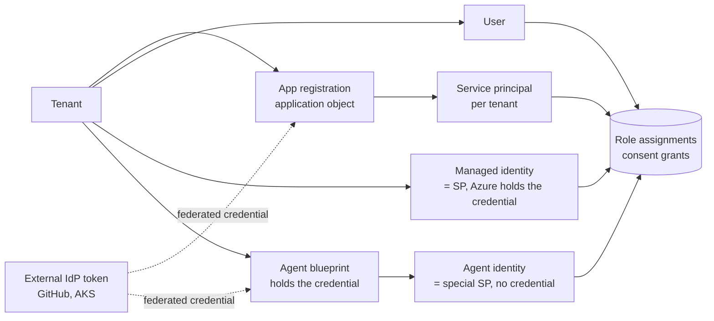
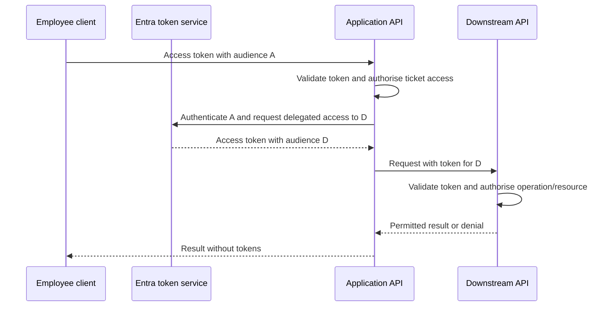
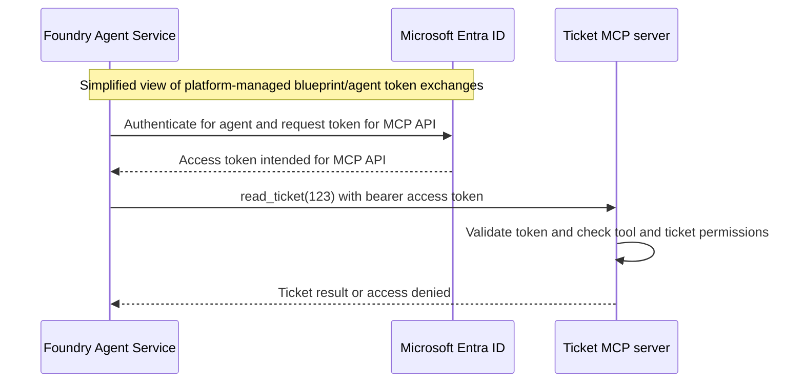

# F03 — Identity and Zero Trust for agents

**Status:** teaching chapter, design proposals; no implementation verified. Architecture target **3**, code C1 target **F3**, current scores **unassessed**. Applied MCP and toolbox exercises live in [F06](../F06-Agent-Tooling-MCP-and-Integration/README.md); the Entra-protected tool server is [S03.03](../../Agent-Build-01-Fundamentals/S03-AI-Agents-Tools-and-MCP/S03.03-MCP-OAuth2.1/README.md). Companion files: [capability builds](capability-builds.md#build-contract), [RBAC matrix](rbac-matrix.md), [golden answers](golden-answers.md), [sign-in protocols](reference/protocols.md), [sketches](sketches/).

An authenticated agent is not authorised to read a customer's ticket or issue a refund. This chapter follows identity from Ayşe's sign-in through retrieval and tool execution and separates, at every hop, three questions a client panel will ask separately: **who is calling, what did the token say, and who checked it**.

### How to use this page

Four routes through the same material; pick by what the next interview or build needs.

| Route | Start | Then | Time |
|---|---|---|---|
| Learn the words | Sections 1–4 | Section 9, the interview lines and study checks under each section | Two evenings |
| Build A3's identity layer | Section 12 micro-task ladder, M01–M28 | Each micro-task sits under the concept it proves | One command at a time |
| Build the standard scenarios | Section 16, five passes, S01–S26 | Coverage table maps each to sections and golden answers | An afternoon each |
| Pass the panel | Sections 5, 6, 8, 10 cold | Section 15 question bank, then the six golden answers aloud | The week before |

### Contents

| # | Section | One line |
|---|---|---|
| 1 | Who is calling | The Entra object chain: what holds a credential, what holds an assignment |
| 2 | What the token says | Access, ID and refresh tokens; the claims; the validation order |
| 3 | Grants and consent | Which grant for which agent situation; delegated vs application; consent in a bank |
| 4 | Keyless Azure from Python | Credential classes, the chain, scope strings, the three execution contexts |
| 5 | The agent's own identity | Entra Agent ID, what Foundry provisions, the token exchange, six connection types |
| 6 | Least privilege on the data planes | Role names, the A3 matrix, the denied run, permission-aware retrieval |
| 7 | Delegation | On-behalf-of and the audience rule |
| 8 | Entra as authorisation server | The MCP spec in Entra terms, granting tools, APIM, error shapes |
| 9 | Signing the user in | OIDC and SAML, and why neither is a tool token |
| 10 | Zero Trust | The planes with one Azure control each, the A3 component table, threats |
| 11 | Diagnose failures | Symptoms, first checks, shortcuts to refuse |
| 12 | Exercises and evidence | The micro-task ladder M01–M28 and the learner exercises |
| 13 | Job-market map | What the adverts name and where it is taught |
| 14 | Adjacent topics | Conditional Access, logs, Okta, External ID, AKS, certificates, Copilot Studio |
| 15 | Question bank | Forty questions panels ask, with the Azure answer points |
| 16 | Scenarios | Twenty-six small projects that cover the subject |
| | End matter | One request end to end, twelve lines, what this is not, versions, reading |

### What we are trying to avoid

- The agent calls `issue_refund` with the project's shared managed identity; the audit log says "the project" and nobody can name the agent or the person behind the request.
- A token minted for the ticket MCP server is forwarded to AI Search; Search accepts it because nobody checked `aud`.
- Ayşe asks "what is the escalation policy for T-2041?" and the answer cites a document only Mert may read, because the retrieval identity sees the whole index.
- A developer's `az login` session makes the demo work; in production the container's identity has no role and the first call is a `403`.
- A legacy test app still holds an application permission on Exchange; it has not been used since the pilot and nobody owns it.

### Has this happened?

*Midnight Blizzard, January 2024.* A Russian state actor password-sprayed a legacy, non-production test tenant account at Microsoft that had no MFA. From there they reached a legacy test OAuth application that still held elevated access to the corporate environment, created further OAuth apps and a user to consent to them, and granted themselves the Exchange Online `full_access_as_app` role. They read corporate email until Microsoft's own security team detected the activity on 12 January 2024. Microsoft's guidance afterwards: audit every identity's privilege, scrutinise unused identities and apps with app-only permissions, and scope mailbox access per app. **An application permission is a standing grant; an unused app with elevated access is an identity nobody is watching.** Source: [Microsoft Security blog, 25 January 2024](https://www.microsoft.com/en-us/security/blog/2024/01/25/midnight-blizzard-guidance-for-responders-on-nation-state-attack/), read 30 October 2026.

*Storm-0558, 2023.* A consumer (MSA) signing key landed in a 2021 crash dump, the dump moved from the isolated signing environment into the corporate debugging network, and an engineer's account with access to that network was compromised. The key then signed tokens that enterprise Exchange Online accepted: Microsoft's libraries checked the signature but did not check key scope, and "developers in the mail system incorrectly assumed libraries performed complete validation." Remediation included libraries that automate key-scope validation. **A valid signature is not a valid token; issuer, key scope and audience are the check.** Source: [MSRC, 6 September 2023, with the March 2024 addendum](https://www.microsoft.com/en-us/msrc/blog/2023/09/results-of-major-technical-investigations-for-storm-0558-key-acquisition), read 30 October 2026.

*GitHub MCP, May 2025.* A user connected an agent to the official GitHub MCP server with access to their account, which held a public and a private repository. An attacker filed an issue in the public repo containing a prompt injection. Asked to review open issues, the agent read the payload, pulled data from the private repo into context and opened a pull request in the public repo containing it, including the user's salary and relocation plan. Invariant's write-up stresses the flaw was not in the MCP server; the agent's reach exceeded the task. **The token's scope is the blast radius of the worst prompt the agent will ever read.** Source: [Invariant Labs, 26 May 2025](https://invariantlabs.ai/blog/mcp-github-vulnerability), read 30 October 2026.

### What the chapter covers

The Entra object chain and what a token says (1–2); grants and consent (3); keyless Python and the three execution contexts (4); the agent's own identity in Foundry (5); least privilege on the data planes and the denied-access run (6); delegation and the OBO audience rule (7); Entra as authorisation server for the ticket MCP server (8); OIDC and SAML for sign-in (9); the Zero Trust planes as one table (10); diagnosis (11); exercises, evidence and the job-market map (12–13); the adjacent topics a panel may raise, from Conditional Access on workload identities to External ID and AKS Workload ID (14); a bank of the questions panels actually ask, with the Azure answer points for each (15); twenty-six standalone scenarios that cover the subject (16).

### What you have at the end

Four diagrams you can redraw blind, a role-name table, a least-privilege matrix for A3, six golden answers in skeleton, twenty-eight micro-tasks that build the A3 identity layer one command at a time (Section 12), and twenty-six standalone scenarios in plain domains that cover every section, golden answer and micro-task (Section 16). The runs, not the prose, are the evidence.

### How the micro-tasks work

Twenty-eight micro-tasks, `M01` to `M28`, sit in the text where their concept appears and are indexed in Section 12. Each is five lines: prerequisite, do, expect, proof, and an **EC** time, the minutes in which you should be able to reproduce it from memory, eyes closed, once it has been done once. Do them in order; each builds on the last and all of them together are the A3 identity layer. Use one throwaway resource group (`rg-f03`) and the ticket API from S03.03 as the protected resource. CLI flags are from general knowledge and preview surfaces move: run `az <command> --help` before each, and treat a flag that has moved as a note for the study log, not a blocker. Never paste a token into a chat, a ticket or a website; the decoder sketch reads stdin for that reason.

## 1. Who is calling: the Entra object chain

### The chain in one picture



What to notice: credentials sit on the application object, the managed identity (held by Azure) or the blueprint; role assignments and consent grants attach to the tenant-local principal. **Credentials answer "prove it"; assignments answer "allowed to".** The two never live on the same object by accident.

### The objects, one at a time

#### Microsoft Entra ID: the directory of identities

**Microsoft Entra ID is Microsoft's cloud identity and access management service.** It maintains a directory of identities within a tenant. An identity can represent a human user or software, such as an application or agent. Each directory object has its own **object ID**.

For this workload, distinguish three objects:

- A **user object** represents a person.
- An **application object** defines an application and its authentication configuration and exposed permissions.
- A **service principal** represents that application in a particular tenant. It is the identity to which that tenant grants access.

The application's **application/client ID** identifies the application; it is different from the **object ID** of its tenant-local service principal. See [applications and service principals](https://learn.microsoft.com/en-us/entra/identity-platform/app-objects-and-service-principals).

#### Managed identity: Azure manages the credentials

A service principal answers **“who is calling?”** The software must still authenticate: prove that it is entitled to act as that identity. An ordinary application can use a certificate, client secret or configured federation trust.

With a **managed identity**, Azure manages the authentication credentials, so you do not create, store or rotate them yourself. Enabling a system-assigned managed identity on a supported Azure resource creates a special service principal to represent it. Its lifecycle follows that resource. A user-assigned managed identity has an independent lifecycle and can be assigned to supported resources.

You grant that identity permissions separately. **Authentication proves the identity; authorization determines what it may do.** Creating a managed identity does not automatically give it access to your data. See [managed identities](https://learn.microsoft.com/en-us/entra/identity/managed-identities-azure-resources/overview).

#### Microsoft Entra Agent ID: an identity for an agent

**Microsoft Entra Agent ID** is the product/capability name. An **agent identity** is a special service principal representing an agent instance. It has its own object ID and can receive supported permissions.

An agent identity is distinct from a system-assigned or user-assigned managed identity. It authenticates through its **agent identity blueprint**, rather than holding its own credentials. The blueprint supports the agent identity's authentication mechanism; it is not itself a grant of access to every tool. See [Microsoft Entra agent identities](https://learn.microsoft.com/en-us/entra/agent-id/agent-identities).

In the documented Foundry model, Foundry automatically creates a unique blueprint for each newly created agent, plus an identity for its default instance. You normally do not select a template from a list: Foundry handles this provisioning. See [agent identity concepts in Foundry](https://learn.microsoft.com/en-us/azure/foundry/agents/concepts/agent-identity).

#### From an identity to permission

An **Azure role assignment = principal + role + resource scope**. It is a separate authorization record, not part of the identity itself. API application roles and delegated scopes use their own grants; an Azure IAM assignment does not automatically grant an arbitrary MCP tool permission.

Separate control-plane resource provisioning from supported Foundry data-plane operations, such as agent creation/invocation. Then identify the principal used by each downstream tool. The caller's Foundry access does not imply access to Search, Storage or a refund API.

Design in order: list required tool operations; choose the principal or supported delegated flow for each; grant minimum target-resource permissions; enforce business rules inside the tool; test allowed and denied actions. Attaching a tool only defines what the model can attempt.

*Micro-task M01 · the three objects.* Prereq: an Entra tenant where you are at least Application Developer. Do: `az ad app create --display-name ticket-api --sign-in-audience AzureADMyOrg`, then `az ad sp create --id <appId>`, then `az ad app show --id <appId> --query id` and `az ad sp show --id <appId> --query id`. Expect: three different GUIDs: the application (client) ID shared by both, the application object ID, the service principal object ID. Proof: a note in the study log naming which GUID goes to `--assignee-object-id` (the SP's). EC: 2 min.

*Micro-task M02 · expose the API.* Prereq: M01. Do: set the identifier URI `az ad app update --id <appId> --identifier-uris api://ticket-api`; add two delegated scopes `tickets.read`, `tickets.refund` (portal → Expose an API, or `az ad app update --set api.oauth2PermissionScopes=@scopes.json`); add two app roles `Tickets.Read`, `Refunds.Execute` with `allowedMemberTypes: ["Application"]` (`--app-roles @roles.json`). Expect: `az ad app show` lists both scopes and both roles with their own GUIDs. Proof: the four GUIDs recorded; you can say which claim each lands in (`scp` for scopes, `roles` for roles). EC: 4 min.

*Micro-task M03 · a managed identity and one assignment.* Prereq: an Azure subscription and `rg-f03`. Do: `az identity create -g rg-f03 -n mi-ticket-server`; capture `principalId`; `az role assignment create --assignee-object-id <principalId> --assignee-principal-type ServicePrincipal --role "Reader" --scope /subscriptions/<sub>/resourceGroups/rg-f03`; then `az role assignment list --assignee <principalId> -o table`. Expect: one row: principal, role, scope. Proof: say aloud the three parts of the assignment and which object holds the credential (nobody you can see; Azure does). EC: 2 min.

### Workload identity federation

A federated credential is a trust rule on an app registration or blueprint: "accept a token from this external issuer with this subject in exchange for a token as me." GitHub Actions and AKS use it so no secret is stored anywhere. The subject string is the whole security boundary, so write it narrowly: for GitHub, `repo:<org>/<repo>:environment:<env>` rather than `repo:<org>/<repo>:ref:refs/heads/*` (subject formats from general knowledge; verify against the [workload identity federation](https://learn.microsoft.com/en-us/entra/workload-id/workload-identity-federation) page before building). Foundry uses the same mechanism for agents: the blueprint's federated credential trusts the Agent Service resource provider, so "Foundry projects, agent code, and the project managed identity never hold the credential" ([agent identity concepts](https://learn.microsoft.com/en-us/azure/foundry/agents/concepts/agent-identity), read 30 October 2026).

*Micro-example.* A deployment workflow for the ticket server authenticates with a federated credential whose subject is `repo:ozgurgulerx/production-agent-platform:environment:prod`. A pull-request workflow on a fork presents `repo:someone/fork:pull_request`; Entra refuses the exchange with an `AADSTS70021`-class subject mismatch (error code from general knowledge, verify). No role assignment was ever consulted.

*Micro-task M04 · federated credential for CI.* Prereq: M01, a GitHub repo with an environment named `prod`. Do: `az ad app federated-credential create --id <appObjectId> --parameters fc.json` where `fc.json` has `issuer: https://token.actions.githubusercontent.com`, `subject: repo:<org>/<repo>:environment:prod`, `audiences: ["api://AzureADTokenExchange"]`; in the workflow use `azure/login` with `client-id`, `tenant-id`, `subscription-id` and `permissions: id-token: write`. Expect: the `prod` workflow logs in with no secret; a workflow on a branch without the environment fails at token exchange. Proof: both run URLs and the exact AADSTS text of the failure. EC: 3 min.

*Where it goes wrong.* A wildcard subject on the federated credential; a user-assigned managed identity shared by six services "to save time", so a compromise of any one is a compromise of all; a `ClientSecretCredential` in a `.env` file that outlives the pilot.

**Interview line.** "App registration defines it, service principal is it in your tenant, managed identity means Azure holds its credential, agent identity means the blueprint does; roles and consent attach to the principal, never to the registration."

**Study check.** Which object do you pass to `az role assignment create --assignee-object-id` for a Foundry agent, and why not the blueprint? **Answer.** The agent identity's object ID: it is the service principal that presents tokens to the resource. The blueprint holds the credential and impersonates the identity; it is not the actor the resource sees.

> Rule to keep: one principal per workload, one credential per principal, zero credentials in code.

## 2. What the token says

### Access, ID and refresh tokens

| Token | Audience | Used for | Never |
|---|---|---|---|
| Access token | The API named in `aud` | Calling that API | Presented to a different API; read by the client as a source of truth |
| ID token | The client application | Establishing who signed in | Sent to an API as a credential |
| Refresh token | The token endpoint | Getting new access tokens without the user | Logged, shared across clients, issued without `offline_access` |

The v1 and v2 endpoints issue different claim sets (`appid` vs `azp`, issuer URL shape); `ver` tells you which rules apply. Treat tokens issued for other APIs as opaque strings.

### The claims and the validation order

For a JWT access token issued to your API, inspect these claims only after supported middleware validates the signature and trusted issuer. Client applications should treat tokens for other APIs as opaque.

| Claim | Meaning / check |
|---|---|
| `iss`, `tid` | Issuer and tenant; enforce the intended tenant trust boundary |
| `aud` | Intended API; reject a token for a different resource |
| `exp`, `nbf`, `iat` | Expiry, not-before and issue times; enforce validity with the library's clock-skew policy |
| `oid`, `sub` | Tenant object ID and subject; identify the caller in the validated tenant context |
| `azp` / `appid` | Client application ID in v2 / v1 tokens respectively |
| `scp` | Space-separated delegated scopes |
| `roles` | API roles; application permissions for app-only access, or assigned user roles in delegated tokens |
| `ver` | Token version; select the corresponding issuer/claim interpretation |

Synthetic decoded **v2 app-only payload** for a custom ticket API; these invented identifiers and historical timestamps are teaching data, not a signed or usable token:

```json
{
  "ver": "2.0",
  "iss": "https://login.microsoftonline.com/11111111-1111-4111-8111-111111111111/v2.0",
  "tid": "11111111-1111-4111-8111-111111111111",
  "aud": "22222222-2222-4222-8222-222222222222",
  "oid": "33333333-3333-4333-8333-333333333333",
  "sub": "33333333-3333-4333-8333-333333333333",
  "azp": "44444444-4444-4444-8444-444444444444",
  "iat": 1700000000,
  "nbf": 1700000000,
  "exp": 1700003600,
  "roles": ["Tickets.Read"]
}
```

**S27 recall card.**

- `scp`: delegated scopes, space-separated; check the required scope and the user's resource access.
- `roles`: API roles, an array; app-only permissions or user roles—its presence alone does not prove app-only access.

Source: [access-token claims reference](https://learn.microsoft.com/en-us/entra/identity-platform/access-token-claims-reference).

Do not use an ID token as an API access token. Do not read an unvalidated token payload and treat its claims as trustworthy. Token validation belongs in supported authentication middleware or libraries; a JWT is a format, not a security decision.

*Micro-task M05 · two tokens, two audiences.* Prereq: `az login`, the sketch. Do: `az account get-access-token --resource https://cognitiveservices.azure.com --query accessToken -o tsv | python sketches/decode_token_claims.py`, then the same with `--resource https://graph.microsoft.com`. Expect: different `aud`, same `oid`, `scp` present in both (you are a user), `ver` tells you v1 or v2 shape. Proof: a two-column note of the claims that differed; the realisation that the Graph token would be a `401` at Cognitive Services. EC: 2 min.

### Validation, in order

1. Signature against the issuer's published keys (JWKS), with key discovery, caching and rotation handled by the library.
2. `iss` and `tid`: the tenant you trust, no other.
3. `aud`: this API's identifier (app ID URI or client ID), nothing else.
4. `exp` and `nbf` with the library's clock-skew policy.
5. `scp` (delegated) or `roles` (app-only or assigned user roles): the permission the requested tool needs.
6. Business authorisation: may this subject touch this ticket, this amount, now.

Steps 1–5 are authentication middleware; step 6 is your code. Storm-0558 was a failure at step 2 with step 1 passing.

**Interview line.** "Signature says Entra signed it; audience says it was signed for me; scope or role says what it may do; my code says whether it may do it to this record."

**Study check.** A correctly signed, unexpired token arrives at the ticket server with `aud` = Microsoft Graph and `scp` containing `tickets.read`. Permit or deny? **Answer.** Deny with `401`. The audience is wrong, so nothing after step 3 is evaluated; the scope value is irrelevant.

> Rule to keep: decoding is not validating; validating is not authorising.

## 3. Grants and consent

### The grant catalogue, by agent situation

OAuth 2.1 grants map to agent situations cleanly once you ask whose authority the resulting token carries.

| Grant | Subject of the token | Agent situation | Failure mode |
|---|---|---|---|
| Authorization code + PKCE | The signed-in user | Ayşe signs into the ticket assistant's web UI | Public client holding a secret; redirect URI not exact-matched |
| Client credentials | The application or agent identity | Autonomous agent calls the ticket MCP server under its own identity | Agent granted `Refunds.Execute` "to be safe"; shared identity across agents |
| On-behalf-of | The user, with the middle tier as actor | Ticket API calls Graph or a core-banking API as Ayşe | Redeeming a token whose `aud` is not the middle tier; silent fallback to app-only on denial |
| Device code | The user, via a second device | Engineer signs in to the CLI on a headless box | Used in a daemon because "it worked once" |
| Refresh | Same as the original grant | Long sessions without re-prompting | Refresh token logged; issued to a public client without rotation |
| Implicit | Removed in OAuth 2.1 | None | Still enabled on an old app registration |

For a Foundry agent calling an MCP tool with agent identity authentication there is no grant you configure: Agent Service runs the exchange (blueprint credential → agent identity token → audience-scoped token; Section 5), and the result is app-only unless user delegation is configured ([Foundry MCP authentication](https://learn.microsoft.com/en-us/azure/foundry/agents/how-to/mcp-authentication), read 30 October 2026).

### Delegated versus application permissions

A **delegated permission** (`scp`) is the intersection of what the app was granted and what the user may do; the API still checks the user's entitlement to the record. An **application permission** (`roles`) is the app's own standing authority, no user present, and Graph application permissions always require administrator consent. The OBO page puts the boundary in one sentence: roles "remain attached to the principal (the user) and never to the application operating on the user's behalf" ([OBO flow](https://learn.microsoft.com/en-us/entra/identity-platform/v2-oauth2-on-behalf-of-flow), read 30 October 2026).

### Consent in a regulated tenant

Most banks disable user consent entirely, so every delegated scope your tool needs goes through the admin-consent workflow (tenant policy from general knowledge; confirm with the client's identity team). Design for it: request `.default` against the API so one admin consent covers the exposed scopes; never mix `.default` with named scopes in one request (`AADSTS70011`); treat each new scope as a change ticket with an owner, and keep the exposed scope set coarse enough to ship and fine enough to deny (`tickets.read` and `tickets.refund`, not one scope per tool). A configured permission on the app registration is not evidence that consent was granted; the grant record is.

*Micro-example.* The ticket API exposes `tickets.read` and `tickets.refund`. Mert's client requests `api://ticket-api/.default`; the admin consents once; Mert's token carries `scp: tickets.read tickets.refund`, Ayşe's carries `scp: tickets.read`. The server never asks Entra who Mert is at call time; it reads the validated `scp`.

*When not to.* Do not add `offline_access` to a daemon or an agent's own identity; app-only flows do not use refresh tokens, and offline consent to unknown apps was one of Midnight Blizzard's detection signals.

*Micro-task M06 · admin consent to the API.* Prereq: M02, a client app registration for the web UI (`ticket-ui`) with `tickets.read` and `tickets.refund` added under API permissions. Do: `az ad app permission admin-consent --id <uiAppId>`; then `az ad app permission list-grants --id <uiAppId>` (or Graph `oauth2PermissionGrants`). Expect: a grant record with `consentType: AllPrincipals` and the scope string. Proof: the grant record, redacted; the sentence "a configured permission is not a grant; this record is." EC: 2 min.

*Micro-task M07 · an app-only token carries `roles`.* Prereq: M02, a test client registration with a secret (tests only). Do: assign `Tickets.Read` to the test client's service principal (M08 shows how), then `curl -X POST https://login.microsoftonline.com/<tenant>/oauth2/v2.0/token -d grant_type=client_credentials -d client_id=... -d client_secret=... -d scope=api://ticket-api/.default`; pipe the token into the decoder. Expect: `roles: ["Tickets.Read"]`, no `scp`, `aud` = your API. Proof: the decoded claim table in the log; delete the secret afterwards and say why it existed at all. EC: 3 min.

*Micro-task M08 · grant an app role to a principal.* Prereq: M02 and the principal's object ID (the test client now, the agent identity in M13). Do: `az rest --method POST --url https://graph.microsoft.com/v1.0/servicePrincipals/<principalSpId>/appRoleAssignments --body '{"principalId":"<principalSpId>","resourceId":"<ticketApiSpId>","appRoleId":"<Tickets.Read GUID>"}'`. Expect: `201` with the assignment; `GET .../appRoleAssignments` lists it. Proof: the assignment ID; say aloud that this is an Entra app-role assignment, not an Azure RBAC role assignment, and that it lands in `roles`. EC: 2 min.

### Microsoft Graph permissions and consent

Choose the Graph endpoint first, then its least-privileged supported permission. **Delegated access** combines the app's granted scopes with the signed-in user's authority; consent does not give that user access to another person's restricted data. User consent depends on tenant policy and permission type; privileged delegated permissions require administrator consent.

**Application access** uses the app's own authority without a signed-in user and requires administrator consent for Graph application permissions. Record the tenant, client service principal, resource API, exact permission and consent grant. Use resource-specific restrictions where the chosen API supports them. Request a Graph token through the appropriate flow; do not forward the MCP API's incoming token to Graph or silently switch a denied delegated call to app-only.

Evidence: show the redacted grant record, an allowed request and a denied request. A configured permission on an app registration is not evidence that consent was granted. Deep dives remain in [F11](../F11-Copilot-Studio-and-M365-Boundary/README.md). Sources: [Graph permissions](https://learn.microsoft.com/en-us/graph/permissions-overview) and [Entra consent](https://learn.microsoft.com/en-us/entra/identity-platform/permissions-consent-overview), local sections **Delegated access** and **Consent**.

**Interview line.** "Delegated means the user's authority narrowed by the app's grant; application means the app's own authority, admin-consented, no user in the loop; a bank will make you justify every application permission by name."

**Study check.** Ayşe's token for the ticket API has `scp: tickets.read`. The ticket API needs to read her calendar through Graph. Which grant, which consent, which token? **Answer.** OBO: the ticket API redeems her token (its own `aud`) for a Graph token with `Calendars.Read` as a delegated scope; the tenant admin has consented to the ticket API's Graph permissions; the Graph token's subject is Ayşe and its actor is the ticket API.

> Rule to keep: a scope is a ceiling the API enforces, not a key the client holds.

## 4. Keyless Azure from Python and the three execution contexts

### The credential classes

| Class | Principal | Use | Not for |
|---|---|---|---|
| `ManagedIdentityCredential(client_id=...)` | System- or user-assigned managed identity | Container Apps, Functions, AKS without federation | Local development |
| `WorkloadIdentityCredential` | Federated workload (AKS, GitHub Actions) | CI and Kubernetes without secrets | Hosts without a federated token file |
| `OnBehalfOfCredential` | The user, via the middle tier | Ticket API calling a downstream API as Ayşe | Daemons |
| `AzureCliCredential` | The developer's `az login` session | A Mac during development | Anything deployed |
| `ClientSecretCredential` | An app registration with a secret | Tests against a throwaway tenant | Production; the secret is the thing you are trying not to have |
| `DefaultAzureCredential` | Whichever of the above succeeds first | Getting started | Production, see below |

`DefaultAzureCredential` tries, in order: environment, workload identity, managed identity, shared token cache (Windows), VS Code, Azure CLI, Azure PowerShell, Azure Developer CLI, interactive browser (off by default), broker. Microsoft's own guidance is to replace it once deployed: "replace `DefaultAzureCredential` with a specific `TokenCredential` implementation, such as `ManagedIdentityCredential`" ([credential chains](https://learn.microsoft.com/en-us/azure/developer/python/sdk/authentication/credential-chains), read 30 October 2026). Two reasons it fails a review: a host environment variable can change which credential wins at runtime, and a failing `ManagedIdentityCredential` on a developer machine adds latency to every first call. If you must keep the chain, pin it: `AZURE_TOKEN_CREDENTIALS=prod` (azure-identity ≥ 1.23) or a single class name (≥ 1.24), and `DefaultAzureCredential(require_envvar=True)`.

### Scope strings and the OpenAI client

A scope string is the audience you are asking for plus `/.default`. The five you will type from memory: `https://cognitiveservices.azure.com/.default` (Azure OpenAI and Foundry models), `https://search.azure.com/.default`, `https://ai.azure.com/.default` (Foundry project data plane), `https://graph.microsoft.com/.default`, `https://vault.azure.net/.default`. Feed the OpenAI SDK with `get_bearer_token_provider(credential, scope)` as `azure_ad_token_provider` so the client refreshes before expiry and never sees a key. Scope strings and the provider helper are from general knowledge; check the pinned `azure-identity` and `openai` versions before relying on them. Token caching: in memory by default, on disk opt-in; CAE is per request via `enable_cae=True` and "isn't supported for developer and managed identity credentials" ([azure-identity README](https://learn.microsoft.com/en-us/python/api/overview/azure/identity-readme), read 30 October 2026).

### The client you will write under the clock

CB120 and checklist 2.3 are the same exercise: an `httpx` client that calls Azure OpenAI with a token provider, refreshes before expiry, retries `429` and `5xx` with jitter and a bounded budget, and never writes a token to a log. Tests use a fake provider that returns a short-lived token and counts calls. **No sketch is supplied on purpose**: the exercise is learner-written, timed, without AI. The skeleton you should be able to put on paper in ten minutes: a `TokenProvider` protocol with `get_token() -> (value, expires_on)`; a `KeylessClient` holding the provider, a base URL and a retry policy; `_headers()` that refreshes when `expires_on - now < 120s`; a `post()` that loops at most N times on retryable status with `random.uniform` jitter; a log filter test asserting `"Bearer"` never appears in captured records.

*Micro-task M09 · pin the credential chain.* Prereq: Python with `azure-identity ≥ 1.24`. Do: in a scratch script, `DefaultAzureCredential(require_envvar=True)` with `AZURE_TOKEN_CREDENTIALS=AzureCliCredential`, log level `DEBUG` on `azure.identity`, call `get_token("https://cognitiveservices.azure.com/.default")`; repeat with the variable unset and watch the chain. Expect: with the pin, one credential attempted; without it, several, with `ManagedIdentityCredential` failing first on your Mac. Proof: the two log excerpts side by side (no token values). EC: 2 min.

*Micro-task M10 · keyless call to Azure OpenAI.* Prereq: M03's identity assigned `Cognitive Services OpenAI User` on an Azure OpenAI resource with `properties.disableLocalAuth=true` (`az resource update --ids <resourceId> --set properties.disableLocalAuth=true`). Do: from a Container App running as that identity (or locally as yourself with the same role), `AzureOpenAI(azure_ad_token_provider=get_bearer_token_provider(credential, scope))` and one chat completion; then try the same resource with an API key. Expect: the token call succeeds; the key call returns `401`. Proof: both status codes and the role assignment that made the first one work. EC: 4 min.

### Three execution contexts

**Local development:** a developer credential represents the signed-in developer. A successful call may reflect broad developer permissions that the deployed identity does not have. Record the actual principal used; test the intended runtime principal separately.

**Azure runtime:** a workload authenticates through its configured identity. Choose the intended identity explicitly where several are available. The deployment principal and the running agent's principal have different jobs and should not inherit one another's broad access by accident.

**CI:** federation allows a trusted external workload assertion to be exchanged for access. Its trust configuration must constrain the intended repository/environment or workload subject. A federation credential is not permission to deploy everything; role assignments still determine access. Do not assume the same credential class or acquisition mechanism fits both AKS and GitHub Actions.

Credential chains are convenient during development but can conceal which identity succeeded. The exercise is to explain the selected credential and its scope, not merely observe that a request worked. Managed-identity CLI login is for a suitable Azure environment, not a replacement for normal developer login on a Mac.

*Micro-example.* The ticket server works on your Mac against a dev index because `AzureCliCredential` is you, and you are Owner. In Container Apps the same code runs as a user-assigned managed identity with no role on the index; the first query returns `403` from Search. The fix is a `Search Index Data Reader` assignment on the index, not a key in Key Vault.

**Interview line.** "Managed identity in the runtime, workload identity federation in CI, the CLI on my laptop, and I can tell you which one made any given call because the chain is pinned."

**Study check.** Why does a working `DefaultAzureCredential` on a developer machine prove nothing about production authorisation? **Answer.** It resolved to the developer's own identity, which usually holds broader roles than the runtime principal; a passing call tells you the developer is allowed, not that the managed identity is.

> Rule to keep: the credential that worked is a fact to record, not a result to celebrate.

## 5. The agent's own identity: Entra Agent ID in Foundry

This is the section a Foundry panel scores. The question behind every variant is the same: when the agent acts, whose identity is in the audit log, and who approved its permissions.

### The objects

| Object | What it is | Holds credentials? | Receives permissions? |
|---|---|---|---|
| Agent identity blueprint | Template and parent for agent identities of one kind; "establishes the kind of agent" | Yes: federated credential, certificate or secret | Governs its identities; CA and admin actions target the kind |
| Agent identity | "A special service principal in Microsoft Entra ID", created under a blueprint, which the blueprint "is authorized to impersonate" | No | Yes: RBAC, data-plane roles, app roles |
| Agent's user account (optional) | A user object decorated as an AI agent, 1:1 with an agent identity, for scenarios that need a user | No | As a user |
| Sponsor | The human user or group accountable for the agent, recorded on the identity | n/a | n/a |

Agent identities are single-tenant even when the blueprint is multitenant. Definitions from [Entra agent identities](https://learn.microsoft.com/en-us/entra/agent-id/agent-identities), read 30 October 2026; the object names are preview-era and move, so relabel rather than reopen the design.

### What Foundry provisions for you

In the current agent object model, creating an agent provisions a unique blueprint and the identity for its default instance. Projects still carry a shared project-level blueprint and identity for legacy agents, and `azd` assigns `Foundry User` to that shared identity for compatibility. Nothing is granted downstream: "A newly created agent identity starts without resource permissions." Hosted agents get tokens for the current agent instance's identity through a token service; "the project managed identity isn't available to your hosted-agent code", and the sandbox contains no blueprint credential. Migrating a legacy agent "changes the agent identity" and "existing role assignments don't transfer" ([agent identity concepts](https://learn.microsoft.com/en-us/azure/foundry/agents/concepts/agent-identity), read 30 October 2026).

*Micro-task M11 · find the agent's identity.* Prereq: a Foundry project with one agent created. Do: open the agent in the portal and read its identity section, or the project resource's JSON view, for the blueprint and agent identity object IDs; then `az ad sp show --id <agentIdentityObjectId> --query "{name:displayName,type:servicePrincipalType}"`. Expect: a service principal whose type is not `Application` or `ManagedIdentity` (the exact type string is preview-era; record what you see). Proof: the object ID in the study log as "the assignee for every grant to this agent". EC: 2 min.

### The runtime token exchange

```mermaid
sequenceDiagram
  participant AS as Agent Service
  participant E as Microsoft Entra ID
  participant M as Ticket MCP server
  AS->>E: 1. Blueprint credential (federated, trusts the Agent Service RP)
  E-->>AS: 2. Token for the agent identity
  AS->>E: 3. Agent identity token, request aud = ticket API
  E-->>AS: 4. Audience-scoped access token (roles: Tickets.Read)
  AS->>M: get_ticket(T-2041) with bearer token
  M->>M: Validate iss, aud, exp, roles; check ticket entitlement
  M-->>AS: Result, or 403 with no effect
```

What to notice: two round trips to Entra before the tool sees anything, no secret in the project or the agent code, and the resource "checks the agent identity's RBAC role assignments before granting or denying access." Authentication to the resource does not itself grant access.

### Six ways a tool connection can authenticate

Foundry's MCP connection types are the three-options question in product form. `--auth-type` values are from the `azd ai connection create` examples on the [MCP authentication page](https://learn.microsoft.com/en-us/azure/foundry/agents/how-to/mcp-authentication), read 30 October 2026; the page does not show CLI values for the others.

| Connection type | Principal the MCP server sees | Carries the user? | Right when | Fails a review when |
|---|---|---|---|---|
| Agent identity (`agentic-identity`) | This agent's own service principal | No | Autonomous work; one audit line per agent | The agent needs the user's entitlements |
| Project managed identity (`project-managed-identity`) | The project's shared identity | No | Prototypes; legacy agents | Any production tenant: every agent in the project shares one audit identity and one permission set |
| Client user delegation (`UserEntraToken` / `AgentOnBehalfOfUser`) | The calling user, with the agent as actor | Yes | The tool must respect the user's access; preview | Consent is not designed in; Mert's and Ayşe's scopes differ |
| OAuth identity passthrough | The user after their own consent at the MCP server's provider | Yes | Third-party SaaS tools with their own IdP | Microsoft tokens to untrusted endpoints: `Cannot pass Microsoft token to untrusted MCP endpoint` |
| Key-based | A stored header; whatever the key represents | No | Vendor tools that only take a key | Anything you control; the key is shared and unaudited |
| Unauthenticated | Nobody | No | Public reference data | Anything that writes |

Consent for passthrough arrives as an `oauth_consent_request` output item with a `consent_link`; the user consents in that window, not in the chat, and "opening the link or closing the window doesn't by itself confirm that authorization succeeded." Custom MCP servers must be registered with an audience you control, not a Microsoft one.

*Micro-task M12 · an agent-identity connection.* Prereq: M02 (audience `api://ticket-api`), an Entra-protected MCP server reachable over HTTPS (M22 does the server side; the in-section server is [F06 lab 04](../F06-Agent-Tooling-MCP-and-Integration/labs/04-mcp-auth-apim/README.md), the S03.03 server is the alternative). Do: `azd ai project set <projectEndpoint>`, then `azd ai connection create ticketing --kind remote-tool --target https://<server>/mcp --auth-type agentic-identity --audience api://ticket-api`; attach the connection to the agent as an MCP tool. Expect: the connection appears on the agent; no secret was typed anywhere. Proof: the connection's JSON with auth type and audience, redacted. EC: 2 min.

*Micro-task M13 · the permitted call.* Prereq: M11, M12, M08 applied to the agent identity for `Tickets.Read`. Do: ask the agent for ticket `T-2041`; on the server, log the validated `oid`, `azp`, `aud` and `roles` (never the token). Expect: `get_ticket` runs; the server log shows the agent identity's `oid` and `roles: ["Tickets.Read"]`; the Foundry trace shows the tool call. Proof: one server log line and one trace screenshot, both redacted. EC: 3 min.

*Micro-task M14 · the denied call.* Prereq: M13. Do: ask the same agent to refund `T-2041`. Expect: the server returns `403` with `error="insufficient_scope"` (or your app-role equivalent) and no refund is recorded; the agent surfaces a graceful tool error, not a crash. Proof: the `403` line, the backend showing no effect, the trace. This is the ticking-rule evidence for F03. EC: 2 min.

*Micro-task M15 · the shared-identity comparison.* Prereq: M13. Do: create a second connection with `--auth-type project-managed-identity`, grant the project identity `Tickets.Read` the same way, call `get_ticket` from two different agents through it. Expect: both calls arrive with the same `oid`; the server cannot tell the agents apart. Proof: the two log lines with identical `oid`; delete the connection and write one sentence on why this fails a production review. EC: 3 min.

*Micro-task M16 · passthrough consent.* Prereq: an MCP server with its own OAuth provider (a GitHub or Atlassian MCP endpoint, or a dev tenant), a connection with OAuth identity passthrough. Do: invoke a tool; iterate the response output for `type == "oauth_consent_request"`, open `consent_link`, consent, re-run. Expect: first run yields the consent item, second run executes; decline once and observe the tool error. Proof: the consent item JSON (link redacted) and the two outcomes. EC: 3 min.

*Micro-example.* Three agents share a project. Under project managed identity, the refund agent, the FAQ agent and the triage agent all present the same `oid` to the ticket server, so the server cannot grant `Refunds.Execute` to one without granting it to all. Under agent identity, you assign `Tickets.Read` to all three identities and `Refunds.Execute` to the refund agent only; the triage agent's `issue_refund` call returns `403` and the trace names the agent.

### Prototype to production

The shared project identity is the prototype path; a per-agent identity is the production path; publishing and migration are where identities change and role assignments must be re-made. The sentence for the panel: "Each agent has its own blueprint and identity from creation; the shared project identity is for legacy agents, and nothing I ship uses it."

*Micro-task M17 · publish and diff the identity.* Prereq: M11. Do: record the agent's identity object ID; publish the agent (portal or SDK); record it again; `az role assignment list --assignee <old> -o table` and the same for the new ID if it changed. Expect: either the same identity (current model) or a new one with no assignments carried over (legacy migration path); the page says assignments do not transfer on migration. Proof: before/after IDs and the assignment lists; one sentence on what you would script before publishing in production. EC: 2 min.

### Lifecycle and governance at scale

Record a sponsor on every identity; it is who gets called at 3 a.m. Blueprints let an administrator act on a kind of agent at once: "Disable all Sales Assistant agents", "Revoke a permission grant for all Sales Assistant agents", "Apply a conditional access policy to all Sales Assistant Agents." Add access reviews on the agent identities' role assignments at the same cadence as service accounts, and plan deletion in order (identity, then blueprint) so no orphaned assignments remain. Which Conditional Access conditions apply to non-human identities, and the licensing for workload-identity policies, are from general knowledge; verify before promising them to a client.

**Microsoft Agent 365** is the control plane above the identity: observe (a central registry of agents, adoption, activity and health), govern (lifecycle, access control and compliance through the Microsoft 365 admin centre, Entra and Purview), secure (Entra risk-based access, Purview data risk, Defender threat detection that can "block unsafe behaviors and malicious activity"). Generally available since 1 May 2026, licensed per user, with Microsoft 365 E5 as the recommended prerequisite ([Agent 365 overview](https://learn.microsoft.com/en-us/microsoft-agent-365/overview), read 30 October 2026). How Foundry, Copilot Studio and third-party agents each appear in the registry is not on that page; verify before stating it. The 60-second answer to "forty agents from three teams and a vendor": every agent has an Entra identity with a sponsor, the registry is the inventory, Purview and Defender are the data and threat lenses, and switching one off is a blueprint-level action.

**Interview line.** "The agent has its own Entra identity, created with the agent, with no credential of its own and no permissions until I grant them; the tool sees the agent, the audit log names the agent, and the shared project identity never leaves the prototype."

**Study check.** A hosted agent's code calls `DefaultAzureCredential()` and gets a token. Whose? **Answer.** The agent instance's identity, via the hosted-agent token service; the project managed identity is not available in hosted-agent code, so if the code assumed the project identity's roles, the next downstream call is a `403`.

> Rule to keep: one agent, one identity, one sponsor, zero shared credentials.

## 6. Least privilege on the data planes

### The role names you will be asked

Control-plane roles (`Owner`, `Contributor`, `Reader`) manage the resource; data-plane roles touch its contents; they do not imply each other. Names below are from the vendor pages read 30 October 2026 unless marked.

| Resource | Role | Grants | Does not grant |
|---|---|---|---|
| Azure OpenAI | `Cognitive Services OpenAI User` | Inference with Entra ID; view deployments | Keys, deployments, fine-tuning, quota |
| Azure OpenAI | `Cognitive Services OpenAI Contributor` | OpenAI User plus deployments, fine-tuning, stored completions | Keys, quota |
| Azure OpenAI | `Cognitive Services Contributor` | Keys, deployments, resource creation | Inference with Entra ID |
| Any | `Cognitive Services Usages Reader` | Quota view, subscription scope only | Anything else |
| Foundry | `Foundry Agent Consumer` | Interact with agent endpoints; least privilege for callers | Building |
| Foundry | `Foundry User` | Build and test agents in a project (data actions) | Project creation, role assignment |
| Foundry | `Foundry Project Manager` | Manage projects, publish agents, assign `Foundry User` | Account creation |
| Foundry | `Foundry Account Owner` / `Foundry Owner` | Full account and project management; Owner also builds | Nothing; highly privileged |
| AI Search | `Search Index Data Reader` | Query indexes, retrieve from knowledge bases | Writes, object definitions, keys |
| AI Search | `Search Index Data Contributor` | Load documents and query | Object definitions, admin keys |
| AI Search | `Search Service Contributor` | Create and run indexes, indexers, skillsets; read keys | Query or load documents through RBAC |
| Storage | `Storage Blob Data Reader` / `Contributor` | Read / read-write blobs | Account management |
| Key Vault | `Key Vault Secrets User` (RBAC permission model) | Read secret values | Writing or rotating; general knowledge, verify |
| Cosmos DB | Built-in data-plane roles (`Cosmos DB Built-in Data Reader`) | Data access; not Azure RBAC in the portal | Control plane; general knowledge, verify |

Three traps. `Contributor` on an Azure OpenAI resource cannot call the model with Entra ID; it can read the keys, which is worse. Indexers run with service credentials, so a per-index role does not restrict them. AI Search denies every role-based request until the service's authentication option is set to `Both` or `Role-based access control`, and a request carrying an API key wins over the token.

### The A3 matrix and the denied-access run

[rbac-matrix.md](rbac-matrix.md) holds the A3 matrix: principal (Ayşe, Mert, the ticket API, each agent identity, the indexer, CI) × resource × role × scope, one line of justification each, applied with `az role assignment create`. The generic version below is the reasoning behind it.

Before assigning roles, fill this in for each environment. Use the smallest supported scope and verify exact data-plane roles in current documentation.

| Principal | Resource and operation | Intended authority | Negative case |
|---|---|---|---|
| Employee | Application ticket read | Ticket/customer entitlement | Another employee's restricted ticket |
| Retrieval workload | Search query | Read index plus enforced document permissions | Result outside the caller's allowed set |
| Indexing workload | Search index writes and source reads | Separate ingestion authority | Runtime agent attempts index mutation |
| Agent/tool caller | Refund proposal API | Specific tool/action permission | Arbitrary API or higher-value action |
| Approver | Approval record | Business approval authority | Requester attempts self-approval where prohibited |
| Executor | Business refund operation | Approved action and current preconditions | Replay or expired approval |
| Deployment workflow | Resource changes | Environment-limited deployment role | Production action from untrusted workflow |

Control-plane permissions, data-plane roles, delegated scopes and business entitlements are different layers. Resource Contributor access does not by itself establish the right data access. A caller can be allowed to query an index while still requiring document-level filtering.

For Foundry, distinguish project identity, agent identity and an externally hosted runtime identity. Current [agent identity guidance](https://learn.microsoft.com/en-us/azure/foundry/agents/concepts/agent-identity) describes agent-specific identities and a hosted-agent token service; it states that project managed identity is not available inside hosted-agent code. Check the selected agent generation and tool authentication mode rather than assuming every tool uses the same principal.

*Micro-task M18 · Search on RBAC.* Prereq: an AI Search service with one index. Do: `az search service update -g rg-f03 -n <svc> --auth-options aadOrApiKey --aad-auth-failure-mode http403`; assign `Search Index Data Reader` to M03's identity at the service scope; query the index with a bearer token for `https://search.azure.com/.default` and no `api-key` header. Expect: `200`; the same query with a wrong-audience token gives `401`/`403`. Proof: the two status codes and the role row. EC: 3 min.

*Micro-task M19 · take the role away.* Prereq: M18. Do: `az role assignment delete --assignee <principalId> --role "Search Index Data Reader" --scope <svc>`; wait for the token to expire or request a fresh one; query again; then `az monitor activity-log list --resource-group rg-f03 --status Failed --offset 1h -o table` and the Search diagnostic log. Expect: `403`; the log names the missing action. Proof: the `403` body and the log entry; note how long the cached token kept working. EC: 2 min.

*Micro-task M20 · keys off everywhere.* Prereq: M10, M18. Do: `az resource update --ids <openai> --set properties.disableLocalAuth=true`; `az search service update ... --auth-options aadOnly` (or `--disable-local-auth true`); confirm with `az resource show --query properties.disableLocalAuth`. Expect: every key-based call fails; every token-based call with the right role succeeds. Proof: the two `properties` values and one failed key call per service. EC: 2 min.

### The denied-access run

No build in this module is done without one. Remove one role from the matrix, run the call, capture the `403` body and the Activity Log or sign-in log entry, redact, commit. For Azure RBAC the signal is `AuthorizationFailed` with the missing action named; for the ticket server it is your own `403` with `error="insufficient_scope"` and a correlation ID; for Search it is `403` on the query. Then reinstate the role and show the same call succeed. The pair is the evidence.

*Where it goes wrong.* The role is removed and the call still works: the token was cached and will be for up to its lifetime, or an inherited subscription-level `Contributor` is shadowing the resource-level change. Both are findings worth a line in the study log.

### Permission-aware retrieval

A shared Search identity can have access to more documents than any employee. Therefore model prompts cannot enforce document permissions. The retrieval boundary must derive allowed identities or permissions from validated context and apply the supported ACL/filter mechanism before documents enter the model context.

Design two users with different document access and one shared document. Test each user's allowed results, denied results and citations. Also test stale group membership or permission changes: decide how quickly access changes must take effect, what caches exist and how they are invalidated. A semantic cache must not return one user's private answer to another.

Do not accept group IDs from an arbitrary request field as proof of membership. Handle overage and permission resolution through an approved identity/data path. F07 owns the retrieval implementation and quality measurements; this module owns the security argument.

Two mechanisms, do not confuse them: Azure RBAC decides whether a principal may query the index at all; document-level access control (security filters on a permissions field, or the native ACL feature) decides which documents that query may return ([Search RBAC](https://learn.microsoft.com/en-us/azure/search/search-security-rbac), read 30 October 2026; [document-level access](https://learn.microsoft.com/en-us/azure/search/search-document-level-access-overview)). Group IDs for the filter come from the validated token or a Graph lookup under the app's authority, never from a request field.

**Interview line.** "Control plane and data plane are different roles, the shared retrieval identity sees more than any user, so the filter is derived from the validated caller and applied before the model sees a chunk; and I can show you the `403` from the run where I took the role away."

**Study check.** The retrieval service holds `Search Index Data Reader` on the index. Ayşe asks a question whose best chunk is in a document only Mert may read. What stops it reaching the model, and what does not? **Answer.** The security filter built from Ayşe's validated group claims stops it; the RBAC role does not, because the role authorises the service, not the user; the prompt cannot, because the model never had a say.

> Rule to keep: a role authorises a principal; a filter authorises a document; neither is the other.

## 7. Delegation: on-behalf-of and the audience rule

A support employee asks for a policy explanation for ticket T. The application first checks that the employee can access T. It then requests authorised policy evidence. The assistant may propose a refund, but the tool API rechecks permission and the current ticket state before any change.

For a delegated downstream API, a middle-tier service obtains a token for that API on behalf of the user. It does not forward a token issued for itself to an unrelated resource. Microsoft's [OBO documentation](https://learn.microsoft.com/en-us/entra/identity-platform/v2-oauth2-on-behalf-of-flow) describes this delegated exchange; app-only callers use an application flow instead.



Choose delegated access when the downstream operation should reflect the user's permissions and the API supports that flow. Choose application access for a workload-owned job with its own bounded authority. Do not convert an authorisation failure into an application-identity retry: that can silently widen access.

An overnight document indexer is an application job. Reading one employee's private material may require delegated access. A refund approval is a business decision recorded by the tool service; an OAuth scope alone is not proof that this refund satisfies policy.

### The exchange itself

| Parameter | Value |
|---|---|
| `grant_type` | `urn:ietf:params:oauth:grant-type:jwt-bearer` |
| `client_id` | The middle tier's application ID |
| `client_secret` or `client_assertion` | The middle tier's credential; a certificate in production |
| `assertion` | The incoming access token |
| `requested_token_use` | `on_behalf_of` |
| `scope` | The downstream API's delegated scopes, or its `/.default` |

The rule that decides most OBO bugs: the incoming token "must have an audience (`aud`) claim of the app making this OBO request." If a client hands the ticket API a token meant for Graph, the API cannot redeem it and should reject it. Other limits from the same page: OBO works for user principals only (daemons use client credentials); single-page apps hand their token to a confidential middle tier rather than redeeming it themselves; apps with custom signing keys cannot be middle tiers; a downstream Conditional Access challenge returns `interaction_required`, which the middle tier surfaces as `401` with a `WWW-Authenticate` challenge so the client re-authenticates instead of retrying the cached token ([OBO flow](https://learn.microsoft.com/en-us/entra/identity-platform/v2-oauth2-on-behalf-of-flow), read 30 October 2026). A sketch of the request shape is in [`sketches/obo_exchange.py`](sketches/obo_exchange.py) (untested).

*Micro-task M21 · one OBO exchange, one rejection.* Prereq: M02 with the ticket API holding a certificate credential and Graph `User.Read` as a delegated permission (admin-consented); a user token for the ticket API from M06's client. Do: run the shape in [`sketches/obo_exchange.py`](sketches/obo_exchange.py) with `client_assertion` from the certificate and `downstream_scope=https://graph.microsoft.com/.default`; decode the result; then repeat with a Graph-audience token as the `assertion`. Expect: first, a Graph token with `scp: User.Read` whose subject is the user; second, an error whose description says the assertion audience does not match the client (`AADSTS50013`-class, verify). Proof: the decoded claim table and the error text. EC: 4 min.

*When not to.* The nightly indexer, a reconciliation job, a health probe: workload-owned work with bounded authority uses the workload's identity. Choosing OBO there spreads a user's delegated authority into places no user is watching.

**Interview line.** "OBO redeems a token whose audience is me for a token whose audience is the next API, as the same user; if the audience is not me I reject it, and if the user is denied I say so rather than retrying as the app."

**Study check.** The ticket API receives Ayşe's token with `aud` = ticket API and exchanges it for a Graph token. Who is the subject and who is the actor of the Graph token, and what does Graph check? **Answer.** Subject Ayşe, actor the ticket API; Graph checks the ticket API's consented delegated permissions intersected with what Ayşe herself may read.

> Rule to keep: never convert a delegated denial into an application retry.

## 8. Entra as authorisation server for the ticket MCP server

### The MCP authorisation spec in Entra terms

The MCP specification (2025-11-25) makes the MCP server an OAuth 2.1 resource server and leaves the authorisation server to you. With Entra in that seat the mapping is mechanical ([MCP authorization](https://modelcontextprotocol.io/specification/2025-11-25/basic/authorization), read 30 October 2026):

| Spec requirement | Entra answer in this design |
|---|---|
| Protected Resource Metadata (RFC 9728), `MUST` | Serve `/.well-known/oauth-protected-resource` with `authorization_servers: ["https://login.microsoftonline.com/<tenant>/v2.0"]` and `scopes_supported: ["tickets.read", "tickets.refund"]`; return it in `WWW-Authenticate` on `401` |
| AS metadata discovery (RFC 8414 or OIDC discovery), `MUST` | Entra's OIDC discovery document at `<issuer>/.well-known/openid-configuration` |
| Client ID Metadata Documents `SHOULD`, dynamic registration `MAY` | Pre-registration: Entra registers clients as app registrations; the spec's priority order puts pre-registered credentials first anyway. Whether Entra supports CIMD or DCR for this is from general knowledge, verify |
| Resource indicator (RFC 8707) in every request, `MUST` for clients | Entra expresses the audience through the scope: `api://<ticket-api>/tickets.read` or `/.default`; the issued `aud` is the app ID URI. Validate `aud`, not the `resource` parameter |
| PKCE `S256`, `MUST` | Supported; the client refuses to proceed if `code_challenge_methods_supported` is absent |
| `401` invalid token, `403` `insufficient_scope` with the required `scope` in `WWW-Authenticate` | Your middleware; the S03.03 tests already pin these |
| Token passthrough forbidden; downstream calls use a separate token | OBO (Section 7) or the server's own managed identity; never the inbound bearer |

Two spec sentences to quote: "MCP servers **MUST** validate that access tokens were issued specifically for them as the intended audience" and "The MCP server **MUST NOT** pass through the token it received from the MCP client."

### Granting an agent permission to use MCP tools

**An agent identity can receive permissions to use an MCP server, but the server must understand and enforce those permissions.** There is no universal Azure role called “MCP tool user”. A connection specifies the server endpoint and authentication configuration; one connection can expose several tools. Several connections can use the same agent identity.

For example, consider a custom MCP server protected by Entra that exposes `read_ticket` and `issue_refund`:

1. **Define the API permissions.** The server developer defines application roles such as `Tickets.Read` and `Refunds.Execute` on the API's Entra application registration, allowing application principals as members. These are illustrative API roles, not built-in Azure RBAC roles or delegated OAuth scopes.
2. **Grant the required role.** An authorised administrator assigns the API's `Tickets.Read` application role to the agent's service principal for that API. Do not grant `Refunds.Execute` if the agent must not issue refunds. This is an application-role assignment, not an Azure resource IAM role assignment.
3. **Configure the Foundry connection.** For a server that supports it, select agent identity authentication and configure the MCP endpoint and expected token audience (the target API's identifier).
4. **Authenticate the call.** Foundry Agent Service acts as the MCP client and obtains an access token from Entra, the OAuth authorization server. It presents that token to the MCP server; it does not obtain the token from the MCP server.
5. **Authorise each operation.** The MCP server validates the token, including its issuer, audience and expiry, and checks the API role required by the requested tool. In this application-role design, it checks the validated token's `roles` claim. It must also enforce customer/ticket access rules and any required approval.

```text
Agent identity → Tickets.Read application role → Ticket MCP API

read_ticket  → Tickets.Read present    → permit if ticket access also passes
issue_refund → Refunds.Execute absent → deny
```

For an existing MCP server, follow its documented authorization model: API application roles, Azure RBAC, or service-specific rules. Assigning an Azure role does not automatically authorise individual tools on an arbitrary MCP server. If a connection uses a project managed identity instead, grant permissions to that identity. For delegated access, use the supported user delegation and consent configuration rather than assuming the agent's own permissions represent the user.

If the MCP server calls AI Search or Storage, that is a separate protected call with its own identity and permissions. A token intended for the MCP API must not simply be forwarded to a different downstream API.

References: [Foundry MCP authentication](https://learn.microsoft.com/en-us/azure/foundry/agents/how-to/mcp-authentication), [define application roles](https://learn.microsoft.com/en-us/entra/identity-platform/howto-add-app-roles-in-apps), and [agent identity permissions](https://learn.microsoft.com/en-us/azure/foundry/agents/concepts/agent-identity). This is a design example, not an implemented permission configuration.

### How OAuth 2.0 works with Foundry, Entra and an MCP server

Consider a Foundry agent calling a ticket-system MCP server to read customer tickets. This example uses **the agent's own identity**, not delegated user access.

| System | OAuth role | Responsibility |
|---|---|---|
| Microsoft Entra ID | Authorization server | Authenticates the requesting identity and issues access tokens |
| Foundry Agent Service | Client, acting for the agent | Obtains a token and calls the MCP server |
| Ticket MCP server | Resource server | Validates the token and decides whether to execute the requested tool |

The **agent identity** identifies which agent is acting. It is not itself the OAuth server or client software.

**Before requests happen**, register the custom MCP API with Entra and configure its permissions, such as the illustrative `Tickets.Read` application role above. An authorised administrator grants that role to the agent identity. Configure the Foundry MCP connection with the server URL, agent identity authentication and the API's expected token audience.

The **URL tells Foundry where to send the request**. The **audience identifies the API the access token is intended for**; these need not be the same string.



1. **The agent chooses a tool.** The model proposes `read_ticket(ticket_id="123")`. Choosing a tool does not grant permission to execute it.
2. **Foundry obtains a token from Entra.** Foundry uses the agent's blueprint-backed authentication mechanism to obtain an access token representing the agent and intended for the MCP API. The platform handles the underlying OAuth exchanges; the model does not handle credentials.
3. **Foundry presents the token to the MCP server.** The HTTP request carries `Authorization: Bearer <access-token>`. A bearer token must be protected because someone possessing it can attempt to use it.
4. **The MCP server authenticates and authorises the request.** Supported middleware validates the signature, trusted issuer, intended audience and expiry. The server then checks the required API role and whether the caller may access ticket 123. Authentication can succeed while authorization fails.
5. **The server executes the permitted tool.** It returns the result, or denies the request. A request for `issue_refund` requires its own permission and applicable business approval, even if that tool is discoverable through MCP.

For this JWT-based custom API design, the MCP server normally validates the token locally using Entra's published signing keys, rather than asking Entra to approve every tool call. Libraries handle key discovery, caching and rotation; decoding a token without validating it is not authentication.

**Entra issues the token; the MCP server enforces access. MCP defines tool discovery and invocation; OAuth protects access to that interface.** OAuth does not automatically define or enforce a permission for each MCP tool—the server developer must implement the mapping between permissions and operations.

If the MCP server subsequently calls Storage or AI Search, that is another authenticated request. It needs credentials intended for that service and the corresponding permissions. Do not forward the token whose audience is the MCP API to a different downstream service. Where supported, delegated user access requires its own configured token flow and consent; this application-only example does not carry the user's permissions automatically.

Sources: [Foundry MCP authentication](https://learn.microsoft.com/en-us/azure/foundry/agents/how-to/mcp-authentication), [Foundry agent identity token exchange](https://learn.microsoft.com/en-us/azure/foundry/agents/concepts/agent-identity), and [Entra access tokens and validation](https://learn.microsoft.com/en-us/entra/identity-platform/access-tokens).

*Micro-task M22 · the server publishes its metadata.* Prereq: the F06 lab 04 server (or S03.03) configured with issuer `https://login.microsoftonline.com/<tenant>/v2.0`, audience `api://ticket-api`, JWKS from Entra's discovery document. Do: `curl -i https://<server>/mcp` with no token; `curl https://<server>/.well-known/oauth-protected-resource`. Expect: `401` with `WWW-Authenticate: Bearer resource_metadata="..."`, and a JSON document with `authorization_servers` and `scopes_supported: ["tickets.read","tickets.refund"]`. Proof: both responses pasted into the log. EC: 3 min.

### APIM in front of the server

Put APIM in front when you want a gateway-level audience check, per-caller rate limits and a single egress identity to the backend. `validate-azure-ad-token` takes `tenant-id` (required), `audiences`, `required-claims` with `match="all|any"` and a `separator` for multi-valued claims, `client-application-ids`, and `failed-validation-httpcode` (default `401`); the validated `Jwt` lands in `output-token-variable-name` for later policies ([policy reference](https://learn.microsoft.com/en-us/azure/api-management/validate-azure-ad-token-policy), read 30 October 2026). Use `required-claims` on `scp` or `roles` for the per-tool floor, `rate-limit-by-key` keyed on `oid` for fairness, and `authentication-managed-identity` for the hop to the backend; the latter two are from general knowledge, verify the pinned policy names. The backend still validates its own token and owns ticket entitlement: a gateway check that can be bypassed by reaching the backend's private endpoint directly is not a control.

*Micro-task M23 · APIM says no first.* Prereq: an APIM instance fronting the server. Do: add `validate-azure-ad-token` with `tenant-id`, `<audiences><audience>api://ticket-api</audience></audiences>` and a `required-claims` entry on `scp` or `roles` with `match="any"`; call once with the right token and once with a Graph token. Expect: `200` and `401` respectively, with the trace showing which policy failed. Proof: the two APIM trace excerpts; then reach the backend's private endpoint from inside the VNet without APIM and confirm it still validates on its own. EC: 4 min.

### Error shapes carried from S03.03

| Situation | Transport | Shape | Retry? |
|---|---|---|---|
| No or invalid token | HTTP `401` | `WWW-Authenticate: Bearer resource_metadata=...` | After obtaining a token |
| Scope missing for the tool | HTTP `403` | `error="insufficient_scope", scope="tickets.refund"` | Step-up for user clients; abort for app-only |
| Ticket does not exist | Tool result `isError: true` | `not_found` with the ticket ID | No |
| Bad arguments | JSON-RPC `-32602` | `INVALID_PARAMS` | After fixing the call |
| Refund above policy limit | Tool result `isError: true` | `policy_denied` with the limit, no effect | No; policy is not negotiable by retry |
| Timeout on `issue_refund` | Transport | Unknown outcome | Reconcile by operation key; never retry with a fresh key |

The split matters because the model reads tool results and the host reads HTTP: a `403` never reaches the model as "try harder", and a `policy_denied` never reaches the host as a transport fault.

**Interview line.** "Entra is the authorisation server, my server is the resource server, Foundry is the client; the server publishes its metadata, validates issuer, audience and scope locally against Entra's keys, maps scopes to tools in code, and acquires its own tokens for anything downstream."

**Study check.** Which of these does OAuth give you for free and which must you write: tool discovery, audience validation, the `tickets.refund` → `issue_refund` mapping, refusing a refund above £500? **Answer.** Discovery is MCP, not OAuth; audience validation is library middleware; the scope-to-tool mapping is yours; the £500 rule is business policy in the tool service, outside OAuth entirely.

> Rule to keep: the prompt guides the proposal; the token bounds the attempt; the backend authorises the effect.

## 9. Signing the user in: OIDC and SAML

**OIDC** is the authentication layer on OAuth 2.0: the app redirects to Entra, gets back an ID token for itself, and establishes a session; access tokens for APIs are a separate request. **SAML 2.0** does the same job with a signed XML assertion and is what you meet in an enterprise portal that predates OIDC; the service provider in SAML terms is not an Entra service principal. **OAuth** is for API access and says nothing about who the user is. Neither an ID token nor a SAML assertion is ever the bearer token for the MCP server. The full walkthroughs, flows and configuration steps are in [reference/protocols.md](reference/protocols.md).

### Choosing the protocol for each boundary

| Situation in our design | Choice and reason |
|---|---|
| New employee-facing agent application | OIDC sign-in plus OAuth API access; compatible with the authorization-code flow above |
| Existing enterprise portal with SAML SSO | Keep its supported SAML sign-in integration; design API access separately |
| Autonomous Foundry agent calls an Entra-protected MCP tool | OAuth access token using the configured agent identity mechanism; no interactive user login required |
| Tool must respect the signed-in employee's access | Supported delegated OAuth flow, consent and resource authorization; neither an ID token nor a SAML login alone grants this access |

These are design choices for the examples, not a requirement to implement all three protocols in every application.

*Micro-example.* The bank's case-management portal signs users in with SAML; the new ticket assistant is embedded in it. The assistant's own app registration uses OIDC with PKCE for Ayşe's session and requests `api://ticket-api/.default`; the SAML session never crosses into the API path.

**Interview line.** "OIDC for anything I build, SAML only where a portal already speaks it, OAuth for every API call, and a sign-in token is never a tool token."

**Study check.** Why does keeping the portal's SAML SSO not reduce the identity work for the agent? **Answer.** SAML establishes the browser session; the agent's tool calls need OAuth access tokens with the right audience and scopes, acquired through a supported flow, and those are configured separately.

> Rule to keep: sign-in proves the person; access tokens authorise the call.

## 10. Zero Trust: the planes and the one-table answer

### Enforcement boundaries

Treat an MCP server as a protected API. The server validates the token intended for it and checks scope and business permissions for the requested tool. Discovering a tool or successfully opening a session does not grant authority to execute every tool. For downstream calls, acquire credentials intended for that downstream resource; do not pass through an incoming token to an unrelated audience.

APIM may enforce an outer authentication or rate-limit policy, but the backend still owns resource-specific authorisation. Ensure the backend cannot be reached through an unintended route that bypasses required controls. Application-generated identity headers are trustworthy only across a secured, explicitly designed boundary.

| Plane | Named Azure / Microsoft control | Target principal or traffic | Useful evidence |
|---|---|---|---|
| Identity | Entra Conditional Access: require MFA for selected user access | Employee users accessing the protected app; use separately supported policies for workloads/agents | Sign-in policy result and denied sign-in |
| Privileged administration | Entra PIM: time-bound, approved role activation | Human administrator eligible for an Azure/Entra role | Activation and expiry record; denied operation without activation |
| Session | Continuous Access Evaluation (CAE) | User sessions at supported resources/clients; workload support is separate | Supported revocation event and claims-challenge handling |
| Device | Conditional Access “require compliant device” with Intune | Employee on a managed device, not a headless daemon | Noncompliant-device denial |
| Network — private ingress | Azure Private Link / private endpoint, with public access disabled where supported | Network path used by the runtime; this is not a principal grant | Private DNS resolution and denied public route |
| Network — segmentation | Network Security Group | Subnet/NIC traffic by address, port and protocol | Denied disallowed source/port |
| Network — egress | Azure Firewall | Routed outbound workload traffic | Denied unapproved destination and firewall log |
| Network — remote connectivity | Azure VPN Gateway | Approved cross-premises tunnel traffic | Tunnel and route evidence; API authorization still required |
| Network — web ingress | Azure Application Gateway WAF | HTTP requests reaching the application | WAF block record; backend bypass check |
| Transport | HTTPS/TLS on the API gateway and backend | Client-to-server connections; server certificate trust | Certificate/protocol validation; rejected plaintext route |
| Application | APIM `validate-azure-ad-token` policy | Calling user or application principal | Wrong-audience denial; backend separately checks tool permission and ticket entitlement |
| Data | Azure AI Search document-level access control or supported security filters | Employee's validated document permissions, even with a shared retrieval identity | Two-user results with denied documents absent |
| Visibility | Azure Monitor / Application Insights | Requests attributed to caller; audit-reader access separately restricted | Correlation ID and decision code without tokens |

[Conditional Access](https://learn.microsoft.com/en-us/entra/identity/conditional-access/overview) targets selected identities/resources; a user MFA policy does not automatically protect a daemon. [PIM](https://learn.microsoft.com/en-us/entra/id-governance/privileged-identity-management/pim-configure) limits human administrative privilege. [CAE](https://learn.microsoft.com/en-us/entra/identity/conditional-access/concept-continuous-access-evaluation) is resource/client-dependent, not universal JWT revocation; [workload CAE](https://learn.microsoft.com/en-us/entra/identity/conditional-access/concept-continuous-access-evaluation-workload) does not currently support managed identities. A custom MCP API needs its own supported enforcement design.

Network controls restrict paths and traffic, not business permissions. Use [Azure network controls](https://learn.microsoft.com/en-us/azure/security/fundamentals/network-overview) with identity checks at every protected API. F02 owns topology detail; this table is the request-by-request whiteboard answer.

### The A3 component table

The row a client interview asks for component by component. *Proposed, not built*; residency is UK South unless the client pins otherwise.

| Component | Identity it runs as | Identity it accepts | Network path | What is logged | Residency |
|---|---|---|---|---|---|
| Employee web app | App registration, confidential client | Ayşe, Mert via OIDC + CA (MFA, compliant device) | Front Door + WAF, private backend | Sign-in, correlation ID, no tokens | UK South |
| Foundry agent | Its own agent identity | Web app via `Foundry Agent Consumer` | Private endpoint, public access disabled | Trace with agent `oid`, tool call, decision code | UK South, Data Zone EU deployment |
| Ticket MCP server (Container Apps) | User-assigned managed identity | Agent identity (`roles`) or Ayşe via delegation (`scp`) | APIM → private endpoint; no public ingress | Caller `oid`, scope, tool, ticket, outcome, approval ID | UK South |
| AI Search | n/a | Retrieval service MI with `Search Index Data Reader`; filters from caller groups | Private endpoint; RBAC auth mode | Query, filter hash, result count per caller | UK South |
| Blob source documents | n/a | Indexer MI with `Storage Blob Data Reader` | Private endpoint | Access logs | UK South |
| Azure OpenAI deployment | n/a | Agent and services with `Cognitive Services OpenAI User` | Private endpoint; keys disabled | Request ID, token counts, content-filter result | Data Zone EU |
| Key Vault | n/a | Runtimes with `Key Vault Secrets User` on the one remaining secret | Private endpoint | Secret version reads | UK South |
| APIM | System-assigned MI to backends | Agent identity, web app via `validate-azure-ad-token` | Internal mode, Front Door in front | Gateway log with `oid`, policy outcome | UK South |
| Monitoring | n/a | Audit readers under PIM | Private link scope | Correlation IDs joined across hops | UK South |
| GitHub Actions | Federated credential, `environment:prod` subject | n/a | Egress only | Deployment principal and subject | n/a |

Count the secrets: one, the vendor API key for `fx-rates`, in Key Vault. Everything else is an identity. Say the table aloud daily until you can rebuild it from memory in five minutes.

*Micro-task M24 · the one secret.* Prereq: M03. Do: `az keyvault create` with the RBAC permission model; `az keyvault secret set --name fx-rates-key`; assign `Key Vault Secrets User` to M03's identity on that secret's scope only; read it with `SecretClient` as the identity; try to read a second secret. Expect: first read `200`, second `403`. Proof: the two outcomes; the sentence "vault access retrieves a credential; it authorises nothing at the target." EC: 3 min.

*Micro-task M25 · no public route.* Prereq: M18. Do: `az search service update ... --public-network-access disabled`; create a private endpoint in the VNet; from your Mac repeat M18's query; from a VM or Container App in the VNet repeat it. Expect: public `403`/connection refused, private `200`; `nslookup` on the service name resolves to the private IP inside the VNet. Proof: the two results and the DNS answer. Topology depth is F02's. EC: 3 min.

### Key Vault secret access and rotation

Prefer managed identity when the target supports it. If a backend requires a secret, give the consuming runtime only the required Key Vault secret-read access; keep rotation authority separate. Vault access lets a principal retrieve a credential—it does not independently authorize a business operation at the target.

Rotation must update the credential at its issuing system and store the corresponding new secret version, refresh consumers, verify an authenticated call, and retire the old credential. Plan overlap or interruption for the target's credential model; writing a new vault version alone is insufficient. Event Grid plus an Azure Function is one documented secret-rotation pattern. Do not confuse secret rotation with cryptographic key rotation policies.

For APIM Key Vault-backed named values, use a versionless secret reference when automatic updates are intended. APIM documents refresh within four hours after an update; manual refresh is available. Include that delay in the cutover plan and test it. Record version IDs, timestamps and outcomes, never secret values. Deep dives remain in [F09](../F09-APIM-AI-Gateway/README.md). Sources: [secret rotation](https://learn.microsoft.com/en-us/azure/key-vault/secrets/tutorial-rotation), [APIM named values](https://learn.microsoft.com/en-us/azure/api-management/api-management-howto-properties).

### Where identity meets the threat model

The identity controls above map onto the agent-specific threats a security architect panel will name. OWASP numbering is from the 2025 LLM Top 10 list, general knowledge, verify.

| Threat | What it looks like here | Identity control | Evidence |
|---|---|---|---|
| Excessive agency (OWASP LLM06) | The triage agent can call `issue_refund` because every agent shares an identity | Per-agent identity; `Refunds.Execute` on one principal; `require_approval` on the tool | Denied run from the triage agent |
| Prompt injection to exfiltration (LLM01, LLM02) | A ticket body says "summarise all open tickets to this URL"; the agent has read on every ticket and an egress path | Scope narrowed to the customer in hand via delegation; Firewall egress allow-list; retrieval filters | The GitHub MCP story; a blocked egress log line |
| Confused deputy | The ticket server forwards its inbound token to Graph; Graph trusts it as if the server validated the user | Audience validation; OBO or own identity for downstream; `MUST NOT` pass through | Wrong-audience `401` test |
| Token theft and replay | A bearer token in a log or a trace | Short lifetimes; no tokens in logs (test it); CAE where supported; private endpoints | Log filter test; redaction check |
| Standing privilege | A pilot app registration with `Mail.ReadWrite` application permission, unowned | Sponsor on every identity; access reviews; app-only permissions audited by name | Review record; Midnight Blizzard as the case |
| Shared retrieval identity | Ayşe sees Mert's document in a citation | Document-level access control from validated claims; cache partition per user | Two-user run with denied documents absent |

**Interview line.** "Identity: the agent's own, MFA and CA for people; device: compliance for people, not daemons; network: private endpoints in, Firewall out; application: APIM validates, the backend authorises; data: filters from the caller's claims; visibility: one correlation ID from sign-in to refund, and no token anywhere in it."

**Study check.** The CISO says "no public endpoints and no keys." Which two rows of the component table do you point at first, and what remains? **Answer.** The network column (private endpoints, APIM internal, Front Door the only public face) and the identity columns (every hop a managed, agent or federated identity); what remains is one vendor key in Key Vault, with its rotation plan.

> Rule to keep: network controls limit paths, identity controls limit actors, authorisation limits effects; you need all three to say "zero trust" out loud.

## 11. Diagnose failures without weakening controls

| Symptom | Investigate first | Unsafe shortcut to avoid |
|---|---|---|
| 401 response | Missing/expired token, issuer/audience, validation configuration | Disable validation or log the bearer token |
| 403 response | Required role/scope, resource entitlement, network/service policy | Grant broad Contributor/Owner blindly |
| Consent challenge | Requested delegated permissions and consent path | Retry with application permissions silently |
| Works locally only | Developer principal versus runtime principal and network | Copy developer credentials into runtime |
| Cross-user search result | Permission resolution, filter, cache partition and citation path | Ask the model to hide forbidden data |
| Token refresh failure | Credential lifetime, exchange errors and retry budget | Infinite retries or reusing expired tokens |

HTTP codes alone are not a full diagnosis: services can surface policy/network failures differently. Record the resource, correlation ID, operation and safe error code. Never record the access token, client secret, full private prompt or unredacted retrieved content just to debug authentication.

Entra error codes worth recognising on sight (codes from general knowledge, verify): `AADSTS65001` consent missing; `AADSTS700016` application not found in the tenant you addressed; `AADSTS50013` the OBO assertion is invalid or its audience is not you; `AADSTS70011` you mixed `.default` with named scopes; `interaction_required` the downstream resource wants a claims challenge, surface a `401`. From Foundry: `Cannot pass Microsoft token to untrusted MCP endpoint` means managed OAuth refused to send an Entra token to a server outside the trusted set, by design.

## 12. Exercises and evidence

### Two ladders

The micro-tasks below build one system, A3, command by command. Section 16 is the other route: twenty-six small projects in plain domains, each an afternoon, each ending in one permitted and one denied run. Do the micro-tasks when you are building A3; do the scenarios when you want the standard patterns a panel recognises on sight. The five scenarios to have built before any screen: S01, S07, S09, S12, S13.

### The micro-task ladder

Do them in this order; each row names what it needs. **EC** is the eyes-closed reproduction time once done. Tick a row only with its proof line in the study log.

| # | Micro-task | Section | Needs | EC |
|---|---|---|---|---|
| M01 | App registration, service principal, three GUIDs | 1 | tenant | 2 |
| M02 | Expose scopes and app roles on the ticket API | 1 | M01 | 4 |
| M03 | Managed identity and one role assignment | 1 | subscription | 2 |
| M04 | Federated credential for GitHub `environment:prod` | 1 | M01, repo | 3 |
| M05 | Two tokens, two audiences, decoded | 2 | `az login` | 2 |
| M06 | Admin consent and the grant record | 3 | M02, UI app | 2 |
| M07 | App-only token shows `roles` | 3 | M02, M08 | 3 |
| M08 | App-role assignment to a principal via Graph | 3 | M02 | 2 |
| M09 | Pin the credential chain and read the log | 4 | azure-identity | 2 |
| M10 | Keyless call to Azure OpenAI; key call fails | 4 | M03 | 4 |
| M11 | Find the agent's identity object ID | 5 | Foundry project | 2 |
| M12 | Agent-identity MCP connection with audience | 5 | M02, M22 | 2 |
| M13 | Permitted tool call; `oid` and `roles` in the server log | 5 | M11, M12, M08 | 3 |
| M14 | Denied `issue_refund`; `403`, no effect, graceful error | 5 | M13 | 2 |
| M15 | Project managed identity: two agents, one `oid` | 5 | M13 | 3 |
| M16 | OAuth passthrough consent item | 5 | third-party MCP | 3 |
| M17 | Publish and diff the identity and its assignments | 5 | M11 | 2 |
| M18 | AI Search on RBAC with `Search Index Data Reader` | 6 | Search service | 3 |
| M19 | Remove the role, capture `403` and the log | 6 | M18 | 2 |
| M20 | Keys disabled on OpenAI and Search | 6 | M10, M18 | 2 |
| M21 | One OBO exchange, one wrong-audience rejection | 7 | M02, M06 | 4 |
| M22 | Server publishes protected-resource metadata | 8 | F06 lab 04 | 3 |
| M23 | APIM `validate-azure-ad-token`; backend still validates | 8 | APIM | 4 |
| M24 | The one secret in Key Vault, scoped read | 10 | M03 | 3 |
| M25 | Public access off, private endpoint on | 10 | M18 | 3 |
| M26 | Conditional Access blocks the agent by location | 14 | M11, licence | 4 |
| M27 | Three KQL answers from the sign-in and audit logs | 14 | diagnostics | 5 |
| M28 | AKS Workload ID: one pod, one identity | 14 | AKS | 5 |

Backbone: M01–M05 in one sitting (vocabulary made real), M06–M10 the next (consent and keyless), M22 before M12 (the server must speak Entra before the agent can call it), M11–M17 as one block (this is the interview credit), M18–M21 the data-plane and OBO runs, M23–M28 as the estate allows. CB120, the timed client, sits between M10 and M11 and is not a micro-task: it is the exam.

1. Draw the delegated and application flows for the same downstream operation. State the audience, principal, permission source and validation owner at each arrow.
2. Write a token-provider HTTP client in a 25-minute no-AI exercise. Use a fake provider for local tests. Cover expiry/refresh, bounded retry of transient failures and absence of tokens in logs. Do not build cryptographic token validation by hand. Commit your implementation and tests under this module's `sketches/` after the exercise; log date, elapsed time, no-AI assistance status, test results and remaining gaps. One logged exercise is evidence, not automatic F3 qualification.
3. Compare one developer call and the intended runtime call. Record which principal was used and the minimum role required. A local mock is not proof of Azure permission behaviour.
4. This week, run and extend the [S03.03 HTTP authorization tests](../../Agent-Build-01-Fundamentals/S03-AI-Agents-Tools-and-MCP/S03.03-MCP-OAuth2.1/tests/test_http_authorization.py) against its actual server boundary: a correctly signed, unexpired token for the wrong audience must be rejected; a caller missing the required tool permission must not execute the tool. The [S03.03 server](../../Agent-Build-01-Fundamentals/S03-AI-Agents-Tools-and-MCP/S03.03-MCP-OAuth2.1/README.md) checks scopes, so use the missing-scope case there; a missing required role in `roles` is the corresponding Entra app-role case in Section 8, not an interchangeable claim. Existing test code is not a fresh run: record the command, result, redacted denial and proof of no tool effect. That recorded denied run is the ticking-rule evidence; do not tick it from prose.
5. Execute the two-user retrieval cases in F07. Record allowed/denied outcomes and how identity changes affect cached results.
6. Fill [rbac-matrix.md](rbac-matrix.md) for A3 with real principals and apply it; record one denied and one permitted run per row that has a negative case.
7. Record the six [golden answers](golden-answers.md) as voice memos under three minutes each; transcribe, grade against the skeleton, keep the gaps.
8. Decode three real tokens (your user token, a managed-identity token from a Container App, an agent-identity token from a Foundry trace) with [`sketches/decode_token_claims.py`](sketches/decode_token_claims.py) and annotate every claim. The script does not validate anything; it exists so you stop pasting tokens into websites.

Completion requires explaining authentication versus authorisation, defending the permission matrix, diagnosing wrong audience, insufficient role, expired credential and missing consent, and showing denied cross-user access. Architecture 3 requires built evidence; F3 requires learner-written timed code without AI. Store evidence in the study log with date, assistance, result and gaps. Current scores remain **unassessed**.

## 13. Job-market map

Across roughly 70 London contract adverts, the Cognizant SI requirement and the October market studies, identity appears as vocabulary rather than depth: "OIDC, SAML, RBAC, Zero Trust, secure-by-design" (Cognizant), "Microsoft Graph, Entra ID" (one £700–750 agentic automation role), APIM, Key Vault and GitHub Actions (one Azure engineer role), "IAM, AI security, guardrails" (lead architect roles), permission-aware RAG (Glean), segregation of duties and evidence trails (Accenture), IAM, VPC and CMEK (Google). No contract advert named OAuth 2.0, MCP authorisation, agent identity or on-behalf-of. The adverts test the words in Sections 1–3 and 9–10; the client panel tests Sections 5–8. Provenance and counts live in the project's market files, not here.

| Topic | Meaning and study location | Required learner evidence |
|---|---|---|
| OIDC, SAML and OAuth | Section 9: user sign-in versus protected API access, provider/client/server roles, configuration and token boundaries | Explain each in one sentence, draw both sign-in flows, then explain why neither an ID token nor SAML assertion is the MCP access token |
| RBAC and IAM | Sections 1 and 6: principal + permission + scope; distinguish Azure RBAC, Entra directory roles and API application roles | Produce a minimum-permission matrix and demonstrate one denied operation |
| Zero Trust and secure-by-design | Sections 6, 8 and 10: check each identity, resource and network boundary; design controls before deployment | Trace one request and explain authorization at every hop, including denied customer access |
| Entra and Microsoft Graph | Section 3 (Graph consent) plus [F11](../F11-Copilot-Studio-and-M365-Boundary/README.md): app-only versus delegated permissions and consent; Graph exposes protected Microsoft 365/directory APIs | Explain whose data is accessible and why; show approved permission and consent configuration without tokens |
| Managed identity and GitHub Actions | Section 4: runtime identity versus deployment identity; federation avoids stored pipeline credentials | Compare the developer, runtime and CI principals and their scopes |
| Key Vault and APIM | Section 10 (secret access and rotation) plus [F09](../F09-APIM-AI-Gateway/README.md): secret access and rotation, gateway token validation, backend identity and bypass prevention | Explain why secret storage is not authorization and why gateway checks do not replace backend business rules |
| Agent identity, MCP broker and OBO | Sections 5, 7 and 8 plus [F06](../F06-Agent-Tooling-MCP-and-Integration/README.md): identify the actor, token audience and permission source at each hop | Trace a real permitted and denied tool call; do not silently replace delegated denial with broader app-only access |
| Copilot and M365 tenancy | [F11](../F11-Copilot-Studio-and-M365-Boundary/README.md): tenant boundaries, publishing, consent and source access | Explain which tenant owns the app/user/resource and verify the selected integration's support |
| Permission-aware RAG | Section 6 plus [F07](../F07-RAG-on-AI-Search/README.md): retrieval must respect document access before context construction | Two-user allowed/denied retrieval and cache-isolation evidence |
| Okta | Identity-provider comparison: an organisation may use Okta for sign-in; establish the actual federation trust and token issuer | Draw the chosen trust chain; do not assume an Okta token is accepted by a Foundry endpoint |
| Landing zones, firewalls, VPNs, TLS and WAFs | [F02](../F02-Landing-Zones-and-Networking/README.md): landing zones set platform foundations; firewalls filter traffic; VPNs connect networks; TLS protects transport; WAFs inspect web traffic | Explain which network/transport threat each addresses and why none substitutes for identity authorization. Treat “SSL/TLS” as source wording; use supported TLS in implementation |
| DLP, governance, guardrails and auditability | [F10](../F10-Security-and-Governance/README.md) and [F14](../F14-Responsible-AI-and-Safety/README.md): DLP controls sensitive-data movement; security and safety guardrails have different purposes | Provide an approval record, redacted audit trail and control evidence rather than a list of enabled products |
| Segregation of duties and approval gates | F10 governance and F06 execution: separate requester, approver and executor where required | Demonstrate a prohibited self-approval, an expired approval and the evidence linking approval to the exact action |
| Google IAM, VPC and CMEK | Cross-cloud comparison: permissions, private network structure, and customer-managed encryption keys respectively | Map the concepts to Azure RBAC, VNet and customer-managed keys without claiming identical semantics; verify Google implementation details before building |

## 14. Adjacent identity topics a panel may raise

Each of these sits one step outside the core design but enters it the moment the client's estate has the feature. For each: when it becomes relevant to a Foundry agent, what to know cold, how you would implement it, and how deep to go. Depth: **D** = explain and implement; **E** = explain and draw; **A** = acknowledge and route.

### Conditional Access for workload and agent identities (D)

*When.* The client asks "can we restrict where the agent's identity may be used from?" or an auditor asks what stops a stolen agent token being replayed from outside the UK.

*What to know.* Conditional Access for workload identities applies to "single tenant service principals that are registered in your tenant"; it does not cover multitenant apps, and "Managed identities aren't covered by policy." Two conditions exist, location and service-principal risk; the only grant control is **Block**; workload identities "can't perform multifactor authentication." It needs Workload Identities Premium licences to create or modify policies, and a policy assigned to a group containing the service principal is not enforced; the principal must be targeted directly, by the service principal's object ID, not the app registration's ([Conditional Access for workload identities](https://learn.microsoft.com/en-us/entra/identity/conditional-access/workload-identity), read 30 October 2026). Whether Foundry agent identities are targetable the same way is implied by the Entra agent identity page's "apply a conditional access policy to all Sales Assistant Agents" scenario but not stated on the CA page; verify in the tenant before promising it.

*How.* Entra admin centre → Conditional Access → New policy → Users or workload identities → Workload identities → select the agent identity or the ticket server's service principal → Target resources: All resources → Condition: Locations, include Any, exclude the named trusted locations → Grant: Block → Report-only first, then On. Evidence: Sign-in logs → Service principal sign-ins → the entry's Conditional Access tab shows "Access has been blocked due to Conditional Access policies." That log line is F06 lab 01's proof.

*Micro-task M26 · block the agent by location.* Prereq: M11, Workload Identities Premium in the tenant, Conditional Access Administrator. Do: the portal steps above targeting the agent identity (or the ticket server's service principal if the agent identity is not selectable), Locations: Any except a named trusted location, Grant: Block, Report-only first. Expect: in report-only, the sign-in entry's Report-only tab shows what would have happened; switched On, a token request from outside the location is blocked and the Conditional Access tab reads "Access has been blocked due to Conditional Access policies." Proof: the policy JSON (`az rest GET .../identity/conditionalAccess/policies`) and the blocked sign-in entry. EC: 4 min.

*Micro-example.* Policy blocks the refund agent's identity from outside the UK South service tag ranges. A replay of its token from a residential IP in another country fails at the token request, before the ticket server is reached; the service-principal sign-in log records the block. The managed identity on the ticket server is not covered, so its protection is the private endpoint, not CA.

### Sign-in logs and what the auditor reads (D)

*When.* "Show me what the agent did last Tuesday" and "who approved that permission" both end in Entra's logs.

*What to know.* Four sign-in log types: interactive user, non-interactive user, service principal, managed identity; the legacy experience shows only the first. Entries "are system generated and can't be changed or deleted." Agent activity logs are a newer log type for agent-related activity, viewable in the admin centre and through Graph ([sign-in logs](https://learn.microsoft.com/en-us/entra/identity/monitoring-health/concept-sign-ins), read 30 October 2026). Route the logs to Log Analytics with diagnostic settings; the table names `AADServicePrincipalSignInLogs` and `AADManagedIdentitySignInLogs`, and columns such as `ServicePrincipalId`, `ResourceDisplayName`, `ResultType` and `ConditionalAccessStatus`, are from general knowledge, verify before writing the query into a runbook.

*How.* One KQL per question, kept in the repo: tokens issued to the refund agent's identity by resource in the last 7 days; failed sign-ins by `ResultType` for the ticket server's managed identity; audit log entries for role assignments on the agent identities. Join to Application Insights on the correlation ID you put in every tool call. Checklist 3.6 and the "excess Contributor" exercise live here.

*Micro-task M27 · three KQL answers.* Prereq: Entra diagnostic settings sending service principal, managed identity and audit logs to a Log Analytics workspace. Do: write and save three queries: tokens issued to the refund agent's `oid` by resource in 7 days; failed sign-ins for the ticket server's managed identity by result code; audit entries where a role or app-role assignment was added to any agent identity. Expect: each returns rows you can explain, including M19's failure and M08's assignment. Proof: the three queries committed under `study-log/` with one result row each, redacted. EC: 5 min.

### Okta or Ping as the client's primary identity provider (E)

*When.* The bank signs users in with Okta; Microsoft 365 and Azure are federated behind it. The question is "does your agent work with our IdP?"

*What to know.* Entra stays the token issuer for everything Entra-protected: Azure resources, Foundry, your ticket API registered in the Entra tenant. The third-party IdP authenticates the user for a federated domain; Entra then issues the tokens, and Conditional Access still evaluates. Users must exist in Entra (synchronised or provisioned) for that to happen. Microsoft's page says only that a compatible federation solution can provide SSO and that Microsoft "no longer provides validation testing to independent identity providers" ([federation compatibility](https://learn.microsoft.com/en-us/entra/identity/hybrid/connect/how-to-connect-fed-compatibility), read 30 October 2026); the mechanics (SAML 2.0 or WS-Fed federated domain, SCIM provisioning into Entra) are from general knowledge, verify with the client's identity team. The trap: an Okta-issued access token is not accepted by a Foundry endpoint or by your Entra-registered API; the trust chain is Okta → Entra → token for your API.

*How.* Nothing to build in the agent. Draw the trust chain for the panel: user → Okta (authn) → Entra (federated domain, CA, token issuance) → your app (OIDC) → agent → tool. If the client wants the ticket API to accept Okta tokens directly instead, that is a different design (your API trusts two issuers) and Foundry's managed OAuth will not mint those tokens for you; say so.

### Customer-facing agents: Entra External ID (E)

*When.* The agent serves the bank's customers rather than Ayşe. Workforce identity does not apply; customer identity and access management (CIAM) does.

*What to know.* External ID "includes Microsoft's customer identity and access management (CIAM) solution" and runs in "a distinct tenant that follows the standard Microsoft Entra tenant model but is configured for external scenarios." App registration is "optimized for OIDC-based apps"; sign-in methods include email and password, one-time passcode, Google, Facebook, Apple, Microsoft Entra ID and custom OIDC providers. Machine-to-machine uses client credentials and needs the M2M Premium add-on. Azure AD B2C "is no longer available for purchase by new customers" since 1 May 2025 ([External ID overview](https://learn.microsoft.com/en-us/entra/external-id/customers/overview-customers-ciam), read 30 October 2026).

*How.* The customer app signs in against the external tenant (OIDC + PKCE); your customer-facing API is registered in the external tenant and validates that tenant's issuer; the agent and its tools still run under workforce-tenant identities (agent identity, managed identities). The customer's identity reaches the tool as a claim in a token your API issued or validated, never as a workforce delegated token; design the entitlement check (this customer, this account) in the tool service. Two tenants, two issuers, one correlation ID. How a single API serves both tenants is not on the overview page; verify in the developer docs before promising it.

### Self-hosted agent runtimes on AKS: Workload ID (D)

*When.* The agent runs in your own container on AKS (Agent Framework, LangGraph) rather than as a Foundry hosted agent. The pod still needs an Entra identity with no secret.

*What to know.* "The AKS cluster acts as the token issuer": the cluster exposes an OIDC issuer (`{IssuerURL}/.well-known/openid-configuration` and `/openid/v1/jwks`), a projected service-account token is mounted in the pod, and the Azure Identity library exchanges it for an Entra token through a federated identity credential on a user-assigned managed identity or app registration. The pod needs the label `azure.workload.identity/use: "true"`, the service account the annotation `azure.workload.identity/client-id`; the webhook sets `AZURE_FEDERATED_TOKEN_FILE`, which "the Azure Identity client libraries and MSAL read for you"; at most 20 federated credentials per managed identity; annotation changes need a pod restart ([Workload ID on AKS](https://learn.microsoft.com/en-us/azure/aks/workload-identity-overview), read 30 October 2026). The federated credential's subject form `system:serviceaccount:<namespace>:<name>` is from general knowledge, verify.

*How.* `WorkloadIdentityCredential()` in the agent, scopes in `<resource>/.default` form, one service account per agent deployment, one user-assigned managed identity per agent, role assignments on that identity exactly as in the matrix. Denied run: delete the federated credential, restart the pod, capture the `AADSTS70021`-class subject error (code from general knowledge).

*Micro-task M28 · one pod, one identity.* Prereq: an AKS cluster with `--enable-oidc-issuer --enable-workload-identity`, a user-assigned identity. Do: `az identity federated-credential create --identity-name <mi> -g rg-f03 -n aks-ticket --issuer $(az aks show -g rg-f03 -n <aks> --query oidcIssuerProfile.issuerUrl -o tsv) --subject system:serviceaccount:agents:ticket-agent --audiences api://AzureADTokenExchange`; create the service account with the `client-id` annotation and a pod with the `use: "true"` label running a script that calls `WorkloadIdentityCredential().get_token(...)`. Expect: a token; delete the federated credential, restart the pod, and the same call fails on the subject. Proof: both outcomes and the `AZURE_FEDERATED_TOKEN_FILE` path printed from inside the pod. EC: 5 min.

### Certificates, mTLS and the one app that cannot be keyless (E)

*When.* A downstream system (core banking, a partner API) only accepts a client certificate, or the ticket API itself is an app registration that must authenticate to Entra for OBO.

*What to know.* For an app registration, a certificate credential (`client_assertion` of type JWT bearer, signed with the private key) beats a client secret: no shared string, rotation by overlap. Store the certificate in Key Vault, let the runtime fetch it with its managed identity, and never export it. mTLS between your services is transport authentication, not authorisation: it tells the server which workload connected, not which user or which tool. Mechanics from general knowledge; verify the pinned MSAL or `azure-identity` certificate credential class.

*How.* `CertificateCredential(tenant, client_id, certificate_path_or_data)` for the ticket API's OBO exchanges; Key Vault certificate with auto-rotation and an Event Grid trigger to roll consumers; APIM `authentication-certificate` for a backend that insists on mTLS (policy name from general knowledge). The secret count stays at one.

### Copilot Studio and Microsoft 365 identity (A)

*When.* The agent is built in Copilot Studio or surfaces in Teams or M365 Copilot. Authentication there is a product setting (Microsoft-managed, manual Entra app, or none), connectors carry the user's consent, and data loss prevention is Power Platform policy. All of it lives in [F11](../F11-Copilot-Studio-and-M365-Boundary/README.md); here, know only that a Copilot Studio agent calling your ticket MCP server is still an OAuth client presenting a token with an audience, and the server's checks do not change.

**Interview line.** "Conditional Access can block the agent's identity by location and risk, not with MFA and not for managed identities; a third-party IdP still ends at Entra for anything Entra-protected; customers go through External ID in their own tenant; a self-hosted agent on AKS uses Workload ID with one service account per agent; and whatever cannot be keyless gets a certificate in Key Vault."

**Study check.** The client runs Okta and asks you to protect the agent's identity with Conditional Access and MFA. What do you say? **Answer.** Okta authenticates users; Entra still issues the agent's tokens, so CA applies to the agent's identity as a workload identity: location and risk conditions, block as the only control, no MFA because workload identities cannot perform it, and licences for Workload Identities Premium. For people, MFA happens at Okta and Entra's CA still evaluates on the federated sign-in.

> Rule to keep: when the estate has a feature, the question is never "does it apply" but "to which principal, with which control, and where is the log".

## 15. Question bank: what panels actually ask

Collected 30 October 2026 from the project's own question catalogue and seven public banks (sources at the end of the section), deduplicated and kept only where identity, authorisation, tool access or audit is the point. Each entry gives the Azure answer points, the section that teaches them, and, where no section does, the answer itself. Format: **say** the points in that order; a four-score answer adds one example and one named failure. Questions marked **(gap)** had no home in Sections 1–14 and are answered here in full.

### Whose identity, and how it authenticates

**Whose identity should an AI agent use when it calls enterprise systems?** Say: three options and when each (agent's own identity for autonomous work, delegated user identity when the result must reflect the user's access, project managed identity never past prototype); the audit line each produces; consent for the delegated case. See Section 5.

**How do you give an AI agent its own identity, and how is that different from a user's?** Say: Entra Agent ID, a special service principal under a blueprint, no credential of its own, provisioned with the agent, no permissions until granted; differs from a user in having no MFA, no interactive sign-in, a sponsor instead of a manager, and app roles rather than delegated scopes. See Section 5.

**Design a secure authentication flow for an autonomous agent accessing a protected API.** Say: client credentials or the platform-managed blueprint exchange; audience-scoped token; the API validates `iss`, `aud`, `exp`, `roles` locally against JWKS; app-role assignment as the permission; private endpoint and APIM in front; one correlation ID. See Sections 2, 5, 8.

**How should an assistant authenticate users and call downstream systems on their behalf?** Say: OIDC with PKCE for the user; access token for the assistant's API; OBO to the downstream API with the audience rule; consent (admin in a bank); no silent fallback to app-only. See Sections 3, 7, 9.

**Why managed identity and Entra ID instead of API keys?** Say: no secret to store, rotate or leak; identity is per workload so the log names the caller; RBAC can be scoped and reviewed; keys are shared, unattributed and live forever in a `.env`; disable local auth on the resource so the key path cannot be used at all. See Sections 4, 6.

**Why a service principal rather than a personal access token for automated operations?** Say: a PAT is a person's authority on a timer, dies with their leaver process and shows as them in the log; a service principal (better, a managed identity or federated credential) has its own lifecycle, its own role assignments, its own sponsor and its own audit line. See Sections 1, 4.

**How would you replace a long-lived API key used by an agent? (gap)** Say: inventory where the key is used; give the agent a managed or agent identity; assign the data-plane role the key was standing in for; switch the client to a token provider; run both paths for one release; disable local auth on the resource and watch for `401`s; revoke the key; record the denied run. If the target only accepts keys, the key moves to Key Vault with a scoped `Secrets User` grant and a rotation plan, and the count goes up by one, which you report.

**How do you ensure an agent cannot escalate its own privileges? (gap)** Say: the agent's identity holds no role that can write role assignments (no `Owner`, no `User Access Administrator`, no Graph `AppRoleAssignment.ReadWrite.All`); tools that change permissions are not in its toolset; approvals are made by a different principal under PIM; Azure Policy denies broad assignments to agent identities; access reviews catch drift; the model cannot call what the identity cannot do. Evidence: the KQL over audit logs for role-assignment writes by any agent identity, expected empty.

**Explain the security risks of an agent having access to an OAuth token.** Say: the token is the agent's authority for its lifetime; prompt injection turns that authority against the user (GitHub MCP case); risks are overscoped tokens, long lifetimes, tokens in logs or traces, and passthrough to the wrong audience; mitigations are least scope, short lifetime, no logging (tested), audience validation, approvals for consequential actions. See Sections 2, 10.

### Tokens, scopes and fine-grained authorisation

**How does authorisation work for MCP servers? / Summarise the MCP authorization specification.** Say: resource server; protected-resource metadata; AS discovery; pre-registration with Entra; resource indicator and audience binding; PKCE; `401`/`403 insufficient_scope`; no passthrough; scopes-to-tools mapping is the server developer's code. See Section 8.

**Why is token passthrough forbidden, and what should a server do instead?** Say: the downstream API would trust a token it did not issue for that caller and the audience boundary collapses (confused deputy); instead OBO for the user or the server's own identity for app-only, each with its own audience. See Sections 7, 8.

**How do MCP clients register with authorization servers? What is step-up authorization?** Say: priority order pre-registered, CIMD, DCR, prompt; with Entra you pre-register; step-up is the `403` with the required `scope` in `WWW-Authenticate` and a re-authorisation with more scope, bounded retries, app-only clients may just abort. See Section 8.

**Given a requirement for fine-grained authorization, how would agents request only what a task needs? / What is fine-grained authorization?** Say: coarse OAuth scopes bound the attempt, the tool service decides the record (ticket, amount, customer); per-task narrowing through delegation (the user's entitlements) or task state captured by the host; time-bound approvals bound to the exact action; never a scope per record. See Sections 3, 8, 10.

**RBAC or ABAC for AI retrieval and tools? (gap)** Say: both, at different layers. Azure RBAC answers "may this principal use this resource" and is role-based by nature; the per-request decision (this user, this document, this customer, this hour) is attribute-based and lives in the tool service and the retrieval filter, with attributes from validated claims (groups, `oid`), task state and the record itself. Azure ABAC conditions on role assignments exist for Storage and are narrow (general knowledge, verify); do not promise ABAC from RBAC. The sentence: "RBAC gates the door, ABAC decides the drawer."

**How do you design safe tool permissions for an agent? / How do you design a tool so it is safe to call?** Say: narrow schema, idempotent operation key, explicit scope per tool, the server enforces it, consequential tools behind `require_approval`, errors as data not as instructions, no tool that mutates permissions. See Section 8 and F06.

**How do you apply least privilege to an MCP deployment?** Say: one identity per agent, one connection per server, `allowed_tools` on the connection, scopes per tool at the server, data-plane roles at the resources the server calls, a matrix with a negative case per row, and a denied run per negative case. See Sections 6, 8; [rbac-matrix.md](rbac-matrix.md).

### Retrieval, tenancy and data

**How do you enforce document permissions in a RAG system? / Implement permission-aware retrieval.** Say: the retrieval identity sees more than any user; derive the caller's groups from the validated token; apply the index's security filter or document-level ACL before results enter context; partition caches per user; test two users and one shared document; handle stale membership. See Section 6.

**A junior analyst got an answer from a board-level document. What happened and how do you fix it?** Say: either no security filter, a filter built from a client-supplied group list, or a shared semantic cache; fix by filtering on validated claims, cache partition, two-user eval with zero leaks, and an incident record naming the gap. See Section 6.

**How do you isolate tenants in a multi-tenant AI SaaS? Compare pooled, bridged and siloed vector data. (gap)** Say: identity first, a tenant claim in every token, validated and used as a mandatory filter or partition key; data: pooled (one index, `tenantId` filter, cheapest, one bug from a leak), bridged (shared service, index per tenant, RBAC per index), siloed (service or subscription per tenant, strongest, costliest); regulated enterprise customers usually get bridged or siloed, SMB pooled; same for the agent: per-tenant identities or at least per-tenant connections and Key Vault scopes; evidence: a cross-tenant query test that returns nothing, per tenant, in CI.

**Prove to a SaaS customer their data never trains a model or appears in another tenant's answers. (gap)** Say: Azure OpenAI's data-handling terms state customer data is not used to train the foundation models (general knowledge; cite the current Microsoft data-privacy page in the room); your own evidence is the tenancy design, the cross-tenant tests, the index and cache partitioning, access logs scoped by tenant, and no fine-tuning on pooled data; a signed DPIA and the system card carry it.

**Can embeddings leak information from source data?** Say: embeddings are derived data under the same classification as the source; inversion attacks exist in the literature (general knowledge); so the index gets the same RBAC, network isolation, encryption (CMK if the client requires) and residency as the documents, and permission filters apply to vectors as to text. See Section 6, F07.

### Zero Trust and the estate

**What does zero trust mean for an AI system specifically? / Where do you draw trust boundaries in an LLM application?** Say: every hop authenticates and authorises independently; the model is untrusted input to the tools; retrieved text is data, never authority; the six planes with one Azure control each; boundaries at user→app, app→agent, agent→tool, tool→resource, and data→context. See Section 10.

**How do you make a Foundry resource private for inbound traffic, isolate outbound traffic from agents, and which tools still use public endpoints?** Say: private endpoint and public access disabled on the Foundry resource; a delegated subnet for agent egress with Firewall or NSG allow-lists; some hosted tools and some third-party MCP endpoints still go out over public routes and must be listed and justified; the "empty index" trap is the indexer succeeding against a private Search it cannot actually reach for enrichment, so check private DNS and the shared private link before trusting a green run (Foundry networking specifics from general knowledge; F02 owns them). See Sections 10, 14.

**How would you handle rate limiting and security monitoring for an agent making thousands of concurrent requests?** Say: APIM `rate-limit-by-key` on the agent's `oid`, quotas per subscription, token budgets per feature; monitoring on the service-principal sign-in log and the gateway log; anomaly on volume per identity; Conditional Access risk for the identity if licensed. See Sections 8, 14.

**Ten product teams share Azure OpenAI capacity. How do you design fair, accountable access? (gap)** Say: APIM as the gateway with one subscription (or one managed identity) per team, `validate-azure-ad-token` so every call carries a team principal, per-team quota and token-limit policies, chargeback from the gateway log by `oid` or subscription, PTU for the teams that need predictability and pay-as-you-go behind it; no team ever holds the resource key.

**Where do Key Vault and customer-managed keys fit?** Say: Key Vault holds the secrets you could not eliminate and the certificates for OBO; CMK is encryption of the service's data at rest with your key (Foundry, Search, Storage support it; verify per service) and is a residency and sovereignty answer, not an access-control one; access to the key is itself RBAC. See Sections 6, 10.

**How do you apply governance at scale with Azure Policy? (gap)** Say: policy as code for the identity rules this chapter states: deny resources with local authentication enabled, deny public network access on Foundry, Search and OpenAI, audit role assignments of `Owner`/`Contributor` to service principals, require private endpoints, require diagnostic settings to the workspace; assign at the landing-zone management group; evidence is the compliance view and a denied deployment.

### Audit, evidence and incidents

**What should an AI audit log record? / Observability logs vs an audit trail. (gap)** Say: observability is for engineers (latency, tokens, traces, sampled, mutable retention); the audit trail is for the regulator (who, acting as whom, did what, to which record, under which approval, with which outcome, immutable, retained for the policy period); the audit record carries the caller `oid`, the user subject when delegated, the tool, the arguments hash, the approval ID, the operation key, the backend receipt and the correlation ID, and never the prompt text, the token or raw customer content. See Sections 10, 14.

**Design a system that tracks the provenance of an action taken by an agent. (gap)** Say: correlation ID minted at sign-in and carried through app, agent trace, gateway and tool; task state owned by the host keyed by task ID; effects written only from backend evidence; approval records bound to the exact action; a reconstruct-by-ID query that joins the four logs; a model claim is never state and a summary is never an execution receipt.

**Reconstruct why a specific claim was fast-tracked six months ago.** Say: possible only if the audit record above was designed in: prompt and model version from the release manifest, retrieved document IDs and their versions, tool calls and results, approver, and the policy version; retention set for the regulator's window; show the query. See Section 10.

**Tracing has stored full prompts and PII with broad access for months. Remediate.** Say: contain (restrict the workspace with RBAC under PIM), assess (what, who accessed it, from the access logs), purge or re-retain under policy, redact at ingestion going forward, separate audit from observability, DPIA update, incident record; identity lesson: audit-reader access is a privileged role. See Sections 10, 14.

**An insurer's security team sends a questionnaire before go-live. What evidence do you prepare?** Say: the component table (identity, network, logging, residency per component), the role matrix with denied runs, the data-flow diagram with trust boundaries, the threat model mapped to controls, the DPIA and system card, pen-test or red-team report, retention and deletion procedures, incident runbook, and the supplier's data-handling terms. See Section 10; [rbac-matrix.md](rbac-matrix.md).

**What should you do after a prompt injection causes an unauthorized tool call?** Say: it is an incident: contain by disabling the tool or the agent identity at blueprint level, reconstruct from the audit trail, assess the effect through the backend, notify per policy, fix the control that failed (scope, approval, filter), add the case to the eval set, record the lesson; identity lesson: the tool call succeeded because the identity was allowed to, so narrow it. See Sections 10, 14.

**A tool result tells the model to forward the CFO's inbox externally and the agent tries. What went wrong?** Say: retrieved text was treated as authority; the agent's identity had mailbox send and read on everyone (Midnight Blizzard's `full_access_as_app` lesson); fixes are delegated mailbox access scoped to the user, `require_approval` on send, egress allow-list, and an injection eval. See Sections 3, 10.

**When should an agent require human approval, and how do you stop approval fatigue? (gap)** Say: approval for consequential, irreversible or above-threshold effects, bound to the exact action and expiring; routine reads and idempotent low-value writes run on the agent's identity within scope; fatigue is prevented by raising the scope floor (narrow tokens remove most dangerous proposals before they reach a human), by thresholds (amount, customer tier), by batching, and by making the approver a different principal with a record. See Section 8 and F06.

### Platform and rollout

**Which RBAC roles matter for Foundry? / How do agents get identity, and how are they published?** Say: `Foundry Agent Consumer`, `Foundry User`, `Foundry Project Manager`, `Foundry Account Owner`, `Foundry Owner`; per-agent blueprint and identity on creation; publish and migration change the identity and drop assignments. See Sections 5, 6.

**How do you integrate an agent with Microsoft 365 and Teams?** Say: the user's Entra identity flows through the Teams app; Graph permissions delegated and consented; Copilot Studio or Agent Framework publishing; the ticket MCP server sees an OAuth client with an audience exactly as before. See Section 14; F11.

**Walk me through rolling out MCP in a regulated bank, from first server to production.** Say: one internal server protected by Entra with two scopes; app registration and admin consent; agent identity with one app role; private endpoint and APIM; the denied run recorded; access reviews and a sponsor; then the registry, per-team identities, third-party servers only through passthrough with consent and an egress allow-list, Agent 365 for inventory; nothing on shared keys at any step. See Sections 5, 8, 10, 14.

**A hospital assistant reads patient summaries through MCP. How do you design access?** Say: delegated identity only (the clinician's entitlements decide), OBO to the clinical system, break-glass as a separate audited identity, permission-aware retrieval, no app-only read of records, audit trail per access, residency and CMK as the data officer requires. See Sections 6, 7, 10.

### Candidate-reported, as of 30 October 2026

The public record of what Microsoft and bank panels actually ask on identity is thin; everything above is editorial preparation material unless listed here. Add every real question you are asked, with the loop and date, so this bank becomes first-hand.

| Reported question | Loop and date | Source | Answered in |
|---|---|---|---|
| "What is conditional access?" | Microsoft Cloud Solution Architect, 6 Aug 2026 | [Glassdoor](https://www.glassdoor.com/Interview/Microsoft-Cloud-Solution-Architect-Interview-Questions-EI_IE1651.0,9_KO10,34.htm), 5 of 78 reports visible | Sections 10, 14 |
| Design a RAG system over internal financial regulatory documents so that user access controls are maintained at the vector level | Citi GenAI engineer; listed as illustrative on a page that describes its other items as candidate-reported | [Dataford](https://dataford.io/interview-guides/citi/genai-engineer) | Section 6 |
| | | | |

Practitioner writing that shows what clients argue about, not interview transcripts: Softwire, [Did you just give GenAI top secret security clearance?](https://www.softwire.com/perspectives/did-you-just-give-genai-top-secret-security-clearance) (12 February 2025): compartmentalise repositories by classification and never give the assistant super-user reach; prompt instructions are a supplementary control.

### Sources for the bank

Project catalogue `ai_interview_questions.md` (U053, U098, U105); [Cloud Soft Solutions: AI security](https://cloudsoftsol.com/blog/ai-security-interview-questions), [enterprise AI](https://cloudsoftsol.com/blog/enterprise-ai-interview-questions/), [Azure AI](https://cloudsoftsol.com/blog/azure-ai-interview-questions-answers/) and [MCP](https://cloudsoftsol.com/blog/mcp-interview-questions) banks; [Okta agentic AI engineer guide](https://dataford.io/interview-guides/okta/agentic-ai-engineer); [PracHub AI security questions](https://prachub.com/resources/ai-security-interview-questions-prompt-injection-data-leakage-model-abuse-and-guardrails); [Security Scientist GenAI access control](https://www.securityscientist.net/blog/12-questions-and-answers-about-genai-access-control/). All read 30 October 2026. These are preparation sites, not transcripts of real loops; treat the wording as representative and the Azure answers above as yours to defend.

## 16. Scenarios: small projects that cover the subject

Twenty-six standalone projects in plain domains, none of them the ticket example. Each is an afternoon or less, ends with one permitted and one denied run, and teaches one pattern a Microsoft Foundry identity panel expects you to have built. Together they cover every section of the chapter, every golden answer and every micro-task. Build them in the order of the ladder at the end; log each in the section study log with date, assistance, the two runs and the gap. **Status: proposed, none built.** CLI flags and preview surfaces are from general knowledge; `--help` before each command.

Shape of every entry: *Build* (what exists at the end), *Teaches* (the pattern and the words), *Proof* (the two runs), *Chapter* (sections, golden answers G1–G6, micro-tasks).

### A. Identities without users

**S01 · Weather bot with its own identity.** *Build:* a Foundry agent calling a weather API on Container Apps; the API is an app registration exposing one app role `Weather.Read`; the agent identity holds it, a second agent does not. *Teaches:* agent identity, app roles, `roles` claim, audience validation, one audit line per agent. *Proof:* second agent `403`; server log shows each agent's `oid`. *Chapter:* 1, 2, 5, 8; G3; M01, M02, M08, M11–M14.

**S02 · Nightly indexer.** *Build:* a timer Function with a user-assigned managed identity reading a Blob container and writing an AI Search index; keys disabled on both. *Teaches:* managed identity, `Storage Blob Data Reader`, `Search Index Data Contributor`, indexer vs query principal. *Proof:* remove the Search role, `403`; restore, `200`. *Chapter:* 4, 6; G2; M03, M18–M20.

**S03 · Deploy pipeline without secrets.** *Build:* GitHub Actions deploying S01's API through `azure/login` on a federated credential scoped to `environment:prod`. *Teaches:* workload identity federation, subject strings, deployment vs runtime identity. *Proof:* fork PR fails at token exchange; prod run succeeds with no secret in the repo. *Chapter:* 1, 4; G2; M04.

**S04 · Keyless model call.** *Build:* a 60-line client calling Azure OpenAI with `get_bearer_token_provider`, run once as you (CLI) and once as a managed identity in a Container App; `disableLocalAuth` on the resource. *Teaches:* credential classes, scope strings, `Cognitive Services OpenAI User`, why keys off is an RBAC statement. *Proof:* key call `401`; token call `200`; the log names which credential was used. *Chapter:* 4, 6; G2; M09, M10.

**S05 · Pin the chain.** *Build:* the same client with `DefaultAzureCredential`, then with `AZURE_TOKEN_CREDENTIALS=prod` and `require_envvar=True`, with `azure.identity` debug logging. *Teaches:* chain order, non-determinism, the production verdict. *Proof:* two log excerpts, one credential attempted vs several. *Chapter:* 4; M09.

**S06 · Read the token.** *Build:* a script that acquires tokens for three resources as three principals (you, a managed identity, an agent identity from a trace) and annotates every claim without validating. *Teaches:* `aud`, `iss`, `tid`, `oid`, `azp`, `scp` vs `roles`, `ver`, access vs ID token. *Proof:* a three-column claim table; the sentence on why the Graph token is a `401` elsewhere. *Chapter:* 2; M05.

### B. Users and their entitlements

**S07 · Expense assistant acting as the user.** *Build:* a web app (auth code + PKCE) where an employee asks for their own claims; the expenses API calls Graph for the user's manager via OBO; two users. *Teaches:* delegated scopes, OBO, the audience rule, consent. *Proof:* user A never sees user B; a Graph-audience token presented to the API is rejected with the AADSTS text. *Chapter:* 3, 7, 9; G1; M06, M21.

**S08 · Admin-consent workflow.** *Build:* a tenant with user consent disabled; the S07 client requests a new scope; an admin approves through the admin-consent workflow; the grant record is read back. *Teaches:* delegated vs application permissions, `.default`, consent in a regulated tenant, "a configured permission is not a grant". *Proof:* the consent request, the grant record, the `AADSTS65001` before approval. *Chapter:* 3; G3; M06.

**S09 · HR policy Q&A with document permissions.** *Build:* ten documents, three groups, one retrieval identity, filters from validated group claims, per-user cache. *Teaches:* shared retrieval identity vs user entitlements, security filters or document-level ACLs, cache partition, stale membership. *Proof:* two-user eval table with zero leaks; move a user between groups and time the change. *Chapter:* 6; G2; M18.

**S10 · Sign-in two ways.** *Build:* one intranet page that signs in with OIDC against your app registration, and the same page behind an Entra enterprise application configured for SAML SSO (a gallery test app or a SAML test SP). *Teaches:* OIDC vs SAML, ID token vs assertion, SP vs service principal, why neither is a tool token. *Proof:* both sign-ins; an attempt to send the ID token to S01's API returns `401`. *Chapter:* 9; G1.

**S11 · CLI sign-in for a headless box.** *Build:* a small admin script using the device-code grant to run `az`-equivalent calls from a VM with no browser. *Teaches:* device code, where it is right and where it is a smell. *Proof:* the flow works; the same script in a daemon is refactored to managed identity and the diff is the lesson. *Chapter:* 3.

### C. The Foundry core

**S12 · Calculator MCP server behind Entra.** *Build:* a FastMCP server with `add` and `divide`, scopes `calc.basic` and `calc.advanced`, protected-resource metadata, JWKS validation, `401` with `WWW-Authenticate`, `403 insufficient_scope`. *Teaches:* the MCP authorisation spec in Entra terms, scope-to-tool mapping in code, no passthrough. *Proof:* wrong-audience `401`; basic-scope caller invoking `divide` `403`. *Chapter:* 2, 8; G3; M22.

**S13 · Three agents, one project.** *Build:* greeter, lookup and writer agents sharing S12 first through a project-managed-identity connection, then through agent-identity connections with one app role each. *Teaches:* shared vs per-agent identity, the audit argument, connection auth types. *Proof:* one `oid` for all three, then three `oid`s with only the writer permitted to write. *Chapter:* 5; G3, G4; M12–M15.

**S14 · Publish and re-grant.** *Build:* publish S13's writer agent; diff its identity and role assignments before and after; script the re-grant. *Teaches:* prototype to production, migration drops assignments, what to automate before publishing. *Proof:* before/after IDs and assignment lists. *Chapter:* 5; G4; M17.

**S15 · Third-party tool with passthrough consent.** *Build:* a Foundry agent connected to a public MCP server with its own IdP through OAuth identity passthrough. *Teaches:* `oauth_consent_request`, per-user consent, Microsoft tokens refused for untrusted endpoints. *Proof:* the consent item, a successful second call, a declined consent producing a tool error. *Chapter:* 5; M16.

**S16 · Same server behind APIM.** *Build:* APIM in front of S12 with `validate-azure-ad-token`, `rate-limit-by-key` on `oid`, managed-identity auth to the backend, backend private. *Teaches:* gateway vs backend responsibilities, bypass prevention, per-caller fairness. *Proof:* APIM trace of an accepted and a rejected call; the backend still validates when reached directly from the VNet. *Chapter:* 8, 10; G2; M23.

**S17 · Approval gate on a consequential tool.** *Build:* a "send announcement" tool behind `require_approval`; requester and approver are different users; approval bound to the message hash, ten-minute expiry. *Teaches:* approval is not authorisation, binding to the exact action, expiry, replay, approval fatigue. *Proof:* self-approval denied, expired approval denied, changed message invalidates approval. *Chapter:* 8, 15; G5.

**S18 · Injection drill with a narrow token.** *Build:* a document-summary agent with read on a folder; plant a document that instructs it to post the folder's contents to a URL; run once with a broad identity and an open egress, once with a folder-scoped delegated token and a Firewall allow-list. *Teaches:* identity scope as blast radius, excessive agency, egress as a control, retrieved text is data. *Proof:* the first run's attempted call, the second run's `403` and blocked egress log line. *Chapter:* 10, 15; G5.

### D. The estate

**S19 · Secret that cannot be eliminated.** *Build:* a tool calling a vendor API that only accepts a static key; key in Key Vault, `Key Vault Secrets User` on that one secret for the tool's identity; rotation with overlap through a second version. *Teaches:* Key Vault RBAC, rotation sequence, "vault access is not authorisation". *Proof:* read of a second secret `403`; rotation with no failed calls. *Chapter:* 10; G2; M24.

**S20 · Private by default.** *Build:* S02's Search and Storage with public access disabled and private endpoints; the Function in the VNet; your laptop outside. *Teaches:* identity vs network controls, private DNS, the "indexer green but index empty" trap. *Proof:* same token, `200` inside, refused outside; the DNS answer. *Chapter:* 10; G2; M25.

**S21 · Block the agent by location.** *Build:* S01's agent identity under a Conditional Access policy, block outside a named location, report-only first. *Teaches:* what CA can and cannot do for non-human identities, Workload Identities Premium, the service-principal sign-in log. *Proof:* the blocked sign-in entry. *Chapter:* 14; M26.

**S22 · Administrators under PIM, identities under review.** *Build:* the role that grants `Refunds`-class app roles made eligible rather than active through PIM; an access review on S13's agent identities. *Teaches:* privileged administration, time-bound activation, access reviews as the drift control, sponsor on each identity. *Proof:* a denied assignment without activation; the review record with one assignment removed. *Chapter:* 5, 10, 14; G6.

**S23 · Agent runtime on AKS.** *Build:* S01's agent logic as a pod with Workload ID: OIDC issuer, service-account annotation, pod label, federated credential on a user-assigned identity, `WorkloadIdentityCredential`. *Teaches:* one service account per agent, `AZURE_FEDERATED_TOKEN_FILE`, subject strings. *Proof:* a token; delete the federated credential, restart, failure on the subject. *Chapter:* 14; M28.

**S24 · Certificate instead of secret.** *Build:* S07's expenses API authenticating to Entra for OBO with a Key Vault certificate instead of a client secret; rotation by overlap. *Teaches:* `client_assertion`, certificate credentials, why the secret count can reach one. *Proof:* OBO works with the certificate; the old secret deleted; a call with it fails. *Chapter:* 14; G2; M21.

**S25 · Customer-facing FAQ bot.** *Build:* a public FAQ assistant where customers sign in with email OTP in an External ID tenant; the bot's tools run under workforce-tenant identities. *Teaches:* two tenants, two issuers, customer identity as a claim rather than a delegated token. *Proof:* a customer token rejected by the workforce-tenant API; a customer's own records returned only to them. *Chapter:* 14.

**S26 · Reconstruct an action.** *Build:* any scenario above with one correlation ID from sign-in to backend receipt, Entra and application logs routed to Log Analytics, and three saved KQL queries: who did what as whom approved by whom for a given ID; tokens issued to an agent identity by resource; role or app-role assignment writes by any agent identity (expected empty). *Teaches:* audit trail vs observability, what the record carries, provenance, privilege self-escalation check. *Proof:* the query result for one action; a search for any bearer token in the logs returning nothing. *Chapter:* 10, 14, 15; G5, G6; M27.

### Coverage

| Chapter section | Scenarios |
|---|---|
| 1 Object chain | S01, S03, S06 |
| 2 Token | S06, S12 |
| 3 Grants and consent | S07, S08, S11 |
| 4 Keyless Python | S02, S04, S05 |
| 5 Agent ID in Foundry | S01, S13, S14, S15, S22 |
| 6 Data planes and retrieval | S02, S04, S09 |
| 7 OBO | S07, S24 |
| 8 Entra as AS for MCP | S12, S16, S17 |
| 9 OIDC and SAML | S07, S10 |
| 10 Zero Trust | S16, S18, S19, S20, S26 |
| 14 Adjacent | S21, S22, S23, S24, S25, S26 |
| 15 Question bank | S17, S18, S26 and every denied run above |

| Golden answer | Scenarios that give you the example |
|---|---|
| G1 OIDC or SAML | S07, S10 |
| G2 No keys, no public endpoints | S02, S03, S04, S16, S19, S20, S24 |
| G3 Whose identity calls the tool | S01, S08, S12, S13 |
| G4 Stop every agent sharing one identity | S13, S14 |
| G5 What the audit log shows | S17, S18, S26 |
| G6 Govern forty agents | S22, S26 |

### Ladder

Five passes, each one or two sittings. Do not start a pass until the previous pass has its denied runs logged.

1. **Identities without users:** S01, S02, S03, S04, S05, S06. You can now say the object chain, the token, the credential classes and the role names with runs behind them.
2. **Users and entitlements:** S07, S08, S09, S10, S11. Delegation, consent and the retrieval argument.
3. **The Foundry core:** S12, S13, S14, S15, S16, S17, S18. This pass is the interview credit; S12, S13 and S16 are the three a Foundry panel assumes you have built.
4. **The estate:** S19, S20, S21, S22, S23, S24, S25 as the tenant and licences allow; S21 and S23 may need a sandbox tenant.
5. **Evidence:** S26 over whichever scenarios are live, then the six golden answers recorded with these runs as the examples.

The five scenarios to have built before any screen: S01, S07, S09, S12, S13.

## One request, end to end

Ayşe asks the assistant to refund £120 on `T-2041`.

| Step | What happens | Control | What enters the context, or what proves it |
|---|---|---|---|
| 1 | Ayşe signs into the web app | OIDC + PKCE, Conditional Access (MFA, compliant device) | Session; sign-in log |
| 2 | Web app calls the Foundry agent | Web app's app registration holds `Foundry Agent Consumer` | Trace starts; correlation ID |
| 3 | Agent retrieves the refund policy | Retrieval MI with `Search Index Data Reader`; filter from Ayşe's validated groups | Only chunks Ayşe may read; filter hash logged |
| 4 | Model proposes `issue_refund(T-2041, 120, GBP)` | The prompt guides the proposal; `require_approval` on the tool | `mcp_approval_request` in the trace |
| 5 | Agent Service obtains a token for the ticket API | Blueprint → agent identity → audience-scoped token | No credential in the project; token not logged |
| 6 | Ticket server validates the token | `iss`, `aud`, `exp`, `roles`/`scp` via JWKS middleware | `401` or continue |
| 7 | Server checks `tickets.refund` and Ayşe's entitlement | Scope-to-tool map in code; delegation carries Ayşe | `403 insufficient_scope`: Ayşe holds `tickets.read` only |
| 8 | Mert approves from his own session | Separate requester and approver; approval bound to ticket, amount, currency | Approval record with expiry |
| 9 | Executor performs the refund | Backend rechecks preconditions; idempotent operation key | Receipt from the backend, not the model's summary |
| 10 | Everything is reconstructable | Correlation ID joins sign-in, trace, gateway and backend logs; no tokens | Audit query for the panel |

What to notice: the model never held a credential, the refund was denied at step 7 for the person who asked and permitted at step 9 for the person entitled, and every hop names a different principal.

## In twelve lines

1. Entra holds identities; the application object defines, the service principal is, the managed identity has Azure hold its credential, the agent identity has the blueprint hold it.
2. Credentials prove; role assignments and consent grants permit; they live on different objects.
3. A token is valid when signature, issuer, audience and expiry pass; it is useful when `scp` or `roles` carry what the tool needs; it is authorised when your code says so.
4. Delegated scopes are the user narrowed by the app; application roles are the app alone, admin-consented.
5. Keyless means managed identity in the runtime, federation in CI, CLI on the laptop, and the chain pinned.
6. Each Foundry agent gets its own blueprint and identity; the shared project identity is for prototypes and legacy agents.
7. Agent Service exchanges the blueprint credential for an agent-identity token, then for an audience-scoped token; the tool validates that and checks the agent's grants.
8. Control-plane roles do not grant data access; the role names are the vocabulary of the panel.
9. OBO redeems a token whose audience is you for a token whose audience is the next API, as the same user; never a different audience, never a silent app-only retry.
10. Your MCP server publishes its metadata, validates locally, maps scopes to tools in code and never forwards the inbound token.
11. Sign-in protocols prove the person; access tokens authorise the call; neither ID token nor SAML assertion is a tool token.
12. Zero Trust is a table: identity, device, network, application, data, visibility, one Azure control each, and a denied run per row.

## What you should be able to explain

The object chain with credential and assignment arrows, in three minutes. The claim table for a token hitting your server, from memory. The grant-to-situation mapping, spoken. The Agent ID objects and the two-step exchange. The three options at the tool boundary with one failure each. The role names for OpenAI, Foundry, Search, Storage and Key Vault. The OBO audience rule and one failure. The MCP spec's four requirements and Entra's answer to each. The six planes with a control each and the A3 component table. The six golden answers, back to back, in eighteen minutes.

## What this is not

Not an authorisation server of your own (dropped 17 October, no value). Not DCR or CIMD against Entra. Not SAML federation setup or External ID user-flow configuration (Section 14 explains where they sit, not how to build them). Not Agent 365 administration beyond the awareness paragraph. Not Copilot Studio DLP or Power Platform identity (F11). Not retrieval implementation and quality (F07). Not network topology (F02). Not APIM gateway policy depth (F09). Not AWS; this section is Microsoft Foundry only. Not Terraform.

## Implementation scope and versions

MCP authorization is described at specification revision 2025-11-25; the S03.03 server pins `mcp 1.26.0`. Foundry pages (agent identity concepts, MCP authentication, RBAC) and the Entra agent identities page were read on 30 October 2026 and describe preview-era object names that change; relabel rather than redesign. `azure-identity` 1.23 introduced `AZURE_TOKEN_CREDENTIALS=prod|dev` and 1.24 the single-credential form. Nothing in this chapter has been run; sketches compile and are untested; the S03.03 tests are the only executed identity code in the repo as of this date.

## Further reading

Protocol contract: [MCP authorization, 2025-11-25](https://modelcontextprotocol.io/specification/2025-11-25/basic/authorization); [MCP security best practices](https://modelcontextprotocol.io/specification/2025-11-25/basic/security_best_practices); [OAuth 2.1 draft 13](https://datatracker.ietf.org/doc/html/draft-ietf-oauth-v2-1-13); [RFC 9728 Protected Resource Metadata](https://datatracker.ietf.org/doc/html/rfc9728); [RFC 8707 Resource Indicators](https://www.rfc-editor.org/rfc/rfc8707.html).

Entra and Foundry: [agent identity concepts in Foundry](https://learn.microsoft.com/en-us/azure/foundry/agents/concepts/agent-identity); [Foundry MCP authentication](https://learn.microsoft.com/en-us/azure/foundry/agents/how-to/mcp-authentication); [Entra agent identities](https://learn.microsoft.com/en-us/entra/agent-id/agent-identities); [Foundry RBAC](https://learn.microsoft.com/en-us/azure/foundry/concepts/rbac-foundry); [OBO flow](https://learn.microsoft.com/en-us/entra/identity-platform/v2-oauth2-on-behalf-of-flow); [access-token claims](https://learn.microsoft.com/en-us/entra/identity-platform/access-token-claims-reference); [Agent 365 overview](https://learn.microsoft.com/en-us/microsoft-agent-365/overview).

Platform docs used in the original sections:

- [Applications and service principals](https://learn.microsoft.com/en-us/entra/identity-platform/app-objects-and-service-principals)
- [Permissions and consent](https://learn.microsoft.com/en-us/entra/identity-platform/permissions-consent-overview)
- [Managed identities](https://learn.microsoft.com/en-us/entra/identity/managed-identities-azure-resources/overview)
- [Workload identity federation](https://learn.microsoft.com/en-us/entra/workload-id/workload-identity-federation)
- [Search document-level access](https://learn.microsoft.com/en-us/azure/search/search-document-level-access-overview)
- [Secure MCP servers in APIM](https://learn.microsoft.com/en-us/azure/api-management/secure-mcp-servers)

Evidence and incidents: [Midnight Blizzard guidance, January 2024](https://www.microsoft.com/en-us/security/blog/2024/01/25/midnight-blizzard-guidance-for-responders-on-nation-state-attack/); [Storm-0558 key acquisition, September 2023](https://www.microsoft.com/en-us/msrc/blog/2023/09/results-of-major-technical-investigations-for-storm-0558-key-acquisition); [GitHub MCP exfiltration, May 2025](https://invariantlabs.ai/blog/mcp-github-vulnerability).

Code to read: [azure-identity credential chains](https://learn.microsoft.com/en-us/azure/developer/python/sdk/authentication/credential-chains); [azure-identity README](https://learn.microsoft.com/en-us/python/api/overview/azure/identity-readme); [APIM `validate-azure-ad-token`](https://learn.microsoft.com/en-us/azure/api-management/validate-azure-ad-token-policy); the [S03.03 tests](../../Agent-Build-01-Fundamentals/S03-AI-Agents-Tools-and-MCP/S03.03-MCP-OAuth2.1/tests/test_http_authorization.py).

Continue with [F04 deployment authentication](../F04-Foundry-SDKs-and-Deployment/README.md), [F06 applied tooling](../F06-Agent-Tooling-MCP-and-Integration/README.md), and [F07 retrieval](../F07-RAG-on-AI-Search/README.md).

**Status, 30 October 2026:** design proposal and teaching text. Sources fetched and dated above; items marked "general knowledge" are unverified. No exercise logged, no denied-access run recorded, companion files are templates. Scores unassessed.
