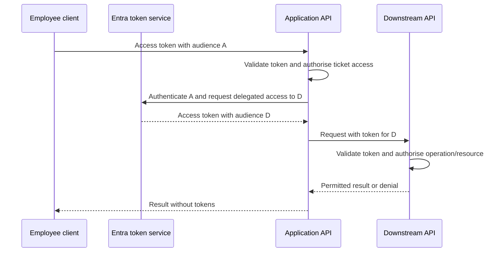
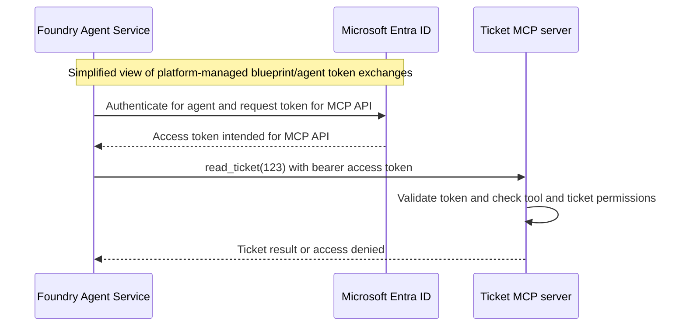

# F03 — Identity and Zero Trust for agents

[Capability builds and exact checklist targets](capability-builds.md#build-contract)

Foundry splits operations into control plane (what a user can configure / provision on foundry e.g. agents) and data plane, what an agent can do - which services can it call...?

Microsoft Entra ID is Azure's identity system.
Microsoft Entra ID maintains a directory of identities.
An identity can represent a human user or software, such as an application or agent.
Each identity object has a unique identifier called its **object ID**.

There are two main types of objects in Entra.
The **user object** assigned to users and the software **service principal object** - that is assigned to software.
Obviously each has a unique object ID, and each can be granted permissions.

A service principal represents the software’s identity in Entra—the who.
The software must authenticate, meaning prove that it is entitled to act as that identity. An ordinary application can use a certificate, client secret, or configured federation.
With a managed identity, Azure manages the authentication credentials, so you do not need to create, store, or rotate them yourself.
When you enable a system-assigned managed identity on a supported Azure resource, Azure creates a special service principal in Entra to represent it.
You then grant that identity permissions through role assignments. These determine what it is allowed to do—authorization.

To grant access, you create a **role assignment** linking:
(Managed) Identity (who) + role (what actions) + scope (where).
This is authorization. The managed identity remains an identity; each role assignment is a separate record defining its permissions.

An agent identity is a special service principal in Microsoft Entra ID that represents an agent instance.
It has its own object ID and can receive supported permissions. **Microsoft Entra Agent ID** is the product/capability name.

An agent identity is distinct from a system-assigned or user-assigned managed identity.
It authenticates through its agent identity blueprint, rather than holding its own credentials. [Microsoft Entra agent identities](https://learn.microsoft.com/en-us/entra/agent-id/agent-identities)

In Foundry’s current model: Foundry automatically creates a unique blueprint for each newly created agent, plus an identity for its default instance.
You normally do not select a template from a list. Entra blueprints, Foundry provisioning. [Agent identity concepts in Microsoft Foundry](https://learn.microsoft.com/en-us/azure/foundry/agents/concepts/agent-identity)


### MCP Operation

For an MCP tool configured to use Entra agent identity authentication:

   Component                Role
  ━━━━━━━━━━━━━━━━━━━━━━━  ━━━━━━━━━━━━━━━━━━━━━━━━━━
   Microsoft Entra ID       OAuth 2.0 authorization
                            server: issues access
                            tokens
  ───────────────────────  ──────────────────────────
   Foundry Agent Service    Acts as the MCP client
                            on the agent’s behalf
  ───────────────────────  ──────────────────────────
   MCP server               Protected resource
                            server: exposes tools
                            and checks incoming
                            access

  The flow is:

  1. Agent decides to call an MCP tool.
  2. Foundry authenticates through the agent’s identity mechanism.
  3. Entra issues an access token intended for that MCP server.
  4. Foundry sends the MCP request with the access  token.
  5. MCP server validates the token and checks permissions.
  6. MCP server executes the permitted operation—or rejects it.

  Authentication: “Which agent is calling?”
  Authorization: “May that agent execute this toolwith these arguments?”

  One more boundary matters: if the MCP server then
  calls AI Search or Storage, that is another
  protected call. It needs appropriate credentials
  and permissions for that downstream service. The
  token issued for the MCP server must not simply be
  forwarded to a different API.

  This describes Entra-based authentication. An MCP
  server can instead use another authorization
  provider or another supported authentication
  method.


1. Your App's managed identity authenticates to Foundry.
Its Foundry RBAC assignments determine which supported data-plane operatoins it can perform - e.g. building or invoking agents
2. Tool identity - what can the agent access through its tools.
e.g. a complaints agent might need access to AI Search, storage, tickets API but not to payments API.

The model choosing to call a tool does not grant permission.
The target service checks the identity and rejects unauthorized operations.

So your design sequence is:

1. Identify which tools and operations the agent needs.
2. Choose which identity each tool call uses—an application/managed identity or delegated user access where supported.
3. Grant minimum permissions at the target resource.
4. Enforce finer business rules inside the tool.
5. Test both allowed and denied actions.

Attaching a tool defines what the agent can attempt; identity, authorization, and tool-side controls determine what it can actually do.


An authenticated agent is not automatically authorised to read a customer's records or perform a refund. This module follows identity from employee sign-in through retrieval and tool execution, separating the caller, the application and the downstream resource at every boundary.

**Status:** learning material; no implementation verified. Architecture target **3**, code C1 target **F3**, current scores **unassessed**. Applied MCP and toolbox exercises remain in [F06](../F06-Agent-Tooling-MCP-and-Integration/README.md); this module establishes the reasoning needed to explain them.

## 1. Foundations and prerequisites

Know HTTP headers/status codes, Azure resources, and Python functions/exceptions. Before writing a client, explain these distinctions:

| Concept | Meaning in this workload |
|---|---|
| OpenID Connect | Identity layer commonly used for application sign-in. |
| SAML | Enterprise federation protocol encountered in existing SSO estates; it does not remove the need for API access-token design. |
| Application registration | Definition of an application, its exposed permissions and authentication configuration. |
| Service principal | Tenant-local representation used for application access and assignments. |
| Managed identity | Azure-managed workload identity; system-assigned lifecycle follows a resource, while user-assigned identities can be managed separately. |
| Access token | Credential intended for a particular resource; possession is not proof of permission for every operation. |

Do not use an ID token as an API access token. Do not read an unvalidated token payload and treat its claims as trustworthy. Token validation belongs in supported authentication middleware or libraries; a JWT is a format, not a security decision.

## 2. Three execution contexts

**Local development:** a developer credential represents the signed-in developer. A successful call may reflect broad developer permissions that the deployed identity does not have. Record the actual principal used; test the intended runtime principal separately.

**Azure runtime:** a workload authenticates through its configured identity. Choose the intended identity explicitly where several are available. The deployment principal and the running agent's principal have different jobs and should not inherit one another's broad access by accident.

**CI:** federation allows a trusted external workload assertion to be exchanged for access. Its trust configuration must constrain the intended repository/environment or workload subject. A federation credential is not permission to deploy everything; role assignments still determine access. Do not assume the same credential class or acquisition mechanism fits both AKS and GitHub Actions.

Credential chains are convenient during development but can conceal which identity succeeded. The exercise is to explain the selected credential and its scope, not merely observe that a request worked. Managed-identity CLI login is for a suitable Azure environment, not a replacement for normal developer login on a Mac.

## 3. Follow the employee through the request

A support employee asks for a policy explanation for ticket T. The application first checks that the employee can access T. It then requests authorised policy evidence. The assistant may propose a refund, but the tool API rechecks permission and the current ticket state before any change.

For a delegated downstream API, a middle-tier service obtains a token for that API on behalf of the user. It does not forward a token issued for itself to an unrelated resource. Microsoft's [OBO documentation](https://learn.microsoft.com/en-us/entra/identity-platform/v2-oauth2-on-behalf-of-flow) describes this delegated exchange; app-only callers use an application flow instead.



Choose delegated access when the downstream operation should reflect the user's permissions and the API supports that flow. Choose application access for a workload-owned job with its own bounded authority. Do not convert an authorisation failure into an application-identity retry: that can silently widen access.

An overnight document indexer is an application job. Reading one employee's private material may require delegated access. A refund approval is a business decision recorded by the tool service; an OAuth scope alone is not proof that this refund satisfies policy.

## 4. Principal-to-resource matrix

Before assigning roles, fill this in for each environment. Use the smallest supported scope and verify exact data-plane roles in current documentation.

| Principal | Resource and operation | Intended authority | Negative case |
|---|---|---|---|
| Employee | Application ticket read | Ticket/customer entitlement | Another employee's restricted ticket |
| Retrieval workload | Search query | Read index plus enforced document permissions | Result outside the caller's allowed set |
| Indexing workload | Search index writes and source reads | Separate ingestion authority | Runtime agent attempts index mutation |
| Agent/tool caller | Refund proposal API | Specific tool/action permission | Arbitrary API or higher-value action |
| Approver | Approval record | Business approval authority | Requester attempts self-approval where prohibited |
| Executor | Business refund operation | Approved action and current preconditions | Replay or expired approval |
| Deployment workflow | Resource changes | Environment-limited deployment role | Production action from untrusted workflow |

Control-plane permissions, data-plane roles, delegated scopes and business entitlements are different layers. Resource Contributor access does not by itself establish the right data access. A caller can be allowed to query an index while still requiring document-level filtering.

For Foundry, distinguish project identity, agent identity and an externally hosted runtime identity. Current [agent identity guidance](https://learn.microsoft.com/en-us/azure/foundry/agents/concepts/agent-identity) describes agent-specific identities and a hosted-agent token service; it states that project managed identity is not available inside hosted-agent code. Check the selected agent generation and tool authentication mode rather than assuming every tool uses the same principal.

## 5. Permission-aware retrieval

A shared Search identity can have access to more documents than any employee. Therefore model prompts cannot enforce document permissions. The retrieval boundary must derive allowed identities or permissions from validated context and apply the supported ACL/filter mechanism before documents enter the model context.

Design two users with different document access and one shared document. Test each user's allowed results, denied results and citations. Also test stale group membership or permission changes: decide how quickly access changes must take effect, what caches exist and how they are invalidated. A semantic cache must not return one user's private answer to another.

Do not accept group IDs from an arbitrary request field as proof of membership. Handle overage and permission resolution through an approved identity/data path. F07 owns the retrieval implementation and quality measurements; this module owns the security argument.

## 6. MCP boundary and Zero Trust

### Granting an agent permission to use MCP tools

**An agent identity can receive permissions to use an MCP server, but the server must understand and enforce those permissions.** There is no universal Azure role called “MCP tool user”. A connection specifies the server endpoint and authentication configuration; one connection can expose several tools. Several connections can use the same agent identity.

For example, consider a custom MCP server protected by Entra that exposes `read_ticket` and `issue_refund`:

1. **Define the API permissions.** The server developer defines application roles such as `Tickets.Read` and `Refunds.Execute` on the API's Entra application registration, allowing application principals as members. These are illustrative API roles, not built-in Azure RBAC roles or delegated OAuth scopes.
2. **Grant the required role.** An authorised administrator assigns the API's `Tickets.Read` application role to the agent's service principal for that API. Do not grant `Refunds.Execute` if the agent must not issue refunds. This is an application-role assignment, not an Azure resource IAM role assignment.
3. **Configure the Foundry connection.** For a server that supports it, select agent identity authentication and configure the MCP endpoint and expected token audience (the target API's identifier).
4. **Authenticate the call.** Foundry Agent Service acts as the MCP client and obtains an access token from Entra, the OAuth authorization server. It presents that token to the MCP server; it does not obtain the token from the MCP server.
5. **Authorise each operation.** The MCP server validates the token, including its issuer, audience and expiry, and checks the API role required by the requested tool. In this application-role design, it checks the validated token's `roles` claim. It must also enforce customer/ticket access rules and any required approval.

```text
Agent identity → Tickets.Read application role → Ticket MCP API

read_ticket  → Tickets.Read present    → permit if ticket access also passes
issue_refund → Refunds.Execute absent → deny
```

For an existing MCP server, follow its documented authorization model: API application roles, Azure RBAC, or service-specific rules. Assigning an Azure role does not automatically authorise individual tools on an arbitrary MCP server. If a connection uses a project managed identity instead, grant permissions to that identity. For delegated access, use the supported user delegation and consent configuration rather than assuming the agent's own permissions represent the user.

If the MCP server calls AI Search or Storage, that is a separate protected call with its own identity and permissions. A token intended for the MCP API must not simply be forwarded to a different downstream API.

References: [Foundry MCP authentication](https://learn.microsoft.com/en-us/azure/foundry/agents/how-to/mcp-authentication), [define application roles](https://learn.microsoft.com/en-us/entra/identity-platform/howto-add-app-roles-in-apps), and [agent identity permissions](https://learn.microsoft.com/en-us/azure/foundry/agents/concepts/agent-identity). This is a design example, not an implemented permission configuration.

### How OAuth 2.0 works with Foundry, Entra and an MCP server

Consider a Foundry agent calling a ticket-system MCP server to read customer tickets. This example uses **the agent's own identity**, not delegated user access.

| System | OAuth role | Responsibility |
|---|---|---|
| Microsoft Entra ID | Authorization server | Authenticates the requesting identity and issues access tokens |
| Foundry Agent Service | Client, acting for the agent | Obtains a token and calls the MCP server |
| Ticket MCP server | Resource server | Validates the token and decides whether to execute the requested tool |

The **agent identity** identifies which agent is acting. It is not itself the OAuth server or client software.

**Before requests happen**, register the custom MCP API with Entra and configure its permissions, such as the illustrative `Tickets.Read` application role above. An authorised administrator grants that role to the agent identity. Configure the Foundry MCP connection with the server URL, agent identity authentication and the API's expected token audience.

The **URL tells Foundry where to send the request**. The **audience identifies the API the access token is intended for**; these need not be the same string.



1. **The agent chooses a tool.** The model proposes `read_ticket(ticket_id="123")`. Choosing a tool does not grant permission to execute it.
2. **Foundry obtains a token from Entra.** Foundry uses the agent's blueprint-backed authentication mechanism to obtain an access token representing the agent and intended for the MCP API. The platform handles the underlying OAuth exchanges; the model does not handle credentials.
3. **Foundry presents the token to the MCP server.** The HTTP request carries `Authorization: Bearer <access-token>`. A bearer token must be protected because someone possessing it can attempt to use it.
4. **The MCP server authenticates and authorises the request.** Supported middleware validates the signature, trusted issuer, intended audience and expiry. The server then checks the required API role and whether the caller may access ticket 123. Authentication can succeed while authorization fails.
5. **The server executes the permitted tool.** It returns the result, or denies the request. A request for `issue_refund` requires its own permission and applicable business approval, even if that tool is discoverable through MCP.

For this JWT-based custom API design, the MCP server normally validates the token locally using Entra's published signing keys, rather than asking Entra to approve every tool call. Libraries handle key discovery, caching and rotation; decoding a token without validating it is not authentication.

**Entra issues the token; the MCP server enforces access. MCP defines tool discovery and invocation; OAuth protects access to that interface.** OAuth does not automatically define or enforce a permission for each MCP tool—the server developer must implement the mapping between permissions and operations.

If the MCP server subsequently calls Storage or AI Search, that is another authenticated request. It needs credentials intended for that service and the corresponding permissions. Do not forward the token whose audience is the MCP API to a different downstream service. Where supported, delegated user access requires its own configured token flow and consent; this application-only example does not carry the user's permissions automatically.

Sources: [Foundry MCP authentication](https://learn.microsoft.com/en-us/azure/foundry/agents/how-to/mcp-authentication), [Foundry agent identity token exchange](https://learn.microsoft.com/en-us/azure/foundry/agents/concepts/agent-identity), and [Entra access tokens and validation](https://learn.microsoft.com/en-us/entra/identity-platform/access-tokens).

### OpenID Connect: signing the user into the agent application

**OpenID Connect (OIDC) is an authentication protocol built on OAuth 2.0.** It lets your application establish who signed in. Entra acts as the **identity provider / OpenID Provider**; your complaints application is the **client / relying party** that trusts its sign-in result.

Register the application with Entra, configure its redirect URI (the approved address for returning the sign-in response), and use a supported authentication library. Request the `openid` scope to request OIDC authentication.

```text
Employee → Application → Entra sign-in
                           ↓
Application validates the returned ID token
                           ↓
Application establishes the employee's signed-in session
```

The **ID token** tells the application about the authenticated user. It is intended for that application, not for calling an MCP API. Libraries validate its signature, issuer, audience, expiry and applicable request-binding checks.

Subsequent Foundry/MCP calls need **access tokens** for their respective APIs and the required permissions. User sign-in does not automatically grant downstream access. A background agent acting under its own identity does not need an interactive OIDC user sign-in for every tool call.

Source: [OpenID Connect on the Microsoft identity platform](https://learn.microsoft.com/en-us/entra/identity-platform/v2-protocols-oidc). The diagram summarises sign-in, not the individual browser redirects or token exchanges.

#### When and how to use OIDC

Use OIDC when building an interactive web, desktop or mobile application where employees sign in with Entra. For the complaints assistant, this is the employee-facing application login, not the agent's background identity.

A typical authorization-code flow with PKCE works as follows:

1. Configure the app registration, tenant, client ID, redirect URI and required API permissions. Use a supported authentication library.
2. The application redirects the browser to Entra, requesting `openid` and any required API scopes. PKCE binds code redemption to the client that started the request.
3. Entra authenticates the employee and applies applicable sign-in policy; consent is obtained where required.
4. Entra returns a short-lived authorization code to the registered redirect URI.
5. The client redeems the code with its PKCE verifier and, for a confidential client, its configured client authentication. It receives the requested, authorised tokens.
6. The application validates the ID token for sign-in; an access token is presented only to its intended API. Browser/public clients must not hold a client secret.

Source: [Authorization code flow with OIDC and PKCE](https://learn.microsoft.com/en-us/entra/identity-platform/v2-oauth2-auth-code-flow).

### SAML: enterprise single sign-on into an application

**SAML 2.0 is another protocol for federated sign-in**, where an application trusts an identity provider to authenticate users. Single sign-on (SSO) means users can access participating applications using an existing sign-in session. SAML remains common in enterprise applications.

Entra acts as the **identity provider (IdP)**. The application is the **service provider (SP)**—this protocol term is not the same as an Entra service principal.

```text
Employee → Enterprise application → Entra sign-in
                                      ↓
Application receives and validates a signed SAML assertion
                                      ↓
Application establishes the employee's signed-in session
```

Administrators configure trust through identifiers, reply/recipient URLs, signing certificates and metadata. The SAML assertion is an XML security statement about the authenticated user; the application validates it before accepting sign-in.

In our Foundry/MCP design, SAML may authenticate the employee into an enterprise front end. It does not replace the OAuth access tokens used for subsequent API calls. Do not send a SAML assertion as the MCP bearer access token. Any transition to delegated API access requires an explicitly supported authentication flow.

Source: [Microsoft identity platform SAML protocol](https://learn.microsoft.com/en-us/entra/identity-platform/saml-protocol-reference).

#### When and how to use SAML

Use SAML when integrating an enterprise application whose supported SSO interface is SAML, or when maintaining an existing SAML federation. For example, a bank's existing case-management portal might use SAML while its agent integration separately uses OAuth API access.

1. Add/select the enterprise application in Entra and configure SAML single sign-on.
2. Configure the application's Entity ID (its SAML identifier), Reply/ACS URL (where it receives the response), and required user claims.
3. Configure the application to trust Entra's issuer, sign-in endpoint and signing certificate/metadata. Assign the intended users or groups as required by the application's access configuration.
4. In an application-initiated flow, the browser goes from the application to Entra for sign-in and returns with a SAML response. The application validates it and establishes a session.
5. Test sign-in and denied access, and plan signing-certificate renewal. Follow the application's integration guide; user provisioning and sign-in are separate concerns.

Source: [Configure enterprise application SAML SSO](https://learn.microsoft.com/en-us/entra/identity/enterprise-apps/add-application-portal-setup-sso).

#### Choosing the protocol for each boundary

| Situation in our design | Choice and reason |
|---|---|
| New employee-facing agent application | OIDC sign-in plus OAuth API access; compatible with the authorization-code flow above |
| Existing enterprise portal with SAML SSO | Keep its supported SAML sign-in integration; design API access separately |
| Autonomous Foundry agent calls an Entra-protected MCP tool | OAuth access token using the configured agent identity mechanism; no interactive user login required |
| Tool must respect the signed-in employee's access | Supported delegated OAuth flow, consent and resource authorization; neither an ID token nor a SAML login alone grants this access |

These are design choices for the examples, not a requirement to implement all three protocols in every application.

### Enforcement and Zero Trust boundaries

Treat an MCP server as a protected API. The server validates the token intended for it and checks scope and business permissions for the requested tool. Discovering a tool or successfully opening a session does not grant authority to execute every tool. For downstream calls, acquire credentials intended for that downstream resource; do not pass through an incoming token to an unrelated audience.

APIM may enforce an outer authentication or rate-limit policy, but the backend still owns resource-specific authorisation. Ensure the backend cannot be reached through an unintended route that bypasses required controls. Application-generated identity headers are trustworthy only across a secured, explicitly designed boundary.

| Plane | Question to answer | Useful evidence |
|---|---|---|
| Identity | Who is the caller, and why is it trusted? | Validated issuer/audience and principal; consent/role records |
| Device | Does the user's access policy require a compliant device? | Applicable sign-in policy outcome, not an assumption about workload identities |
| Network | Which ingress and egress paths are permitted? | DNS/connectivity and denied-route checks |
| Application | Which operation and resource may this principal use? | Denied tool and ticket cases |
| Data | Which documents and fields may enter context or logs? | Permission-trimmed results and redaction checks |
| Visibility | Can an operator reconstruct the decision safely? | Correlation IDs, decision codes and restricted audit records |

Conditional Access, PIM and access reviews support governance, but their applicability differs across users, applications and agent identities. Explain which principal a policy targets. Never assume an interactive-user policy automatically governs every daemon.

## 7. Diagnose failures without weakening controls

| Symptom | Investigate first | Unsafe shortcut to avoid |
|---|---|---|
| 401 response | Missing/expired token, issuer/audience, validation configuration | Disable validation or log the bearer token |
| 403 response | Required role/scope, resource entitlement, network/service policy | Grant broad Contributor/Owner blindly |
| Consent challenge | Requested delegated permissions and consent path | Retry with application permissions silently |
| Works locally only | Developer principal versus runtime principal and network | Copy developer credentials into runtime |
| Cross-user search result | Permission resolution, filter, cache partition and citation path | Ask the model to hide forbidden data |
| Token refresh failure | Credential lifetime, exchange errors and retry budget | Infinite retries or reusing expired tokens |

HTTP codes alone are not a full diagnosis: services can surface policy/network failures differently. Record the resource, correlation ID, operation and safe error code. Never record the access token, client secret, full private prompt or unredacted retrieved content just to debug authentication.

## 8. Learner exercises and evidence

1. Draw the delegated and application flows for the same downstream operation. State the audience, principal, permission source and validation owner at each arrow.
2. Write a token-provider HTTP client in a 25-minute no-AI exercise. Use a fake provider for local tests. Cover expiry/refresh, bounded retry of transient failures and absence of tokens in logs. Do not build cryptographic token validation by hand.
3. Compare one developer call and the intended runtime call. Record which principal was used and the minimum role required. A local mock is not proof of Azure permission behaviour.
4. Design and implement an MCP audience/scope test when the corresponding lab is requested. Include a valid token for the wrong audience and a caller missing the required tool permission.
5. Execute the two-user retrieval cases in F07. Record allowed/denied outcomes and how identity changes affect cached results.

Completion requires explaining authentication versus authorisation, defending the permission matrix, diagnosing wrong audience/insufficient role/expired credential/missing consent, and showing denied cross-user access. Architecture 3 requires built evidence; F3 requires learner-written timed code without AI. Store actual evidence in the study log with date, assistance, result and gaps. Current scores remain **unassessed**.

## 9. Job-market identity requirements and interview evidence

The following provenance is supplied by the learner from the contract digest, Cognizant requirement, and 7/13 October market studies. The underlying adverts and counts were not independently rechecked for this addition. Separate literal wording from architectural inference; a curriculum topic is not proof of an advertised requirement or completed proficiency.

### What the supplied evidence actually names

| Evidence category | Supplied source and wording | Interpretation boundary |
|---|---|---|
| Named protocols and architecture terms | Cognizant permanent SI role: “OIDC, SAML, RBAC, Zero Trust, secure-by-design” | Reported as the only explicit OIDC/SAML occurrence across the reviewed ads; the 27 October mapping flags SAML/Zero Trust as thin |
| Named Microsoft identity products | Access Computer Consulting, Agentic Automation Engineer, £700–750: “Microsoft Graph, Entra ID”, alongside Semantic Kernel/Dataverse and Bedrock Agents as an alternative | Explicit Graph/Entra preparation; does not itself specify OBO or agent identities |
| Supporting Azure services | Uniting People, Senior Azure Engineer, SC, £385: APIM, Key Vault, GitHub Actions | Services are named; the supplied review reports no other Azure-side explicit Entra, managed identity, OBO or Entra Agent ID wording |
| Generic IAM and security | Summer-Browning Lead Technical Architect: “landing zones, IAM, microservices, AI security, AI guardrails”; Morson Edge Lead Technical Architect, SC: “IAM, AI governance and guardrails” | IAM means identity and access management; exact protocols/products are unspecified |
| Governance and operational controls | Hays £800 investment manager: “security, data governance”; Boston Hale: “AI security, approvals and reviews, auditability”; TEKsystems AI Platform Lead: “enterprise APIs/tools, AI governance/security” | Prepare concrete controls and evidence without attributing a specific protocol to the ad |
| Inferred integration depth | Uniting People FDE £600: “MCP broker”; Hays/Adecco Copilot roles; Talent Smart: “MCP, microservices, event-driven” | Tool authorization and M365 tenancy are design considerations inferred from these systems, not quoted requirements. MCP itself can also expose public unauthenticated tools |
| Global permanent/lab study, 7 October | Glean: “Azure/Entra ID, Okta, firewalls, VPNs, SSL/TLS, DLP, WAFs”, plus permission-aware RAG interview question | Broader identity, network and data controls; includes a non-Microsoft identity provider |
| Global governance and cloud comparison | Accenture: “segregation of duties, approval gates, evidence trails”; Google CE: “IAM, VPC, CMEK” | Preserve cross-cloud vocabulary and governance evidence alongside Azure implementation |

The supplied review covers roughly 70 contract roles plus the Cognizant requirement and market studies. It reports identity/authorization mentions in 4 of 30 architect requirements and 17 of 54 role descriptions in the global study, mostly brief mentions. It reports no contract ad explicitly naming OAuth 2.0, MCP authorization, agent identity or on-behalf-of. These are source-reported counts and absence claims, not a new audit.

### Coverage and what to demonstrate

| Topic | Meaning and study location | Required learner evidence |
|---|---|---|
| OIDC, SAML and OAuth | Section 6: user sign-in versus protected API access, provider/client/server roles, configuration and token boundaries | Explain each in one sentence, draw both sign-in flows, then explain why neither an ID token nor SAML assertion is the MCP access token |
| RBAC and IAM | Sections 1 and 4: principal + permission + scope; distinguish Azure RBAC, Entra directory roles and API application roles | Produce a minimum-permission matrix and demonstrate one denied operation |
| Zero Trust and secure-by-design | Sections 4–6: check each identity, resource and network boundary; design controls before deployment | Trace one request and explain authorization at every hop, including denied customer access |
| Entra and Microsoft Graph | Section 3 plus [F11](../F11-Copilot-Studio-and-M365-Boundary/README.md): app-only versus delegated permissions and consent; Graph exposes protected Microsoft 365/directory APIs | Explain whose data is accessible and why; show approved permission and consent configuration without tokens |
| Managed identity and GitHub Actions | Section 2: runtime identity versus deployment identity; federation avoids stored pipeline credentials | Compare the developer, runtime and CI principals and their scopes |
| Key Vault and APIM | [F09](../F09-APIM-AI-Gateway/README.md): secret access and rotation, gateway token validation, backend identity and bypass prevention | Explain why secret storage is not authorization and why gateway checks do not replace backend business rules |
| Agent identity, MCP broker and OBO | Sections 3 and 6 plus [F06](../F06-Agent-Tooling-MCP-and-Integration/README.md): identify the actor, token audience and permission source at each hop | Trace a real permitted and denied tool call; do not silently replace delegated denial with broader app-only access |
| Copilot and M365 tenancy | [F11](../F11-Copilot-Studio-and-M365-Boundary/README.md): tenant boundaries, publishing, consent and source access | Explain which tenant owns the app/user/resource and verify the selected integration's support |
| Permission-aware RAG | Section 5 plus [F07](../F07-RAG-on-AI-Search/README.md): retrieval must respect document access before context construction | Two-user allowed/denied retrieval and cache-isolation evidence |
| Okta | Identity-provider comparison: an organisation may use Okta for sign-in; establish the actual federation trust and token issuer | Draw the chosen trust chain; do not assume an Okta token is accepted by a Foundry endpoint |
| Landing zones, firewalls, VPNs, TLS and WAFs | [F02](../F02-Landing-Zones-and-Networking/README.md): landing zones set platform foundations; firewalls filter traffic; VPNs connect networks; TLS protects transport; WAFs inspect web traffic | Explain which network/transport threat each addresses and why none substitutes for identity authorization. Treat “SSL/TLS” as source wording; use supported TLS in implementation |
| DLP, governance, guardrails and auditability | [F10](../F10-Security-and-Governance/README.md) and [F14](../F14-Responsible-AI-and-Safety/README.md): DLP controls sensitive-data movement; security and safety guardrails have different purposes | Provide an approval record, redacted audit trail and control evidence rather than a list of enabled products |
| Segregation of duties and approval gates | F10 governance and F06 execution: separate requester, approver and executor where required | Demonstrate a prohibited self-approval, an expired approval and the evidence linking approval to the exact action |
| Google IAM, VPC and CMEK | Cross-cloud comparison: permissions, private network structure, and customer-managed encryption keys respectively | Map the concepts to Azure RBAC, VNet and customer-managed keys without claiming identical semantics; verify Google implementation details before building |

### Study priority and evidence boundary

- [ ] First learn the explicit vocabulary cold: OIDC versus SAML, RBAC, IAM, Zero Trust and secure-by-design. Explain each without assuming prior identity knowledge.
- [ ] Then defend the design: application/agent identities, least privilege, Graph consent, OBO, MCP authentication and permission-aware retrieval.
- [ ] Finally produce runtime evidence: actual actor and audience, permitted/denied calls, safe traces, and approval/audit records. Existing notes or samples are not completion evidence.

The supplied interpretation places quick vocabulary preparation in subjects 1 and 3 of an external Entra checklist, and deeper interview credit in subjects 4 and 5. Its “one day” estimate is a source opinion, not a proficiency guarantee. References to S03.03, Foundry trace 5.2 and 4.3 belong to that external planning material; they are retained here as unresolved cross-references, not equated with this README's section numbers. Link the actual merge and trace artifacts before marking those dependencies complete.

## Reading and scope

Source review: 30 October 2026. Read the local `documentation/INDEX.md` identity study path and `documentation/REFRESH-REPORT.md` coverage limits. Local article sections used here include **Delegated access** in permissions/consent, **Protocol diagram** in OBO, and **Token acquisition in hosted-agent code** in agent identity.

- [Applications and service principals](https://learn.microsoft.com/en-us/entra/identity-platform/app-objects-and-service-principals)
- [Permissions and consent](https://learn.microsoft.com/en-us/entra/identity-platform/permissions-consent-overview)
- [Managed identities](https://learn.microsoft.com/en-us/entra/identity/managed-identities-azure-resources/overview)
- [Workload identity federation](https://learn.microsoft.com/en-us/entra/workload-id/workload-identity-federation)
- [Search document-level access](https://learn.microsoft.com/en-us/azure/search/search-document-level-access-overview)
- [Secure MCP servers in APIM](https://learn.microsoft.com/en-us/azure/api-management/secure-mcp-servers)

Continue with [F04 deployment authentication](../F04-Foundry-SDKs-and-Deployment/README.md), [F06 applied tooling](../F06-Agent-Tooling-MCP-and-Integration/README.md), and [F07 retrieval](../F07-RAG-on-AI-Search/README.md). No learner functions, adapters or tests are supplied by this chapter.
