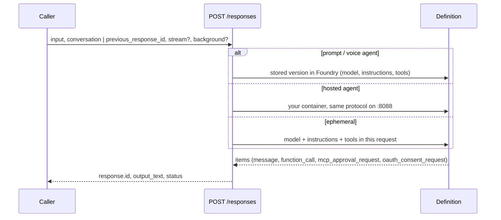
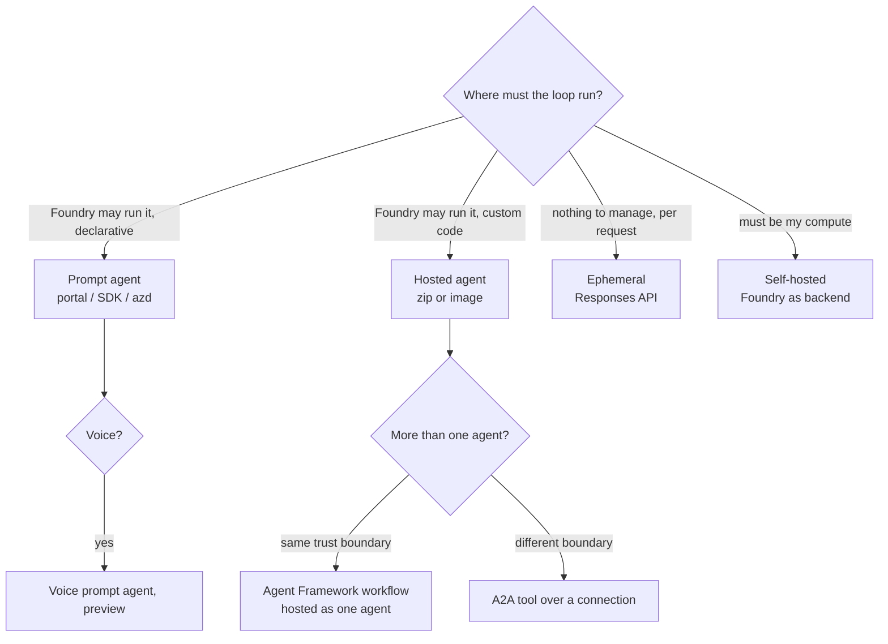

# F05 — Creating AI agents on Microsoft Foundry: seven ways, one invocation surface

[Capability builds and exact checklist targets](capability-builds.md#build-contract)

Updated curriculum guidance — 30 October 2026. Scores are **unassessed**; retained labs are **not newly runtime-verified**. See the [depth and preservation contract](../reference/curriculum-mapping.md).

## Platform choice and state ownership

Choose orchestration and hosting separately. Agent Service is a managed platform; Agent Framework and LangGraph are code-level orchestration choices that may use managed hosting. Copilot Studio provides another authoring and governance surface. Compare control of execution, tool integration, deployment ownership, identity, state, observability, operational burden and existing team skills.

For the ticket agent, begin with one agent and bounded tools. Add a workflow when explicit branching or approval must be controlled; add independent agents only when separate responsibilities or trust boundaries justify the coordination cost. A supervisor pattern without a measurable benefit adds latency and more failure paths.

State has several purposes: conversation context, resumable workflow state and durable business audit. Give each an owner, retention policy, authorisation rule and recovery objective. A conversation ID is not permission to read another user's history. Choose storage partitioning from query patterns and tenant isolation; use concurrency control to prevent lost updates rather than assuming a session is single-threaded.

Learner exercise: compare the retained hosted, self-hosted and alternative-framework examples. Submit one platform ADR and a state lifecycle diagram. Explain what happens when the process dies after a tool succeeds but before the response is stored. Demonstrate permission boundaries and retention in a later explicitly requested implementation; mark them unverified until then. Voice and alternative providers remain bounded extensions.

Completion evidence: defensible platform choice, minimal topology, explicit state ownership and failure/recovery reasoning. Link to [identity](../F03-Identity-and-Zero-Trust/README.md) and [durable tools](../F06-Agent-Tooling-MCP-and-Integration/README.md).

## Retained chapter material

The following material is preserved with its original scope and dates. Historical module-number references refer to the [migration mapping](../reference/curriculum-mapping.md#repository-preservation-and-migration-rules); current navigation uses folder links.

# F03 — Creating AI agents on Microsoft Foundry: seven ways, one invocation surface

Foundry gives you three agent types in Agent Service (prompt, voice prompt, hosted) and one way to use the runtime without any agent resource at all (the Responses API from your own code). Counted by where the loop runs, that is seven ways to put an agent on Foundry. **Every design decision in this chapter comes down to two questions: where does the agent's definition live, and where does its loop run.** Those two answers decide what you can version, roll back, govern, trace and evaluate, which is why F04 and F05 both start from this table.

> _Everything is called through `POST /responses`. The question is only whether the definition lives in Foundry, in your container, or in your request._

The running scenario is the S03 support-ticket assistant (`get_ticket`, `issue_refund`, UK card team). The runnable proofs are in [`labs/`](labs/) (01 seven ways, 02 hosted agents, 03 multi-agent workflow, 04 memory, 05 AI Search grounding), rebuilt on 25 Oct 2026 against the current SDKs; the shared environment is [`../labs-setup/`](../labs-setup/). Facts come from the Learn pages crawled that day, kept in [`../reference/reading-map-foundry-agents-2026-10-25.md`](../reference/reading-map-foundry-agents-2026-10-25.md); letters such as B1 or C4 refer to that map. Status words are GA, preview, legacy and retiring, with page dates.

### What we are trying to avoid

A team ships a Foundry declarative workflow in November 2026 and discovers in December that the designer is gone. A hosted agent built on the 2025 preview adapter (`agent.yaml`, protocol `v1`, `azure-ai-agentserver-agentframework`) stops deploying because that backend was retired on 20 Aug 2026. A startup hook calls `create_version` on every boot and the agent hits the 1,000-version cap in production. A demo only works with an API key, so nobody can say which identity made the call. An architect counts "connected agents" and "Foundry workflows" as ways to build and is corrected in the review.

### Has this happened?

All five happened to the 2025 version of these labs (then the `foundry-demo` Ignite repository), audited on 25 Oct 2026: three API generations side by side, `ImageBasedHostedAgentDefinition` with protocol `v1`, a `WorkflowAgentDefinition` YAML in folder 12, API-key auth in folder 01, and a notebook calling `client.agents.invoke`, a method that never existed. No external incident is told here because the internal one is enough.

### What the chapter covers

One invocation surface and the four controls on it (1). The seven ways, as a table and then one subsection each (2). Versions, the endpoint and what "publish" means now (3). Multi-agent: workflows as one hosted agent, A2A across boundaries, the retirement of declarative workflows (4). The tooling that creates agents for you (5). A decision page (6).

### What you have at the end

A creation matrix you can recite, a decision rule in one sentence, the Responses sequence diagram, the version and rollback mechanics, and seven runnable scripts whose output you have seen.

---

## 1. One invocation surface

Foundry Agent Service is GA (A4). Its runtime objects are **agents** (name + immutable versions), **conversations** (server-side state), **responses** (one turn) and **items** (typed output: `message`, `function_call`, `mcp_approval_request`, `oauth_consent_request`, ...). The classic Assistants vocabulary (threads, runs) is gone (B5).

Whatever kind of agent you built, you call it the same way:

```python
openai = project.get_openai_client(agent_name="ticket-agent-prompt")   # pre-bound OpenAI client
conversation = openai.conversations.create()
r = openai.responses.create(conversation=conversation.id, input="My card was charged twice.")
```



Four controls matter in production and behave identically for every agent type (proof: `labs/01-seven-ways/06-invoke-everything.py`):

- `conversation`: Foundry keeps the state. Use it for user sessions.
- `previous_response_id`: you chain turns yourself. It is also how you answer an approval or resume after OAuth consent.
- `stream=True`: SSE deltas, `response.output_text.delta` events.
- `background=True`: submit, then poll `responses.retrieve(id)` until `completed`. Needed when a run can exceed the request timeout.

Two gotchas. `get_openai_client(agent_name=...)` is the current spelling; `extra_body={"agent_reference": ...}` was the initial-preview spelling and still appears on a few Learn pages. And an ephemeral call has no agent to bind to, so you pass `model` and `instructions` yourself.

**Interview line.** "One surface, three places the definition can live. If you can tell me where the loop runs, I can tell you what you can roll back."

## 2. The seven ways

| #   | Way                                                   | Definition lives       | Loop runs                           | Status                   | Proof                                                   |
| --- | ----------------------------------------------------- | ---------------------- | ----------------------------------- | ------------------------ | ------------------------------------------------------- |
| 1   | Prompt agent, portal                                  | Foundry, versioned     | Foundry                             | GA                       | `labs/01-seven-ways/01-prompt-agent-portal.md`                          |
| 2   | Prompt agent, SDK / REST / azd                        | Foundry, versioned     | Foundry                             | GA                       | `labs/01-seven-ways/02-prompt-agent-sdk.py`, `labs/01-seven-ways/02b-prompt-agent-azd/` |
| 3   | Voice prompt agent                                    | Foundry, `kind: voice` | Foundry + Voice Live                | preview (B3, 2026-10-21) | `labs/01-seven-ways/03-voice-prompt-agent.py`                           |
| 4   | Ephemeral agent via the Responses API                 | your request           | Foundry runtime; nothing to version | GA                       | `labs/01-seven-ways/04-ephemeral-agent.py`                              |
| 5   | Hosted agent from a source zip                        | your container         | Foundry sandbox                     | GA                       | `labs/02-hosted-agents/code-deploy/`                                       |
| 6   | Hosted agent from a container image                   | your container         | Foundry sandbox                     | GA                       | `labs/02-hosted-agents/container-deploy/` (+ LangGraph, OpenAI Agents SDK) |
| 7   | Self-hosted on your compute, Foundry models + toolbox | your infra             | your infra                          | GA                       | `labs/02-hosted-agents/self-hosted-aca/`                                   |

Decision rule: _declarative loop → prompt agent; custom loop, dependencies or state → hosted; nothing to manage → ephemeral; your own platform constraints → self-hosted. More than one agent → an Agent Framework workflow inside one hosted agent; across a trust boundary → A2A._

### Way 1 — prompt agent in the portal

Build → Agents → Create agent; interaction mode Text or Voice is fixed at creation; **Save** creates version 1 and every later Save a new immutable version (A2). The button sends `POST {endpoint}/agents?api-version=v1` with `{"definition": {"kind": "prompt", "model": ..., "instructions": ...}}`, and the playground sends `POST .../agents/{name}/endpoint/protocols/openai/responses?api-version=v1`. When to pick it: the first hour, or when the owner of the instructions is not an engineer. Gotcha: the portal's "new version per save" is harmless; the same pattern in code is how the 1,000-version cap (A4) gets hit.

**Interview line.** "The portal is a REST client with a Save button. Version 1 is created on Save, not on first call."

### Way 2 — prompt agent from the SDK, REST or azd

```python
from azure.ai.projects import AIProjectClient
from azure.ai.projects.models import PromptAgentDefinition
project = AIProjectClient(endpoint=FOUNDRY_PROJECT_ENDPOINT, credential=DefaultAzureCredential())
agent = project.agents.create_version(
    agent_name="ticket-agent-prompt",
    definition=PromptAgentDefinition(model="gpt-5-mini", instructions=SUPPORT_INSTRUCTIONS, tools=[...]),
)
```

`azure-ai-projects` 2.x, incompatible with 1.x (B1). The azd flavour is a service with `host: azure.ai.agent`, `kind: prompt`, `model`, `instructions`, `tools` in `azure.yaml`; `azd deploy` creates the version (upstream `prompt-agents/openai-computer-tool`). REST is the same body with a bearer token for `https://ai.azure.com/.default`. Get-or-create with `agents.get`, and treat a 404 as "does not exist", not as something to retry (A2). Two Agent Framework bridges exist: `FoundryAgent(agent_name=...)` drives a server-managed agent from your code (it replaced the removed `AzureAIAgentClient`), and `to_prompt_agent(agent)` exports a locally authored Agent Framework agent as a `PromptAgentDefinition` (proof: `labs/01-seven-ways/05-foundry-agent-af.py`).

**Interview line.** "`create_version` is the only create verb. If your deploy script calls it unconditionally, you are minting versions, not deploying."

### Way 3 — voice prompt agent (preview)

Same `create_version`, a `VoiceAgentDefinition` (`model_type=MANAGED`, `model="gpt-realtime"`, `audio.output.voice`, `output_modalities=[AUDIO]`, `store=True`) and `AIProjectClient(..., allow_preview=True)` (B3). The endpoint is live when version 1 exists; you talk to it over a realtime WebSocket (`project.beta.voice_agents.realtime.connect(agent_name)`), PCM16 mono 24 kHz, 60-minute sessions, 60-day retention. `azd ai agent invoke` cannot do voice; `azd ai agent init --kind prompt-voice` exists but was not verified on 25 Oct. Telephony is Teams Phone extensibility or Twilio; direct SIP is not a customer flow (A1).

**Interview line.** "A voice agent is a prompt agent with a different protocol on the endpoint. The definition surface did not change."

### Way 4 — ephemeral agent through the Responses API

No resource in Foundry, so nothing to version, publish or delete (B2). Two spellings prove it is the plain OpenAI wire format:

```python
agent = Agent(client=FoundryChatClient(project_endpoint=..., model=..., credential=DefaultAzureCredential()),
              instructions=SUPPORT_INSTRUCTIONS, tools=[get_ticket])
```

```python
OpenAI(base_url=f"{project_endpoint}/openai/v1", api_key=get_bearer_token_provider(cred, "https://ai.azure.com/.default")) \
    .responses.create(model=..., instructions=..., input=...)
```

You still get conversations, hosted tools (web search, file search, code interpreter, MCP), tracing and identity. `FoundryChatClient` is also what hosted agents use inside their container, which makes way 4 the hinge between the Foundry-native and the code-owned worlds. Removed names you will still see in old code: `AzureOpenAIResponsesClient` (now `OpenAIChatClient`), `AzureAIAgentClient`, package `agent-framework-azure-ai`.

**Interview line.** "Ephemeral is the lightest path and the hardest to govern: the definition is wherever your code is."

### Way 5 — hosted agent from source (code deploy)

The container contract (C4): listen on 8088, `GET /readiness`, `POST /responses` and/or `/invocations`, read `FOUNDRY_PROJECT_ENDPOINT`, `FOUNDRY_AGENT_NAME`, `FOUNDRY_AGENT_VERSION`, `FOUNDRY_AGENT_SESSION_ID`, `APPLICATIONINSIGHTS_CONNECTION_STRING`, exit on SIGTERM. One line satisfies it:

```python
ResponsesHostServer(Agent(client=FoundryChatClient(...), instructions=..., default_options={"store": False})).run()
```

All configuration lives in `azure.yaml` (`host: azure.ai.agent`, `kind: hosted`, `codeConfiguration: {runtime: python_3_13, entryPoint: main.py}`, `protocols: [{protocol: responses, version: 2.0.0}]`, `container.resources`), and `azd ai agent init -m <azure.yaml> --deploy-mode code`, `azd provision`, `azd ai agent run`, `azd deploy`, `azd ai agent invoke`, `azd ai agent monitor --follow` are the whole lifecycle (C1, C5). There is no `agent.yaml` any more. The SDK twin is `create_version_from_code(HostedAgentDefinition(code_configuration=CodeConfiguration(..., dependency_resolution=REMOTE_BUILD), protocol_versions=[ProtocolVersionRecord("responses", "2.0.0")]), code=zip, code_zip_sha256=...)`, then poll `get_version` until `active`. Gotchas: `main.py` and `requirements.txt` must sit at the zip root; protocol `1.0.0` is rejected; Foundry Project Manager is required.

**Interview line.** "Hosted agents are a container contract, not a framework. Agent Framework just happens to implement it in one line."

### Way 6 — hosted agent from a container image

Same manifest with `docker: {path: Dockerfile, remoteBuild: true}` (`remoteBuild: false` builds locally; the image must be `linux/amd64`). The SDK form is `HostedAgentDefinition(container_configuration=ContainerConfiguration(image=...), protocol_versions=[...], cpu, memory, environment_variables)` (C4); the project managed identity needs Container Registry Repository Reader on the ACR. Runtime facts (C2): per-session VM-isolated sandbox, sizes 0.5/1, 1/2, 2/4 (vCPU/GiB), idle timeout 2–240 min, `$HOME` and `/files` persist for 30 days, two identities (the agent's own Entra ID for runtime calls, the project MI for the image pull), 30 regions. LangGraph (`langchain_azure_ai.agents.hosting.run --protocol responses`) and the OpenAI Agents SDK behind the raw `ResponsesAgentServerHost` are in `labs/02-hosted-agents/container-deploy/variants/` to prove the contract is framework-neutral.

**Interview line.** "Image or zip is a packaging choice. The runtime, the identity and the endpoint are the same object."

### Way 7 — self-hosted, Foundry as the backend

The same `ResponsesHostServer` on Container Apps, AKS or a laptop, with a managed identity holding Foundry User on the project. Foundry still supplies the model, the toolbox and the tracing backend; you supply ingress, scaling, patching, and the identity story. What you lose: the per-agent Entra identity, the sandbox, the Foundry endpoint URL and the playground. Why it exists: your VNet, your scaler, a stack Foundry does not build, or a regulator that wants the loop on your compute. It plugs back into Foundry as an A2A target (F04).

**Interview line.** "Self-hosted is not 'outside Foundry'; it is outside the Foundry runtime. Models, tools, traces and evals still flow through the project."

## 3. Versions, the endpoint, and what "publish" means now

- Versions are immutable; refer to one as `name:version`; the name can never change; cap 1,000 per agent, HTTP 400 `UserError` when exceeded, which is terminal until you delete versions (A2, A4).
- An agent endpoint serves **one** version at 100 % of traffic; there is no splitting. Rollback and roll-forward are `update_details(agent_endpoint=AgentEndpointConfig(version_selector=VersionSelector(version_selection_rules=[FixedRatioVersionSelectionRule(agent_version="1", traffic_percentage=100)])))` (proof: `labs/01-seven-ways/07-versions-and-publish.py`).
- Creating the agent already gives it a stable endpoint, an Entra identity and an agent card (`agent_endpoint`, `instance_identity`, `blueprint`, `agent_card` on `AgentDetails`). The 2025 **Agent Applications** path is marked legacy on Learn (E1, 2026-09-23); legacy agents have `identity == null` and must be recreated (E2).
- "Publish" now means distribution to Microsoft 365 Copilot and Teams: `publish_to_microsoft365(agent_name, publish_scope="Shared"|"Tenant", ...)` or the portal, needs `Microsoft.BotService/*` write rights, turns on the `activity` protocol (E3). Permissions never transfer: the published identity starts with none (B4).

**Interview line.** "Deployment is a version; rollback is a pointer; publish is a channel. Keep the three words apart and the review goes quickly."

## 4. Multi-agent

Three facts, in order of importance:

1. **Connected Agents do not exist in the new Agent Service** (D2, 2026-10-23).
2. **Foundry declarative workflows (the YAML designer) are preview and retire on 1 December 2026** (D1, 2026-10-19). After that, the designer and in-portal runs stop; existing YAML keeps running only when deployed as a hosted agent. Export the YAML first.
3. **The replacement is an Agent Framework workflow hosted as one hosted agent**, and A2A across trust boundaries.

```python
t, s, r = (AgentExecutor(a, context_mode="last_agent") for a in (triage, specialist, responder))
workflow_agent = (WorkflowBuilder(start_executor=t, output_executors=[r])
                  .add_edge(t, s).add_edge(s, r).build().as_agent())
ResponsesHostServer(workflow_agent).run()
```

Proof: `labs/03-multi-agent-workflow/src/ticket-workflow/main.py`, deployed with exactly the way-5 manifest. `context_mode="last_agent"` keeps each step's context small; `output_executors` limits what streams out. Checkpoints (`FileCheckpointStorage`, `CosmosCheckpointStorage`) make long workflows resumable; `RequestInfoExecutor` is the human-in-the-loop primitive; other orchestrations (`ConcurrentBuilder`, handoff, group chat, Magentic) are different edges on the same builder (D4). Across a boundary, the `a2a` tool (protocol 1.0, GA) over a `RemoteA2A` connection delegates to another Foundry agent, the self-hosted agent, or a third party (D2; proof in F04 lab 06).

> **Retirement box.** If a client shows you a Foundry workflow today: open the designer, switch to the YAML view, copy it out, and rebuild it as a `WorkflowBuilder` graph. Budget a day per workflow; the YAML names map one-to-one onto `AgentExecutor` nodes.

**Interview line.** "Multi-agent did not get a new deployment primitive. A workflow is an agent with edges inside, deployed like any hosted agent."

## 5. Tooling that creates agents for you

Builders, not runtimes: **VS Code Foundry Toolkit** (create project, create and deploy hosted agent, Agent Inspector on `:8088`; the Toolkit replaced the separate Foundry extension and the AI Toolkit), **Canvas** in GitHub Copilot (runs `azd ai agent run`), the **`microsoft-foundry` skill** for coding agents, and natural-language creation `project.beta.agents.create_from_prompt(...)` (voice today). Each of them produces one of the seven ways above; none of them is an eighth.

## 6. Decision page



---

## The chapter in eight lines

1. Three agent types plus the ephemeral path; seven ways counted by where the loop runs.
2. One invocation surface: `POST /responses`; four controls: conversation, previous_response_id, stream, background.
3. `create_version` is the only create verb; versions are immutable; 1,000 cap; 404 is terminal.
4. Hosted agents are a container contract on 8088 with protocol `responses 2.0.0`; `azure.yaml` is the only manifest.
5. One version serves 100 % of traffic; rollback is a version-selector pointer.
6. The agent is born with an endpoint and an identity; Agent Applications are legacy; publish means Copilot/Teams.
7. Connected Agents are gone; declarative workflows retire 1 Dec 2026; use `WorkflowBuilder` in a hosted agent, A2A across boundaries.
8. `FoundryChatClient` owns the definition in your code; `FoundryAgent` drives one that lives in Foundry.

## What you should be able to explain

Why a voice agent is still a prompt agent. What a hosted agent's two identities are for. Why `previous_response_id` appears in the approval and consent flows. What happens to a declarative workflow on 2 Dec 2026. Why `remoteBuild` exists and when you would turn it off. Which call creates the stable endpoint. Why the raw OpenAI client and `FoundryChatClient` give the same answer.

## What this is not

Not the tool, MCP, toolbox and identity material (F04). Not evaluation (F05). Not the landing zone and networking (F01) or SDK and Bicep boundaries (F02). Not a claim that the voice script ran: it needs the preview enabled on the project and is marked so in the proof checklist.

## Implementation scope and versions

Learn pages dated 2026-06-19 to 2026-10-23, devblog September 2026 roundup (posted 15 Oct 2026). Lab code runs on Python 3.13 with `azure-ai-projects` 2.7.0 (because `agent-framework-foundry` 1.15.0 pins `<2.8`), `agent-framework-core` 1.23.0, `agent-framework-foundry-hosting` 1.0.0b261022; lab 13 uses `azure-ai-projects` 2.9.0 in its own venv. azd 1.34.2+ with `azure.ai.agents` 1.0.0-beta.18+. Prompt and hosted agents GA; voice, toolbox on prompt agents, long-running resilience, optimizer, memory preview; declarative workflows retiring.

## Further reading

Start here: A1 overview, A2 lifecycle, A4 limits. Create: B1 prompt quickstart, B2 Responses quickstart, B3 voice quickstart, B4 identity. Hosted: C1 quickstart, C2 concept, C3 framework hosting, C4 image deploy, C5 azd extension, C6 canonical sample. Multi-agent: D1 workflow retirement, D2 A2A tool, D4 Agent Framework workflows. Publish: E1 legacy applications, E2 migration, E3 Copilot/Teams. What's new: H1, H2. Sketches: [`sketches/`](sketches/) holds three untested shapes (the seven-ways matrix as code, version rollback, workflow-as-agent) that mirror the runnable scripts in `labs/`.
