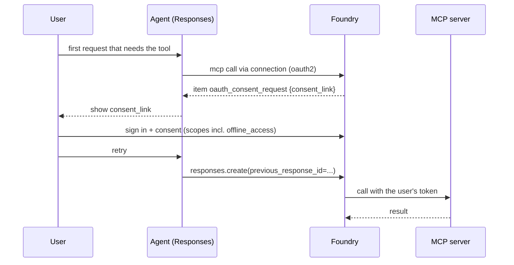

# F06 — Foundry agent tooling: identity, connections, OAuth, toolboxes, A2A

[Capability builds and exact checklist targets](capability-builds.md#build-contract)

Updated curriculum guidance — 30 October 2026. Scores are **unassessed**; retained labs are **not newly runtime-verified**. See the [depth and preservation contract](../reference/curriculum-mapping.md).

## Durable actions and approval boundaries

Separate a model's proposed action from the business service's authority to execute it. A refund tool accepts a validated business request, checks current permissions and policy, and returns a stable operation identifier. Neither a gateway nor a model-generated “approved” flag replaces backend authorisation.

For asynchronous execution, a producer submits an operation with a correlation ID and idempotency key; a consumer records progress and returns a queryable result. Delivery can repeat. The business operation must deduplicate safely, including concurrent duplicates. A timeout means the outcome may be unknown, not necessarily that the operation failed. Resolve status before repeating a non-idempotent action.

Use queues for work needing buffering and acknowledgement; use events for notification/fan-out; choose a durable workflow when a pause, approval or compensation must survive process restarts. An approval records approver identity, approved parameters, expiry and decision. If the action changes after approval, require a new approval. Define retryable failures, terminal failures, dead-letter handling and authorised replay.

Learner exercise: design one ticket refund workflow with Service Bus and a durable approval step, without implementing every messaging product. Specify request/result shapes, state transitions, deduplication ownership and timeout behaviour. Test scenarios to implement later: duplicate delivery, concurrent duplicate, crash after side effect, expired approval, denied permission and poison message. Preserve existing MCP/A2A labs as applied references.

Completion evidence: sequence diagram, operation-state table, failure matrix and an explanation of why delivery guarantees do not alone make business effects exactly once. MCP scopes and audiences belong in [F03](../F03-Identity-and-Zero-Trust/README.md); gateway policy belongs in [F09](../F09-APIM-AI-Gateway/README.md).

## Retained chapter material

The following material is preserved with its original scope and dates. Historical module-number references refer to the [migration mapping](../reference/curriculum-mapping.md#repository-preservation-and-migration-rules); current navigation uses folder links.

# F04 — Foundry agent tooling: identity, connections, OAuth, toolboxes, A2A

F03 decided where the loop runs. F04 decides **who the agent is when it reaches out, and what it is allowed to reach.** S03.F already teaches the tool catalogue, the `mcp` tool's fields, the approval loop, toolbox mechanics and the Agent Framework side; this chapter does not repeat them. It layers the identity and authentication model on top, proves each auth type with a run, and places APIM, API Center and A2A around it. **Every design decision here comes down to one question: which principal does the downstream system see, and is that the one your policy expects.**

> _Auth lives on the connection, not on the tool. The tool only names the connection._

Running scenario: the support-ticket agents from F03 calling a ticketing MCP server (Logic Apps Standard hosts it; Functions, Container Apps or APIM would be invisible to the agent), bundled in a toolbox, fronted by API Management, registered in API Center, and delegating to a specialist over A2A. Runnable proofs: [`labs/`](labs/) 01 identity, 02 MCP tool, 03 toolbox, 04 auth matrix + APIM, 05 private catalog, 06 A2A; shared environment in [`../labs-setup/`](../labs-setup/). Facts from the S03 reading map ([`../../Agent-Build-01-Fundamentals/S03-.../reference/reading-map-2026-10-23.md`](../../Agent-Build-01-Fundamentals/S03-AI-Agents-Tools-and-MCP-Microsoft-Foundry-and-Agent-Framework/reference/reading-map-2026-10-23.md), letters A–E) and the F03 map ([`../reference/reading-map-foundry-agents-2026-10-25.md`](../reference/reading-map-foundry-agents-2026-10-25.md), B4, D2, D3, F).

### What we are trying to avoid

Five notebooks pass the classic `McpTool(...).definitions` into the new `PromptAgentDefinition` and never answer an `mcp_approval_request`, so every tool call silently expires. An agent that "uses managed identity" turns out to use the project's identity shared by every agent in the project, so Conditional Access cannot single it out. A user's Microsoft token is forwarded to a third-party MCP server and the call fails with a message nobody recognises. A toolbox is described as a firewall in a design review. A "Logic Apps tool" is promised to a customer; it does not exist.

### Has this happened?

The first one is the 2025 foundry-demo folders 07–11, audited 25 Oct 2026. The platform-neutral incidents (GitHub MCP leak, Supabase ticket exfiltration, EchoLeak) are told in S03.06 and mapped to Foundry controls in S03.F.

### What the chapter covers

Agent identity: blueprints, instances, the four-step token exchange, the two identities of a hosted agent (1). The six connection auth types as a decision table (2). OAuth identity passthrough end to end (3). Entra Agent ID and Conditional Access, from lab 04 (4). Toolbox as the governed surface, tool search, skills (5). Built-in tools by status and where they may live (6). A2A v1.0 and agent-as-tool (7). APIM and API Center around all of it (8).

### What you have at the end

The auth-type table you can recite, the consent flow as a sequence, a list of what the toolbox does not do, the "no Logic Apps tool" sentence, and six runs whose output tells you which principal the server saw.

---

## 1. Agent identity

Every agent created in the new service gets an **agent identity**: a special Entra service principal, an instance under an **agent identity blueprint** (the application-like object that policy attaches to). It is created with the agent and starts with no permissions (B4, 2026-10-23). Hosted agents get theirs at deploy time and carry **two** identities: their own Entra ID for runtime calls (what `DefaultAzureCredential` resolves inside the container) and the project managed identity for infrastructure such as the image pull (C2). Legacy and unpublished prompt agents may still share the project's identity; azd grants Foundry User to that shared identity for compatibility. The project MI is **not** available to hosted-agent code.

Token exchange, four steps: blueprint authentication → agent identity token → token scoped to the downstream audience → the call. The audience is the downstream resource's app id, never the MCP URL. Two modes: unattended (application-only) and attended (`AgentOnBehalfOfUser`, preview, needs the `AgentBlueprint` endpoint scheme). Roles were renamed from Azure AI to Foundry (User, Owner, Project Manager, **Agent Consumer** for people who only call agents).

**Interview line.** "Each agent is a service principal under a blueprint. Policy binds to the blueprint; permissions bind to the instance; nothing is inherited from the project."

## 2. The six connection auth types

Create once per downstream server (`azd ai connection create <name> --kind remote-tool|remote-a2a --target <url> --auth-type ... [--audience ...]`), reference by `project_connection_id`. Proof: `labs/04-mcp-auth-apim/mcp_auth_matrix.py` runs one agent per type.

| `--auth-type`              | What the server sees                                           | User context | Pick when                                                                   |
| -------------------------- | -------------------------------------------------------------- | ------------ | --------------------------------------------------------------------------- |
| `none`                     | anonymous                                                      | no           | public, read-only servers                                                   |
| `custom-keys`              | a header you stored (`Authorization: Bearer ...`, `x-api-key`) | no           | legacy APIs; rotate like any secret; anyone with project access can read it |
| `project-managed-identity` | the project MI (shared by all agents)                          | no           | infra-level calls; weak for per-agent policy                                |
| `agentic-identity`         | this agent's own Entra identity                                | no           | the default for app-only calls; CA and logs can single out the agent        |
| `user-entra-token`         | the calling user's Entra token (same tenant)                   | yes          | Foundry-to-Foundry and first-party servers                                  |
| `oauth2`                   | the user, after one consent (managed connector or your app)    | yes          | third-party SaaS, per-user data                                             |

Connection auth also applies to A2A (D3) and OpenAPI tools (`anonymous` / `connection` / `managed_identity` + audience). APIM in front validates these tokens and limits rates; the server still authorises (S03.F §6).

**Interview line.** "Two of six carry the user. If the ticket system must know who asked, the answer is `user-entra-token` or `oauth2`, nothing else."

## 3. OAuth identity passthrough

Rules (S03 map B2, 2026-10-23): consent is per tool (connection) per project per user; the caller needs **Foundry Agent Consumer** at least; same tenant only, no cross-tenant exchange; scopes are space-separated and should include `offline_access` or tokens will not refresh; managed OAuth (Microsoft or publisher app, connector names such as `foundrygithubmcp`, `foundrydatabricksmcp`) versus custom OAuth (your client id, auth URL, token URL, refresh URL, a redirect URL Foundry gives you back); a Microsoft-audience token can never be sent to a custom server, the error is `Cannot pass Microsoft token to untrusted MCP endpoint`; declining consent fails the tool call; refresh-token expiry means re-consent. On a toolbox endpoint the same first-use condition surfaces as JSON-RPC error `-32006 CONSENT_REQUIRED`. Hosted agents in Microsoft 365 channels can use on-behalf-of when a user token is present. Proof: the `oauth2` row in `labs/04-mcp-auth-apim/mcp_auth_matrix.py`.

**Interview line.** "Consent is a Responses item, not an exception. Your client has to render `consent_link` and resume with `previous_response_id`."

## 4. Entra Agent ID and Conditional Access

Lab 04 reads the agent identity and blueprint off the project (ARM), creates a Conditional Access policy that targets agent blueprints, and proves it by watching a hosted agent's call fail and a non-targeted one succeed. Blueprints are what makes "all agents of this type" expressible in policy; instance identities are what shows up in sign-in logs. Agent 365 is the enterprise control plane above this (registry, access control, visibility) and Autopilots are agent instances with their own M365 identity (Frontier preview). Identity never transfers on publish; re-grant on the published principal.

## 5. Toolbox: the governed surface

What it adds (S03 map A1, C1–C8): one MCP endpoint (`/toolboxes/{name}/mcp` serves the promoted default version, `/versions/{v}/mcp` a pinned one), credential injection from connections, immutable versions you promote without redeploying agents, `rai_policy_name` guardrails, tool search (`tool_search` + `call_tool` meta-tools, GA 24 Sep 2026, recommended at 10+ tools), skills (`SKILL.md` as MCP resources, preview), reminder tool (hosted only). What it does not do: run tool code, rate-limit or IP-restrict, enforce `require_approval` (the consuming agent does; hosted-agent runtimes must honour `_meta.tool_configuration.require_approval`). Hosted-agent toolboxes are GA; prompt-agent toolboxes are public preview (H1). Proof: `labs/03-toolbox/toolbox_demo.py` (two MCP servers + web search + tool search, v1 and v2).

**Interview line.** "Toolbox versions, injects credentials and screens content. Rate limits are APIM's job and approvals are the agent's."

## 6. Built-in tools by status and placement

From the migration table and the toolbox support table (F03 map B5; S03 map A1): GA in the new service: A2A, Azure AI Search, Code Interpreter, File Search, Function calling, Grounding with Bing, MCP, OpenAPI, Web Search. Preview: Browser automation (GA 19 Oct 2026 per devblog), Computer use, Fabric data agent, Bing Custom Search, Image generation, SharePoint. **Not available:** Azure Functions tool (a live how-to still describes it; flag the contradiction), Connected Agents, Deep Research tool (use the Deep Research model with Web Search; `o3-deep-research` retires 2026-11-19). **There is no Logic Apps agent tool**: Logic Apps Standard appears as an MCP server host and as a workflow migration target. Toolbox-capable: MCP, Web search, AI Search, Code interpreter, File search, OpenAPI, A2A, Browser automation, Fabric IQ, Work IQ; direct-only: Function calling, Bing, Computer use, Image generation, SharePoint, Fabric data agent, Azure Functions; toolbox-only: Tool search, Skills, Reminder. Foundry IQ knowledge bases are consumed through their MCP endpoint via a toolbox connection; lab 07 still uses the AI Search tool and says so.

Two portal labels worth decoding for a reviewer: a catalog tool tagged **Remote MCP** is hosted by Microsoft or the vendor and only needs a connection; **Local MCP** means you host the server yourself in your subscription (the Cosmos DB MCP ToolKit on Container Apps is the canonical example, and lab 04's `project-managed-identity` row is exactly that wiring). The hundreds of "Custom" tools are Logic Apps connector wrappers: one action each, useful as triggers, not as a data surface.

## 7. A2A and agent-as-tool

`a2a` (protocol 1.0) is GA, `a2a_preview` (0.3) is preview (D2, 2026-10-23). `A2ATool(a2a_version=V1_0, project_connection_id=conn.id)` on the caller; a `RemoteA2A` connection with one of the six auth types; targets are another Foundry agent (`.../agents/{name}/endpoint/protocols/a2a`, audience `https://ai.azure.com`, incoming A2A enabled on it), the self-hosted agent from F03 way 7 (F03 `labs/02-hosted-agents/self-hosted-aca`), or any A2A server. Text only; no streaming when the target is a Foundry agent; `send_credentials_for_agent_card` only when the card is protected and only over HTTPS to the `base_url` host (D3). Toolbox form: `A2AToolboxTool`. In Agent Framework, `agent.as_tool()` still exists for in-process composition; Connected Agents from the classic API do not. Proof: `labs/06-a2a/a2a_demo.py`; the reverse direction (Logic Apps calling the agent with its managed identity) is `labs/06-a2a/logic-app/workflow.json`.

**Interview line.** "Same trust boundary: a workflow edge. Different trust boundary: an A2A connection. Connected Agents was neither and is gone."

## 8. APIM and API Center around it

APIM AI Gateway (S03 map E1–E3, F09): `validate-azure-ad-token` with the downstream audience for the Entra auth types, `check-header` for keys, `rate-limit-by-key` and token metrics per caller, Private Link and the delegated subnet for private MCP; new portal-created MCP tools can be routed through APIM at creation (preview); APIM is not the authorisation boundary. API Center is the organisation's **private tool catalog** (preview, S03 map B4): register the gateway URL (`az apic api create --type mcp` + deployment with `runtimeUri`), grant API Center Data Reader, and the server appears under Build → Tools for every project; adding it there creates the same `mcp` tool. Proofs: `labs/04-mcp-auth-apim/` for the policies and matrix, `labs/05-private-tool-catalog/private_tool_catalog.py` for the registration.

---

## The chapter in eight lines

1. Each agent is an Entra service principal under a blueprint; hosted agents carry two identities.
2. Auth lives on the connection; six types; only `user-entra-token` and `oauth2` carry the user.
3. OAuth consent arrives as an `oauth_consent_request` item; resume by `previous_response_id`; `offline_access` or no refresh.
4. Microsoft-audience tokens never go to third-party servers.
5. Toolbox versions, injects credentials, screens; it does not rate-limit, execute or approve.
6. No Logic Apps tool, no Azure Functions tool, no Connected Agents in the new service.
7. A2A 1.0 is GA and is the cross-boundary pattern; the agent card is anonymous by default.
8. APIM counts and validates; API Center catalogues; the backend authorises.

## What you should be able to explain

Which auth type lets Conditional Access single out one agent. Why `project-managed-identity` is weak for per-agent policy. What a toolbox consumer sees on first use of an OAuth tool. Why the Logic Apps folder is about MCP hosting. Which tools cannot live in a toolbox and why that matters for governance. When `send_credentials_for_agent_card` should be true.

## What this is not

Not the `mcp` tool field reference, the approval loop mechanics, Agent Framework middleware or MCP server construction (S03.F §3, §7, §8). Not APIM policy engineering (F09). Not a claim that the `oauth2` row ran: it needs a registered app and is ticked only with a consent link in the output.

## Implementation scope and versions

Learn pages dated 2026-07-31 to 2026-10-23. `azure-ai-projects` 2.7.0; `MCPTool`, `MCPToolboxTool`, `A2ATool`, `ToolSearchToolboxTool` from `azure.ai.projects.models`; `McpApprovalResponse` from the OpenAI SDK. Agentic identity OBO, prompt-agent toolboxes, skills, private tool catalog and AI gateway routing are preview; tool search, A2A 1.0, hosted-agent toolboxes are GA.

## Further reading

S03 map: A1, A2, A5, B1, B2, B4, C1–C8, D1–D5, E1–E9. F03 map: B4 identity, D2 A2A tool, D3 A2A auth, F addendum (azd connection flags, managed connector names). Sketches in [`sketches/`](sketches/): the auth-type matrix as a data table, the consent-and-resume loop, a toolbox manifest in `azure.yaml`.
