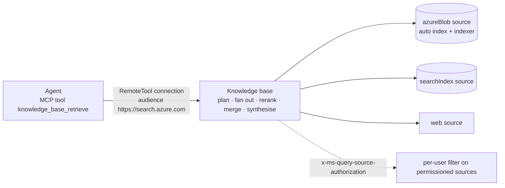
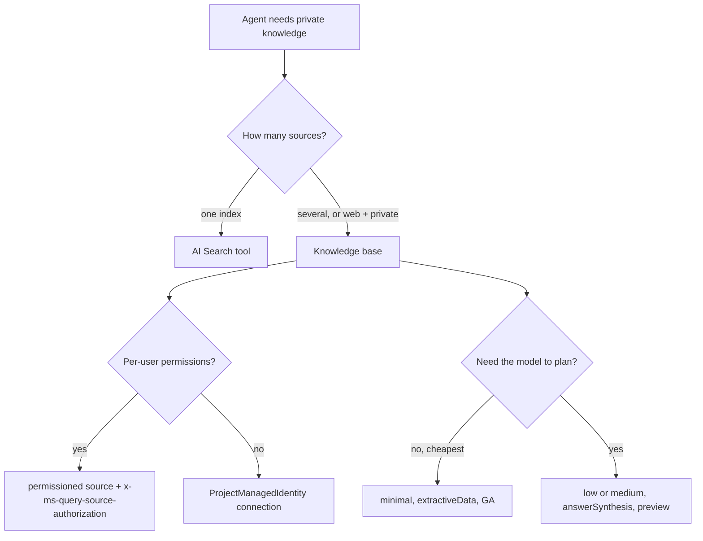

# F07 — Foundry IQ: a knowledge base is not an index

[Capability builds and exact checklist targets](capability-builds.md#build-contract)

Updated curriculum guidance — 30 October 2026. Scores are **unassessed**; retained labs are **not newly runtime-verified**. See the [depth and preservation contract](../reference/curriculum-mapping.md).

## Foundational retrieval before agentic retrieval

An index stores searchable representations; a retrieval pipeline chooses evidence; the agent generates an answer from that evidence. Preserve this distinction before studying the Foundry IQ knowledge-base material below. A richer retrieval product does not remove the need to measure relevance and enforce document permissions.

For policy PDFs, preserve document identity, version, page and section through extraction and chunking. Compare fixed-size chunks with layout-aware boundaries using the same questions. Keep ingestion incremental and make deletions and permission changes propagate; an old chunk is not harmless if its access rights changed.

Compare vector-only, lexical-plus-vector hybrid and hybrid with semantic ranking on a labelled question set. Define what counts as relevant before computing recall@5. Record dataset size, retrieval latency, missing answers and unsupported answer claims. Do not claim a general uplift from a small ticket-policy dataset.

Authorisation is enforced before evidence enters the model context. Obtain user identity from a trusted authentication path, not a user-supplied group list. Verify the specific index/source supports the proposed ACL mechanism. Negative cases include a user from another tenant, revoked access and a document whose text is relevant but forbidden. Never rely on a prompt to suppress a document already retrieved without permission.

Learner exercise: design PDF → extraction → page-aware chunks → embeddings/index → authorised retrieval → cited answer. Use a versioned index and an explicit switch/rollback procedure. Compare the existing knowledge-base approach with a custom pipeline on control, operations and cost. Add GraphRAG only after describing a relationship-heavy question that the simpler baseline handles poorly; include ingestion and update costs.

Completion evidence: ingestion lineage, permissions matrix, labelled retrieval comparison, citation trace and freshness/rollback plan. See local `documentation/current/search/` articles “RAG and Generative AI” and “Document-Level Access Control”, plus [official access-control guidance](https://learn.microsoft.com/en-us/azure/search/search-document-level-access-overview).

## Retained chapter material

The following material is preserved with its original scope and dates. Historical module-number references refer to the [migration mapping](../reference/curriculum-mapping.md#repository-preservation-and-migration-rules); current navigation uses folder links.

# F08 — Foundry IQ: a knowledge base is not an index

Foundry IQ is the knowledge layer: an Azure AI Search **knowledge base** that plans a query, fans it out across several **knowledge sources**, re-ranks, merges and optionally writes the answer with citations, and that a Foundry agent calls through one MCP tool. **The design decision in this chapter is where retrieval intelligence lives: in your agent's prompt and tool loop, or in a governed retrieval object you can version, permission and bill separately.** The old answer was "index plus a search tool"; the current one is "knowledge base plus `knowledge_base_retrieve`".

> _An index answers a query. A knowledge base answers a question, and tells you which sources it asked._

Running scenario: the support-ticket agent from F03 grounded on three refund and card policy documents in Blob storage. The runnable proof is [`labs/01-knowledge-base/`](labs/01-knowledge-base/); the older Azure AI Search **tool** path stays in F03 lab 05 for contrast. Facts are from the Learn pages dated 2026-07-31 to 2026-09-17 listed in section I of [`../reference/reading-map-foundry-agents-2026-10-25.md`](../reference/reading-map-foundry-agents-2026-10-25.md). Status words are GA and preview with page dates.

### What we are trying to avoid

A team builds a RAG pipeline by hand (chunker, embeddings, vector store, re-ranker, citation formatter) and six months later cannot say which document a given answer came from or why a user saw a file they had no access to. A second team connects AI Search to Foundry with an admin key because the wizard offered it, and the key ends up in three notebooks. A third team puts "retrieval instructions" into the agent's system prompt, so every agent that shares the index gets a different retrieval behaviour.

### Has this happened?

The 2025 version of F03 lab 05 did two of the three: it grounded with the AI Search tool against one index, with the retrieval hints in the agent prompt, and the book chapter this chapter was written against connects AI Search with an API key "for demo purposes". Neither is wrong for a demo; both are what gets copied into production.

### What the chapter covers

The object model: knowledge base, knowledge sources, indexed versus remote (1). What agentic retrieval does per query and what the three reasoning efforts and two output modes buy (2). How a Foundry agent consumes it: connection, MCP tool, roles, the ACL passthrough header (3). Classic RAG versus knowledge base, and when the AI Search tool is still right (4). Cost, API versions and status (5). Decision page (6).

### What you have at the end

A knowledge base you created from code, an agent that cites the policy document it used, the role table you can recite, and the one header that decides whether users see documents they should not.

---

## 1. The object model

A **knowledge base** is a top-level AI Search object (create page, 2026-08-12). It holds the list of **knowledge sources**, default retrieval behaviour (`retrievalReasoningEffort`, `outputMode`, `retrievalInstructions`, `answerInstructions`) and an optional Azure OpenAI model for query planning and answer synthesis.

A **knowledge source** is one place to look. Kinds (source overview, 2026-09-01):

| Kind | Indexed or remote | Status | What it does on create |
|---|---|---|---|
| `searchIndex` | indexed | listed without tag | wraps an index you already own |
| `azureBlob` | indexed | listed without tag | **creates** `<name>-datasource`, `-skillset`, `-index`, `-indexer`; embeds with the AOAI deployment you name; optional `ingestionPermissionOptions` for ACLs (preview) |
| `oneLake` | indexed | listed without tag | same pattern on Fabric OneLake |
| Azure SQL, File, indexed SharePoint | indexed | preview | |
| `web` | remote | listed without tag | live web, no index |
| remote SharePoint, Fabric Data Agent, Fabric Ontology, MCP server, Work IQ | remote | preview | queried live, nothing stored in Search |

Indexed sources pay for storage and get Search's ranking; remote sources are fresh and bypass indexing. One knowledge base can mix both, which is the "financial reports in Blob plus the web" picture, and `retrievalInstructions` is where you say which source to prefer for which question.

**Interview line.** "Sources are where to look, the knowledge base is how to look, the agent only says what it wants to know."

## 2. What one retrieval does

Per request (overview, 2026-09-17): the model decomposes the conversation into focused sub-queries, runs them in parallel across sources, semantically re-ranks, merges, and returns either the grounding content (`extractiveData`) or a written answer with citations (`answerSynthesis`, preview). `includeActivity` returns the plan and every sub-query, which is the audit trail the hand-built pipelines never had.

`retrievalReasoningEffort`: `minimal` skips planning and is the GA path; `low` (default) and `medium` plan with the model; `auto` lets the service choose (2026-08-01-preview). Higher effort costs more model tokens and latency per call, so pick per knowledge base, not per agent.

Multi-turn: send the recent `messages` and the planner uses them; this is why the retrieval instructions belong on the knowledge base and not in each agent's prompt.

## 3. How a Foundry agent consumes it

Three objects, in order (connect page, 2026-08-07):

1. **Roles.** The project's system-assigned managed identity gets **Search Index Data Reader** on the search service. The search service's managed identity gets **Cognitive Services User** on the Foundry resource if the knowledge base has a model. Creating the source needs Search Service Contributor plus Search Index Data Contributor on the human or pipeline doing it.
2. **Connection** (preview): a `RemoteTool` project connection, `authType: ProjectManagedIdentity`, `target` = `{search}/knowledgebases/{kb}/mcp?api-version=2026-08-01-preview`, `audience: https://search.azure.com/`, metadata `ApiType: Azure`. No key exists anywhere in this chain. The upstream hosted sample uses `agentic-identity` instead, with the agent's own identity holding the reader role; both work, and F04 §2 is the table that tells you which to pick.
3. **Tool**: `MCPTool(server_label="knowledge-base", server_url=<mcp url>, allowed_tools=["knowledge_base_retrieve"], require_approval="never", project_connection_id=conn.id)` on a prompt agent, or the same URL as a toolbox entry for a hosted agent (`FoundryToolbox`). `knowledge_base_retrieve` is the only tool the MCP endpoint exposes to Agent Service today.

**Permissions at query time.** Permissioned sources are filtered only when the request carries the user's Search token in `x-ms-query-source-authorization`. Agent Service sets it from the user context when a user calls the agent; for service-to-service calls you pass it as a structured input. The page's warning is the whole governance story: _without the token, permission-enabled sources return results unfiltered_. Interview line: "The reader role lets the agent in; the header decides what the user sees."

## 4. Knowledge base, AI Search tool, or your own RAG

| You need | Pick | Why |
|---|---|---|
| one index, one agent, simplest path | AI Search **tool** on the agent (F03 lab 05) | GA, no planning cost, hybrid + semantic ranker |
| several sources, citations, retrieval tuned once for many agents, activity log | **knowledge base** | planning, fan-out, merge and instructions live in one governed object |
| web plus private documents in one answer | knowledge base with a `web` and an `azureBlob` source | remote and indexed mixed |
| custom chunking, your own embeddings, non-Azure store | your own RAG, exposed to the agent as an MCP server | you own the loop; the agent still sees one tool |
| row-level security | knowledge base with `ingestionPermissionOptions` and the header, or your own RAG with your own filter | the AI Search tool has no per-user passthrough |

Fine-tuning is not on this table: it changes how the model answers, not what it knows today (F06). GraphRAG-style community summaries are a further option when questions span many documents; it is your own RAG row, exposed as an MCP server. "Lawyer memory versus lawyer library" is the book's analogy and it holds.

## 5. Cost, versions, status

Two meters (overview): Search bills retrieval tokens (free monthly allowance, then pay-as-you-go), Azure OpenAI bills the planning and synthesis tokens on the deployment the knowledge base names. A `medium` effort, `answerSynthesis` knowledge base can cost more per call than the agent's own model turn; measure it in F05 with the trace. Standard tier Search is roughly a few hundred dollars a month idle, so the lab tears down.

API versions: `2026-04-01` GA covers the untagged source kinds, `minimal` effort and extractive output; `2026-08-01-preview` is needed for planning, synthesis, preview sources and ACL ingestion. The connection in Foundry is preview. Python: `azure-search-documents` (preview build for the preview surface, `KnowledgeBase`, `KnowledgeSourceReference`, `create_or_update_knowledge_base`); the lab uses REST so the shapes are visible.

## 6. Decision page

## The chapter in eight lines

1. A knowledge base is a top-level Search object: sources plus retrieval defaults plus an optional model.
2. Sources are indexed (`azureBlob` builds its own index and indexer) or remote (web, SharePoint, MCP).
3. One retrieval = plan, fan out, re-rank, merge, optionally synthesise with citations; `includeActivity` is the audit log.
4. Effort `minimal` is GA and cheap; `low`/`medium`/`auto` plan with the model and are preview.
5. Output is `extractiveData` or `answerSynthesis` (preview).
6. The agent reaches it through a `RemoteTool` connection with managed identity, audience `https://search.azure.com`, and one MCP tool, `knowledge_base_retrieve`.
7. Project MI needs Search Index Data Reader; Search MI needs Cognitive Services User; no keys.
8. Per-user filtering happens only with `x-ms-query-source-authorization`; without it permissioned sources return everything.

## What you should be able to explain

Why retrieval instructions belong on the knowledge base rather than in each agent prompt. The difference between an indexed and a remote source and what each costs. What the two meters are. Which three roles make the chain work and which header makes it safe. When the plain AI Search tool is still the right answer.

## What this is not

Not the Search indexing deep-dive (skillsets, vectorizers, chunking strategies). Not fine-tuning (model customisation is a separate decision; see the F02 note on model choice). Not MCP auth in general: the six connection types are F04 §2.

## Implementation scope and versions

Learn pages dated 2026-07-31 (Foundry IQ concept), 2026-08-07 (connect), 2026-08-12 (create knowledge base), 2026-09-01 (source overview), 2026-09-02 (blob source), 2026-09-04 (retrieve), 2026-09-16 (overview). Search REST `2026-08-01-preview`; ARM connections `2025-10-01-preview`; `azure-ai-projects` 2.7.0. Two Learn URLs (`.../tools/knowledge-retrieval`, `.../agentic-retrieval-how-to-create-knowledge-source-blob`) returned 404 on 2026-10-25 and were replaced by their siblings in the map. Upstream reference: foundry-samples `hosted-agents/agent-framework/responses/17-foundry-iq-toolbox`.

## Further reading

Section I of the reading map: I1 Foundry IQ concept, I2 connect a knowledge base to an agent, I3 agentic retrieval overview, I4 knowledge source overview, I5 blob knowledge source, I6 create a knowledge base, I7 retrieve, I8 the toolbox sample. Sketch: [`sketches/kb_shapes.py`](sketches/kb_shapes.py), the three REST bodies side by side.
