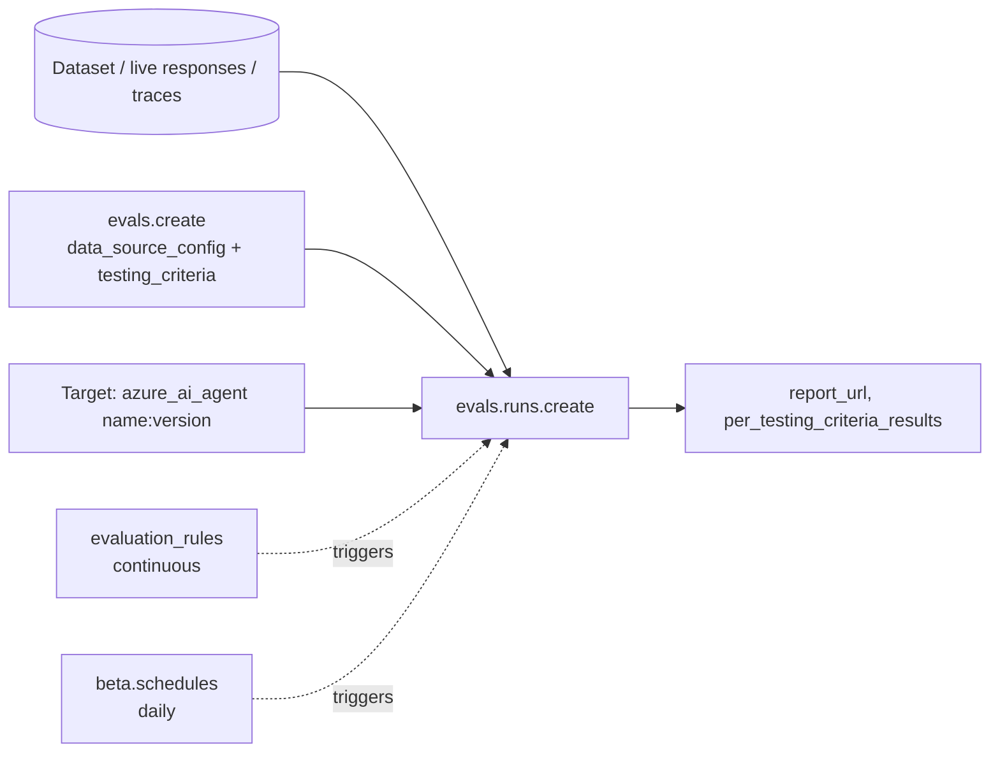

# F08 — Evals, tracing, and release for the agents built in F05

[Capability builds and exact checklist targets](capability-builds.md#build-contract)

Updated curriculum guidance — 30 October 2026. Scores are **unassessed**; retained labs are **not newly runtime-verified**. See the [depth and preservation contract](../reference/curriculum-mapping.md).

## Evidence-driven release and rollback

Define success before choosing metrics: a ticket agent resolves the supported task with authorised evidence and permitted actions, or deliberately escalates. A fluent answer can still be a failure. Separate deterministic tool/permission checks, retrieval metrics, model-graded quality and human-reviewed risk cases. Record grader/version, threshold rationale and dataset version.

Trace request, retrieval and tool spans with correlation identifiers and redaction. Capture duration and token usage without logging credentials or unnecessary customer text. For p95, specify population and time window; separate successful requests from failures and cold starts when diagnosing latency. Cost per 1,000 requests requires dated prices and all included costs, not merely multiplying input tokens by one rate.

A release manifest binds code, prompt/agent, model, index and configuration versions to evaluation evidence. A gate blocks promotion when required checks fail; noisy evaluation results need an explicit review policy. A canary requires a routing unit and conversation-affinity decision. Do not assume the platform splits traffic between arbitrary agent versions.

Learner exercise: write the manifest and gate criteria for the retained evaluation lab; design KQL for request p95 and token usage by operation using the actual emitted schema. Specify rollback order for prompt regression, incompatible index change and model failure. Run no cloud workload merely to populate a score table.

Completion evidence: versioned dataset, evaluation report, trace examples with redaction, reproducible metric queries and rollback/runbook walkthrough. Until exercised, mark all operational evidence unverified. [APIM backend pools](https://learn.microsoft.com/en-us/azure/api-management/backends) provide routing primitives; session and release semantics remain application design responsibilities.

## Module boundaries and production build gaps

F08 owns evaluation execution, telemetry, release gates, and rollback evidence. [F14 Responsible AI and Safety](../F14-Responsible-AI-and-Safety/README.md) owns harm definitions, safety-control decisions, human oversight, and interpretation of safety/red-team findings. [F10 Security and Governance](../F10-Security-and-Governance/README.md) owns threat/control evidence and governance decisions. Reuse the evaluation scripts here rather than duplicating them in either module.

- [ ] Give evaluation polling a bounded deadline and distinguish failed runs, errored rows, and failed quality criteria in the learner's implementation.
- [ ] Keep similarity and groundedness distinct; review the `groundedness_vs_truth` label attached to `builtin.similarity` in the retained batch sample.
- [ ] Demonstrate that a deliberately regressed agent version fails the release gate and is not promoted; an `eval.yaml` file alone is not evidence of a working gate.
- [ ] Bind dataset, agent, grader, and configuration versions to the report; capture an actual rollback result.

The tasks above describe outstanding learner work. Existing scripts were not changed or executed during this documentation update.

## Retained chapter material

The following material is preserved with its original scope and dates. Historical module-number references refer to the [migration mapping](../reference/curriculum-mapping.md#repository-preservation-and-migration-rules); current navigation uses folder links.

# F05 — Foundry evals: measuring the agents you built in F03 and F04

Foundry evaluation is one API, the OpenAI-compatible `evals` surface on the project's OpenAI client, plus four Foundry-specific things: **evaluators** (`builtin.*` and ones Foundry generates for your agent), **targets** (an agent by name and version, or a model), **data sources** (a dataset, live responses, traces, a red-team scenario) and **rules and schedules** that run evals without you. **Every evaluation question in this chapter comes down to: which rows, which target, which evaluators, and who triggers it.**

> _An eval says what to measure. A run says on what and against whom. A rule says when._

Running scenario: the support-ticket agents from F03 (`ticket-agent-prompt`, `ticket-agent-hosted-code`, `ticket-agent-workflow`) and one six-row dataset. Runnable proofs are [`labs/02-evals/`](labs/02-evals/) (its own venv on `azure-ai-projects` 2.9.0) and the tracing proof in [`labs/01-observability/`](labs/01-observability/); shared environment in [`../labs-setup/`](../labs-setup/). Facts are from the pages in [`../reference/reading-map-foundry-agents-2026-10-25.md`](../reference/reading-map-foundry-agents-2026-10-25.md), section G; status words are GA and preview with page dates. Evaluations and tracing are GA (announced March 2026); several evaluators, rubric generation, trace schedules, red-team scans in the dashboard and the optimizer are preview (G1, G3, H1).

### What we are trying to avoid

A team evaluates the model in a notebook and ships the agent, which calls three tools the notebook never exercised. A "pass" on relevance hides that the agent issued a refund the policy forbids. Continuous evaluation is switched on and silently does nothing because the project's managed identity lacks Foundry User. The optimizer is run on a production agent and invokes `issue_refund` 200 times. A CI gate asserts on a score nobody can reproduce because the dataset was never versioned.

### Has this happened?

Two of these are in the labs' own history: the 2025 repository had no evaluation folder at all, and lab 06 proved tracing with `USE_AZURE_MONITOR = False`, so nothing ever reached Application Insights. No external incident is told; the internal gap is the point.

### What the chapter covers

The four objects and how they fit (1). What you can evaluate: datasets, agent targets, live responses, traces (2). Evaluators: built-in, agent-specific, rubric-generated, custom (3). Batch evaluation against an agent target, step by step (4). Continuous and scheduled evaluation (5). Red teaming (6). The agent optimizer (7). CI gates with azd (8). How this maps onto S05 (9).

### What you have at the end

The four-object vocabulary, the data-mapping cheat sheet (`{{item.*}}` vs `{{sample.*}}`), a batch run with a `report_url`, a continuous rule you can switch on and off, and the score thresholds that separate noise from signal.

---

## 1. Four objects



- `client = project_client.get_openai_client()`; `client.evals.create(name, data_source_config, testing_criteria)` defines what to measure (G1).
- `client.evals.runs.create(eval_id, data_source={...})` executes it. The data source names both the rows and, for agent evaluation, the target.
- `project_client.evaluation_rules.create_or_update(...)` and `project_client.beta.schedules.create_or_update(...)` trigger runs on events and timers (G3).
- Results: `run.status`, `run.report_url`, `run.result_counts`, `run.per_testing_criteria_results`.

The SDK floor differs by page (2.0 → 2.8); use `azure-ai-projects>=2.8.0` for the agent flow (G1). That is why folder 13 has its own venv: `agent-framework-foundry` 1.15 pins `<2.8`.

**Interview line.** "Eval, run, target, rule. If I hear 'we evaluated the agent' I ask which of the four they created."

## 2. What you can evaluate

| Rows come from                                                                    | `data_source` / `data_source_config`                                                                                                                                                                   | Use                                           |
| --------------------------------------------------------------------------------- | ------------------------------------------------------------------------------------------------------------------------------------------------------------------------------------------------------ | --------------------------------------------- |
| A dataset you uploaded (`project.datasets.upload_file(name, version, file_path)`) | `{"type":"custom", "item_schema":..., "include_sample_schema": true}` + run `{"type":"azure_ai_target_completions", "source":{"type":"file_id"}, "target":{"type":"azure_ai_agent","name","version"}}` | pre-release gate, regression                  |
| Live responses of one agent                                                       | `{"type":"azure_ai_source","scenario":"responses"}` + an evaluation rule                                                                                                                               | production sampling                           |
| Traces in Application Insights                                                    | `{"type":"azure_ai_source","scenario":"traces"}` + `azure_ai_trace_data_source_preview` with `agent_filter` and `lookback_hours`                                                                       | external/self-hosted agents, scheduled audits |
| A red-team scenario                                                               | `{"type":"azure_ai_source","scenario":"red_team"}` or `beta.red_teams.create(RedTeam(target=AzureAIAgentTarget(...)))`                                                                                 | safety                                        |
| A third-party agent                                                               | `azure_ai_target_completions` with a non-Foundry target (preview, April 2026)                                                                                                                          | comparisons                                   |

Targets: prompt agents and responses-protocol hosted agents behave the same (G1), which is why the F03 workflow agent (lab 03) is evaluated with the same script as the prompt agent. Datasets are versioned project assets; version them on every change or the CI number means nothing.

## 3. Evaluators

- **Built-in quality and safety** (`builtin.coherence`, `builtin.relevance`, `builtin.groundedness`, `builtin.similarity`, `builtin.violence`, ...): text in, score or pass/fail out.
- **Agent evaluators** (G4): Task Completion, Customer Satisfaction, Task Adherence, Intent Resolution (preview); Tool Call Accuracy, Tool Selection, Tool Input Accuracy, Tool Output Utilization, Tool Call Success, Task Navigation Efficiency, Output Quality, Tool Use Quality. These need the tool calls, so map `response` to `{{sample.output_items}}`, not `{{sample.output_text}}`; some need `tool_definitions`.
- **Rubric generated for your agent** (G1): `project.evaluators.begin_create_generation_job(EvaluatorGenerationInputs(sources=[AgentEvaluatorGenerationJobSource(agent_name, agent_version, description)], model, evaluator_name))` reads the definition and returns weighted dimensions; 1–5 per dimension, normalised to 0–1, default threshold 0.5. Review it before trusting it; the job returns `input_quality_warnings` when the instructions are too thin.
- **Custom**: prompt-based (`PromptBasedEvaluatorDefinition`) or code-based, versioned with `evaluators.create_version` (preview).
- **Local** (`azure-ai-evaluation` 1.18.x): the same evaluator classes run in your process for fast iteration and log to the project (G6). Local is for the loop; cloud is for the record.

Data-mapping cheat sheet: `{{item.query}}`, `{{item.ground_truth}}` are dataset columns; `{{sample.output_text}}` is the agent's text; `{{sample.output_items}}` is the full item list including tool calls; `{{item.response}}`, `{{item.tool_definitions}}` are what live-response and trace sources expose. Model-based evaluators take `initialization_parameters: {"deployment_name": <judge model>}`.

**Interview line.** "Tool-call evaluators cannot see tool calls in `output_text`. If the mapping says text, the score is about prose."

## 4. Batch evaluation against an agent target

Proof: `labs/02-evals/01_batch_eval_agent_target.py`. The shape:

```python
dataset = project.datasets.upload_file(name="ticket-queries", version="3", file_path="data/ticket_queries.jsonl")
ev = client.evals.create(name="ticket-agent-batch", data_source_config={"type": "custom", ...},
    testing_criteria=[{"type": "azure_ai_evaluator", "name": "task_adherence", "evaluator_name": "builtin.task_adherence",
                       "data_mapping": {"query": "{{item.query}}", "response": "{{sample.output_items}}"},
                       "initialization_parameters": {"deployment_name": EVAL_MODEL}}, ...])
run = client.evals.runs.create(eval_id=ev.id, data_source={"type": "azure_ai_target_completions",
    "source": {"type": "file_id", "id": dataset.id},
    "input_messages": {"type": "template", "template": [{"type": "message", "role": "user", "content": {"type": "input_text", "text": "{{item.query}}"}}]},
    "target": {"type": "azure_ai_agent", "name": "ticket-agent-prompt", "version": "2"}})
```

Then poll `evals.runs.retrieve` until `completed` and open `report_url`. Run it twice, once with `EVAL_AGENT_NAME=ticket-agent-workflow`, and you have the comparison a review board asks for: same rows, same judges, two targets. Note that Foundry executes the agent per row; tools run for real.

## 5. Continuous and scheduled evaluation

Continuous (G3): an eval with `data_source_config={"type":"azure_ai_source","scenario":"responses"}`, then

```python
project.evaluation_rules.create_or_update(id=RULE_ID, evaluation_rule=EvaluationRule(
    action=ContinuousEvaluationRuleAction(eval_id=ev.id, max_hourly_runs=100),
    filter=EvaluationRuleFilter(agent_name="ticket-agent-prompt"),
    event_type=EvaluationRuleEventType.RESPONSE_COMPLETED, enabled=True))
```

Prerequisite that silently breaks it: the **project managed identity needs Foundry User**. The hourly cap (default 100) and `sampling_rate` bound the cost. Results surface in the Monitor dashboard (metrics, recurring evaluations, red-team scans, alerts: all preview) and in Application Insights. Scheduled (preview): `beta.schedules.create_or_update(Schedule(trigger=RecurrenceTrigger(interval=1, schedule=DailyRecurrenceSchedule(hours=[9])), task=EvaluationScheduleTask(eval_id, eval_run={... "azure_ai_trace_data_source_preview" ...})))`, which is also how self-hosted and third-party agents get evaluated: they only have to emit OpenTelemetry GenAI traces into the project's Application Insights. Insights (preview, Sept 2026) mines the same traces for recurring failure patterns (G8). Proofs: `labs/02-evals/03_continuous_evaluation_rule.py`, `labs/02-evals/04_scheduled_trace_eval.py`, tracing in `labs/01-observability/`.

**Interview line.** "Continuous evaluation is a rule on an event with a cap. The first thing I check when it shows nothing is the project identity's role."

## 6. Red teaming

Cloud scan: `project.beta.red_teams.create(RedTeam(target=AzureAIAgentTarget(name, version), risk_categories=[ProhibitedActions, SensitiveDataLeakage, HateUnfairness, ...], attack_strategies=[Baseline, Jailbreak, Base64, MultiTurn, Crescendo, ...], num_turns=3, application_scenario=...))` (G5; proof `labs/02-evals/05_red_team.py`). The eval form is `{"type":"azure_ai_source","scenario":"red_team"}` with `builtin.prohibited_actions`, `builtin.task_adherence`, `builtin.sensitive_data_leakage`. Local: `azure-ai-evaluation[redteam]` `RedTeam`. For the ticket agent the two categories that matter are prohibited actions (a refund outside policy) and sensitive data leakage (another customer's ticket). Red teaming is GA; the dashboard integration is preview.

## 7. Agent optimizer (preview)

**Verification note:** The fixed delta thresholds in the retained paragraph below are historical heuristics, not universal statistical significance rules. Set promotion criteria using the chosen metric scale, dataset size, repeated-run variability, safety regressions, and a held-out evaluation set. Do not promote solely because a score increased by 0.03.

`AgentOptimizationJob(target_configuration=AgentOptimizationFoundryAgentTargetConfiguration(name, version), optimization_model_configuration=..., optimization_configuration=PromptOptimizationConfiguration(goal, evaluation_configuration=AgentOptimizationEvaluationConfiguration(training_set, evaluators, evaluation_model), candidate_search_configuration=...))`; `agents.estimate_optimization_job(job)` first, then `agents.begin_create_optimization_job(job)`, then `promote_optimization_candidate(job_id, candidate_id)` creates the new version (C8; proof `labs/02-evals/06_agent_optimizer.py`). Prompt agents also have the portal Optimize tab; hosted agents need the optimizer-ready layout (`instructions.md`, `skills/`, `tools.json`, `eval.yaml`) and `azd ai agent optimize`. Score scale 0–1; Δ < 0.03 is noise, 0.03–0.10 moderate, 0.10–0.20 significant, > 0.20 major. The optimizer invokes the agent for every row and candidate, tools included: never point it at an agent with a live `issue_refund`.

## 8. Runtime guardrails: the other half of safety

**Unresolved historical guidance:** This section contains conflicting claims about an agent without explicit guardrail configuration: one says no guardrail, another says inheritance from the deployment. Neither should be used as an implementation guarantee. Verify current official guidance for the exact model, agent runtime, and API version, then test the effective policy at each relevant input/tool/output boundary. The egress-policy and default-policy claims below also need current-source verification. Retained material is preserved for provenance; current safety ownership is [F14](../F14-Responsible-AI-and-Safety/README.md).

Evals tell you after the fact; **guardrails** (the renamed content filters, now with agent-aware controls) act on every request. A guardrail is a named RAI policy on the Foundry account, made of **controls**; each control is a **risk** (jailbreak, indirect prompt injection, hate, self-harm, sexual, violence, protected material for text and code, PII, blocklists, and the agent-specific task adherence and groundedness), an **intervention point** (user input, tool call, tool response, output) and an **action** (annotate or block), with severity thresholds on the four harm categories. `Microsoft.DefaultV2` is the baseline every model deployment gets unless you say otherwise.

Three rules that decide incidents:

- **Assignment is explicit per object.** A model deployment carries `raiPolicyName` (ARM `Microsoft.CognitiveServices/accounts/deployments`, 2026-09-15-preview). A hosted agent carries `rai_config.rai_policy_name` on its version, set to the policy's **full ARM resource ID**; `invocations_moderation` additionally tells the platform where the prompt and answer sit in a custom invocations body. Omit `rai_config` and the hosted agent runs with **no** guardrail at all; include it without a name and you get `Microsoft.DefaultV2`.
- **It fails open.** The hosted-agent guidance (local crawl, 2026-10-13) warns that a `rai_policy_name` pointing at a policy that does not exist is often accepted, the agent reports `active`, and nothing is filtered. Test filtering separately from readiness: send a known-bad prompt in the F05 red-team set and expect a block.
- **Agent policy replaces, it does not merge.** Per the book chapter this section was checked against (Learn guardrail pages returned 404 on 2026-10-25, so this rule is cited from there and should be re-verified): a guardrail assigned to an agent fully overrides the model deployment's guardrail; an agent without one inherits the deployment's. Write agent policies complete, never as a delta.

Policies are also where the hosted-agent **egress** allow-list lives (`raiPolicies` with `basePolicyName: Microsoft.DefaultV2`, `mode: Blocking`, an `egressPolicy` of FQDN rules), which is why the F04 identity story and this section meet. Third-party providers (Palo Alto Prisma AIRS, Zenity, per the book) plug into the same intervention points and are additive. Every control at every point adds latency; a voice agent cannot afford all four. Proof: `sketches/rai_config_shape.py`; a runnable assignment is in F03 lab 02's hosted agent once Learn's agent-guardrail page is back.

**Interview line.** "Evals grade yesterday; guardrails decide now. Assign the policy by resource ID, test it with a bad prompt, and remember the agent's policy replaces the model's."

## 9. CI gates

`azd ext install azure.ai.evaluations azure.ai.dataset` (preview) gives declarative evals with thresholds and versioned datasets; `azd ai agent eval run --config eval.yaml --no-prompt` fails the step when a threshold is missed; `azd pipeline config` scaffolds GitHub Actions or Azure DevOps (G7). The same eval definition should be the one continuous evaluation uses in production, so pre-release and post-release numbers are comparable. Proof: `labs/02-evals/eval.yaml`.

## 10. Mapping onto S05

S05.01 foundations → sections 1–3. S05.02 tool-use and trajectory evals → the agent evaluators and `{{sample.output_items}}`. S05.03 RAG evals → groundedness and retrieval evaluators on the lab 07 agent. S05.04 agent task evals → task adherence, intent resolution, the generated rubric, batch runs against two targets. S05.05 eval ops → rules, schedules, red-team scans, optimizer, CI gate.

---

## The chapter in eight lines

1. Four objects: eval (what), run (on what, against whom), target (name:version), rule or schedule (when).
2. One API: the project's OpenAI client `evals`; Foundry adds `azure_ai_evaluator` criteria and `azure_ai_*` data sources.
3. Rows come from a dataset, live responses, traces, or a red-team scenario.
4. Agent evaluators need `{{sample.output_items}}`; text evaluators are fine with `output_text`.
5. Rubric generation writes the evaluator from the agent definition; review the weights.
6. Continuous evaluation is a rule with an hourly cap; the project MI needs Foundry User.
7. The optimizer runs tools for real; estimate first; promote only above 0.03.
8. Pre-release gate and production rule should share one eval definition.

## What you should be able to explain

Why the same script evaluates a prompt agent and a hosted workflow. What `report_url` shows that `result_counts` does not. Which role makes a continuous rule go silent. Why a self-hosted agent can still be evaluated. The difference between a rubric score and a pass/fail evaluator. What a 0.02 optimizer gain means.

## What this is not

Not the design of evaluation datasets or judges (S05.01, S05.04). Not observability design (S09), only the pieces evals depend on. Not a claim that every script ran: the rubric, schedule, red-team and optimizer scripts are preview surfaces and are ticked in the lab-13 checklist only when they produced output.

## Implementation scope and versions

Learn pages dated 2026-09-25 to 2026-10-21; `azure-ai-projects` 2.9.0 in `labs/02-evals/.venv`; `azure-ai-evaluation` 1.18.10; azd `azure.ai.evaluations` 1.0.0-beta.2. The Learn URLs for the agent-evaluator list, red teaming in the cloud and continuous evaluation returned 404 on 25 Oct 2026; their content is cited from the 2026-10-13 crawl and must be re-fetched before quoting externally.

## Further reading

G1 evaluate agents, G2 cloud evaluation, G3 monitor dashboard and rules, G4 evaluator catalogue, G5 red teaming, G6 local evaluators, G7 CI, G8 tracing; C8 optimizer. Sketches in [`sketches/`](sketches/): batch-eval shape, continuous rule, the data-mapping table as code.
