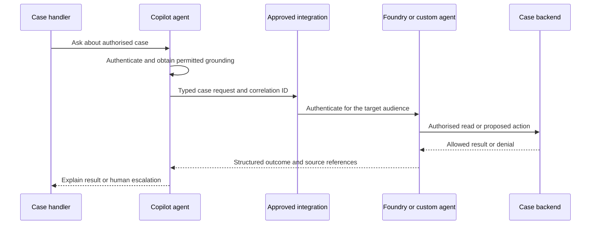

# F11 — Copilot Studio and the Microsoft 365 boundary

[Capability builds and exact checklist targets](capability-builds.md#build-contract)

Study status: **unassessed**. Target: defend the architecture for item 17, implement the relevant C15 Graph exercise with documentation open, and demonstrate one C22 integration. Detailed authoring stays in the [existing Copilot Studio chapter](../../Agent-Build-03-Microsoft-Copilot-Studio/C03-Creating-Agents-in-Copilot-Studio/README.md). This module owns the boundary: identity, grounding, DLP, integration and operations.

## 1. Choose responsibilities before products

A case handler wants a conversational entry point in their working environment. The assistant retrieves complaint policy and asks a specialised backend to prepare a refund recommendation. A low-code experience can own dialogue and connectors while a code-owned service owns specialised validation and execution. Calling a Foundry agent does not transfer the caller's permissions automatically.

| Choice | Useful when | Responsibility that remains with the team |
|---|---|---|
| Copilot Studio | Makers need managed conversational authoring, connectors and governed distribution | Authentication, source access, environment policies, action permissions and release evidence |
| Foundry Agent Service | A managed agent runtime and platform integrations fit the workload | Agent/tool configuration, permissions, evaluation and lifecycle |
| Agent Framework on chosen compute | Custom orchestration, middleware or runtime control is required | Hosting, state, deployment and operational controls as well as agent behaviour |
| Existing LangGraph service | The client already owns a suitable codebase and operating model | Preserve its permission and state boundaries; justify migration before rebuilding |

These choices can be composed. Compare control, hosting ownership, team skills, governance, integration effort and time to production. Do not choose a framework to solve an authoring problem or an authoring tool to avoid backend authorisation.

## 2. Follow one request across the boundary

The diagram is a design exercise, not a claim that every connector forwards a delegated identity. Select a supported integration and prove its actual authentication mode.

For each arrow, write principal, audience, permission, data transmitted, timeout and owner. Never assume a token intended for one API is valid for another. F03 covers token flows; F06 covers MCP integration. A case ID is input, not proof of access.

## 3. Grounding and permissions

Separate three forms of access: permission to chat with the agent, permission to read a source, and permission to execute an action. Granting the first does not intentionally grant the others. In the worked case, one user may read policy but not a restricted customer attachment. The answer must respect both restrictions.

For delegated Graph access, the application acts in a user context subject to the configured permissions and resource checks. Application permissions represent the application rather than the interactive user's access. A background integration may need them, but it must not use broad app access to bypass per-user restrictions in a conversational response. Specify what the backend enforces and test with two users who have different access.

Source configuration matters. Determine the selected connector's identity and retrieval behaviour, including whether content is copied/indexed or fetched at request time. Test revocation, stale caches and citations. Do not promise permission inheritance for every possible knowledge source. Oversharing can expose already over-permissioned documents without any authentication failure; review the underlying source permissions.

## 4. DLP and environment controls

Power Platform data policies can restrict agent capabilities and connections. Check the applicable tenant/environment policies and verify their effect in the actual authoring and published experience. The current [data-policy guide](https://learn.microsoft.com/en-us/microsoft-copilot-studio/admin-data-loss-prevention) describes configuration and enforcement checks.

For the exercise, identify allowed knowledge sources, connectors, HTTP endpoints, authentication and publication channels. DLP approval does not replace per-record authorisation, and a successful maker preview does not prove the published user's access. Read the [security and governance overview](https://learn.microsoft.com/en-us/microsoft-copilot-studio/security-and-governance) alongside environment policy.

Prepare a table of source → connector/action → destination → identity → data classification → policy decision. Include one deliberately disallowed destination and show the resulting denial. Do not weaken an organisation's policy to make a demo pass; redesign the integration or document the blocked requirement.

## 5. Bounded integration exercise

Use the [existing connected-agent lab](../../Agent-Build-03-Microsoft-Copilot-Studio/C03-Creating-Agents-in-Copilot-Studio/labs/04-agents-sdk-connected/README.md) as material to assess, not a claim of current compatibility. Keep implementation and evidence in the companion Copilot section; do not copy it here. Verify the selected integration's current API and channel support before running it.

1. Choose one supported Foundry/custom-agent or MCP boundary and explain why it suits the ticket scenario.
2. Define a small request/response contract: case reference, requested operation, correlation ID, typed outcome and allowed citations. Avoid exposing internal traces or tokens.
3. Document identities, scopes and consent. Demonstrate an allowed read with synthetic data and a denied read for another user.
4. Demonstrate an unavailable downstream service and a policy-blocked action. Present a clear failure or escalation; never report success before execution is confirmed.
5. Preserve correlation across systems and inspect logs for customer data. Record measured latency and the observation window without invented numbers.

The learner authors any necessary adapter/tests. A screenshot of an answer alone is insufficient evidence: include the integration configuration, permission decisions and backend result.

## 6. Failure diagnosis and ownership

| Symptom | Investigate first | Expected product behaviour |
|---|---|---|
| Consent denied | Required permission, admin/user consent and selected identity flow | Explain unavailable capability; no silent switch to a broader app identity |
| Source unavailable to one user | Source ACL, connector identity and retrieval/cache behaviour | No inaccessible text or revealing citation; permitted alternative or escalation |
| DLP blocks publishing/action | Applicable environment/tenant policy and blocked capability | Keep the restriction; document the approved integration path |
| Backend timeout after an action | Operation ID and recorded backend outcome | Reconcile before retrying; avoid duplicate effects |
| Works in preview, fails in channel | Published version, channel authentication and user context | Diagnose using that user's context, not the maker's permissions |

Split ownership explicitly: makers own dialogue and configuration; platform administrators own environment policy; the backend owner owns business authorisation and idempotency; operations owns alert response; the business owner owns escalation policy. One named owner coordinates an end-to-end failure.

## 7. Release and completion evidence

Record the Copilot solution/configuration version, connector contract, backend agent/version, knowledge source configuration and policy assumptions together. Use separate environments where available and verify policies in each. A backend rollback may not undo a changed connector contract or previously sent message; specify compatibility and reconciliation.

Completion requires a platform-choice table, the annotated request sequence, a permission/DLP analysis, one demonstrated integration with allowed and denied cases, and a rollback/ownership explanation. Defend when to retain low-code and when custom code is justified. Scores remain unassessed until the learner demonstrates these outcomes.

Source review: 30 October 2026. Consult the [Copilot reading map](../../Agent-Build-03-Microsoft-Copilot-Studio/reference/reading-map-copilot-studio-2026-10-25.md) and current official guides before implementation. Licensing, channel support and integration capabilities are verification tasks, not assumptions carried forward from an old lab.
