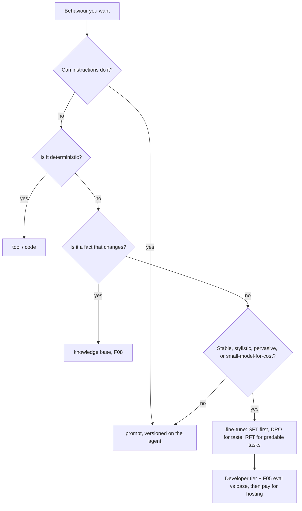

# F12 — Fine-tuning: change how the model answers, not what it knows today

[Capability builds and exact checklist targets](capability-builds.md#build-contract)

Updated curriculum guidance — 30 October 2026. Scores are **unassessed**; retained labs are **not newly runtime-verified**. See the [depth and preservation contract](../reference/curriculum-mapping.md).

## Study priority and routing decisions

Retain all existing fine-tuning exercises. Core completion is the decision: demonstrate why better retrieval, instructions or routing do not solve the observed problem before proposing training. Compare quality on held-out cases, data rights, maintenance and cost. No model improvement is claimed without before/after evidence.

Routing belongs here at decision level: define task classes, quality floor, escalation signal and total cost/latency. F09 owns gateway implementation and F08 owns the evaluation evidence. Optional deeper completion is the existing training lab with reproducible data and evaluation; awareness is not a reason to delete it.

## Retained chapter material

The following material is preserved with its original scope and dates. Historical module-number references refer to the [migration mapping](../reference/curriculum-mapping.md#repository-preservation-and-migration-rules); current navigation uses folder links.

# F06 — Fine-tuning: change how the model answers, not what it knows today

Fine-tuning in Foundry means a managed training job over your JSONL that produces a new model you deploy like any other. **The design decision is which lever you pull for a behaviour you want: instructions, a tool, a knowledge base, or weights. Weights are last, because they are the slowest to change, the hardest to audit and the only one that cannot be rolled back by editing a string.** For an agent, most "the model keeps doing X" problems are prompt, tool or retrieval problems.

> _RAG is the lawyer's library; fine-tuning is what the lawyer has in their head. You still check the library._

Running scenario: the F03 ticket agent, fine-tuned for the UK card team's tone and refund-policy phrasing, then compared with the base deployment on the F05 dataset. Facts from the Learn pages dated 2026-10-05 to 2026-10-19 (section K of the reading map). Runnable proof: [`labs/01-sft-ticket-tone/`](labs/01-sft-ticket-tone/).

### What we are trying to avoid

A team fine-tunes a model on last quarter's policy document so it "knows the policy", ships it, and the policy changes the next month; the knowledge base would have updated in minutes. A second team fine-tunes, eyeballs ten answers in the playground, and promotes; three weeks later a complaint shows the refund threshold is wrong in 4 % of answers. A third leaves a Standard fine-tuned deployment running at the hourly hosting fee for a model nobody calls.

### Has this happened?

The book chapter this was written against fine-tunes a medical assistant, judges it by chatting, and never measures it. Its own aside, that fine-tuning is for behaviour and style and RAG is for facts, is the right rule and the exercise ignores it.

### What the chapter covers

The lever order (1). The three methods and which model supports which (2). Data: JSONL shapes for SFT, DPO and RFT; how much; synthetic data (3). Training type, deployment type and what each costs (4). The job: Python on the project client, azd YAML, and the loop back to evals (5). Decision page (6).

### What you have at the end

A trained `gpt-4.1-mini` suffix deployment on the Developer tier, an eval run of base against tuned on the same six rows, and the lever order as a sentence.

---

## 1. The lever order

Instructions (free, instant, versioned with the agent). Tools (deterministic behaviour belongs in code: the refund cap is an `if`, not a learned tendency). Knowledge base (facts that change: F08). Model choice and reasoning effort (F02). Then weights. Fine-tune when the behaviour is stable, pervasive and stylistic (tone, format, terminology, refusal style, following a long house style that would otherwise cost 2,000 prompt tokens per call), or when a smaller model must do a narrow task a larger one does out of the box, for latency or cost. Never for facts with a shelf life, never as a substitute for a tool.

## 2. Methods and models

Managed methods (overview, 2026-10-19): **supervised fine-tuning** (SFT: examples of input and ideal output), **preference fine-tuning with DPO** (pairs of preferred and non-preferred outputs for the same input), **reinforcement fine-tuning** (RFT: a grader scores sampled outputs; the model is trained on the reward). Interactive training with SFT, RL, preference and distillation recipes is preview and gated.

| Model | SFT | DPO | RFT | Developer tier |
|---|---|---|---|---|
| gpt-4.1, gpt-4.1-mini, gpt-4.1-nano | yes | yes | no | yes |
| gpt-4o | yes | yes | no | |
| gpt-4o-mini | yes | no | no | |
| o4-mini | no | no | yes | |
| gpt-5 | no | no | yes, by invitation | no |
| open-weight (Llama 3.3 70B, Qwen3 32B, gpt-oss 20b/120b, Ministral 3B, ...) | varies | | some RFT | |

The table is the one on the overview page; the gpt-5.x chat family was not in it on 2026-10-25, so the lab uses `gpt-4.1-mini`. Check the table before promising a model to anyone.

**Interview line.** "SFT shows the answer, DPO shows the better of two, RFT scores the answer. Pick by what data you can honestly produce."

## 3. Data

SFT line: `{"messages":[{"role":"system",...},{"role":"user",...},{"role":"assistant",...}]}`; multi-turn and tool-call examples are supported (`fine-tuning-functions` page). DPO line: `{"input":{"messages":[...]},"preferred_output":[{"role":"assistant",...}],"non_preferred_output":[{"role":"assistant",...}]}`, exactly two outputs. RFT: prompts plus reference fields the grader reads via `{{item.<field>}}`; graders are `string_check`, `text_similarity`, `score_model`, `python` (no network) and `multi`.

How much: start at 50 to 100 clean examples for SFT; quality and coverage of edge cases beat volume; keep a validation file. Every example is a policy statement, so the person who owns the policy should review the set. Synthetic data: the portal offers generators (Q&A pairs from documents, tool-use conversations from an OpenAPI spec) per the book; the Learn page for it returned 404 on 2026-10-25, so treat the details as unverified and always review generated rows before training. The lab generates its 60 rows from the F08 policy documents with the base model and makes you read them.

Hyperparameters (`method.supervised.hyperparameters`): `n_epochs`, `batch_size`, `learning_rate_multiplier`, each a number or `auto`. The azd YAML spells it `epochs` and also accepts `seed` and `prompt_loss_weight`, which Learn does not document. Start with `auto`.

## 4. Training type, deployment type, cost

Training type (`trainingType`): **Standard** (your resource's region), **Data zone** (US only), **Global** (`GlobalStandard`, cheaper), **Developer** (idle capacity, may be pre-empted, cheapest). SFT and DPO cost training tokens × epochs × price; RFT costs training hours plus grader tokens, with a per-job spending limit that pauses and checkpoints.

Deployment of the result: **Developer** (24 hours, no SLA, no hosting fee: for evaluation), **Standard** / **Data Zone Standard** / **Global Standard** (per token **plus an hourly hosting fee** whether or not it is called), **Provisioned** and **Global Provisioned**. The hosting fee is the line item teams forget; the Developer tier plus an eval is how you decide whether to pay it.

## 5. The job, and the loop back to evals

Python, on the same project client as everything else:

```python
client = project.get_openai_client()
tf = client.files.create(file=open("train.jsonl", "rb"), purpose="fine-tune"); client.files.wait_for_processing(tf.id)
job = client.fine_tuning.jobs.create(model="gpt-4.1-mini", training_file=tf.id, validation_file=vf.id, suffix="ticket-tone",
        method={"type": "supervised", "supervised": {"hyperparameters": {"n_epochs": "auto"}}}, extra_body={"trainingType": "Developer"})
```

Poll `fine_tuning.jobs.retrieve(job.id)` until `succeeded`; `fine_tuned_model` is the name you deploy (F02 model lab, SKU `DeveloperTier` first). azd: `azd ext install azure.ai.finetune`, `azd ai finetuning init -e <project endpoint>`, `azd ai finetuning jobs submit -f job.yaml`, `jobs show|pause|resume|cancel -i <id>`. The YAML keys are `name, model, method.type, method.supervised.hyperparameters, suffix, training_file: local:..., validation_file`.

Then the only step that matters: run F05 lab 02's batch eval twice, `EVAL_AGENT_NAME` pointed at an agent on the base deployment and at one on the tuned deployment, same six rows, same evaluators. Promote on the numbers, with the same thresholds the CI gate uses. Without this step fine-tuning is a feeling.

## 6. Decision page



## The chapter in eight lines

1. Lever order: instructions, tools, knowledge base, model choice, then weights.
2. Methods: SFT, DPO, RFT; gpt-4.1 family does SFT and DPO, o4-mini and gpt-5 do RFT.
3. SFT = `messages` lines; DPO = input plus two outputs; RFT = prompts plus a grader.
4. 50 to 100 reviewed examples beat 5,000 scraped ones; keep a validation file.
5. Training type sets where and how cheap; Developer is cheapest and pre-emptible.
6. Fine-tuned deployments cost per token plus an hourly hosting fee; Developer tier is free for 24 hours.
7. One client: `project.get_openai_client().fine_tuning.jobs.create(...)`; or azd YAML.
8. Promote only on an eval of tuned versus base on the same rows.

## What you should be able to explain

Why the refund cap must never be fine-tuned in. The difference between the three methods in one sentence each. What the hosting fee is. Why Developer tier exists. Where the eval sits in the loop.

## What this is not

Not distillation or interactive training (gated preview). Not vision or audio fine-tuning. Not open-weight training on your own GPUs.

## Implementation scope and versions

Learn: fine-tuning overview 2026-10-19, how-to 2026-10-08, DPO 2026-10-08, RFT 2026-10-08. `azd` extension `azure.ai.finetune` (azd ≥ 1.22.1). 404 on 2026-10-25: the synthetic-data page and `fine-tuning-python`; `jobs list` and the `-s/-e` submit flags from the book are not on Learn. Hourly hosting rates are on the pricing page, not on Learn, and are not quoted here.

## Further reading

Section K of the reading map. Sketch: [`sketches/three_jsonl_shapes.py`](sketches/three_jsonl_shapes.py).
