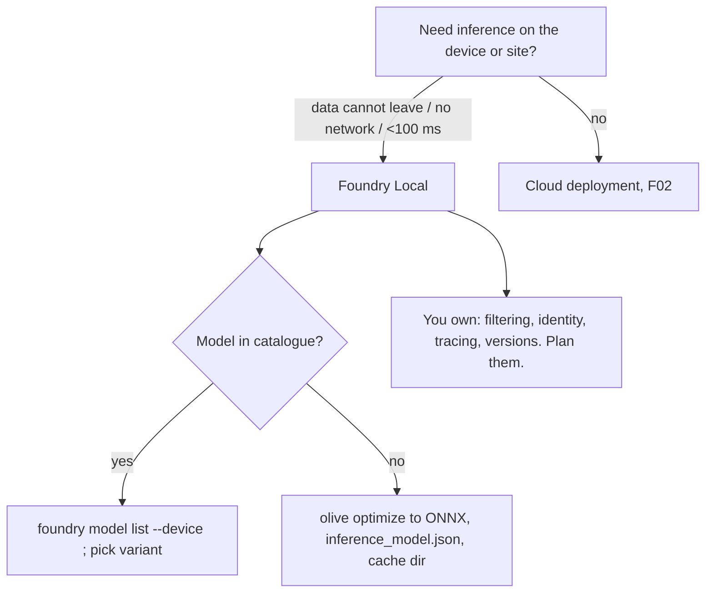

# F13 — Foundry Local: the same agent, no cloud in the loop

[Capability builds and exact checklist targets](capability-builds.md#build-contract)

Updated curriculum guidance — 30 October 2026. Scores are **unassessed**; retained labs are **not newly runtime-verified**. See the [depth and preservation contract](../reference/curriculum-mapping.md).

## Study priority and evidence

Keep the local-runtime and optimisation labs as optional depth. Core completion is explaining when offline operation, privacy, latency or hardware constraints justify local inference and what operational responsibilities move to the application owner. Do not equate local execution with automatic data security.

A deeper learner exercise records hardware, model/version, quantisation, startup time, task quality and latency under a stated workload. Compare with the same task definition used in the cloud scenario. No existing runtime is newly verified by this reorganisation.

## Retained chapter material

The following material is preserved with its original scope and dates. Historical module-number references refer to the [migration mapping](../reference/curriculum-mapping.md#repository-preservation-and-migration-rules); current navigation uses folder links.

# F07 — Foundry Local: the same agent, no cloud in the loop

Foundry Local runs catalogue or self-optimised ONNX models on the laptop, the branch server or the edge box, behind an OpenAI-compatible endpoint on localhost. **The design decision is which parts of F03's agent stay identical when the model moves on-device, and which disappear: the Agent Framework code and the tool contract stay; Foundry's guardrails, identity, tracing, versions and evals all go, and you own them.** That trade, not the install command, is what an architect is asked about.

> _Local inference moves the model, not the responsibility._

Running scenario: the F03 ticket agent with `get_ticket` and `issue_refund`, pointed at a Qwen or Phi model served by Foundry Local, so it works on a train. Facts from the Learn pages dated 2026-05-06 to 2026-08-13 (section J of the reading map); the CLI is in **preview** and the Learn pages disagree with each other in one place, noted in §2. The runnable proof is [`labs/01-local-ticket-agent/`](labs/01-local-ticket-agent/).

### What we are trying to avoid

A team ships an on-device assistant and discovers in the pen test that nothing filters prompts or outputs, because the Foundry guardrails they relied on live in the cloud service they are no longer calling. A second team hard-codes `localhost:5272` from a tutorial; the server assigns a different port every start and the app fails on the second launch. A third quantises a 7B model to INT4 for a Snapdragon laptop, never evaluates it, and the refund policy answers drift.

### Has this happened?

The O'Reilly chapter this was written against uses `foundry model run`, `foundry server start ... --port 5272`, `foundry cache ls` and `olive auto-opt`; the CLI reference dated 2026-08-13 has `foundry run`, a dynamic port found with `foundry server status`, `foundry cache list` and `olive optimize`. Six months of drift between a book and the tool it teaches. The guardrail gap is stated in the book itself and is the one line to remember.

### What the chapter covers

When local is the right call (1). The runtime: Core API in-process, ONNX Runtime, execution providers, catalogue, cache, optional REST server (2). Hardware: GPU, NPU, unified memory, what VRAM buys (3). Quantisation done correctly (4). Bring your own model with Olive (5). The agent on top: what stays, what you now own (6). Decision page (7).

### What you have at the end

The ticket agent running against a local model with the same Agent Framework code as F03 way 4, a correct INT4 worked example you can do on a whiteboard, and the "what you now own" list.

---

## 1. When local is the right call

Four reasons and one non-reason. Data must not leave the device or site (regulated, classified, medical). No or intermittent connectivity (field, ship, factory floor, air-gapped). Latency under what a round trip allows (voice, UI assist, robotics). Cost during development and for low-volume features, with a switch to a cloud deployment at release. The non-reason: "it is free". You pay in hardware, in the capabilities listed in §6 that you must rebuild, and in model quality, since nothing you can run on a laptop matches the frontier models.

## 2. The runtime

Architecture (Learn, 2026-05-06): a native **Core API** library loaded in your process, **ONNX Runtime** as the engine with plug-in **execution providers** and a CPU fallback, a cloud **catalogue** of pre-optimised models downloaded on first use into a local **cache**, an optional **OpenAI-compatible REST server** hosted in your process, and SDKs for Python, JavaScript, C# and Rust. On Windows the package integrates with Windows ML.

Execution providers: CUDA (Windows, Linux), WebGPU via Dawn (all three), CPU (all three); Windows-only plug-ins for NVIDIA TensorRT RTX, Intel OpenVINO (GPU and NPU), Qualcomm QNN (Hexagon NPU), AMD Vitis AI (NPU). On a Mac you get WebGPU or CPU; Apple's Neural Engine is not an execution provider here.

```mermaid
flowchart LR
  A[Your app / Agent Framework] -->|OpenAI client, base_url = manager.urls[0]/v1| R[REST server in-process]
  R --> C[Core API] --> O[ONNX Runtime] --> EP[Execution provider<br/>CUDA · WebGPU · OpenVINO · QNN · Vitis · CPU]
  C --> K[(Model cache)]
  K <-->|first use| Cat[Foundry catalogue]
```

CLI (preview, 2026-08-13): `foundry model list|info|download|load|unload`, `foundry run <model>` and `foundry chat <model>`, `foundry server start|stop|restart|status|logs`, `foundry cache location|list|cd|remove`. **The port is dynamic**: `foundry server status` tells you; `foundry server start --port 39839 --idle-timeout 0` pins it. Python (SDK 2.2.1, import `foundry_local_sdk`; Learn's snippet still says `foundry_local` and `manager.catalog`): `FoundryLocalManager.initialize(Configuration(app_name=...))`, `manager.get_catalog().get_model("qwen2.5-0.5b")`, `model.download()`, `model.load()`, `manager.start_web_service()` (binds `127.0.0.1:0` unless `Configuration.web.urls` pins it), then `OpenAI(base_url=f"{manager.urls[0]}/v1", api_key="none")` with `model=model.id`. `Model.supports_tool_calling` tells you before you try. The endpoint is Chat Completions; Responses support is not documented. One documented contradiction: the CLI page calls the server a daemon, the architecture page says everything is in-process. Treat the server as yours to start and stop.

**Interview line.** "The alias picks the model; the manager picks the variant for your silicon; the port is whatever it says today."

## 3. Hardware in four sentences

Parameter count times bytes per weight is the memory you need: a 14B model is 28 GB at FP16, 14 GB at INT8, about 8 GB at INT4 plus KV cache. Discrete GPUs copy weights into VRAM; Apple silicon and the new unified-memory PCs share one pool, which is why a Mac with 64 GB runs models a 16 GB GPU cannot. NPUs are built for low-precision (INT8, INT4) inference at a few watts, so the model must be quantised for them and the operator set must be supported, which is what the catalogue variants (`-qnn-npu`, `-vitis-npu`, `-openvino-npu`) are. CPU always works and is always slowest.

## 4. Quantisation, with the arithmetic

Symmetric linear INT4 over a tensor whose weights lie in [-1, 1]: the integer range is [-8, 7], so scale `s = 1.0 / 7 ≈ 0.142857`. Weight 0.37 → `round(0.37 / 0.142857) = round(2.59) = 3` → stored as `0011`. Dequantised: `3 × 0.142857 = 0.428571`. Error 0.0586, about 16 % of the value, for an 87.5 % memory saving over FP32. Real schemes cut that error with per-channel or per-block scales (the OCP microscaling formats MXFP4/MXFP8 share one scale per 32 values), asymmetric zero points, and calibration data. Rule: quantise, then **evaluate on your own task** with the F05 dataset before you trust it. INT8 is rarely noticeable; INT4 often is on policy-precise answers.

## 5. Bring your own model with Olive

`pip install olive-ai transformers onnxruntime-genai`, `hf auth login`, then (Learn, 2026-05-29):

```bash
olive optimize --model_name_or_path Qwen/Qwen2.5-0.5B-Instruct --trust_remote_code \
  --output_path models/qwen --device cpu --provider CPUExecutionProvider --precision int4 --log_level 1
```

`--device` is `cpu|gpu|npu`, `--precision` is `fp32|fp16|int8|int4`. Write `models/qwen/inference_model.json` with `{"Name": "qwen2.5-local:1"}`, point the SDK at the parent folder (`model_cache_dir="models"`) or `foundry cache cd models`, and the model appears in `foundry cache list`. The page itself warns the Olive CLI changes and points at `microsoft/olive-recipes`. `--trust_remote_code` executes repository code: only for publishers you trust.

## 6. The agent on top: what stays, what you own

| Stays identical to F03 | Gone, now yours |
|---|---|
| Agent Framework `Agent` + tools (`OpenAIChatClient(base_url=local)`) | Guardrails and content filters: nothing scans input, tool calls or output |
| Tool contract, MCP clients, your own A2A | Identity: no agent Entra ID, no OBO; the device user is the identity |
| Conversation handling in your code | Tracing: no Application Insights unless you ship OTel yourself |
| Eval datasets and evaluators (run them locally) | Versions, rollback, endpoint: you manage binaries and model files |
| The decision rule from F03 | Quota, cost meters, Control Plane inventory |

So the migration path is the reverse of the book's: build with the cloud deployment, keep the local model as a second `ChatClient` behind the same agent, and gate the switch on the same eval. Local is F03 way 7 with the model also on your side of the line.

## 7. Decision page



## The chapter in eight lines

1. Foundry Local = Core API in-process + ONNX Runtime + execution providers + catalogue cache + optional OpenAI-compatible server.
2. CLI is preview: `foundry run`, `foundry server start|status`, `foundry cache list|cd`; the port is dynamic.
3. Python: `FoundryLocalManager.initialize`, `get_catalog().get_model(alias)`, `start_web_service()`, `OpenAI(base_url=urls[0]+"/v1")`.
4. Memory = parameters × bytes per weight; unified memory is why Macs punch above GPUs; NPUs need INT8/INT4 variants.
5. INT4 symmetric: scale 1/7, 0.37 → 3 → 0.4286; evaluate before trusting.
6. Olive `optimize` turns a Hugging Face model into an ONNX folder plus `inference_model.json`.
7. Agent code and tools do not change; guardrails, identity, tracing, versions and quota disappear.
8. Build cloud-first, keep local as a second client behind the same eval gate.

## What you should be able to explain

Why a dynamic port is the default and how to pin it. Which execution providers exist on which OS. The INT4 arithmetic. What a Snapdragon variant is. The "now yours" list without looking. Why the same Agent Framework code runs in both places.

## What this is not

Not a Windows ML or ONNX Runtime internals chapter. Not Azure IoT Edge or Arc-enabled deployments. Not model training.

## Implementation scope and versions

Learn pages: architecture 2026-05-06, inference SDKs 2026-05-11, compile Hugging Face models 2026-05-29, get started 2026-06-04, CLI reference 2026-08-13 (all marked updated 2026-10-19). `foundry-local-sdk` 2.2.1, `olive-ai` 0.13.0 on PyPI on 2026-10-25. `whats-new` returned 404. Responses API support unverified. Lab run on macOS (WebGPU/CPU); NPU variants untested.

## Further reading

Section J of the reading map: J1 architecture, J2 get started, J3 inference SDKs, J4 compile Hugging Face models, J5 CLI reference. Sketch: [`sketches/int4_by_hand.py`](sketches/int4_by_hand.py).
