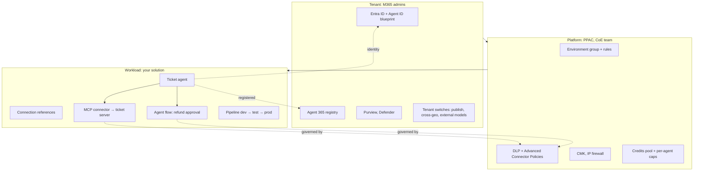

# Landing zones for production Copilot Studio agents

Status: skeleton, 25 Oct 2026. Headings fixed; each `###` carries a one-line scope note to be replaced by prose. Mirror of `../../Agent-Build-02-Microsoft-Foundry/F02-Landing-Zones-and-Networking/` and `../../Agent-Build-04-AWS-Bedrock-Agent-Core/B01-AWS-Landing-Zones-for-Agents/`. Running scenario: the UK support-ticket agent for a UK bank, built in Copilot Studio with the ticket MCP server as a tool. Facts come from the reading map [`../reference/reading-map-copilot-studio-2026-10-25.md`](../reference/reading-map-copilot-studio-2026-10-25.md); letters such as F1 or K6 refer to it. Nothing deployed.

## Opening

### The aim

One paragraph: a Copilot Studio agent in production is three layers of ownership stacked on one another. The Microsoft 365 tenant (identity, registry, compliance, owned by the tenant admins), the Power Platform (environments, groups, connector policy, credits, owned by the platform team), and your workload, a solution inside one environment. **Most "production" failures here are a layer-boundary mistake, not an agent mistake**: the agent that cannot be published because a DLP policy blocks a connector nobody told the maker about, the shared agent that answers from a SharePoint site the viewer could not open, the environment where credits ran out at 125 % and every agent went dark (K6).

> _On Copilot Studio you own the solution. The tenant owns the identity, the platform owns the connectors, and everything your agent touches is a connector._

### What we are trying to avoid

One-line scenes: the ticket agent built in the maker's personal default environment, with "No authentication", shared with the whole tenant and flagged by the security scan on publish day (E6); the HTTP tool that worked for a month and stopped the day the platform team blocked the HTTP virtual connector tenant-wide (F1); the agent whose Entra Agent ID was created on publish and whose Conditional Access policy did nothing because enforcement is Teams only (E1); the UK bank's agent whose Dataverse sits in `crm11` while its generative calls leave the geography because cross-geo was left on (C11); the pack that was sized for the pilot and disabled every agent in the environment at 125 % of prepaid credits (K6).

### Has this happened?

Two or three dated incidents to fetch on the writing day: EchoLeak (CVE-2025-32711, Microsoft 365 Copilot data exfiltration through a crafted email, June 2025) as the shape of the cross-prompt-injection risk; the 2025 MCP server exposure scans; a regulated firm's data-residency finding. Not from memory.

### What the chapter covers

The three tiers, who owns what, the Copilot Studio constraints a landing zone has to accommodate (connector mediation, Entra Agent ID, regions and cross-geo, credits), the policy baseline a regulated client applies, and how a solution-based workload maps onto a client's environment strategy.

### What you have at the end

A one-page ownership matrix, a tenant → platform → workload diagram with the enforcement points named, the checklist you hand a platform team, and the three-line setup answer for interviews.

---

## 1. Three tiers of ownership

### The tenant

What the client already has: the Microsoft 365 tenant with Entra ID, the M365 admin centre, Purview, Defender; since 1 May 2026 the Agent 365 registry as the tenant-wide inventory of agents (F15, E9). Entra Agent ID is created automatically for every agent since May 2026 and cannot be opted out of (E1). Tenant-level switches: turn off publishing of generative agents, turn off cross-geo data movement, admin consent for external model providers (C11, K3). You inherit all of it.

### The platform

The Power Platform admin centre layer, owned by a platform or Center of Excellence team: Managed Environments grouped into environment groups with locked rules (transcript access, Advanced Connector Policies, external models, credit draw, sharing, knowledge sources, preview models) (F2, F3); default environment routing so each maker lands in a governed dev environment; DLP policies enforced for every tenant with no exemptions (F1); customer-managed keys for Managed Environments (F9); the IP firewall for web chat and API channels (F10); the credits pool, per-agent caps and consumption reports (K6).

### Your workload

A custom solution in one environment: the agent, its topics or instructions, connection references, environment variables, custom connectors including the MCP connector for the ticket server, agent flows, and the pipeline that moves the solution from dev to test to production (C3). Knowledge that was uploaded or ingested through a connector is not ALM-portable and has to be reattached per environment (C4). Source control through the VS Code extension or `pac copilot clone` with Git (C1, C2, C5).

Mermaid `flowchart TB`: tenant (Entra + Agent ID, Agent 365 registry, Purview, Defender, tenant switches) → platform (PPAC, environment group with rules, DLP / ACP, CMK, credits pool, firewall) → workload (solution: agent, connection references, custom connectors, flows, pipeline). One sentence: notice that every arrow from the workload to the outside world passes through a connector, and every connector is under a DLP policy.

### Who decides what

Table: decision / tenant admins / platform team / you. Rows: Entra Agent ID and Conditional Access; Agent 365 registry actions (block, reassign); tenant publish and cross-geo switches; external model consent; environment and group membership; DLP and ACP; CMK; credits pack and per-agent caps; sharing limits; agent definition, instructions, tools and knowledge; connection references; pipeline and Git; evaluation test sets; transcripts retention.

**Interview line.** Study check with answer. Rule to keep: _you own the solution, not the environment it runs in._

## 2. Why the landing zone matters for Copilot Studio specifically

### Everything is a connector

MCP servers, REST tools, HTTP calls, triggers, channels, even Application Insights export are connectors or virtual connectors, so the DLP policy is the one control that reaches every tool the agent can use (F1, D3). Blocking a connector blocks its MCP tools and disables the publish button. Design the policy before the agent, or the maker discovers it on publish day.

### Identity is created for you

Entra Agent ID per agent, owned by a Microsoft blueprint, no bring-your-own app registration, connector scopes attached on publish, Conditional Access only enforced in Teams today, no scopes for custom connectors, MCP or REST tools (E1). Two consequences: you cannot "harden" the identity the way you would a service principal, and tool-level authorisation lives in the connector and its credentials mode, not in the agent identity (D1).

### Region and geography

Dataverse in the UK region (`crm11`) keeps data at rest in the UK; generative calls can still move cross-geo unless the tenant switch is off (C11). External models (Anthropic as Microsoft subprocessor; Mistral and xAI hosted externally) need separate admin consent (K3). The deep-reasoning preview is US and EU only (B9). Say which models the bank's agents may use before the first agent exists.

### Credits are a control, not just a bill

Enforcement is hard: agents disabled at 125 % of the prepaid pack, agent flows blocked at 100 %, per-agent monthly caps in PPAC (K6). A landing zone sets the pack, the caps and the credit-draw rule per environment group (F2) so one runaway autonomous agent cannot take the environment down.

### Harness choice is a platform decision

Standard versus GitHub Copilot harness changes billing (feature credits versus usage credits), channels (L1, L2), code-first support (C8) and which governance features apply (A1, A5). Environment group rules can constrain preview and experimental models and skills (F2). Decide per environment, not per agent.

**Interview line.** Study check with answer. Rule to keep: _design the DLP policy, the region switches and the credits cap before the first agent._

## 3. The policy baseline a regulated client applies

### Tenant switches

Publishing of generative agents allowed only in approved environments; cross-geo data movement off; external model terms accepted only for the providers the bank approved; Agent 365 licensed so Entra Agent ID security controls and Defender for AI apply (C11, E3, F14).

### Environment group rules

Managed Environments only; transcript access restricted; Advanced Connector Policies in ACP-only mode so only pre-approved connectors appear; external and preview models off in production groups; sharing limited to Editor-by-name and Viewer-by-security-group with a viewer cap; credit draw from the tenant pool capped; knowledge sources restricted to SharePoint and Dataverse (F2, F4).

### DLP

Business group: Dataverse, SharePoint, the certified MCP connector for the ticket server, Teams. Blocked: HTTP, "Chat without Microsoft Entra ID authentication", Facebook, WhatsApp, the Direct Line channel connector until a custom canvas is approved (F1). The MCP connector for the ticket server rides on the custom-connector route with `x-ms-agentic-protocol: mcp-streamable-1.0` and gets its own DLP classification (D3).

### Compliance plumbing

Purview audit on, DSPM for AI on, retention policy for Copilot Studio interactions set, eDiscovery scope agreed, IRM "Risky AI usage" on (F6, F7, F8); CMK applied to the production environment group (F9); IP firewall on web chat if a custom canvas is published (F10).

### Where policy is enforced

Table: control / enforced at / what it cannot see. DLP at connector call time (cannot see model output); content moderation at generation time (cannot see the tool arguments); bring-your-own-protection webhook before every tool call (1 s timeout, default allow) (F12); Conditional Access at token issuance in Teams only; Purview after the fact. Hand-off to C09.

**Interview line.** Study check with answer. Rule to keep: _DLP for reach, moderation for content, a webhook for arguments, Purview for evidence._

## 4. Solutions and pipelines for the three tiers

### What goes where

Tenant: nothing of yours. Platform: environment group definitions, DLP policies, CMK, exported as PPAC configuration and documented. Workload: one solution per agent product line with connection references and environment variables parameterised per environment; the agent definition cloned to Git as YAML (C2); knowledge reattached per environment because uploads do not travel (C4).

### The code-first project as a starting point

`pac copilot init --environment` bootstraps an agent and a local folder; `clone` and `pull` bring an existing agent into Git; `pack` builds the solution without a tenant connection "safe to run in a build pipeline"; `pac solution import` and `pac copilot publish` finish the release (C1). Power Platform Pipelines or Git integration for environments that use them (C5).

### Pipeline shape

Build: clone, lint YAML, pack. Test: import to the test environment, run the evaluation test set through the REST API (I3), gate on pass rate. Release: import to production, publish, verify through Direct-to-Engine (C8). Rollback: re-import the previous solution version and publish.

### Reading configuration without authoring it

Learn to read the solution zip, `customizations.xml`, the connection-reference manifest and the environment-variable definitions. The platform team authors the environment; you author the solution.

**Interview line.** Study check with answer. Rule to keep: _one solution per product, parameters per environment, knowledge reattached._

## 5. Placing the ticket agent in a client's estate

### Walkthrough table

One request from a Teams user to a refund: step / what happens / which tier owns the control / what evidence proves it. Teams issues the Entra token; Authenticate with Microsoft maps it to the user; the agent reads the ticket through the MCP connector in the user's context; the refund flow requires approval; content moderation screens the answer; the transcript lands in Dataverse and the span in App Insights (H2); Purview records the interaction.

### What to hand the platform team

Checklist: region and cross-geo decision; environment group and its rules; DLP groups incl. the MCP connector classification; model allowlist and external-model consent; Agent 365 licence and registry ownership; credits pack and per-agent caps; CMK scope; channel list and auth mode; transcript retention; App Insights resource for env-level telemetry (Managed Environment); the public-client app registration for Direct-to-Engine and the evaluation API.

### When not to

Small internal pilot on Microsoft 365 data only: a governed dev environment from default environment routing, Authenticate with Microsoft, no custom connectors, the maker's own credits. Say so in the ADR and name the path to the production group.

## 6. In N lines

Numbered summary, to be written last.

## 7. What you should be able to explain

Bulleted list of spoken answers: the three tiers; why DLP is designed first; what Entra Agent ID does and does not give you; the region and cross-geo switches; the credits enforcement thresholds; what goes in the solution versus the environment; what you hand the platform team.

## 8. What this is not

Not a Power Platform CoE guide; not the identity chapter (C04); not the governance pack (C09); not the ALM chapter (C02). Where each lives.

## 9. Scope and versions

Copilot Studio and Power Platform pages read 25 Oct 2026 (reading map A, C, E, F, K). The Power Platform CoE Starter Kit, Managed Environments pricing and the Well-Architected guidance for Power Platform: not fetched; verify before citing.

## 10. Same thing on Foundry and AgentCore

| Copilot Studio                                              | Foundry (F01)                                          | AgentCore (B01)                                         |
| ----------------------------------------------------------- | ------------------------------------------------------ | ------------------------------------------------------- |
| M365 tenant + Entra + Agent 365 registry                    | CAF enterprise landing zone, management groups         | Control Tower / Landing Zone Accelerator, Organizations |
| Environment group with rules (Managed Environments)         | AI landing zone spoke subscription                     | AI platform account(s)                                  |
| DLP + Advanced Connector Policies                           | Azure Policy + APIM policies                           | SCPs + Cedar on the Gateway                             |
| Entra Agent ID created by a Microsoft blueprint, no BYO app | Agent identity under a blueprint you can see in Entra  | Workload identity + execution role you author           |
| Cross-geo switch + Dataverse region (`crm11`)               | `DataZoneStandard` vs `GlobalStandard` deployment type | `eu.` vs `global.` inference profile                    |
| CMK on Managed Environments                                 | CMK on the Foundry account                             | KMS CMK on token vault, Memory, Registry                |
| IP firewall (web chat only), Agent 365 network controls     | Private endpoints, VNet injection                      | VPC mode + PrivateLink + `aws:VpceOrgID`                |
| Credits pack, 125 % cut-off, per-agent caps                 | Model quota (TPM) and APIM token limits                | Per-second consumption, no hard cut-off, budgets        |
| Solution + connection references + pipelines                | `azure.yaml` + Bicep + azd                             | `agentcore.json` + CDK app                              |
| Purview audit + DSPM for AI                                 | Diagnostic settings + Purview                          | CloudTrail + Config                                     |

## 11. Further reading

Platform guidance

- Security and governance in Copilot Studio (C11): https://learn.microsoft.com/en-us/microsoft-copilot-studio/security-and-governance
- Environment groups and rules (F2, F3): https://learn.microsoft.com/en-us/power-platform/admin/environment-groups-rules
- Data loss prevention for Copilot Studio (F1): https://learn.microsoft.com/en-us/microsoft-copilot-studio/admin-data-loss-prevention
- Microsoft Agent 365 overview (F15): https://learn.microsoft.com/en-us/microsoft-agent-365/overview

Identity and compliance (fetched 25 Oct 2026)

- Entra agent identities for Copilot Studio (E1): https://learn.microsoft.com/en-us/microsoft-copilot-studio/admin-use-entra-agent-identities
- Customer-managed keys (F9): https://learn.microsoft.com/en-us/microsoft-copilot-studio/admin-customer-managed-keys
- Network isolation and IP firewall (F10): https://learn.microsoft.com/en-us/microsoft-copilot-studio/admin-network-isolation-firewall
- Purview for Copilot Studio (F7): https://learn.microsoft.com/en-us/purview/ai-copilot-studio
- Credits management and enforcement (K6): https://learn.microsoft.com/en-us/microsoft-copilot-studio/requirements-messages-management

ALM

- Solutions in Copilot Studio (C3): https://learn.microsoft.com/en-us/microsoft-copilot-studio/authoring-solutions-overview
- `pac copilot` reference (C1): https://learn.microsoft.com/en-us/power-platform/developer/cli/reference/copilot
- C09 sketches: `../C09-Governance-and-Agent-365/sketches/`

Status: skeleton, 25 Oct 2026. Nothing deployed; design proposal.
