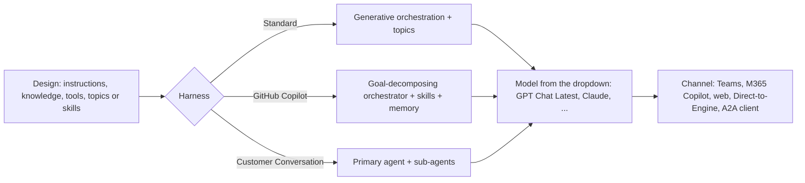
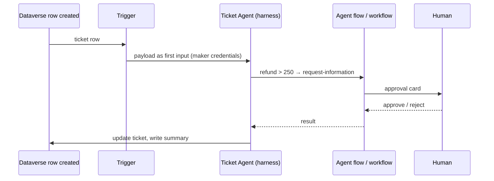
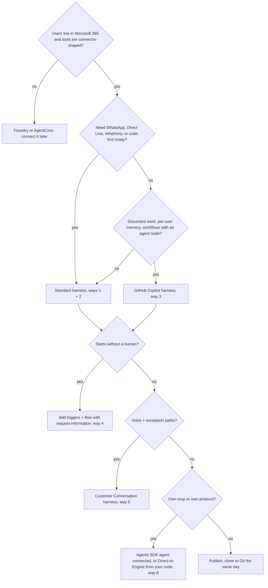

# C03 — Creating agents in Microsoft Copilot Studio: seven ways, three harnesses

Copilot Studio is the Microsoft 365 builder for agents: the definition lives in Dataverse, the loop runs in a Microsoft-hosted **harness**, and the agent reaches people through Teams, Microsoft 365 Copilot, a website or your own app. Since 2026 there are three harnesses (A1): the Standard harness with topics and generative orchestration, the GitHub Copilot harness with skills, memory and workflows, and the Customer Conversation harness for contact centres. Counted by where the definition is authored and which harness runs it, that is seven ways to put an agent on the platform. **Every design decision in this chapter comes down to two questions: which harness runs the loop, and whether the definition is something you can clone into Git.** Those two answers decide what you can version, test, govern and connect, which is why C04, C05 and C09 all start from this table.

> _The portal is where the agent is born. Git is where it grows up. The harness decides what it can do in between._

The running scenario is the same support-ticket assistant as the Foundry and AgentCore tracks (`get_ticket`, `list_tickets`, `get_policy`, `issue_refund`, UK card team, refunds above 250 GBP refused). The runnable proofs are in [`labs/`](labs/) (01 the ticket agent two ways, 02 GitHub Copilot harness, 03 autonomous trigger, 04 Agents SDK connected), written on 25 Oct 2026 against `pac` CLI, the Copilot Studio VS Code extension (GA Jan 2026) and `microsoft-agents-copilotstudio-client` 1.9.0; the shared environment is [`../labs-setup/`](../labs-setup/). Facts come from the Learn pages fetched that day, kept in [`../reference/reading-map-copilot-studio-2026-10-25.md`](../reference/reading-map-copilot-studio-2026-10-25.md); letters such as A5 or C1 refer to that map. Status words are GA, preview and retiring, with dates. Nothing has run against the tenant yet; the proof checklists are unticked.

### What we are trying to avoid

A team builds the agent by clicking for three weeks and nobody can rebuild it in the test environment, because it was never cloned into a solution or Git. A second agent has forty topics with branching conditions that read like a flowchart drawn in the dark, when generative orchestration and four tools would have done it. A third works in the test pane for a month and never reaches a channel, because publish was treated as a release ceremony rather than a save. A fourth has a tool set to maker credentials, so every user refunds as the maker and the audit log shows one name. A fifth was pinned to GPT-4.1 in January and stops answering on 12 Nov 2026, when that model retires in Copilot Studio (K1).

### Has this happened?

The last two are in the vendor's own pages as of 25 Oct 2026: the security scan exists because maker-credential tools kept reaching production (E6), and the retirement table on the model page lists GPT-4.1, GPT-5 Chat, GPT-5 Auto and GPT-5 Reasoning with their stop dates (K1). The first three are the internal story of this track: the harness split that landed between June and October 2026 (A1, A5, A6) changed what "an agent" means in the product, and the only agents that survive a platform change like that are the ones you can clone, diff and re-import. The VS Code extension and `pac copilot clone` exist for exactly that reason (C1, C2).

### What the chapter covers

One agent and three harnesses, and what each harness gives and takes (1). The seven ways, as a table and then one subsection each (2). Publish, channels and end-user authentication, including the two channels that are really APIs for code (3). Autonomous agents: triggers, agent flows and workflows (4). Multi-agent: connected agents, Foundry agents, A2A, Agents SDK agents, and publishing a Copilot Studio agent as an MCP server or A2A agent (5). A decision page (6). A three-column "same thing on Foundry and AgentCore" table at the end.

### What you have at the end

A creation matrix you can recite, a decision rule in one sentence, a harness comparison table, the publish and session mechanics, the Direct-to-Engine loop in twelve lines, and a set of scripts and portal walkthroughs whose output you will have seen once the tenant is set up.

---

## 1. One agent, three harnesses

A **harness** is the runtime that sits between what you authored and the model (A1). The same word is used by AWS for its managed loop; in Copilot Studio the harness is not something you choose per deployment but per agent, at creation, and it decides which features exist.

|            | Standard harness                                                                                          | GitHub Copilot harness                                                            | Customer Conversation harness                            |
| ---------- | --------------------------------------------------------------------------------------------------------- | --------------------------------------------------------------------------------- | -------------------------------------------------------- |
| Status     | GA, the classic product                                                                                   | GA 3 Aug 2026 (A5, verify the MC date)                                            | preview, 21 Oct 2026 (A6)                                |
| Authoring  | instructions + generative orchestration, topics as deterministic escape hatch                             | instructions + knowledge + tools + skills + memory + hooks; no topics             | primary agent + sub-agents, each with an escalation path |
| Tools      | connectors, agent flows, REST (preview), prompts, MCP, computer use (GA May 2026, B8)                     | connectors, MCP servers, workflows, code interpreter (D11)                        | the Standard set per sub-agent                           |
| Autonomy   | event triggers (B2)                                                                                       | triggers (preview) or an agent node in a workflow (A7)                            | not the point                                            |
| Channels   | Teams + M365 Copilot, SharePoint, WhatsApp, website, Direct Line apps, Azure Bot channels, telephony (L1) | M365 Copilot, Teams, demo site, web app, MCP client and A2A client (preview) (L2) | voice and chat through Dynamics 365 Contact Center       |
| Code-first | `pac copilot clone / push`, VS Code YAML, Direct-to-Engine client (C1, C2, C8)                            | partial: no Direct-to-Engine yet (C8); pac support growing                        | n/a today                                                |
| Billing    | Copilot credits per feature (K6)                                                                          | usage-billed credits                                                              | credits                                                  |



The labs script against the Standard harness because that is where `pac`, the VS Code extension and the Direct-to-Engine client are fully supported today (C8 says the GitHub harness is "not yet officially supported" by the client). The GitHub Copilot harness is covered in prose and in lab 02 as a portal walkthrough.

_Micro-example._ The ticket agent on the Standard harness has one instruction block, three knowledge files and four MCP tools; no topics at all. The same agent on the GitHub Copilot harness has the same instruction block, the same tools, one skill called `ticket-triage` and memory switched on so a returning user's card type is remembered. The Customer Conversation version splits it into a primary agent that greets and routes, and two sub-agents, refunds and card replacement, each with an escalation path to a human queue.

**Interview line.** "Copilot Studio has three harnesses now; the Standard one is what I can clone into Git and drive from code, so that is where production starts."

**Study check.** Which harness has no topics, and what replaced them? **Answer.** The GitHub Copilot harness; topics became hooks and prompts became skills (A5).

Rule to keep: **pick the harness before the first click; it is not a setting you change later.**

## 2. The seven ways

| #   | Way                                                                                                                                               | Definition lives                  | Loop runs                        | Status                                                  | Lab            |
| --- | ------------------------------------------------------------------------------------------------------------------------------------------------- | --------------------------------- | -------------------------------- | ------------------------------------------------------- | -------------- |
| 1   | Standard-harness agent in the portal: instructions + generative orchestration, topics as the escape hatch                                         | Dataverse (`bot`, `botcomponent`) | Copilot Studio Standard harness  | GA                                                      | 01             |
| 2   | Same agent code-first: `pac copilot init / clone` → YAML in Git → `pack` → `pac solution import` → `pac copilot publish`; VS Code extension sync  | Git + Dataverse                   | Standard harness                 | GA; extension GA Jan 2026 (C1, C2)                      | 01             |
| 3   | GitHub Copilot harness agent: instructions, skills, memory, hooks, workflows                                                                      | Dataverse                         | GitHub Copilot harness           | GA 3 Aug 2026 (A5)                                      | 02             |
| 4   | Autonomous agent: event triggers and agent flows / workflows with request-information                                                             | Dataverse + flows                 | the harness, started by an event | GA triggers on Standard (B2); preview on GitHub harness | 03             |
| 5   | Customer Conversation harness: primary + sub-agents for voice and chat                                                                            | Dataverse                         | contact-centre harness           | preview 21 Oct 2026 (A6)                                | 02 (described) |
| 6   | Code-first agent on the Microsoft 365 Agents SDK, surfaced as a connected agent; or Copilot Studio called from your code through Direct-to-Engine | your service                      | your host + the harness          | SDK GA; connected preview (B5, C7)                      | 04             |
| 7   | Foundry agent as a connected agent; a Copilot Studio agent exposed as MCP server or A2A agent for Foundry                                         | Foundry / Dataverse               | both                             | preview (B4, B6)                                        | C04 lab 04     |
| +   | Channels and publish: Teams + M365 Copilot, website, Direct Line app, WhatsApp; end-user auth modes                                               |                                   |                                  | GA (L1, E5)                                             | 01             |

Decision rule to carry: _Microsoft 365 users, connector-shaped tools and governed sharing → Copilot Studio; custom loop or your own protocol surface → Agents SDK or Foundry and connect it in; a process that starts without a human → triggers and workflows; voice and escalation paths → Customer Conversation harness; anything you need in Git → clone it as YAML first._

### Way 1: Standard-harness agent in the portal

When to pick it: every time, as the starting point. The portal is the fastest way to a working agent, and the Standard harness is the only one with full code-first coverage behind it.

The shortest path: Copilot Studio → Create → New agent → Skip to configure → name `Ticket Agent`, paste the instructions, switch orchestration to generative (it is the default for new agents), add the three policy documents as knowledge, add the tools (C04), set Authenticate with Microsoft, test, publish. The schema name appears under Settings → Advanced → Metadata after the first save; the labs read it as `AGENT_SCHEMA_NAME`.

The gotcha: generative orchestration is required for MCP tools, web search and "allow ungrounded responses" (B1). An agent created with classic orchestration will refuse to add an MCP server and the error does not say why. Proof: `labs/01-ticket-agent-two-ways/README.md`.

### Way 2: the same agent code-first

When to pick it: as soon as the agent is worth keeping. `pac copilot clone` writes the agent as a YAML tree (settings, instructions, knowledge references, tools, topics); `pull` does a three-way merge from the environment; `push` sends your edits back; `pack` builds a solution zip offline so a build pipeline can `pac solution import` it (C1). The VS Code extension does the same with IntelliSense and a diff view (C2).

The shortest path:

```bash
pac auth create --deviceCode
pac copilot clone --environment $ENVIRONMENT_ID --agent $AGENT_SCHEMA_NAME --outputDirectory ./agent   # verify flag names (C1)
# edit agent/instructions.md in Git, open a PR
pac copilot push --environment $ENVIRONMENT_ID --directory ./agent
pac copilot publish --environment $ENVIRONMENT_ID --agent $AGENT_SCHEMA_NAME
```

The gotcha: uploaded-file knowledge is not ALM-portable (C4). An import re-creates the reference, not the vectors; knowledge from SharePoint by connector survives, uploaded files do not. Proof: `labs/01-ticket-agent-two-ways/clone_pull_push.sh` and `create_from_yaml.sh`.

### Way 3: GitHub Copilot harness agent

When to pick it: when the work is document-shaped (create and edit Word, Excel, PowerPoint, PDF), when you want per-user memory, or when the agent should run as a workflow with an agent node rather than as a chat. The harness decomposes goals itself; there are no topics to maintain (A5).

The shortest path: Create → New agent → choose the GitHub Copilot harness → instructions, knowledge, tools, a skill folder with `SKILL.md`, memory on, publish to Teams. It can also be published as an MCP server or an A2A agent for other agents to call (B6).

The gotcha: channel and code-first coverage is narrower today. No SharePoint, WhatsApp or Direct Line channels (L2), and the Direct-to-Engine client does not officially support it yet (C8). It is also usage-billed in credits, not per message (K5). Proof: `labs/02-github-copilot-harness/README.md`.

### Way 4: autonomous agent

When to pick it: when nobody types the first message. A Dataverse row, a SharePoint file, a Planner task or a schedule starts the run (B2). The agent then uses its instructions, knowledge and tools as in a conversation, and an agent flow or workflow can pause for a human with a request-information step (A7).

The shortest path: Overview → Triggers → add a trigger → pick the Power Automate connector trigger → map the payload into the agent's input → test with a real row.

The gotcha: triggers run with maker credentials only (B2), every trigger payload is billed as an agent action (K6), and solution-aware flow sharing must be on for the trigger to deploy with the solution. Proof: `labs/03-autonomous-trigger/`.

### Way 5: Customer Conversation harness

When to pick it: a contact centre with voice and chat, where a primary agent routes to sub-agents and each sub-agent needs its own escalation path to a human queue (A6).

The shortest path: Create → New agent → Customer Conversation harness → define the primary agent and sub-agents → connect Dynamics 365 Contact Center.

The gotcha: preview since 21 Oct 2026; sub-agents share ALM with the primary, connected agents do not; code-first support is not documented. Described in `labs/02-github-copilot-harness/customer_conversation_note.md`.

### Way 6: Agents SDK agent, connected or calling

When to pick it: when you need your own loop, your own state, your own protocol surface, but the users live in Microsoft 365. Two directions (C7): your SDK agent exposes `/api/messages` on the Activity protocol and Copilot Studio adds it as a connected agent (B5); or your service calls a Copilot Studio agent through the **Copilot Studio client** (Direct-to-Engine) with a delegated `CopilotStudio.Copilots.Invoke` token (C8).

The shortest path for the calling direction, which is the one the labs script:

```python
settings = ConnectionSettings(environment_id=ENV_ID, agent_identifier=AGENT_SCHEMA_NAME,
                              cloud=PowerPlatformCloud.PROD, copilot_agent_type=AgentType.PUBLISHED)
client = CopilotClient(settings, token)                      # token: device-code, scope CopilotStudio.Copilots.Invoke
async for a in client.start_conversation(): ...              # Activities; the welcome message
async for a in client.ask_question("Ticket T-2041, refund 400 GBP"): print(a.text)
```

The gotcha: the client needs the agent published and the Power Platform API permission consented; GitHub-harness agents are not supported yet (C8). Proof: `labs/01-ticket-agent-two-ways/invoke_direct_to_engine.py` and `labs/04-agents-sdk-connected/`.

### Way 7: Foundry in, Copilot Studio out

When to pick it: when a Foundry agent already owns a capability (a hosted agent with its own container, a prompt agent with Foundry tools) and Microsoft 365 users should reach it, or the reverse. Foundry agent → Copilot Studio: enable the Activity protocol endpoint on the Foundry agent (REST or Python only; new-portal agents only, else 400) and add it as a connected agent (B4). Copilot Studio → Foundry: publish the GitHub-harness agent as an A2A agent (scope `MCS.InvokeAsA2A`) and call it with Foundry's A2A tool, which accepts A2A v1.0 over JSON-RPC with Entra only (B6, B7).

The gotcha: both directions are preview, and the Copilot Studio side only works from the GitHub Copilot harness. Proof: `../C04-Tools-Identity-MCP-and-Connected-Agents/labs/04-connected-agents/`.

**Interview line.** "Seven ways, but one habit: build in the portal, clone to Git the same day, publish from the pipeline."

**Study check.** A customer asks for a Teams agent that must also be reachable over WhatsApp and must run a nightly job without a user. Which harness and which way? **Answer.** Standard harness (WhatsApp is not a GitHub-harness channel, L2), way 1 then way 2 for Git, plus way 4 for the nightly trigger (B2).

Rule to keep: **the definition you cannot clone is the definition you do not own.**

## 3. Publish, channels and end-user authentication

Publish is agent-wide: one publish updates every channel, and new content reaches **new** sessions, where a session ends after about 30 minutes of inactivity or a "start over" (L1). There is no version selector; the published build is the build. Rollback is re-importing the previous solution version and publishing again (C3), which is why way 2 matters.

| Channel (Standard harness)                                                              | What it needs                                    | Notes                                                      |
| --------------------------------------------------------------------------------------- | ------------------------------------------------ | ---------------------------------------------------------- |
| Teams + Microsoft 365 Copilot                                                           | Authenticate with Microsoft                      | tenant-wide catalogue needs admin approval (L4)            |
| Demo website / custom website                                                           | none or Entra                                    | the test outside the maker pane                            |
| Mobile or custom app (Direct Line)                                                      | token endpoint from the Mobile app channel (C10) | the first "channel for code"                               |
| Direct-to-Engine (Agents SDK client)                                                    | delegated `CopilotStudio.Copilots.Invoke` (C8)   | the second "channel for code"; not a channel in the portal |
| SharePoint, WhatsApp, Facebook, Azure Bot channels (Slack, Telegram, Twilio, Email ...) | per channel                                      | admins can block each through DLP virtual connectors (F1)  |
| Telephony / Dynamics 365 Contact Center, Teams Phone Agent (preview Jun 2026)           | voice licence                                    |                                                            |

End-user authentication has three modes (E5): **No authentication** (anyone with the link; blocks tools that need user credentials), **Authenticate with Microsoft** (automatic Entra sign-in in Teams, SharePoint, Power Apps and M365 Copilot; no `User.AccessToken` variable), and **Authenticate manually** (Entra ID v2 with federated credentials, certificate or secret; generic OAuth 2 with a token-exchange URL for SSO). The GitHub Copilot harness supports only Entra or none (L2). Admins can lock manual auth tenant-wide.

_Micro-example._ The ticket agent is published once. In Teams it signs the user in silently and `issue_refund` runs as that user. On the demo website with no authentication the same tool is unavailable and the agent says so; that is the correct behaviour, not a bug.

**Interview line.** "Publish is a save that reaches new sessions; versions live in solutions, not in the publish button."

**Study check.** Where does a custom React app get its token for the ticket agent? **Answer.** Either the Direct Line token endpoint under the Mobile app channel (C10) or a delegated Power Platform API token for the Copilot Studio client (C8).

Rule to keep: **choose the end-user auth mode before adding tools; tools that need user credentials do not exist under "no authentication".**

## 4. Autonomous agents: triggers, agent flows, workflows

A trigger is a Power Automate connector trigger bound to the agent: Dataverse row created, SharePoint file added, OneDrive change, Planner task, recurrence (B2). The payload becomes the agent's first input; the run shows on the Activity page; each run is billed as an agent action (K6). Triggers use maker credentials only, which is the one place the "end-user credentials" default does not apply.

An **agent flow** (Standard harness) or **workflow** (GitHub harness, A7) is the deterministic side: nodes for prompt, extract, agent, Copilot and **request-information**, the human-in-the-loop step that pauses the run until someone answers. Responses beyond the two-minute conversational limit are handled asynchronously (A2, May 2026).



**Interview line.** "Autonomous in Copilot Studio means a connector trigger plus a flow with a request-information step; the loop is the same harness."

**Study check.** Why does an autonomous agent show one identity in the audit log? **Answer.** Triggers run with maker credentials (B2); pair the agent with an agent user for Dataverse if roles must apply (E4).

Rule to keep: **every trigger is a billed run with the maker's identity; design the human step before the trigger.**

## 5. Multi-agent: connected agents in every direction

The **Connected agents** dialog accepts four kinds (B3): other Copilot Studio agents (and child agents inside the same agent), Foundry agents (B4), A2A remote agents (GA Apr 2026), and Microsoft 365 Agents SDK agents by their Activity endpoint with none, API key or OAuth2 (B5). Guidance: split when an agent passes 30–40 actions; a main agent that has connected agents cannot itself be connected elsewhere (B3).

The reverse direction exists for the GitHub Copilot harness: publish the agent as an **MCP server** or an **A2A agent** (preview, early-release environments; delegated scopes `MCS.InvokeAsMCP` and `MCS.InvokeAsA2A`, B6). Foundry's A2A tool can then call it (B7). That closes the loop across the three tracks: the Foundry prompt agent, the AgentCore A2A runtime and the Copilot Studio agent can each be a connected agent of another.

| Direction                                   | Mechanism                                                 | Status           |
| ------------------------------------------- | --------------------------------------------------------- | ---------------- |
| Copilot Studio → Copilot Studio             | connected agent, child agent                              | GA               |
| Copilot Studio → Foundry agent              | connected agent over the Activity protocol endpoint       | preview (B4)     |
| Copilot Studio → AgentCore / any A2A server | A2A remote agent                                          | GA Apr 2026 (B3) |
| Copilot Studio → your Agents SDK service    | connected agent by Activity endpoint                      | preview (B5)     |
| Foundry / AgentCore → Copilot Studio        | GitHub-harness agent published as A2A agent or MCP server | preview (B6)     |

**Interview line.** "Connected agents is the one dialog; what changes is the protocol on the other side: Activity, A2A, or another Copilot Studio agent."

**Study check.** The Foundry agent you add as a connected agent returns 400. First check? **Answer.** The Activity protocol endpoint is not enabled on it, or it is an old-portal agent (B4).

Rule to keep: **connect across trust boundaries with A2A; connect inside the tenant with connected agents.**

## 6. Decision page



Rule to keep: **start on the Standard harness unless the GitHub harness has a feature you need today; either way, clone before the second day.**

## The chapter in eight lines

1. Three harnesses: Standard (topics + generative orchestration), GitHub Copilot (skills, memory, hooks, workflows; GA 3 Aug 2026), Customer Conversation (preview 21 Oct 2026). Pick at creation.
2. Seven ways counted by where the definition is authored and which harness runs it; the Standard harness is the one with full code-first coverage.
3. `pac copilot clone / pull / push / pack / publish` and the VS Code extension (GA Jan 2026) turn a portal agent into YAML in Git.
4. Publish is agent-wide and reaches new sessions; versions live in solutions; rollback is a solution re-import.
5. End-user auth is none, Authenticate with Microsoft, or manual; tools that need user credentials vanish under none.
6. Direct-to-Engine (`CopilotClient`, delegated `CopilotStudio.Copilots.Invoke`) and Direct Line are the two channels for code; Standard harness only for the client today.
7. Autonomy is a connector trigger with maker credentials plus a flow with a request-information step; every run is billed.
8. Connected agents accept Copilot Studio, Foundry (Activity endpoint), A2A and Agents SDK agents; a GitHub-harness agent can be published as MCP server or A2A agent for Foundry.

## What you should be able to explain

Why the harness is chosen before the first click. Why the labs script against the Standard harness. What `pac copilot clone` produces and what an import does not restore. Why "it works in the test pane" says nothing about Teams. Which identity a trigger runs as. Why a Foundry connected agent returns 400. Where the token for a custom app comes from. What retires on 12 Nov 2026 and what to set instead.

## What this is not

Not the tools, MCP, identity and connected-agent mechanics in depth (C04). Not evaluation, observability or safety (C05). Not models, prompts and credits (C06), the dev loop (C07), knowledge (C08) or governance (C09). Not the landing zone (C01) or the toolchain and ALM boundaries (C02). Not a claim that anything ran: the tenant exists but the labs had not been executed when this was written.

## Implementation scope and versions

Learn pages fetched 25 Oct 2026 (reading map A–L). Lab code targets Python 3.13 with `microsoft-agents-copilotstudio-client` 1.9.0, `microsoft-agents-hosting-aiohttp` 1.9.0, `microsoft-agents-authentication-msal` 1.9.0, `msal` 1.39.0; `pac` CLI via `dotnet tool`; the Copilot Studio VS Code extension GA Jan 2026. Harness dates: GitHub Copilot harness GA 3 Aug 2026 (seen through a Message Center mirror, verify), Customer Conversation harness preview 21 Oct 2026. Marked `# verify` in code: `pac copilot` flag names, the YAML key names in the clone tree, `conversationtranscripts` column names, Direct Line token endpoint shape.

## Same thing on Foundry and AgentCore

| Copilot Studio (this chapter)                        | Foundry (F03)                                                             | AgentCore (B03)                            |
| ---------------------------------------------------- | ------------------------------------------------------------------------- | ------------------------------------------ |
| Standard-harness agent, definition in Dataverse      | prompt agent (`create_version`)                                           | Harness (`CreateHarness`)                  |
| GitHub Copilot harness agent                         | no equivalent (closest: prompt agent + memory + Agent Framework workflow) | Harness with skills                        |
| `pac copilot clone / push` + VS Code YAML            | `azd ai agent` + `azure.yaml`                                             | `agentcore` CLI + `agentcore.json`         |
| Agents SDK agent connected by Activity endpoint      | hosted agent from source or container                                     | Runtime from zip or container              |
| Direct-to-Engine `CopilotClient`                     | `project.get_openai_client(agent_name=)`                                  | `InvokeAgentRuntime`                       |
| publish, agent-wide, new sessions                    | immutable versions + endpoint selector                                    | versions + `DEFAULT` + named endpoints     |
| end-user auth none / Microsoft / manual              | Entra only on the project endpoint                                        | SigV4 or `customJWTAuthorizer`             |
| triggers + agent flows / workflows                   | Agent Framework workflows, Logic Apps                                     | Harness triggers, Step Functions connector |
| connected agents (Copilot Studio, Foundry, A2A, SDK) | A2A tool v1.0, `remote-a2a` connection                                    | A2A on 9000, Gateway HTTP target           |
| published as MCP server / A2A agent (preview)        | A2A endpoint on the agent                                                 | Runtime MCP (8000) / A2A (9000)            |
| model retirements 15 Oct – 12 Nov 2026               | deployment retirements per model                                          | model lifecycle on Bedrock                 |

## Further reading

Start here: A1 harnesses, A2 what's new, A4 agents overview, A5 GitHub Copilot harness, A6 Customer Conversation harness. Code-first: C1 `pac copilot`, C2 VS Code extension, C3 solutions, C4 quotas and ALM caveats, C7–C9 Agents SDK and the client, C10 Direct Line. Autonomy: B2 triggers, A7 workflows. Multi-agent: B3 connected agents, B4 Foundry agents, B5 SDK agents, B6 publish as MCP / A2A, B7 Foundry A2A endpoint. Channels and auth: L1, L2, E5. Models and retirements: K1. Sketches: [`sketches/`](sketches/) holds the clone tree shape, a topic YAML shape and the Direct-to-Engine loop, all untested and marked where a key name is a guess.
