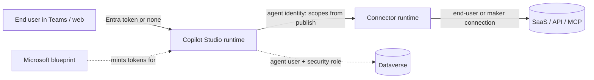
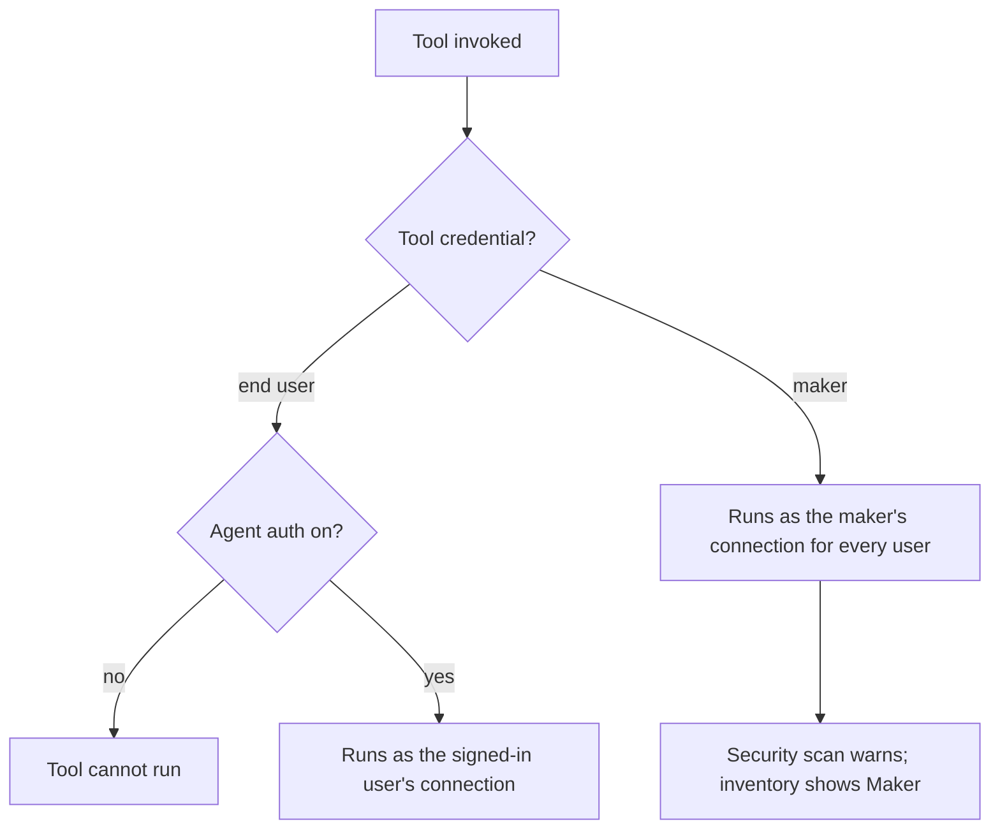
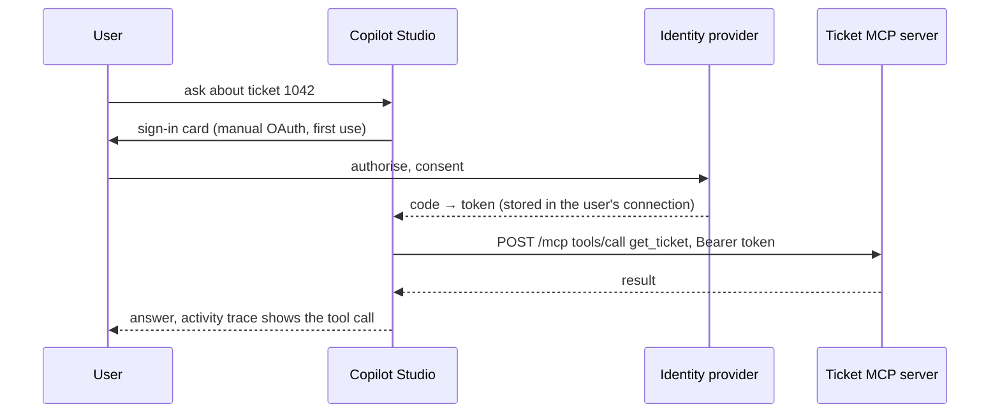

# C04 — Copilot Studio tooling: identity, who the tool runs as, MCP, connected agents

C03 decided which harness the loop runs in. C04 decides **who the agent is when it reaches out, which credential a tool runs under, and which other agents it may call.** On Copilot Studio those three questions have three different owners: Entra gives every agent an identity you did not create and cannot replace; each tool chooses between the end user's credential and the maker's; and MCP, REST and connected agents all ride on Power Platform connectors, so the admin's DLP policy, not your instructions, decides what the agent can reach. **Every design decision in this chapter comes down to one question: which principal does the downstream system see, and did the admin allow that connector.**

> _The identity is Microsoft's. The credential is a per-tool switch. The allow-list is a connector policy._

Running scenario: the UK support-ticket agent built in C03 lab 01 (`AGENT_SCHEMA_NAME`, `AGENT_ID` in the track-root `.env`), calling the ticket MCP server (`get_ticket`, `list_tickets`, `get_policy`, `issue_refund`), then a REST tool and an agent flow, then other agents on Foundry and AgentCore. Runnable proofs: [`labs/`](labs/) 01 identity, 02 MCP tool, 03 REST and flow tools, 04 connected agents, 05 Direct-to-Engine apps; shared environment in [`../labs-setup/`](../labs-setup/). Facts come from the Learn pages crawled on 25 Oct 2026, kept in [`../reference/reading-map-copilot-studio-2026-10-25.md`](../reference/reading-map-copilot-studio-2026-10-25.md); letters such as D3 or E1 refer to that map. Status words are GA and preview, with dates. The counterparts are [F04 on Foundry](../../Agent-Build-02-Microsoft-Foundry/F06-Agent-Tooling-MCP-and-Integration/) and [B04 on AgentCore](../../Agent-Build-04-AWS-Bedrock-Agent-Core/B04-AgentCore-Tooling-Identity-and-MCP/); the three-column table is at the end.

### What we are trying to avoid

A maker flips a refund tool to "maker credentials" so the demo works for everyone, and every end user now refunds as the maker. An MCP server is added with "Allow all" and the agent grows 90 tools nobody reviewed. A team registers its own app for the agent because "that is how we did it for the bot", and finds the agent identity cannot be replaced. A Conditional Access policy on the agent identity is reported as enforced everywhere when today it binds only in Teams. An SSE endpoint is pasted into the MCP wizard and the team concludes "Copilot Studio does not support MCP". A Foundry agent is added as a connected agent and returns 400 because nobody enabled its Activity endpoint.

### Has this happened?

The platform-neutral incidents (GitHub MCP leak, Supabase exfiltration, EchoLeak through Microsoft 365 Copilot itself) are told in S03.06. The Copilot Studio specifics are in Microsoft's own pages: the security scan exists because makers switch tools to maker credentials and share agents tenant-wide (E6); the MCP wizard dropped SSE in Aug 2025 and still gets SSE URLs (D3); the Foundry connected-agent page documents the 400 (B4). This chapter is the dated version of those warnings.

### What the chapter covers

The agent's identity: Entra Agent ID, blueprint, scopes on publish, Conditional Access, agent users (1). Who a tool runs as: end-user versus maker credentials, the three end-user auth modes, the security scan (2). MCP: three ways in, five auth modes, the allow-list, the limits, DLP (3). The other tool kinds (4). Connected agents in both directions, including Foundry and A2A (5). Calling the agent from code (6). Agent 365's registry and tooling gateway (7).

### What you have at the end

The credential decision table you can recite, the MCP auth-mode table, the connected-agent matrix, the three "cannot" facts (no BYO identity, no SSE, no CA outside Teams), and five labs whose output names the principal the server saw.

---

## 1. The agent's identity

Since May 2026 Copilot Studio creates a **Microsoft Entra Agent ID** for every new agent (E1): a service principal of subtype Agent, child of the tenant-wide blueprint "Microsoft Copilot Studio agent identity blueprint" (`25664c89-cea5-4ab6-b924-a54fd8a19ae0`). The opt-out was removed in May 2026; agents created earlier keep legacy app registrations until Microsoft migrates them (manual migration via PPAC, PowerShell or API). Standard-harness agents get the identity at creation, GitHub-harness agents at first publish. The owner is recorded as *sponsor*. You cannot bring your own app registration, and nobody in the tenant can mint a token for the identity: only the Microsoft-owned blueprint principal can, through federated identity credentials. Each identity counts against the directory object quota.

What the identity carries is decided at **publish**. Copilot Studio attaches API permissions representing the first-party and certified connectors the agent uses (`Operations.Execute.All` for a whole connector, per-operation scopes, or the `Azure API Connections Runtime.All` fallback). Those scopes describe what the agent is *configured* to do; DLP and Advanced Connector Policies decide what it is *allowed* to do at run time, and the connector runtime is the only consumer, so a stolen agent token cannot call Graph directly. Custom connectors, MCP servers and REST tools get **no** scopes. Conditional Access can target the scopes (device, location, risk) but is enforced **only in Teams** today (E1).

For autonomous access to Dataverse the identity is paired with an **agent user** (preview, E4) so security roles can be assigned to something that is not a human. Entra's own page (E3) frames the two modes: autonomous access with rights on the identity, delegated access on behalf of a user.

_Micro-example._ The ticket agent uses the SharePoint connector and a custom MCP connector. After publish, Graph shows the agent's service principal with `Operations.Execute.All` on SharePoint and nothing for the MCP connector. A Conditional Access rule that requires a compliant device for that scope blocks the agent in Teams and does nothing on the demo website. Proof: `labs/01-identity/inspect_agent_identity.py`.

**Interview line.** "Every Copilot Studio agent is an Entra service principal under a Microsoft-owned blueprint; you do not create it, cannot replace it, and its scopes mirror the connectors you published."

**Study check.** Why can a leaked agent token not be used to read mail through Graph? **Answer.** The scopes are connector scopes whose only consumer is the Power Platform connector runtime; Graph does not accept them.

Rule to keep: **the identity is Microsoft's; your levers are publish, DLP and Conditional Access.**

## 2. Who the tool runs as

Each tool has a credential switch: **end-user credentials** (default) or **maker-provided credentials** (D1). With end-user credentials the tool runs in the signed-in user's connection, so the downstream system sees the user and its permissions apply; a tool with end-user credentials cannot run unless the agent requires authentication. With maker credentials the tool runs as whoever configured it, for every user; the inventory shows this as `connectionProvider: Maker` and `connectionIdSharedByMaker` (E7), and the pre-publish **security scan** flags it (E6).

The end-user side has three modes (E5):

| End-user auth | Who the agent knows | Channels | Consequence for tools |
|---|---|---|---|
| No authentication | nobody | web, custom | end-user-credential tools cannot run; the "Chat without Microsoft Entra ID authentication" virtual connector lets DLP block this mode |
| Authenticate with Microsoft (default) | the Entra user, SSO in Teams, SharePoint, Power Apps, M365 Copilot | Microsoft surfaces | tools run as the user; no `User.AccessToken` variable |
| Authenticate manually | Entra ID v2 (federated credential, certificate, or secret), Entra ID, generic OAuth 2 with a token-exchange URL for SSO | any | tools run as the user; the admin can lock this mode |

_Micro-example._ `issue_refund` on maker credentials: Ayşe refunds Mert's ticket because the ticket API never saw Ayşe. On end-user credentials the API rejects her for a ticket she does not own, and the agent says so. Proof: `labs/01-identity/maker_vs_user_credentials.md`.

**Interview line.** "Default is end-user credentials. Maker credentials are a shared service account by another name; the scan warns, the inventory shows it, and the API cannot tell users apart."

**Study check.** A customer wants the ticket agent on a public website with no sign-in and a refund tool. What breaks? **Answer.** End-user-credential tools cannot run without authentication, so the refund tool either moves to maker credentials (everyone refunds as the maker) or the agent requires manual auth.

Rule to keep: **maker credentials are for read-only, non-personal tools, and only with a written reason.**

## 3. MCP

Three ways to add an MCP server (D2, D3, D9): the **onboarding wizard** (recommended), a **custom connector** built from an OpenAPI 2.0 definition that declares `x-ms-agentic-protocol: mcp-streamable-1.0`, or a server registered through the **Agent 365 CLI** as a BYO MCP server, approved in the Microsoft 365 admin centre and then selectable in Copilot Studio. All three produce a connector, which is why connector DLP governs MCP tools: block the connector and the tools disappear (F1).

Constraints: remote servers only, **Streamable HTTP only** (SSE dropped Aug 2025), tools and resources supported, prompts not; generative orchestration required; **128 tools per agent** with 25–30 recommended, each child agent counting its own 128 (D1, D4); dynamic tool refresh. The allow-list is a single "Allow all" toggle; switched off, every tool has its own toggle and new tools arrive off (D4). The GitHub harness adds a gallery (M365 Mail, Foundry IQ, Fabric IQ) and a custom-URL path with API key, OAuth client id and secret, or signed-in identity; the tool list is negotiated when you add the server, and an activity trace shows each call (D5).

| Wizard auth mode | What the user does | What is stored | Pick when |
|---|---|---|---|
| None | nothing | nothing | public or network-restricted dev servers |
| API key (header or query) | each user supplies the key at run time | in the user's connection | per-user keys; never a shared key pasted by the maker |
| OAuth 2.0, dynamic discovery | signs in once | DCR-registered client + token in the connection | server publishes `.well-known` metadata and supports dynamic client registration |
| OAuth 2.0, dynamic | signs in once | DCR client, endpoints typed by the maker | DCR without discovery |
| OAuth 2.0, manual | signs in once | client id/secret, auth/token/refresh URLs, scopes; callback URL registered at the IdP | the common enterprise case; the token "lets your agent use the MCP server on behalf of the user" |

_Micro-example._ The ticket server exposes four tools. With "Allow all" off and only `get_ticket` and `get_policy` on, the planner never sees `issue_refund`; the agent explains it cannot refund. Turn the tool on, publish, and the plan changes without any instruction edit. Proof: `labs/02-mcp-tool/allow_list.md`.

**Interview line.** "MCP in Copilot Studio is a connector: wizard or OpenAPI with the agentic-protocol extension, Streamable HTTP only, 128 tools, per-tool allow-list, and DLP can switch the whole server off."

**Study check.** Why does the SSE URL fail in the wizard, and what do you change? **Answer.** Copilot Studio removed SSE transport in Aug 2025; the server must serve Streamable HTTP, usually at `/mcp`.

Rule to keep: **"Allow all" off, named tools on, and a reason per tool.**

## 4. The other tool kinds

| Tool kind | Harness | Auth | Notes |
|---|---|---|---|
| Connectors (1,500+ prebuilt, custom) | both | end-user or maker connection | scopes attached to the agent identity on publish for first-party and certified ones |
| REST API tool from OpenAPI v2 (D8) | Standard, preview | None / API key / OAuth 2.0, with M365-org and client-app restrictions | v2 only; v3 must be converted |
| Agent flows (Standard) / workflows (GitHub harness) (A7) | both | the flow's connections | async responses beyond 2 minutes, request-information for human approval, agent node |
| Prompts (AI Builder) | Standard; "skills" in the new harness | n/a | model per prompt; BYO Foundry model (K4) |
| Computer use (B8) | Standard GA May 2026; new harness planned | Key Vault credentials | 5–15 credits per step; Cloud PC pooling; allow-list of sites |
| Dataverse MCP server (D6, D7) | both | the user's Dataverse rights | `https://{org}.crm.dynamics.com/api/mcp`, 15 tools; billed for non-Copilot-Studio clients since 15 Dec 2025 |
| Code interpreter | GitHub harness | n/a | native |

_Micro-example._ The refund above 250 is not a tool decision: an agent flow with a request-information step asks a supervisor in Teams and resumes. The MCP tool keeps returning `ESCALATE`; the flow is what turns ESCALATE into a human answer. Proof: `labs/03-rest-and-flow-tools/agent_flow_refund_approval.md`.

**Interview line.** "Pick the connector if one exists, the REST tool for a plain OpenAPI v2 API, MCP when the server already speaks it, and a flow when a human or a long wait is in the path."

**Study check.** Which of these can a DLP policy switch off, and how? **Answer.** All of them: each is a connector or a virtual connector (HTTP, Skills, Copilot Studio triggers), so a blocked connector disables the tool and the publish button.

Rule to keep: **one tool kind per capability; flows own the waits.**

## 5. Connected agents

The "Connected agents" dialog (B3) accepts four kinds and the GitHub harness adds its own preview: other **Copilot Studio agents**, **child agents** inside the same agent, **Foundry agents** (preview, B4), **A2A remote agents** (GA April 2026) and **Microsoft 365 Agents SDK agents** via their `/api/messages` Activity endpoint with auth none, API key or OAuth2 (B5). The guidance splits an agent at about 30–40 actions, and a main agent that has connected agents cannot itself be connected elsewhere (B3). The Customer Conversation harness distinguishes sub-agents (shared ALM) from connected agents (A6).

Two facts carry the cross-platform story. A **Foundry agent** must have its **Activity protocol endpoint** enabled, which is done through REST or Python, not the portal; new-portal agents only; otherwise Copilot Studio returns 400 (B4). In the other direction a **GitHub-harness agent can be published as an MCP server or an A2A agent** (preview, early-release environments; delegated scopes `MCS.InvokeAsMCP` and `MCS.InvokeAsA2A`, B6), and Foundry's A2A tool (incoming A2A v1.0 GA, Entra only, JSON-RPC, B7) can call it. The AWS track's A2A runtime card is a valid remote agent too.

| Kind | Needs | Auth | Status |
|---|---|---|---|
| Copilot Studio agent | same tenant, published | agent's own | GA |
| Child agent | nothing external | inherits | GA |
| Foundry agent | project endpoint + agent id, Activity endpoint enabled | Entra | preview (B4) |
| A2A remote agent | agent card URL | none / API key / OAuth2 | GA Apr 2026 |
| Agents SDK agent | Activity endpoint | none / API key / OAuth2 | preview (B5) |
| This agent as MCP / A2A | GitHub harness, early-release env | Entra delegated scopes | preview (B6) |

_Micro-example._ The Foundry `ticket-agent-prompt` from F03 is added as a connected agent; the first attempt returns 400 because the Activity endpoint was never enabled; `labs/04-connected-agents/foundry_agent_enable_activity.py` enables it; the second attempt lists the Foundry agent as a callable and the plan shows a hand-off.

**Interview line.** "Connected agents are the multi-agent story: same-tenant Copilot Studio agents, Foundry agents over the Activity protocol, anything else over A2A, and the agent itself can be published as MCP or A2A for the others."

**Study check.** Why can the main ticket agent not be added as a connected agent to a regional agent once it has its own connected agents? **Answer.** The documented limit: an agent with connected agents cannot itself be connected (B3), so hierarchies are one level deep.

Rule to keep: **split at 30–40 actions, one level, Activity for Microsoft, A2A for everyone else.**

## 6. Calling the agent from code

Three doors (C7–C10). **Direct-to-Engine** through the Agents SDK Copilot Studio client: delegated Power Platform API permission `CopilotStudio.Copilots.Invoke`, environment id plus schema name, `CopilotClient(ConnectionSettings(...), token)`; `start_conversation()` and `ask_question()` yield Activities; services use on-behalf-of; Standard-harness agents only (the GitHub harness is "not yet officially supported", C8). **Direct Line** through the token endpoint for custom canvases (C10). An **Agents SDK agent** that embeds the client, hosted on `aiohttp` with `AgentApplication`, so your own channel logic wraps the Copilot Studio agent (C9). Pinned packages: `microsoft-agents-copilotstudio-client`, `-hosting-aiohttp`, `-authentication-msal`, all 1.9.0.

_Micro-example._ `labs/05-direct-to-engine-apps/web_app/app.py` takes a user's bearer token at `/chat`, exchanges it on-behalf-of for `https://api.powerplatform.com/CopilotStudio.Copilots.Invoke`, and streams the agent's Activities back. The agent sees the user, not the web app.

**Interview line.** "Direct-to-Engine is the SDK door and keeps the user's identity through OBO; Direct Line is the canvas door; both are Standard harness today."

**Study check.** What does the web service hold to perform OBO, and what must it never hold? **Answer.** A certificate or federated identity credential for its own app, never the user's password or a long-lived client secret in the repository.

Rule to keep: **the app authenticates itself; the user's token is exchanged, not forwarded.**

## 7. Agent 365: registry and tooling gateway

Copilot Studio agents auto-register in the **Agent 365 registry** and emit telemetry without an SDK (E8); the registry (converged from the Entra Agent Registry, E9) can block, reassign or delete. For tools, the **Tooling Gateway** (D10) lets an admin connect an APIM AI Gateway or LiteLLM so MCP servers behind it are discovered and governed centrally, with per-tool block on the APIM AI Gateway tier (preview). **BYO MCP** (D9) registers a server (NoAuth, APIKey, ExternalOAuth, EntraOAuth), an admin approves it, Defender hunting sees `ExecuteToolByGateway`; clients today are Copilot Studio, VS Code, Claude Code and GitHub Copilot CLI, not Foundry.

**Interview line.** "Agent 365 is the control plane above the maker: registry for agents, tooling gateway for MCP, both with block at the admin's level."

**Study check.** If the ticket MCP server sits behind APIM and the admin blocks `issue_refund` in the Tooling Gateway, what does the maker see? **Answer.** The tool disappears from the server's negotiated list; no instruction or allow-list change in Copilot Studio can bring it back.

Rule to keep: **register the server once, govern it in one place, and let the maker pick from what is approved.**

---

## The chapter in eight lines

1. Every agent is an Entra service principal under a Microsoft blueprint; no BYO identity; scopes mirror published connectors.
2. Conditional Access on the agent identity binds in Teams only, today.
3. A tool runs as the end user by default; maker credentials are a shared account and the scan says so.
4. End-user auth has three modes; "No authentication" disables end-user-credential tools and is a DLP-blockable virtual connector.
5. MCP is a connector: wizard, OpenAPI with `x-ms-agentic-protocol`, or Agent 365 BYO; Streamable HTTP only; 128 tools; per-tool allow-list.
6. REST tools are OpenAPI v2 and preview; flows own waits and approvals; computer use is GA and billed per step.
7. Connected agents: Copilot Studio, Foundry (Activity endpoint), A2A GA, Agents SDK; one level deep; the agent can be published as MCP or A2A.
8. Direct-to-Engine with OBO keeps the user; Agent 365 governs agents and MCP servers above the maker.

## What you should be able to explain

Why you cannot register your own app for an agent and what the sponsor field is. Which tools get scopes on publish and which do not. What the security scan flags and why. Which MCP auth mode to pick for an enterprise server and where the token lives. What the 128 limit counts. Why a Foundry agent returns 400 as a connected agent and the one call that fixes it. Which door a web app should use and what identity the agent sees.

## What this is not

Not DLP policy design, environment groups, quarantine or Purview (C09). Not evaluation of tool use (C05). Not the Foundry or AgentCore mechanics themselves (F04, B04). Not a claim that the OAuth rows ran: they need an identity provider and are ticked only with a sign-in card in the transcript.

## Implementation scope and versions

Learn pages dated 2026-05-28 to 2026-10-23, crawled 25 Oct 2026. `microsoft-agents-copilotstudio-client`, `-hosting-aiohttp`, `-authentication-msal` 1.9.0; `msal` 1.39.0; `mcp` 2.3.0 for the ticket server. Preview: REST API tools, Foundry and Agents SDK connected agents, MCP and A2A client channels, agent users, BYO MCP, Tooling Gateway per-tool block. GA: Entra Agent ID, MCP wizard (GA date not stated on Learn, verify), A2A connected agents (Apr 2026), computer use (May 2026). Nothing has run against a tenant yet.

## Same thing on Foundry and AgentCore

| Copilot Studio (C04) | Foundry (F04) | AgentCore (B04) |
|---|---|---|
| Entra Agent ID under the Microsoft blueprint, no BYO | agent identity under a project blueprint | workload identity + token vault |
| connector scopes attached on publish | connection auth types per tool | credential providers per target |
| end-user vs maker credentials | `user-entra-token` / `oauth2` vs `project-managed-identity` | `CALLER_IAM_CREDENTIALS` / 3LO vs `GATEWAY_IAM_ROLE` |
| three end-user auth modes | Entra-only project endpoint | SigV4 or `customJWTAuthorizer` |
| MCP wizard / OpenAPI `x-ms-agentic-protocol` | `MCPTool` on the agent | Gateway MCP target |
| "Allow all" + per-tool toggles | `allowed_tools` | Gateway target scoping, semantic search |
| DLP on the connector | APIM policies in front | Cedar policy on the Gateway |
| connected agents (Foundry via Activity, A2A GA) | A2A tool + `remote-a2a` connection | A2A passthrough / runtime targets |
| agent published as MCP / A2A (preview) | A2A endpoint on the agent | Runtime A2A mode on 9000 |
| Direct-to-Engine client + OBO | `get_openai_client(agent_name=)` | `invoke_agent_runtime` / JWT over HTTPS |
| Agent 365 registry + Tooling Gateway | API Center private catalog | AWS Agent Registry |

## Further reading

Reading map letters: E1–E9 (identity, auth modes, scan, inventory, Agent 365 builder), D1–D12 (tools, MCP, Dataverse MCP, REST, BYO MCP, Tooling Gateway), B3–B7 (connected agents, Foundry, A2A), C7–C10 (Direct-to-Engine, Direct Line), F1 (DLP, for the hand-off to C09). Sketches in [`sketches/`](sketches/): the MCP custom-connector OpenAPI, the Graph queries for the agent identity, the connected-agent shapes.
