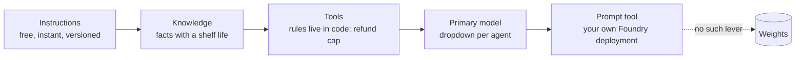
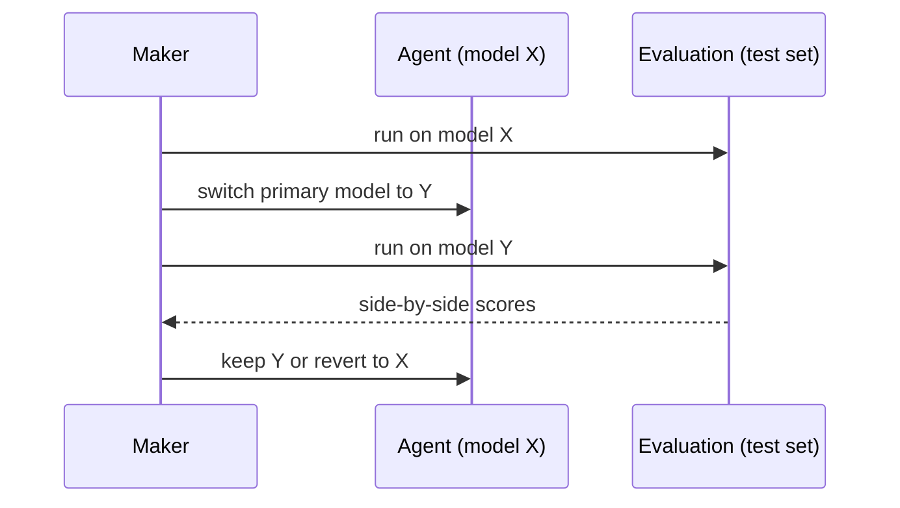

# C06 — Models, prompts and customisation: the levers you have when there are no weights

Copilot Studio gives you a model dropdown, a prompt tool that can point at your own Foundry deployment, a reasoning switch and credits. It does not give you a training job. **The design decision is still the lever order: instructions, knowledge, tools, model choice, and only then a prompt tool on a deployment you tuned elsewhere. On this platform the last lever is not available at all for the orchestrator, which is a feature, not a gap: the agent's behaviour stays in text you can version and in a model Microsoft keeps current.** For an agent, most "the model keeps doing X" problems are instruction, tool or knowledge problems, and the C05 test set tells you which.

> _You do not tune Copilot Studio. You choose its model, write its instructions, and measure the difference._

Running scenario: the UK support-ticket agent from C03, switched between primary models and given a Prompt tool that runs on a Foundry chat-completions deployment (the F06 tuned `gpt-4.1-mini` is the candidate). Facts come from the Learn pages dated 2026-05-28 to 2026-10-22, section K of [`../reference/reading-map-copilot-studio-2026-10-25.md`](../reference/reading-map-copilot-studio-2026-10-25.md); letters such as K1 or B9 refer to it. Runnable proof: [`labs/01-models-and-prompts/`](labs/01-models-and-prompts/). Status words are GA, preview and retiring, with dates.

### What we are trying to avoid

A team pins the ticket agent to GPT-4.1 because "it was tested on that" and the model is retired on 12 Nov 2026 with the agent silently moved to GPT Chat Latest, untested. A second team files a request for fine-tuning because the agent keeps offering refunds above 250 GBP; the cap was never in the instructions and never a tool. A third enables Claude in the dropdown without the two admin switches and the agent fails on publish in the production environment. A fourth builds a Prompt tool on a Foundry Responses API endpoint and gets an error that reads like an auth problem.

### Has this happened?

All four are the shape of the retirement table on the model-selection page (K1), the BYO-model restrictions page (K4) and the external-model admin page (K3). The fine-tuning request is the one the fundamentals chapter on adapting models (S02.07) warns about: weights are for stable, pervasive, stylistic behaviour, never for a rule.

### What the chapter covers

The lever order as it exists on this platform (1). The primary model: the two dropdowns, GPT Chat Latest, the retirement wave, external providers, GCC (2). Prompt tools and bringing your own Foundry deployment, and where a fine-tuned deployment plugs in (3). Deep reasoning and what it costs in credits (4). The eval loop around a model switch (5).

### What you have at the end

The lever order as a sentence for this platform, the retirement dates, the two admin switches, the BYO-model restrictions, a credits estimate for one session, and a before-and-after test-set run on a model switch.

---

## 1. The lever order

Instructions first: the system prompt is versioned with the agent, exported as YAML by `pac copilot clone` (C07) and changed in seconds. Knowledge second: a policy that changes monthly belongs in a SharePoint source or Foundry IQ (C08), never in a model. Tools third: the refund cap is an `if` in the MCP server or a Cedar-like gate at the gateway (C04, C09), not a tendency. Model fourth: the dropdown changes behaviour more than most prompt edits and costs nothing to try. Prompt tool fifth: when one step needs a model you control, a Prompt tool can call your Foundry deployment, and that is the only place a model you trained can enter the agent. There is no sixth lever. The orchestrator model is Microsoft's.

*Micro-example.* The ticket agent apologises too much. Instruction change: "one apology per conversation, then act". Test set: the General quality score is unchanged, the Custom grader for tone rises from 61 to 88. Nobody opened a model page.

**Interview line.** "On Copilot Studio the levers are instructions, knowledge, tools, model choice and a prompt tool on your own deployment. Weights are not a lever, and for an agent that is usually right."

**Study check.** A stakeholder asks for fine-tuning so the agent "knows our products". **Answer.** Products are facts with a shelf life: knowledge source, with citations, measured by the groundedness part of General quality. Rule to keep: **facts go in knowledge, rules go in tools, style goes in instructions.**

## 2. The primary model

Two dropdowns, because there are two harnesses (A1).

**Standard harness** (K1, 2026-10-22). Default is **GPT Chat Latest**, an alias that tracks the current GPT chat snapshot. GA options: GPT-4.1, GPT-5 Chat, GPT-5.5 Chat, Claude Sonnet 4.6, Claude Opus 4.6 / 4.7 / 4.8. Preview: GPT-5 Reasoning, GPT-5 Auto, GPT-5.3 Chat. Experimental: Grok 4.2 (US early access). GCC: GPT-4o. Separate settings exist for deep reasoning, the generative-responses model and the prompt-builder model, so "the agent's model" is three settings, not one.

**GitHub Copilot harness** (K2, 2026-10-02). GA: GPT-5 Chat, GPT-5.5 Chat, GPT-6 Astra (Deep), Claude Sonnet 4.6, Claude Sonnet 5, Claude Fable 5 / 5.1 (Deep), Claude Opus 4.8 / 5. Experimental: GPT-5.6 Reasoning, Mistral Medium 3.5. Tags General / Auto / Deep.

### The retirement wave

| Model | Retires | Moves to |
|---|---|---|
| GPT-5.3 Chat, GPT-5.4 | 15 Oct 2026 | GPT Chat Latest |
| GPT-5.5 Chat | 31 Oct 2026 | GPT Chat Latest |
| GPT-4.1, GPT-4.1 Mini, GPT-5 Chat, GPT-5 Auto, GPT-5 Reasoning | 12 Nov 2026 | GPT Chat Latest |

An agent pinned to a retiring model is migrated, not stopped. The failure is silent: a behaviour change on a date you did not choose. The habit is to run the C05 test set against GPT Chat Latest now and keep the alias unless a measured reason says otherwise.

### External providers and the two admin switches

Anthropic runs as a Microsoft subprocessor; Mistral and xAI are hosted outside Microsoft (K3). Before a maker can pick them: an admin accepts the terms in the Microsoft 365 admin centre, and an admin enables "external models" in the Power Platform admin centre, per environment group or environment (F2). Without both, the dropdown shows the model and publish fails in the governed environment. Data for external models may leave the Microsoft boundary; the cross-geo switch (C11) is the other half of that decision.

**Interview line.** "Default to GPT Chat Latest and test on every retirement date; pin a named model only when a test set proves it, and then own the retirement."

**Study check.** Why is "we tested on GPT-4.1" not a reason to pin to it in October 2026? **Answer.** It retires on 12 Nov 2026; the pin buys three weeks and then the migration happens untested. Rule to keep: **a pinned model is a retirement you now own.**

## 3. Prompt tools and your own deployment

A Prompt tool is an AI Builder prompt the orchestrator can call like any tool: a template with inputs, a model, and structured output. The model is chosen per prompt (Claude Opus 4.6 or Sonnet 4.5 selectable since Feb 2026, A2), which already gives you a different model per step without touching the orchestrator.

**Bring your own model** (K4, 2026-07-14, GA). A Prompt tool can run on an Azure AI Foundry deployment you name by endpoint and deployment name. Restrictions that bite: chat-completions deployments only; Responses API endpoints fail; the GPT-5 family is not supported for BYOM. Authentication is through a connection the maker creates (Entra); the deployment's own keys stay in Foundry.

**Where a fine-tuned model plugs in.** The F06 lab produced a tuned `gpt-4.1-mini` deployment for tone. It is a chat-completions deployment, so it meets the stated shape, but the Learn page does not mention fine-tuned deployments either way, so treat this as `verify` until the lab runs. The pattern, if it works, is narrow and honest: the orchestrator stays on GPT Chat Latest, and one step ("draft the refund-refusal message in house tone") runs on your tuned model through a Prompt tool, measured by the same test set.

| Lever | What changes | Rollback |
|---|---|---|
| Prompt tool model dropdown | the model for one step | pick the previous model |
| BYO Foundry deployment | the model for one step, yours | point the prompt back |
| Primary model dropdown | the whole orchestration | pick the previous model |

**Interview line.** "Fine-tuning reaches Copilot Studio through one door: a Prompt tool on a Foundry chat-completions deployment. Everything else stays Microsoft's model."

**Study check.** The BYOM prompt returns an error on a Foundry `gpt-5-mini` deployment. **Answer.** The GPT-5 family is excluded for BYOM (K4); use a supported chat-completions deployment. Rule to keep: **chat completions, not Responses; not GPT-5; one step, not the orchestrator.**

## 4. Deep reasoning and what it costs

Deep reasoning (B9, preview) routes a turn to Azure OpenAI o3 when the maker enables it and the user, or the instructions, trigger it (the `reason` keyword), US and EU regions only. It is an **agent action** for billing: 5 credits per use on top of the 2-credit generative answer (K6). Reasoning models through AI tools bill as premium: 10 credits per 1,000 tokens. The GitHub harness exposes reasoning as the "Deep" tag on the model itself (K2) and bills by usage.

The arithmetic matters because credits are the only budget an admin can cap per agent (K6: agents disabled at 125 % of prepaid; per-agent monthly caps in PPAC). `labs/01-models-and-prompts/credits_estimate.py` turns a described session into credits and a monthly projection.

**Interview line.** "Deep reasoning is a 5-credit agent action per turn. Turn it on for the step that needs it, not for the agent."

**Study check.** Support handles 40,000 conversations a month, each with three generative answers and one tool call; what does tenant graph grounding add? **Answer.** 6 credits per conversation without grounding (three generative answers at 2), 36 with it (10 more per answer); 1,440,000 credits a month instead of 240,000, 58 packs instead of 10. Rule to keep: **estimate credits before enabling a 10-credit feature agent-wide.**

## 5. The eval loop around a model switch

Model choice is an experiment, so it runs through C05: a test set (General quality, Tool use, the refusal-aware Custom grader), a run on the current model, a switch, a run on the candidate, and the **version comparison** view the evaluation page offers (I2). The test pane is not evidence; the test run is. The same loop applies to a Prompt tool on a BYO deployment: the tool step gets its own cases.

**Interview line.** "A model switch without a test-set run is a guess with a date on it."

**Study check.** Where does the comparison live? **Answer.** Monitor → Evaluation, version comparison (I2); or two test-run ids from the REST API (I3) diffed in CI. Rule to keep: **switch, run, compare, decide; never switch and watch.**

## The chapter in eight lines

1. Levers: instructions, knowledge, tools, primary model, prompt tool on your deployment. No weights.
2. Two dropdowns for two harnesses; Standard defaults to GPT Chat Latest.
3. Retirement wave: 15 Oct, 31 Oct, 12 Nov 2026; pinned models migrate silently.
4. External models need two admin switches: terms in M365 admin centre, "external models" in PPAC.
5. Prompt tools choose a model per step; BYO Foundry deployment is chat-completions only, no GPT-5.
6. A fine-tuned deployment enters only through a Prompt tool (verify when the lab runs).
7. Deep reasoning is a 5-credit agent action; reasoning tokens through AI tools are premium.
8. Every switch runs through the C05 test set and the version comparison.

## What you should be able to explain

Why fine-tuning is not a lever here and why that is acceptable for an agent. What GPT Chat Latest is and what the retirement wave does to a pinned agent. The two admin switches. The BYOM restrictions. The credit arithmetic for one session.

## What this is not

Not a fine-tuning chapter (F06 and B06 are). Not the Foundry model deployment chapter (F02). Not the knowledge chapter (C08). Not the credits governance chapter (C09 covers caps and enforcement).

## Implementation scope and versions

Learn: model selection 2026-10-22, GitHub-harness model availability 2026-10-02, external models 2026-05-28, BYOM for prompts 2026-07-14, deep reasoning 2026-08-28, credits 2026-08-03. Unverified on 2026-10-25: fine-tuned deployments behind BYOM prompts; the USD 0.01 per credit PAYG rate (third-party only); the Dataverse column that stores the primary model setting (the lab prints the configuration JSON and marks it).

## Same thing on Foundry and AgentCore

| Copilot Studio (this chapter) | Foundry (F02, F06) | AgentCore (B06, labs-setup/01-models) |
|---|---|---|
| primary model dropdown, GPT Chat Latest alias | model deployment per project, deployment name in `FOUNDRY_MODEL` | inference profile id (`global.` / `eu.`), no deployment object |
| retirement wave moves pinned agents to the alias | deployment retirement dates per model version | model lifecycle status in `ListFoundationModels` |
| external models need two admin switches | model catalogue access per subscription | Anthropic use-case form, Marketplace subscribe |
| Prompt tool with BYO Foundry chat-completions deployment | the same deployment called directly | custom model deployment on demand |
| no fine-tuning feature | SFT, DPO, RFT jobs | SFT, RFT, distillation; no DPO |
| deep reasoning as a 5-credit action | reasoning effort on the request | service tier and reasoning models |
| credits per feature | tokens per deployment plus hosting fee | per-second and per-token consumption |
| C05 test set, version comparison | F05 batch eval against two agents | B05 Strands Evals, base vs tuned |

## Further reading

Section K of the reading map (K1 primary model, K2 GitHub-harness models, K3 external providers, K4 BYOM for prompts, K5 licensing, K6 credit rates, K7 pack price), B9 deep reasoning, I2 and I3 for the comparison loop. Sketches: [`sketches/prompt_tool_byom_shape.md`](sketches/prompt_tool_byom_shape.md), [`sketches/credits_table.md`](sketches/credits_table.md).
