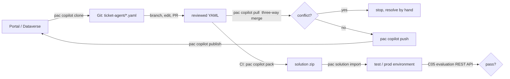

# C07 — The code-first dev loop: Git is your local, the cloud is the only runtime

Copilot Studio has no Foundry Local and no `BedrockAgentCoreApp().run()`. There is no process you can start on a laptop that executes a Copilot Studio agent, and no on-device model behind it; the runtime is the harness in Microsoft's cloud, full stop (A1). What you _can_ hold locally is the **definition**: since the VS Code extension went GA in January 2026 and `pac copilot clone` / `pull` / `push` matured (C1, C2), the whole agent round-trips as YAML in a Git repository, gets reviewed in a pull request, and is packed into a solution by a build agent that never signs in. **The design decision this chapter asks is the F07 and B07 question with the answer inverted: on Foundry and AWS the model moves to the laptop and the responsibility stays; on Copilot Studio nothing executable moves, only the source does, and the responsibility you take on is the Git workflow, not the guardrail.**

> _On Foundry Local you own the runtime. On Copilot Studio you own the diff._

Running scenario: the C03 ticket agent (instructions, the three policy documents as knowledge, the ticket MCP server as a tool, the 250 GBP refund rule) cloned into `ticket-agent/` as YAML, edited on a branch, pushed back, published; plus the C03 lab 04 Microsoft 365 Agents SDK agent, which _does_ run on your laptop because it is your code, and which Copilot Studio reaches as a connected agent through a dev tunnel (B5, C7). Runnable proof: [`labs/01-dev-loop/`](labs/01-dev-loop/). Facts from the pac CLI reference, the VS Code extension page and the Agents SDK pages fetched 25 Oct 2026, cited by letter into [`../reference/reading-map-copilot-studio-2026-10-25.md`](../reference/reading-map-copilot-studio-2026-10-25.md). Status words are GA, preview and retiring, with dates. Nothing here has run against the tenant yet.

### What we are trying to avoid

A pro-dev team asks for "the Copilot Studio Docker image" and loses a week. A maker edits a topic in the portal while a colleague edits the same topic in YAML; `pac copilot push` stops on the conflict and the colleague force-pushes by deleting the portal change. A pipeline imports a solution with uploaded-file knowledge and nobody notices the files did not come across, because uploaded knowledge is not ALM-portable (C4). A team builds the Agents SDK ticket agent, runs it locally for a month, and finds at go-live that Copilot Studio can only reach it through an `/api/messages` endpoint with an auth mode they never configured (B5). A developer pastes the YAML into a coding agent that invents node types; the VS Code extension's IntelliSense would have caught it (C2).

### Has this happened?

The conflict rule and the "safe to run in a build pipeline" note for `pac copilot pack` are on the pac reference itself (C1); the ALM gap for uploaded knowledge is on the quotas page (C4). Microsoft pitches the VS Code extension explicitly for coding agents such as GitHub Copilot and Claude Code (C2), which is the invitation and the risk in one sentence. The Docker request is from this author's own engagements; there is nothing to cite because there is nothing to pull.

### What the chapter covers

What "local" can and cannot mean here (1). The YAML artefact: what a clone contains, how the extension round-trips, what never crosses the ALM boundary (2). The loop: clone, branch, edit, `pull`, `push`, `publish`, and `pack` plus `pac solution import` in CI (3). The one thing that does run on your laptop: the Agents SDK agent, the Agents Playground, a dev tunnel, then the connected-agent registration (4). pac's own MCP server and the extension as surfaces for coding agents (5). What you now own (6).

### What you have at the end

A `ticket-agent/` YAML tree you can diff, a branch-to-publish loop you can run from a terminal, a CI job that packs and imports without a human, the SDK agent answering in the Playground and reachable from Copilot Studio, and the sentence that stops the "local Copilot Studio" conversation.

---

## 1. What "local" can mean here

Four meanings, three of them real.

| Meaning                                                              | On Copilot Studio                                                                                                                 | Reference |
| -------------------------------------------------------------------- | --------------------------------------------------------------------------------------------------------------------------------- | --------- |
| Run the agent on my machine                                          | **No.** The harness is cloud-only; the Direct-to-Engine client, Direct Line and the channels all call the hosted agent (C8, C10)  | A1        |
| Run a model on my machine                                            | **No.** The orchestrator model is a curated dropdown; even BYO Foundry models for Prompt tools are cloud endpoints (K1, K4)       | K         |
| Hold the agent definition on my machine, in Git                      | **Yes.** `pac copilot clone` and the VS Code extension produce YAML for topics, knowledge references, tools and triggers (C1, C2) | C         |
| Run _my own_ agent code on my machine and let Copilot Studio call it | **Yes.** An Agents SDK agent on `localhost:3978` behind a dev tunnel is a valid connected-agent endpoint (B5, C7)                 | B, C      |

The honest architecture is therefore **source-first**: the portal is a view over Dataverse, Git is a second view over the same objects, and the cloud is the only place anything executes. Development-time cost is Copilot credits for the test pane and nothing else; there is no "a day of Ollama costs electricity" line to write (compare B07 §1).

**Interview line.** "There is no local Copilot Studio. There is a local _source_ for a Copilot Studio agent, and a local _process_ only for the code you connect to it."

**Study check.** A security team asks you to run the ticket agent inside their network because the data is sensitive. **Answer.** You cannot move the harness. You can keep the data in place (SharePoint and Dataverse knowledge stay where they are, read live with the user's permissions, J1), keep the definition in their Git, and put the tool and any custom code on their side of a tunnel or App Service. Say which of those they actually wanted.

## 2. The YAML artefact

`pac copilot clone --schemaName <agent> --outputDirectory ./ticket-agent` writes a folder of YAML, one file per component: the agent manifest, each topic, each knowledge source reference, each tool reference, triggers, and settings; `pac copilot init --environment` bootstraps the same layout for a new agent, and `init` without an environment scaffolds it offline (C1). The VS Code extension opens the same tree with IntelliSense for node types, a sync view that shows portal-side drift, and an **apply** command that is `push` with a diff preview (C2). The exact file names are not enumerated on the reference page; the lab records what the clone produces in your tenant (`# verify` in `pac_init_local.sh`).

What crosses the ALM boundary and what does not matters more than the layout:

| Component                                                                                 | In the YAML / solution                                  | Survives import elsewhere                          |
| ----------------------------------------------------------------------------------------- | ------------------------------------------------------- | -------------------------------------------------- |
| Instructions, topics, generative orchestration settings, triggers                         | yes                                                     | yes                                                |
| Tool _references_ (connectors, MCP connectors, flows)                                     | yes, as connection references and environment variables | yes, once the target environment has connections   |
| SharePoint and Dataverse knowledge _references_                                           | yes                                                     | yes, live read in the target                       |
| Uploaded files, OneDrive / SharePoint uploads, Salesforce / ServiceNow ingested knowledge | reference only                                          | **no**: the index is not re-created on import (C4) |
| Memory contents, transcripts, evaluation runs                                             | no                                                      | no                                                 |

That table is why the C03 lab stores the three policy documents in SharePoint and reads them through the connector rather than uploading them: the upload is the convenient path and the non-portable one.

**Interview line.** "The YAML carries the agent and the pointers. It does not carry an index, a connection or a conversation."

**Study check.** After `pac solution import` into test, the agent answers policy questions with "I could not find that". Which row of the table happened? **Answer.** Uploaded knowledge: the reference imported, the index did not. Switch the source to the SharePoint connector or re-upload in the target and say so in the runbook.

## 3. The loop

Six commands and two rules (C1):

1. `pac copilot clone` once; after that `pull` before every edit session. `pull` is a three-way merge against the last-synced state, so portal edits by a maker and YAML edits by you are reconciled rather than overwritten.
2. Edit on a branch. The PR is the review the portal never had.
3. `pac copilot push`. Rule one: **a conflict stops the push**; there is no `--force`. Resolve in YAML, pull again, push again.
4. `pac copilot publish` makes the pushed definition live for new sessions (L1 for the session-rollover semantics).
5. In CI, `pac copilot pack` turns the YAML into a solution zip **without authenticating**; the reference calls it safe for build pipelines. `pac solution import` into the target environment then needs a service principal or a federated credential, never a maker's user token. Rule two: a third-party blog reports a one-time portal step before exports work in pipelines; not on Learn, marked verify in the lab's `ci_pipeline.yml`.
6. The gate after import is the C05 evaluation REST API (I3), which is the only non-interactive quality check Microsoft offers; Power Platform Pipelines can call the same thing through the connector actions (I4).

Where `pac` stops and solutions start: `pack` handles the agent's own YAML; connection references and environment variables that the agent's tools use live in the solution, and Power Platform Pipelines or the Copilot Agent Kit's quality gate (I5) are the enterprise versions of the same loop.

**Interview line.** "Pull, push, publish for people; pack, import, evaluate for pipelines."

**Study check.** Your push fails with a conflict on `topics/escalation.yaml`. A colleague says "just delete the portal version". **Answer.** No. `pull` first to see the three-way diff, keep both intents, push, then tell the colleague the portal is still a valid editor and the merge exists for exactly this case.

## 4. The one thing that runs on your laptop

The Microsoft 365 Agents SDK is code you host (A10). The Python packages are `microsoft-agents-hosting-aiohttp` 1.9.0 (`AgentApplication`, `CloudAdapter`, `start_agent_process`) and `microsoft-agents-authentication-msal` 1.9.0 (`MsalConnectionManager`), verified in the shared venv on 25 Oct 2026 (C9). An `AgentApplication` registers handlers (`@app.message`, `@app.conversation_update`) and an aiohttp route serves `POST /api/messages` on port 3978 by convention.

Local loop for it:

1. `python app.py` in `C03/labs/04-agents-sdk-connected/sdk_agent/`; the process listens on `http://localhost:3978/api/messages`.
2. The **Microsoft 365 Agents Playground** (the Agents Toolkit's local test client) sends Activities to that URL with no Entra token, so you see the conversation without any tenant.
3. A **dev tunnel** (`devtunnel host -p 3978` or ngrok) gives the laptop a public HTTPS URL.
4. In Copilot Studio, add the tunnel URL plus `/api/messages` as an **M365 Agents SDK connected agent** with auth none for the lab, API key or OAuth2 for anything shared (B5). The main agent now hands ticket intents to code running on your machine.

Two cautions. The Playground skips authentication, so the first real call from Copilot Studio is also the first test of your `MsalConnectionManager` configuration; set it up before the tunnel. And Copilot Studio reaches a connected agent through the Activity protocol, not MCP: if what you built is a tool, host it as an MCP server instead (C04 lab 02) and keep the SDK path for agents that converse.

**Interview line.** "The Playground tests the agent. The tunnel tests the contract. The connected-agent dialog tests the auth."

**Study check.** The Playground works, the tunnel URL answers in a browser, Copilot Studio says the connected agent did not respond. **Answer.** The Playground sent unauthenticated Activities; Copilot Studio sends them with the auth mode you selected. Check the mode in the connected-agent dialog against the connection manager in `app.py`, then the tunnel's 401 log.

## 5. Surfaces for coding agents

Two things in this product are built to be driven by another agent. `pac copilot mcp --run` starts a local MCP server that exposes pac's own commands as tools, so a coding agent (Claude Code, GitHub Copilot CLI) can run the §3 loop for you (C1). The VS Code extension's page says the quiet part out loud: it exists so that "GitHub Copilot or Claude Code" can edit the YAML with schema help (C2). That is a code path from a prompt to a published agent with no human click, which is why §3's PR step and C09's DLP and environment-group rules are not optional (F1, F2).

The restraint to carry: give the coding agent `clone`, `pull`, `push` on a dev environment and keep `publish` and `pac solution import` behind the pipeline's federated credential.

**Interview line.** "pac's MCP server lets an agent write your agent. The PR and the pipeline are where a person still signs."

**Study check.** A developer wants to let a coding agent `publish` directly from VS Code "to save time". **Answer.** Scope its pac profile to a dev environment, keep publish in CI after the C05 evaluation gate, and point at the Agent 365 audit trail that will show the agent as the publisher (E8, F6).

## 6. What you now own

| Concern                                 | Who owns it in the dev loop                                                                               |
| --------------------------------------- | --------------------------------------------------------------------------------------------------------- |
| Runtime, scaling, model hosting         | Microsoft, always; nothing local to run                                                                   |
| Guardrails, moderation, XPIA protection | the harness (F11, F12); unchanged by where you edit                                                       |
| Identity                                | Entra Agent ID, created by the product (E1); your SDK agent's own app registration for the connected path |
| Source of truth and history             | **you**: Git, branches, PRs, `pull` discipline                                                            |
| Promotion between environments          | **you**: `pack`, `pac solution import`, pipelines, connection references                                  |
| Quality gate                            | **you**: the evaluation REST API call in CI (I3), test sets as code (`data/testset.csv` in C05)           |
| Secrets in the pipeline                 | **you**: a federated credential for the service principal; no client secrets in YAML or workflows         |
| Knowledge that does not port            | **you**: pick portable sources or script re-upload per environment (C4)                                   |

The contrast with F07 and B07 is the whole point: there the laptop gains a runtime and loses every platform control; here the laptop gains nothing executable and the controls stay where they were.

**Interview line.** "Locally I own the diff, the pipeline and the gate. The runtime and its controls never left Microsoft's cloud."

**Study check.** A reviewer asks for the "local security story". **Answer.** There is none to tell because nothing executes locally; the stories to tell are secret-free CI (federated credential), least-privilege pac profiles per environment, and the DLP / environment rules that bound what a pushed YAML can wire up.

---

## The chapter in eight lines

1. Copilot Studio has no local runtime and no local model; the harness is cloud-only (A1).
2. "Local" means the agent definition as YAML in Git: `pac copilot clone` / `init`, the VS Code extension GA Jan 2026 (C1, C2).
3. The loop is `clone` once, `pull` (three-way merge), edit on a branch, `push` (conflicts stop it), `publish`.
4. In CI, `pac copilot pack` needs no login; `pac solution import` needs a federated credential; the C05 evaluation REST API is the gate (I3).
5. Uploaded and ingested knowledge does not cross the ALM boundary; references do (C4).
6. The Agents SDK agent is the one process that runs on your laptop: Playground, dev tunnel, then a connected agent with an explicit auth mode (B5, C9).
7. `pac copilot mcp --run` and the extension are built for coding agents; keep publish and import behind the pipeline (C1, C2).
8. On Foundry Local you own the runtime; here you own the diff, the pipeline and the gate.

## What you should be able to explain

Why there is no local Copilot Studio and what to offer instead. What a clone contains and the two things it cannot carry. The six commands and the two rules of the loop. Why `pack` is safe in CI and `import` is not without a service principal. How an SDK agent on `localhost:3978` becomes a connected agent. Where a coding agent should and should not be allowed in the loop.

## What this is not

Not the solution and pipeline chapter (C02 has the ALM layers and the credits table). Not the Agents SDK programming guide (C03 lab 04 has the agent; this chapter only runs it). Not the governance of what a pushed YAML may do (C09). Not fine-tuning or local models, which do not exist here (C06 for models).

## Implementation scope and versions

`pac` CLI reference updated 10 Jul 2026 (C1); Copilot Studio VS Code extension GA Jan 2026 (C2); `microsoft-agents-hosting-aiohttp`, `microsoft-agents-authentication-msal`, `microsoft-agents-copilotstudio-client` 1.9.0 (C9); Microsoft 365 Agents SDK overview 28 Apr 2026 (A10). pac flags in the lab scripts are copied from the reference and still marked verify until the first run; the file layout of a clone and the "portal click before pipeline export" caveat are marked verify. Nothing here has run against the tenant.

## Same thing on Foundry and AgentCore

| Copilot Studio (this chapter)                                    | Foundry (F07, F02)                                             | AgentCore (B07, B02)                                                       |
| ---------------------------------------------------------------- | -------------------------------------------------------------- | -------------------------------------------------------------------------- |
| `pac copilot clone` → YAML tree (agent, topics, tools, triggers) | `azure.yaml` + prompt-agent definition (`create_version` body) | `agentcore/agentcore.json` + the code zip                                  |
| Copilot Studio VS Code extension (IntelliSense, sync, apply)     | VS Code Foundry Toolkit / Canvas                               | `agentcore dev` with hot reload and the Agent Inspector                    |
| `pac copilot pull` / `push` / `publish`                          | `azd deploy`, `create_version` (immutable versions)            | `agentcore deploy` (thin CDK), `update_agent_runtime` (immutable versions) |
| `pac copilot pack` + `pac solution import` in CI                 | `azd pipeline config`, Bicep                                   | CDK app in CI, `agentcore deploy --yes`                                    |
| Agents SDK agent on `localhost:3978` + Playground + tunnel       | Agent Framework `ResponsesHostServer` on 8088 locally          | `BedrockAgentCoreApp().run()` on 8080, `agentcore invoke --local`          |
| Connected agent via Activity endpoint                            | hosted agent / A2A tool                                        | Runtime as a Gateway HTTP target / A2A on 9000                             |
| No local model                                                   | Foundry Local (`foundry run`, Olive INT4)                      | Ollama / llama.cpp behind Strands                                          |
| You own the diff, pipeline, gate                                 | you own guardrails, identity, tracing locally                  | same list as Foundry                                                       |

## Further reading

C1 pac copilot reference · C2 VS Code extension · C3 solutions · C4 quotas and ALM limits · C5 Dataverse Git integration · C7 Agents SDK integration modes · C9 package versions · B5 SDK agent as connected agent · A1 harnesses · A10 Agents SDK overview · I3 evaluation REST API · F1, F2 the rules that bound a pushed definition.
