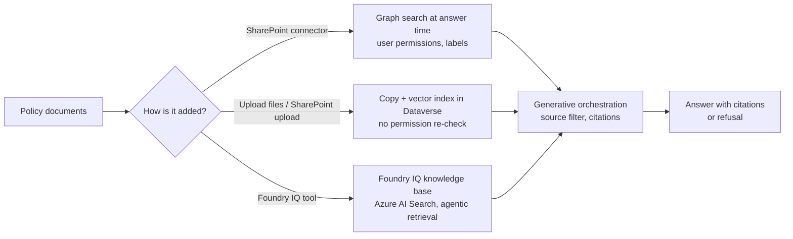

# C08 — Knowledge and memory in Copilot Studio: live sources, ingested sources, and the knowledge base you bring from Foundry

Copilot Studio gives an agent knowledge in two ways that look the same in the portal and behave differently in production. A **live source** (a SharePoint site through Microsoft Graph, a Dataverse table, an enterprise connector) is queried at answer time with the signed-in user's permissions. An **ingested source** (uploaded files, a SharePoint folder copied into Dataverse, a Salesforce connector crawl) is chunked and indexed inside Dataverse and answers from the copy. **The design decision in this chapter is the same one F08 and B08 asked: does retrieval intelligence live in your agent's prompt, in a source the platform indexes for you, or in a governed knowledge base you can version and bill separately.** Copilot Studio adds a third answer the other two platforms do not have: the knowledge base can be Foundry IQ, added as a tool.

> _A live source inherits the user's permissions and the tenant's labels. An ingested source inherits nothing after the copy. Decide which one you are adding before you decide which one is faster._

Running scenario: the support-ticket agent from C03 grounded on the three refund, card and escalation policy documents from F08, uploaded to a SharePoint site. The runnable proof is [`labs/01-knowledge/`](labs/01-knowledge/), written on 25 Oct 2026 against `microsoft-agents-copilotstudio-client` 1.9.0 and `msal` 1.39.0 and not yet run. Facts come from the pages fetched that day, sections J, G and B of [`../reference/reading-map-copilot-studio-2026-10-25.md`](../reference/reading-map-copilot-studio-2026-10-25.md); letters such as J2 or G1 refer to it. Status words are GA, preview and retiring, with dates. Harness tags follow the docs: Standard, GitHub Copilot harness, Customer Conversation harness (A1).

### What we are trying to avoid

A team adds a SharePoint site with "Upload files → SharePoint" because it indexes faster, ships to production, and discovers that a finance folder restricted to twelve people is now answerable by everyone who can reach the agent, because the copy in Dataverse does not re-check SharePoint permissions. A second team exports the solution to the test environment and the agent answers nothing: uploaded-file knowledge does not travel with a solution and is not re-ingested on import (J7). A third team adds 31 knowledge sources to a generative-orchestration agent and cannot explain why answers got worse; above 25 sources the orchestrator runs a model pass to pick sources first, and it picks badly when source descriptions are vague (B1). A fourth team builds the same policy index three times, once per platform, when one Foundry IQ knowledge base could serve the Foundry agent, the AgentCore agent and the Copilot Studio agent (J3).

### Has this happened?

The first failure is the EchoLeak shape from S03.06 turned inward: not an attacker, just a copy that outlived the permission check. The ALM gap is written into the quotas page (J7). The 25-source filter is documented on the knowledge summary page (B1). The three-index problem is the reason Foundry IQ exists as a product and the reason it surfaces in Copilot Studio as a tool rather than as yet another ingested source.

### What the chapter covers

The knowledge catalogue in one table, with the four properties that matter (1). SharePoint two ways and why the choice is a security decision (2). What generative orchestration does with sources: the filter, citations, ungrounded answers (3). Foundry IQ, Fabric IQ and Work IQ as tools, the cross-track knowledge base (4). Enterprise connectors, Graph connectors and the Standard-harness Azure AI Search node (5). Memory, which is not knowledge and not transcripts (6).

### What you have at the end

The three policy documents in a SharePoint library, uploaded from code; the ticket agent answering the three canonical questions with citations and refusing the Peru question; the one-table catalogue you can draw from memory; the sentence that separates live from ingested; and the Foundry IQ tool you can reuse from F08.

---

## 1. The knowledge catalogue

Every knowledge type in Copilot Studio can be placed on four axes. The table is the chapter; the sections after it are the reasons.

| Source                                      | Harness                                   | Live or ingested                                      | Auth passthrough                                     | ALM portable | Limits worth knowing                                                        | Map        |
| ------------------------------------------- | ----------------------------------------- | ----------------------------------------------------- | ---------------------------------------------------- | ------------ | --------------------------------------------------------------------------- | ---------- |
| Public websites (Bing)                      | Standard, GitHub                          | live (Bing index)                                     | n/a                                                  | yes          | 25 sites generative, 4 classic; "Web Search" toggle is Grounding with Bing  | J1         |
| Bing Custom Search                          | Standard                                  | live                                                  | n/a                                                  | yes          | your configured domains only (Mar 2026)                                     | J1         |
| Uploaded files                              | both                                      | ingested into Dataverse                               | none after upload                                    | **no** (J7)  | 500 files per agent, 512 MB each; page-level PDF citations                  | J2         |
| SharePoint, connector                       | both                                      | live via Graph search                                 | yes, user's permissions, sensitivity labels honoured | yes          | 25 sites; metadata filters; 200 MB files with tenant graph grounding        | J1, J2, J6 |
| SharePoint / OneDrive, "Upload files"       | both                                      | ingested into Dataverse (vector index)                | **none after copy**                                  | **no**       | 1,000 files / 50 folders / 10 levels per source; 4–6 h sync                 | J2         |
| Dataverse tables                            | both                                      | live                                                  | Dataverse security roles                             | yes          | 2 sources × 15 tables; unstructured text and file columns preview Sept 2026 | J1, J5     |
| Azure SQL                                   | Standard                                  | live                                                  | connection                                           | yes          | Aug 2026                                                                    | J1         |
| Enterprise data via Graph connectors        | both                                      | live via Microsoft Search                             | yes                                                  | yes          | needs the Graph connector configured in M365 admin                          | J1         |
| Salesforce, ServiceNow, Confluence, Zendesk | Standard                                  | ingested, with a live permission check at answer time | yes (check), content copied                          | **no**       | connector licensing                                                         | J1, J7     |
| Azure OpenAI on your data / Azure AI Search | Standard, classic generative-answers node | live                                                  | your index's auth                                    | yes          | preview; not in the GitHub harness                                          | J4         |
| **Foundry IQ knowledge base**               | GitHub harness, as a tool                 | live (Foundry IQ owns the index)                      | API key, SPN, certificate or Entra                   | yes          | one knowledge base per agent; GA Sept 2026                                  | J3         |
| Fabric IQ, Work IQ                          | GitHub harness, as tools                  | live                                                  | Entra                                                | yes          | preview Aug / June 2026                                                     | J5         |

Hard caps: 500 knowledge objects per agent; above 25 sources generative orchestration runs a selection pass first (B1).

_Micro-example._ The ticket agent needs the three policy documents. Added as a SharePoint connector source, the agent answers "Do customers still need a travel notice?" with a citation to `card-policy.md` and only for users who can open that site. Added as uploaded files, it answers for everyone, and after you import the solution into the test environment it answers nothing until someone uploads the files again by hand.

**Interview line.** "Copilot Studio knowledge is either live, which inherits permissions and survives ALM, or ingested, which is faster and inherits nothing. I add SharePoint as a connector, never as an upload, unless the documents are public inside the company."

**Study check.** A knowledge source shows a sensitivity label in the citation. Which column of the table did it come from? **Answer.** Live via Graph (the SharePoint connector or a Graph connector). Ingested copies drop the label with the permission.

Rule to keep: **live for anything with an ACL; ingested only for documents everyone may read and that you will re-upload per environment.**

## 2. SharePoint two ways

The portal offers SharePoint in two places and the names do not warn you (J2).

|                    | SharePoint connector ("SharePoint" under Knowledge)                                 | "Upload files → SharePoint / OneDrive"                                |
| ------------------ | ----------------------------------------------------------------------------------- | --------------------------------------------------------------------- |
| Mechanism          | Graph search over the site at answer time                                           | files copied into Dataverse, chunked, embedded, re-synced every 4–6 h |
| Permissions        | the signed-in user's; needs Authenticate with Microsoft (E5)                        | none; whoever reaches the agent reads the copy                        |
| Sensitivity labels | honoured and shown                                                                  | lost                                                                  |
| File size          | 200 MB with tenant graph grounding, otherwise the Graph limit                       | 512 MB                                                                |
| Structure          | up to 25 sites, metadata filters                                                    | 1,000 files, 50 folders, 10 levels per source                         |
| Freshness          | immediate                                                                           | hours                                                                 |
| ALM                | the site URL travels in the solution                                                | the copy does not; re-upload after import (J7)                        |
| Credits            | tenant graph grounding bills 10 credits per use when semantic search is on (K6, J6) | generative answer 2 credits                                           |

Tenant graph grounding with semantic search is the switch that makes the connector path good: it needs an M365 Copilot licence in the tenant and Authenticate with Microsoft, and it lifts the SharePoint file ceiling to 200 MB (J6). Without it the connector still works, with keyword-style Graph search.

_Micro-example._ `labs/01-knowledge/upload_policies.py` puts the three files in a `Policies` library with Graph, so the SharePoint connector path can be tested from code; the lab README then has you add the same three files as uploads to a second agent and compare the citations and the "who can see this" column.

**Interview line.** "The SharePoint connector is a permission-preserving live query; the SharePoint upload is a Dataverse copy. The second one is a data-leak waiting for an auditor."

**Study check.** Why does the connector path need "Authenticate with Microsoft"? **Answer.** Graph search runs as the user; without a user token there is no permission to trim by, so the source is unavailable in a no-auth agent (E5).

Rule to keep: **if the site has an ACL you care about, it is a connector source, and the agent authenticates with Microsoft.**

## 3. What orchestration does with sources

With generative orchestration on (required for MCP and web search, B1) the orchestrator receives the user's message, picks knowledge sources, queries them, and composes an answer with citations. Four behaviours decide answer quality:

- **The source filter.** Above 25 sources a model pass chooses which sources to query. It reads the source _descriptions_, so a source named "Docs 2" is a source that never gets picked (B1). Keep names and descriptions specific: "UK card team policy, effective 1 Jul 2026".
- **Citations.** Each grounded sentence carries a citation to a file, page or record. Teams renders up to 20; citations cannot be passed as tool inputs (B1). The lab prints the citation entities the Direct-to-Engine client returns.
- **"Allow ungrounded responses."** Off means the agent answers only from knowledge and refuses otherwise; this is the setting that produces the correct refusal for "What is the capital of Peru?" On means the model may answer from its own weights. Leave it off for a policy agent.
- **Moderation and the refusal shape.** Content moderation (F11) is separate from grounding; a refusal for lack of knowledge is not a moderation block, and the evaluation General quality method penalises it unless you use a Custom grader (I1).

_Micro-example._ With the three policy files as the only knowledge and ungrounded responses off: "Can I refund £300 to a customer's new card?" cites the refund policy and the card policy; "Do customers still need a travel notice?" cites the card policy (no, since May 2026); "What is the capital of Peru?" returns the no-knowledge message. That triple is the proof checklist.

**Interview line.** "Grounding quality in Copilot Studio is mostly two settings and one habit: ungrounded responses off, moderation at High, and source descriptions a model can choose between."

**Study check.** Your agent has 40 sources and answers from the wrong policy. First thing to check? **Answer.** The descriptions of the sources; above 25 the orchestrator filters by them before it queries anything (B1).

Rule to keep: **ungrounded responses off for policy agents; descriptions written for the model, not for you.**

## 4. Foundry IQ, Fabric IQ and Work IQ as tools

The GitHub Copilot harness does not re-index Foundry IQ; it calls it. A Foundry IQ knowledge base is added as a **tool** (one per agent), authenticated with an API key, a service principal, a certificate or the signed-in Entra identity, tuned in Foundry (sources, `retrievalReasoningEffort`, output mode), and its retrievals appear in the agent's activity trace (J3). It reached GA in Sept 2026 (A8). Fabric IQ (Aug 2026) and Work IQ (June 2026) follow the same pattern for Fabric data and Microsoft 365 signals (J5).

This is the cross-track object. The F08 lab built `kb-ticket-policies` on Azure AI Search from the same three documents and gave it to the Foundry agent through an MCP connection; B08 gave the same documents to the AgentCore agent through a Gateway target. C08 gives the Foundry knowledge base to the Copilot Studio agent as a tool. One index, three platforms, one citation format inside Foundry IQ.

|             | Foundry IQ tool (C08)                              | Foundry agent (F08)                                    | AgentCore agent (B08)                                   |
| ----------- | -------------------------------------------------- | ------------------------------------------------------ | ------------------------------------------------------- |
| Object      | the same knowledge base                            | `kb-ticket-policies`                                   | Managed Knowledge Base (separate index)                 |
| Access path | tool in the GitHub harness                         | `RemoteTool` MCP connection, `knowledge_base_retrieve` | Gateway KB target, `Retrieve` / `AgenticRetrieveStream` |
| Identity    | API key, SPN, certificate, or Entra signed-in user | project managed identity                               | gateway IAM role                                        |
| Tuning      | in Foundry                                         | in Foundry                                             | in Bedrock                                              |

What you give up: the Foundry IQ tool is GitHub-harness only (J3), so the Standard-harness agent in C03 lab 01 cannot use it; the Standard-harness equivalent is Azure AI Search inside a classic generative-answers node (J4, §5). Which is why `labs/01-knowledge/foundry_iq_tool.md` is a portal walkthrough on the GitHub-harness copy of the agent, not a script.

_Micro-example._ Add the F08 knowledge base as a tool with the agent's Entra identity; ask the Peru question; the activity trace shows one retrieval returning nothing and the agent refusing. Change the knowledge base's `retrievalReasoningEffort` in Foundry; the Copilot Studio agent changes behaviour with no republish.

**Interview line.** "When the same documents must ground agents on more than one platform, the knowledge base belongs in Foundry IQ and each platform gets a tool, not a copy."

**Study check.** Why does a Foundry IQ tool count against the agent's tool budget rather than its knowledge limit? **Answer.** Because the agent calls it; Copilot Studio does not index it. It is governed like a tool: auth, trace, credits per action (J3, K6).

Rule to keep: **shared documents, shared index, platform-specific tool.**

## 5. Enterprise connectors, Graph connectors, and the Standard-harness search node

Three more families sit in the catalogue (J1):

- **Enterprise data via Graph connectors.** Anything already indexed into Microsoft Search (ServiceNow KB, Confluence, file shares, custom connectors) is a live source with the user's permissions. The work is in the M365 admin centre, not in Copilot Studio.
- **Unstructured connectors** for Salesforce, ServiceNow, Confluence and Zendesk. Content is ingested into Dataverse, with a live permission check at answer time, so they sit between the two columns of §1: fresher than an upload, still a copy for ALM purposes (J7).
- **Azure OpenAI on your data / Azure AI Search** (J4). Standard harness only, inside a classic generative-answers node, preview. This is the pre-Foundry-IQ way to point an agent at an index you built yourself, and the only way for a Standard-harness agent to use an Azure AI Search index directly. Custom data (your own retrieval) is classic-only too.

_Micro-example._ A bank already runs a ServiceNow Graph connector for Microsoft Search. Adding "Enterprise data" to the ticket agent gives it the knowledge articles with no crawl, no copy and the same visibility the agent user has in ServiceNow.

**Interview line.** "If it is already in Microsoft Search, do not ingest it twice; add it as enterprise data and keep the permissions you already paid to model."

**Study check.** A Standard-harness agent must query an Azure AI Search index you own. Which path? **Answer.** The Azure OpenAI on your data option in a classic generative-answers node (J4); the Foundry IQ tool is GitHub-harness only (J3).

Rule to keep: **index once, in whichever system already enforces the permission.**

## 6. Memory is not knowledge

Three objects get called memory and none of them is the knowledge catalogue (G1–G4):

| Object                  | Harness                                  | Scope                                                   | Who can read it                                         | Lifetime                                         |
| ----------------------- | ---------------------------------------- | ------------------------------------------------------- | ------------------------------------------------------- | ------------------------------------------------ |
| Memory                  | GitHub harness, production-ready preview | per user, per agent; files in Microsoft-managed storage | the user, through a memory portal; **the maker cannot** | deleted after 28 days of inactivity (G1)         |
| Structured memory       | Customer Conversation harness            | per conversation / customer                             | the agent                                               | the harness's own rules (G2)                     |
| Business-process memory | persistent agents, Frontier preview      | per agent, across runs                                  | the agent                                               | announced 15 Oct 2026, details to come (G3)      |
| ConversationTranscript  | all                                      | per session, Dataverse table                            | makers and admins with the role                         | 30 days by default, extendable to 12 months (G4) |

The last row is the one teams confuse with memory. Transcripts are an analytics and compliance record (C05 uses them); they are never read back into a conversation. The first row is the one teams confuse with knowledge: it is personal, maker-blind and short-lived, which is the right design for "remember my preferred name", and the wrong one for "remember the refund policy".

On Foundry the equivalent is the memory store with the memory search tool (F03 lab 04); on AgentCore it is AgentCore Memory with semantic and user-preference strategies (B03 lab 04). Both let the developer configure and read strategies. Copilot Studio deliberately does not.

_Micro-example._ A user tells the GitHub-harness ticket agent "always address me as Dr Osei". Next week, in a new session, the agent does. The maker opens the agent and cannot see that fact anywhere; the user can, in the memory portal, and can delete it.

**Interview line.** "Copilot Studio memory is per-user, maker-blind and expires in 28 days; policy knowledge goes in a source, process state goes in Dataverse, and transcripts are for analytics."

**Study check.** A product owner asks you to "use memory so the agent remembers the new refund limit". What do you do? **Answer.** Put the limit in a knowledge source or in the instructions (and in a tool's policy, B09/C09 style); memory is per user and cannot be seeded or read by the maker (G1).

Rule to keep: **knowledge is shared and governed; memory is personal and invisible to you; transcripts are evidence.**

---

## The chapter in eight lines

1. Every knowledge type is either live (permissions inherited, ALM-portable) or ingested (a copy in Dataverse, nothing inherited, not portable) (J1, J2, J7).
2. SharePoint appears twice; the connector is live, the upload is a copy. Choose by ACL, not by speed (J2).
3. Tenant graph grounding needs an M365 Copilot licence and Authenticate with Microsoft, and lifts files to 200 MB (J6).
4. Above 25 sources the orchestrator filters by description; 500 knowledge objects is the hard cap (B1).
5. Ungrounded responses off is what makes the Peru question a refusal (B1).
6. Foundry IQ is a tool in the GitHub harness, one knowledge base per agent, GA Sept 2026; it is the index you share with F08 (J3).
7. Standard-harness agents reach Azure AI Search only through the classic generative-answers node (J4).
8. Memory is per-user, maker-blind, 28 days; transcripts are not memory (G1, G4).

## What you should be able to explain

Live versus ingested in one sentence. Why the SharePoint upload is a security decision. What the 25-source filter reads. The two settings that produce correct refusals. Why Foundry IQ is a tool and not a knowledge source, and which harness can use it. The three things people call memory and who can read each.

## What this is not

Not the evaluation of grounding quality (C05 §3 and the General quality method). Not the DLP rules that decide which knowledge connectors an environment may use (C09 §2). Not the Foundry IQ knowledge base itself, which F08 builds. Not the Dataverse MCP server, which is a tool (C04 lab 03).

## Implementation scope and versions

Written 25 Oct 2026 against: Copilot Studio Learn pages dated Jun–Oct 2026 (map J, G, B); `microsoft-agents-copilotstudio-client` 1.9.0; `msal` 1.39.0; Microsoft Graph v1.0 for the SharePoint upload. The lab targets a Standard-harness agent for the scripted parts and the GitHub harness for the Foundry IQ tool. Nothing has run against a tenant.

## Same thing on Foundry and AgentCore

| Copilot Studio (C08)                                 | Foundry (F08)                                                                       | AgentCore (B08)                                           |
| ---------------------------------------------------- | ----------------------------------------------------------------------------------- | --------------------------------------------------------- |
| SharePoint connector (live, Graph, labels)           | Foundry IQ SharePoint remote source (`x-ms-query-source-authorization` passthrough) | Managed KB SharePoint connector (ingested)                |
| Upload files / SharePoint upload (copy in Dataverse) | `azureBlob` indexed source (`-datasource/-skillset/-index/-indexer`)                | S3 data source, ingestion job                             |
| Foundry IQ tool (GitHub harness)                     | `RemoteTool` MCP connection, `MCPTool(allowed_tools=["knowledge_base_retrieve"])`   | Gateway KB target, `Retrieve` / `AgenticRetrieveStream`   |
| "Allow ungrounded responses" off                     | `outputMode: extractiveData` + agent instructions                                   | agent instructions; no KB-level switch                    |
| Citations in the Activity (entities / attachments)   | `activity` + citations in the MCP result                                            | `retrievalResults[].location.s3Location.uri`              |
| 25-source filter, 500 objects                        | knowledge sources per knowledge base                                                | 100 targets per gateway                                   |
| Azure OpenAI on your data node (Standard)            | AI Search tool (F03 lab 05)                                                         | customer-managed KB on S3 Vectors                         |
| Per-user Memory, maker-blind, 28 days                | memory store + memory search tool                                                   | AgentCore Memory, semantic and user-preference strategies |
| ConversationTranscript (Dataverse)                   | conversations in the project                                                        | short-term memory events                                  |

## Further reading

Catalogue and limits: J1, J2, B1. SharePoint and tenant graph grounding: J2, J6. Foundry IQ and the IQ family: J3, J5, A8. Standard-harness search node: J4. ALM: J7, C4. Memory: G1, G2, G3; transcripts: G4. End-user auth that the live sources need: E5. Credits: K6. The matching Foundry and AWS chapters: `../../Agent-Build-02-Microsoft-Foundry/F07-RAG-on-AI-Search/README.md`, `../../Agent-Build-04-AWS-Bedrock-Agent-Core/B08-Bedrock-Knowledge-Bases/README.md`.
