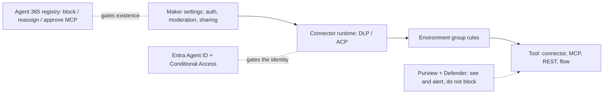

# C09 — Governance and Agent 365: the controls that hold when the maker is in a hurry

Foundry governs agents with APIM policies, Entra roles and Azure Policy. AgentCore puts a Cedar engine on the Gateway. Copilot Studio is different in kind: the agent is a Dataverse row inside a Power Platform environment, every tool call rides a connector, and the identity is minted by Microsoft. **Governance here is mostly not something you write; it is something you configure at five places that already exist, and the whole craft is knowing which place sees what.** This chapter walks those places from the maker's settings page outward to the tenant, names the admin object at each one, and says what each is blind to.

> _The maker proposes. DLP and the environment decide what the agent may touch. Entra and Agent 365 decide whether it exists at all._

The running scenario is the UK support-ticket agent from C03 lab 01 (`AGENT_ID`, `AGENT_SCHEMA_NAME`, `ENVIRONMENT_ID` in the track-root `.env`) with the ticket MCP server from C04 lab 02 as a tool (`TICKET_MCP_URL`). Runnable proofs are in [`labs/`](labs/) (01 inventory and quarantine, 02 DLP and environment rules, 03 Agent 365 and Purview), written on 25 Oct 2026 and not yet run; the user has tenant admin, so lab 02 changes a DLP policy and reverts it. Facts come from the Learn pages fetched that day, listed in [`../reference/reading-map-copilot-studio-2026-10-25.md`](../reference/reading-map-copilot-studio-2026-10-25.md); letters such as F1 or E7 refer to it. Status words are GA, preview and retiring, with dates.

### What we are trying to avoid

A maker ships a ticket agent with "No authentication", shares it tenant-wide, and the SharePoint policy folder it was grounded on is now readable by anyone with the link. Someone adds a third-party MCP server on a Friday afternoon; it works, nobody approved it, and on Monday nobody can say who did it or which tools it exposes. A tool is switched to maker credentials so the demo works, and from then on every user in the company issues refunds as the maker. The finance team buys one credit pack; an autonomous trigger loops over a Dataverse table, consumption passes 125 %, and every agent in the tenant stops answering. An auditor asks for the list of agents and the answer is a screenshot of someone's maker portal.

### Has this happened?

The first failure is the EchoLeak shape (CVE-2025-32711, June 2025): Microsoft 365 Copilot leaked data through grounded content with no click from the user; the fix on the platform side was tighter grounding and audit, the fix on your side is the authentication requirement and sharing limits in §5. The MCP-added-on-Friday failure is why Agent 365 shipped an approval queue for BYO MCP servers in September 2026 (D9). The credits cliff is documented behaviour, not a story: agents are disabled at 125 % of prepaid capacity (K6). Nothing here is invented; the dates are in the map.

### What the chapter covers

Where a control can live and what each one cannot see (1). Inventory and lifecycle: the agent list, Azure Resource Graph, quarantine (2). DLP and Advanced Connector Policies (3). Environment strategy with Managed Environments and groups (4). Sharing and publishing controls (5). Identity controls seen from the governance side (6). Agent 365: registry, licence boundary, Tooling Gateway, BYO MCP approval, Defender (7). Purview, customer-managed keys, network, credits (8).

### What you have at the end

A one-page map of the five control points, the DLP policy you would write for a UK bank, the environment-group rules table filled in, the three inventory fields you check first in a review, the quarantine call, and the three-column "same thing on Foundry and AgentCore" table.

---

## 1. Where governance can live

A tool call from the ticket agent passes five places where something can say no. Unlike Foundry and AgentCore, none of them is code you write; each is an admin object with a known blind spot.

| Enforcement point              | Copilot Studio or admin object                                                                  | Sees                                                                               | Cannot see                                                                                                       | Holds when the maker is wrong?                       |
| ------------------------------ | ----------------------------------------------------------------------------------------------- | ---------------------------------------------------------------------------------- | ---------------------------------------------------------------------------------------------------------------- | ---------------------------------------------------- |
| Maker settings                 | end-user authentication (E5), content moderation (F11), sharing (F4), tool credential mode (D1) | the agent's own configuration                                                      | other agents; what the tool does downstream                                                                      | no, the maker can change it                          |
| Connector runtime              | DLP policy with virtual connectors; Advanced Connector Policies (F1, F2)                        | connector name, HTTP endpoint, MCP server (because MCP rides a connector)          | argument values; prompt content                                                                                  | yes; publish is disabled on violation                |
| Environment group rules        | Managed Environments group rules (F2, F3)                                                       | which features, models, knowledge sources, sharing modes an environment allows     | individual calls                                                                                                 | yes                                                  |
| Identity                       | Entra Agent ID with connector scopes; Conditional Access (E1)                                   | which connectors the agent is configured for; device, location, risk of the caller | custom connectors, MCP and REST tools (no scopes attached); non-Teams channels (CA enforced only in Teams today) | partly                                               |
| Tenant registry and compliance | Agent 365 registry (E8, E9), Purview (F6–F8), Defender (F14)                                    | every agent in the tenant, every interaction, every tool call via the gateway      | the business meaning of an argument                                                                              | registry yes; Purview and Defender observe and alert |

_Micro-example._ The ticket agent calls `issue_refund(T-2041, 900, "customer upset")` through the MCP tool. The maker set end-user credentials, so the call runs as the signed-in support agent. DLP allows the ticket connector in the Business group. Nothing in Copilot Studio evaluates the 900. The cap lives in the MCP server (B04 lab 03 interceptor) or in a Cedar policy if the server sits behind an AgentCore Gateway, or in an APIM policy if it sits behind APIM via the Agent 365 Tooling Gateway (§7). Copilot Studio governance decides **who may call which tool through which connector**; it never decides **with what values**. That sentence is the difference between this chapter and B09.

**Interview line.** "Copilot Studio gives me reach control, not value control: DLP, environment rules and the Agent ID decide which agent may use which connector as whom. The refund cap still has to live behind the tool, in the server or a gateway."

**Study check.** Which of the five points can stop an MCP server from being used at all, and which can stop a 900 GBP refund? **Answer.** DLP (and the Agent 365 BYO MCP approval) stops the server, because MCP rides a connector. None of the five stops the 900; that is the tool's or a gateway's job.

Rule to keep: **in Copilot Studio, governance is about reach; argument-level policy belongs behind the tool.**

## 2. Inventory and lifecycle

### The inventory (E7)

Power Platform admin centre lists every agent in the tenant, and the same data is exposed through the Power Platform API and as `microsoft.copilotstudio/agents` resources in Azure Resource Graph (refresh about 20 minutes). The fields that matter in a review:

| Field                                                                         | Why you read it first                                                                     |
| ----------------------------------------------------------------------------- | ----------------------------------------------------------------------------------------- |
| `authenticationMode`                                                          | "None" with any knowledge source is the EchoLeak shape                                    |
| sharing counts and `entireTenant`                                             | a tenant-wide share is flagged even without admin approval (F4)                           |
| `connectionProvider` per tool: User or Maker, and `connectionIdSharedByMaker` | maker credentials mean every user acts as the maker                                       |
| channels                                                                      | a Direct Line or WhatsApp channel means the IP firewall and Teams-only CA do not cover it |
| `entraAgentId`, blueprint                                                     | pre-May-2026 agents still on legacy app registrations                                     |
| `isQuarantined` (preview)                                                     | the agent is answering only in the maker's test pane                                      |

Lab 01 `inventory.py` prints these for the ticket agent and for every agent in the environment.

### Quarantine (F5)

The quarantine API, `copilotstudio/.../botQuarantine/SetAsQuarantined` on the Power Platform API, needs a Global, AI or Power Platform admin with `CopilotStudio.AdminActions.Invoke`. A quarantined agent is usable only in the maker test pane; every channel goes dark without deleting anything. The Agent 365 registry adds **block**, **reassign** (new owner when a maker leaves) and **delete** on top (E8). Quarantine is the move you make at 02:00 when Defender raises a prompt-injection alert; block is the move you make after the review.

**Interview line.** "First three fields I check: authentication mode, sharing scope, tool credential provider. Those three together are nine tenths of the Copilot Studio risk register."

**Study check.** A maker left the company and the agent runs tools on maker credentials. Which control fixes it today? **Answer.** Agent 365 reassign to a new owner, then switch each tool back to end-user credentials; quarantine in between if the connections have expired.

Rule to keep: **you cannot govern what you cannot list; the inventory is the first deliverable of a Copilot Studio review.**

## 3. DLP and Advanced Connector Policies

### DLP (F1)

Data Loss Prevention policies classify connectors into Business, Non-business and Blocked, and are enforced for all tenants with no exemptions. Copilot Studio adds **virtual connectors** so that agent features become governable as if they were connectors:

| Virtual connector                                                                                  | Governs                                                        |
| -------------------------------------------------------------------------------------------------- | -------------------------------------------------------------- |
| Chat without Microsoft Entra ID authentication                                                     | whether unauthenticated agents may be published                |
| HTTP (with endpoint filtering)                                                                     | HTTP requests from topics and REST tools; allow-list endpoints |
| Skills                                                                                             | Bot Framework skills                                           |
| Channel connectors: Teams + M365 Copilot, Direct Line, Facebook, Omnichannel, SharePoint, WhatsApp | which channels may be published to                             |
| Microsoft Copilot Studio (triggers / autonomous)                                                   | event triggers                                                 |
| Application Insights                                                                               | telemetry export                                               |

Because every MCP server is added through a connector (D3), **blocking a connector blocks its MCP tools**; there is no separate MCP switch. The publish button is disabled while the agent violates the policy, which is the Copilot Studio equivalent of a CI gate. Lab 02 blocks the HTTP virtual connector, watches the ticket agent's publish button go grey, and unblocks.

### Advanced Connector Policies (F2)

ACP lets an admin pre-approve specific connectors and their actions per environment group; **ACP-only mode** (preview) refuses anything not pre-approved. For a bank: the ticket custom connector and the MCP connector approved; HTTP blocked except an allow-listed APIM host; "Chat without Entra authentication" blocked everywhere but the sandbox.

**Interview line.** "DLP is where I stop an MCP server, because in Copilot Studio an MCP server is a connector. The endpoint filter on HTTP is where I force every REST tool through APIM."

**Study check.** A maker adds an MCP server with an API key and it works in the test pane. Can DLP stop it reaching users? **Answer.** Yes: block or leave the connector out of the Business group and publish is disabled; test pane still works, which is why the inventory and Agent 365 approval also matter.

Rule to keep: **block at the connector, not in the prompt; the publish button is your gate.**

## 4. Environment strategy

Managed Environments carry the admin features (groups, rules, CMK, environment-level telemetry); unmanaged environments do not. The pattern (F3): a **default environment routing** rule gives each maker a personal developer environment inside a "Makers" group; a "Pre-production" and a "Production" group hold shared environments with tighter rules and Pipelines between them (C3).

The rules an environment group can lock (F2), with the value a UK bank would set:

| Rule                                            | Makers group                            | Production group                      |
| ----------------------------------------------- | --------------------------------------- | ------------------------------------- |
| Transcript access                               | makers can read                         | admins only                           |
| Advanced Connector Policies                     | advisory                                | ACP-only mode                         |
| Generative AI settings, cross-geo data movement | on, cross-geo off                       | on, cross-geo off                     |
| External models (Anthropic, Mistral, xAI; K3)   | allowed                                 | allowed after risk sign-off, else off |
| Preview and experimental models                 | allowed                                 | off                                   |
| Knowledge sources for agents                    | all                                     | SharePoint and Dataverse only         |
| Agent sharing                                   | Editor to individuals, Viewer to groups | Viewer to named security groups only  |
| Copilot credit draw from tenant pool            | capped per agent                        | capped per agent, alert at 80 %       |
| Skills in Copilot Studio                        | on                                      | on                                    |
| Content security policy for the web canvas      | default                                 | bank domains only                     |

There is no "allow MCP" rule; MCP is governed through DLP and ACP (§3). `sketches/environment_group_rules.md` carries the table with the reasoning per row.

**Interview line.** "Every maker gets a routed dev environment; production is a Managed Environment in a group with ACP-only mode and admin-only transcripts. The rules travel with the group, not with the agent."

**Study check.** Why does environment-level telemetry (H2) matter to the environment decision? **Answer.** It is a Managed Environments feature; an agent built in an unmanaged default environment cannot export OpenTelemetry spans to App Insights, so observability is decided at environment creation.

Rule to keep: **put the agent in the environment whose rules you want to inherit; do not try to configure the same thing per agent.**

## 5. Sharing and publishing controls

Sharing (F4): Editor access only to individuals; Viewer to individuals or security groups; the viewer count can be capped; limits apply only to authenticated agents. A tenant-wide share is flagged by the security scan (E6) and in the inventory even when no admin approved it. Publishing (L4, C11): an admin can switch off publishing of generative agents tenant-wide and switch off cross-geo data movement; Agent 365 pre-approves through DLP and ACP, and only the tenant-wide Teams / M365 Copilot catalogue needs an extra approval. The pre-publish security scan (E6) warns on three things: no authentication, maker credentials, tenant-wide sharing. Those are the same three fields as §2, which is not a coincidence.

**Interview line.** "Three warnings on publish, three fields in the inventory, one list: no auth, maker credentials, tenant-wide share."

**Study check.** Can a maker share an authenticated agent with "Everyone" by accident? **Answer.** The UI allows a tenant-wide share for authenticated agents, but the inventory marks it `entireTenant` and the scan warns; an environment-group sharing rule can forbid it outright.

Rule to keep: **viewers by security group, editors by name, never Everyone outside a sandbox.**

## 6. Identity controls, seen from the governance side

C04 covers how the identity works; here is what an admin does with it (E1–E4):

- Every agent created since May 2026 has an Entra Agent ID under the Microsoft-owned blueprint; the opt-out is gone. Older agents sit on legacy app registrations until Microsoft migrates them; the inventory shows which.
- On publish, connector scopes are attached to the identity. **Conditional Access** can target those scopes (compliant device, location, sign-in risk), enforced in Teams only today. Custom connectors, MCP servers and REST tools get no scopes, so CA does not see them; DLP does.
- The maker is recorded as **sponsor**. When the sponsor leaves, Agent 365 reassign is the fix (§2).
- Autonomous agents that read or write Dataverse need an **agent user** paired with the identity so security roles apply (E4, preview). Without it the agent runs on the maker's connection, which is the FullAccess-equivalent mistake on this platform.
- Nobody in the tenant can mint a token for the agent identity; only the Microsoft blueprint principal can (E1). A stolen agent identity therefore cannot call Graph directly, which is why the connector runtime is the only consumer of those scopes.

**Interview line.** "The agent identity is Microsoft-minted and scope-bound to connectors. I use it for Conditional Access and audit, and I pair it with an agent user when the agent writes to Dataverse without a human."

**Study check.** Why does CA on the agent identity not protect a WhatsApp channel? **Answer.** CA enforcement on agent identities applies in Teams only today (E1); for other channels use authentication requirements, DLP channel connectors and the IP firewall.

Rule to keep: **maker credentials and missing agent users are the two identity findings you grep for.**

## 7. Agent 365

Agent 365 is GA since 1 May 2026 (F15), in Microsoft 365 E7 or standalone per user. It converged the Entra Agent Registry into one registry in the M365 admin centre (E9); Entra keeps identity and Conditional Access. Copilot Studio agents **auto-register and auto-emit telemetry** with no SDK work (E8); Foundry agents and partner agents register too, and Bedrock and Google registries sync in preview. From **1 July 2026**, Entra Agent ID security controls and Defender security for AI agents require Agent 365 licensing (E3, F14), which makes the licence a governance decision, not a procurement detail.

Three Agent 365 features matter for the ticket agent:

1. **Registry actions**: block, reassign, delete; AI Reader role to view (E9).
2. **Tooling Gateway** (D10, preview): connect APIM (or LiteLLM) to the M365 admin centre so every MCP server behind the gateway is discovered and governed centrally, with per-tool block on the APIM AI Gateway tier. This is where the Foundry F09 APIM work and this track meet: put the ticket MCP server behind APIM once, and both Foundry and Copilot Studio inherit the same rate limits, token validation and per-tool blocks.
3. **BYO MCP approval** (D9, preview): a developer registers a server with the Agent 365 CLI (NoAuth, APIKey, ExternalOAuth, EntraOAuth); an admin approves, blocks the server or single tools; Defender hunts `ExecuteToolByGateway`. Clients today: Copilot Studio, VS Code, Claude Code, GitHub Copilot CLI; Foundry is not a client yet.

**Interview line.** "Agent 365 is the registry and the licence boundary. I front shared MCP servers with APIM and register the gateway, so one block in the admin centre removes a tool from every Copilot Studio agent."

**Study check.** What does Agent 365 add that DLP does not? **Answer.** Tenant-wide inventory across Copilot Studio and Foundry, owner reassignment, an approval queue for MCP servers before they are even available to makers, and the Defender signal; DLP only classifies connectors per environment.

Rule to keep: **register the gateway, not each server; approve servers before makers can see them.**

## 8. Purview, customer-managed keys, network, credits

**Purview** (F6, F7, F8). The unified audit log carries maker and admin events (`BotCreate`, `BotPublish`, `BotShare`, `BotAuthUpdate`) and `CopilotInteraction` for prompts and responses; transcripts are visible only in DSPM for AI; a 0-day retention policy drops the text while keeping the event. Insider Risk Management detects "Risky AI usage" including prompt injection; eDiscovery finds agent conversations as `IPM.SkypeTeams.Message.Copilot.Studio.*` items; non-Microsoft channels need Purview pay-as-you-go. Lab 03 `purview_audit.py` pulls the two event types for the last day.

**Customer-managed keys** (F9). Power Platform CMK, Managed Environments only, covers agent definitions, snapshots, telemetry and conversations; it does not cover Agent 365 audit telemetry, and Customer Lockbox excludes Purview audit and Agent 365 events.

**Network** (F10). The IP firewall (preview) applies to web chat and the API only, not to Teams or M365 Copilot; Entra network egress and ingress controls arrive through Agent 365 (GA per C11). VNet support for the HTTP and Application Insights connectors was announced in preview in May 2025; its current state is unverified. Say plainly to a reviewer: Copilot Studio has no private endpoint story comparable to Foundry's agent subnet or AgentCore's VPC mode.

**Credits** (K5, K6). Messages became Copilot Credits on 1 Sep 2025. Agents are disabled at **125 %** of prepaid capacity and agent flows blocked at 100 %; per-agent monthly caps in PPAC and the consumption report are the controls. A runaway trigger is the usual cause (each trigger payload is billed), so caps go on autonomous agents first.

**Interview line.** "Purview sees every interaction, CMK covers the data at rest in Dataverse, the firewall covers only web chat, and credits are capped per agent before an autonomous trigger can empty the pool."

**Study check.** Where does a 900 GBP refund attempt appear afterwards? **Answer.** As a `CopilotInteraction` event in Purview and as an `ExecuteTool` span in environment-level App Insights (H2); neither blocked it, both prove it.

Rule to keep: **observe in Purview, encrypt with CMK where the environment is managed, cap credits per autonomous agent.**

---

## The chapter in eight lines

1. Five control points: maker settings, connector DLP / ACP, environment rules, Entra Agent ID + CA, Agent 365 + Purview; each blind to something.
2. Copilot Studio governs reach (who, which connector, as whom), never argument values; the refund cap lives behind the tool.
3. Inventory first: authentication mode, sharing scope, tool credential provider; `microsoft.copilotstudio/agents` in Resource Graph.
4. Quarantine darkens channels in minutes; Agent 365 block, reassign, delete finish the job.
5. MCP is a connector, so DLP and ACP-only mode are the MCP switch; publish disables on violation.
6. Managed Environments in groups; rules travel with the group; telemetry and CMK need Managed.
7. Three publish warnings equal three inventory fields: no auth, maker credentials, tenant-wide share.
8. Agent 365 (GA 1 May 2026) is the registry, the MCP approval queue, the Tooling Gateway with APIM, and the licence boundary since 1 Jul 2026.

## What you should be able to explain

Why a DLP policy, not a prompt, removes an MCP server. What Conditional Access on an agent identity can and cannot see. Why the environment decides observability and encryption. What happens at 125 % of credits. Where the refund cap lives in each of the three platforms.

## What this is not

How the identity and auth modes work is C04. Evaluation, telemetry and runtime safety settings are C05. Environment design in depth is C01. APIM policy authoring is the Foundry F09 material; here APIM appears only through the Tooling Gateway.

## Implementation scope and versions

Power Platform API (`api.powerplatform.com`, `copilotstudio` namespace, inventory and quarantine), Azure Resource Graph, Microsoft Graph audit queries, `msal` 1.39.0 device-code auth from a public-client app registration, `httpx`. Unverified on 25 Oct 2026 and marked `# verify` in the labs: the exact inventory and DLP admin API paths and the quarantine release operation name, the Agent 365 CLI command set, the VNet state for connectors, the USD 0.01 PAYG rate. Nothing in this chapter has run against a tenant.

## Same thing on Foundry and AgentCore

| Copilot Studio                                                         | Foundry (F04 / F09)                                                | AgentCore (B09)                                        |
| ---------------------------------------------------------------------- | ------------------------------------------------------------------ | ------------------------------------------------------ |
| DLP + Advanced Connector Policies on connectors (MCP included)         | APIM inbound policies + Azure Policy on the AI resources           | Cedar policy engine on the Gateway + SCP               |
| Environment groups with locked rules                                   | AI landing-zone spoke (F01)                                        | account / OU in the landing zone (B01)                 |
| Quarantine API; Agent 365 block / reassign                             | no equivalent (disable the deployment or endpoint)                 | resource policy deny on the Runtime                    |
| Agent 365 registry, BYO MCP approval, Tooling Gateway                  | API Center private catalog; Agent 365 registers Foundry agents too | AWS Agent Registry with approval workflow              |
| Entra Agent ID with connector scopes + Conditional Access (Teams only) | Entra agent identity + Conditional Access on the agent             | workload identity + `customJWTAuthorizer`              |
| Purview audit, DSPM for AI, eDiscovery                                 | Purview (same)                                                     | CloudTrail + Purview-less; Defender via Agent 365 sync |
| Copilot credit caps, 125 % cut-off                                     | TPM quota per deployment                                           | per-second billing, no cut-off (budget alarms)         |
| IP firewall for web chat only; no private endpoint                     | private endpoints + agent subnet                                   | VPC mode + PrivateLink                                 |

## Further reading

F1 DLP, F2 environment group rules, F3 environment groups, F4 sharing limits, F5 quarantine, F6 audit logging, F7 Purview for Copilot Studio, F8 Purview for Agent 365, F9 CMK, F10 network, F14 Defender, F15 Agent 365; E1 Entra Agent ID, E7 inventory, E8 Agent 365 builder overview, E9 registry convergence; D9 BYO MCP, D10 Tooling Gateway; K5 and K6 credits; L4 and C11 publishing controls. All in the dated reading map.
