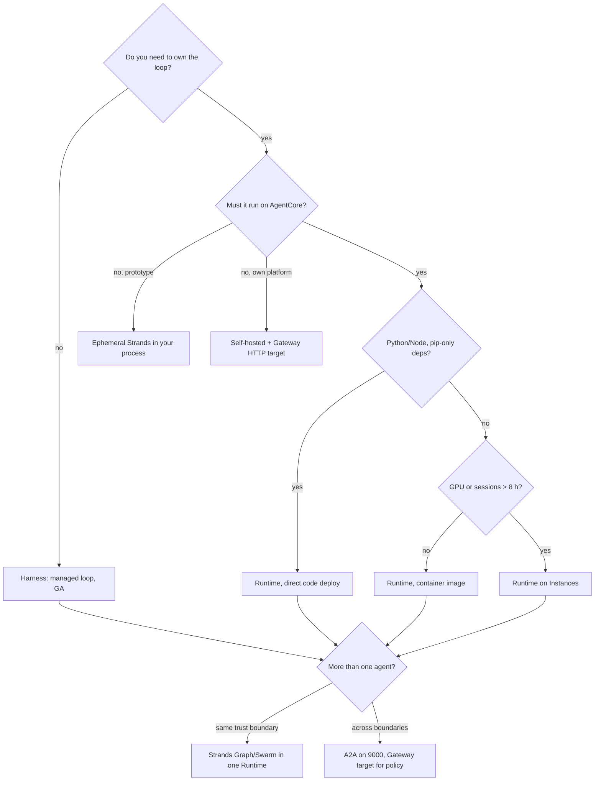

# B03 — Creating AI agents on Amazon Bedrock AgentCore: seven ways, one invocation surface

AgentCore gives you a managed agent loop (Harness) and a managed place to run your own loop (Runtime, from a zip, a container, or on your own EC2 capacity), plus everything you can do with Bedrock models and the Strands SDK without registering anything. Counted by where the loop runs, that is seven ways to put an agent on AWS. **Every design decision in this chapter comes down to two questions: where does the agent's definition live, and where does its loop run.** Those two answers decide what you can version, roll back, govern, trace and evaluate, which is why B04, B05 and B09 all start from this table.

> _Everything is called with `InvokeAgentRuntime` or `InvokeHarness` and a session id. The question is only whether the definition lives in AgentCore, in your container, or in your process._

The running scenario is the same support-ticket assistant as the Foundry track (`get_ticket`, `list_tickets`, `get_policy`, `issue_refund`, UK card team, refunds above 250 GBP refused by the tool). The runnable proofs are in [`labs/`](labs/) (01 ways to build, 02 runtime containers, 03 multi-agent, 04 memory), written on 25 Oct 2026 against `bedrock-agentcore` 1.25.0, `strands-agents` 1.62.0 and `boto3` 1.43.118; the shared environment is [`../labs-setup/`](../labs-setup/). Facts come from the AWS pages fetched that day, kept in [`../reference/reading-map-agentcore-2026-10-25.md`](../reference/reading-map-agentcore-2026-10-25.md); letters such as B4 or D3 refer to that map. Status words are GA, preview, maintenance mode and retiring, with dates. Nothing has run against an account yet; the proof checklists are unticked.

### What we are trying to avoid

A team ships a new "Bedrock Agent" with action groups in August 2026 and finds `CreateAgent` returning 403, because Agents Classic closed to new accounts on 30 Jul 2026. A deploy script `pip install`s the Python starter toolkit, which is deprecated and shadows the `agentcore` binary, so `agentcore deploy` runs the wrong tool. A hosted agent streams for twenty minutes and dies at fifteen, because nobody flipped `/ping` to `HealthyBusy`. A rollback plan says "redeploy the old image" when a one-call endpoint update would have done it. An architect counts "multi-agent collaboration" and "inline agents" as ways to build and is corrected in the review.

### Has this happened?

All five are in the AWS documentation as of 25 Oct 2026 rather than in an incident report: the Classic maintenance-mode page with its 403 behaviour (B7), the starter-toolkit README banner telling you to uninstall it (C1), the long-running page explaining the 15-minute idle timeout and `HealthyBusy` (B4), the versioning page with endpoint pin and rollback (B3), and the Classic migration guide saying supervisor routing mode is "not straightforward" to move (B7). No external incident is told here because the vendor's own pages are enough.

### What the chapter covers

One invocation surface and the four controls on it (1). The seven ways, as a table and then one subsection each (2). Versions, the `DEFAULT` endpoint, custom endpoints, Runtime V1 vs V2 and session lifecycle (3). Multi-agent: a Strands graph inside one Runtime, A2A across Runtimes, Gateway runtime-targets, and the Classic retirement box (4). The tooling that creates agents for you (5). A decision page (6). A "same thing on Foundry" table at the end.

### What you have at the end

A creation matrix you can recite, a decision rule in one sentence, the invocation sequence diagram, the version and rollback mechanics, and a set of scripts whose output you will have seen once an account exists.

---

## 1. One invocation surface

Bedrock AgentCore is a family of thirteen services (A1). For creation, three matter: **Harness** (GA Jun 2026, the managed loop), **Runtime** (GA 13 Oct 2025, the managed place for your loop), and the **Bedrock model endpoints** themselves (Converse, InvokeModel, the OpenAI-compatible `bedrock-mantle` endpoint), which any Strands agent can call from anywhere. Its runtime objects are **agent runtimes** (name + immutable versions), **endpoints** (`DEFAULT` plus named pointers to a version), **sessions** (one microVM per `runtimeSessionId`, server-side state) and the **payload** your container defines.

Whatever kind of agent you built, you call it the same way:

```python
dp = boto3.Session(profile_name=AWS_PROFILE).client("bedrock-agentcore")
resp = dp.invoke_agent_runtime(agentRuntimeArn=ARN, runtimeSessionId=sid, qualifier="DEFAULT",
                               contentType="application/json", accept="application/json, text/event-stream",
                               payload=json.dumps({"prompt": "My card was charged twice."}).encode())
body = resp["response"]      # StreamingBody: JSON, or SSE if the agent streams
```

```mermaid
sequenceDiagram
    participant C as Caller (SigV4 or JWT)
    participant R as InvokeAgentRuntime / InvokeHarness
    participant D as Definition
    C->>R: payload, runtimeSessionId (>=33 chars), qualifier, accept
    alt Harness
        R->>D: stored definition in AgentCore (model, system prompt, tools, skills, memory)
    else Runtime (zip, container, instance)
        R->>D: your container, POST /invocations on 8080 (MCP 8000, A2A 9000)
    else ephemeral / self-hosted
        R->>D: not involved; your process calls Bedrock Converse directly
    end
    D-->>R: JSON or text/event-stream; /ping says Healthy or HealthyBusy
    R-->>C: response, runtimeSessionId, statusCode, traceId
```

Four controls matter in production and behave identically for every Runtime agent (proof: `labs/01-ways-to-build/04-invoke-everything.py`):

- `runtimeSessionId`: the only state handle. Same id, same microVM and conversation; new id, clean slate. Must be at least 33 characters; the SDK generates one if you omit it, which is the usual way to lose your session (B4).
- `qualifier`: `DEFAULT` (always the latest version) or a named endpoint you pinned (§3).
- `accept: text/event-stream`: SSE when the entrypoint yields; `application/json` when it returns.
- `/ping` → `HealthyBusy`: keeps the session alive past the 15-minute idle timeout, up to 8 hours on microVMs and 14 days on Instances (B4, B5). `StopRuntimeSession` ends one early.

Two gotchas. The Harness surface is Converse-shaped: `InvokeHarness` takes `messages` and returns a `stream` of `contentBlockDelta` events, so a Harness client looks like a Bedrock client, not like a Runtime client. And a JWT-authorized Runtime cannot be called through boto3 at all; you sign nothing and send a bearer token over raw HTTPS (E2).

**Interview line.** "One session id, one qualifier, one ping. If you can tell me where the loop runs, I can tell you what you can roll back and what you can pin."

**Study check.** Why does a twenty-minute agent die at fifteen? **Answer.** The idle timeout is measured on `/ping` returning `Healthy`; a tracked async task or a custom ping returning `HealthyBusy` is what tells the platform the session is still working.

## 2. The seven ways

| #   | Way                                                                 | Definition lives                  | Loop runs                     | Status                                                    | Proof                                                      |
| --- | ------------------------------------------------------------------- | --------------------------------- | ----------------------------- | --------------------------------------------------------- | ---------------------------------------------------------- |
| 1   | Harness (managed loop, Strands-powered)                             | AgentCore, versioned              | AgentCore                     | GA Jun 2026 (B1)                                          | `labs/01-ways-to-build/01-harness.md`, `01-harness-sdk.py` |
| 2   | Runtime, direct code deploy (zip in S3)                             | your code, versioned by AgentCore | AgentCore microVM             | GA Nov 2025 (B6)                                          | `labs/01-ways-to-build/02-runtime-code-deploy.py`          |
| 3   | Runtime, container image (ECR, arm64)                               | your container                    | AgentCore microVM             | GA Oct 2025 (B2)                                          | `labs/02-runtime-containers/container-deploy/`             |
| 4   | Runtime on Instances (EC2 capacity provider)                        | your container                    | your EC2, AgentCore-scheduled | GA 6 Aug 2026 (B5)                                        | `labs/02-runtime-containers/instances/` (described)        |
| 5   | Ephemeral: Strands in your process, Bedrock Converse directly       | your process                      | your process                  | GA                                                        | `labs/01-ways-to-build/03-ephemeral-strands.py`            |
| 6   | Self-hosted (Lambda, ECS) with Bedrock models, fronted by a Gateway | your infra                        | your infra                    | GA                                                        | `labs/02-runtime-containers/self-hosted-lambda/`           |
| 7   | Amazon Bedrock Agents Classic (action groups, `InvokeAgent`)        | Bedrock Classic                   | Bedrock Classic               | maintenance mode, closed to new accounts 30 Jul 2026 (B7) | `labs/03-multi-agent/appendix-classic-agent-migration/`    |

Decision rule: _managed loop and fastest path → Harness; custom loop or dependencies → Runtime code deploy; system packages or a non-Python stack → container; GPU or sessions over 8 h → Instances; nothing to manage → ephemeral Strands; your own platform constraints → self-hosted behind a Gateway. More than one agent → a Strands graph inside one Runtime; across a trust boundary → A2A._

### Way 1 — Harness, the managed loop

A Harness stores model, system prompt, tools, skills, memory binding, hooks and limits in AgentCore and runs the loop there (B1). Preview 22 Apr 2026, GA Jun 2026, lifecycle hooks and interactive shells Sep 2026.

```python
cp = session.client("bedrock-agentcore-control")
h = cp.create_harness(
    harnessName="ticket_agent_harness", executionRoleArn=ROLE_ARN,
    model={"bedrockModelConfig": {"modelId": "global.anthropic.claude-haiku-5-5", "maxTokens": 600}},
    systemPrompt=[{"text": SUPPORT_INSTRUCTIONS}],
    tools=[{"type": "inline_function", "name": "get_ticket", "config": {"inlineFunction": {...}}},
           {"type": "agentcore_gateway", "name": "ticket_tools", "config": {"agentCoreGateway": {"gatewayArn": GW}}}],
)
```

CLI twin: `agentcore add harness` then `agentcore deploy`; test with `agentcore invoke --harness ticket_agent_harness "..."` (C2). Tool types are `inline_function` (return of control: the stream yields `toolUse`, you answer with `toolResult`), `agentcore_gateway` (tools run behind a Gateway, where Policy attaches), `remote_mcp`, `agentcore_code_interpreter`, `agentcore_browser`. Skills are `SKILL.md` folders from S3, git or a path. When to pick it: the first hour, the Classic migration target, or any agent whose loop you do not need to own. Gotcha: inline functions execute in the **caller**, so a Harness with only inline tools is not "serverless tools"; it is Classic's return-of-control with a new name.

**Interview line.** "A Harness is a prompt agent with AWS spelling: definition in the service, loop in the service, inline tools as return-of-control, everything else behind a Gateway."

### Way 2 — Runtime from source (direct code deploy)

The container contract (B2): listen on 8080, `POST /invocations`, `GET /ping`, read the session id from the request context, exit on SIGTERM. One class satisfies it:

```python
from bedrock_agentcore import BedrockAgentCoreApp, RequestContext
app = BedrockAgentCoreApp()

@app.entrypoint
def invoke(payload: dict, context: RequestContext) -> dict:
    prompt = payload.get("prompt")
    if not isinstance(prompt, str):            # SDK guidance: refuse non-string prompts (toolUse injection)
        return {"error": "prompt must be a string"}
    return {"result": str(agent(prompt)), "session_id": context.session_id}

app.run()
```

Deploy is a zip with `main.py` and `requirements.txt` at the root, uploaded to S3, then `create_agent_runtime(agentRuntimeArtifact={"codeConfiguration": {"code": {"s3": {"bucket", "prefix"}}, "runtime": "PYTHON_3_13", "entryPoint": ["main.py"]}}, roleArn=..., protocolConfiguration={"serverProtocol": "HTTP"})`, polled to `READY` (B6; Python since 4 Nov 2025, Node 22 since Apr 2026, Python 3.14 supported). CLI twin: `agentcore add runtime` + `agentcore deploy`, config in `agentcore/agentcore.json`, deployed by a thin CDK app (C2). Gotchas: the role must trust `bedrock-agentcore.amazonaws.com` with `aws:SourceAccount` and allow `bedrock:InvokeModel`; `platformVersion="V2"` (18 Sep 2026) gives sub-2-second cold starts but the container must answer `/ping` within 120 seconds of start and env vars are capped at a few KB (B3).

**Interview line.** "The zip is the artifact, `BedrockAgentCoreApp` is the contract, the role is the identity. Nothing in the agent knows it is on AgentCore."

### Way 3 — Runtime from a container image

Same create call, different artifact: `agentRuntimeArtifact={"containerConfiguration": {"containerUri": ECR_URI}}` (B2). The image must be `linux/arm64`; `docker buildx build --platform linux/arm64 --push` is the whole build. Put `opentelemetry-instrument python main.py` as the entrypoint and Strands spans arrive in CloudWatch GenAI Observability without code changes (H1). The framework inside is irrelevant: `labs/02-runtime-containers/container-deploy/variants/` has the same contract with LangGraph and the OpenAI Agents SDK (the latter against the `bedrock-mantle` OpenAI-compatible endpoint, L3). When to pick it: system packages, a non-Python stack, a model inside the image, or a build you already have. Gotcha: the execution role also needs ECR pull permissions on the repository; a `CREATE_FAILED` with an image-pull reason is almost always that.

**Interview line.** "Container is way 2 with a different artifact field. Ports, ping, sessions, versions and endpoints do not change."

### Way 4 — Runtime on Instances

GA 6 Aug 2026 (B5). A **capacity provider** is EC2 capacity in your account, including GPU, onto which AgentCore schedules sessions; `create_agent_runtime(..., capacityProviderConfiguration={"capacityProviderArn": ...}, lifecycleConfiguration={"maxLifetime": 14*24*3600})`. Same image, same endpoint, 14-day sessions, `capacityProviderVolume` mounts, EC2 price plus a management fee (L4). When to pick it: local models or embeddings on GPU inside the agent, sessions longer than 8 hours (interactive shells, long research jobs), compute that must sit on your instances. Not run in these labs; described in `labs/02-runtime-containers/instances/`.

**Interview line.** "Instances change where the work lands, not the contract."

### Way 5 — ephemeral: Strands in your process

No AgentCore resource at all:

```python
from strands import Agent
from strands.models import BedrockModel
agent = Agent(model=BedrockModel(model_id="global.anthropic.claude-haiku-5-5"), system_prompt=SUPPORT_INSTRUCTIONS,
              tools=[get_ticket, list_tickets, get_policy, issue_refund])
print(agent("Refund the full 480 on T-1003."))     # refused by the tool, not by the model's mood
```

You still get Bedrock Guardrails (`BedrockModel(guardrail_id=...)`), cross-region inference profiles, service tiers and Strands telemetry if you wire an exporter. You give up session isolation, versions, the execution-role identity and managed observability. This is also exactly the code that runs **inside** a Runtime container, which makes way 5 the hinge between the AgentCore-native and the code-owned worlds (the same file is `labs/01-ways-to-build/agent/main.py` once `BedrockAgentCoreApp` wraps it).

**Interview line.** "Ephemeral is the lightest path and the hardest to govern: the definition is wherever your code is."

### Way 6 — self-hosted, Bedrock as the backend

The Strands agent on Lambda, ECS or anywhere else, with Bedrock models (`labs/02-runtime-containers/self-hosted-lambda/`). Nothing from Runtime is used, so you re-implement session state, identity propagation and tracing yourself. What AgentCore still offers: register the endpoint as a **Gateway HTTP target** (GA Jul 2026, D3) and it gets inbound JWT or SigV4 auth, Policy, rate limits and Gateway observability; B04 lab 06 does that. When to pick it: an existing platform with its own deployment, networking or compliance story that AgentCore Runtime does not fit.

**Interview line.** "Self-hosted keeps the model and the tools and loses the microVM. A Gateway target gives some of the governance back."

### Way 7 — Amazon Bedrock Agents Classic (maintenance mode)

The 2024–2025 managed agent (action groups, knowledge base, `InvokeAgent`, supervisor collaboration, inline agents) is now "Agents Classic": no new features, frozen model catalogue, closed to accounts without 12 months of prior use since 30 Jul 2026 (`CreateAgent` and `InvokeInlineAgent` return 403), no end-of-life date (B7). Migration: `agentcore migrate` and `agentcore add runtime --agent-id <classic-id> --framework strands` (CLI 1.0, 22 Oct 2026); action groups become Gateway targets, the attached KB a Gateway Managed-KB target, return of control an inline Harness tool, the supervisor a Strands graph. Multi-agent collaboration and inline agents are no longer pushed. Details in `labs/03-multi-agent/appendix-classic-agent-migration/`.

**Interview line.** "Classic is closed to new accounts since July 2026. Count it as a migration source, not as a way to build."

## 3. Versions, endpoints, platform and sessions

Every `UpdateAgentRuntime` mints an immutable version (V1, V2, …); `ListAgentRuntimeVersions` lists them. The `DEFAULT` endpoint always serves the latest version. A **custom endpoint** (`CreateAgentRuntimeEndpoint(name="stable", agentRuntimeVersion="1")`) is a pointer you move with `UpdateAgentRuntimeEndpoint`; promote and roll back are the same call with a different version (B3). There is **no weighted split** at a Runtime endpoint; percentage routing lives in Gateway rules with session stickiness (Jun 2026, D1) and in Optimization A/B tests (I3). Proof: `labs/01-ways-to-build/05-versions-and-endpoints.py` mints V2 by changing an environment variable, pins `stable` to V1, promotes it, rolls it back.

Platform versions (B3): `V1` is the default; `V2` (GA 18 Sep 2026, five regions) restores from a snapshot and brings P75 cold starts from 5–30 s to about 2 s, at the price of a longer create/update, a 120-second `/ping` deadline at startup and smaller environment-variable limits. Pricing differs too (L4).

Sessions (B4): a session is a microVM keyed by `runtimeSessionId`; states Active, Idle, Stopped; idle timeout 15 min and max lifetime 8 h by default, both configurable in `lifecycleConfiguration`; memory is sanitised on termination; a 409 `RetryableConflictException` means the microVM is still provisioning, retry. Session storage, S3 Files and EFS mounts (May 2026) persist files across stop and resume. Header passthrough is limited to `X-Amzn-Bedrock-AgentCore-Runtime-Custom-*` plus an allow-list.

**Interview line.** "Versions are free and immutable; endpoints are pointers; DEFAULT follows latest. Rollback is one endpoint update, never a redeploy."

**Study check.** You need 10 % of traffic on V2. Where does that live? **Answer.** Not on the Runtime. A Gateway rule with weighted routing in front of two endpoints, or an Optimization A/B test; the Runtime endpoint serves one version at 100 %.

## 4. Multi-agent

**Inside one Runtime.** Strands `GraphBuilder` (nodes, conditional edges, entry point), `Swarm` (handoffs) and agents-as-tools all run in the container; the Runtime sees one `/invocations`, one session and one trace tree (proof: `labs/03-multi-agent/graph_agent/`). Checkpointing and session persistence are Strands session managers (`FileSessionManager`, `S3SessionManager`, `AgentCoreMemorySessionManager`).

**Across Runtimes with A2A.** `protocolConfiguration={"serverProtocol": "A2A"}`, the server on port 9000 (`serve_a2a(StrandsA2AExecutor(agent_factory=...), AgentCard(...))`), the card at `.../invocations/.well-known/agent-card.json`, SigV4 or JWT on every request (D6). The client only ever sees the card and the task result; tools and prompts stay private. A2A agents can also be **Gateway HTTP passthrough targets** (Jul 2026), which is how Policy applies to agent-to-agent calls; there is no A2A aggregation or card federation in Gateway yet (D3).

**Gateway runtime-targets.** A Runtime agent itself can be a Gateway HTTP target (GA Jul 2026) with `CALLER_IAM_CREDENTIALS` or token passthrough, so one Gateway can front a fleet of agents under one authorizer and one policy engine (D3; B04 lab 06).

> **Retirement box.** Amazon Bedrock Agents Classic "multi-agent collaboration" (supervisor + collaborators) and inline agents are no longer the way to do this. Supervisor routing mode has no direct equivalent; the guide maps supervisor mode to agents-as-tools. Migrate with `agentcore migrate` (B7).

**Interview line.** "Multi-agent inside one Runtime is free; across Runtimes it is A2A on 9000 with a card. Put a Gateway in front when a policy has to apply to the call."

## 5. Tooling that creates agents for you

- **AgentCore CLI 1.0** (Node, `npm i -g @aws/agentcore`, 22 Oct 2026, C2): `create --template agent-python-strands`, `add runtime|harness|memory|gateway|tool`, `deploy` (thin CDK app, `agentcore/agentcore.json`), `dev --mode browser` (hot reload plus the Agent Inspector), `invoke --local`, `logs`, `traces`, `eval`, `migrate`. The Python `bedrock-agentcore-starter-toolkit` and its `configure/launch` verbs are deprecated (C1).
- **AWS Agent Registry** (GA Aug 2026, D5): a catalogue of agents, MCP servers and skills with approval workflows and an MCP endpoint, shared across accounts with RAM. It discovers, it does not build (B04 lab 05).
- **Amazon Bedrock AgentCore MCP server** and the **AWS MCP Server** (GA 6 May 2026, D4) let a coding agent drive Runtime, Memory, Browser and Code Interpreter from an IDE.
- **Harness export to Strands** (B1): a Harness can be exported as Strands code when you outgrow the managed loop.

These are builders, not runtimes; what they produce is one of the seven rows above. Kiro and the agent-toolkit-for-aws `amazon-bedrock` skill are mentioned in the migration guide (B7) and were not verified further on 25 Oct 2026.

## 6. Decision page



Rule to keep: **own the loop only when you have to; when you do, pick the artifact by dependencies and the compute by GPU and session length.**

## The chapter in eight lines

1. Thirteen AgentCore services; three create agents: Harness, Runtime, and the model endpoints from anywhere. Seven ways counted by where the loop runs.
2. One invocation surface: `InvokeAgentRuntime` with `runtimeSessionId` (≥33 chars), `qualifier`, `accept`, and `/ping` returning `HealthyBusy` for long work.
3. `BedrockAgentCoreApp` is the contract: `/invocations` and `/ping` on 8080; MCP on 8000, A2A on 9000.
4. Zip, container and Instances differ only in the artifact and capacity fields of one `create_agent_runtime` call.
5. Every update mints an immutable version; `DEFAULT` follows latest; a named endpoint is the rollback pointer; weighted traffic lives in Gateway rules.
6. Harness is the managed loop with inline (return-of-control) or Gateway tools; export to Strands when you outgrow it.
7. Agents Classic is in maintenance mode and closed to new accounts since 30 Jul 2026; `agentcore migrate`.
8. The AgentCore CLI 1.0 is Node; the Python starter toolkit is deprecated.

## What you should be able to explain

Why a Harness with only inline tools still executes tools in the caller. Why a twenty-minute agent dies at fifteen and which line fixes it. What changes between a zip and a container deploy, and what does not. Which call creates a version and which moves traffic. Why A2A is a trust boundary and a graph is not. What a 409 on first invoke means. Why `BedrockAgentCoreApp` rejects a non-string prompt.

## What this is not

Not the Gateway, Identity, MCP and A2A tooling material (B04). Not observability and evaluation (B05). Not Cedar policy and guardrails (B09). Not the landing zone (B01) or the CLI and CDK deployment boundaries (B02). Not a claim that anything ran: no AWS account was available on 25 Oct 2026, and the proof checklists say so.

## Implementation scope and versions

AWS pages and release notes fetched 25 Oct 2026 (reading map A–L). Lab code targets Python 3.13 with `bedrock-agentcore` 1.25.0 (extras `strands-agents`, `a2a`), `strands-agents` 1.62.0, `strands-agents-tools` 0.8.10, `boto3` 1.43.118, `a2a-sdk`; the CLI is `@aws/agentcore` 1.0.0 on Node 20.12+. Runtime, Memory, Gateway, Identity GA Oct 2025; Harness GA Jun 2026; Instances GA Aug 2026; Runtime platform V2 Sep 2026; Agents Classic in maintenance mode. Marked `# verify` in code: the Harness inline-function `inputSchema` wrapper, the `create_harness` response shape, the CLI's YAML key spelling, `list_memories()` item keys.

## Same thing on Foundry

| AgentCore (this chapter)                                | Foundry (F03)                                                   |
| ------------------------------------------------------- | --------------------------------------------------------------- |
| Harness (managed loop, definition in the service)       | Prompt agent (`create_version`, `PromptAgentDefinition`)        |
| Runtime, direct code deploy (zip in S3)                 | Hosted agent from source (`create_version_from_code`)           |
| Runtime, container image (arm64 in ECR)                 | Hosted agent from a container image (ACR)                       |
| Runtime on Instances                                    | no equivalent (Foundry has no bring-your-own-capacity tier)     |
| Ephemeral Strands on Bedrock Converse                   | Ephemeral agent via the Responses API (`FoundryChatClient`)     |
| Self-hosted + Gateway HTTP target                       | Self-hosted on Container Apps + toolbox                         |
| `InvokeAgentRuntime` + `runtimeSessionId` + `qualifier` | `POST /responses` + `conversation` + version selector           |
| Versions + `DEFAULT` + named endpoints                  | Immutable versions + agent endpoint + `FixedRatio` selector     |
| `/ping` → `HealthyBusy`                                 | `background=True` + long-running resilience (preview)           |
| Strands Graph/Swarm in one Runtime; A2A on 9000         | Agent Framework `WorkflowBuilder` in one hosted agent; A2A tool |
| Agents Classic (maintenance mode)                       | Declarative workflows (retire 1 Dec 2026), Connected Agents     |
| `agentcore` CLI 1.0 + thin CDK                          | `azd ai agent` + `azure.yaml`                                   |

## Further reading

Start here: A1 overview and service list, A2 release notes, A3 FAQ. Harness and Runtime: B1 Harness, B2 Runtime and the container contract, B3 versioning and platform V2, B4 sessions and long-running, B5 Instances, B6 direct code deploy, B7 Agents Classic maintenance mode and migration. CLI and SDK: C1 starter-toolkit deprecation, C2 AgentCore CLI get-started and 1.0 release, C3 Python SDK README. Gateway targets for agents: D3. A2A: D6. Memory: G1–G3. Pricing: L4. Sketches: [`sketches/`](sketches/) holds three untested shapes (the Runtime contract, an A2A server, a full Harness definition) that mirror the runnable scripts in `labs/`.
