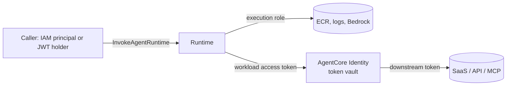
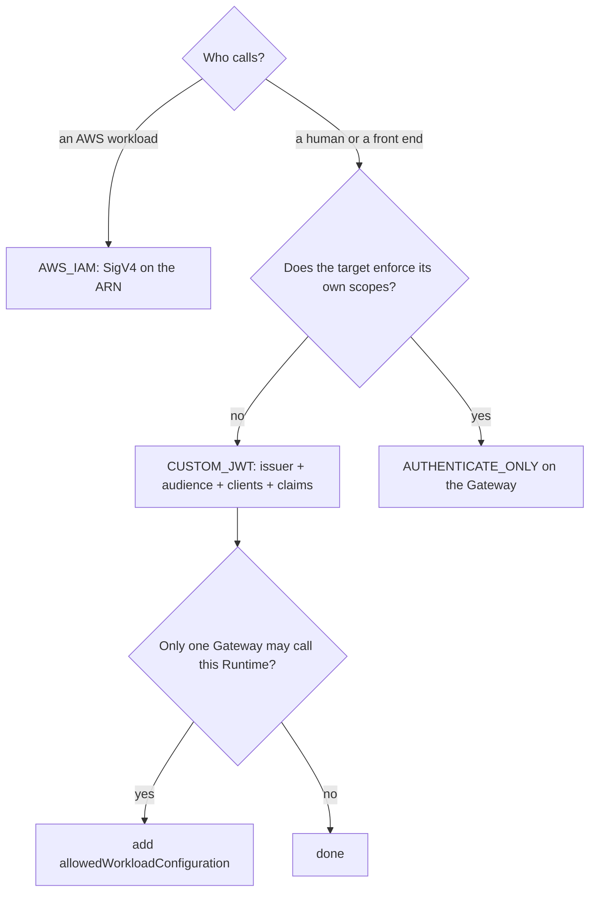

# B04 — AgentCore tooling: identity, inbound and outbound auth, MCP, Gateway, A2A, Registry

B03 decided where the loop runs. B04 decides **who the agent is when it reaches out, and what it is allowed to reach.** On AgentCore the answer is split across three services that are easy to confuse: **Identity** issues the agent its own workload identity and keeps the tokens it collects; **Runtime** decides who may call the agent (SigV4 or a JWT); **Gateway** decides which tools exist, who may call them and with which downstream credential. **Every design decision in this chapter comes down to one question: which principal does the downstream system see, and is that the one your policy expects.**

> _Inbound auth lives on the Runtime or the Gateway. Outbound auth lives on a credential provider. The tool only names the provider._

Running scenario: the support-ticket agent from B03 calling a ticketing MCP server (`get_ticket`, `list_tickets`, `get_policy`, `issue_refund`), first hosted on Runtime as an MCP server, then put behind a Gateway, then exposed to other agents over A2A and listed in an Agent Registry. Runnable proofs: [`labs/`](labs/) 01 inbound identity, 02 MCP on Runtime, 03 Gateway, 04 auth matrix, 05 Agent Registry, 06 A2A and Runtime targets; shared environment in [`../labs-setup/`](../labs-setup/). Facts come from the AWS pages crawled on 25 Oct 2026, kept in [`../reference/reading-map-agentcore-2026-10-25.md`](../reference/reading-map-agentcore-2026-10-25.md); letters such as D2 or E4 refer to that map. Status words are GA and preview, with dates. The Foundry counterpart is [`../../Agent-Build-02-Microsoft-Foundry/F06-Agent-Tooling-MCP-and-Integration/`](../../Agent-Build-02-Microsoft-Foundry/F06-Agent-Tooling-MCP-and-Integration/); the mapping table is at the end.

### What we are trying to avoid

A Runtime left on `AWS_IAM` so a web front end has to hold AWS credentials to call it. A Gateway with `authorizerType: NONE` because "the VPC is private". An OAuth client secret pasted into a Lambda environment variable because nobody knew the token vault existed. An agent that forwards the user's Cognito token to a third-party API as if it were valid there. A Gateway described as a firewall in a design review. An MCP server deployed on port 8080 that never passes `/ping`. An `IssueRefund` tool exposed to every agent in the account because the only catalogue was a wiki page.

### Has this happened?

All of them are the shapes of the 2025 preview samples the AWS docs now warn about: the docs say `BedrockAgentCoreFullAccess` grants `GetWorkloadAccessTokenForUserId`, which lets any holder mint a token as any user, and tell you to deny it in production (E1). The platform-neutral incidents (GitHub MCP leak, Supabase ticket exfiltration, EchoLeak) are told in S03.06; this chapter maps the AgentCore controls onto them.

### What the chapter covers

Agent identity: workload identity, the token vault, execution role versus caller, the two identities of a Runtime (1). Inbound auth on Runtime and Gateway as a decision table (2). Outbound auth: the credential-provider matrix, the `@requires_access_token` flow, on-behalf-of exchange, the Consent Portal (3). MCP servers hosted on Runtime (4). Gateway as the governed surface: target classes, semantic search, interceptors, rate limits, rules (5). Consuming a Gateway from Strands (6). A2A and agents as Gateway targets (7). Agent Registry and the AWS MCP Server (8).

### What you have at the end

The inbound table and the outbound matrix you can recite, the 3LO sequence as a diagram, the "a Gateway is not a firewall" list, the three ports (8080, 8000, 9000) and six runs whose output tells you which principal the server saw.

---

## 1. Agent identity

AgentCore Identity gives every agent a **workload identity** in a per-account directory (`arn:aws:bedrock-agentcore:<region>:<account>:workload-identity-directory/default/workload-identity/<name>`; quota 11,000 per account) and a KMS-encrypted **token vault** that stores the OAuth tokens and API keys the agent obtains downstream, keyed by workload and, for user flows, by user (E1, E2). Runtime and Gateway create a workload identity for you when you create them (`workloadIdentityDetails` in the Gateway response); you create one by hand only for code that runs outside AgentCore and still wants the vault (`create_workload_identity`, proof in `labs/04-auth-matrix/`).

A Runtime therefore carries **two** identities. The **execution role** (`roleArn`, trusted by `bedrock-agentcore.amazonaws.com` with `aws:SourceAccount` and `aws:SourceArn` conditions) is what `boto3` resolves inside the container: ECR pull, logs, `bedrock:InvokeModel`, `bedrock-agentcore:GetWorkloadAccessToken*`. The **workload identity** is what the agent presents to Identity to fetch downstream tokens; the platform injects the workload access token into the request context (`BedrockAgentCoreContext.get_workload_access_token()`), so your code never handles the exchange itself. The **caller** is a third principal: whoever holds `bedrock-agentcore:InvokeAgentRuntime` on the ARN, or whoever presents a JWT the authorizer accepts.



_Micro-example._ The refund Lambda behind the Gateway logs the principal that called it. With the Gateway's own role it logs `AgentCoreGatewayRole`; with `CALLER_IAM_CREDENTIALS` it logs the user's assumed role. Same tool, two different audit trails, chosen by one field.

**Interview line.** "Three principals: the caller who invokes, the execution role the container runs as, and the workload identity that collects downstream tokens. Policy must name the right one."

**Study check.** Why does the docs page tell you to deny `bedrock-agentcore:GetWorkloadAccessTokenForUserId` in production? **Answer.** It mints a workload token for an arbitrary user id without a user token, so any holder can act as any user downstream.

Rule to keep: **the execution role is for AWS, the workload identity is for everything else.**

## 2. Inbound auth: who may call the agent or the tools

Runtime accepts **either** IAM SigV4 (default) **or** a `customJWTAuthorizer`, never both (E3, runtime-oauth page 2026). Gateway adds two more modes. The same `authorizerConfiguration` block is used on Runtime, Harness, Gateway and Registry, so you learn it once.

| Mode                | Where                      | What is checked                                                                                                                                                                                        | Pick when                                                                                                     |
| ------------------- | -------------------------- | ------------------------------------------------------------------------------------------------------------------------------------------------------------------------------------------------------ | ------------------------------------------------------------------------------------------------------------- |
| `AWS_IAM` (SigV4)   | Runtime, Gateway, Registry | the caller's IAM identity has `InvokeAgentRuntime` / `InvokeGateway`                                                                                                                                   | callers are AWS workloads (Lambda, Step Functions, another Runtime)                                           |
| `CUSTOM_JWT`        | Runtime, Gateway, Registry | `discoveryUrl` issuer, `allowedAudience`, `allowedClients`, `allowedScopes`, `customClaims`; optional `allowedWorkloadConfiguration` to accept only tokens from a named Gateway or workload (Jul 2026) | end users or front ends with Cognito, Entra, Okta, Auth0; the production default for anything a human touches |
| `AUTHENTICATE_ONLY` | Gateway                    | token validity only; authorisation is delegated to the target                                                                                                                                          | the target already enforces its own scopes                                                                    |
| `NONE`              | Gateway                    | nothing                                                                                                                                                                                                | local development only                                                                                        |

A JWT Runtime is invoked over raw HTTPS, not the SDK: `POST https://bedrock-agentcore.<region>.amazonaws.com/runtimes/<url-encoded ARN>/invocations?qualifier=DEFAULT` with `Authorization: Bearer <token>` and `X-Amzn-Bedrock-AgentCore-Runtime-Session-Id`. A missing or bad token gets `401` with `WWW-Authenticate: Bearer resource_metadata=...` (RFC 9728 protected-resource metadata), which is how an MCP client discovers the authorisation server. The `X-Amzn-Bedrock-AgentCore-Runtime-User-Id` header path exists for IAM callers that want a user context; the docs recommend JWT for production.



Proof: `labs/01-identity-inbound/invoke_with_bearer.py` shows the 401 first, then the 200.

**Interview line.** "Runtime is SigV4 or JWT, never both. If a browser calls it, it is JWT; if Step Functions calls it, it is SigV4; if both, put a Gateway in front and use its rules."

**Study check.** A Gateway is created with `NONE` "because it is in a VPC". What does the VPC actually protect? **Answer.** The network path only. Anyone who reaches the endpoint can list and call every tool; the Gateway URL is public unless a private endpoint is configured, and even then a VPC is a perimeter, not an identity.

Rule to keep: **`NONE` is a dev setting; `CUSTOM_JWT` is the default; SigV4 is for AWS-to-AWS.**

## 3. Outbound auth: the credential-provider matrix

Outbound credentials are **credential providers**, resources owned by Identity and referenced by name or ARN from a Gateway target or from code. The target's `credentialProviderConfigurations[].credentialProviderType` picks the mode (D3, E2).

| Type                               | Who the downstream sees                                    | User context | Configured by                                                                                                                                      | Pick when                                                                                                 |
| ---------------------------------- | ---------------------------------------------------------- | ------------ | -------------------------------------------------------------------------------------------------------------------------------------------------- | --------------------------------------------------------------------------------------------------------- |
| `GATEWAY_IAM_ROLE`                 | the Gateway's execution role                               | no           | nothing extra; Lambda, Smithy and API Gateway targets                                                                                              | the tool is yours and lives in AWS                                                                        |
| `API_KEY`                          | a header or query parameter you stored                     | no           | `create_api_key_credential_provider`; `credentialLocation`, `credentialParameterName`, `credentialPrefix`                                          | legacy APIs; rotate like any secret                                                                       |
| `OAUTH` `CLIENT_CREDENTIALS` (2LO) | a client registered for the agent                          | no           | `create_oauth2_credential_provider` + `grantType: CLIENT_CREDENTIALS`; `@requires_access_token(auth_flow="M2M")`                                   | app-only SaaS access                                                                                      |
| `OAUTH` `AUTHORIZATION_CODE` (3LO) | the user, after one consent                                | yes          | same provider, `grantType: AUTHORIZATION_CODE`; `@requires_access_token(auth_flow="USER_FEDERATION", on_auth_url=...)`; GA on MCP targets Apr 2026 | per-user SaaS data (Google, GitHub, Slack, Salesforce, Atlassian, Microsoft and 20 more vendors built in) |
| `OAUTH` `TOKEN_EXCHANGE` (OBO)     | the user, exchanged RFC 8693 / RFC 7523, no consent screen | yes          | `onBehalfOfTokenExchangeConfig` on the provider (`MicrosoftOauth2` has it built in); `oauth2Flow: ON_BEHALF_OF_TOKEN_EXCHANGE` (Apr 2026)          | the inbound JWT and the downstream API share an IdP                                                       |
| `CALLER_IAM_CREDENTIALS`           | the caller's own IAM identity                              | yes (IAM)    | Runtime and HTTP targets only                                                                                                                      | AWS-to-AWS where the caller's role is the policy subject                                                  |
| `JWT_PASSTHROUGH`                  | the caller's inbound JWT, unchanged                        | yes          | Runtime and HTTP targets only                                                                                                                      | the downstream is yours and validates the same issuer                                                     |

Three refinements that interviews probe. Client secrets can be **managed** (stored in the vault) or **external** (a Secrets Manager ARN, Jul 2026). Client authentication can be `PRIVATE_KEY_JWT` signed with a KMS key (Jul 2026), so no secret exists at all. The **Consent Portal** (Sep 2026) is an AWS-hosted page that collects 3LO consents for every provider behind one JWT-authorised Gateway, so your agent does not have to render the `authorizationUrl` itself.

```mermaid
sequenceDiagram
    participant U as User
    participant A as Agent code (@requires_access_token)
    participant I as AgentCore Identity
    participant V as Token vault
    participant P as Provider (e.g. GitHub)
    U->>A: first request that needs the tool
    A->>I: GetResourceOauth2Token(workload token, provider, scopes, USER_FEDERATION)
    I->>V: lookup(workload, user)
    V-->>I: miss
    I-->>A: authorizationUrl, sessionUri
    A-->>U: on_auth_url(url): "please approve"
    U->>P: consent
    P->>I: callback with code
    I->>V: store token (workload, user)
    A->>I: poll sessionUri
    I-->>A: accessToken
    A->>P: tool call with Bearer
    Note over V: later calls hit the vault; no second consent
```

Proof: `labs/04-auth-matrix/run_matrix.py` runs one script per row that has credentials in `.env` and prints which principal the ticket API saw.

**Interview line.** "Only three of seven carry the user: 3LO, on-behalf-of, and passthrough. If the ticket system must know who asked, it is one of those; if it must not learn the user's upstream token, it is not passthrough."

**Study check.** The inbound JWT is from Cognito; the downstream is Microsoft Graph. Which row? **Answer.** Not passthrough (Graph will reject a Cognito token) and not plain OBO (different IdP). It is 3LO with the `MicrosoftOauth2` provider, one consent, token in the vault. OBO applies only when Entra issued the inbound token too.

Rule to keep: **a token is valid for one audience; the vault, not your code, holds the second one.**

## 4. MCP servers hosted on Runtime

Runtime is a host for MCP servers as well as agents (B3, D1). Set `protocolConfiguration.serverProtocol = "MCP"`; the container must listen on **`0.0.0.0:8000/mcp`** with streamable HTTP. The default is **stateless** (`FastMCP(..., stateless_http=True)`): the platform injects `Mcp-Session-Id` and maps it onto a Runtime session, so one microVM per MCP session, same 15-minute idle and 8-hour lifetime as agents. **Stateful** mode (Mar 2026) keeps the server's own session and enables elicitation, sampling and progress notifications. Invoke URL is the same as for agents, `.../runtimes/<url-encoded ARN>/invocations?qualifier=DEFAULT`, with a Bearer token for JWT Runtimes or SigV4 via `mcp-proxy-for-aws` for IAM ones. The CLI equivalent is `agentcore add runtime --protocol MCP --authorizer-type CUSTOM_JWT`.

The three ports to memorise: **8080** HTTP agents (`/invocations`, `/ping`), **8000** MCP (`/mcp`), **9000** A2A (`/`). A server on the wrong port never passes the readiness check and the Runtime stays in `CREATE_FAILED`; `labs/02-mcp-on-runtime/README.md` starts from that failure.

**Interview line.** "Runtime hosts the server, Gateway aggregates servers. If you have one server and one agent, Runtime MCP is enough; the moment you need tool search, a second credential or a policy, you need the Gateway."

**Study check.** Why does stateless mode exist at all if stateful is richer? **Answer.** Stateless lets the platform scale sessions without the server keeping memory, and matches MCP 2026-07-28 which drops `initialize`; stateful is for servers that need to ask the user something mid-call.

Rule to keep: **8000, `/mcp`, stateless unless you need elicitation.**

## 5. Gateway: the governed surface

Gateway turns anything with a schema into MCP tools and puts one authorisation point in front of them (D1–D6). Since Jul 2026 it has **three target classes**:

| Class                 | Targets                                                                                                                                                                                                                   | Aggregated into one MCP server               | Semantic search | Status                                |
| --------------------- | ------------------------------------------------------------------------------------------------------------------------------------------------------------------------------------------------------------------------- | -------------------------------------------- | --------------- | ------------------------------------- |
| **MCP targets**       | Lambda (inline `toolSchema`), OpenAPI, Smithy, API Gateway REST (Dec 2025), remote MCP servers (tools, prompts, resources), connectors (Web Search GA Jul 2026, Step Functions Oct 2026, Managed Knowledge Base Jun 2026) | yes                                          | yes             | GA 13 Oct 2025, extended through 2026 |
| **HTTP targets**      | `agentcoreRuntime` (a Runtime agent as a target, GA Jul 2026), `passthrough` with `protocolType` MCP, A2A, INFERENCE or CUSTOM, HTTP connectors                                                                           | no (path-based: `/<targetName>/invocations`) | no              | GA Jul 2026                           |
| **Inference targets** | model providers (Bedrock, OpenAI, Anthropic) with `modelMapping`; `InvokeModel` wire-format translation, fallback and circuit breaker (Oct 2026)                                                                          | n/a                                          | n/a             | GA Jul 2026                           |

What else sits on the Gateway object (all from the `CreateGateway` shape, dumped 25 Oct 2026):

- **Semantic search**: `protocolConfiguration.mcp.searchType = "SEMANTIC"`, set at creation only. The agent calls the built-in tool `x_amz_bedrock_agentcore_search` with `{"query": "..."}` and gets a ranked subset, which is how you stay under the model's context budget with 1,000 tools per target. Not available for HTTP targets. 18 regions. Priced per search call.
- **Interceptors**: one `REQUEST` and one `RESPONSE` Lambda per gateway, `passRequestHeaders` off by default, `payloadFilter.exclude` to keep secrets out. This is where you validate arguments (`issue_refund.amount <= 250`), rewrite them, or add headers. It is a hook, not a policy engine; B09 adds Cedar via `policyEngineConfiguration` with `LOG_ONLY` then `ENFORCE`.
- **Rules** (`create_gateway_rule`, Jun 2026): priority-ordered conditions on principal, path or model, with `routeToTarget` static or **weighted** routing (`trafficSplit` with weights and session stickiness) and fallback on `CONNECTION_ERROR`, `FIRST_BYTE_TIMEOUT`, `UNROUTABLE`. This is the A/B and canary mechanism; Runtime endpoints have no traffic splitting of their own.
- **Rate limits** (`create_gateway_rate_limit`, Aug 2026): RPS, tokens per minute, connections.
- **Sessions and streaming**: `sessionConfiguration.sessionTimeoutInSeconds`, `streamingConfiguration.enableResponseStreaming`; MCP versions 2026-07-28, 2025-11-25, 2025-06-18, 2025-03-26.
- **Network**: VPC egress (Apr 2026), private endpoints via VPC Lattice or a managed VPC resource, private CA certificates for targets (Oct 2026), WAF.
- **Quotas** (adjustable): 1,000 gateways per account, 100 targets per gateway, 1,000 tools per target, 15-minute invocation timeout, 200 TPS tool calls, 25 searches per minute, 6 MB payload.

What the Gateway does **not** do: it does not run your tool, it does not stop an agent that holds the Lambda's ARN from calling it directly (that is IAM on the Lambda), it does not authorise by itself beyond the inbound check (that is Policy, B09), and it does not make a public Lambda private.

Proof: `labs/03-gateway/` creates the Gateway, adds a Lambda and an OpenAPI target, searches, calls `issue_refund`, then attaches a request interceptor that refuses amounts over 250.

**Interview line.** "Gateway is the toolbox with a search engine and a hook: schema in, MCP out, one inbound check, one outbound credential per target. Governance is Policy, not Gateway."

**Study check.** Where does weighted traffic between v1 and v2 of an agent live? **Answer.** On a Gateway rule routing to two `agentcoreRuntime` HTTP targets, each pinned to a Runtime endpoint; the Runtime `DEFAULT` endpoint only ever points at one version.

Rule to keep: **schema in, MCP out, one credential per target.**

## 6. Consuming a Gateway from Strands

A Gateway is an ordinary streamable-HTTP MCP server, so the client is `strands.tools.mcp.MCPClient` (D4). Two spellings exist: the transport-callable form (`MCPClient(lambda: streamablehttp_client(url, headers=...))`) and the keyword form that 1.62 exposes directly (`MCPClient(url=gateway_url, headers={"Authorization": f"Bearer {token}"})`). The client is a context manager; `list_tools_sync()` returns the tools, and `tool_filters` or `prefix` keep two Gateways from colliding. The bearer token is whatever the Gateway's JWT authorizer accepts (a Cognito client-credentials token in the labs); for an IAM Gateway use `mcp-proxy-for-aws` to sign SigV4.

```python
from strands import Agent
from strands.tools.mcp import MCPClient

gw = MCPClient(url=GATEWAY_URL, headers={"Authorization": f"Bearer {token}"})
with gw:
    tools = gw.list_tools_sync()                 # or search first, see lab 03
    agent = Agent(model=MODEL_ID, tools=tools, system_prompt=SYSTEM)
    print(agent("Refund ticket 1042 for the duplicate £40 charge."))
```

Search before listing when the catalogue is large: call `x_amz_bedrock_agentcore_search` with the user's intent and pass only the returned tools to the `Agent`. Proof: `labs/03-gateway/search_and_call.py`.

**Interview line.** "The agent sees one MCP server with a search tool. It never learns whether a tool is a Lambda, an OpenAPI route or another agent."

**Study check.** What does a 403 on `list_tools` at the Gateway mean versus a 403 inside a tool result? **Answer.** The first is inbound auth (authorizer rejected the token or the IAM caller lacks `InvokeGateway`); the second is outbound (the credential provider's token was rejected by the target) or Policy denying that action.

Rule to keep: **search, then list, then call; never list 1,000 tools into a prompt.**

## 7. A2A and agent-as-target

Runtime speaks **A2A** when `serverProtocol = "A2A"`: the container serves JSON-RPC on **port 9000 at `/`** and the agent card at `/.well-known/agent-card.json`, reached through `.../invocations/.well-known/agent-card.json` or `get_agent_card` on the data plane (D7). The SDK helper is `bedrock_agentcore.runtime.a2a.serve_a2a(executor, agent_card)` with a Strands `StrandsA2AExecutor`; the client side is `a2a-sdk` (`A2ACardResolver`, `ClientFactory`). Authentication is the Runtime's: SigV4 or the JWT authorizer; the card itself is served unauthenticated only if you choose `NONE` on a Gateway in front.

Two ways an agent becomes a tool for another agent, both GA Jul 2026: an **`agentcoreRuntime` HTTP target** on a Gateway (path `/<targetName>/invocations`, credential `CALLER_IAM_CREDENTIALS` or `JWT_PASSTHROUGH`), and an **A2A passthrough target** (`protocolType: A2A`) pointing at an A2A Runtime or any external A2A endpoint with session stickiness. Neither is aggregated or searchable; the Gateway only routes. AWS FAQ still lists broader A2A support, such as card federation, as coming.

Proof: `labs/06-a2a-and-runtime-targets/` registers the B03 ticket Runtime as an HTTP target, adds an A2A passthrough target to the B03 A2A specialist, and writes a weighted rule between two targets.

**Interview line.** "A2A on AgentCore is a Runtime protocol plus a passthrough target. It is the cross-boundary pattern; inside one trust boundary use Strands multi-agent in one Runtime."

**Study check.** Why is the agent card on `/invocations/.well-known/agent-card.json` and not the root? **Answer.** Every Runtime path is served under the invocations route of the data-plane URL; the container still serves it at `/.well-known/agent-card.json` on 9000.

Rule to keep: **9000, `/`, card under `.well-known`; cross boundaries with A2A, not with shared memory.**

## 8. Agent Registry and the AWS MCP Server

**AWS Agent Registry** (preview Apr 2026, GA Aug 2026; namespace `agent-registry` for discovery, `bedrock-agentcore-control` for management) is the organisation's catalogue of agents, MCP servers and skills (D8). A registry has its own authorizer (`AWS_IAM` or `CUSTOM_JWT`) and an `approvalConfiguration`; records have a `descriptorType` of `MCP` (server descriptor plus tool list), `A2A` (an agent card), `AGENT_SKILLS` (a `SKILL.md` plus definition) or `CUSTOM`, either inline or **synchronised from a URL** with OAuth or IAM credentials. Lifecycle is `DRAFT → PENDING_APPROVAL → APPROVED → DEPRECATED` through `submit_registry_record_for_approval` and `update_registry_record_status`. Approved records are discoverable across accounts shared through AWS RAM, with Organizations auto-detection, CMK and PrivateLink; the registry also exposes an MCP endpoint so an agent can discover tools at run time. Proof: `labs/05-agent-registry/`.

The **AWS MCP Server** (GA 6 May 2026) is the managed server for AWS itself: `call_aws` over 15,000+ API operations with your SigV4 identity through a local MCP proxy, plus `search_documentation`, `read_documentation` and `run_script`; the open-source `awslabs/mcp` servers (Documentation, Knowledge, IaC, Bedrock AgentCore MCP Server) remain for local use. It is the AWS-side counterpart of the Foundry `microsoft-foundry` skill for coding agents.

**Interview line.** "Registry is governance of the catalogue: what exists, who approved it, who may discover it. Gateway is governance of the call."

**Study check.** A partner account wants to use your refund MCP server. What do you share? **Answer.** The registry record through RAM, not the Gateway credentials; they discover the record, then their Gateway adds your server as an MCP target with their own credential provider.

Rule to keep: **publish records, not secrets.**

---

## The chapter in eight lines

1. Three principals per Runtime: caller, execution role, workload identity. Tokens live in the vault, not in your code.
2. Inbound is SigV4 or JWT, never both; `NONE` is for dev; `AUTHENTICATE_ONLY` delegates authorisation to the target.
3. Outbound is a credential provider on the target: seven types; 3LO, OBO and passthrough carry the user.
4. OBO with `MicrosoftOauth2` is the cross-cloud talking point: an Entra token in, a Graph token out, no consent screen.
5. Runtime hosts MCP servers on 8000 `/mcp`, stateless by default; A2A on 9000; agents on 8080.
6. Gateway has three target classes; semantic search, interceptors, rules and rate limits sit on it; Policy is separate.
7. An agent becomes a tool as an `agentcoreRuntime` HTTP target or an A2A passthrough target; neither is searchable.
8. Agent Registry catalogues and approves; the AWS MCP Server gives agents the AWS API with your identity.

## What you should be able to explain

Which identity a Lambda behind the Gateway sees under each credential type. Why a JWT Runtime cannot be called through `invoke_agent_runtime`. What `allowedWorkloadConfiguration` prevents. When OBO applies and when it does not. Why the Gateway is not a firewall and not a policy engine. Where weighted traffic lives. What an MCP server must do to pass `/ping` on Runtime. What a registry record contains and who approves it.

## What this is not

Not Cedar policy, Guardrails-in-Policy or org controls (B09). Not Memory, Code Interpreter or Browser (B03 lab 04 and the reading map). Not a claim that the OBO row ran: it needs an Entra app and is ticked only with a token in the output. Not MCP server construction or the Strands tool decorator (S03, B03).

## Implementation scope and versions

AWS pages and release notes dated 13 Oct 2025 to 22 Oct 2026, crawled 25 Oct 2026. `boto3` 1.43.118 (`bedrock-agentcore-control`, `bedrock-agentcore`, `agent-registry`), `bedrock-agentcore` 1.25.0 (`requires_access_token`, `serve_a2a`), `strands-agents` 1.62.0 (`MCPClient(url=..., headers=...)`, `A2AServer`), `mcp` for `FastMCP`. Shapes were dumped from botocore on the writing day; fields marked `# verify` in the labs were not exercised against the service. Nothing has run against AWS.

## Same thing on Foundry

| AgentCore                                  | Foundry (F04)                                                            |
| ------------------------------------------ | ------------------------------------------------------------------------ |
| workload identity + token vault            | agent identity (Entra service principal under a blueprint)               |
| execution role vs workload identity        | project managed identity vs the hosted agent's own Entra identity        |
| `customJWTAuthorizer` on Runtime / Gateway | Entra-only auth on the project endpoint; Conditional Access on the agent |
| seven credential-provider types            | six connection auth types                                                |
| 3LO `USER_FEDERATION` + `authorizationUrl` | `oauth2` connection + `oauth_consent_request.consent_link`               |
| OBO `TOKEN_EXCHANGE` (`MicrosoftOauth2`)   | `user-entra-token` / agentic identity OBO (preview)                      |
| Gateway                                    | toolbox                                                                  |
| `x_amz_bedrock_agentcore_search`           | tool search (`ToolSearchToolboxTool`)                                    |
| interceptor Lambdas                        | APIM policies (`validate-azure-ad-token`, `check-header`)                |
| Gateway rules, weighted routes             | APIM backend pools; no agent-level equivalent                            |
| Runtime MCP mode (8000)                    | hosting your own MCP server on Container Apps / Logic Apps Standard      |
| A2A Runtime (9000) + passthrough target    | A2A tool v1.0 + `remote-a2a` connection                                  |
| AWS Agent Registry                         | API Center private tool catalog                                          |
| AWS MCP Server (`call_aws`)                | `microsoft-foundry` skill / Azure MCP Server                             |

## Further reading

Reading map letters: C (CLI and SDK), D1–D8 (Gateway, targets, search, interceptors, rules, A2A, Registry), E1–E5 (Identity, inbound, outbound, OBO, Consent Portal), F (Policy, for the hand-off to B09). Sketches in [`sketches/`](sketches/): the three target shapes, the `@requires_access_token` flow, an agent card.
