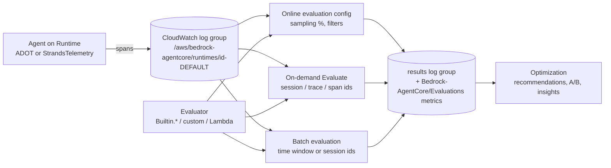

# B05 — AgentCore evals and observability: measuring the agents you built in B03 and B04

AgentCore evaluates **traces**, not transcripts. Every agent you deploy on Runtime writes OpenTelemetry spans to a CloudWatch log group; an **evaluator** (one of 13 `Builtin.*` judges, a third-party one, or your own) scores a tool call, a trace or a whole session; an **online evaluation config** samples live sessions and scores them continuously; a **batch evaluation** scores a chosen time window or a dataset run; results come back as OTel GenAI evaluation events and CloudWatch metrics. **Every evaluation question in this chapter comes down to: which spans, which evaluator at which level, and who triggers it.**

> _On Foundry an eval says what and a run says on what. On AgentCore the trace is the dataset; you pick the evaluator and the trigger._

Running scenario: the UK support-ticket agent created by B03 lab 01 (`TICKET_AGENT_RUNTIME_ARN` in the track-root `.env`, log group `/aws/bedrock-agentcore/runtimes/{agent_id}-DEFAULT`). Runnable proofs are [`labs/01-observability/`](labs/01-observability/), [`labs/02-evals/`](labs/02-evals/) and [`labs/03-guardrails/`](labs/03-guardrails/); shared environment in [`../labs-setup/`](../labs-setup/). Facts come from the pages in [`../reference/reading-map-agentcore-2026-10-25.md`](../reference/reading-map-agentcore-2026-10-25.md), sections H (observability), I (evaluations and optimization) and F (policy and guardrails); letters such as I2 refer to that map. AgentCore Evaluations is GA (31 Mar 2026); batch evaluation and Optimization recommendations are GA (Jun 2026); Failure Insights is public preview; `Builtin.FailureAnalysis` arrived in Oct 2026.

### What we are trying to avoid

A team evaluates the model in a notebook and ships the agent, which calls three tools the notebook never exercised. An online evaluation config is created, status `ACTIVE`, and scores nothing because Transaction Search was never enabled on the account and no spans ever reached CloudWatch. A "helpful" score of 0.9 hides that the agent refunded £400 against a £250 policy because nobody ran `Builtin.ToolParameterAccuracy`. A guardrail is attached to the model and the agent still leaks a card number, because the leak was in a tool result, not the model output. A CI gate asserts on a score nobody can reproduce because the dataset lives in someone's home directory.

### Has this happened?

The second one is the most common AgentCore support thread of 2026: the observability page puts the one-time Transaction Search step first for that reason (H1). The fourth is the gap Guardrails-in-Policy (GA 17 Jun 2026) was built to close: Bedrock Guardrails on the model never saw tool inputs or outputs until the Gateway could call them (F4). No external incident is told here; the internal gaps are enough.

### What the chapter covers

The objects and how they fit (1). What you can evaluate: live traces, chosen sessions, a batch window, a local experiment (2). Evaluators: the 13 built-ins by level, skill evaluators, failure analysis, third-party, custom judge and custom code (3). On-demand evaluation of a session (4). Online evaluation configs (5). Batch, simulation and the Optimization loop (6). Observability: the one-time account step, instrumentation, the per-agent log group, the console (7). Runtime guardrails on the model, on tool I/O and at the gateway (8). CI gates (9). How this maps onto S05 (10).

### What you have at the end

The span, evaluator, config vocabulary; the evaluator table by level; an on-demand result for one session with six scores; an online config you can switch on and off; a trace you have looked at in GenAI Observability; a guardrail that blocks a prompt attack and one that inspects a tool result; and the thresholds that separate noise from signal.

---

## 1. The objects



- A **span** is one unit of work with `gen_ai.*` attributes (model call, tool call, agent cycle); a **trace** is one invocation; a **session** is every trace sharing a `runtimeSessionId`. Evaluators are declared at one of three **levels**, `TOOL_CALL`, `TRACE`, `SESSION`, and that level decides which ids you hand them (I3).
- An **evaluator** is identified by `Builtin.<Name>` or a custom ARN. Custom evaluators are LLM-as-a-judge, code-based (a Lambda) or derived (a built-in prompt on your model) via `CreateEvaluator` (I3).
- An **online evaluation config** names a data source (log groups, prefixes or service names), a sampling percentage, optional session filters, the evaluators and the result destination; it needs an execution role (I4).
- **On-demand** `Evaluate` takes one evaluator and either raw `sessionSpans` or `spanIds` / `traceIds`, with optional ground truth (`expectedResponse`, `assertions`, `expectedTrajectory.toolNames`) (I5).
- A **batch evaluation** reads a CloudWatch window, a list of session ids, or the sessions an online config already saw, and may carry ground truth per session (I6).
- **Results** are JSON events following the OTel GenAI evaluation convention (`gen_ai.evaluation.name`, `gen_ai.evaluation.score`) in `/aws/bedrock-agentcore/evaluations/results/<config-id>` or back in the source group, plus metrics in the `Bedrock-AgentCore/Evaluations` namespace (I7).

The Python SDK wraps all of this in `bedrock_agentcore.evaluation.EvaluationClient` (`run`, `create_online_evaluation_config_and_wait`, `create_evaluator_and_wait`, `start_batch_evaluation_and_wait`); the console view is CloudWatch → GenAI Observability → Bedrock AgentCore → agent → **Evaluations**.

**Interview line.** "Span, evaluator, trigger. When someone says 'we evaluated the agent' I ask at which level and from which log group."

**Study check.** An evaluator declared at `TRACE` level is given a session id. What happens? **Answer.** The SDK's `run` looks up the level first and expands the session into its trace ids before calling `Evaluate`; the raw API would reject the mismatch. Rule to keep: **the level decides the ids.**

## 2. What you can evaluate

| Rows come from                                | Call                                                                                                                                       | Use                                                      |
| --------------------------------------------- | ------------------------------------------------------------------------------------------------------------------------------------------ | -------------------------------------------------------- |
| Live sessions, sampled                        | `CreateOnlineEvaluationConfig` with `rule.samplingConfig.samplingPercentage` (console default 10 %, range 0.01–100)                        | production monitoring                                    |
| A session or trace you choose                 | `Evaluate` with `evaluationTarget.traceIds` / `spanIds`, or `EvaluationClient.run(session_id=...)`                                         | debugging a complaint, pre-release spot check            |
| A time window or list of session ids          | `StartBatchEvaluation` with `dataSourceConfig.cloudWatchLogs.filterConfig` and optional `evaluationMetadata.sessionMetadata[].groundTruth` | regression against a known set, 25 % cheaper than online |
| The sessions an online config already sampled | `StartBatchEvaluation` with `onlineEvaluationConfigSource`                                                                                 | re-score with a new evaluator                            |
| A dataset you drive yourself                  | `OnDemandEvaluationDatasetRunner` or `strands_evals.Experiment` locally                                                                    | CI gate, no Runtime needed                               |

Self-hosted agents are not excluded: anything that writes OTel spans to a CloudWatch log group with the right `service.name` can be a data source (`serviceNames`), which is how a Lambda or ECS agent from B03 lab 02 is evaluated with the same config (H3). Evaluations understands Strands, LangGraph, OpenAI Agents, LlamaIndex, Google ADK, the Claude Agent SDK and TypeScript frameworks through OpenInference and OTel GenAI conventions (I8).

**Interview line.** "Online for what is happening, batch for what happened, on-demand for the one session the customer complained about."

## 3. Evaluators

The 13 built-ins, by level (I3; ids are exactly `Builtin.<Name>`):

| Level     | Evaluator                                                                                                                                                                     | What it scores                                                                              |
| --------- | ----------------------------------------------------------------------------------------------------------------------------------------------------------------------------- | ------------------------------------------------------------------------------------------- |
| SESSION   | `Builtin.GoalSuccessRate`                                                                                                                                                     | did the user get what they came for across turns; a ground-truth variant accepts assertions |
| TRACE     | `Builtin.Correctness`, `Builtin.Helpfulness`, `Builtin.Faithfulness`, `Builtin.ResponseRelevance`, `Builtin.Coherence`, `Builtin.Conciseness`, `Builtin.InstructionFollowing` | the answer of one invocation; Correctness accepts an expected response                      |
| TRACE     | `Builtin.Harmfulness`, `Builtin.Refusal`, `Builtin.Stereotyping`                                                                                                              | safety of one invocation                                                                    |
| TOOL_CALL | `Builtin.ToolSelectionAccuracy`, `Builtin.ToolParameterAccuracy`                                                                                                              | was the right tool chosen and were its arguments right                                      |

Then four more families:

- **Skill evaluators** `Builtin.SkillSelectionAccuracy`, `Builtin.SkillInstructionFollowing` for agents that load `SKILL.md` files (I3).
- **`Builtin.FailureAnalysis`** (Oct 2026) classifies why a session failed into root causes; it feeds Failure Insights, which is still public preview (I9).
- **Third-party** evaluators from DeepEval and AutoEval run managed, by id (I3).
- **Custom**: `CreateEvaluator` with `llmAsAJudge` (instructions, a numerical, categorical or multi-dimensional rating scale, a Bedrock judge model), `codeBased` (a Lambda ARN with a timeout) or `derived` (a built-in's logic on your model). Built-in configs are immutable; derive one when you want a different judge.

Strands Evals (`strands-agents-evals` 1.7.0) ships the same names as local classes (`ToolSelectionAccuracyEvaluator`, `GoalSuccessRateEvaluator`, `OutputEvaluator(rubric=...)`, ...) plus `TrajectoryEvaluator`, actor and tool simulators, chaos testing and a `redteam` module. They run in your process against any callable and never need Runtime; the managed ones run on spans in CloudWatch. Same vocabulary, two homes.

Pricing that changes a decision: built-ins cost judge tokens ($0.0024 / $0.012 per 1K in/out); a custom judge is $1.50 per 1K evaluations plus your model; batch is 25 % off online (I10). Six built-ins on 10 % of traffic is cheap; a custom judge on 100 % is not.

**Interview line.** "Tool evaluators catch the refund; trace evaluators catch the tone; the session evaluator catches whether the customer left satisfied. Run all three levels or you are measuring one."

**Study check.** Which evaluator would have flagged a £400 refund against a £250 policy? **Answer.** `Builtin.ToolParameterAccuracy` at TOOL_CALL level, if the policy is in the system prompt or tool description; otherwise a custom judge with the policy in its instructions. Rule to keep: **put the policy where the judge can read it.**

## 4. On-demand evaluation of a session

```python
from bedrock_agentcore.evaluation import EvaluationClient
results = EvaluationClient(region_name=REGION).run(
    evaluator_ids=["Builtin.GoalSuccessRate", "Builtin.ToolSelectionAccuracy",
                   "Builtin.ToolParameterAccuracy", "Builtin.Correctness",
                   "Builtin.Helpfulness", "Builtin.Refusal"],
    session_id=session_id, agent_id=agent_id)          # log group derived from agent_id
for r in results:
    print(r["evaluatorId"], r.get("value"), r.get("label"), r["explanation"][:80])
```

`run` collects spans from the agent's log group, looks up each evaluator's level, builds the matching `evaluationTarget`, calls `Evaluate` in batches of ten targets and returns the flattened `evaluationResults` (`value`, `label`, `explanation`, `tokenUsage`, `context.spanContext`). Spans take a minute or two to land, so the lab waits before asking. Ground truth goes in `reference_inputs` (`expectedResponse`, `assertions`, `expectedTrajectory`). Proof: `labs/02-evals/01_on_demand_session_eval.py`.

**Interview line.** "One call, one session, six scores with explanations. That is the pre-release spot check and the complaint investigation."

## 5. Online evaluation config

```python
cfg = client.create_online_evaluation_config_and_wait(
    onlineEvaluationConfigName="ticket-agent-online",
    rule={"samplingConfig": {"samplingPercentage": 10.0},
          "sessionConfig": {"sessionTimeoutMinutes": 15}},
    dataSourceConfig={"cloudWatchLogs": {"logGroupNames": [log_group]}},
    evaluators=[{"evaluatorId": e} for e in EVALUATORS],
    outputConfig={"cloudWatchConfig": {"resultDestination": "DEDICATED_LOG_GROUP"}},
    evaluationExecutionRoleArn=ROLE_ARN, enableOnCreate=True)
```

Limits worth knowing: 25 evaluators per config, 5 session filters (`key`, `operator`, `value`), session idle timeout 1–60 minutes, which decides when a session is "closed" and scored (I4). The execution role needs read on the source log group and write on the results group; a missing permission shows as `executionStatus` failing, not as an error on create. Results appear in the **Evaluations** tab and as metrics you can alarm on. Proof: `labs/02-evals/02_online_eval_config.py` (with `--cleanup`).

**Interview line.** "Ten percent of sessions, six evaluators, one alarm on the metric. Then raise the sample when a release is fresh."

**Study check.** The config is `ACTIVE`, the metric stays empty. First three things to check? **Answer.** Transaction Search enabled; spans actually landing in the named log group; the execution role's log permissions. Rule to keep: **ACTIVE means configured, not scoring.**

## 6. Batch, simulation and Optimization

**Batch** (`StartBatchEvaluation`) is the regression tool: a time window or a list of session ids from the agent's log group, optional per-session ground truth, results into a dedicated group; the SDK's `BatchEvaluationRunner` polls to completion (I6). The SDK also carries a dataset runner (`OnDemandEvaluationDatasetRunner`) and `SimulationConfig` for **user simulation**: an actor profile drives multi-turn conversations against the agent so a batch covers the paths real users take (I6; the simulation shape is marked `# verify` in the lab).

**Optimization** (GA Jun 2026) closes the loop: `StartRecommendation` with `type=SYSTEM_PROMPT_RECOMMENDATION` or `TOOL_DESCRIPTION_RECOMMENDATION` takes your current prompt or tool descriptions plus agent traces (a CloudWatch window, a batch evaluation or an online config) and returns a rewritten prompt with an explanation; **A/B testing** (`CreateABTest`) routes traffic between two Runtime versions through Gateway weighted rules with session stickiness; **Failure Insights** (preview) clusters failed sessions by root cause (I9). Recommendations have no separate charge. Like the Foundry optimizer, every candidate is exercised against real traces, so never point it at an agent whose `issue_refund` is live.

**Interview line.** "Evaluate, recommend, A/B, promote. The platform rewrites the prompt; you still decide from the numbers."

## 7. Observability

Four facts carry the section (H1–H4):

1. **One account-level step first.** CloudWatch Transaction Search must be on: `aws xray update-trace-segment-destination --destination CloudWatchLogs`, then an indexing rule (sampling percentage; 1 % is free). Without it no spans are stored and nothing downstream works.
2. **Instrumentation.** On Runtime, `pip install aws-opentelemetry-distro>=0.18.0` and start with `opentelemetry-instrument python main.py` (the `CMD` in the container); outside Runtime set `AGENT_OBSERVABILITY_ENABLED=true`, `OTEL_PYTHON_DISTRO=aws_distro`, `OTEL_PYTHON_CONFIGURATOR=aws_configurator`, `OTEL_RESOURCE_ATTRIBUTES=service.name=...,aws.log.group.names=...` and the OTLP log headers. Strands adds its own spans (agent → cycle → model → `Tool: <name>` with `gen_ai.agent.name`, `gen_ai.usage.input_tokens`, `gen_ai.tool.name`) through `StrandsTelemetry().setup_otlp_exporter()` or `setup_console_exporter()` for local reading.
3. **Where spans go.** One log group per agent and endpoint, `/aws/bedrock-agentcore/runtimes/<agent_id>-<endpoint>`, stream `spans` (unified since Jul 2026); W3C `traceparent` and `baggage` headers on `InvokeAgentRuntime` stitch your caller's trace to the agent's.
4. **Where you look.** CloudWatch → GenAI Observability → Bedrock AgentCore: agents, sessions, traces and spans, the Evaluations tab. This is what Foundry calls Insights plus Application Insights in one place. Other backends (Langfuse, any OTLP collector) take the same spans with `DISABLE_ADOT_OBSERVABILITY=true` and your own exporter (H4). Cost is plain CloudWatch ingestion.

Proof: `labs/01-observability/` enables Transaction Search from boto3, runs a locally traced Strands agent, and reads the agent's spans back from the log group.

**Interview line.** "Transaction Search once, ADOT in the container, one log group per agent, GenAI Observability to read it. If any of the four is missing, evals are blind."

## 8. Runtime guardrails: the other half of safety

Evals grade yesterday; **guardrails** act now. Amazon Bedrock Guardrails (F1–F3) is one named resource with versions, made of policies: content filters (hate, insults, sexual, violence, misconduct, **prompt attack**; text and image; strength per direction), denied topics, word and profanity lists, sensitive information (PII entities and regexes, block or anonymise), contextual grounding (grounding and relevance thresholds) and **Automated Reasoning checks** (GA Aug 2025, formal policies with a confidence threshold). Two tiers: Standard (multilingual, code-aware, prompt-leakage detection, requires a cross-Region guardrail profile) and Classic. `ApplyGuardrail` runs the guardrail on any text with `source` INPUT or OUTPUT, independent of a model call.

Three places to put it for an agent, and all three are needed:

- **On the model.** Strands `BedrockModel(guardrail_id=..., guardrail_version=..., guardrail_trace="enabled", guardrail_redact_output=True)` passes the guardrail into `Converse`; a blocked prompt returns the guardrail's message, the trace shows which policy fired. This sees the user turn and the model's answer, nothing else.
- **On tool I/O.** A Strands hook on `AfterToolCallEvent` (and `BeforeToolCallEvent` for arguments) calls `ApplyGuardrail` on the tool result and replaces it when `action == "GUARDRAIL_INTERVENED"`. This is where a card number in a `get_ticket` result is caught (Strands docs and the AWS Security blog pattern, F3).
- **At the gateway.** Guardrails-in-Policy (GA 17 Jun 2026): a Cedar `when guardrails { ... }` clause runs `BedrockGuardrails::ContentFilter`, `PromptAttack` or `SensitiveInformation` on tool inputs and outputs for every agent behind the gateway, with `suppressOutput` for responses; the gateway role needs `bedrock:InvokeGuardrailChecks`; seven regions (F4). B09 owns this.

Assignment is explicit per object, exactly as on Foundry: a Runtime without a guardrail in its code has none; the Gateway without a policy engine has none. There is no account-wide default. And there is no AWS-native red-team service for agents: the Well-Architected Agentic AI Lens says manual red teaming plus `Builtin.Harmfulness` / `Refusal` / `Stereotyping` (F5); `strands_evals.redteam` (`AdversarialCaseGenerator`, `CrescendoStrategy`, `GoatStrategy`, `BadLikertJudgeStrategy`, `AttackSuccessEvaluator`) is the local tool.

Pricing: content filters and denied topics $0.15 per 1K text units, PII and grounding $0.10, Automated Reasoning $0.17 per policy; word lists free; both tiers the same price (F2). Proof: `labs/03-guardrails/`.

**Interview line.** "Guardrail on the model, hook on the tool, policy at the gateway. The leak you will miss is in a tool result, so the hook is not optional."

**Study check.** Where does a guardrail attached via `BedrockModel` not look? **Answer.** Tool arguments and tool results. Rule to keep: **the model guardrail sees the model's turn only.**

## 9. CI gates

Two gates, one dataset. Pre-release: a `strands_evals.Experiment` over `data/cases.jsonl` against the local Strands agent (same tools, same prompt as the Runtime one), evaluators `ToolSelectionAccuracyEvaluator`, `GoalSuccessRateEvaluator`, `OutputEvaluator(rubric=policy)`, thresholds in code, non-zero exit on a miss; it needs Bedrock access for the judge and nothing else. Post-release: the online config of §5 with the same evaluator names, so the two numbers are comparable. The AgentCore CLI 1.0 has an `eval` command group (C2); its YAML format is not verified here, so `eval.yaml` in the lab is the plain spec `02_online_eval_config.py` consumes. Proof: `labs/02-evals/06_strands_evals_ci.py`, `.github-workflow-snippet.yml`.

## 10. Mapping onto S05

S05.01 foundations → sections 1–3. S05.02 tool-use and trajectory evals → the TOOL_CALL evaluators and `expectedTrajectory.toolNames`. S05.03 RAG evals → `Builtin.Faithfulness` and contextual grounding on the B08 agent. S05.04 agent task evals → `Builtin.GoalSuccessRate` with assertions, batch runs with ground truth. S05.05 eval ops → online configs, batch, recommendations, A/B, the CI gate.

---

## The chapter in eight lines

1. The trace is the dataset: spans in a per-agent CloudWatch log group.
2. Evaluators live at one of three levels; the level decides the ids.
3. Thirteen built-ins by exact id `Builtin.<Name>`; custom ones are a judge, a Lambda or a derived built-in.
4. On demand for one session, online for a sample of all, batch for a window with ground truth.
5. `ACTIVE` on a config means configured, not scoring; check Transaction Search and the role.
6. Optimization rewrites prompts from traces and A/B-tests versions through the Gateway.
7. Guardrail on the model, hook on tool I/O, Cedar guardrails at the gateway.
8. One dataset, two gates: Strands Evals before release, an online config after.

## What you should be able to explain

Why a self-hosted agent can be evaluated with the same online config. What `Builtin.ToolParameterAccuracy` needs in order to judge a refund. Why `run` works with a session id for a TRACE-level evaluator. Which step makes every evaluation in an account go silent. Where a `BedrockModel` guardrail does not look. What a recommendation does to a production agent's tools.

## What this is not

Not the design of datasets and judges (S05.01, S05.04). Not observability architecture (S09), only what evaluation depends on. Not Policy (B09), which owns Cedar and Guardrails-in-Policy. Not a claim that anything ran: nothing in this chapter has been executed against AWS yet; the lab checklists stay unticked until Phase D.

## Implementation scope and versions

`bedrock-agentcore` 1.25.0 (`evaluation` module), `strands-agents` 1.62.0, `strands-agents-evals` 1.7.0, `boto3` 1.43.118 in `../labs-setup/.venv`; shapes checked against the installed botocore models on 25 Oct 2026. Pages dated per the reading map. Marked `# verify` in the labs: the user-simulation config fields, the AgentCore CLI `eval` YAML, the exact `Builtin.FailureAnalysis` level, and the evaluation execution role's minimum policy.

## Same thing on Foundry

| AgentCore (B05)                                     | Foundry (F05)                                            |
| --------------------------------------------------- | -------------------------------------------------------- |
| Online evaluation config with sampling %            | continuous evaluation rule with hourly cap               |
| `Builtin.<Name>` evaluators by level                | `builtin.*` evaluators and `{{sample.output_items}}`     |
| `EvaluationClient.run(session_id, agent_id)`        | `evals.runs.create` with an `azure_ai_agent` target      |
| Batch evaluation with per-session ground truth      | dataset upload + batch run, `report_url`                 |
| `strands_evals.Experiment` locally                  | `azure-ai-evaluation` local evaluators                   |
| Bedrock Guardrails on model / hook / gateway policy | RAI policy by resource ID on deployment and hosted agent |
| GenAI Observability, per-agent log group            | Application Insights and Insights                        |
| Recommendations, A/B, Failure Insights              | agent optimizer                                          |
| No native red-team service; `strands_evals.redteam` | cloud red-team scans                                     |

## Further reading

H1 observability configure, H2 ADOT and env, H3 supported frameworks, H4 Langfuse; I1 evaluations overview, I2 GA announcement, I3 evaluators and built-in prompts, I4 online configs, I5 on-demand, I6 batch, I7 results and output, I8 frameworks, I9 Optimization, I10 pricing; F1 guardrails overview, F2 tiers and pricing, F3 Strands guardrails and tool hooks, F4 Guardrails-in-Policy, F5 Agentic AI Lens red teaming. Sketches in [`sketches/`](sketches/): the online config shape, a custom judge, the tool-output hook.
