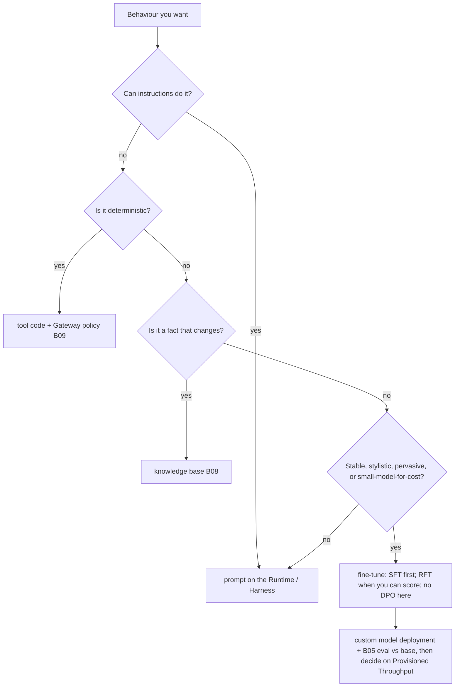

# B06 — Fine-tuning on Bedrock: change how the model answers, not what it knows today

Fine-tuning on Bedrock is a managed customisation job over your JSONL in S3 that produces a **custom model** you then deploy on demand or on Provisioned Throughput. **The design decision is which lever you pull for a behaviour you want: instructions, a tool, a knowledge base, the model you picked, or weights. Weights come last, because they are the slowest to change, the hardest to audit, and the only lever a `git revert` does not undo.** For an agent, most "the model keeps doing X" problems are prompt, tool or retrieval problems.

> _RAG is the lawyer's library; fine-tuning is what the lawyer has in their head. You still check the library._

Running scenario: the B03 ticket agent, fine-tuned for the UK card team's tone and refund-policy phrasing on Nova 2 Lite, then compared with the base model on the B05 cases. Facts come from the AWS pages fetched on 25 Oct 2026, section K of [`../reference/reading-map-agentcore-2026-10-25.md`](../reference/reading-map-agentcore-2026-10-25.md). Runnable proof: [`labs/01-sft-ticket-tone/`](labs/01-sft-ticket-tone/), written against boto3 1.43.118 and not yet run.

### What we are trying to avoid

A team fine-tunes Nova on last quarter's refund policy so the model "knows the policy", and the policy changes the next month; a Managed Knowledge Base (B08) would have picked it up at the next sync. A second team fine-tunes, chats with it in the console for ten minutes, and promotes; three weeks later 4 % of answers quote the wrong threshold. A third team asks for DPO pairs because that is what they did on Foundry, and discovers Bedrock has no preference-tuning job. A fourth leaves Provisioned Throughput running for a model nobody calls.

### Has this happened?

The Foundry chapter F06 was written against a book exercise that fine-tunes a medical assistant and judges it by chatting. The AWS equivalent is every blog that ends at "the fine-tuned model responds in the desired style" with no eval table. The lab here ends with the table.

### What the chapter covers

The lever order (1). SFT, RFT and distillation, which models take which, and the DPO gap (2). Data: the Nova conversation JSONL, sizes, validation, and the OpenAI-format path on `bedrock-mantle` (3). The job: the customisation role, `create_model_customization_job`, hyperparameters and cost arithmetic (4). Serving: custom model deployment, Provisioned Throughput, Custom Model Import, Nova Forge (5). The eval loop back to B05 and the promotion rule (6). Decision page (7).

### What you have at the end

A custom Nova 2 Lite model with a `ticket-tone` suffix, an on-demand deployment ARN, a side-by-side Strands Evals table of base versus tuned on the same cases, and the lever order as one sentence.

---

## 1. The lever order

Instructions (free, instant, versioned with the Runtime or Harness). Tools (deterministic behaviour belongs in code: the refund cap is an `if` in `issue_refund` and a Cedar rule on the Gateway, B09, never a learned tendency). Knowledge base (facts with a shelf life: B08). Model choice, inference profile and service tier (`labs-setup/01-models`). Then weights. Fine-tune when the behaviour is stable, pervasive and stylistic (tone, format, terminology, refusal phrasing, a long house style that would otherwise cost 2,000 prompt tokens per call), or when a smaller model must do a narrow task a larger one already does, for latency or cost. Never for facts that change, never as a substitute for a tool.

**Interview line.** "On AWS the cheap levers are the same as anywhere: prompt on the Runtime, code in the tool, documents in the knowledge base. Fine-tuning is the one lever where the rollback is a redeploy of a different model ARN, not an edit."

**Study check.** A product owner wants the agent to stop refunding over 250 GBP. Which lever? **Answer.** Tool code and a Gateway policy. A fine-tune makes it less likely; the `if` makes it impossible.

## 2. Methods and models

```mermaid
flowchart LR
  D[JSONL in S3] --> J[CreateModelCustomizationJob<br/>FINE_TUNING | REINFORCEMENT_FINE_TUNING | DISTILLATION]
  J --> M[custom model ARN]
  M --> P[CreateCustomModelDeployment<br/>on-demand]
  M --> T[Provisioned Throughput]
  P --> E[B05 eval: base vs tuned<br/>same cases, same evaluators]
  E -->|numbers up| G[promote model id in .env]
  E -->|numbers flat| X[delete deployment, keep prompt]
```

Three managed methods (K1): **supervised fine-tuning** (examples of input and ideal output), **reinforcement fine-tuning** (prompts plus a reward: a Lambda grader or a model-as-judge; `customizationConfig.rftConfig`), and **distillation** (a teacher model generates responses, the student is trained on them; `customizationConfig.distillationConfig`). Continued pre-training exists as an enum value on older models. **There is no DPO or preference-tuning job on Bedrock**; the Nova Forge SDK lists DPO only for Nova 1.0 on SageMaker (K1). If a Foundry habit says "DPO for taste", on AWS the nearest tool is RFT with a judge that encodes the taste.

| Model | SFT | RFT | Distillation student | Notes (K2–K4, K7) |
|---|---|---|---|---|
| Nova 2 Lite | yes | yes (us-east-1, ≤20K prompts) | yes | the default for this lab |
| Nova Micro / Lite / Pro (1.x) | yes | no | yes | |
| Llama 3.1 / 3.2 / 3.3 | yes | no | some | |
| Claude 3 Haiku | yes, us-west-2 only | no | no | the only Claude; EOL reported 10 Sep 2026, verify before planning on it |
| gpt-oss-20b, Qwen3-32B | via `bedrock-mantle` OpenAI-compatible Files + Fine-tuning APIs, us-west-2 | yes | | separate endpoint, OpenAI JSONL |
| Any open weights you trained elsewhere | Custom Model Import (Llama 2–3.3, Mistral, Qwen 2–3, GPT-OSS; <200 GB; 4 regions) | | | per-copy billing |

Newer Claude, GPT-5/6, Llama 4 and the other third-party models on the catalogue are **not** fine-tunable on Bedrock on 25 Oct 2026. Check the table before promising a model to anyone.

**Interview line.** "SFT shows the answer, RFT scores the answer, distillation copies a bigger model's answers. Bedrock has no DPO; pick by what data you can honestly produce."

**Study check.** The team has 300 pairs of good and bad replies. **Answer.** Keep the good halves as SFT rows; use the bad halves to write the judge rubric for an RFT run or, cheaper, for the B05 custom evaluator.

## 3. Data

The Nova shape (K5) is one conversation per line:

```json
{"schemaVersion": "bedrock-conversation-2024",
 "system": [{"text": "UK card team support assistant. Warm, brief, British English."}],
 "messages": [{"role": "user", "content": [{"text": "Can I get £300 back on ticket 1042?"}]},
              {"role": "assistant", "content": [{"text": "I can't approve that myself: refunds above £250 need a second approver. I've flagged it; you'll hear back within 4 business hours."}]}]}
```

Content blocks are lists, so images and video references fit the same line; tool-use turns follow the Converse message shape. AWS suggests 8K–20K samples for a measurable shift on Nova (K5); for a tone change on a narrow domain, 50–100 reviewed rows are where you start and the validation metrics tell you whether to add more. Keep a validation file (`validationDataConfig.validators[].s3Uri`); the job reports `trainingMetrics` and `validationMetrics` you read before deploying.

Every row is a policy statement, so the person who owns the policy reviews the set. The lab generates about 60 rows from the three policy documents with the base model and prints every one. The refund cap is never in the data as a rule to learn; the data teaches how to *say* the refusal.

The second shape on AWS is OpenAI chat JSONL (`{"messages":[{"role":...,"content":...}]}`) for the `bedrock-mantle` fine-tuning APIs on gpt-oss and Qwen3 (K4). Same content, different envelope; `sketches/nova_jsonl_shapes.py` has both.

**Interview line.** "One JSONL line is one Converse conversation. If your eval cases are already Converse messages, your training data is one `json.dumps` away."

## 4. The job

A customisation job needs a role that `bedrock.amazonaws.com` can assume with read on the training prefix and write on the output prefix (lab: `customization_role.py`). Then:

```python
job = br.create_model_customization_job(
    jobName="ticket-tone-sft-001", customModelName="ticket-tone-nova2lite", roleArn=FT_ROLE_ARN,
    baseModelIdentifier="amazon.nova-2-lite-v1:0", customizationType="FINE_TUNING",
    trainingDataConfig={"s3Uri": f"s3://{bucket}/finetune/train.jsonl"},
    validationDataConfig={"validators": [{"s3Uri": f"s3://{bucket}/finetune/valid.jsonl"}]},
    outputDataConfig={"s3Uri": f"s3://{bucket}/finetune/out/"},
    hyperParameters={"epochCount": "2", "learningRate": "0.00001", "batchSize": "1"})   # all strings
```

Poll `get_model_customization_job(jobIdentifier=arn)` until `Completed`; `outputModelArn` is the custom model. Hyperparameter keys are per model family; the Nova page names `epochCount`, `learningRate`, `batchSize` and `learningRateWarmupSteps` (verify the exact spelling for Nova 2 Lite on the model page before a paid run). RFT jobs add `customizationConfig.rftConfig` with a `lambdaGrader` or judge, and their own `hyperParameters` struct (integers, not strings: `epochCount`, `trainingSamplePerPrompt`, `reasoningEffort`).

Cost (K9): training tokens × epochs at the per-model training price, plus USD 1.95 per custom model per month of storage, plus whatever you serve it on. The arithmetic for the lab: 60 rows × ~300 tokens × 2 epochs is a few cents of training; storage is the recurring line; serving is the decision.

**Study check.** Why are the SFT hyperparameters strings? **Answer.** `hyperParameters` is a `map<string,string>` in the API so every model family can define its own keys; RFT has a typed struct because its keys are fixed.

## 5. Serving the result

| Option | What it is | When | Facts (K6, K7, K8) |
|---|---|---|---|
| **Custom model deployment** (`CreateCustomModelDeployment`) | on-demand endpoint for a custom model; pay per token | evaluation and low or spiky traffic | the lab's path; status `Creating → Active`; the deployment ARN is the `modelId` you pass to Converse |
| **Provisioned Throughput** | reserved model units, hourly | steady high traffic, latency SLA | the line item teams forget to turn off |
| **Custom Model Import** | bring weights trained elsewhere | you own a training pipeline | per-copy billing, 4 regions |
| **Nova Forge + SageMaker** | checkpoints and data mixing for your own Nova variant | frontier-scale customisation | SageMaker Inference for custom Nova GA Feb 2026 |

Strands does not care which: `BedrockModel(model_id=<deployment ARN>)`. Nothing else in the Runtime changes, which is the point of the mirror with B03: the agent is the same, the model id in `.env` is different.

## 6. The loop back to evals

The only step that decides anything: run the B05 lab 02 Strands Evals experiment twice with the same cases and evaluators, once with `BEDROCK_MODEL_ID` and once with the deployment ARN, and read the table (`compare_base_vs_tuned.py`). Promote on numbers with the same thresholds the CI gate uses; hold if tone improved but `ToolSelectionAccuracy` or `GoalSuccessRate` dropped. Then switch the model id on the Runtime (a new version, B03 §3), keep the old version on a pinned endpoint for a day, and let the online evaluation config (B05 §5) watch the real traffic.

**Interview line.** "Fine-tuning without an eval table is a feeling. The eval is the same experiment you already run in CI with one environment variable changed."

## 7. Decision page



## The chapter in eight lines

1. Lever order: instructions, tools, knowledge base, model choice, then weights.
2. Methods: SFT, RFT (Lambda or judge reward), distillation. No DPO on Bedrock.
3. Fine-tunable today: Nova 2 Lite and Nova 1.x, Llama 3.x, Claude 3 Haiku only; gpt-oss and Qwen3 through `bedrock-mantle`.
4. Data is Converse conversations: `schemaVersion bedrock-conversation-2024`, content blocks as lists.
5. The job is `create_model_customization_job` with a Bedrock-trusted role and S3 in and out; hyperparameters are strings.
6. The result is a custom model ARN; serve it on demand with a custom model deployment or on Provisioned Throughput.
7. Strands only needs the new `model_id`; the agent code does not change.
8. Promote only on an eval of tuned versus base on the same cases.

## What you should be able to explain

Why the refund cap is never fine-tuned in. The three methods in one sentence each and why DPO is missing. What a custom model deployment is and when Provisioned Throughput is the right answer instead. Where the eval sits in the loop. Why hyperparameters are a string map.

## What this is not

Not Nova Forge or SageMaker training recipes. Not image or speech model customisation. Not Custom Model Import in depth. Not a guide to RFT reward design beyond the sketch.

## Implementation scope and versions

boto3 1.43.118 (`bedrock` client: `CreateModelCustomizationJob`, `GetModelCustomizationJob`, `CreateCustomModelDeployment`, `GetCustomModelDeployment`, `DeleteCustomModelDeployment`, `DeleteCustomModel`), `strands-agents` 1.62.0, `strands-agents-evals` 1.7.0. Pages K1–K9 fetched 25 Oct 2026. Unverified on the day: Claude 3 Haiku EOL; exact Nova 2 Lite hyperparameter key names; Mantle fine-tuning request body. Nothing has run.

## Same thing on Foundry

| Bedrock (this chapter) | Foundry (F06) |
|---|---|
| Nova conversation JSONL in S3 | OpenAI chat JSONL uploaded with `files.create` |
| `create_model_customization_job(customizationType="FINE_TUNING")` | `fine_tuning.jobs.create(method={"type":"supervised"})` |
| custom model ARN | `fine_tuned_model` name |
| custom model deployment (on demand) | `DeveloperTier` deployment (24 h) or Standard with hourly hosting fee |
| Provisioned Throughput | Provisioned / Global Provisioned SKUs |
| no DPO; RFT with Lambda or judge reward | DPO available; RFT with graders |
| Custom Model Import | no equivalent |
| `BedrockModel(model_id=<deployment ARN>)` | `FOUNDRY_MODEL=<tuned deployment>` |
| Strands Evals experiment, base vs tuned | F05 batch eval against two agents |

## Further reading

Section K of the reading map (K1 methods, K2 SFT models, K3 RFT Nova, K4 Mantle APIs, K5 JSONL, K6 serving, K7 import, K8 Nova Forge, K9 pricing). Sketch: [`sketches/nova_jsonl_shapes.py`](sketches/nova_jsonl_shapes.py).
