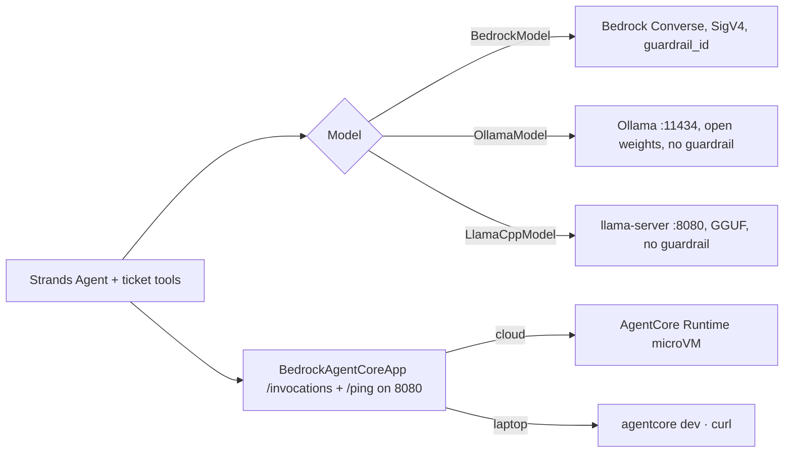

# B07 — Local agents with Strands: the same agent, no AWS in the loop

AWS has no Foundry Local. There is no AWS-shipped runtime that serves catalogue models on a laptop, Nova has no open weights, and there is no Bedrock on Outposts or Local Zones (L1). What AWS gives you instead is a framework that does not care where the model is: Strands swaps `BedrockModel` for `OllamaModel` or `LlamaCppModel` and the agent, the tools and the Runtime contract stay the same. **The design decision is the same one F07 asks on Foundry: which parts of the B03 agent stay identical when the model moves on-device, and which disappear. The Strands code, the tool contract and the `/invocations` + `/ping` contract stay; Bedrock Guardrails, AgentCore Identity, Gateway, Policy, Observability, versions and Evaluations all go, and you own them.**

> _Local inference moves the model, not the responsibility. On AWS it also moves the runtime, because there is no local AgentCore._

Running scenario: the B03 ticket agent (`get_ticket`, `list_tickets`, `get_policy`, `issue_refund` with the 250 GBP rule), pointed at a Qwen or gpt-oss model served by Ollama or llama.cpp, so it works on a train. The runnable proof is [`labs/01-local-ticket-agent/`](labs/01-local-ticket-agent/). Facts from the Strands model-provider pages and the AgentCore CLI 1.0 local-development guide fetched 25 Oct 2026 (reading map L1, L2, C2, C4, K7). Status words are GA, preview and retiring, with dates.

### What we are trying to avoid

A team demos the ticket agent on a laptop with Ollama, ships it to a branch server, and the pen test finds nothing filters prompts or tool calls, because the guardrail they trusted was a `BedrockModel(guardrail_id=...)` argument that `OllamaModel` does not have. A second team keeps running `agentcore launch --local` from a 2025 tutorial; the Python starter toolkit is deprecated and the flag is gone (C1, L2). A third quantises a 20B model to 4-bit, never re-runs the B05 cases, and the refund-policy answers drift. A fourth tells a customer "we run Bedrock on-prem"; there is no such product.

### Has this happened?

The deprecation is on the starter toolkit's own README (C1). The guardrail gap is structural: Bedrock Guardrails are an API on `bedrock-runtime` (F5), so any model you call without that API has no guardrail unless you call `ApplyGuardrail` yourself. The quantisation drift is the reason F07 and this chapter both insist on the eval gate.

### What the chapter covers

When local is right on AWS and when it is not (1). The Strands provider swap (2). The Runtime contract on your laptop: `BedrockAgentCoreApp`, `agentcore dev`, `invoke --local` (3). Quantisation in four sentences, with the same INT4 arithmetic as F07 (4). From local to cloud: Custom Model Import and the same open models on Bedrock (5). What you now own (6).

### What you have at the end

The ticket agent running against a local model with the same Strands code as B03 way 5, the Runtime contract answering `curl` on 8080 without AWS, the INT4 example you can do on a whiteboard, and the "now yours" list.

---

## 1. When local is right on AWS

Four reasons and one non-reason, the same as F07. Data must not leave the device or site. No or intermittent connectivity. Latency under what a round trip to a Region allows. Cost during development: a day of Ollama on a Mac costs electricity, a day of AgentCore microVMs costs Runtime seconds plus model tokens (L8), and the inner loop of writing a tool does not need either. The non-reason is "it is free": you pay in hardware, in the §6 list you must rebuild, and in model quality.

What AWS does not offer, said plainly: no local runtime that mirrors AgentCore Runtime; no catalogue-and-cache client; no on-device Nova. The honest architecture is **cloud-first, local as a second provider behind the same agent and the same eval** (B05 lab 02 cases). Air-gapped sites that still want AWS-managed hardware use Outposts or Snow devices with a self-managed model server; that is an EC2 pattern, not a Bedrock one.

**Interview line.** "Strands makes the model a constructor argument; nothing on AWS makes the laptop an AgentCore."

**Study check.** A regulated client asks for "Bedrock, but on our premises". **Answer.** Not a product. Offer Strands with an open-weight model on their hardware for the loop, Bedrock in a Region of their residency choice for production, and show the diff is one line in `build_agent()`.

## 2. The provider swap

Strands models implement one abstract `Model` (`stream`, `structured_output`, `get_config`, `update_config`), so the agent never sees the provider. Verified in the venv on 25 Oct 2026:

| Provider | Constructor (strands-agents 1.62.0) | Serves | Tool calling |
|---|---|---|---|
| `BedrockModel` | `BedrockModel(model_id=<inference profile>, region_name=..., guardrail_id=..., service_tier=...)` | Bedrock Converse | yes, plus guardrail arguments |
| `OllamaModel` | `OllamaModel(host="http://localhost:11434", model_id="qwen3:8b", keep_alive="5m", options={...})`; needs `pip install "strands-agents[ollama]"` | Ollama daemon | per model: Qwen3, Llama 3.x, gpt-oss, Mistral tags that list `tools`; check `ollama show <tag>` |
| `LlamaCppModel` | `LlamaCppModel(base_url="http://localhost:8080", model_id="default", params={...})` | `llama-server` | yes when the server is started with a chat template that supports it; Jinja templates since 2025 |

Everything else is identical to B03 lab 01: the four `@tool` functions, the system prompt, `Agent(model=..., tools=[...])`, hooks, session managers and the 250 GBP refusal living in the tool. The swap is the `--provider` flag in `labs/01-local-ticket-agent/local_ticket_agent.py`.

Small models call `issue_refund` for 300 GBP anyway. The policy refusal lives in the tool, which is the right place regardless of model size; smaller models make that lesson louder.

**Interview line.** "The agent is provider-agnostic; the guardrail is not. `guardrail_id` is a Bedrock argument, so local means `ApplyGuardrail` by hand or nothing."

**Study check.** Which line changes between the cloud and the local run? **Answer.** The model constructor. Nothing in tools, prompt or the Runtime app.

## 3. The Runtime contract on your laptop

AgentCore Runtime asks for `POST /invocations` and `GET /ping` on port 8080 (B13, C6). `BedrockAgentCoreApp().run()` serves exactly that locally, so the file you zip for B03 lab 01 is the file you run on the train. Three ways to drive it:

1. **Plain Python.** `python local_runtime_contract.py`, then `curl` with the session header (`curl_local.sh`). No AWS credentials are touched as long as the model provider is local.
2. **`agentcore dev`** (AgentCore CLI 1.0, 22 Oct 2026, C2/C4): runs the entrypoint under uvicorn with hot reload; `agentcore dev "<prompt>"` invokes it; `agentcore dev --mode browser` opens the Agent Inspector. Node 20.12+, config in `agentcore/agentcore.json`. Docker is needed only for container agents.
3. **`agentcore invoke --local`**: the same payload path the deployed invoke uses, against the dev server.

What does not exist any more: `agentcore launch --local` and `.bedrock_agentcore.yaml` from the deprecated Python starter toolkit (C1). If a tutorial shows them, it predates Feb 2026.

**Interview line.** "The contract is two routes and a port; if it answers `curl` on the laptop it will answer the Runtime."

**Study check.** `/ping` returns `HealthyBusy` locally. What did you forget? **Answer.** A tracked async task was never completed; the same flag keeps a cloud session alive past 15 minutes, so test it here first (B6).

## 4. Quantisation, with the arithmetic

Symmetric linear INT4 over a tensor whose weights lie in [-1, 1]: the integer range is [-8, 7], so scale `s = 1.0 / 7 ≈ 0.142857`. Weight 0.37 → `round(0.37 / 0.142857) = round(2.59) = 3` → stored as `0011`. Dequantised: `3 × 0.142857 = 0.428571`. Error 0.0586, about 15.8 % of the value, for an 87.5 % memory saving over FP32 (`sketches/int4_by_hand.py`). Real schemes cut that error with per-block scales (GGUF `Q4_K_M` uses blocks with their own scales and minimums; MXFP4, which gpt-oss ships in, shares one scale per 32 values), and calibration. Ollama tags carry the quant: `qwen3:8b` is Q4_K_M by default, `qwen3:8b-q8_0` is INT8, `gpt-oss:20b` is MXFP4 as published. Memory is parameters × bytes per weight plus KV cache: 20B at 4 bits is about 12 GB, which is why `gpt-oss:20b` fits a 16 GB Mac and a 24 GB GPU. Rule: quantise, then **run the B05 lab 02 cases** before you trust it. INT8 is rarely noticeable; INT4 often is on policy-precise answers.

The Olive analogue on this side is `llama-quantize` (`gguf_quant.sh`): Hugging Face → GGUF F16 → `Q4_K_M`, then `ollama create` from a Modelfile.

**Interview line.** "Scale is max over qmax; 0.37 becomes 3 becomes 0.4286; the 16 % error is why the eval runs again."

## 5. From local to cloud

Two paths, both without touching the agent code:

- **Same open model on Bedrock.** gpt-oss 20b/120b, Llama 4, Qwen3, Mistral, Gemma are in the Bedrock catalogue (L3). Swap `OllamaModel(model_id="gpt-oss:20b")` for `BedrockModel(model_id="openai.gpt-oss-20b-1:0")` and you have SigV4, guardrails, service tiers and Observability back. (The exact Bedrock model id spelling is on the model card; verify before quoting.)
- **Your tuned weights.** Custom Model Import (K7) takes Llama 2–3.3, Mistral/Mixtral, Flan, Qwen2/2.5/3 and GPT-OSS 20B/120B weights under 200 GB from S3, in four Regions, billed per model copy while active. That is the AWS answer to "I fine-tuned locally, now serve it with IAM in front". Foundry has no equivalent; B06 covers tuning inside Bedrock.

What you cannot do: import a GGUF or an INT4 you quantised yourself; Custom Model Import wants safetensors in the supported architectures. Quantise for the laptop, upload the full-precision checkpoint for the cloud.

**Study check.** The client wants the gpt-oss agent that worked offline to run in `eu-west-2` with guardrails. **Answer.** `BedrockModel` with the gpt-oss id and a `guardrail_id`; no code elsewhere changes; re-run the B05 cases because the quantisation differs.

## 6. What you now own

| Stays identical to B03 | Gone, now yours |
|---|---|
| Strands `Agent` + the four tools | Bedrock Guardrails: nothing scans input, tool calls or output (call `ApplyGuardrail` yourself, B05 lab 03, which needs AWS) |
| `BedrockAgentCoreApp` contract, `/invocations` + `/ping` | AgentCore Identity: no workload identity, no OBO; the OS user is the identity |
| Tool contract, MCP clients, A2A server code | Gateway and Policy: no Cedar between the agent and the tool; your hook is the only gate |
| Session id in `RequestContext` | Observability: no CloudWatch GenAI view unless you export OTel somewhere |
| Eval cases and Strands Evals (run locally) | Versions, endpoints, rollback: you manage binaries and model files |
| The B03 decision rule | Quota, per-second cost meters, Registry entry |

So the migration path is: build with the Bedrock deployment, keep the local model as a second provider behind the same agent, gate the switch on the same Strands Evals experiment. Local is B03 way 6 (self-hosted) with the model also on your side of the line.

## The chapter in eight lines

1. AWS has no Foundry Local; the local story is Strands plus Ollama or llama.cpp with open weights.
2. `BedrockModel` ↔ `OllamaModel(host, model_id)` ↔ `LlamaCppModel(base_url)`: one constructor, same agent.
3. The Runtime contract is two routes on 8080; `BedrockAgentCoreApp().run()` serves it on the laptop.
4. `agentcore dev` and `invoke --local` (CLI 1.0) replace the deprecated `agentcore launch --local`.
5. INT4 symmetric: scale 1/7, 0.37 → 3 → 0.4286, 15.8 % error; GGUF `Q4_K_M` and MXFP4 are the tags you will meet.
6. `llama-quantize` is the Olive of this side; Custom Model Import is the cloud door for tuned weights.
7. Guardrails, identity, gateway, policy, tracing, versions and quota disappear locally; the tool-side refusal survives.
8. Build cloud-first, keep local as a second provider behind the same eval gate.

## What you should be able to explain

Why there is no AWS equivalent of Foundry Local and what to say instead. Which Strands providers exist and which argument carries the guardrail. The two routes and the port. The INT4 arithmetic. What Custom Model Import accepts and refuses. The "now yours" list without looking.

## What this is not

Not a llama.cpp or Ollama internals chapter. Not Outposts, Snow or IoT Greengrass. Not fine-tuning (B06). Not the container deploy (B03 lab 02).

## Implementation scope and versions

`strands-agents` 1.62.0 (providers `bedrock`, `ollama`, `llamacpp`, `openai`, `anthropic`, `litellm`, `sagemaker` and more, listed from the installed package), `bedrock-agentcore` 1.25.0, AgentCore CLI 1.0.0 (22 Oct 2026). Ollama and llama.cpp versions are whatever Homebrew installs on the day. Nothing here has been run yet; the lab needs Ollama installed and one model pulled. The gpt-oss Bedrock model id and Ollama tag quant defaults are marked verify in the lab.

## Same thing on Foundry

| On AWS (this chapter) | On Foundry (F07) |
|---|---|
| Strands `OllamaModel` / `LlamaCppModel` | Foundry Local SDK (`FoundryLocalManager`, OpenAI-compatible server) |
| Ollama catalogue and `ollama pull` | Foundry Local catalogue and cache, `foundry model list` |
| `BedrockAgentCoreApp().run()` on 8080, `agentcore dev` | Agent Framework hosting run locally, `ResponsesHostServer` |
| `agentcore invoke --local` | `azd ai agent invoke --local` |
| `llama-quantize` to GGUF `Q4_K_M` | `olive optimize --precision int4` to ONNX |
| Custom Model Import for tuned open weights | no equivalent |
| no AWS-managed local runtime | Foundry Local itself |
| Guardrails, identity, policy, tracing all yours | same list, same sentence |

## Further reading

Reading map L1 (Strands Ollama and llama.cpp providers; the "no equivalent" facts), L2 (`agentcore dev`, legacy flag retired), C2 and C4 (CLI 1.0 and local development), K7 (Custom Model Import), L3 (open models on Bedrock), L8 (what a cloud lab day costs). Sketches: [`sketches/int4_by_hand.py`](sketches/int4_by_hand.py), [`sketches/provider_swap.py`](sketches/provider_swap.py).
