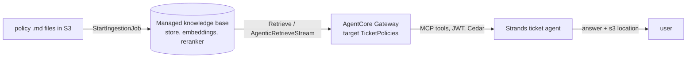

# B08 — Bedrock Knowledge Bases: the managed line, and the knowledge base as a gateway tool

Bedrock now has two knowledge-base product lines. The **Managed Knowledge Base** (GA 17 Jun 2026) owns the store, the embeddings, the reranker and an agentic multi-hop retriever, and AWS recommends it by default. The **customer-managed** knowledge base is the 2024 design: you choose a vector store (OpenSearch, S3 Vectors, Aurora, Neptune), an embedding model and a chunking strategy. **The design decision in this chapter is the same one F08 asked on Foundry: does retrieval intelligence live in your agent's prompt and loop, or in a governed retrieval object you can version, permission and bill separately.** On AWS the governed object is the knowledge base, and the way an agent reaches it is a Gateway target.

> _A vector store answers a similarity query. A knowledge base answers a question, cites the document, and sits behind the same gateway and policy engine as every other tool._

Running scenario: the support-ticket agent from B03 grounded on the three refund, card and escalation policy documents from F08, uploaded to S3. The runnable proof is [`labs/01-managed-knowledge-base/`](labs/01-managed-knowledge-base/), written on 25 Oct 2026 against `boto3` 1.43.118 and not yet run. Facts come from the pages fetched that day, section J of [`../reference/reading-map-agentcore-2026-10-25.md`](../reference/reading-map-agentcore-2026-10-25.md); J1 to J7 refer to it. Status words are GA, preview and retiring, with dates.

### What we are trying to avoid

A team builds RAG by hand on OpenSearch Serverless (collection, index mapping, embedding job, chunker, reranker, citation formatter) and pays for the collection every hour the agent is idle. A second team wires the deprecated Strands `retrieve` tool with a knowledge-base id in the agent's prompt, so each agent that shares the index behaves differently and none of the calls pass through the gateway where the Cedar policy lives. A third team starts a SharePoint connector on a customer-managed knowledge base in October 2026 and finds the option gone, because new SharePoint, Confluence, Salesforce and web connectors are managed-only since 30 Sep 2026 (J4). A fourth team hard-codes `Retrieve` into Lambda and loses the citations by flattening the result to text.

### Has this happened?

Two of the four are visible in the reading list: the Strands tools repository marks `retrieve` deprecated in favour of a memory store (J5), and the connector page carries the 30 Sep 2026 cutoff (J4). The hourly-collection cost is the recurring complaint in every "we tried Bedrock KB" write-up of 2024 and 2025, which is exactly what the managed line and S3 Vectors were built to remove.

### What the chapter covers

The two product lines and when each is right (1). What a managed knowledge base does for you (2). Sources, connectors and the cutoff (3). The three retrieval calls and what each returns (4). Giving it to an agent: gateway target, Strands memory store, direct call, and the roles (5). The customer-managed path and RAG evaluation jobs (6).

### What you have at the end

A managed knowledge base created from code with no store to run, an agent that cites the S3 location of the policy it used through the same gateway as its ticket tools, the role table, and the sentence that explains why the Peru question must be refused.

---

## 1. Two product lines

| | Managed Knowledge Base (J1) | Customer-managed knowledge base (J3) |
|---|---|---|
| Status | GA 17 Jun 2026, recommended default | GA since 2024; still supported |
| Store | AWS-managed | yours: OpenSearch Serverless or Managed, S3 Vectors (GA 2 Dec 2025), Aurora pgvector, Neptune Analytics (GraphRAG), Pinecone, Redis, MongoDB Atlas, Kendra GenAI index |
| Embeddings and reranker | managed, or bring your own embedding model | you pick the embedding model; rerank via Bedrock rerankers (Cohere Rerank 3.5) |
| Chunking and parsing | managed | fixed, hierarchical or semantic chunking; parsing by a foundation model or Bedrock Data Automation |
| Retrieval | `Retrieve`, `RetrieveAndGenerate`, **agentic multi-hop** (`AgenticRetrieveStream`) | `Retrieve`, `RetrieveAndGenerate` |
| Connectors | S3, SharePoint, Confluence, Web, Google Drive, OneDrive, custom | S3, custom; the SaaS and web connectors are closed to new creation since 30 Sep 2026 (J4) |
| Cost shape | USD 5 per GB-month of index, USD 1 per 1,000 `Retrieve`, USD 4 per 1,000 agentic retrievals (J7) | the store's own bill (an OpenSearch Serverless collection runs hourly) plus embedding tokens |
| Pick when | you want the document-to-citation path owned by AWS; several agents; connectors; agentic retrieval | you need a specific store (GraphRAG, an existing OpenSearch domain), custom chunking, or NL2SQL over Redshift |

In the API both are `CreateKnowledgeBase`; the difference is `knowledgeBaseConfiguration.type`: `MANAGED` with a two-line `managedKnowledgeBaseConfiguration`, or `VECTOR` plus a `storageConfiguration` block. `sketches/kb_shapes.py` has both side by side.

**Interview line.** "Managed KB is the default now; S3 Vectors is how you keep the old design cheap; OpenSearch is for when you already run it."

**Study check.** A client already has an OpenSearch domain with a security review. Which line? **Answer.** Customer-managed, `storageConfiguration.type = OPENSEARCH_MANAGED_CLUSTER`, because the review was on the store; the managed line would move the data into an AWS-owned store they have not reviewed.

Rule to keep: **type MANAGED unless the store itself is a requirement.**

## 2. What a managed knowledge base does for you

Per ingestion job it reads the source, extracts text (and optionally images, audio, video through `mediaExtractionConfiguration` on managed connectors), chunks, embeds, indexes and keeps the document location as metadata. Per query it embeds, searches, reranks with the managed reranker (`rerankingModelType: MANAGED` on `managedSearchConfiguration`) and returns passages with `location`, `score` and metadata. With `AgenticRetrieveStream` it also plans: a model decomposes the question, runs several retrievals (up to `maxAgentIteration`), merges and optionally writes the answer (`generateResponse`), with an optional guardrail and an optional AgentCore Memory binding for conversational context.

**Interview line.** "Agentic retrieval is Bedrock's retrievalReasoningEffort: a model plans sub-queries inside the knowledge base, so every agent gets the same plan."

**Study check.** Where does the number of passages returned get set, and who can change it? **Answer.** On the call (`numberOfResults`) or, once the knowledge base is a gateway target, on the target; the agent prompt cannot override it.

Rule to keep: **retrieval settings live on the knowledge base or the target, never in the agent prompt.**

## 3. Sources and the connector cutoff

`CreateDataSource` types: `S3`, `WEB`, `CONFLUENCE`, `SALESFORCE`, `SHAREPOINT`, `CUSTOM`, `REDSHIFT_METADATA`, `MANAGED_KNOWLEDGE_BASE_CONNECTOR`. The last one is the managed line's connector family (SharePoint, Confluence, Google Drive, OneDrive, web) with a sync schedule and deletion protection. Since 30 Sep 2026 new Confluence, SharePoint, Salesforce and web sources cannot be created on customer-managed knowledge bases (J4); existing ones keep running. `CUSTOM` plus `IngestKnowledgeBaseDocuments` is the push path for your own pipeline. One knowledge base can hold several sources; ingestion is per source.

**Interview line.** "SaaS connectors are managed-only now; if a client needs SharePoint, the line is decided for them."

**Study check.** A nightly job produces policy PDFs. Push or pull? **Answer.** Pull from S3 with `StartIngestionJob` after the job, or `CUSTOM` push if the pipeline already has the text and metadata; pull keeps the document location as the citation for free.

Rule to keep: **S3 pull for documents you own; managed connectors for SaaS; CUSTOM push only for pipelines that already produce text.**

## 4. Three retrieval calls

| Call | Returns | Who writes the answer | Use |
|---|---|---|---|
| `Retrieve` | passages with `location`, `score`, `metadata`; `guardrailAction` | your agent | the agent-tool case; keeps citations raw |
| `RetrieveAndGenerate` | an answer with citations | Bedrock, one model | a chat box with no agent loop |
| `AgenticRetrieveStream` | streamed plan, passages and optionally an answer | Bedrock, with planning | multi-hop questions; several retrievers; memory-aware follow-ups |

Filters: `managedSearchConfiguration.filter` (managed) or `vectorSearchConfiguration.filter` and implicit filters (vector line) over document metadata. Per-user restriction is `userContext.userId` on the call; the knowledge base applies the document ACLs the connector ingested. Through the gateway, the `JWT_PASSTHROUGH` outbound mode is how the caller's identity reaches the call (B04 §3).

**Interview line.** "Retrieve for agents, RetrieveAndGenerate for a chat box, AgenticRetrieveStream when one query is not enough."

**Study check.** The agent's answers lose their citations after a refactor. First thing to check? **Answer.** Whether someone flattened `retrievalResults` to text before it reached the model; the `location` field is the citation and must survive to the tool result.

Rule to keep: **never flatten retrievalResults; the location is the proof.**

## 5. Giving it to an agent

Three ways, in order of preference for a production agent:

1. **Gateway target** (J2). The managed knowledge base becomes a connector target on the B04 gateway; the agent sees `TicketPolicies___Retrieve` and `TicketPolicies___AgenticRetrieveStream` through the same `MCPClient`, bearer token, Cedar policy engine and rate limits as the ticket tools. Roles: the gateway role needs `bedrock:Retrieve` and `bedrock:AgenticRetrieveStream` on the knowledge base; the caller needs nothing new. Proof: `labs/01-managed-knowledge-base/add_gateway_target.py` and `connect_agent.py`.
2. **Strands memory store**. `Agent(memory_manager=MemoryManager(stores=[store]))` with a read-only store that wraps `Retrieve`; passages are injected before each turn and a search tool is exposed. This replaces the deprecated `strands_tools.retrieve` (J5). It runs in your process with SigV4 and no gateway; right for one agent, wrong when several agents or a policy must govern access. Proof: `strands_memory_store_variant.py` (the venv on 25 Oct 2026 had no shipped `BedrockKnowledgeBaseStore`, so the lab implements the `MemoryStore` protocol in 20 lines).
3. **Direct boto3** from a tool function. Fine for a prototype; it hides the knowledge base id in agent code and bypasses the gateway.

The agent prompt in all three says only: answer from the tools, cite the location, refuse otherwise. The retrieval behaviour is not in it.

**Interview line.** "Put the knowledge base behind the gateway; then the refund policy and the knowledge policy are enforced in the same place."

**Study check.** Why must the Peru question be refused and what does a wrong answer tell you? **Answer.** The documents do not cover it and the agent has no web tool; an answer of "Lima" means the model answered from weights, so either the system prompt or the tool filter failed and the citation discipline is gone.

Rule to keep: **gateway target first; memory store for single-process agents; direct calls only in prototypes.**

## 6. The customer-managed path and RAG evaluation

Keep the vector line for: an existing OpenSearch domain, GraphRAG on Neptune Analytics, S3 Vectors when the cheapest possible store matters, Aurora when the data already lives there, and structured NL2SQL over Redshift (`type: SQL`). You then own chunking (`FIXED_SIZE`, `HIERARCHICAL`, `SEMANTIC`), parsing (`BEDROCK_FOUNDATION_MODEL`, `BEDROCK_DATA_AUTOMATION`, multimodal embeddings) and reranking configuration. Bedrock Evaluations has RAG jobs for both lines: retrieve-only and retrieve-and-generate, with ground truth, judged by a model (I11); AgentCore Evaluations' `Faithfulness` and `Correctness` cover the agent's use of what was retrieved (B05 §3). Amazon Q Business closed to new customers on 31 Jul 2026 and Amazon Quick is the successor for the enterprise-search product line (J6); for an agent, the knowledge base is the primitive.

**Interview line.** "S3 Vectors keeps the vector line cheap; GraphRAG and NL2SQL are the two reasons to stay on it."

**Study check.** Which evaluation measures the retriever and which measures the agent? **Answer.** A Bedrock RAG evaluation job measures retrieval quality against ground truth; AgentCore `Faithfulness` measures whether the agent's answer stayed inside the retrieved passages.

Rule to keep: **evaluate the retriever and the agent separately; they fail for different reasons.**

## The chapter in eight lines

1. Two lines: Managed (GA 17 Jun 2026, default) and customer-managed (you own the store).
2. `CreateKnowledgeBase` with `type: MANAGED` needs no store, embedding model or chunking choice.
3. SaaS and web connectors are managed-only since 30 Sep 2026.
4. `Retrieve` returns passages with location and score; that location is the citation.
5. `AgenticRetrieveStream` plans multi-hop retrieval inside the knowledge base.
6. An agent reaches it through a Gateway target, under the same JWT and Cedar as every other tool.
7. The Strands `retrieve` tool is deprecated; the in-process pattern is a read-only `MemoryStore`.
8. Retrieval settings live on the knowledge base and the target, never in the agent prompt.

## What you should be able to explain

Managed versus customer-managed in one sentence each; what an ingestion job produces; the three retrieval calls; how the knowledge base becomes an agent tool and which role needs what; why the Peru question is refused; when S3 Vectors, GraphRAG or NL2SQL justify the vector line.

## What this is not

Not the gateway mechanics (B04 §5), not evaluation of answers (B05), not the Cedar rule that limits who may call `Retrieve` (B09), not Amazon Quick or Kendra.

## Implementation scope and versions

`boto3` 1.43.118 (`bedrock-agent`, `bedrock-agent-runtime`, `bedrock-agentcore-control`), `strands-agents` 1.62.0, `strands-agents-tools` 0.8.10; one lab, one sketch; nothing run against AWS on 25 Oct 2026. Unverified and marked in code: the gateway connector id and configuration keys for the knowledge-base target, the `AgenticRetrieveStream` message and retriever key names, the shipped name of a Strands knowledge-base store.

## Same thing on Foundry

| AWS | Foundry (F08) |
|---|---|
| Managed Knowledge Base | Foundry IQ knowledge base on Azure AI Search |
| `CreateDataSource` S3 / managed connectors | knowledge sources: `azureBlob` (indexed), SharePoint, web (remote) |
| `Retrieve` | `knowledge_base_retrieve` with `outputMode: extractiveData` |
| `RetrieveAndGenerate` | `outputMode: answerSynthesis` |
| `AgenticRetrieveStream`, `maxAgentIteration` | `retrievalReasoningEffort` minimal / low / medium / auto |
| Gateway connector target, `GATEWAY_IAM_ROLE` | `RemoteTool` connection with `ProjectManagedIdentity`, `MCPTool(allowed_tools=["knowledge_base_retrieve"])` |
| `userContext.userId`, `JWT_PASSTHROUGH` | `x-ms-query-source-authorization` ACL passthrough |
| S3 Vectors / OpenSearch customer-managed line | Azure AI Search index plus the AI Search tool (F03 lab 05) |
| Strands `MemoryStore` over `Retrieve` | Agent Framework `FoundryChatClient` with the AI Search tool |

## Further reading

J1 managed KB launch and build page; J2 gateway target; J3 vector stores; J4 connector cutoff; J5 Strands tools deprecation; J6 Q Business to Quick; J7 pricing; D1 gateway target classes; I11 Bedrock RAG evaluation jobs.
