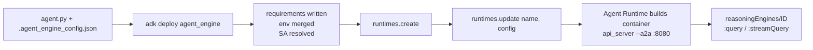
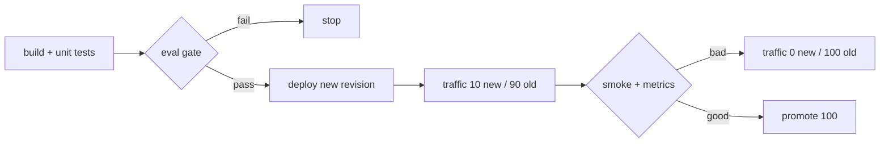

# G02 — SDKs and Automated Deployment

[G01](../G01-GCP-Agent-Landing-Zones/README.md) left you a project inside a perimeter, a staging bucket in the right region and the roles your deployer identity needs. This chapter is about how an agent gets into that project repeatably: which Python package owns which call, what `adk deploy agent_engine` does when you are not looking, what the same deploy looks like as SDK code and as Terraform, and how a pipeline turns one deploy into a release with an eval gate, a traffic split and a rollback. Agent design belongs in [G03](../G03-Creating-Agents/README.md); tools and identity in [G04](../G04-Agent-Tooling-Identity-MCP-A2A/README.md).

> _Know what you are deploying, which package owns the call, and how you verify the result._

Running scenario: the S03 support-ticket agent, `ticket-agent`, is deployed to Agent Runtime (ex-Agent Engine; the API resource is still `ReasoningEngine`, A5) three ways and then put behind a pipeline. Lab in [`labs/`](labs/README.md); shared environment in [`../labs-setup/`](../labs-setup/README.md); facts cited by letter from [`../reference/reading-map-gcp-agents-2026-10-25.md`](../reference/reading-map-gcp-agents-2026-10-25.md).

### What we are trying to avoid

The notebook that imports `vertexai.agent_engines` from a 2025 tutorial and fails on the 2.0.1 package split (A2, A5); the deploy that creates a second `ticket-agent` every pipeline run because nobody did get-or-create; the pipeline that reaches the 950-revision cap on one agent (A10); the "rollback" that is a redeploy of last week's commit instead of a traffic change (C4); the Terraform apply that ends in IMAGE_PULL_BACKOFF because the Artifact Registry binding came after the agent (I8).

### Has this happened?

No first-party incident page was fetched for this chapter. The nearest documented failure modes are in the deploy code itself: `cli_deploy.py` refuses to run when only `agent_engines` is importable and asks for `google-cloud-agentplatform>=2.2` (C2). Everything else here is a pattern, not a dated incident; unverified.

### What the chapter covers

The SDK map; the `adk deploy` path under the hood; the SDK path and the `runtimes.create` config keys; the Terraform path; agents-cli and the Agent Starter Pack as pipeline scaffolds with Cloud Build stages; revisions and traffic split as the release and rollback mechanism; a release checklist.

### What you have at the end

Three sketches that deploy the same agent three ways, a Cloud Build pipeline scaffold with an eval gate placeholder and a 10/90 traffic step, a Terraform variant, and the spoken answer to "how do you release an agent on Google Cloud".

---

## 1. The SDK map

Four packages, four jobs. The split happened on 18 Sep 2026 when SDK 2.0.1 moved agents out of `google-cloud-aiplatform` into `google-cloud-agentplatform`, a breaking change (A2). The Agent Runtime page describes the result: `agent_engines` became `runtimes`, `sessions`, `sandboxes` and `memory_banks` under `agentplatform`, and `agentplatform.Client(...).runtimes` replaces `vertexai.agent_engines` (A5).

| Package (pinned 25 Oct 2026)                | Import for                                                                                                   | Not for                              |
| ------------------------------------------- | ------------------------------------------------------------------------------------------------------------ | ------------------------------------ |
| `google-adk` 2.13.0 (A8)                    | `LlmAgent`, `Runner`, `McpToolset`, the `adk` CLI                                                            | talking to the Runtime control plane |
| `google-cloud-agentplatform` 2.6.0 (A5)     | `agentplatform.Client().runtimes.create/update`, revisions, `sessions`, `memory_banks`                       | model calls                          |
| `google-cloud-aiplatform` 2.6.0 (map table) | the old `vertexai.agent_engines` surface; still written into requirements by `adk deploy` as `>=2.2,<3` (C2) | new code                             |
| `google-genai` 2.33.0                       | `client.models.generate_content`, `client.tunings.tune` (G4)                                                 | deploying agents                     |

`adk deploy` needs `client.runtimes` to exist and errors if only `agent_engines` does (C2), so the labs pin both `aiplatform` and `agentplatform` (map "Pinned versions"). The one place the old surface appears in this track is [`sketches/sdk_map.py`](sketches/sdk_map.py), side by side with the new one.

**Interview line.** "Agents live in `google-cloud-agentplatform` since 2.0.1; `aiplatform` is kept only because `adk deploy` still writes it."

## 2. The `adk deploy agent_engine` path, under the hood

The CLI source (B6, C2) is the honest documentation. `adk deploy agent_engine --project --region --display_name --agent_engine_config_file .agent_engine_config.json` does the following in order:

1. Writes a requirements file containing `google-cloud-aiplatform[adk,agent_engines]>=2.2,<3` and `google-adk[a2a]==<installed version>` (C2).
2. Merges `.env` into `env_vars`; picks the service account with precedence CLI flag, then `GOOGLE_CLOUD_SERVICE_ACCOUNT`, then the config file (C2).
3. Calls `runtimes.create()` and then `runtimes.update(name, config)`; with `--agent_engine_id` it updates an existing resource instead (B6, C2).
4. The container Agent Runtime builds runs `api_server --host=0.0.0.0 --a2a` on port 8080 with `agentengine://` session and memory URIs and `agent_framework="google-adk"` (C2).
5. Prints `reasoningEngines/<ID>`; the agent then answers at `https://{LOCATION}-aiplatform.googleapis.com/v1/projects/{P}/locations/{L}/reasoningEngines/{ID}:query` (C3).

Flags that matter for a pipeline: `--otel_to_cloud` for tracing (E4), `--service_account` only when you are not using Agent Identity, `--extra_packages` for local modules. `--staging_bucket`, `--requirements_file` and `--env_file` are deprecated and move into the config file (B6). The Python payload excludes the web UI (C3).

**Interview line.** "`adk deploy` is a thin wrapper over `runtimes.create` then `runtimes.update`; the config file is the contract, not the flags."

## 3. The SDK path and the `runtimes.create` config keys

The deploy-an-agent page lists five sources: Developer Connect, source files, a Dockerfile, a container image, or an SDK object (I7). Whatever the source, the config dictionary is the same:

| Key (I7)                                                                     | Decision it carries                                                    | Lab default             |
| ---------------------------------------------------------------------------- | ---------------------------------------------------------------------- | ----------------------- |
| `requirements`, `extra_packages`                                             | what is installed, what is uploaded                                    | from `requirements.txt` |
| `env_vars`                                                                   | `TICKET_MCP_URL`, `GOOGLE_GENAI_USE_VERTEXAI`                          | from `.env`             |
| `identity_type`                                                              | `AGENT_IDENTITY` or a service account (C5)                             | `AGENT_IDENTITY`        |
| `service_account`                                                            | only when `identity_type` is unset                                     | unset                   |
| `encryption_spec`                                                            | CMEK key (F5, G01 §5)                                                  | unset in the lab        |
| `min_instances`, `max_instances`, `container_concurrency`, `resource_limits` | capacity                                                               | defaults                |
| `psc_interface_config`                                                       | network attachment and DNS peering (I3); fixed at create               | unset in the lab        |
| `agent_framework`                                                            | `google-adk`, `langchain`, `langgraph`, `ag2`, `llama-index`, `custom` | `google-adk`            |
| `gcs_dir_name`, `container_spec.image_uri`                                   | staging path; custom image                                             | staging bucket          |

The older quickstart shows the shape with `vertexai.Client(...).agent_engines.create(agent=app, config={...})` (C1); the new one is `agentplatform.Client().runtimes.create` with `from agentplatform.frameworks import AdkApp` (A5; that page was not fetched, so the exact import is unverified). Agent Identity needs `http_options=dict(api_version="v1beta1")` on the client (C5).

**Interview line.** "Everything the CLI hides is one dictionary; `identity_type` and `psc_interface_config` are the two keys you cannot change later without a new principal or a new resource."

## 4. The Terraform path

`google_vertex_ai_reasoning_engine` (provider ≥5.28.0) takes `spec.agent_framework`, `spec.package_spec{python_version, pickle_object_gcs_uri, requirements_gcs_uri}`, `spec.service_account`, `spec.deployment_spec{env, secret_env}`, `spec.container_spec.image_uri` and `spec.source_code_spec`; `agent_gateway_config` is google-beta and needs `identity_type="AGENT_IDENTITY"`; put `depends_on` on the `roles/artifactregistry.reader` binding or the first apply can end in IMAGE_PULL_BACKOFF (I8). Terraform is the right owner when the agent is one resource among a data store, a search engine and a Model Armor template that must change together (`google_discovery_engine_data_store`, `google_discovery_engine_search_engine`, `google_model_armor_template`, `google_model_armor_floorsetting`, I8).

| Path         | Owns                                               | Weak at                                                    |
| ------------ | -------------------------------------------------- | ---------------------------------------------------------- |
| `adk deploy` | a developer's loop, one agent, fast                | fleets, drift, review                                      |
| SDK          | pipelines that need logic (get-or-create, traffic) | reviewability of state                                     |
| Terraform    | the agent next to its data store, key and policy   | the pickle it points at, which something else must produce |

The pickle and requirements objects Terraform references are produced by the SDK or CLI path first; the lab's [`terraform/`](labs/01-deploy-pipeline/terraform/main.tf) variant assumes a prior pipeline step uploaded them. Whether the provider exposes revisions and traffic is unverified in the map; the lab shifts traffic from Python.

**Interview line.** "Terraform for the resource graph, SDK for the release logic; Terraform cannot run your eval gate."

## 5. agents-cli, the starter pack and Cloud Build stages

Two scaffolds exist. The Agent Starter Pack (v0.41.3, 25 Apr 2026) is in maintenance mode; `uvx agent-starter-pack create|enhance|setup-cicd` gives templates `adk`, `adk_a2a`, `agentic_rag`, `langgraph` and a Cloud Build set of `.cloudbuild/pr_checks.yaml`, `staging.yaml`, `deploy-to-prod.yaml` across staging and prod projects plus a `cicd_runner_project_id` (I11). Its successor is agents-cli (`google-agents-cli` 1.11.0, 20 Oct 2026): `uvx google-agents-cli setup`, `create`, `scaffold enhance|upgrade`, `run`, `eval run|generate|grade|compare|optimize`, `deploy`, `publish gemini`, `infra single-project`, `infra cicd`; the default deploy target is `agent_runtime`, with Cloud Run and GKE as alternatives; telemetry is on by default and `AGENTS_CLI_TELEMETRY=0` turns it off (I12). `agents-cli deploy --agent-identity` is the flag for Agent Identity (C5).

The stage shape both scaffolds share, and the lab's `cloudbuild.yaml` copies:

| Stage         | Does                                                                                      | Source                                                                                          |
| ------------- | ----------------------------------------------------------------------------------------- | ----------------------------------------------------------------------------------------------- |
| build         | install, lint, unit tests                                                                 | I11 `pr_checks.yaml`                                                                            |
| eval gate     | `adk eval` or `agents-cli eval run`; fail stops the pipeline                              | E1, I12; no first-party Cloud Build wiring page exists (E7), so the lab's step is a placeholder |
| deploy        | `adk deploy agent_engine --agent_engine_id` or `runtimes.update` on the existing resource | C2                                                                                              |
| traffic 10/90 | manual split, new revision at 10                                                          | C4                                                                                              |
| promote       | manual split to 100, or back to `trafficSplitAlwaysLatest`                                | C4                                                                                              |

**Interview line.** "Starter pack is in maintenance; agents-cli `infra cicd` is the scaffold, and the eval gate is the one stage you still wire yourself."

## 6. Revisions and traffic split as release and rollback

Revisions and traffic management are preview on 22 Oct 2026, on `v1beta1` (C4). A revision is created on `create` and whenever a versioned field changes. Traffic is either `trafficSplitAlwaysLatest` (default) or `trafficSplitManual`. There is no rollback verb: rollback is a manual split that sends traffic to an earlier active revision. Archived revisions are unrecoverable, and changing an Agent Gateway binding archives prior revisions. SDK calls: `client.runtimes.revisions.list/get/delete` and `client.runtimes.update(traffic_config=...)` (C4). Limits: 6,000 revisions per project-region and 950 per agent, not adjustable (A10); the Runtime create/update/delete quota is 10 per minute (A10).

Three rules the lab's [`sketches/traffic_split.py`](sketches/traffic_split.py) encodes:

| Rule                                                  | Why                                                                            |
| ----------------------------------------------------- | ------------------------------------------------------------------------------ |
| get-or-create by `display_name`, then `update`        | one agent, many revisions; never a new resource per run (map labs-setup rules) |
| delete old revisions once below a headroom you choose | 950 per agent is a hard cap (A10)                                              |
| rollback is `traffic_config`, not a redeploy          | a redeploy makes a new revision; the old one is already there (C4)             |

**Interview line.** "Release is a revision at 10 percent, rollback is traffic to the previous revision, and the 950 cap means the pipeline prunes."

## 7. Release checklist

- [ ] `pip show google-cloud-agentplatform` is ≥2.2 and `google-adk` matches the pinned version (C2, map table)
- [ ] `.agent_engine_config.json` carries `identity_type: AGENT_IDENTITY` and no service account (C5)
- [ ] deploy targets an existing resource by id or display name; no second `ticket-agent` after the run
- [ ] eval gate ran and its report is attached to the build; a failed gate stopped the pipeline (E1)
- [ ] new revision received 10 percent; `revisions.list` shows both active (C4)
- [ ] smoke `:query` against the resource returns a policy refusal for an out-of-policy refund (C3)
- [ ] promote or roll back by `traffic_config`; record the revision id in the release note (C4)
- [ ] revision count per agent is below your headroom (A10)
- [ ] `gcloud ai reasoning-engines describe ID` shows `spec.effectiveIdentity` as a SPIFFE principal (C5, I10)

## The chapter in 8 lines

1. Agents moved to `google-cloud-agentplatform` in SDK 2.0.1; `aiplatform` is legacy but still pinned (A2, A5, C2).
2. `adk deploy agent_engine` is `runtimes.create` then `runtimes.update` with a generated requirements file (C2).
3. The SDK path is one config dictionary; `identity_type` and `psc_interface_config` are the create-time keys (I7, I3).
4. Terraform owns the agent next to its data store and policy, not the pickle it points at (I8).
5. agents-cli replaced the starter pack; `infra cicd` scaffolds Cloud Build (I11, I12).
6. The eval gate has no first-party Cloud Build page; you wire `adk eval` yourself (E1, E7).
7. Release is a revision at 10 percent, rollback is a traffic change, preview on 22 Oct 2026 (C4).
8. 950 revisions per agent; prune (A10).

## What you should be able to explain

Which package owns which import; what `adk deploy` writes and calls; the config keys you cannot change later; why Terraform depends on the Artifact Registry binding; the five pipeline stages; why rollback is not a redeploy; where the 950 comes from.

## What this is not

Not the agent-design chapter (G03); not identity in depth (G04 lab 01); not evals in depth (G05 lab 02); not the perimeter and CMEK (G01).

## Implementation scope and versions

Map read 25 Oct 2026: A5, C4, I7, I8 dated 2026-10-22; C2 and B6 from `adk-python` main; I11 v0.41.3; I12 v1.11.0. Pins: `google-adk` 2.13.0, `google-cloud-agentplatform` 2.6.0, `google-cloud-aiplatform` 2.6.0, `google-genai` 2.33.0. Revisions and traffic are preview. Status on 25 Oct 2026: scaffold only, functionality unverified.

## Further reading

- A5 Agent Runtime: https://docs.cloud.google.com/gemini-enterprise-agent-platform/build/runtime
- C2 `cli_deploy.py`: https://raw.githubusercontent.com/google/adk-python/main/src/google/adk/cli/cli_deploy.py
- B6 `cli_tools_click.py`: https://raw.githubusercontent.com/google/adk-python/main/src/google/adk/cli/cli_tools_click.py
- C3 ADK deploy to Agent Runtime: https://adk.dev/deploy/agent-runtime/
- I7 Deploy an agent: https://docs.cloud.google.com/gemini-enterprise-agent-platform/scale/runtime/deploy-an-agent
- I8 Terraform: https://docs.cloud.google.com/gemini-enterprise-agent-platform/scale/runtime/use-terraform
- C4 Revisions and traffic: https://docs.cloud.google.com/gemini-enterprise-agent-platform/scale/runtime/manage-revisions-and-traffic
- A10 Quotas: https://docs.cloud.google.com/gemini-enterprise-agent-platform/resources/agent-quotas
- I11 Agent Starter Pack: https://github.com/GoogleCloudPlatform/agent-starter-pack
- I12 agents-cli: https://github.com/google/agents-cli
- E1 ADK evaluation: https://adk.dev/evaluate/
