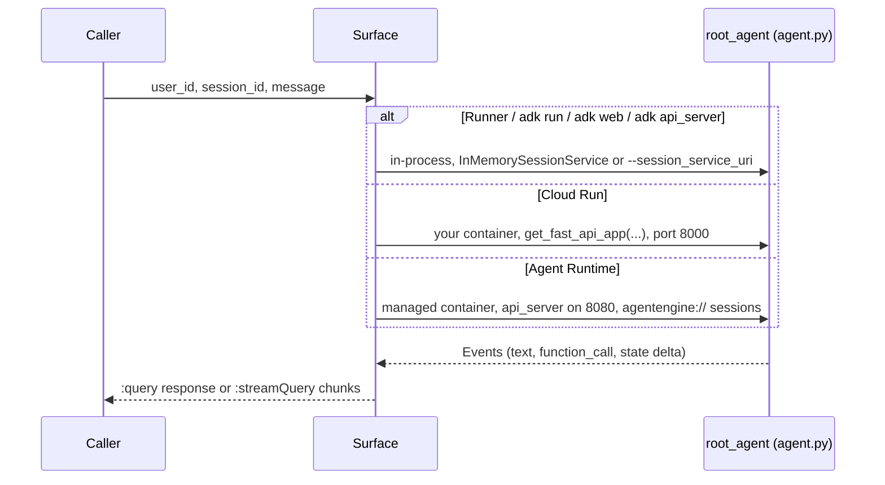
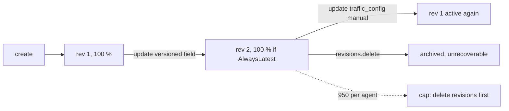

# G03 — Creating agents on Gemini Enterprise Agent Platform: N ways to run one agent, one resource surface

G02 left you with a pipeline that can put an ADK project onto Agent Runtime from a script or from Terraform ([`../G02-SDKs-and-Automated-Deployment/`](../G02-SDKs-and-Automated-Deployment/)). This chapter steps back and asks the question the pipeline assumed an answer to: where should the agent's loop run at all? On GCP there is no "prompt agent" object to create in a portal. Every agent is ADK code, and the only choices are where that code executes (your laptop, Cloud Run, Agent Runtime) and which resource, if any, represents it (a `reasoningEngines/ID` path or nothing). **Every design decision in this chapter comes down to one question: is there a `ReasoningEngine` resource, or not.** That one answer decides what you can revise, split traffic over, give an Agent Identity to, register in Gemini Enterprise, trace and evaluate, which is why G04 and G05 both start from the table in section 2.

> _One ADK `root_agent`, N places to run it, one resource surface (`reasoningEngines/ID`, called with `:query` and `:streamQuery`) once it is on Agent Runtime._

Running scenario: the S03 support-ticket agent, `ticket-agent`. It answers customer tickets, looks tickets up through a ticketing MCP server (MCP Toolbox for Databases on Cloud Run over a Postgres "tickets" table, built in G04), refuses "refund outside policy", and cites policy documents. The runnable proofs are in [`labs/`](labs/) (01 ways to run, 02 Agent Runtime, 03 multi-agent workflow, 04 Memory Bank, 05 Agent Search grounding); the shared environment is [`../labs-setup/`](../labs-setup/). Facts come from the pages crawled on 25 Oct 2026 and kept in [`../reference/reading-map-gcp-agents-2026-10-25.md`](../reference/reading-map-gcp-agents-2026-10-25.md); letters such as A5 or C4 refer to that map. Status words are GA, preview and experimental, with page dates. Product names follow the 22 Apr 2026 rename (A1): Gemini Enterprise Agent Platform (ex-Vertex AI), Agent Runtime (ex-Vertex AI Agent Engine, resource still `ReasoningEngine`), Agent Search (ex-Vertex AI Search).

### What we are trying to avoid

A team writes its deploy script against `vertexai.agent_engines` in August 2026 and finds in September that SDK 2.0.1 moved agents into `google-cloud-agentplatform` and the import no longer exists (A2, 2026-09-18). A CI job calls `runtimes.create` on every push, so the project has forty copies of `ticket-agent` and nobody knows which one Gemini Enterprise points at. A startup hook calls `runtimes.update` on every boot, each call is a new revision, and the agent is at the 950-revision cap (A10). An architect puts `google_search` and a function tool in the same `LlmAgent` and the deploy works but the first call fails (D4). A multi-agent demo deploys three `ReasoningEngine`s where one `SequentialAgent` would do, and then needs A2A, identity and a registry entry for each (B2, C5).

### Has this happened?

All of the above are in the 2025 version of these labs, audited on 25 Oct 2026: a `vertexai.agent_engines.AdkApp` deploy script, no get-or-create, `update` in a startup hook, and a "research agent" with `google_search` beside two function tools. The SDK split and the Vertex AI rename happened to everyone on 18 Sep 2026 and 22 Apr 2026 respectively (A2). No external incident is told here because the internal one is enough.

### What the chapter covers

The invocation surface and what changes between a local Runner, `adk api_server`, Cloud Run and Agent Runtime (1). The ways to run the ticket agent, as a table and then one subsection each (2). Revisions, traffic, get-or-create, delete and the 950 cap (3). Multi-agent: Sequential, Loop, Parallel, custom `BaseAgent`, graph workflows, and the pointer to A2A in G04 (4). Sessions and Memory Bank (5). Grounding with the Agent Search tool and the one-built-in-tool rule (6).

### What you have at the end

A creation matrix you can recite, a decision rule in one sentence, the `:query` sequence diagram, the revision and traffic mechanics with the rollback that has no verb, one `root_agent` running in nine places, and `AGENT_RUNTIME_RESOURCE` in `.env` for every later chapter.

---

## 1. The invocation surface

ADK defines the agent once, in `agent.py`, as a module-level `root_agent` (B1). Everything else is a host that imports that module and exposes it. Locally the host is the `Runner` (B5) or one of three CLI servers; on Cloud Run it is the same FastAPI app packaged into a container; on Agent Runtime it is a managed container Google builds and runs for you, addressed as a `ReasoningEngine` resource (A5, C2).

| Host                     | Command                                        | Wire surface                                                          | Resource?         | Map    |
| ------------------------ | ---------------------------------------------- | --------------------------------------------------------------------- | ----------------- | ------ |
| `Runner` in your process | `python run_local.py`                          | none; `runner.run_async(...)` yields `Event`s                         | no                | B5     |
| `adk run`                | `adk run ticket_agent`                         | terminal; `--save_session`, `--resume`, `--replay`                    | no                | B6     |
| `adk web`                | `adk web --port 8000`                          | dev UI + REST; `--session_service_uri`, `--a2a`, `--reload`           | no                | B6     |
| `adk api_server`         | `adk api_server --a2a --with_ui`               | FastAPI REST; `--auto_create_session`, `--gemini_enterprise_app_name` | no                | B6     |
| Cloud Run                | `adk deploy cloud_run --service_name ...`      | the same FastAPI app on your Cloud Run URL                            | Cloud Run service | B7     |
| Agent Runtime            | `adk deploy agent_engine` or `runtimes.create` | `POST .../reasoningEngines/{ID}:query` and `:streamQuery`             | `ReasoningEngine` | C3, I7 |

The two calls that matter in production are on the resource:

```
POST https://{LOCATION}-aiplatform.googleapis.com/v1/projects/{P}/locations/{L}/reasoningEngines/{ID}:query
POST https://{LOCATION}-aiplatform.googleapis.com/v1/projects/{P}/locations/{L}/reasoningEngines/{ID}:streamQuery
```

(C3). Quota is 90 `Query`/`StreamQuery` per minute per project-region and 10 concurrent `BidiStreamQuery` (A10). Inside the managed container Agent Runtime runs `adk api_server --host=0.0.0.0 --a2a` on port 8080 with `agentengine://` session and memory URIs (C2), so what you tested with `adk api_server` locally is what runs in the cloud, with the session store swapped for Sessions and Memory Bank.



Decision rule: _no resource needed → Runner, `adk run` or `adk web`; a URL for other services → `adk api_server` locally, Cloud Run in the cloud; revisions, Agent Identity, Gemini Enterprise registration, Sessions and Memory Bank → Agent Runtime._

**Interview line.** "ADK gives me one `root_agent` and a set of hosts. Only Agent Runtime gives the agent a resource path, and everything governance-shaped hangs off that path."

## 2. The ways to run the ticket agent

| #   | Way                                         | Definition lives                   | Loop runs          | Status (25 Oct 2026)                   | Proof                                 |
| --- | ------------------------------------------- | ---------------------------------- | ------------------ | -------------------------------------- | ------------------------------------- |
| 1   | `Runner` in code                            | `agent.py`                         | your process       | GA (ADK 2.13.0, A8)                    | `labs/01-ways-to-run/run_local.py`    |
| 2   | `adk web` / `adk run`                       | `agent.py`                         | your process       | GA                                     | `labs/01-ways-to-run/`                |
| 3   | `adk api_server`                            | `agent.py`                         | your process, REST | GA                                     | `labs/01-ways-to-run/`                |
| 4   | Cloud Run via `adk deploy cloud_run`        | `agent.py` in your container       | Cloud Run          | GA (B7)                                | `labs/01-ways-to-run/`                |
| 5   | Agent Runtime via `adk deploy agent_engine` | `agent.py`, packaged by the CLI    | Agent Runtime      | GA (A5)                                | `labs/02-agent-runtime/`              |
| 6   | Agent Runtime via SDK (`runtimes.create`)   | `agent.py`, pickled or from source | Agent Runtime      | GA; `vertexai.agent_engines` is legacy | `labs/02-agent-runtime/deploy_sdk.py` |
| 7   | Custom container                            | your Dockerfile or image           | Agent Runtime      | GA (A2, 2026-04-22)                    | `sketches/n_ways.py` only             |
| 8   | Agent Garden sample via Agents CLI          | Google's sample, then yours        | Agent Runtime      | Agent Garden preview (A7)              | `sketches/n_ways.py` only             |
| 9   | Registered in Gemini Enterprise             | the `ReasoningEngine` from 5 or 6  | Agent Runtime      | GA (C8)                                | `labs/02-agent-runtime/`              |

Way 9 is not a tenth place to run the loop. It is the same resource made visible to end users, and it is in the table because the registration page says "You must host and maintain your ADK agents on Agent Runtime" (C8): ways 1 to 4 cannot be registered.

### Way 1 — the Runner in your own code

```python
from google.adk.agents import Agent
from google.adk.runners import Runner
from google.adk.sessions import InMemorySessionService

root_agent = Agent(name="ticket_agent", model=os.environ["GEMINI_MODEL"], instruction=SUPPORT_INSTRUCTIONS, tools=[...])
runner = Runner(agent=root_agent, app_name="ticket-agent", session_service=InMemorySessionService(), auto_create_session=True)
async for event in runner.run_async(user_id="u1", session_id="s1", new_message=msg):
    ...
```

`LlmAgent` (alias `Agent`) takes `name`, `model`, `instruction` with `{var}` and `{var?}` placeholders, `description`, `tools`, `output_schema`, `output_key`, `generate_content_config`, `planner`, `code_executor` (B1). Two details matter for S02: `output_schema` together with `tools` is native only on newer Gemini models, otherwise ADK falls back to a synthetic `set_model_response` tool (B1), and `planner` takes `BuiltInPlanner` (the model's own reasoning) or `PlanReActPlanner` (an explicit plan-act-observe loop) (B1). The `Runner` commits state and artifact deltas per event; `auto_create_session=True` saves a `create_session` call in tests (B5). This is the shape every other way wraps, which is why lab 01 starts here and the tests in every lab exercise the agent through it.

**Interview line.** "The Runner is the loop. If I can run it in pytest I can run it anywhere, because every host just imports the same module."

### Way 2 — `adk web` and `adk run`

`adk web --port 8000` serves the dev UI with the agent folder as the app name; `--session_service_uri` points it at a database or at `agentengine://<resource>` so a local UI can read cloud sessions; `--reload` restarts on file changes; `--a2a` serves an agent card (B6). `adk run <folder>` is the terminal version with `--save_session`, `--resume` and `--replay` (B6), the last of which is what you use to re-run a saved conversation as an eval fixture in G05. When to pick them: the first hour, and every time you touch the instruction. Gotcha: the Python payload that `adk deploy agent_engine` sends excludes the web UI (C3), so nothing you see in `adk web` is deployed.

**Interview line.** "`adk web` is a dev UI over the same Runner. The deploy excludes it, so it never leaks into production."

### Way 3 — `adk api_server`

`adk api_server` exposes the Runner as FastAPI REST, with `--a2a` for an agent card, `--with_ui` to bundle the dev UI, `--auto_create_session`, `--express_mode`, and `--gemini_enterprise_app_name` (B6). It is the local twin of what Agent Runtime runs in its container (C2), so lab 01 uses it to prove the HTTP contract before any cloud resource exists.

**Interview line.** "`api_server` is what Agent Runtime runs on 8080. Testing it locally tests the cloud contract."

### Way 4 — Cloud Run via `adk deploy cloud_run`

```bash
adk deploy cloud_run --project "$GOOGLE_CLOUD_PROJECT" --region "$GOOGLE_CLOUD_LOCATION" \
  --service_name ticket-agent --app_name ticket-agent --with_ui ticket_agent
```

(B6, B7). Persistence is opt-in: `--session_service_uri agentengine://...`, `--artifact_service_uri gs://...`, `--memory_service_uri ...` (B7). The alternative is `gcloud run deploy --source .` with a `main.py` calling `get_fast_api_app(...)` and a `python:3.13-slim` Dockerfile running `uvicorn main:app` (B7). Flags after `--` pass through to gcloud (B6). Cloud Run is the self-host path: your URL, your scaling, your networking, no `ReasoningEngine`, so no revisions-and-traffic API from section 3 (Cloud Run has its own), no Agent Identity from Agent Runtime, and no Gemini Enterprise registration (C8). With `--a2a` it is still reachable as an A2A agent (C10), which is how it plugs back in (G04 lab 06).

**Interview line.** "Cloud Run is the same FastAPI app I ran with `api_server`. I give up the resource path and get my own infrastructure in return."

### Way 5 — Agent Runtime via `adk deploy agent_engine`

```bash
adk deploy agent_engine --project "$GOOGLE_CLOUD_PROJECT" --region "$GOOGLE_CLOUD_LOCATION" \
  --display_name ticket-agent --otel_to_cloud ticket_agent
```

What the CLI does (C2): writes `google-cloud-aiplatform[adk,agent_engines]>=2.2,<3` and `google-adk[a2a]==<installed>` into the requirements, refuses to run unless `client.runtimes` exists (that is `google-cloud-agentplatform>=2.2`), calls `runtimes.create()` and then `runtimes.update(name, config)`, merges `.env` into `env_vars`, and sets `agent_framework="google-adk"`. Configuration lives in `.agent_engine_config.json` (`--agent_engine_config_file`); `--staging_bucket`, `--trace_to_cloud`, `--requirements_file` and `--env_file` are deprecated flags (B6). `--agent_engine_id` updates an existing resource instead of creating one (B6), which is the get-or-create for the CLI path. The service account precedence is CLI flag, then `GOOGLE_CLOUD_SERVICE_ACCOUNT`, then the config file (C2); the labs set none of them and put `{"identity_type": "AGENT_IDENTITY"}` in the config file instead (C5). Output ends with `reasoningEngines/<ID>` (C3); lab 02 writes that path into `.env` as `AGENT_RUNTIME_RESOURCE`.

**Interview line.** "`adk deploy agent_engine` is `runtimes.create` plus `runtimes.update` with a generated requirements file. Pass `--agent_engine_id` or you mint a new agent every run."

### Way 6 — Agent Runtime via the SDK

```python
from google.cloud import agentplatform
client = agentplatform.Client(project=P, location=L, http_options={"api_version": "v1beta1"})
runtime = client.runtimes.create(agent=app, config={
    "display_name": "ticket-agent", "requirements": [...], "extra_packages": ["ticket_agent"],
    "env_vars": {...}, "identity_type": "AGENT_IDENTITY", "agent_framework": "google-adk"})
```

The `config` keys documented for `runtimes.create` are `requirements`, `extra_packages`, `env_vars`, `service_account`, `encryption_spec`, `min_instances`, `max_instances`, `container_concurrency`, `resource_limits`, `identity_type`, `agent_framework`, `gcs_dir_name`, `psc_interface_config` and `container_spec.image_uri` (I7). `identity_type=AGENT_IDENTITY` needs `api_version="v1beta1"` (C5). The `agent` object wraps `root_agent` in `AdkApp` from `agentplatform.frameworks` (A5); that page could not be fetched on 25 Oct 2026, so the constructor arguments are unverified and `sketches/old_vs_new_deploy.py` shows the old surface once beside it: `vertexai.agent_engines.AdkApp(agent=agent)` with `vertexai.Client(...).agent_engines.create(agent=app, config={...})` (C1), the surface SDK 2.0.1 broke on 18 Sep 2026 (A2). The five source shapes the SDK accepts are Developer Connect, source files, Dockerfile, container image and an SDK object (I7).

**Interview line.** "Two SDK surfaces exist for the same resource. `agentplatform.Client().runtimes` is the one that survives; `vertexai.agent_engines` is a migration note."

### Way 7 — custom container

For a framework Agent Runtime does not integrate (anything outside ADK Python, Go, LangChain, LangGraph, AG2, LlamaIndex) you give it a Dockerfile it builds or an image from Artifact Registry (A5, I7: `container_spec.image_uri`), with `agent_framework="custom"` (I7). The service agent `service-PROJECT_NUMBER@gcp-sa-aiplatform-re.iam.gserviceaccount.com` needs `roles/artifactregistry.reader` first or the deploy ends in `IMAGE_PULL_BACKOFF` (I6, I8). Custom containers and sub-second cold starts arrived on 22 Apr 2026 (A2). The container contract (port, routes) is not on any fetched page and is left unverified here; `sketches/n_ways.py` keeps the slot.

**Interview line.** "Custom container is the escape hatch that keeps the resource path. It is Cloud Run's flexibility with Agent Runtime's governance."

### Way 8 — Agent Garden and the Agents CLI

Agent Garden is a curated set of prebuilt samples, preview on 22 Oct 2026, deployable through the Agents CLI to Agent Runtime, through Application Design Center templates ("Simple Agent Platform", "Agent Platform with governance"), or straight into Gemini Enterprise (A7). The Agents CLI (`google-agents-cli` 1.11.0, successor to the maintenance-mode Agent Starter Pack) gives `create`, `run`, `deploy` with `agent_runtime` as the default target, `publish gemini`, `infra single-project` and `infra cicd`, and sends telemetry unless `AGENTS_CLI_TELEMETRY=0` (I11, I12). `agents-cli deploy --agent-identity` is the third spelling of `identity_type=AGENT_IDENTITY` (C5). Each of these produces way 5 or 6; none is a new runtime.

**Interview line.** "Agent Garden and the Agents CLI are builders. They end at `runtimes.create`, like everything else."

### Way 9 — registered in Gemini Enterprise

Console: app → Agents → Add agent → "Custom agent via Agent Runtime" → paste `projects/P/locations/L/reasoningEngines/ID`. REST: `POST .../engines/APP_ID/assistants/default_assistant/agents` (v1alpha) with `adkAgentDefinition.provisionedReasoningEngine.reasoningEngine` and `authorizationConfig.toolAuthorizations` (C8). The app location (`global`, `us`, `eu`) must match the region prefix of the resource, and registration consumes a pooled daily agent-creation quota (C8). A2A agents register by pasted agent card instead (C9, G04).

**Interview line.** "Gemini Enterprise does not run agents. It points at a `ReasoningEngine` or an agent card."

## 3. Revisions, traffic, get-or-create, delete, and the 950 cap

- A revision is created on `create` and on every change to a versioned field; the feature is preview on v1beta1 (C4, 2026-10-22).
- Traffic is `trafficSplitAlwaysLatest` by default or `trafficSplitManual`; there is no rollback verb. Rollback means `client.runtimes.update(traffic_config=...)` pointing at an earlier **active** revision; archived revisions are unrecoverable, and changing an Agent Gateway binding archives prior revisions (C4).
- `client.runtimes.revisions.list/get/delete` manage the history (C4). Since 22 Apr 2026 Agent Runtime also supports long-running operations up to 7 days and sub-second cold starts (A2), which is what makes a durable agent (S04.07) a runtime setting rather than a queue you build; `BidiStreamQuery` is capped at 10 concurrent per resource (A10). Limits: 6,000 revisions per project-region, **950 per agent**, not adjustable; 10 create/update/delete per minute; 100 regional resources (A10).
- Get-or-create: list by `display_name`, reuse the match, otherwise create. The listing verb is REST `projects.locations.reasoningEngines.list` (I10); the exact SDK spelling is marked unverified in `labs/02-agent-runtime/deploy_sdk.py`. The CLI equivalent is `--agent_engine_id` (B6).
- Delete: `delete(force=True)` removes the resource and its child resources (C1). Deleting and recreating yields a new Agent Identity principal (D10), so every consumer that pinned the SPIFFE principal must be re-authorised; prefer update over delete and recreate.



**Interview line.** "Deployment is a revision; rollback is a traffic pointer; delete is a new identity. Keep the three apart and the 950 cap never surprises you."

## 4. Multi-agent

ADK ships three deterministic workflow agents, `SequentialAgent`, `LoopAgent` and `ParallelAgent`, each with `sub_agents=[...]`, passing state through `output_key` on one agent and `{placeholder}` in the next instruction (B2). A custom orchestration subclasses `BaseAgent`, overrides `_run_async_impl(ctx)` and yields `Event`s, reading and writing `ctx.session.state`; every agent has at most one `parent_agent` (B3). Since ADK 2.0 the docs say template workflows "are superseded by graph-based and dynamic workflows" (B2, A8); the graph API itself is not on any fetched page, so the labs use the three template agents and the chapter marks the graph shape unverified in `sketches/workflow_agents.py`.

| Need                                 | Primitive          | State hand-off                           | Map |
| ------------------------------------ | ------------------ | ---------------------------------------- | --- |
| triage → lookup → reply, fixed order | `SequentialAgent`  | `output_key` → `{placeholder}`           | B2  |
| refine until a checker is satisfied  | `LoopAgent`        | same, plus an exit from a sub-agent      | B2  |
| fan out independent lookups          | `ParallelAgent`    | each writes its own `output_key`         | B2  |
| branching on ticket type             | custom `BaseAgent` | `ctx.session.state` in `_run_async_impl` | B3  |
| any of the above since 2.0           | graph workflow     | unverified, page not fetched             | A8  |
| another team's or vendor's agent     | `RemoteA2aAgent`   | A2A over HTTP, experimental              | C7  |

The deployment story is the point: `ticket-agent-workflow` is one `root_agent` that happens to be a `SequentialAgent`, deployed with exactly the way-5 command. One resource, one identity, one trace tree, one registry entry. Three `ReasoningEngine`s would mean three identities, A2A between them and three Gemini Enterprise registrations. Across a trust boundary that is the right answer, and it is G04 lab 06: `to_a2a(root_agent, port=8001)` or `adk api_server --a2a` to expose, `RemoteA2aAgent(...)` in `sub_agents` to consume, experimental on 25 Oct 2026 (C7). Multi-agent over A2A is also the only explicitly preview-labelled Agent Runtime feature (A5).

The Loop and Parallel detail pages were not fetched on 25 Oct 2026 (map Gaps), so the exit mechanism of `LoopAgent` is described only as "an exit from a sub-agent" and left to the learner to verify in lab 03.

**Interview line.** "Multi-agent did not get a new deployment primitive. A workflow is a `root_agent` with sub-agents inside, deployed like any other. Separate resources only across trust boundaries."

## 5. Sessions and Memory Bank

Three session services, one `Runner` parameter: `InMemorySessionService` for tests, `DatabaseSessionService` (`db` extra) for a local database, `VertexAiSessionService` (`gcp` extra) which needs an Agent Runtime resource (B5). Sessions and Memory Bank went GA on `us`, `eu` and `global` on 17 Jun 2026; Memory Bank `IngestEvents` GA 8 Jul 2026; memory profiles GA 15 Jul 2026; both metered on the Agent Platform compute SKU since 1 Sep 2026 (A2). Quotas: 100 session writes per minute, 100 Memory Bank writes and 300 reads per minute (A10). `europe-west2` is supported; `global` exists for Memory Bank and Sessions but CMEK is not available there (A9, F5).

| Scope                | Store       | Wire-up                                                                | Map    |
| -------------------- | ----------- | ---------------------------------------------------------------------- | ------ |
| one conversation     | Sessions    | `VertexAiSessionService` locally; `agentengine://` on Agent Runtime    | B5, C2 |
| across conversations | Memory Bank | `--memory_service_uri` on Cloud Run; `agentengine://` on Agent Runtime | B7, C2 |
| unit tests           | in-memory   | `InMemorySessionService`; SQLite memory service since ADK 2.11         | B5, A8 |

The ADK memory service class for Memory Bank is not named on any fetched page; lab 04 wires it through the URI form and marks the class import unverified. The pattern is: turn one in session A tells the agent the customer's preferred contact channel, turn one in session B asks for it, and the second answer is correct only if Memory Bank is attached. `sketches/memory_shapes.py` holds the three shapes.

**Interview line.** "Sessions are one conversation, Memory Bank is across conversations, and both are resources under the same `ReasoningEngine`, which is why `VertexAiSessionService` needs one."

## 6. Grounding with the Agent Search tool, and the one-built-in-tool rule

```python
from google.adk.tools import VertexAiSearchTool
policy_search = VertexAiSearchTool(data_store_id=os.environ["AGENT_SEARCH_DATASTORE"])  # projects/P/locations/global/collections/default_collection/dataStores/ID
```

(B9). Per-user filters come from overriding `_build_vertex_ai_search_config` (B9). Google Search is the public-web twin, `from google.adk.tools import google_search`, and in production you must render the `renderedContent` suggestions it returns (B8). The plain google-genai equivalent, outside ADK, is `Tool(retrieval=Retrieval(vertex_ai_search=VertexAISearch(datastore=...)))` (H12).

The rule that breaks demos (D4): built-in tools (Google Search, Code Execution, Computer Use, Enterprise Web Search, BigQuery, Spanner, the Agent Search tool and the rest) cannot sit beside function tools in one agent (the Search limit was lifted at ADK v1.16.0 or later), and cannot sit in sub-agents except Search and Agent Search with `bypass_multi_tools_limit=True`. The workaround is one built-in tool per agent, wrapped in `AgentTool` (D1, D4) and listed among the parent's tools. So `ticket-agent` keeps its MCP ticket tools and gets a `policy_agent` with the Agent Search tool as an `AgentTool`, which is also the shape G08 reuses when the knowledge base grows into a RAG Engine corpus (H11, H13).

| Knowledge need                     | Product           | Map     |
| ---------------------------------- | ----------------- | ------- |
| managed search over your documents | Agent Search      | H9, H13 |
| DIY chunk, embed, retrieve         | RAG Engine        | H11     |
| the public web                     | Google Search     | B8, H12 |
| end users with connectors          | Gemini Enterprise | H10     |

**Interview line.** "One built-in tool per agent, wrapped in `AgentTool`. The policy search lives in its own small agent, and the ticket agent calls it like any other tool."

---

## The chapter in nine lines

1. No prompt-agent object; every agent is `agent.py` with a `root_agent`, and the only decision is where the loop runs and whether a `ReasoningEngine` resource exists.
2. One invocation surface on Agent Runtime: `:query` and `:streamQuery` on `reasoningEngines/ID`; locally the same Runner behind `adk run|web|api_server`.
3. Cloud Run is the self-host path: your URL, no resource path, no Agent Identity, no Gemini Enterprise registration, A2A still possible.
4. `adk deploy agent_engine` is `runtimes.create` then `runtimes.update`; `--agent_engine_id` is get-or-create; `.agent_engine_config.json` holds `identity_type`.
5. `agentplatform.Client().runtimes` is the SDK; `vertexai.agent_engines` broke on 18 Sep 2026 and appears once, as legacy.
6. Revisions are preview; rollback is a manual traffic split to an active revision; archived is gone; 950 per agent.
7. Delete and recreate changes the Agent Identity principal; prefer update.
8. Multi-agent is one `root_agent` with sub-agents, deployed as one resource; A2A only across trust boundaries.
9. One built-in tool per agent, wrapped in `AgentTool`; Sessions per conversation, Memory Bank across them, both GA on `us`/`eu`/`global`.

## What you should be able to explain

Why `adk web` never reaches production. What `adk api_server --a2a` on port 8080 has to do with Agent Runtime. Why a Cloud Run agent cannot be registered in Gemini Enterprise. What `--agent_engine_id` prevents. Why there is no rollback verb and what replaces it. Why delete and recreate is an identity event. Why three sub-agents should not be three resources. Why the policy search is its own agent.

## What this is not

Not the tool, MCP, Toolbox, identity and A2A material (G04). Not evaluation and observability (G05). Not the landing zone (G01) or the pipeline and Terraform boundaries (G02). Not the Agent Search data store and RAG Engine build (G08); lab 05 assumes `AGENT_SEARCH_DATASTORE` already exists. Not a claim that any lab ran: the status on 25 Oct 2026 is scaffold only, functionality unverified.

## Implementation scope and versions

Pages dated 2026-10-22 and 2026-10-23 plus undated adk.dev pages, crawled 25 Oct 2026. Lab code targets Python 3.13 with `google-adk[a2a,gcp,eval,mcp]` 2.13.0, `google-cloud-agentplatform` 2.6.0, `google-cloud-aiplatform[agent_engines,adk]` 2.6.0, `google-genai` 2.33.0, model `gemini-3.5-flash` from `.env` (the 2.5 family retired on 20 Oct 2026, B10). Agent Runtime GA; revisions and traffic preview; Agent Garden preview; ADK A2A experimental; Sessions and Memory Bank GA. Unverified at the point of use: `agentplatform.frameworks.AdkApp` arguments, the SDK list verb spelling, the Memory Bank service class name, the graph workflow API, the custom container contract.

## Further reading

Start here: A1 name changes, A3 overview, A5 Agent Runtime, A10 quotas. Create: B1 LLM agents, B5 Sessions and Runner, B6 CLI source, B7 Cloud Run. Deploy: C1 quickstart (old surface), C2 what `adk deploy agent_engine` does, C3 deploy page, I7 five paths, I6 IAM set-up. Revisions: C4. Identity: C5, D10. Register: C8, C9. Multi-agent: B2, B3, C7. Knowledge: B8, B9, D4, H12, H13. Builders: A7 Agent Garden, I12 Agents CLI. Sketches: [`sketches/`](sketches/) holds four untested shapes (`n_ways.py`, `workflow_agents.py`, `memory_shapes.py`, `old_vs_new_deploy.py`) that mirror the labs.
