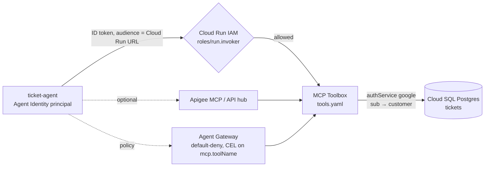

# G04 — Agent tooling: identity, auth, MCP, Toolbox, Apigee, Registry, A2A

[G03](../G03-Creating-Agents/) decided where the loop runs: `ticket-agent` on Agent Runtime, `ticket-agent-workflow` beside it. G04 decides **who the agent is when it reaches out, and what it is allowed to reach.** On this platform the two halves are separate objects. Identity is a deployment setting of the runtime (Agent Identity, a SPIFFE principal, or a service account). Authorisation to a tool is a property of the tool object in ADK code (`auth_scheme` and `auth_credential` on a toolset) and, in front of the tool, of the Cloud Run IAM policy, the Apigee product, or the Agent Gateway policy. **Every design decision here comes down to one question: which principal does the downstream system see, and is that the one your policy expects.**

> _Identity is set on the runtime. Auth is set on the tool. The gateway decides whether the two may meet._

Running scenario: the S03 support-ticket agent (`ticket-agent`) looking up tickets in a ticketing MCP server, which is MCP Toolbox for Databases on Cloud Run over a Postgres `tickets` table, refusing refunds outside policy, fronted by Apigee, catalogued in Agent Registry, policed by Agent Gateway, and delegating to `ticket-agent-workflow` over A2A. Runnable proofs: [`labs/`](labs/) 01 identity, 02 MCP tool, 03 MCP Toolbox, 04 auth matrix + Apigee, 05 registry and gateway, 06 A2A; shared environment in [`../labs-setup/`](../labs-setup/). Facts are cited by letter from the reading map ([`../reference/reading-map-gcp-agents-2026-10-25.md`](../reference/reading-map-gcp-agents-2026-10-25.md)); where the map has no page the text says "unverified".

### What we are trying to avoid

An agent "running as a service account" that turns out to be the project's default compute account, shared by every workload in the project, so Cloud Audit Logs cannot tell one agent from another. A user's Google ID token forwarded as a bearer to a third-party MCP server because `auth_credential` was copied from the Cloud Run example. An `McpToolset` built inside an `async` helper that silently drops its session when the runtime restores state. Two built-in tools placed in one `LlmAgent` and a model error nobody can decode. A Toolbox `tools.yaml` with a `SELECT * FROM tickets` statement and no `authRequired`, described as "the governed surface" in a design review. A2A promised to a customer as GA on ADK when the page says experimental.

### Has this happened?

The shared-service-account pattern is the default on every GCP runtime that predates Agent Identity, which is why the IAM page introduces agent identities as "more secure than service accounts" (D11). The platform-neutral incidents (GitHub MCP leak, Supabase ticket exfiltration, EchoLeak) are told in S03.06; the GCP controls that map to them are the ones this chapter proves: per-tool `authRequired` in Toolbox (D7), default-deny at Agent Gateway with CEL on `mcp.toolName` (F7), Model Armor on tool calls at API hub (D13).

### What the chapter covers

Agent Identity, the SPIFFE principal, versus a service account and Workload Identity (1). The auth matrix for tools, ADK `AuthScheme` and `AuthCredentialTypes`, as a decision table (2). OAuth user passthrough end to end, `request_credential` to `get_auth_response` (3). Tool kinds: `FunctionTool`, `OpenAPIToolset`, `McpToolset` and its three connection parameter classes, built-in tools and the one-per-agent rule, `AgentTool` (4). MCP Toolbox for Databases as the governed surface, and what it does not do (5). Apigee MCP and API hub in front; Agent Registry and Agent Gateway (6). A2A 1.0 in ADK, `to_a2a`, `RemoteA2aAgent`, and the Gemini Enterprise 0.3 gap (7).

### What you have at the end

A principal string you can read off `spec.effectiveIdentity`, the five-row credential table you can recite, the consent flow as a sequence, a `tools.yaml` whose tools name the auth service they require, a list of what Toolbox does not do, a CEL expression that denies every tool but `lookup_ticket`, and six runs whose output tells you which principal the server saw.

---

## 1. Agent identity

Agent Runtime deployments can run as one of two kinds of principal. Unset, the agent runs as a service account (C5). With `identity_type=AGENT_IDENTITY` it runs as an **agent identity**: a per-agent SPIFFE identity of the form `spiffe://agents.global.org-ORG_ID.system.id.goog/resources/SERVICE/RESOURCE_PATH`, addressed in IAM as `principal://TRUST_DOMAIN/NAMESPACE/AGENT_NAME` for one agent and `principalSet://` for all agents in a project or organisation (C5, D9). Google manages the x509 certificate, renews it every 24 hours, and issues no long-lived key (D9). Access tokens are bound to the certificate, DPoP or mTLS, with a `cnf` claim carrying `x5t#S256`, so a token lifted from a log cannot be replayed from another host (D10). Deleting and recreating the agent yields a new principal; IAM bindings on the old one are dead (D10). Agent Identity went GA on 22 Apr 2026 and the Agent Identity API entered preview on 18 Jun 2026 (A2, C5). It is supported on Agent Runtime, Gemini Enterprise and Cloud Run (D9).

Three ways to turn it on (C5): `http_options=dict(api_version="v1beta1")` plus `identity_type=types.IdentityType.AGENT_IDENTITY` in the SDK call; `{"identity_type": "AGENT_IDENTITY"}` in `.agent_engine_config.json` for `adk deploy agent_engine`; or `agents-cli deploy --agent-identity`. Default roles granted to the principal are `roles/aiplatform.agentContextEditor` and `roles/aiplatform.agentDefaultAccess`; an agent that calls another agent also needs `roles/agentregistry.viewer` and `roles/aiplatform.user` (C5). Verify with `gcloud ai reasoning-engines describe ID --project --region` and read `spec.effectiveIdentity` (C5). Terraform's `google_vertex_ai_reasoning_engine` on google-beta needs `identity_type="AGENT_IDENTITY"` before `agent_gateway_config` is accepted (I8).

```python
# the three ways, map C5; the labs use the second one (labs/01-identity/.agent_engine_config.json)
client.runtimes.create(agent=app, config={"identity_type": types.IdentityType.AGENT_IDENTITY},
                       http_options=dict(api_version="v1beta1"))          # SDK call
# .agent_engine_config.json   -> {"identity_type": "AGENT_IDENTITY"}      # adk deploy agent_engine
# agents-cli deploy --agent-identity                                      # agents-cli (I12)
```
```bash
gcloud ai reasoning-engines describe "$ID" --project "$GOOGLE_CLOUD_PROJECT" --region "$GOOGLE_CLOUD_LOCATION" \
  --format='value(spec.effectiveIdentity)'       # principal://... when Agent Identity is on (C5)
```

Inside the container nothing changes in code: `google.auth.default()` picks the identity up from the metadata server (D10). What changes is what the token carries. Two opt-outs exist for clients that cannot handle bound tokens, `GOOGLE_API_ENABLE_RUNTIME_BOUND_TOKEN=false` and `bind_id_token=False` on google-auth 2.61 or later (D10); treat either as a finding in review.

Two authentication models sit on top of the identity (D9). **Own authority**: the agent acts as itself with bound access tokens, OIDC ID tokens, 2-legged OAuth or API keys. **User-delegated**: 3-legged OAuth where the Agent Identity auth manager keeps the user's grant in a credentials vault and the agent presents the user's token downstream. Section 3 shows the ADK side of the second model.

| Principal                    | How it is created                               | Key material                     | Can IAM single out one agent? | Pick when                                                           |
| ---------------------------- | ----------------------------------------------- | -------------------------------- | ----------------------------- | ------------------------------------------------------------------- |
| Service account              | `--service_account` or config `service_account` | long-lived unless you avoid keys | only if one SA per agent      | G04 lab 01 comparison row; frameworks that cannot read bound tokens |
| Workload Identity Federation | external IdP mapped to GCP                      | external                         | per external identity         | agents running outside Google Cloud (D11)                           |
| Managed workload identity    | platform issued                                 | x509                             | per workload                  | GKE and Compute workloads (D11)                                     |
| Agent Identity               | `identity_type=AGENT_IDENTITY` at deploy        | 24 h x509, bound tokens, no keys | yes, `principal://...`        | every Agent Runtime deploy in this track (C5, D9)                   |

**Interview line.** "An agent identity is a SPIFFE principal the runtime mints per agent, with 24-hour certificates and tokens bound to them. A service account is a shared, key-bearing account. Unset means service account, so set it."

## 2. The auth matrix for tools

Foundry puts auth on a project-level connection object and the tool names the connection. ADK puts it on the tool or toolset in code: `OpenAPIToolset(..., auth_scheme=..., auth_credential=...)` and `McpToolset(..., auth_scheme=..., auth_credential=...)` (D2, D3). The schemes live in `google.adk.auth.auth_schemes`: `APIKey`, `HTTPBearer`, `OAuth2`, `OpenIdConnectWithConfig`. The credential types are the `AuthCredentialTypes` enum: `API_KEY`, `HTTP`, `OAUTH2`, `OPEN_ID_CONNECT`, `SERVICE_ACCOUNT` (D5). Helpers `token_to_scheme_credential` and `service_account_scheme_credential` build the pair; `use_id_token` with an `audience` makes the service-account path mint an OIDC ID token for an IAM-protected service, which is exactly what a Cloud Run service with `roles/run.invoker` expects (D5, D8). Toolsets expose `get_auth_config()` from v1.24.0 (D5). Proof: `labs/04-auth-matrix-apigee/auth_matrix.py` runs one agent per row against `TICKET_MCP_URL`.

| `AuthCredentialTypes` | Scheme                           | What the server sees                                           | User context | Pick when                                                                                 |
| --------------------- | -------------------------------- | -------------------------------------------------------------- | ------------ | ----------------------------------------------------------------------------------------- |
| (none)                | none                             | anonymous, or the Cloud Run IAM caller if the URL is IAM-gated | no           | public read-only servers; never for the tickets table                                     |
| `API_KEY`             | `APIKey` (header or query)       | a static key you stored                                        | no           | Apigee API products keyed per client; rotate like any secret (D12)                        |
| `HTTP`                | `HTTPBearer`                     | the bearer you supplied                                        | depends      | a token you already hold; the Toolbox `<name>_token` header is this shape (D7)            |
| `SERVICE_ACCOUNT`     | with `use_id_token` + `audience` | an OIDC ID token for the agent's own principal                 | no           | IAM-protected Cloud Run (`roles/run.invoker`); the default for the ticketing MCP (D5, D8) |
| `OAUTH2`              | `OAuth2`                         | the calling user, after one consent                            | yes          | third-party SaaS and per-user data; section 3                                             |
| `OPEN_ID_CONNECT`     | `OpenIdConnectWithConfig`        | the calling user's ID token                                    | yes          | Toolbox `authService` of `type: google` reads the `sub` claim (D7)                        |

Two further facts shape the choice. Caching user tokens in session `state` is called out as a risk on the ADK page (D5); keep them in the credential service. On the MCP side, Toolbox can run in MCP Authorization mode with an `audience` and `mcpEnabled: true`, accepting `Authorization: Bearer` directly (D7), and Apigee MCP publishes OAuth 2.1 with OIDC and Protected Resource Metadata so a conforming MCP client discovers the authorisation server itself (D12).

**Interview line.** "Five credential types. Two carry the user, `OAUTH2` and `OPEN_ID_CONNECT`. For a Cloud Run tool the agent's own identity with an ID token and the right audience is the default, and the audience is the service URL, never the MCP path."

## 3. OAuth user passthrough

ADK's interactive flow has no exception path; it is a function call the client has to answer (D5).

```mermaid
sequenceDiagram
    participant U as User
    participant C as Client app
    participant R as ADK Runner
    participant T as Tool (FunctionTool)
    participant S as Downstream API
    U->>C: first request that needs the tool
    C->>R: run_async(message)
    R->>T: call tool(tool_context)
    T->>R: tool_context.request_credential(AuthConfig(...))
    R-->>C: function call adk_request_credential {auth_uri}
    C-->>U: open auth_uri, sign in, consent
    U->>C: redirected back with code
    C->>R: FunctionResponse {auth_response_uri, redirect_uri}
    R->>R: exchange code for token
    R->>T: retry tool; tool_context.get_auth_response(...)
    T->>S: call with the user's token
    S-->>T: result
    T-->>R: {"status": "success", ...}
    R-->>C: final answer
```

Rules from the page (D5): the tool asks with `tool_context.request_credential(AuthConfig(...))` and returns a pending status; ADK emits a function call named `adk_request_credential` carrying the `auth_uri`; the client sends the user there and posts back a `FunctionResponse` with `auth_response_uri` and `redirect_uri`; ADK exchanges the code and re-invokes the tool, which reads the token with `tool_context.get_auth_response(...)`. For `OpenAPIToolset` and `McpToolset` the same flow runs without tool code when `auth_scheme` is `OAuth2` or `OpenIdConnectWithConfig` (D2, D3, D5). A Gemini Enterprise registration carries its own `authorizationConfig.toolAuthorizations` so the end-user product can hold the grant (C8); Agent Identity's auth manager is the vault behind a user-delegated agent on Agent Runtime (D9). Proof: the `OAUTH2` row in `labs/04-auth-matrix-apigee/auth_matrix.py`, ticked only when the output shows an `auth_uri`; sketch: [`sketches/consent_and_resume.py`](sketches/consent_and_resume.py).

**Interview line.** "Consent is a function call named `adk_request_credential`, not an error. Your client has to render `auth_uri` and answer with a `FunctionResponse` carrying the redirect."

## 4. Tool kinds

| Kind             | Construct                                                                                                                                    | Where the code runs                  | Auth                                     | Notes                                                                                                                                                                                 |
| ---------------- | -------------------------------------------------------------------------------------------------------------------------------------------- | ------------------------------------ | ---------------------------------------- | ------------------------------------------------------------------------------------------------------------------------------------------------------------------------------------- |
| `FunctionTool`   | a plain Python function in `tools=[...]`; `LongRunningFunctionTool` for slow work                                                            | in the agent process                 | whatever the function does               | docstring is the description; `ToolContext` param is hidden from the LLM and exposes `state`, `actions`, artifacts; return a dict with `status` (D1)                                  |
| `OpenAPIToolset` | `OpenAPIToolset(spec_str\|spec_dict, spec_str_type, auth_scheme, auth_credential, header_provider, ssl_verify, tool_name_prefix)`            | in process, httpx with 600 s timeout | section 2 pair                           | one `RestApiTool` per operation; name is the snake_cased `operationId`, at most 60 chars; OpenAPI 3.x (D2)                                                                            |
| `McpToolset`     | `McpToolset(connection_params=..., tool_filter=[...], auth_scheme, auth_credential, use_mcp_resources)`                                      | on the MCP server                    | section 2 pair, or headers on the params | `pip install "google-adk[mcp]"`; define synchronously in `agent.py`; no auto-reconnect on session restore (D3)                                                                        |
| Built-in tools   | `google_search`, `VertexAiSearchTool`, Code Execution, BigQuery, Spanner, Pub/Sub, Secret Manager, Model Armor and the rest of the catalogue | on Google's side                     | the agent's identity                     | one built-in per agent; cannot sit beside function tools (Search limit lifted at v1.16.0); not in sub-agents except Search and Agent Search with `bypass_multi_tools_limit=True` (D4) |
| `AgentTool`      | `AgentTool(agent=...)`                                                                                                                       | in process, a nested run             | inherits the caller's identity           | the workaround for the built-in rule: one built-in per agent, each wrapped as a tool (D1, D4)                                                                                         |

The three `McpToolset` connection parameter classes live in `google.adk.tools.mcp_tool.mcp_session_manager` (D3): `StdioConnectionParams(server_params=StdioServerParameters(command, args), timeout)` for a local process such as `toolbox --stdio`; `SseConnectionParams(url, headers, timeout)` for legacy SSE servers; `StreamableHTTPConnectionParams(url, headers, timeout, sse_read_timeout)` for the Cloud Run Toolbox and Apigee. `tool_filter` narrows what the model can see; it is a client-side convenience, not a policy, and section 6 says where the policy goes.

```python
# agent.py shape used by labs 02 to 06 (D1, D3, D4, B4). Toolsets are module-level, never built in an async helper.
from google.adk.agents import LlmAgent
from google.adk.tools import AgentTool
from google.adk.tools.mcp_tool import McpToolset
from google.adk.tools.mcp_tool.mcp_session_manager import StreamableHTTPConnectionParams

ticketing = McpToolset(
    connection_params=StreamableHTTPConnectionParams(url=f"{TICKET_MCP_URL}/mcp"),
    tool_filter=["lookup_ticket", "my_open_tickets"],
)
root_agent = LlmAgent(
    name="ticket_agent", model=GEMINI_MODEL, instruction=INSTRUCTION,
    tools=[ticketing, AgentTool(agent=policy_search_agent)],   # policy_search_agent holds the one built-in tool
    before_tool_callback=refuse_refund_outside_policy,          # TODO(learner) in labs/02-mcp-tool/agent.py
)
```

Refusing "refund outside policy" is not a tool concern; it is a `before_tool_callback` on the agent that inspects the pending `refund_ticket` call and returns a dict instead of letting it run (callback lists stop at the first truthy result, B4). Since v2.12.0 ADK also has `require_confirmation` on tools and `after_tool_callback` filtering (A8). Lab 02 wires the callback; G05 evaluates it.

**Interview line.** "Four tool kinds, one rule to remember: one built-in tool per agent, wrapped in `AgentTool` when you need two. And `McpToolset` is declared at import time in `agent.py`, never inside an async helper."

## 5. MCP Toolbox for Databases: the governed surface

Toolbox is an open-source MCP server you host that turns declared SQL statements into MCP tools (D6, D7). It is not a Google-managed service and not a catalogue; it is the thing you put between the model and the tickets table so the model never writes SQL. Version 1.15.0 on 22 Oct 2026; `brew install mcp-toolbox`, container image `us-central1-docker.pkg.dev/database-toolbox/toolbox/toolbox:$VERSION`, `npx @toolbox-sdk/server --config tools.yaml`, Python client `pip install toolbox-core`; flags `--config`, `--prebuilt=<db>[/<toolset>]`, `--stdio`, `--ui`, `--disable-reload`, `--telemetry-otlp` (D6).

`tools.yaml` is a sequence of manifests separated by `---`, each with a `kind` of `source`, `tool`, `toolset`, `group`, `prompt`, `resource`, `resourceTemplate` or `authService` (D7). A `source` names `type`, `host`, `port`, `database`, `user`, `password`, `readOnly`; a `tool` names `type` (for example `postgres-sql`), `source`, `description`, `parameters[{name, type, description}]` and `statement`; `${VAR}` and `${VAR:default}` expand from the environment. Auth is declared once as `kind: authService, type: google, clientId: ...`; a tool sets `authRequired` and a parameter can be bound to a claim with `authServices: [{name, field: sub}]`, so the caller's own `sub` becomes the `customer` parameter and the model cannot ask for someone else's ticket. The client sends the ID token in a header named `<name>_token`; in MCP Authorization mode (`audience`, `mcpEnabled: true`) it is a plain `Authorization: Bearer` (D7). Sketch: [`sketches/tools_yaml_ticketing.yaml`](sketches/tools_yaml_ticketing.yaml).

Cloud Run deploy (D8): a service account `toolbox-identity` with `roles/secretmanager.secretAccessor`; `gcloud secrets create tools --data-file=tools.yaml`; `gcloud run deploy ... --image ...toolbox:latest --service-account toolbox-identity --set-secrets "/app/tools.yaml=tools:latest" --args="--config=/app/tools.yaml,--address=0.0.0.0,--port=8080"`; callers need `roles/run.invoker`; `--allowed-hosts`, `--allowed-origins` and TLS flags harden the listener. The URL this prints is `TICKET_MCP_URL`. Proof: `labs/03-mcp-toolbox/`.

```bash
# labs/03-mcp-toolbox/deploy.sh, from map D8
gcloud iam service-accounts create toolbox-identity
gcloud secrets create tools --data-file=tools.yaml
gcloud secrets add-iam-policy-binding tools --member="serviceAccount:toolbox-identity@$P.iam.gserviceaccount.com" --role=roles/secretmanager.secretAccessor
gcloud run deploy ticket-mcp --image us-central1-docker.pkg.dev/database-toolbox/toolbox/toolbox:latest \
  --service-account toolbox-identity --set-secrets "/app/tools.yaml=tools:latest" \
  --args="--config=/app/tools.yaml,--address=0.0.0.0,--port=8080" --region "$GOOGLE_CLOUD_LOCATION" --no-allow-unauthenticated
TICKET_MCP_URL=$(gcloud run services describe ticket-mcp --region "$GOOGLE_CLOUD_LOCATION" --format='value(status.url)')
```



What Toolbox does: declares tools from SQL, injects the DB credential from the source block, binds claims to parameters, filters by `authRequired`, groups tools into `toolset`s, reloads config unless `--disable-reload`, emits OTLP telemetry (D6, D7). What it does **not** do: it does not authorise which agent may call which tool by IAM (that is Cloud Run IAM at the door and Agent Gateway per tool, D8, F7); it does not catalogue (Agent Registry, F7); it does not proxy other MCP servers or REST APIs (Apigee MCP and Agent Gateway, D12, F7); it does not screen prompts or results for injection (Model Armor at API hub or Agent Gateway, D13, F7); and it does not stop a tool whose `statement` is too broad, because the statement is yours. Rate limiting and quotas are not on the Toolbox pages in the map; unverified, assume Apigee.

**Interview line.** "Toolbox turns a SQL statement into a tool and binds the caller's `sub` to a parameter. It does not decide who may call; Cloud Run IAM and Agent Gateway do, and the registry only catalogues."

## 6. Apigee MCP, API hub, Agent Registry, Agent Gateway

**Apigee MCP** (D12, page dated 24 Oct 2026) serves managed MCP endpoints at `ORG_NAME.mcp.apigee.internal` through an MCP Discovery proxy that answers `tools/list` and `tools/call`. API hub ingests OpenAPI 3.0.x and maps each operation to a tool, so an existing ticketing REST API becomes MCP without a server. Auth is OAuth 2.1 with OIDC and Protected Resource Metadata; tool access policies are per OAuth client; limit 1,000 tools per organisation on SaaS, hybrid from v1.17.0. The "Manage MCP tool access with API products" page, with rate limiting and token exchange, could not be fetched: unverified. **API hub** timeline (D13): Agent Registry sync preview 6 Apr 2026, unified MCP proxy config preview 7 May, API hub resources as MCP tools preview 12 May, **API hub MCP server GA 24 Jul 2026** with Model Armor on tool calls and `ConfigureAndDeployServer`, gcloud deploy of MCP servers to Apigee 12 Aug, service type attribute (Code, Model, Agent, Skill) GA 30 Sep with a "Tool performance" dashboard. Lab 04 runs the matrix against `APIGEE_MCP_URL` when `.env` sets it, and skips otherwise.

**Agent Registry** (F7; preview 22 Apr 2026, GA 18 Jun 2026 with A2A 1.0 and 0.3, A2) holds resources `Agent`, `McpServer`, `Endpoint` and `Service`, with `Skill` and `Publisher` in preview; URNs are catalogue-only. It is the thing Foundry's API Center is: a place to register the ticketing MCP server and the two agents so other teams find them. **Agent Gateway** (F7; private preview 22 Apr, GA 18 Jun 2026, A2) proxies MCP over SSE and streamable HTTP, A2A, REST and gRPC, **default-deny**, brokers OAuth and Workload Identity Federation through the Auth Manager, emits OpenTelemetry and L7 logs, and caps at 5,000 resources. Policy is IAM: `roles/iap.egressor` with CEL conditions on `mcp.toolName`, `mcp.method` and `isReadOnly`. Rollout safely with `iamEnforcementMode: "DRY_RUN"` and Model Armor `INSPECT_ONLY`, then flip both. Binding an agent to a gateway archives its prior revisions (C4). Gateways for GKE, Cloud Run and cross-cloud are "coming soon" on the page (F7). The gcloud and REST verbs for creating registry entries and gateways are not in the map: lab 05 uses the console and Terraform's google-beta `agent_gateway_config` (I8) and marks the CLI steps unverified.

```text
# IAM condition on roles/iap.egressor for the ticket-agent principal (F7). Everything else stays denied.
title:       ticket-agent-lookup-only
expression:  request.mcp.toolName == "lookup_ticket" || request.mcp.toolName == "my_open_tickets"
# attribute names as the govern page lists them (mcp.toolName, mcp.method, isReadOnly); exact CEL prefix unverified
```

| Control                | Decides                                                 | Granularity               | Status (date from map)               |
| ---------------------- | ------------------------------------------------------- | ------------------------- | ------------------------------------ |
| Cloud Run IAM          | who may reach the Toolbox service at all                | service                   | GA (D8)                              |
| Toolbox `authRequired` | which tools need a signed-in user and which claim binds | tool, parameter           | 1.15.0 (D7)                          |
| Apigee API product     | which OAuth client sees which tools, quotas             | client, tool              | GA 24 Jul 2026 for API hub MCP (D13) |
| Agent Gateway + IAM    | which agent principal may call which tool               | principal, `mcp.toolName` | GA 18 Jun 2026 (A2, F7)              |
| Agent Registry         | nothing; it catalogues                                  | resource                  | GA 18 Jun 2026 (A2, F7)              |

**Interview line.** "Registry catalogues, Gateway denies by default and lets IAM CEL on `mcp.toolName` open one tool at a time, Apigee fronts APIs you already have. None of them replaces Cloud Run IAM on the server."

## 7. A2A 1.0 in ADK

The A2A specification is at v1.0.0 (prior 0.3.0) with JSON-RPC, gRPC and HTTP+JSON bindings, and the project joined the Agentic AI Foundation on 27 Aug 2026 (C6). In ADK the whole surface is **experimental** (C7, undated page): `pip install google-adk[a2a]`; expose with `to_a2a(root_agent, port=8001)`, which serves the card at `/.well-known/agent-card.json`, or with `adk api_server --a2a` and your own `agent.json` (B6, C7); consume with `RemoteA2aAgent(name, agent_card=<url|path|AgentCard>, description, use_legacy=True, config=A2aRemoteAgentConfig)` placed in `sub_agents` (C7). The a2a-sdk 1.x line is recommended; 0.3.x is supported for compatibility. Agent Runtime's container already runs `api_server --host=0.0.0.0 --a2a` on port 8080 (C2), and multi-agent via A2A is the one explicitly preview-labelled feature on the Agent Runtime page (A5). Agent Registry accepts both 1.0 and 0.3 cards (A2).

Gemini Enterprise is behind: it registers A2A agents by pasted card (`a2aAgentDefinition.jsonAgentCard`, role `discoveryengine.agentspaceAdmin`), requires an authorization with `cloud-platform` scope for Runtime-hosted A2A agents, and **speaks A2A v0.3 streaming**; for a 1.0 agent use `a2a.compat.v0_3` (C9). The identity side is section 1: an agent calling another agent needs `roles/agentregistry.viewer` and `roles/aiplatform.user` on its principal (C5). Sketch: [`sketches/a2a_card.json`](sketches/a2a_card.json). Proof: `labs/06-a2a/`, `ticket-agent` delegating to `ticket-agent-workflow`.

| Composition                | Construct                       | Trust boundary   | Identity seen downstream               |
| -------------------------- | ------------------------------- | ---------------- | -------------------------------------- |
| same process, same team    | `sub_agents=[...]`, `AgentTool` | none             | the caller's                           |
| same project, other deploy | `RemoteA2aAgent`                | network          | the caller's principal, bound token    |
| other org or vendor        | `RemoteA2aAgent` via Gateway    | network + policy | brokered by Agent Gateway Auth Manager |
| end-user product           | Gemini Enterprise registration  | product          | the end user's authorization (C9)      |

**Interview line.** "Same trust boundary: `sub_agents` or `AgentTool`. Different trust boundary: `RemoteA2aAgent` against a card. Experimental in ADK today, and Gemini Enterprise still speaks 0.3."

---

## Design review questions for a tool

1. Which principal does the server see, and is it per agent? If `spec.effectiveIdentity` is empty, stop (C5).
2. Is the audience the service URL? An ID token minted for the MCP path fails at Cloud Run IAM (D5, D8).
3. Does any tool forward a Google-issued user token to a non-Google server? That is the Foundry "untrusted endpoint" smell in GCP clothing.
4. Which Toolbox parameters are bound to claims, and which does the model fill (D7)?
5. Is there a second built-in tool in the same agent (D4)?
6. Where is the deny? `tool_filter` is not it; Cloud Run IAM, Toolbox `authRequired` and Agent Gateway CEL are (D3, D7, D8, F7).
7. Is the A2A hop labelled experimental in the design, and does the Gemini Enterprise path say 0.3 (C7, C9)?

## The chapter in eight lines

1. Agent Identity is a per-agent SPIFFE principal with 24-hour certificates and bound tokens; unset means service account.
2. Identity is set on the runtime; auth is set on the tool: five `AuthCredentialTypes`, two carry the user.
3. For Cloud Run tools the agent's own ID token with the service URL as audience is the default.
4. Consent is a function call named `adk_request_credential`; answer it with a `FunctionResponse`.
5. One built-in tool per agent; `McpToolset` declared synchronously in `agent.py`; three connection param classes.
6. Toolbox turns SQL into tools and binds `sub` to parameters; it does not authorise, catalogue or screen.
7. Registry catalogues, Gateway denies by default with CEL on `mcp.toolName`, Apigee fronts APIs you already have.
8. A2A 1.0 is experimental in ADK; Gemini Enterprise speaks 0.3 streaming.

## What you should be able to explain

What `spec.effectiveIdentity` shows and why delete-and-recreate breaks IAM bindings. Why a bound token lifted from a log is useless. Which credential type a Cloud Run Toolbox expects and what the audience is. What the client must do when it sees `adk_request_credential`. Why `tool_filter` is not a policy and where the policy goes. Which claim Toolbox binds and why that stops cross-customer reads. What Agent Gateway's default-deny plus `iamEnforcementMode: "DRY_RUN"` buys a rollout. Why an A2A agent registered in Gemini Enterprise needs `a2a.compat.v0_3`.

## What this is not

Not MCP protocol mechanics, prompt-injection incidents or MCP server construction (S03.05, S03.06). Not the Agent Runtime deployment paths, Sessions or Memory Bank (G03). Not Apigee policy engineering or the full gateway design (G09). Not Model Armor settings (G05). Not a claim that the `OAUTH2` row ran: it needs an OAuth client and is ticked only with an `auth_uri` in the output. Not a claim that Agent Gateway CLI steps are correct: the map has no reference page for them.

## Implementation scope and versions

Pages dated 22 Oct to 24 Oct 2026 where dated; adk.dev and a2a-protocol.org pages undated. `google-adk` 2.13.0 with extras `a2a`, `gcp`, `mcp`; `google-cloud-agentplatform` 2.6.0; MCP Toolbox 1.15.0 and `toolbox-core`; Gemini CLI 0.65.0 as the second MCP client (H6). GA: Agent Identity (22 Apr 2026), Agent Registry and Agent Gateway (18 Jun 2026), API hub MCP server (24 Jul 2026). Preview: Agent Identity API (18 Jun 2026), multi-agent via A2A on Agent Runtime, Registry `Skill` and `Publisher`. Experimental: A2A in ADK. Lab status: scaffold only, functionality unverified.

## Further reading

Map letters: A2 release notes, A5 Agent Runtime, A8 ADK releases, B4 callbacks, B6 CLI, C2 deploy internals, C4 revisions, C5 Agent Identity on Agent Runtime, C6 A2A spec, C7 ADK A2A, C8 and C9 Gemini Enterprise registration, D1 to D13 tools and gateways, F7 Registry and Gateway, H6 Gemini CLI MCP, I8 Terraform.

- Agent Identity with Agent Runtime: https://docs.cloud.google.com/gemini-enterprise-agent-platform/scale/runtime/agent-identity (C5)
- Agent Identity overview: https://docs.cloud.google.com/iam/docs/agent-identity-overview (D9); own-authority auth: https://docs.cloud.google.com/iam/docs/auth-agent-own-identity (D10); workload identities: https://docs.cloud.google.com/iam/docs/workload-identities (D11)
- ADK tool authentication: https://adk.dev/tools-custom/authentication/ (D5); function tools: https://adk.dev/tools-custom/function-tools/ (D1); OpenAPI tools: https://adk.dev/tools-custom/openapi-tools/ (D2); MCP tools: https://adk.dev/tools-custom/mcp-tools/ (D3); limits: https://adk.dev/tools/limitations/ (D4); callbacks: https://adk.dev/callbacks/types-of-callbacks/ (B4)
- MCP Toolbox: https://github.com/googleapis/genai-toolbox/releases (D6); configuration and Google auth: https://mcp-toolbox.dev/documentation/configuration/ and https://mcp-toolbox.dev/documentation/authentication/google/ (D7); Cloud Run: https://mcp-toolbox.dev/documentation/deploy-to/cloud-run/ (D8)
- Apigee MCP: https://docs.cloud.google.com/apigee/docs/api-platform/apigee-mcp/apigee-mcp-overview (D12); API hub release notes: https://docs.cloud.google.com/apigee/docs/apihub/release-notes (D13)
- Govern, Agent Gateway, IAM policies: https://docs.cloud.google.com/gemini-enterprise-agent-platform/govern (F7); Terraform: https://docs.cloud.google.com/gemini-enterprise-agent-platform/scale/runtime/use-terraform (I8)
- A2A specification: https://a2a-protocol.org/latest/specification/ (C6); ADK A2A: https://adk.dev/a2a/ (C7); register A2A agents in Gemini Enterprise: https://docs.cloud.google.com/gemini/enterprise/docs/register-and-manage-an-a2a-agent (C9)
- Sketches in [`sketches/`](sketches/): the credential matrix as data, the consent-and-resume loop, the ticketing `tools.yaml`, an A2A agent card.
