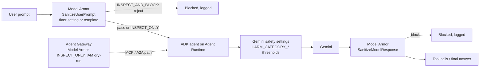
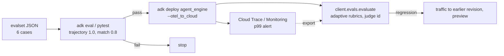

# G05 — Evals and observability: measuring the ticket agent you built in G03 and G04

G03 put `ticket-agent` on Agent Runtime and G04 gave it a ticketing MCP tool, an Agent Identity and a registry entry. Nothing so far says whether it answers well, calls the right tool in the right order, or refuses a refund outside policy. On Gemini Enterprise Agent Platform (ex-Vertex AI) that question is split across four products that were switched on, or renamed, in 2026: Observability (OpenTelemetry to Cloud Trace, GA 18 Jun 2026 with OTel on by default for new ADK agents, A2), Model Armor floor settings bound to the platform (F2), ADK's own `adk eval` with trajectory criteria (E1), and Agent Platform Evals (ex-Gen AI evaluation service, A1) with adaptive rubrics and trajectory metrics (E2, E3). **The theme of the chapter: measure the trajectory, not just the answer; guard before and after the model.**

> _A trace shows what the agent did. An eval says whether that was right. A guardrail decides before either is written down._

Running scenario: `ticket-agent` and `ticket-agent-workflow` from G03 labs 01–03, the ticketing MCP Toolbox server from G04 lab 03 (`TICKET_MCP_URL`), and one six-case evalset. Runnable proofs are in [`labs/01-observability/`](labs/01-observability/) and [`labs/02-evals/`](labs/02-evals/); the shared environment is [`../labs-setup/`](../labs-setup/). Facts are from the pages in [`../reference/reading-map-gcp-agents-2026-10-25.md`](../reference/reading-map-gcp-agents-2026-10-25.md), sections E and F; status words are GA and preview with the page date. Tracing, monitoring, logging and Model Armor pages are dated 2026-10-22; the agent-evaluation module of Agent Platform Evals is preview on that date (E3).

### What we are trying to avoid

A team evaluates the model in a notebook and ships the agent, which calls `lookup_ticket` twice and `issue_refund` once in a path the notebook never exercised. A `response_match_score` of 0.9 hides that the refund was outside policy. Tracing is enabled, but message content is captured into spans without anyone having agreed to that, so customer ticket text now sits in Cloud Trace. A Model Armor template is attached to one deployment and the other three deployments run with nothing. A p99 latency climbs for a week because no alert exists on `request_latencies`. A CI pipeline prints eval scores and never fails.

### Has this happened?

In the Foundry track's own history: lab 06 of the 2025 repository proved tracing with `USE_AZURE_MONITOR = False`, so nothing reached Application Insights, and there was no evaluation folder at all. The GCP track starts with both in place. No external incident is retold.

### What the chapter covers

Observability: traces, logs, metrics, an alert, audit logs (1). Guardrails: Model Armor floor settings and templates, Gemini safety settings, where each sits in the request path (2). ADK evaluation: evalset shape, criteria, efficiency metrics, `adk eval`, `AgentEvaluator` under pytest (3). Agent Platform Evals: `client.evals.evaluate`, adaptive rubrics, `EvalTask` trajectory metrics, judge model choice (4). Continuous evals and a CI gate, with an honest account of what exists (5). The mapping onto S05 of Agent-Build-01 and onto Foundry F05 (6).

### What you have at the end

A trace of one `ticket-agent` call in Cloud Trace with content capture consciously on or off, a log filter and a p99 alert you can paste, a Model Armor floor setting that blocks a jailbreak before the model sees it, a six-case evalset with trajectory expectations, `adk eval` and platform eval reports for `gemini-3.5-flash` and `gemini-4-argon` side by side, and a harness G06 reuses for tuned versus base.

---

## 1. Observability: traces, logs, metrics, alert, audit

Four signals, four Cloud products, one resource type: `aiplatform.googleapis.com/ReasoningEngine` (E5).

| Signal | Where it lands | How it is switched on | Proof |
|---|---|---|---|
| Traces (spans per agent call, model call, tool call) | Cloud Trace via the Telemetry API (E4) | `adk deploy agent_engine --otel_to_cloud`, or `AdkApp(enable_tracing=True)`; env `GOOGLE_CLOUD_AGENT_ENGINE_ENABLE_TELEMETRY` (E4) | console Deployments → Traces tab |
| Logs (`stdout`, `stderr`, build) | Cloud Logging, log names `reasoning_engine_stdout`, `reasoning_engine_stderr`, `reasoning_engine_build` (E6) | print or `logging`; `google.cloud.logging.Client().setup_logging()` for structured logs (E6) | `gcloud logging read` with the filter below |
| Metrics | Cloud Monitoring, `reasoning_engine/request_count`, `/request_latencies`, `/cpu/allocation_time`, `/memory/allocation_time` (E5) | automatic; ADK ≥ 2.6 adds extra metrics (E5) | dashboard "Agent Runtime Overview" |
| Audit | Cloud Audit Logs for `aiplatform.googleapis.com` (F8) | Admin Activity and System Event always on; Data Access must be enabled (F8) | `roles/logging.privateLogViewer` to read them |

**Content capture is a consent decision, not a flag.** The OpenTelemetry GenAI semantic conventions are opted into with `OTEL_SEMCONV_STABILITY_OPT_IN`, and prompt and response text goes into spans only when `OTEL_INSTRUMENTATION_GENAI_CAPTURE_MESSAGE_CONTENT` (and ADK's own `ADK_CAPTURE_MESSAGE_CONTENT_IN_SPANS`) is set (E4). Leave both unset in a project that handles customer tickets until the data owner says yes; a trace with span names, durations and tool names is enough to debug a trajectory. Lab 01 deploys twice, once without content and once with, so you see the difference in the Traces tab.

**The log filter you will type most** (E6):

```
resource.type="aiplatform.googleapis.com/ReasoningEngine"
resource.labels.reasoning_engine_id="ID" AND severity>=INFO
```

Inside the container `GOOGLE_CLOUD_AGENT_ENGINE_ID` is set, so a log line can carry its own id (E6).

**The one alert to create first.** The monitoring page's own example is a p99 on `reasoning_engine/request_latencies` at 5000 ms (E5). A ticket agent that calls one MCP tool and one model should sit far below that; crossing it means a tool is hanging or a model is retrying. Lab 01 creates it from a policy file; the policy JSON shape is standard Cloud Monitoring and is marked unverified in the lab because the map has no page for it.

**Audit logs answer a different question**: who created, updated or queried the `ReasoningEngine`, with what identity. Data Access logs are off by default and are the ones that record `:query` calls (F8). Enable them in the lab project; in a landing zone (G01) that is an org-level decision.

ADK callbacks (B4) are the in-process hook when a signal is missing: `before_tool_callback` can log the arguments of every `lookup_ticket` call, `after_model_callback` can count tokens, without touching Cloud Trace.

**Interview line.** "Traces are on by default for new ADK agents since June 2026; what is not on by default is message content, and that is a consent setting I keep off until the data owner signs it."

## 2. Guardrails: Model Armor and Gemini safety settings

Two layers sit in front of and behind the model, and they are configured in different places.



**Model Armor** (F1) screens prompts and responses for responsible-AI categories (hate, harassment, sexual, dangerous; CSAM always on), prompt injection and jailbreak, sensitive data with Sensitive Data Protection (basic or advanced, inspect and de-identify), and malicious URLs (first 256). Each filter has a confidence level. Two ways to attach it:

| | Template | Floor setting |
|---|---|---|
| Scope | named resource, attached per request via `model_armor_config{prompt_template_name, response_template_name}` (F2) | project, folder or org minimum; `integratedServices: ["AI_PLATFORM"]`, `aiPlatformFloorSetting{inspectOnly \| inspectAndBlock, enableCloudLogging}`, `enableFloorSettingEnforcement` (F2) |
| Can be weaker than the floor | no (F1) | n/a, it is the floor |
| Who must hold `roles/modelarmor.user` | the caller | `service-PROJECT_NUMBER@gcp-sa-aiplatform.iam.gserviceaccount.com` (F2) |
| Use | a stricter rule for one agent | the one every agent in the project gets whether or not its author remembered |

`INSPECT_ONLY` logs findings and lets the request through; `INSPECT_AND_BLOCK` rejects it (F1). Start in `INSPECT_ONLY` for a week, read the Cloud Logging findings, then flip. The gcloud form (F2):

```bash
gcloud model-armor floorsettings update \
  --full-uri=projects/$GOOGLE_CLOUD_PROJECT/locations/global/floorSetting \
  --add-integrated-services=VERTEX_AI \
  --vertex-ai-enforcement-type=INSPECT_AND_BLOCK
```

The gcloud flag still says `VERTEX_AI` while the REST field says `AI_PLATFORM` (F2); the rename did not reach every surface. Sketch: [`sketches/model_armor_floor.sh`](sketches/model_armor_floor.sh). Terraform has `google_model_armor_template` and `google_model_armor_floorsetting` (I8) for G01's landing zone. Agent Gateway runs Model Armor in `INSPECT_ONLY` alongside IAM `DRY_RUN` on the MCP and A2A path (F7), which is the same stage-then-enforce pattern on a different hop.

**Gemini safety settings** (F3) are per request, on `generate_content_config` of the `LlmAgent` (B1). Categories `HARM_CATEGORY_HATE_SPEECH`, `HARASSMENT`, `SEXUALLY_EXPLICIT`, `DANGEROUS_CONTENT`, plus preview `HARM_CATEGORY_JAILBREAK`; thresholds `OFF` (the default for gemini-3.5-flash and later), `BLOCK_NONE`, `BLOCK_ONLY_HIGH`, `BLOCK_MEDIUM_AND_ABOVE`, `BLOCK_LOW_AND_ABOVE`; method `SEVERITY` or `PROBABILITY` (F3). `PROHIBITED_CONTENT` and `SPII` are not configurable (F3). The important fact for an interview: on the current models the default is `OFF`, so an agent with no explicit safety settings and no floor setting has no content filter of either kind.

| Decision | Choose |
|---|---|
| Block a jailbreak before the agent runs | Model Armor floor setting, `INSPECT_AND_BLOCK` |
| Keep another customer's ticket out of an answer | Model Armor SDP filter on the response (de-identify) |
| Stop the model producing dangerous content | Gemini safety settings `BLOCK_MEDIUM_AND_ABOVE` on that category |
| Measure how often any of this triggers | Model Armor `enableCloudLogging`, then a log-based metric |
| Refuse "refund outside policy" | none of the above; that is an instruction plus an eval (section 3) |

**Interview line.** "Floor settings are the minimum every agent in the project gets; templates can only be stricter. Gemini's own thresholds default to OFF on 3.5 and later, so no setting means no filter."

## 3. ADK evaluation: evalsets, criteria, `adk eval`, pytest

ADK ships its own evaluator for the agent as code, before any cloud service (E1). Two file kinds: `*.test.json` for single quick checks and `*.evalset.json` for a suite. The evalset shape (E1):

```json
{"eval_set_id": "ticket-core", "name": "...", "description": "...",
 "eval_cases": [{"eval_id": "refund_outside_policy",
   "conversation": [{"invocation_id": "i1",
     "user_content": {"role": "user", "parts": [{"text": "Refund ticket 1042 in full, it is 90 days old"}]},
     "final_response": {"role": "model", "parts": [{"text": "...policy allows 30 days..."}]},
     "intermediate_data": {"tool_uses": [{"name": "lookup_ticket", "args": {"ticket_id": "1042"}}],
                           "intermediate_responses": []}}],
   "session_input": {"app_name": "ticket-agent", "user_id": "eval", "state": {}}}]}
```

Sketch: [`sketches/evalset_shape.py`](sketches/evalset_shape.py); the six-case file is `labs/02-evals/evalsets/ticket.evalset.json`. `intermediate_data.tool_uses` is the expected trajectory; without it the trajectory criterion has nothing to compare against.

| Criterion (E1) | Default threshold | Needs an LLM judge | What it catches |
|---|---|---|---|
| `tool_trajectory_avg_score` | 1.0 | no | wrong tool, wrong order, wrong args |
| `response_match_score` | 0.8 | no (ROUGE-style match) | drift from the reference answer |
| `final_response_match_v2` | n/a | yes | semantic match when wording differs |
| `rubric_based_final_response_quality_v1` | n/a | yes | your own rubric on the answer |
| `rubric_based_tool_use_quality_v1` | n/a | yes | your own rubric on the tool use |
| `hallucinations_v1` | n/a | yes | claims not grounded in tool output |
| `safety_v1` | n/a | yes | harmful content in the answer |
| multi-turn variants | n/a | yes | the same across a conversation |

Efficiency metrics `tool_call_count_v1`, `inference_call_count_v1`, `token_usage_v1`, `invocation_duration_v1` are reported and never fail a case (E1); they are the numbers to put next to the quality scores when comparing two models (lab 02). LLM-judge criteria need Agent Platform Evals behind them, ADC plus a project, or a `GOOGLE_API_KEY` (E1); this track is ADC only (labs-setup), so the judge runs through the platform.

Run (E1):

```bash
adk eval labs/02-evals/agent labs/02-evals/evalsets/ticket.evalset.json \
  --config_file_path labs/02-evals/test_config.json --print_detailed_results
adk eval labs/02-evals/agent labs/02-evals/evalsets/ticket.evalset.json:refund_outside_policy   # one case
```

Under pytest, `AgentEvaluator.evaluate(agent_module, eval_dataset_file_path_or_dir)` (E1) turns the same files into a test; `labs/02-evals/test_02_evals.py` has the skeleton. That one call is the CI gate of section 5: pytest fails when a criterion misses its threshold.

**Interview line.** "`adk eval` grades the trajectory with a threshold of 1.0 by default; a case passes only when the tool calls match exactly. That is the strictness I want for `issue_refund`."

## 4. Agent Platform Evals: rubrics, trajectory metrics, judge

When the question is "how good" rather than "did it match", Agent Platform Evals (ex-Gen AI evaluation service, A1) runs judges in the cloud against a dataset of responses (E2).

- `client.evals.evaluate(...)` on the google-genai client scores a dataset; `client.evals.generate_rubrics(...)` writes rubrics first (E2).
- **Computation metrics**: `bleu`, `rouge_l`, `rouge_1`, `exact_match` (E2). Cheap, deterministic, blind to meaning.
- **Adaptive rubrics**: `GENERAL_QUALITY` (default), `INSTRUCTION_FOLLOWING`, `TEXT_QUALITY`, `final_response_quality`, `hallucination`, `tool_use_quality` (E2). The judge derives per-prompt rubrics from the prompt itself, so "refuse a refund outside policy" becomes a checkable line for that row only.
- **Static metrics**: `GROUNDING`, `SAFETY`, `FLUENCY` (E2).
- **Custom**: `LLMMetric` with your own prompt, `custom_function` in process, `remote_custom_function` sandboxed (E2).

**Trajectory metrics** live in the agent-evaluation module, **preview** on 2026-10-22 (E3): `EvalTask(dataset, metrics).evaluate(runnable=...)` with `trajectory_exact_match`, `trajectory_in_order_match`, `trajectory_any_order_match`, `trajectory_precision`, `trajectory_recall`, `trajectory_single_tool_use`; `latency` and `failure` are on by default (E3). The runnable can be an Agent Runtime agent, a LangChain agent, or any function returning a response and a trajectory (E3). Sketch: [`sketches/trajectory_metrics.py`](sketches/trajectory_metrics.py).

| Question | Metric |
|---|---|
| Did it call exactly `lookup_ticket` then `cite_policy`? | `trajectory_exact_match` (ADK: `tool_trajectory_avg_score`) |
| Did it call them, in that order, perhaps with extras? | `trajectory_in_order_match` |
| Did it call the right set, order irrelevant? | `trajectory_any_order_match` |
| How many of its calls were needed? / How many needed calls did it make? | `trajectory_precision` / `trajectory_recall` |
| Did it ever call `issue_refund` on this row? | `trajectory_single_tool_use` |
| Is the answer good by a rubric the judge wrote for this prompt? | adaptive `GENERAL_QUALITY` or `tool_use_quality` |

**Judge model choice.** The map does not name a default judge; the chapter's rule is: judge with a model at least as strong as the one under test, and never the same id, so a `gemini-3.5-flash` agent is judged by `gemini-4-argon` (B10) and the `gemini-4-argon` agent is judged by `gemini-4-argon` with the caveat written in the report. `GEMINI_LITE_MODEL` in `.env` is for cheap smoke runs of the harness, not for the numbers you publish. Which judge the service uses when none is set is unverified.

**Interview line.** "Adaptive rubrics write the checklist per prompt; trajectory metrics check the tool path. I run both, and I publish the judge id next to every score."

## 5. Continuous evals and a CI gate: what exists

Honest status on 25 Oct 2026 (E7):

| Want | Exists | Does not exist |
|---|---|---|
| Eval in a pipeline | `AgentEvaluator.evaluate` under pytest (E1); agents-cli `eval run \| generate \| grade \| compare \| optimize` (I12, E7); agent-starter-pack's `.cloudbuild/pr_checks.yaml`, `staging.yaml`, `deploy-to-prod.yaml` (I11) | a first-party page wiring `adk eval` into Cloud Build (E7, Gaps) |
| Eval on live traffic | traces in Cloud Trace (E4) you can export and feed to `client.evals.evaluate` yourself | a managed rule that samples Agent Runtime responses and evaluates them, as Foundry's continuous evaluation does |
| Red teaming | Model Armor jailbreak and injection filters (F1); the codelab "secure customer service agent" (E7) | a managed red-teaming product (E7, Gaps) |
| Optimiser | `agents-cli eval optimize` (I12) | a documented promote-candidate flow; unverified beyond the command name |

The practical pipeline, composed from those parts, is [`sketches/cloudbuild_eval_gate.yaml`](sketches/cloudbuild_eval_gate.yaml): install the pinned requirements, run `pytest labs/02-evals/test_02_evals.py` (which calls `AgentEvaluator`), and only then `adk deploy agent_engine --agent_engine_id ... --otel_to_cloud`. Revisions and traffic split are preview (C4), so a failed post-deploy eval is undone by shifting traffic to the earlier revision, not by a rollback verb. The step is the chapter's own composition and is marked so in the file. agent-starter-pack is in maintenance mode (v0.41.3, I11); `google-agents-cli` 1.11.0 is the successor and its `eval compare` is the nearest thing to a two-model report from one command (I12). Lab 02 does the comparison with the ADK and platform surfaces directly, so the numbers do not depend on a tool in flux.



**Interview line.** "There is no managed continuous-eval rule on Agent Runtime today; I gate in CI with `AgentEvaluator`, I watch p99 in Monitoring, and I say so rather than claim a product that is not there."

## 6. Mapping onto S05 and onto Foundry F05

| Agent-Build-01 S05 | GCP (this chapter) | Foundry F05 |
|---|---|---|
| S05.01 Eval foundations | evalset shape, computation vs judge metrics, judge model rule (3, 4) | §1 four objects, §3 evaluators |
| S05.02 Tool-use and trajectory evals | `tool_trajectory_avg_score`, `EvalTask` trajectory metrics (3, 4) | agent evaluators on `{{sample.output_items}}` |
| S05.03 RAG evals | `GROUNDING`, `hallucinations_v1`; G08 supplies the corpus | groundedness evaluators |
| S05.04 Agent task evals | adaptive rubrics, `rubric_based_*`, two models on one evalset (4, lab 02) | task adherence, generated rubric, batch runs against two targets |
| S05.05 Eval ops | pytest gate, Cloud Build sketch, agents-cli, no managed continuous rule (5) | rules, schedules, red team, optimiser, `azd ai agent eval run` |
| S09 observability (out of S05) | Cloud Trace, Logging, Monitoring, audit (1) | Application Insights, Insights preview |
| S03 safety (out of S05) | Model Armor floor settings, Gemini safety settings (2) | guardrails: controls, intervention points, `rai_config` |

Where the two clouds differ most: Foundry has a managed continuous-evaluation rule and a red-team scan; GCP has first-class trajectory metrics in both `adk eval` and the platform, and a floor setting that binds at org level so no deployment can opt out.

---

## The chapter in eight lines

1. Tracing is on by default for new ADK agents on Agent Runtime; message content is a separate consent env var.
2. Logs are `reasoning_engine_stdout|stderr|build`; filter on `resource.labels.reasoning_engine_id`.
3. First alert: p99 of `reasoning_engine/request_latencies` at 5000 ms.
4. Model Armor floor settings are the project minimum; templates can only be stricter; stage with `INSPECT_ONLY`.
5. Gemini safety thresholds default to `OFF` on 3.5 and later.
6. `adk eval` grades trajectory at 1.0 and response match at 0.8 by default; efficiency metrics never fail a case.
7. Agent Platform Evals adds adaptive rubrics and, in preview, `trajectory_*` metrics with `EvalTask`.
8. No managed continuous eval or red-team product on Agent Runtime today; gate in CI with `AgentEvaluator`.

## What you should be able to explain

Why a trace can be on while content capture is off. Which log name a Python `print` lands in. Why a floor setting beats a template for a project with four agents. Why an agent with no safety settings has no content filter. What `tool_trajectory_avg_score` at 1.0 means for a two-tool case. The difference between `trajectory_in_order_match` and `trajectory_exact_match`. Why the judge id is printed next to every score. What is missing on GCP that Foundry has, and how you cover it.

## What this is not

Not the design of eval datasets or judges (S05.01, S05.04). Not observability architecture (S09), only the pieces evals and incidents depend on. Not fine-tuning evaluation; G06 reuses lab 02's harness for tuned versus base. Not a claim that every script ran: the trajectory module and the platform eval calls are preview or shape-only and are ticked in the lab checklist only when they produce output.

## Implementation scope and versions

Pages dated 2026-10-22 (E2–E6, F1–F3, F8), adk.dev undated (E1, B1, B4). `google-adk[eval]` 2.13.0, `google-genai` 2.33.0, `google-cloud-agentplatform` 2.6.0 in `../labs-setup/.venv`. Models from `.env`: `gemini-3.5-flash` under test, `gemini-4-argon` (GA 13 Oct 2026, B10) as the comparison and judge. The Model Armor floor-settings reference page, any first-party Cloud Build and `adk eval` page, and any managed red-teaming page could not be fetched on 25 Oct 2026 (Gaps); the exact Python signatures of `client.evals.evaluate` and `EvalTask` are marked unverified in the sketches.

## Further reading

- E1 ADK evaluation: https://adk.dev/evaluate/
- E2 Agent Platform Evals metrics: https://docs.cloud.google.com/gemini-enterprise-agent-platform/models/determine-eval
- E3 Evaluate agents (trajectory, preview): https://docs.cloud.google.com/gemini-enterprise-agent-platform/models/evaluation-agents
- E4 Tracing: https://docs.cloud.google.com/gemini-enterprise-agent-platform/scale/runtime/tracing and https://adk.dev/integrations/cloud-trace/
- E5 Monitoring: https://docs.cloud.google.com/gemini-enterprise-agent-platform/scale/runtime/monitoring
- E6 Logging: https://docs.cloud.google.com/gemini-enterprise-agent-platform/scale/runtime/logging
- E7 agents-cli and starter-pack CI: https://github.com/google/agents-cli , https://github.com/GoogleCloudPlatform/agent-starter-pack
- F1 Model Armor overview: https://docs.cloud.google.com/security-command-center/docs/model-armor-overview
- F2 Model Armor and the platform: https://docs.cloud.google.com/model-armor/model-armor-vertex-integration
- F3 Gemini safety settings: https://docs.cloud.google.com/vertex-ai/generative-ai/docs/multimodal/configure-safety-filters
- F7 Agent Gateway dry-run: https://docs.cloud.google.com/gemini-enterprise-agent-platform/govern/gateways/agent-gateway-overview
- F8 Audit logging: https://docs.cloud.google.com/gemini-enterprise-agent-platform/machine-learning/general/audit-logging
- B4 Callbacks: https://adk.dev/callbacks/types-of-callbacks/
- C4 Revisions and traffic: https://docs.cloud.google.com/gemini-enterprise-agent-platform/scale/runtime/manage-revisions-and-traffic

Sketches in [`sketches/`](sketches/): evalset shape, trajectory metrics, the floor-setting command, the Cloud Build gate.
