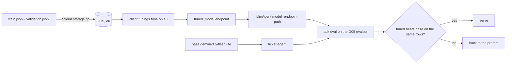

# G06 — Fine-tuning: change how the model answers, not what it knows today

Supervised tuning on Gemini Enterprise Agent Platform (ex-Vertex AI) is a managed training job over your JSONL in Cloud Storage that produces an adapter on a base Gemini model and an endpoint you call like any other (G2, G4). **The design decision is which lever you pull for a behaviour you want: instructions, a tool, grounding, or weights. Weights are last, because they are the slowest to change, the hardest to audit and the only one that cannot be rolled back by editing a string.** After [G05](../G05-Evals-and-Observability/) you have the eval that makes the decision measurable; this chapter is about earning the right to use it.

> _RAG is the lawyer's library; fine-tuning is what the lawyer has in their head. You still check the library._

Running scenario: the G03 `ticket-agent`, tuned for the UK card team's tone and refund-refusal phrasing on `gemini-3.5-flash-lite`, then scored against the base model on the G05 lab 02 evalset. Facts from the pages dated 2026-10-22 in section G of the [reading map](../reference/reading-map-gcp-agents-2026-10-25.md); environment from [`../labs-setup/`](../labs-setup/). Runnable proof: [`labs/01-sft-ticket-tone/`](labs/01-sft-ticket-tone/).

### What we are trying to avoid

A team tunes a model on last quarter's refund policy so it "knows the policy", ships it, and the policy changes the next month; the Agent Search data store from G08 would have updated in minutes. A second team tunes, chats with it in Agent Studio for ten minutes, and promotes; the refund cap is wrong in a few percent of answers and nobody measured. A third starts the job in `europe-west2`, which is where everything else in the track lives, and finds that Gemini 3.x tunes and serves only on the `us` and `eu` multi-region endpoints (G2).

### Has this happened?

The Foundry chapter this mirrors was written against a book that tunes a medical assistant and judges it by chatting. The same shortcut is one click away here: Agent Studio shows a tuned model in a chat box and it is tempting to call that the test. The eval loop in §7 is the only test.

### What the chapter covers

When tuning is the right lever (1). Which models and where (2). The JSONL shape, three ways (3). Running the job and the hyperparameters (4). Calling the tuned endpoint from ADK (5). Preference and RL tuning, and distillation, as they stand on 25 Oct 2026 (6). Cost and the eval loop back to G05 (7).

### What you have at the end

A tuned `gemini-3.5-flash-lite` endpoint on `eu`, a `ticket-agent-tuned` ADK agent that uses it, two `adk eval` reports (base and tuned) on the same evalset, and the lever order as a sentence.

---

## 1. When to tune

Google's own page says it: start with prompting, and tune when you have roughly 100 or more labelled examples or a task that prompting cannot solve (G1). The order of levers is the same as the Foundry chapter and for the same reasons.

| Lever                                             | Changes in                        | Rolls back by                   | Use for                                                                                                      |
| ------------------------------------------------- | --------------------------------- | ------------------------------- | ------------------------------------------------------------------------------------------------------------ |
| Instruction (`LlmAgent.instruction`)              | seconds, versioned with the agent | editing a string                | tone, format, refusal wording, most "it keeps doing X"                                                       |
| Tool (code, MCP)                                  | a deploy                          | a deploy                        | anything deterministic: the refund cap is an `if`, never a learned tendency                                  |
| Grounding (Agent Search, RAG Engine, G08)         | minutes, per document             | deleting the document           | facts with a shelf life: policies, prices, product names                                                     |
| Model choice (`gemini-3.5-flash` vs `-lite`, B10) | a config value                    | a config value                  | latency and cost before you touch weights                                                                    |
| Weights (this chapter)                            | hours per job                     | pointing back at the base model | stable, pervasive, stylistic behaviour; a smaller model doing a narrow task a larger one does out of the box |

Tune for tone, house style, terminology, a long system prompt you would otherwise pay for on every call, or to move a task from `gemini-3.5-flash` to `-lite` (G1). Never for facts, never as a substitute for a tool.

**Interview line.** "Prompt, tool, grounding, model, then weights. Weights are last because they are the only lever with no undo button."

## 2. Which models, and where

| Method            | Base models on 25 Oct 2026                                                                                               | Status                                                                                | Map         |
| ----------------- | ------------------------------------------------------------------------------------------------------------------------ | ------------------------------------------------------------------------------------- | ----------- |
| Supervised (SFT)  | Gemini 3.5 Flash-Lite, 3.5 Flash, 3.1 Flash-Lite; 2.5 Pro/Flash/Flash-Lite listed but the 2.5 family retired 20 Oct 2026 | GA                                                                                    | G1, B10     |
| Preference tuning | 2.5 Flash-Lite and 2.5 Flash only                                                                                        | GA on paper; base models retired 20 Oct 2026, so effectively no live base; unverified | G1, G5, B10 |
| RL fine-tuning    | 3.5 Flash, 3.1 Flash-Lite                                                                                                | pre-GA                                                                                | G6          |
| Open-model SFT    | Gemma 4 (E2B/E4B/26B A4B/31B), Gemma 3, Qwen 3.x, Llama 3.x/4 Scout, GLM 4.7 Flash                                       | see G7                                                                                | G7          |

Limits that shape the dataset (G2): 131,072 tokens per example; 1 GB of JSONL; at most 5,000 validation examples; adapter sizes 1, 2, 4, 8 or 16; training tokens billed as dataset tokens times epochs; a project quota called "Global concurrent tuning jobs". Location: **Gemini 3.5 and 3.1 tune and serve on `us` or `eu` only** (G2). The track's `GOOGLE_CLOUD_LOCATION=europe-west2` is right for Agent Runtime and wrong for this job; the lab sets the tuning client's location to `eu`. Checkpoints and continuous tuning (tuning further from a tuned model) exist (G1).

**Interview line.** "Three-point-five tunes on `eu`, not on a region. If data residency is the reason you are tuning, check that first."

## 3. The JSONL shape, three ways

One JSON object per line, Gemini `contents` with roles `user` and `model`, optional `systemInstruction`, optional `tools`, optional `fileData` for multimodal (G3). Start with 100 examples (G3). The sketch [`sketches/jsonl_shapes.py`](sketches/jsonl_shapes.py) prints one line of each.

```json
{
  "systemInstruction": {
    "parts": [
      {
        "text": "UK card team support assistant. Warm, brief, British English."
      }
    ]
  },
  "contents": [
    {
      "role": "user",
      "parts": [{ "text": "Can I get £300 back on ticket 1042?" }]
    },
    {
      "role": "model",
      "parts": [
        {
          "text": "I can't approve that myself: refunds above £250 need a second approver. I've flagged it; you'll hear back within 4 business hours."
        }
      ]
    }
  ]
}
```

| Shape                    | When                                                                                | Note                                                                                                                                                    |
| ------------------------ | ----------------------------------------------------------------------------------- | ------------------------------------------------------------------------------------------------------------------------------------------------------- |
| Plain `contents`         | the behaviour is in the answer alone                                                | the system instruction you use at inference is not in the data; the model learns the style without it                                                   |
| With `systemInstruction` | you will serve with the same system prompt                                          | the two must match at inference or you are evaluating something you did not train                                                                       |
| With `tools`             | you want the model to call `get_ticket` the same way the base does, in the new tone | the `model` turn carries the function call; shape in the sketch, exact field names for the function-call part unverified beyond G3's "optional `tools`" |

What the data teaches in the lab: how to **say** the refusal, with the £250 rule phrased as the agent should phrase it. The rule itself stays in the ticketing MCP tool and in the instruction, so a wrong example in the data cannot approve a refund.

**Interview line.** "The dataset is a policy document. The person who owns the policy reads every row."

## 4. Running a job

`google-genai` 2.33.0 with `api_version="v1beta1"`, ADC, platform routing (G4, labs-setup rules):

```python
from google import genai
from google.genai import types
client = genai.Client(vertexai=True, project=PROJECT, location="eu", http_options={"api_version": "v1beta1"})
job = client.tunings.tune(
    base_model="gemini-3.5-flash-lite",
    training_dataset=types.TuningDataset(gcs_uri="gs://BUCKET/sft/train.jsonl"),
    config=types.CreateTuningJobConfig(tuned_model_display_name="ticket-tone",
                                       validation_dataset=types.TuningValidationDataset(gcs_uri="gs://BUCKET/sft/validation.jsonl"),
                                       epoch_count=3, adapter_size="ADAPTER_SIZE_FOUR", learning_rate_multiplier=1.0))
```

The map names the three hyperparameters as `epochCount`, `adapterSize`, `learningRateMultiplier` (REST spelling, G4); the Python keyword spellings and the enum string for the adapter size are the SDK's and are unverified here, so the lab leaves them as `TODO(learner)` to confirm against the 2.33.0 signature. REST is `aiplatform.REGION.rep.googleapis.com/v1/.../tuningJobs` (G4). When the job finishes, `tuning_job.tuned_model.endpoint` is the string you serve from (G4).

| Hyperparameter           | Start at                            | Move when                                                                 |
| ------------------------ | ----------------------------------- | ------------------------------------------------------------------------- |
| epochs                   | the default                         | validation loss still falling at the end: up; rising before the end: down |
| adapter size             | smallest (1 or 2 of 1/2/4/8/16, G2) | the task is wide (many styles, many tools): up                            |
| learning rate multiplier | 1.0                                 | loss noisy: down; loss flat: up, a little                                 |

**Interview line.** "One call, three knobs, start with the defaults and read the validation curve before touching any of them."



## 5. The tuned endpoint from ADK

Nothing in the agent changes except the model string (G9):

```python
root_agent = LlmAgent(name="ticket_agent_tuned", model="projects/P/locations/eu/endpoints/ENDPOINT_ID", instruction=..., tools=[...])
```

Needs ADC and, per the adk.dev page, `GOOGLE_GENAI_USE_ENTERPRISE=TRUE` (G9). The track's `.env` sets `GOOGLE_GENAI_USE_VERTEXAI=TRUE` for everything else; which of the two ADK 2.13.0 reads for endpoint-path models is unverified, so the lab exports both. The same page is where Claude (`anthropic[vertex]`) and Llama MaaS (`LiteLlm`) plug in (G9), which is the reminder that "model" in ADK is a string or an object, never a deployment you manage.

**Interview line.** "Tuned model equals a different model string. The agent, tools and evals stay where they are."

## 6. Preference tuning, RL tuning, distillation: status on 25 Oct 2026

Preference tuning: text only, 1 GB, run SFT first (G5; page not fetched in the body, undated). Its listed bases are the 2.5 family (G1), retired 20 Oct 2026 (B10), so until the page lists a 3.x base, treat it as unavailable rather than plan around it. RL fine-tuning is **pre-GA** on 3.5 Flash and 3.1 Flash-Lite, with reward functions from string match, a Gemini autorater, code execution or a custom Cloud Run function, up to 16 weighted and clipped to [-1, 1] (G6). That maps to Foundry's RFT graders almost one to one, and the same rule applies: if you can write the grader, you probably could have written the eval first. Distillation exists only for open students (Qwen 3 4B to 32B, Gemma 3 1B to 27B) from MaaS teachers (G7); it is how a Gemma 4 model for [G07](../G07-Local-and-Edge/) gets a frontier model's behaviour on a narrow task, and it is not available for a Gemini student.

| Want                                         | Method                                        | Today                                  |
| -------------------------------------------- | --------------------------------------------- | -------------------------------------- |
| show the ideal answer                        | SFT on 3.5 Flash-Lite / Flash, 3.1 Flash-Lite | GA (G1)                                |
| show the better of two                       | preference tuning                             | no live base; unverified (G1, G5, B10) |
| score sampled answers                        | RL fine-tuning                                | pre-GA (G6)                            |
| a small open model that imitates a large one | distillation                                  | GA for open students only (G7)         |

## 7. Cost, and the loop back to G05

Price: the pricing page did not load; the search snippet reads "Gemini 3.5 Flash Lite SFT $0.003 / 1,000 count" (G8), **unverified**, verify before quoting. The cost model is training tokens times epochs (G2) plus serving, so a 100-example dataset at three epochs is small change; the cost that matters is the hour of engineering spent reviewing rows, which is also the step that makes it work.

Then the only step that matters. G05 lab 02 wrote a `*.evalset.json` and a criteria config (E1). Run `adk eval` twice: against the G03 `ticket-agent` directory and against `ticket-agent-tuned`, same evalset, same `--config_file_path`, and compare `response_match_score`, `tool_trajectory_avg_score` and the rubric criteria side by side (E1). Promote on the numbers with the thresholds the G05 CI gate uses. Without this step tuning is a feeling.

**Interview line.** "The eval was written before the tuning job. If it was not, write it now, then tune."

## The chapter in eight lines

1. Lever order: prompt, tool, grounding, model choice, then weights (G1).
2. SFT bases today: Gemini 3.5 Flash-Lite, 3.5 Flash, 3.1 Flash-Lite; the 2.5 family retired 20 Oct 2026 (G1, B10).
3. Gemini 3.x tunes and serves on `us`/`eu` only; 131k tokens per example, 1 GB, 5,000 validation rows, adapter 1 to 16 (G2).
4. JSONL = `contents` with `user`/`model`, optional `systemInstruction`, `tools`, `fileData`; start at 100 rows (G3).
5. `client.tunings.tune(base_model, training_dataset, config)` on `v1beta1`; knobs `epochCount`, `adapterSize`, `learningRateMultiplier` (G4).
6. Serve with `LlmAgent(model="projects/P/locations/L/endpoints/ID")` (G9).
7. Preference tuning has no live base, RL tuning is pre-GA, distillation is for open students only (G5, G6, G7).
8. Promote only on `adk eval` of tuned versus base on the G05 evalset (E1).

## What you should be able to explain

Why the refund cap must never be tuned in. What `eu` means for a tuning job and why `europe-west2` is not it. The three JSONL shapes and when the `systemInstruction` must match inference. What an adapter size is for. Where the eval sits in the loop, and why it was written first.

## What this is not

Not RL tuning or distillation in practice (pre-GA and open-model only). Not multimodal tuning. Not open-model training on your own GPUs; see G07 for running them.

## Implementation scope and versions

Map section G, pages dated 2026-10-22 (G1, G2, G3, G4, G6, G7); G5 undated and not fetched in the body; G8 pricing not fetched. `google-genai` 2.33.0, `google-adk` 2.13.0 (map "Pinned versions"). Unverified at the point of use: Python keyword spellings of the hyperparameters, the polling call name, which `GOOGLE_GENAI_USE_*` variable ADK reads for endpoint models, the bucket location rule for `eu` tuning jobs. Lab status on 25 Oct 2026: scaffold only, functionality unverified.

## Further reading

- G1 Introduction to tuning: https://docs.cloud.google.com/vertex-ai/generative-ai/docs/models/tune-models
- G2 About supervised tuning: https://docs.cloud.google.com/gemini-enterprise-agent-platform/models/tuning/supervised-tuning
- G3 Prepare SFT data: https://docs.cloud.google.com/vertex-ai/generative-ai/docs/models/gemini-supervised-tuning-prepare
- G4 Use SFT: https://docs.cloud.google.com/vertex-ai/generative-ai/docs/models/gemini-use-supervised-tuning
- G5 Preference tuning: https://docs.cloud.google.com/vertex-ai/generative-ai/docs/models/gemini-preference-tuning
- G6 RL fine-tuning: https://docs.cloud.google.com/gemini-enterprise-agent-platform/models/tuning/reinforcement-tuning
- G7 Open-model tuning and distillation: https://docs.cloud.google.com/gemini-enterprise-agent-platform/models/tuning/open-model-tuning
- G8 Pricing (unverified): https://cloud.google.com/gemini-enterprise-agent-platform/generative-ai/pricing
- G9 ADK with a tuned endpoint: https://adk.dev/agents/models/agent-platform/
- E1 ADK evaluation: https://adk.dev/evaluate/
- Sketch: [`sketches/jsonl_shapes.py`](sketches/jsonl_shapes.py)
