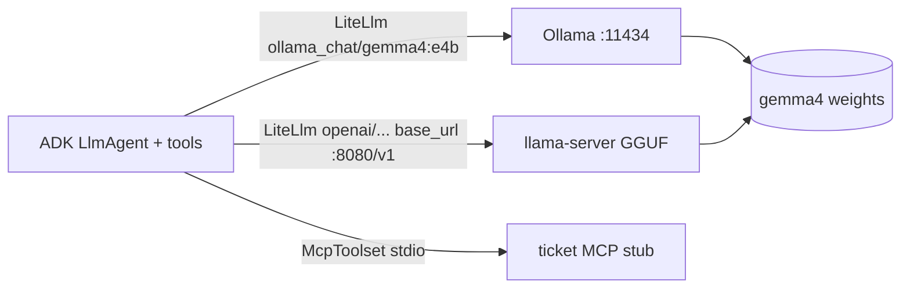

# G07 — Local and edge: the same agent, no cloud in the loop

Gemma 4 is Google's open-weight family under Apache 2.0 (H1). Served by Ollama or llama.cpp on the laptop, the branch server or the edge box, it answers the same ADK `LlmAgent` as [G06](../G06-Fine-Tuning/)'s tuned endpoint did, through `LiteLlm` (H8). **The design decision is which parts of the G03 agent stay identical when the model moves on-device, and which disappear: the ADK code, the tool contract and the evalset stay; Agent Identity, Model Armor, Sessions, Memory Bank, Cloud Trace and the Agent Registry all go, and you own them.** That trade, not the pull command, is what an architect is asked about.

> _Local inference moves the model, not the responsibility._

Running scenario: the G03 `ticket-agent`, pointed at `gemma4:e4b` on Ollama, with a local stdio MCP stub standing in for the ticketing MCP Toolbox on Cloud Run, so it works on a train. Facts from section H of the [reading map](../reference/reading-map-gcp-agents-2026-10-25.md) (pages dated 2026-04-02 to 2026-10-20); environment from [`../labs-setup/`](../labs-setup/). Runnable proof: [`labs/01-local-ticket-agent/`](labs/01-local-ticket-agent/).

### What we are trying to avoid

A team ships an on-device assistant and finds in the pen test that nothing screens prompts or outputs, because Model Armor lives in the cloud path they are no longer calling (F1, F2). A second team writes `LiteLlm(model="ollama/gemma4:e4b")`, the tool loop misbehaves, and they blame the model; the adk.dev page says `ollama_chat` (H8). A third pins `litellm` loosely and pulls 1.82.7 or 1.82.8, the two versions reported compromised on 2026-03-24 (H8). A fourth quantises to INT4, never evaluates, and the refund answers drift.

### Has this happened?

The Foundry chapter this mirrors found six months of drift between a book and its CLI. Here the drift is in the client: Gemini CLI, the obvious local agent front end, was "replaced by Antigravity CLI on 18 Jun 2026" for unpaid and Google One users (H5), while the paid path and the MCP configuration (H6) carry on. Check which CLI your users actually have before writing the runbook.

### What the chapter covers

The Gemma 4 family and what each size needs (1). Ollama and llama.cpp as runtimes (2). ADK with `LiteLlm`, the `ollama_chat` rule and the LiteLLM advisory (3). INT4 quantisation by hand (4). Gemini Nano through AICore on Android (5). Gemini CLI as a local agent client with MCP (6). What you lose locally, and the decision table (7).

### What you have at the end

The ticket agent answering from Gemma 4 on your machine with the same ADK code as G03, a local MCP stub it calls, an `adk eval` comparison against the cloud agent on the G05 evalset using the criteria that run without the platform, a correct INT4 worked example, and the "now yours" list.

---

## 1. The Gemma 4 family

Five sizes on the model card dated 2026-07-30 (H1), all Apache 2.0:

| Model         | Parameters (effective) | Context  | Modalities         | Where it fits                                 |
| ------------- | ---------------------- | -------- | ------------------ | --------------------------------------------- |
| E2B           | 5.1B (2.3B effective)  | 128K     | text, image, audio | phone, small edge box, CPU laptop             |
| E4B           | 8B (4.5B effective)    | 128K     | text, image, audio | laptop; the lab default                       |
| 12B Unified   | 12B                    | 256K     | per card           | workstation GPU, branch server                |
| 26B A4B (MoE) | 26B (3.8B active)      | per card | per card           | server with memory to hold 26B, speed of a 4B |
| 31B dense     | 31B                    | per card | per card           | GPU server                                    |

"Effective" parameters are what runs per token; the full count is what you store, so memory is sized on the first number in each cell and latency on the second. Gemma 4 is also an SFT target on the platform (E2B, E4B, 26B A4B, 31B) and a distillation student in the Gemma 3 generation (G7), which is how a local model gets a frontier model's behaviour on a narrow task before it leaves the cloud.

**Interview line.** "Pick by the memory you have for the full count and the latency you need from the active count."

## 2. Runtimes: Ollama and llama.cpp

| Runtime   | Install and run                                                                   | Endpoint                                                                    | Map    |
| --------- | --------------------------------------------------------------------------------- | --------------------------------------------------------------------------- | ------ |
| Ollama    | `ollama pull gemma4`; tags `gemma4:e2b`, `gemma4:e4b`, `gemma4:26b`, `gemma4:31b` | `http://localhost:11434/api/generate`; ADK reaches it via `OLLAMA_API_BASE` | H2, H8 |
| llama.cpp | `llama-server -hf ggml-org/gemma-4-E2B-it-GGUF`                                   | OpenAI-compatible `http://localhost:8080/v1`                                | H3     |

Ollama is the shorter path and the one ADK documents (H8). llama.cpp gives you the GGUF file, the quantisation choice and an OpenAI-compatible server, which is the path when you need to pin the exact weights or run on hardware Ollama does not package for. Both are yours to start, stop and patch.



## 3. ADK with `LiteLlm`

```python
from google.adk.agents import Agent
from google.adk.models.lite_llm import LiteLlm
root_agent = Agent(name="ticket_agent_local", model=LiteLlm(model="ollama_chat/gemma4:e4b"), instruction=..., tools=[...])
```

`pip install "litellm>=1.84"`, `OLLAMA_API_BASE=http://localhost:11434` (H8). Two rules from the same page. Use the `ollama_chat` provider prefix, not `ollama`; the plain one breaks tool loops (H8). And pin above 1.84: LiteLLM 1.82.7 and 1.82.8 were reported compromised on 2026-03-24 (H8), which is why `labs-setup/requirements.txt` carries `litellm>=1.84` and a comment pointing here.

| Model string                              | Talks to                      | Note                                       |
| ----------------------------------------- | ----------------------------- | ------------------------------------------ |
| `gemini-3.5-flash`                        | the platform                  | G03; ADC, `GOOGLE_GENAI_USE_VERTEXAI=TRUE` |
| `projects/P/locations/eu/endpoints/ID`    | a tuned endpoint              | G06 (G9)                                   |
| `LiteLlm(model="ollama_chat/gemma4:e4b")` | Ollama on this machine        | this chapter (H8)                          |
| `LiteLlm(...)` for Llama MaaS             | the platform's partner models | G9                                         |

**Interview line.** "The agent is the same object. `model` is a string for Gemini and an adapter object for everything else, and `ollama_chat` is the prefix that keeps tool calling working."

## 4. Quantisation, with the arithmetic

Symmetric linear INT4 over a tensor whose weights lie in [-1, 1]: the integer range is [-8, 7], so the scale is `1.0 / 7 ≈ 0.142857`. Weight 0.37 becomes `round(0.37 / 0.142857) = round(2.59) = 3`, stored as `0011`. Dequantised it is `3 × 0.142857 = 0.428571`, an error of 0.0586, about 16 % of the value, for an 87.5 % saving over FP32. Real schemes cut the error with per-block scales, asymmetric zero points and calibration data; the GGUF files llama.cpp serves (H3) are such schemes. The sketch [`sketches/int4_by_hand.py`](sketches/int4_by_hand.py) leaves `quantise` and `dequantise` to you in plain numpy and prints the error over a whole block. Rule: quantise, then evaluate on the G05 evalset before you trust it. INT8 is rarely noticeable; INT4 often is on policy-precise answers.

**Interview line.** "Scale one over seven, 0.37 to 3 to 0.4286. The error is why you run the eval after quantising."

## 5. Gemini Nano on the device

On Android, Gemini Nano runs inside the **AICore** system service and is reached through the ML Kit GenAI APIs: Prompt, Summarization, Proofreading, Rewriting, Image Description, Speech Recognition (H4, page dated 2026-10-08). Firebase AI Logic gives a hybrid path that falls back to the cloud model when the device cannot serve on-device (H4). None of this is ADK; it is the answer to "can the phone do it without a server", and the hybrid fallback is the same architecture as §7's table: local first, cloud behind the same contract.

## 6. Gemini CLI as a local agent client

`npm install -g @google/gemini-cli`, v0.65.0 on 2026-10-20 (H5); for unpaid and Google One users it was "replaced by Antigravity CLI on 18 Jun 2026" (H5), so check which binary your audience has. MCP servers go in `~/.gemini/settings.json` under `mcpServers` with `command` (stdio), `url` or `httpUrl`, plus `headers`, `timeout`, `trust`, `includeTools`/`excludeTools` and an OAuth block; `/mcp` lists them and `/mcp auth` runs the flow (H6). Extensions install with `gemini extensions install <github-url>` (H7). The lab's stdio ticket stub plugs into both the ADK agent and this CLI unchanged, which is the point of MCP.

```json
{
  "mcpServers": {
    "tickets": {
      "command": "python",
      "args": ["labs/01-local-ticket-agent/ticket_mcp_stub.py"],
      "timeout": 30000,
      "trust": false
    }
  }
}
```

**Interview line.** "One MCP stub, two clients: the ADK agent through `McpToolset` and Gemini CLI through `settings.json`."

## 7. What you lose locally, and the decision table

| Stays identical to G03                                        | Gone, now yours                                                                            |
| ------------------------------------------------------------- | ------------------------------------------------------------------------------------------ |
| `LlmAgent`, instruction, `tools`, `McpToolset` (D3)           | Model Armor and floor settings: nothing screens prompt, tool call or output (F1, F2)       |
| MCP tool contract, `tools.yaml` semantics (D7)                | Agent Identity: no SPIFFE principal, no bound tokens; the OS user is the identity (C5, D9) |
| `*.evalset.json` and `adk eval` for the non-LLM criteria (E1) | Sessions and Memory Bank: `InMemorySessionService` only, or a database you run (B5)        |
| The decision rule from G03                                    | Cloud Trace, Monitoring, Logging: ship OpenTelemetry yourself (E4, E5, E6)                 |
|                                                               | Agent Registry, Agent Gateway, revisions and traffic split (F7, C4)                        |
|                                                               | LLM-judge eval criteria, which need the platform or an API key (E1)                        |

| Need                                                                         | Choose                                                                                       |
| ---------------------------------------------------------------------------- | -------------------------------------------------------------------------------------------- |
| data cannot leave the device or site, no network, latency under a round trip | local: Gemma 4 on Ollama or llama.cpp, same agent, own the right column                      |
| the phone must answer without a server                                       | Gemini Nano through ML Kit, hybrid fallback via Firebase AI Logic (H4)                       |
| a developer loop without quota or cost                                       | local during development, cloud `gemini-3.5-flash` at release, same evalset gates the switch |
| anything the right column must exist for                                     | the platform; local is not cheaper once you rebuild it                                       |

So the migration path is cloud first: build with `gemini-3.5-flash` on Agent Runtime, keep the local model as a second model string behind the same agent, and gate the switch on the same eval.

**Interview line.** "Local saves the round trip and the token bill and hands you back identity, guardrails, memory and traces. Price those before you call it free."

## The chapter in eight lines

1. Gemma 4: E2B, E4B, 12B Unified, 26B A4B MoE, 31B dense; Apache 2.0; size on full count, speed on active count (H1).
2. Ollama `ollama pull gemma4:e4b` on `:11434`; llama.cpp `llama-server -hf ...GGUF` on `:8080/v1` (H2, H3).
3. ADK: `Agent(model=LiteLlm(model="ollama_chat/gemma4:e4b"))`, `OLLAMA_API_BASE` set (H8).
4. `ollama_chat`, not `ollama`; `litellm>=1.84`, never 1.82.7 or 1.82.8 (H8).
5. INT4 symmetric: scale 1/7, 0.37 to 3 to 0.4286; evaluate before trusting.
6. Gemini Nano runs in AICore behind the ML Kit GenAI APIs with a Firebase hybrid fallback (H4).
7. Gemini CLI reads `mcpServers` from `~/.gemini/settings.json`; the same stdio stub serves ADK and the CLI (H5, H6).
8. Agent code, tools and evalset do not change; identity, guardrails, sessions, memory, traces and the registry disappear.

## What you should be able to explain

The five Gemma 4 sizes and which number sizes memory. Why `ollama_chat` and not `ollama`. The LiteLLM advisory and the pin that answers it. The INT4 arithmetic. What AICore is. The "now yours" list without looking. Why the same ADK code runs in both places.

## What this is not

Not a llama.cpp or GGUF internals chapter. Not open-model tuning on the platform (that is G6/G7 in the map, covered in G06 §6). Not Android development beyond naming the APIs. Not Antigravity CLI.

## Implementation scope and versions

Map section H: H1 model card 2026-07-30, H2 Ollama 2026-04-02, H3 llama.cpp 2026-04-16, H4 Gemini Nano 2026-10-08, H5 Gemini CLI v0.65.0 2026-10-20, H6 MCP settings 2026-10-06, H7 extensions 2026-02-17, H8 ADK Ollama/LiteLLM undated. `google-adk` 2.13.0, `litellm>=1.84`. Not in the map and therefore unverified: Gemma 4 disk and RAM figures per tag, the MCP Python server package version, Ollama's own version. Lab status on 25 Oct 2026: scaffold only, functionality unverified; written for macOS.

## Further reading

- H1 Gemma 4 model card: https://ai.google.dev/gemma/docs/core/model_card_4
- H2 Gemma with Ollama: https://ai.google.dev/gemma/docs/integrations/ollama
- H3 Gemma with llama.cpp: https://ai.google.dev/gemma/docs/integrations/llamacpp
- H4 Gemini Nano on Android: https://developer.android.com/ai/gemini-nano
- H5 Gemini CLI releases: https://github.com/google-gemini/gemini-cli/releases
- H6 Gemini CLI MCP servers: https://geminicli.com/docs/tools/mcp-server/
- H7 Gemini CLI extensions: https://geminicli.com/docs/extensions/
- H8 ADK with Ollama and LiteLLM: https://adk.dev/agents/models/ollama/ , https://adk.dev/agents/models/litellm/
- D3 ADK MCP tools: https://adk.dev/tools-custom/mcp-tools/
- E1 ADK evaluation: https://adk.dev/evaluate/
- Sketch: [`sketches/int4_by_hand.py`](sketches/int4_by_hand.py)
