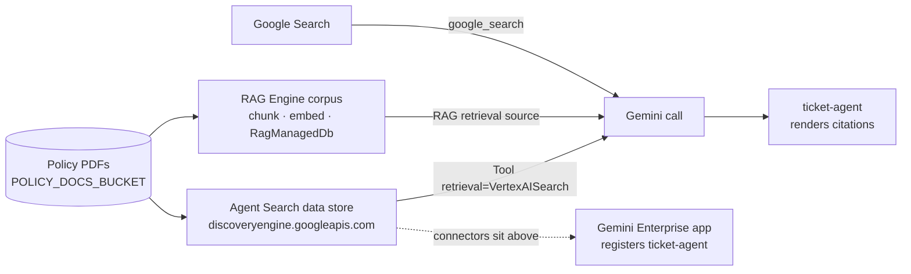

# G08 — Knowledge: Agent Search, RAG Engine and the grounding tool

G07 took the ticket agent off the cloud and ran it on Gemma 4. This chapter brings it back and gives it something to know. On Gemini Enterprise Agent Platform (ex-Vertex AI) the knowledge layer is not one object but three products that look alike from a distance: **Agent Search** (ex-Vertex AI Search) data stores behind the Discovery Engine API, **RAG Engine** corpora, and the **grounding tool** the model calls at generation time (H13). **The design decision in this chapter is which of the three you are actually buying, because a data store is not a corpus is not a grounding tool.** The end-user layer, Gemini Enterprise with its connectors, sits above all three and is a fourth thing again (H10).

> _A data store is where the documents live. A corpus is a retrieval pipeline you own. A grounding tool is a model argument. Pick the one that matches who needs to change what._

Running scenario: the support-ticket agent from G03 (`ticket-agent`), grounded on three refund, card and escalation policy documents in a Cloud Storage bucket. The runnable proof is [`labs/01-knowledge-base/`](labs/01-knowledge-base/); the shorter grounding-only path is G03 lab 05. Environment and pins are in [`../labs-setup/`](../labs-setup/). Facts are cited by letter from [`../reference/reading-map-gcp-agents-2026-10-25.md`](../reference/reading-map-gcp-agents-2026-10-25.md), section H mostly; status words carry the page date from the map.

### What we are trying to avoid

A team builds a hand-rolled RAG loop (chunker, embedder, vector table, re-ranker, citation formatter) and six months later nobody can say which document produced which sentence. A second team creates a data store in the console, points the agent at it with a grounding tool, and discovers the answer never cites anything because the agent prints `response.text` and throws the metadata away. A third team wants per-user document filtering and finds out the tool they chose has no hook for it. All three are the same mistake: choosing a product before deciding who owns the retrieval behaviour.

### Has this happened?

The first draft of G03 lab 05 did the second one: `VertexAiSearchTool` on the agent, `print(final.text)`, no citations rendered, and a reviewer asked "how do I know it read the policy and did not make that up?". The reviewer was right. This chapter is the answer.

### What the chapter covers

The three products and when each is right, as a table (1). Agent Search data stores: sources, verticals, app types, the Discovery Engine API and the Terraform resources (2). RAG Engine: the pipeline, the regions, the vector store choices (3). The two tool shapes in google-genai and ADK and the one-built-in-tool rule (4). Gemini Enterprise connectors as the end-user layer (5). Citations and what the agent must render (6). VPC-SC and CMEK on RAG Engine (7).

### What you have at the end

A data store and a RAG corpus both created from code, the ticket agent answering policy questions through the Agent Search tool wrapped in an `AgentTool`, and a printed proof that each answer names the document it came from.

---

## 1. Three products, one decision

The builder-APIs page draws the line (H13): Agent Search is a managed search engine over your data with an answer API that returns grounding scores; RAG Engine is a managed runtime where you choose the components; Google Search grounding is the public web; Gemini Enterprise is the end-user product with connectors.

| You need | Pick | Why | Status (map) |
|---|---|---|---|
| private documents searchable by an agent, minimum code, Google-managed ranking | **Agent Search data store** + grounding tool or `VertexAiSearchTool` | managed search engine with an answer API and grounding scores (H13); Terraform-able (I8) | data store page undated (H9) |
| you must choose chunking, embedding model and vector store, or bring Pinecone/Vector Search | **RAG Engine corpus** | managed runtime, DIY components, VPC-SC and CMEK (H11) | GA `europe-west3/4`, 2026-10-22 (H11) |
| public web facts | **Google Search grounding** | eight grounding sources, Google Search is one (H12); `google_search` tool in ADK (B8) | B8 undated |
| employees searching Jira, SharePoint, Slack and asking an assistant | **Gemini Enterprise** with connectors | the end-user layer; 19 GA connectors, ~100 preview (H10) | 2026-10-23 (H10) |
| your own search API or Elasticsearch already exists | grounding tool with own search API or Elasticsearch source (H12) | no second copy of the index | 2026-10-22 (H12) |

The fourth row is not a builder choice at all; it is what the business buys. Keep it on the table because the interview question is usually "why would I not just use Gemini Enterprise?", and the answer is "because the ticket agent is yours, and Gemini Enterprise is where its users will find it" (C8).

**Interview line.** "Agent Search when Google should own the search; RAG Engine when I must own the pipeline; grounding is only the model's view of either."

## 2. Agent Search data stores

Agent Search is the renamed Vertex AI Search and the API is still Discovery Engine, `discoveryengine.googleapis.com` (A1, H9). The objects:

| Object | What it is | Choices (H9) |
|---|---|---|
| data store | the indexed container of documents | sources: website, BigQuery, Cloud Storage, Workspace, Cloud SQL, Spanner, Firestore, Bigtable, AlloyDB, JSON |
| industry vertical | fixed at create time | `GENERIC`, `MEDIA`, `HEALTHCARE_FHIR` |
| app (engine) | what sits on top of one or more data stores | search, `SOLUTION_TYPE_CHAT`, `SOLUTION_TYPE_GENERATIVE_CHAT`, `SOLUTION_TYPE_RECOMMENDATION` |

The ticket agent needs the first column only: a `GENERIC` data store fed from `POLICY_DOCS_BUCKET`, with a search app on top so the console and the answer API work. The resource path the tools want is `projects/P/locations/global/collections/default_collection/dataStores/ID` (B9); it goes into `.env` as `AGENT_SEARCH_DATASTORE`.

Create it with Terraform when the landing zone (G01) owns it: `google_discovery_engine_data_store` and `google_discovery_engine_search_engine` are the two resources the Agent Runtime Terraform page lists beside the agent itself (I8). Create it from Python when the lab owns it; the lab uses the `google-cloud-discoveryengine` client pinned in `../labs-setup/requirements.txt`. The exact client method names are not in the map and the sketch marks them unverified; the shapes to look for are a create-data-store call and an import-documents call pointing at `gs://` URIs.

Two things the page does not say and this chapter therefore does not claim: per-user ACL filtering on Cloud Storage documents, and the ingestion formats beyond "Cloud Storage". The lab says "PDFs" because `.env.example` does; treat Markdown ingestion as unverified.

**Interview line.** "A data store is a Discovery Engine resource with a vertical and sources; the app on top decides whether it answers, chats or recommends."

## 3. RAG Engine

RAG Engine is the pipeline product: ingest from local files, Cloud Storage or Drive, chunk, embed, store in a corpus, retrieve, generate (H11). Every step is a parameter you set, which is the point and the cost.

| Decision | Options (H11) | Default for the lab |
|---|---|---|
| region | GA in `europe-west3` and `europe-west4`; allowlist-GA `us-central1`, `us-east4`; others preview (2026-10-22) | `europe-west3` (note: not `GOOGLE_CLOUD_LOCATION`, which is `europe-west2`) |
| vector store | RagManagedDb (GA, default), Vector Search (GA), Pinecone (GA), Feature Store and Weaviate (preview) | RagManagedDb |
| embedding model | the platform embedding model; `GEMINI_EMBEDDING_MODEL` in `.env` | `gemini-embedding-001` |
| security | VPC-SC and CMEK supported (H11) | see §7 |

The region row is the one that bites: the rest of this track runs in `europe-west2` (A9) and RAG Engine does not list it. The lab creates the corpus in `europe-west3` and writes `RAG_CORPUS` as `projects/P/locations/europe-west3/ragCorpora/ID`. Whether a `europe-west2` agent may call a `europe-west3` corpus across the VPC-SC perimeter is a landing-zone question (G01, I2) and is unverified here.

When is RAG Engine the right row? When chunking matters (long policy PDFs with tables), when the vector store is mandated (a bank that already pays for Vector Search), or when you need a corpus the agent retrieves from directly rather than through a search app. When none of those hold, Agent Search is less to own.

**Interview line.** "RAG Engine gives me the pipeline knobs and a corpus; the price is that I now own chunking, embeddings and a second region."

## 4. The two tool shapes and the one-built-in-tool rule

The same data store appears in two SDKs.

**google-genai** (H12): `Tool(retrieval=Retrieval(vertex_ai_search=VertexAISearch(datastore=AGENT_SEARCH_DATASTORE)))` in `GenerateContentConfig.tools`. This is a plain model call with grounding; no agent loop, no session. It is the right shape for a one-shot "answer with citations" endpoint and for the smoke test.

**ADK** (B9): `VertexAiSearchTool(data_store_id=AGENT_SEARCH_DATASTORE)` on an `LlmAgent`. Per-user filtering is done by overriding `_build_vertex_ai_search_config` (B9); the lab leaves a `# TODO(learner)` there.

The rule that shapes the lab (D4): a built-in tool cannot sit beside function tools in the same agent, and built-ins are not allowed in sub-agents except Google Search and Agent Search with `bypass_multi_tools_limit=True`. The ticket agent already has the ticketing `McpToolset` (G04), so the knowledge tool goes into its own small agent and is handed to `ticket-agent` wrapped in `AgentTool` (D1, D4). That is why the lab has two agents in `agent.py`.

| Shape | Where | Use when | Limit |
|---|---|---|---|
| `Tool(retrieval=Retrieval(vertex_ai_search=...))` | google-genai model call | one-shot grounded answer, evals, smoke test | no loop, you render citations yourself |
| `VertexAiSearchTool(data_store_id=...)` | ADK `LlmAgent` | the agent needs to decide when to look | one built-in per agent (D4) |
| knowledge agent wrapped in `AgentTool` | ADK parent agent | parent already has function or MCP tools | adds one model turn per lookup |
| RAG Engine retrieval as grounding source | google-genai call (H12) | corpus from §3 | exact Python shape unverified in the map |

**Interview line.** "One built-in tool per agent; when the agent already has MCP tools, the search lives in a child agent behind `AgentTool`."

## 5. Gemini Enterprise connectors: the end-user layer

Gemini Enterprise (ex-Agentspace, renamed Oct 2025; A6) is intranet search, assistant and agent gallery for employees. Its knowledge comes from connectors: 19 GA (Box, Confluence, Dropbox, GitHub, Google Calendar, Drive and Mail, HubSpot, Jira, Entra ID, Outlook, Teams, Monday, OneDrive, ServiceNow, SharePoint, Slack) and around 100 in preview including Salesforce, Notion, Zendesk and "Custom MCP Server" (H10, 2026-10-23).

None of that is the ticket agent's knowledge. The connectors feed the assistant the employee talks to; the ticket agent is registered into the same app as a custom agent by its `reasoningEngines` path (C8) and brings its own data store. Two layers, two owners: the Gemini Enterprise admin (`discoveryengine.agentspaceAdmin`, C9) owns connectors; the agent team owns the data store or corpus. Do not try to make the ticket agent read Jira through a connector; give it the ticketing MCP server (G04).

**Interview line.** "Connectors are what the assistant knows; the data store is what my agent knows; the registry is how the two meet."

## 6. Citations and what the agent must render

Grounding only helps if the user can see it. The Google Search tool page is explicit: in production the agent must render the search suggestions it returns as `renderedContent` (B8). The same discipline applies to Agent Search and RAG Engine: the model response carries grounding metadata naming the chunks and the source documents it drew on; the lab prints the document title or URI next to each answer. The exact field names on the response object are not in the map; the lab's `test_knowledge_base.py` leaves a `# TODO(learner)` to assert on whatever the response actually carries, and the proof checklist asks for the printed document name, not for a field.

Three cases the proof covers: a refund question answered from `refund-policy`, a card question answered from `card-policy`, and a question the documents do not cover, for which the correct output is a refusal with no citation. The third case is the one that catches an agent that invents sources.

**Interview line.** "A grounded answer without a rendered citation is indistinguishable from an ungrounded one to the user; render or do not bother."

## 7. Security: VPC-SC and CMEK on RAG Engine

RAG Engine supports VPC Service Controls and CMEK (H11). Agent Runtime, Evals, Sessions and Memory Bank support VPC-SC, CMEK and data residency; Example Store does not (F4). CMEK needs `roles/cloudkms.cryptoKeyEncrypterDecrypter` on the platform service agent and the key ring in the same region as the resource (I4, F5), and it is not available with the `global` or multi-region endpoints (A9). Inside a perimeter, Agent Runtime has no internet egress (I2), so an agent that grounds on Google Search as well as a private corpus will lose the web source behind VPC-SC unless the landing zone adds a proxy.

| Control | RAG Engine | Agent Search data store | Where configured |
|---|---|---|---|
| VPC-SC | yes (H11) | not stated in the map; unverified | perimeter in G01 (I2) |
| CMEK | yes (H11) | not stated in the map; unverified | `encryptionSpec.kmsKeyName` pattern (F5), key ring same region |
| data residency | corpus region `europe-west3/4` GA (H11) | data store location `global` in the tool path (B9) | pick at create time |

That last cell is a real design point: the Agent Search tool path in B9 is `locations/global`, while a European corpus in RAG Engine is regional. If residency is a hard requirement, RAG Engine in `europe-west3` answers it on paper; whether Agent Search can be created in `eu` for this use is unverified in the map.

**Interview line.** "RAG Engine is the one of the two I can put behind VPC-SC with a customer key and a European region on the documentation I have; for Agent Search I would verify before promising."

## The chapter in eight lines

1. Three products: Agent Search data store (managed search), RAG Engine corpus (managed pipeline), grounding tool (model argument); Gemini Enterprise connectors are the end-user layer (H13, H10).
2. A data store is a Discovery Engine resource with sources, a vertical and an app type (H9); Terraform `google_discovery_engine_data_store` and `_search_engine` (I8).
3. RAG Engine: ingest, chunk, embed, corpus, retrieve, generate; GA in `europe-west3/4`; RagManagedDb, Vector Search, Pinecone GA (H11).
4. google-genai: `Tool(retrieval=Retrieval(vertex_ai_search=VertexAISearch(datastore=...)))` (H12). ADK: `VertexAiSearchTool(data_store_id=...)` (B9).
5. One built-in tool per agent; combine through a child agent in `AgentTool` (D4, D1).
6. The agent must render citations; `renderedContent` for Google Search is mandatory in production (B8).
7. RAG Engine supports VPC-SC and CMEK (H11); CMEK not on global endpoints (A9); no egress inside the perimeter (I2).
8. The ticket agent reaches Gemini Enterprise users by registration (C8), not through a connector.

## What you should be able to explain

The difference between a data store, a corpus and a grounding tool, and who changes what in each. Why the lab has two agents. Why RAG Engine lives in `europe-west3` when everything else is in `europe-west2`. What the user sees when citations are not rendered. Which of the two products you can put behind VPC-SC with CMEK on today's documentation.

## What this is not

Not a Discovery Engine indexing deep-dive (schemas, boost specs, search tuning). Not fine-tuning: a tuned model changes how it answers, not what it knows (G06). Not Memory Bank, which stores what the agent learned from users, not what the company wrote down (G03 lab 04). Not Gemini Enterprise administration.

## Implementation scope and versions

Pages dated 2026-10-22 (H11 RAG Engine and vector DB choices, H12 grounding), 2026-10-23 (H10 connectors), undated (H9 data stores, H13 builder APIs, B9 Agent Search tool, D4 limits). Packages: `google-adk` 2.13.0, `google-genai` 2.33.0, `google-cloud-discoveryengine` (unpinned in `labs-setup/requirements.txt`), `google-cloud-aiplatform` 2.6.0 for RAG Engine. Model `gemini-3.5-flash`, embeddings `gemini-embedding-001` from `.env`. Gaps hit: no Python method names for data store creation or RAG corpus creation in the map; no response field names for grounding metadata; Agent Search VPC-SC/CMEK not stated; the Apigee and pricing pages were not fetched (A11).

## Further reading

Map section H: H9 data stores (https://docs.cloud.google.com/generative-ai-app-builder/docs/create-data-store-es), H10 connectors (https://docs.cloud.google.com/gemini/enterprise/docs/connectors/connect-third-party-data-source), H11 RAG Engine (https://docs.cloud.google.com/vertex-ai/generative-ai/docs/rag-engine/rag-overview and .../vector-db-choices), H12 grounding (https://docs.cloud.google.com/vertex-ai/generative-ai/docs/grounding/overview), H13 which product (https://docs.cloud.google.com/generative-ai-app-builder/docs/builder-apis). B8 Google Search tool (https://adk.dev/integrations/google-search/), B9 Agent Search tool (https://adk.dev/integrations/agent-search/), D4 limits (https://adk.dev/tools/limitations/), I8 Terraform (https://docs.cloud.google.com/gemini-enterprise-agent-platform/scale/runtime/use-terraform). Sketch: [`sketches/kb_shapes.py`](sketches/kb_shapes.py), the three shapes side by side.
