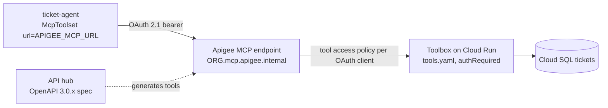
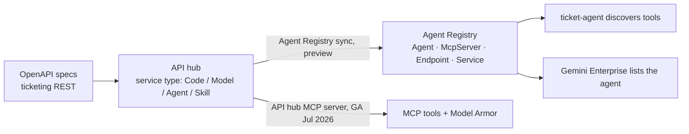
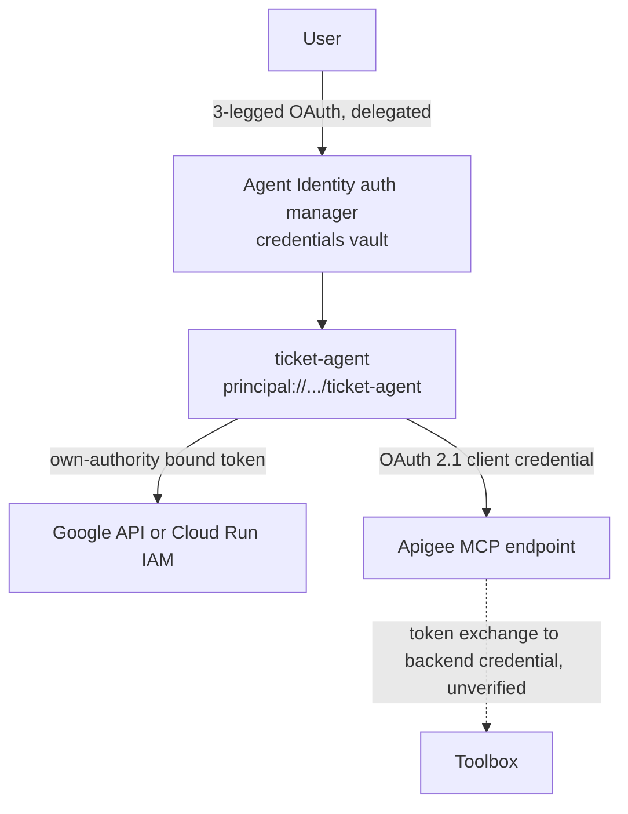
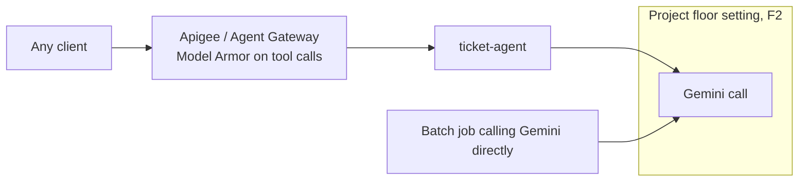

# G09 — Apigee-integrated designs: where the gateway earns its place

G08 gave the ticket agent knowledge. This chapter asks where a gateway belongs around it. On Google Cloud the candidates are **Apigee** (MCP endpoints, OAuth 2.1, API products), **API hub** (the catalogue, with an MCP server of its own since July 2026) and the platform's own **Agent Gateway** (MCP, A2A, REST proxying with IAM policies and Model Armor) (D12, D13, F7). **The design decision in this chapter is which boundary each of them should sit on, because a gateway that validates a token is not the same thing as a service that authorises a call.** Five designs, each with a diagram and a when / when not line. Designs only; there is no lab, and the Apigee variant of the G04 auth matrix (G04 lab 04) is the only code.

> _The gateway decides who may knock. The tool still decides what they may take._

Running scenario: `ticket-agent` on Agent Runtime, the ticketing MCP server (MCP Toolbox for Databases on Cloud Run, G04 lab 03), the Agent Registry entry from G04 lab 05, and a partner agent reached over A2A (G04 lab 06). `APIGEE_ORG` and `APIGEE_MCP_URL` in `.env` are empty unless you have an Apigee org; the designs read the same either way. Facts by map letter from [`../reference/reading-map-gcp-agents-2026-10-25.md`](../reference/reading-map-gcp-agents-2026-10-25.md). One page the map could not fetch, "Manage MCP tool access with API products", carries the rate-limiting and token-exchange detail; wherever a design would quote it this chapter says **unverified**.

### What we are trying to avoid

Treating Apigee as the security boundary on its own, so the Toolbox behind it accepts any caller that reaches it. Running two catalogues, API hub for the API team and Agent Registry for the agent team, that drift within a quarter. Putting Model Armor only on the gateway and then calling the model directly from a batch job that never goes through it. Letting a partner agent's A2A card point straight at an Agent Runtime `:query` URL.

### Has this happened?

The Foundry version of this chapter was a pasted answer, not a design, which is its own kind of evidence: the gateway question gets asked in every review and answered from memory. This chapter writes it down with the limits the documentation actually states.

### What the chapter covers

Apigee MCP endpoint in front of the ticketing MCP server (1). API hub as the catalogue synced to Agent Registry (2). OAuth 2.1 and token exchange at the gateway versus Agent Identity own-authority tokens (3). Model Armor at the gateway versus at the platform floor (4). A2A across trust boundaries through Agent Gateway (5).

### What you have at the end

Five diagrams you can draw on a whiteboard, one when / when not line per design, and a clear list of what is still unverified.

---

## 1. Apigee MCP endpoint in front of the ticketing MCP server

Apigee serves managed MCP endpoints at `ORG_NAME.mcp.apigee.internal` through an MCP Discovery proxy; it answers `tools/list` and `tools/call`, and API hub ingests OpenAPI 3.0.x specs and maps operations to tools (D12, 2026-10-24). Limits on the page: 1,000 tools per org on SaaS, hybrid from v1.17.0 (D12). Two sub-shapes: Apigee generates the tools from an OpenAPI spec of the ticketing REST API, or Apigee fronts the Toolbox's own MCP endpoint as a pass-through (the second is how the map reads D12 together with D7's `mcpEnabled: true`; the pass-through mechanics are unverified).



**When.** Several teams or external partners call the ticketing tools; you need per-client tool allow-lists, quotas and an API product around them; the API team already lives in Apigee.
**When not.** One agent, one Toolbox, one project: Cloud Run IAM (`roles/run.invoker`) plus Toolbox `authRequired` is the whole story (D8, D7), and Apigee adds a hop and a bill. Rate limits per client are the stated reason to add it, and their configuration is **unverified** in the map.

**Interview line.** "Apigee gives me `tools/list` with a per-client view; the Toolbox still enforces `authRequired` on every call."

## 2. API hub as the tool catalogue synced to Agent Registry

API hub has been growing into the agent catalogue: Agent Registry sync (preview, 2026-04-06), API hub resources exposed as MCP tools (preview, 2026-05-12), the API hub MCP server GA on 2026-07-24 with Model Armor on tool calls and a `ConfigureAndDeployServer` operation, gcloud deployment of MCP servers to Apigee (2026-08-12), and a service type attribute of Code, Model, Agent or Skill (GA 2026-09-30) with a "Tool performance" dashboard (D13). Agent Registry itself holds `Agent`, `McpServer`, `Endpoint` and `Service` resources, with `Skill` and `Publisher` in preview; URNs are catalogue-only (F7).



**When.** The organisation already governs APIs in API hub and wants one catalogue; the sync means agents and tools appear in Agent Registry without a second registration step.
**When not.** The sync is preview on 2026-04-06 and the map has no later GA note for it (D13); if the registry must be authoritative today, register `McpServer` and `Agent` directly (G04 lab 05) and treat API hub as the upstream of record.

**Interview line.** "API hub is where the API team publishes; Agent Registry is where agents look; the sync is the bridge and it is still preview."

## 3. OAuth 2.1 at the gateway versus Agent Identity own-authority tokens

Two token stories, and they answer different questions. Apigee MCP uses OAuth 2.1 with OIDC and Protected Resource Metadata, and applies tool access policies per OAuth client (D12). Agent Identity gives each deployed agent a SPIFFE principal, `principal://TRUST_DOMAIN/NAMESPACE/AGENT_NAME`, with Google-managed x509 renewed every 24 hours, no long-lived keys, and two auth models: user-delegated three-legged OAuth through the Agent Identity auth manager, and own-authority tokens (bound access tokens, OIDC ID tokens, two-legged OAuth, API keys) (D9, C5). On Agent Runtime `google.auth.default()` picks that identity up from the metadata server and the tokens are DPoP or mTLS bound (`cnf` `x5t#S256`) (D10).



| Caller → target | Token | Who authorises | Map |
|---|---|---|---|
| agent → Google API or Cloud Run service | own-authority bound token from the agent's SPIFFE principal | IAM on the target | D9, D10 |
| agent → third-party API on the user's behalf | delegated 3-legged OAuth via auth manager | the third party, per user | D9 |
| agent → Apigee MCP endpoint | OAuth 2.1 bearer for an OAuth client | Apigee tool access policy, then the backend | D12 |
| Apigee → backend | exchanged or injected credential | the backend | **unverified** (page not fetched) |

**When.** Apigee OAuth 2.1 when callers are outside the Google Cloud trust domain (partners, SaaS) and you need client-level policy. Agent Identity own-authority whenever the target understands IAM, because there is no secret to rotate and the principal is per agent.
**When not.** Do not put Apigee in front of a target that already honours the agent principal just to "add OAuth"; you gain a client secret to manage and lose the bound token. Do not expect Agent Identity to satisfy a partner who wants a standard OAuth client.

**Interview line.** "Inside Google Cloud the agent is a SPIFFE principal and IAM authorises it; at the edge it is an OAuth client and Apigee's tool policy authorises it; the token exchange between the two is the detail I would verify."

## 4. Model Armor at the gateway versus at the platform floor

Model Armor screens prompts and responses for RAI categories, prompt injection and jailbreak, sensitive data (basic and advanced, inspect and de-identify) and malicious URLs; it runs as templates or as floor settings, and floor settings are minimums that templates cannot weaken (F1, 2026-10-22). It integrates with Agent Gateway, Apigee, Gemini Enterprise, Google MCP servers and the Agent Platform (F1), and the API hub MCP server applies it on tool calls (D13). On the platform side a floor setting with `integratedServices: ["AI_PLATFORM"]` and `enableFloorSettingEnforcement` screens every model call in the project, with `INSPECT_ONLY` or `INSPECT_AND_BLOCK` (F2).



| Place | Screens | Misses | Status (map) |
|---|---|---|---|
| Apigee or API hub MCP server | tool arguments and results crossing the gateway | model calls that never pass the gateway | GA 2026-07-24 (D13) |
| Agent Gateway | MCP, A2A and REST through the gateway; `INSPECT_ONLY` dry-run | the same | GA 2026-06-18 (A2, F7) |
| Platform floor setting | every Gemini call in the project, blocking or logging | tool traffic between agent and Toolbox | 2026-10-22 (F2) |

**When.** Floor first, always: it is the one place a direct call cannot bypass. Gateway Model Armor on top when tool payloads carry user data that should be de-identified before the Toolbox sees it, or when the caller is a partner.
**When not.** Gateway-only screening in a project where other code calls Gemini directly; and floor-only when the risk is in tool arguments, which the floor never sees.

**Interview line.** "The floor is the minimum nobody can turn off; the gateway is where I screen what the tools see; one without the other leaves a path open."

## 5. A2A across trust boundaries through Agent Gateway

Agent Gateway (GA 2026-06-18; A2) proxies MCP over SSE and streamable HTTP, A2A, and REST or gRPC, is default-deny, brokers OAuth and workload identity federation through the Auth Manager, emits OpenTelemetry and L7 logs, and holds up to 5,000 resources; IAM policies use `roles/iap.egressor` with CEL on `mcp.toolName`, `mcp.method` and `isReadOnly`, with `iamEnforcementMode: "DRY_RUN"` for a trial (F7). ADK exposes an agent with `to_a2a` or `adk api_server --a2a` and consumes one with `RemoteA2aAgent`; the ADK A2A surface is experimental and the protocol is v1.0 (C7, C6). Gemini Enterprise still speaks A2A 0.3 streaming and needs `a2a.compat.v0_3` for 1.0 agents (C9). Binding an agent to Agent Gateway archives prior revisions (C4).

```mermaid
flowchart LR
  P[Partner agent<br/>RemoteA2aAgent, other org] -->|A2A 1.0 + OAuth / WIF| AG[Agent Gateway<br/>default-deny, CEL on mcp.toolName, OTel]
  AG --> A[ticket-agent on Agent Runtime<br/>agent card via to_a2a]
  A -->|RemoteA2aAgent| AG2[Agent Gateway] --> Q[Partner's agent]
  GE[Gemini Enterprise, A2A 0.3] -. a2a.compat.v0_3 .-> A
```

**When.** The remote agent is in another organisation or cloud, or the ticket agent must call out to one; you want a deny-by-default policy on which agents and tools are reachable, and logs of every crossing.
**When not.** Two agents in one project under one team: `sub_agents=[RemoteA2aAgent(...)]` with Agent Identity roles (`roles/agentregistry.viewer` plus `roles/aiplatform.user`, C5) is enough. GKE, Cloud Run and cross-cloud gateways are listed as "coming soon" (F7), so a partner agent that is not on Agent Runtime is reached through Apigee (design 1 and 3) today, which is a map gap for A2A specifically.

**Interview line.** "A2A inside the org is a sub-agent with a principal; across the boundary it is Agent Gateway with default-deny, and I say that the ADK side is experimental."

## The chapter in five lines

1. Apigee MCP: managed `ORG.mcp.apigee.internal` endpoints, tools from OpenAPI 3.0.x, OAuth 2.1, per-client tool policy, 1,000 tools per org (D12). Rate limits and backend token exchange: unverified.
2. API hub is the API catalogue; its Agent Registry sync is preview, its MCP server is GA with Model Armor (D13, F7).
3. Inside Google Cloud, Agent Identity own-authority bound tokens and IAM; at the edge, OAuth 2.1 clients and Apigee policy (D9, D10, D12).
4. Model Armor: floor setting on every model call (F2) plus gateway screening on tool traffic (D13, F7); neither alone covers both.
5. A2A across trust boundaries goes through Agent Gateway, default-deny with CEL policies; ADK A2A is experimental and Gemini Enterprise speaks 0.3 (F7, C7, C9).

## What you should be able to explain

Why Apigee in front of the Toolbox does not remove `authRequired` from `tools.yaml`. What the API hub sync buys and what its status is. Which token the agent presents to Cloud Run versus to Apigee. Why the floor setting comes before gateway screening. When a `RemoteA2aAgent` needs Agent Gateway and when it does not.

## What this is not

Not an Apigee course (products, developer portal, policies pipeline, hybrid). Not the Toolbox auth setup, which is G04 lab 03. Not Agent Registry registration, which is G04 lab 05. Not a cost comparison; the pricing pages were not fetched (A11).

## Implementation scope and versions

Pages dated 2026-10-24 (D12 Apigee MCP), 2026 release notes (D13 API hub), 2026-10-22 (D9, D10, C5, F1, F2, F7, C4), undated (C6, C7). Agent Gateway GA 2026-06-18 and Agent Registry GA 2026-06-18 (A2). Not fetched: Apigee "Manage MCP tool access with API products" (rate limiting, token exchange), the Model Armor floor-settings reference page. No code in this chapter; the Apigee variant of the auth matrix is G04 lab 04 and reads `APIGEE_MCP_URL` from `.env`.

## Further reading

D12 Apigee MCP overview (https://docs.cloud.google.com/apigee/docs/api-platform/apigee-mcp/apigee-mcp-overview). D13 API hub release notes (https://docs.cloud.google.com/apigee/docs/apihub/release-notes). D9 Agent Identity overview (https://docs.cloud.google.com/iam/docs/agent-identity-overview). D10 own-authority auth (https://docs.cloud.google.com/iam/docs/auth-agent-own-identity). F1 Model Armor overview (https://docs.cloud.google.com/security-command-center/docs/model-armor-overview). F2 Model Armor and the platform (https://docs.cloud.google.com/model-armor/model-armor-vertex-integration). F7 Govern: Registry, Gateway, IAM policies (https://docs.cloud.google.com/gemini-enterprise-agent-platform/govern/gateways/agent-gateway-overview). C7 ADK A2A (https://adk.dev/a2a/). C9 register A2A agents in Gemini Enterprise (https://docs.cloud.google.com/gemini/enterprise/docs/register-and-manage-an-a2a-agent).
