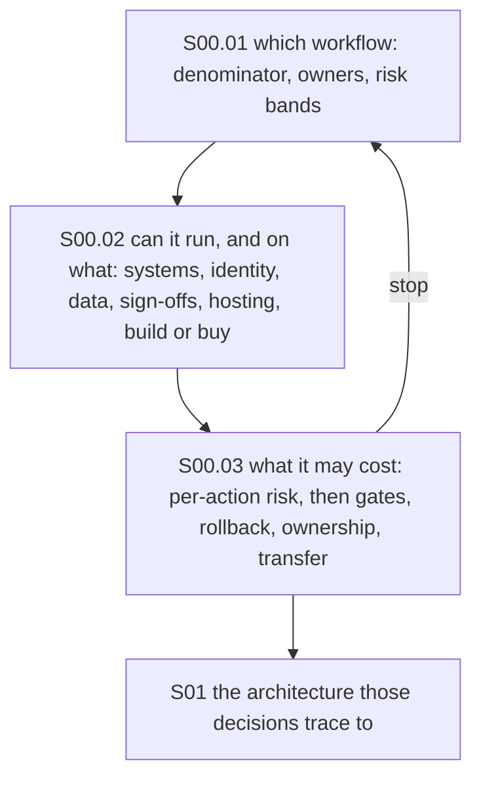

# S00: Enterprise AI and Solution Discovery

Status: **In progress** (three chapters drafted 23 October 2026, consolidated from discovery, deployment-workshop, decision-economics and rollout notes and merged from five to three the same day; no workshop templates or scoring sheets built yet).

Before any architecture: which problems deserve an agent, what must exist first, what each action is allowed to cost, how the business case is measured, and how the work is run and handed over. The governing rule: **the architecture is the last discovery answer, not the first sales answer.**

### What we are trying to avoid

A pilot that demos well and never ships because the data it needs sits in a system nobody can call. An agent that automates a task whose cost was never the problem. A chatbot that makes a promise the company then has to honour. A customer-service rollout that cuts cost on paper and quality in practice. A twelve-month build of what a platform shipped as a feature. A project with no owner once the consultants leave.

### Has this happened? Three micro-stories

**Air Canada's chatbot (February 2024).** A passenger asked the airline's website chatbot about bereavement fares and was told he could claim the discount within 90 days of buying the ticket. The real policy said the opposite, and the chatbot had linked to it. Air Canada argued it could not be liable for what the chatbot said; the tribunal disagreed and ordered CAD 812.02 in damages. **What your agent says is your company speaking**, and a link to the right policy is no defence. ([AI Business on the ruling](https://aibusiness.com/nlp/air-canada-held-responsible-for-chatbot-s-hallucinations-), read 23 October 2026)

**Klarna's reversal (May 2025).** In 2024 Klarna said its AI assistant did the work of 700 agents and handled most chats. A year later its CEO said the push "went too far", quality had suffered, and the company was hiring humans back into a new support model. **A cost number is not a success metric**; quality and customer outcome belong in the business case from day one. ([Maginative on the reversal](https://www.maginative.com/article/klarna-dials-back-its-ai-customer-service-strategy-now-its-hiring-humans-again/), read 23 October 2026)

**The GenAI Divide (August 2025).** MIT's NANDA group reported that 95% of corporate generative-AI pilots produced no measurable return and stalled before scale. Its explanation was not model quality but a learning gap between the tools and real workflows; externally sourced tools succeeded about twice as often as internal builds. **Integration into the workflow decides whether a pilot ships**, and building from scratch is the riskier default. ([Computing on the MIT report](https://computing.co.uk/news/2025/ai/mit-report-95pc-corporate-generative-ai-pilots-fail), read 23 October 2026)

### Running example

The support-ticket system used across the repo starts here: forty agents, refunds and duplicate charges across eight regions, a sponsor who wants "an agent". S00 turns that into a refund-investigation agent for the UK and DE teams, read-only in month one, refund-capable with supervisor confirmation in month three, measured on cost per resolved ticket and refund errors. Ayşe and Mert, the two users of S03, come from this exercise. The chapters themselves use a bank's contact centre as the worked case, because money-moving actions make the risk ladder visible.

## Learning order

| Subsection | What it covers |
| --- | --- |
| [S00.01 Use-Case Discovery and Qualification](S00.01-Use-Case-Discovery-and-Qualification/README.md) | Turn "we want AI" into one bounded workflow: operational truth, the discovery ladder, segment by risk then value, hard gates before scores, the wedge, the PRD as a decision contract |
| [S00.02 Readiness, Hosting and Platform](S00.02-Readiness-Hosting-and-Platform/README.md) | What has to exist before an agent can act (access classes, identity and scopes, data rules, named owners, the one-day workshop, phase gates), hosting forced by a compliance driver, and buy versus low-code versus platform versus custom |
| [S00.03 Economics: Action Risk and the Business Case](S00.03-Economics-Action-Risk-and-Business-Case/README.md) | Part A prices each action: failure-cost tiers, the reversibility ladder, write physics, audit, the executor enforces. Part B prices the deployment: cost per resolved task, true resolution, rollout gates, rollback, degraded modes, ownership, transfer |

## How the chapters connect

Every arrow is a traceability question; a stop at S00.03 sends you back to the top, not to S01.

### What you have at the end

A one-page qualified use case: the workflow, its eligible population and baseline, the systems it touches and their access classes, the readiness gaps with named owners, the risk band of every action, the cost-per-resolved-task target, the rollout gates and rollback triggers, the owner after launch, and the build-or-buy choice. S01 starts from that page.

### What this is not

Not a sales methodology and not the governance framework (S07). It does not pick models (S02) or draw the architecture (S01). It is where you decide whether there should be an architecture at all.

[Back to AI Production Systems](../README.md)
