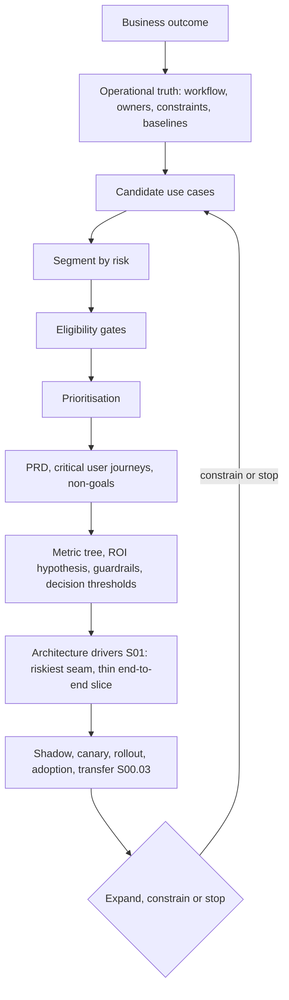
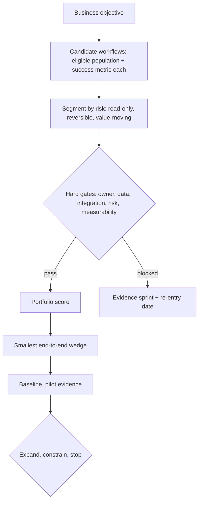

# S00.01: Use-Case Discovery and Qualification

Status: **Drafted** (first written pass, 23 October 2026; consolidated from earlier discovery and prioritisation notes).

Before any architecture: how to turn "we want AI" into one bounded workflow that deserves an agent, with a denominator, named owners and a defended priority. The governing rule for the whole section: **the architecture is the last discovery answer, not the first sales answer.**

### What we are trying to avoid

Building an agent to do what a database view does. A pilot picked because it demos well, not because anyone measured the task. A percentage promised with no denominator. The sponsor's favourite workflow winning the scoring because nobody published the rubric first. A high-value case with no API, parked for ever as "not now".

### Has this happened?

MIT's NANDA group reported in August 2025 that 95% of corporate generative-AI pilots produced no measurable return; the cause it named was a learning gap between tools and real workflows, not the models. That is a discovery failure at organisation scale: the workflow was never observed, so the tool never fitted it. ([Computing on the MIT report](https://computing.co.uk/news/2025/ai/mit-report-95pc-corporate-generative-ai-pilots-fail), read 23 October 2026.) The other two stories in the [section README](../README.md) (Air Canada, Klarna) are the cost of skipping the risk band and the metric.

## 30-second version

Enterprise AI discovery converts an ambiguous request into an evidence-backed delivery contract. Start with the buyer-owned business outcome, observe the operational truth of one real workflow, map owners and constraints, and baseline the eligible population. Segment the demand by risk before you rank it by value. Apply hard eligibility gates, then score what survives. Choose the smallest end-to-end wedge that can move a buyer-owned metric, and express it as a bounded product requirement with non-goals, a metric tree and pre-agreed decision thresholds. Only then select an architecture. The senior signal is not a clever diagram; it is a traceable chain from customer value to production decisions, with every assumption named and every expansion earned by evidence.

## Twelve rules to know by heart

1. **A product request is a hypothesis.** "We want AI" says nothing yet about the workflow, the economic outcome, the user, the constraint, or why an LLM is necessary at all.
2. **Observe before abstracting.** The operational truth is the real trigger-to-completion workflow, including queues, workarounds, handoffs, systems of record, failure paths, and where expert judgment enters.
3. **Name the denominator.** A percentage without the eligible population, baseline, time window and attribution method is not a decision metric.
4. **Attach owners to facts.** Outcome, budget, workflow, data, security, risk, adoption and go-live each need a named owner or veto holder.
5. **Separate facts from assumptions.** Every unknown is retired, bounded through an experiment, accepted as risk, or made a stop condition.
6. **Segment by risk first, then by value.** Read-only, reversible and value-moving intents are different products. Value ranks workflows _within_ a risk band; it never promotes a workflow across one.
7. **Gates before scores.** A fatal zero in lawful data access, system access, accountable ownership, measurability or safe operation cannot be averaged away by theoretical value.
8. **The PRD is a decision contract.** It binds the problem, eligible users, journeys, non-goals, success metrics, guardrails, failure policy and release gates before architecture detail expands.
9. **Prefer deterministic control where the rule is known.** Use model judgment where language ambiguity or open-ended reasoning creates real value, not where a typed rule is safer and cheaper.
10. **Prove the seam, not the centre.** The riskiest work is usually identity, data entitlement, system writes, handoff, latency, evaluation or operator adoption, not the model response in isolation.
11. **Sequencing is the strategy.** The first workflow should buy option value (integration, controls, trust, telemetry) that the harder workflow reuses, not merely win a spreadsheet.
12. **Adoption and transfer are architecture concerns.** A useful system in the wrong surface, with no operating owner, is not deployed value.

## The causal spine

Read it top down as "why does this box exist?" and bottom up as "who owns this and how is it measured?".

Every arrow is a traceability question. If a component, metric or rollout step cannot be traced backward to an outcome or a risk, challenge it. If an outcome cannot be traced forward to an owner, a measurement and an operating decision, it is still a slogan.

## Step 1: Diagnose the operational system

Start with questions whose answers can change or kill the proposed solution. A discovery question is senior when its answer changes scope, priority, architecture, risk treatment, experiment design, or the decision to proceed. Questions that change nothing are question theatre.

**Outcome and urgency**

- Which customer, operator, financial or risk outcome must change, by how much, and by when?
- Who owns that outcome and its budget? What happens if nothing changes?
- Which current baseline will finance and operations both accept?

**Workflow and users**

- Walk one recent case from trigger to verified completion. Where does it queue, branch, fail, rework or escalate?
- Which user acts at each step? Where do experts use judgment rather than policy?
- In which existing surface does the work happen, and what context switch would adoption require?

**Data and systems**

- What is authoritative: a document, a database record, a system API, or a human decision?
- Is retrieval sufficient, or must the system read or write live state through typed tools?
- What are the identity, entitlement, residency, retention, freshness, lineage and audit constraints?

**Risk and failure**

- Which actions are irreversible, regulated, high-value, customer-visible, or unsafe without approval?
- What must the system do when retrieval, a tool, a model or a downstream system fails?
- Which events require abstention, human approval, warm handoff, rollback or incident response?

**Evidence**

- What representative cases, transcripts, traces, policies, exceptions and past failure reports exist?
- Which claims are facts, which are estimates, and which must a bounded spike test?

The output is not a solution pitch. It is a shared problem model: outcome, workflow, eligible population, baseline, owners, constraints, risks, evidence gaps and candidate use cases.

### A worked discovery ladder (contact-centre example)

One purposeful question per turn, each one buying something specific. The example is a bank's premium-customer service line; the ladder transfers to any operations workflow by swapping the nouns.

| #   | Ask                                                                                             | What it buys                                                         | Red-flag answer                                                            |
| --- | ----------------------------------------------------------------------------------------------- | -------------------------------------------------------------------- | -------------------------------------------------------------------------- |
| 1   | How many contacts per month, and the trend over two quarters?                                   | A real number to size the pilot and the value case.                  | "A lot." Log it as gap one; do not invent a number.                        |
| 2   | Which channel do these customers use today?                                                     | Voice-first or omnichannel, before designing anything.               | Assuming voice-only without asking.                                        |
| 3   | Break contact reasons into buckets: enquiry, dispute, payment execution, scheduling, complaint. | The raw material for the risk ladder.                                | Treating all contacts as one homogeneous bucket.                           |
| 4   | Which buckets carry fraud or dispute exposure, and which are purely informational?              | Which bucket can go first: informational, low regret.                | Picking the flashiest bucket because it shows more value.                  |
| 5   | What is handle time today per bucket, and where does expert time actually go?                   | The baseline to prove value against later.                           | No baseline exists. Say so; do not proceed as if one does.                 |
| 6   | What is the abandonment or wait-time baseline for this segment specifically?                    | The customer-facing pain number executives feel.                     | Quoting a general number instead of a segmented one.                       |
| 7   | Where do complaints concentrate: holds, repeat contact, wrong handoff, after-hours?             | The actual failure mode to target.                                   | No complaint data has been reviewed.                                       |
| 8   | Is there an after-hours or weekend gap with no coverage at all?                                 | A coverage-gap workflow: high visibility, no baseline to argue with. | Skipping this rung. It is often the easiest honest start.                  |
| 9   | What is the system of record, and is it read-only or read/write accessible?                     | The real integration-feasibility read.                               | Assuming an API exists.                                                    |
| 10  | Which actions move money or change account state, and which system owns that write?             | The multi-party read: whose money moves, whose data moves.           | Conflating answering a question with executing a transaction.              |
| 11  | How are customers authenticated today, and does it differ by segment?                           | The identity design point: typed step-up, no silent bypass.          | "They will just say their name."                                           |
| 12  | Who signs off business logic (what the agent may say and do) versus technical integration?      | The named owners the launch-gate table needs.                        | "The customer will figure it out."                                         |
| 13  | What is the compliance constraint: residency, recording consent, on-premise mandate?            | The input the hosting decision depends on.                           | Ignoring residency until the security lead raises it.                      |
| 14  | What timeline and budget were promised upward, and what is achievable for a bounded pilot?      | The reframe from a phase to a date, and the pilot value number.      | Accepting an unrealistic timeline without countering with a bounded scope. |

The exit condition for discovery is simple: every rung answered, or every gap named in writing. Zero unanswered rungs, or zero silent ones.

*Micro-example.* The support lead says "agents spend ages on refunds". Pull forty refund tickets. Thirty are under GBP 20 with a visible duplicate charge (a rule). Eight need policy reading (a workflow with a human send). Two are disputes with inconsistent payment records (the agent case, and rare). One sentence of ask, three different answers, and the denominator for each.

**Interview line.** "I ask the questions whose answers could kill the project: volume, baseline, which actions move money, who signs off what the agent may say, and whether the system of record has an API."

**Study check.** The sponsor answers rung 1 with "a lot" and rung 5 with "we don't track that". What do you do? **Answer.** Log both as named gaps with an owner and a date, and refuse to size the pilot or promise a percentage until a baseline exists; a pilot without a baseline can never be declared a success.

**Rule to keep:** a discovery question is senior only if its answer can change scope, priority, design or the go decision.

## Step 2: Segment by risk, then by value

Before ranking anything by value, split the demand by what a wrong action can destroy. In almost every operations deployment the intent mix splits the same way:

| Band                            | What it is                                                        | Share of volume (typical)      | Safety machinery needed                                                | What a mistake costs                  |
| ------------------------------- | ----------------------------------------------------------------- | ------------------------------ | ---------------------------------------------------------------------- | ------------------------------------- |
| **Read-only**                   | Status lookups, balance checks, where-is-my-order, policy answers | Dominant, often 40–60%         | Entitlement check, grounded answer, refusal path                       | Embarrassment; nothing moves          |
| **Reversible write**            | Schedule a callback, open a ticket, protective block              | Mid                            | Typed tool, idempotency key, named reversal owner                      | A correction and an apology           |
| **Value-moving / irreversible** | Refund, transfer, unblock, disclosure to a third party            | Small, often one action in ten | Confirmation gate, caps, audit trail, or kept out of the agent's hands | A loss, a trust break, or a regulator |

Two things follow. First, the read-only slice can ship in week one with almost no safety machinery and buys real containment, real numbers and the trust budget for everything after. Second, the mutating tail is where all the engineering concentrates. One sentence: **segment by risk first; the read ships week one; the write is the product.** S00.03 prices each band.

**The multi-party read.** Read every workflow three ways: whose money moves, whose data moves, and who else is affected (a relationship manager, compliance, the customer themselves). A read that discloses a third party's data is a reversible-band risk even though the system operation is a read. A workflow with three parties is not a chat surface.

*Where it goes wrong.* The team builds the agent for all refunds because the demo looked good on the hard dispute case, then pays model cost and review time on the thousands of easy ones a rule would have handled.

**Interview line.** "I segment by what a wrong action can destroy before I rank by value; the read-only slice ships first and buys the trust budget for the writes."

**Study check.** A status lookup that reveals a joint account holder's transactions: which band? **Answer.** Reversible-band risk, even though the operation is a read, because a third party's data moves; the parties decide the band, not the verb.

**Rule to keep:** segment by risk first; value ranks within a band and never promotes across one.

## Step 3: Gates before scores

Hard eligibility gates are binary. Scores are 0–5 on a common scale among workflows that passed the gates. Keep them separate so one fatal zero cannot hide inside a strong average.

**Hard gates (any failure blocks the workflow)**

| Gate               | Question                                                                                                                                       |
| ------------------ | ---------------------------------------------------------------------------------------------------------------------------------------------- |
| Lawful data access | May the system see the data this workflow needs, under the relevant regulation and contract?                                                   |
| System access      | Can the agent reach the system of record through an API, a read replica, a batch path, or a bounded fallback, with an owner who will grant it? |
| Accountable owner  | Is there a named business owner for the outcome and a named owner for what the agent may say and do?                                           |
| Measurability      | Can a baseline and a denominator be established before the first production call?                                                              |
| Safe operation     | Can the workflow fail visibly and safely, with a human path and a reversal owner for every write?                                              |

A high-value workflow that fails a gate is not "high priority". It is blocked inventory. Give it a dated evidence sprint, an owner and explicit re-entry conditions instead of consuming delivery capacity.

**Portfolio score (among eligible workflows)**

- Realised value against the eligible denominator, not theoretical value against total volume.
- Urgency and time to value.
- Feasibility: integration depth, data readiness, procedure stability.
- Risk band and consequence of error.
- Adoption ownership: who changes how they work, and have they agreed.
- Evidence gain and reusable assets: what the second workflow gets for free.

Publish the rubric before scoring. Transparency is what makes a "not yet" defensible to a sponsor.

*Micro-example.* "Answer fare and refund questions on the website" scores 5 on value and 4 on feasibility and passes every gate except safe operation: there is no refusal path and no owner for what the agent may say. The Air Canada ruling is the price of averaging that zero away. It ships read-only, grounded in `get_policy`, with the governing policy cited and a refusal path, or it waits.

**Interview line.** "Gates are binary and scores are 0 to 5, kept apart, so a fatal zero in data access or ownership cannot hide inside a strong average."

**Study check.** Why is a gate-failing, high-value workflow "blocked inventory" and not "high priority"? **Answer.** Because no amount of delivery effort changes a lawful-access or ownership zero; what changes it is an evidence sprint with an owner and a re-entry date, so you schedule that instead of consuming build capacity.

**Rule to keep:** gates before scores, rubric published before anyone scores.

### Mechanism sketch

The screen as code, so the order of operations is unambiguous: a sketch is in [`sketches/screen.py`](sketches/screen.py) (untested). Gates return `eligible: False` with the blocking list before any score is computed; the three-party reading decides the band, not the system operation; the denominator is a population, never a percentage.

## Step 4: Choose the wedge

The decision flow:

The blocked branch is not a dead end: it has an owner and a date, which is what makes a "not yet" defensible.

The first workflow is the one that retires the most risk per week, which is rarely the richest one. Take the highest volume at the lowest risk with the cleanest system access, and bound it with a segment size, a number of weeks and a target metric. A pilot with a number is the difference between a plan and a wish.

The highest-value path stays the destination. Open its integration workstream on day one with a named owner and a due date, and ship the low-risk, high-volume workflow first to earn the credibility and the telemetry that make the hard integration fundable. The sponsor gets both: a visible win inside weeks, and a dated plan for the workflow they actually care about.

Why not start with the richest segment? Because it is where a mistake is most expensive and least recoverable, and a first deployment is where mistakes are most likely. The richest segment is the second or third deployment, entered with a measured containment curve, a proven escalation path and named owners already in place.

*When not to.* If the only low-risk workflow has no traffic, a wedge there proves nothing; pick the smallest slice of a real workflow instead, bounded by cohort and weeks, rather than a toy with a clean API.

**Interview line.** "The first workflow is the one that retires the most risk per week, which is rarely the richest; the richest stays the destination with its integration workstream open from day one."

**Study check.** The sponsor wants the refund agent first because it has the largest savings. What do you offer? **Answer.** Read-only refund recommendations on the UK cohort for six weeks with a target metric, plus a dated payments-API workstream with a named owner, so they get a visible win and a plan for the thing they care about.

**Rule to keep:** highest volume, lowest risk, cleanest access, bounded by segment, weeks and a number.

## Step 5: Contract the decision

Turn discovery into a small set of artefacts that stop the team solving different problems.

1. **Prioritisation record:** gates, transparent score, selected wedge, defer rationale, re-entry evidence for blocked work.
2. **Bounded PRD:** eligible users, in-scope and excluded journeys, trigger and terminal state, assumptions, dependencies, non-goals, failure policy.
3. **Critical user journeys:** the happy path, missing or conflicting context, denied access, tool failure, unsafe action, escalation, recovery, operator override. A PRD with only the happy path is not a PRD.
4. **Metric tree:** buyer outcome → operational drivers → system measures → guardrails → diagnostics, with an attribution design and a named baseline. One primary metric, two or three guardrails.
5. **Pre-agreed decisions:** the evidence that will cause expand, constrain, stop or redesign, written before results arrive.

A useful contract answers four executive questions without hand-waving: why this workflow, why now, what must be true, and what evidence releases the next tranche of risk or budget?

**Interview line.** "The PRD is a decision contract: it binds users, journeys, non-goals and the stop conditions before architecture detail expands."

**Study check.** What is missing from a PRD that describes only the happy path? **Answer.** The journeys that decide production fitness: missing context, denied access, tool failure, unsafe action, escalation, recovery and operator override; without them the failure policy is undefined and the gates in S00.03 Part B have nothing to read.

**Rule to keep:** pre-agree expand, constrain and stop before results arrive.

### Required artefact set

| Artefact                       | Minimum content                                                                                 | Decision it unlocks                                    |
| ------------------------------ | ----------------------------------------------------------------------------------------------- | ------------------------------------------------------ |
| Discovery brief                | outcome, urgency, baseline, eligible population, facts, assumptions, constraints, evidence gaps | whether the opportunity is real and measurable         |
| Workflow map                   | trigger, actors, steps, queues, systems, decisions, exceptions, terminal state                  | where value and failure actually occur                 |
| Stakeholder and RACI map       | outcome, budget, workflow, data, risk, adoption, go-live owners and vetoes                      | who must decide, contribute, approve or operate        |
| Systems and trust map          | data flows, systems of record, identities, entitlements, boundaries, retention, audit           | what is lawful, accessible and operable (S00.02)       |
| Prioritisation record          | gates, transparent score, selected wedge, defer rationale, re-entry evidence                    | which workflow goes first and why                      |
| PRD and critical user journeys | users, journeys, non-goals, assumptions, acceptance, failure policy, dependencies               | what the team is, and is not, building                 |
| Metric tree and value model    | baseline, denominator, value drivers, costs, guardrails, attribution, thresholds                | whether the pilot changes a business decision (S00.03 Part B) |

## Numbers that matter (starting hypotheses, not laws)

- **One** primary outcome, buyer-owned, with a named baseline and eligible denominator.
- **Two or three** guardrails: enough to expose gaming without an unreadable scorecard.
- **Three to five** candidate workflows for a useful first portfolio comparison.
- **Binary** hard gates plus **0–5** scores.
- **Twenty to fifty** representative cases as a discovery-stage seed for a golden set; expand by slice and risk before release.
- **Four to six weeks** for a wedge, only when it can exercise a real end-to-end path and change a decision. Do not force the calendar onto regulated or integration-heavy work.
- **Three** pre-agreed decisions: expand, constrain, stop.

Vendor case percentages (containment targets, canary sizes) are scenario inputs, not benchmarks, until the customer's own baseline, addressable population and risk appetite support them.

## Traps

- **Pitching after "we want AI":** accepting the proposed solution before the problem is defined.
- **Question theatre:** many generic questions, none of which change scope, priority or design.
- **Designing from the org chart:** missing the workflow operators actually perform.
- **No denominator:** promising a percentage without eligibility, baseline or time window.
- **Highest value wins:** ignoring probability, regret cost and time to value.
- **Weighted average only:** letting a security, data or ownership failure disappear inside a score.
- **Architecture by shopping list:** RAG, agents, graph, memory and tools without drivers.
- **RAG for live truth:** treating documents as authority for data that belongs in a system of record.
- **POC theatre:** proving a response can be generated, not that a workflow reaches verified completion.
- **Permanent defer:** "not now" without evidence, owner and a re-entry date.
- **Adoption after launch:** treating the insertion point and operating change as cleanup.

## Pressure questions worth rehearsing

- The sponsor insists the model and platform are already chosen. Which discovery questions still matter?
- Security permits only synthetic data. What can the pilot decide, and what must remain unproven?
- The highest-value workflow has no usable API. Defer, build assist mode, or automate the UI?
- Operators and finance disagree on the baseline. Who owns the definition, and what proceeds meanwhile?
- Which one-day test would disprove that an LLM is needed at all?
- What evidence would make you reverse the ranking tomorrow?
- Ten teams want three delivery pods. How do you allocate capacity and defend deferrals?

## What this is not

Not the readiness check (S00.02) and not the pricing of actions or of the deployment (S00.03). It picks and bounds one workflow; the other chapters test whether it can run, what it may cost and whether it pays.

## Related chapters

- [S00.02 Readiness, Hosting and Platform](../S00.02-Readiness-Hosting-and-Platform/README.md): what must exist before the chosen workflow can run.
- [S00.03 Economics: Action Risk and the Business Case](../S00.03-Economics-Action-Risk-and-Business-Case/README.md): pricing each band of the risk ladder; the metric tree, containment vs true resolution, gates and ownership.
- [S01 Production AI Application Architecture](../../S01-Production-AI-Application-Architecture/README.md): where the drivers become boxes.

## Sources

Carried from the consolidated notes; not re-fetched on 23 October 2026, so verify before quoting. The MIT and Air Canada stories above were fetched that day.

- Google Cloud, [Evaluate and define your generative AI business use case](https://docs.cloud.google.com/docs/ai-ml/generative-ai/evaluate-define-generative-ai-use-case?hl=en).
- Google Cloud, [A guide for leaders on implementing agentic solutions](https://cloud.google.com/transform/5-elements-to-start-implementing-agentic-solutions-a-guide-for-leaders).
- AWS Prescriptive Guidance, [Generative AI workload assessment: considerations and prerequisites](https://docs.aws.amazon.com/prescriptive-guidance/latest/gen-ai-workload-assessment/best-practices.html).
- AWS Prescriptive Guidance, [Architecting a successful generative AI proof of concept](https://docs.aws.amazon.com/prescriptive-guidance/latest/gen-ai-lifecycle-operational-excellence/dev-architecting.html).
- Wonderful, [How to identify the right AI use cases](https://www.wonderful.ai/blog-articles/how-to-identify-the-right-ai-use-cases) and [We walked out with a real deployment path](https://www.wonderful.ai/blog-articles/we-walked-out-with-a-real-deployment-path): first-party case evidence for workshop-to-deployment use-case selection.
- Melissa Perri, _Escaping the Build Trap_, ch. 19–20. Croll and Yoskovitz, _Lean Analytics_, ch. 2 and 6. Eric Ries, _The Lean Startup_, Part Two.

[Back to S00](../README.md)
