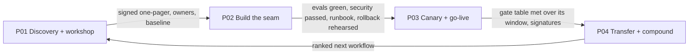
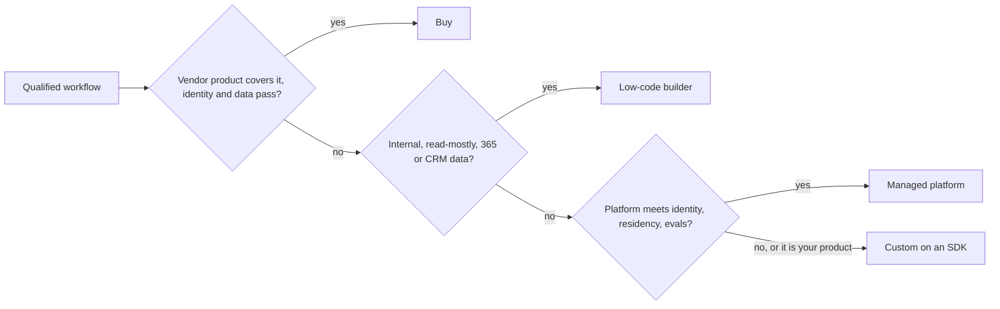

# S00.02: Readiness, Hosting and Platform

Status: **Drafted** (23 October 2026; readiness and hosting consolidated from deployment-workshop and integration-readiness notes, build-buy-platform a first teaching draft; merged into one chapter the same day).

What has to exist before an agent can act, and what you run it on: addressable systems, identity and scopes, data access, approval owners, a stated risk appetite, a hosting topology forced by a named compliance driver, and the buy, low-code, platform or custom decision. S00.01 picks the workflow; this chapter asks whether and where that workflow can actually run.

### What we are trying to avoid

A six-month build that stalls because the payments system has no API and the vendor's roadmap says next year. An agent running as a shared admin account because nobody set up per-user identity. A pilot nobody will approve for production because "acceptable error rate" was never written down. DE customer data processed in a region it was not allowed to leave. "On-premise only" discovered in week six. A twelve-month custom build of what the helpdesk vendor shipped as a feature. A low-code bot that cannot meet the identity or residency requirement found in S00.02. The platform chosen first and the workflow second. A framework picked because the team liked it, with the company's policy logic now living inside it.

### Has this happened?

The MIT NANDA finding of August 2025 (95% of pilots with no measurable return, a learning gap between tools and workflows, bought tools succeeding about twice as often as internal builds) is what readiness failure looks like in aggregate: the seam between the agent and the systems it needs was never owned, so the demo never became a deployment. ([Computing on the MIT report](https://computing.co.uk/news/2025/ai/mit-report-95pc-corporate-generative-ai-pilots-fail), read 23 October 2026.)

## 30-second version

An agent is only as deployable as the seams around it. Before build starts, every system on the workflow map needs an owner and an access class; every write needs an identity model and a reversal owner; every data source needs a lawful basis, a freshness rule and a retention rule; and every launch gate needs a named human who can sign and a named human who can stop. The fastest way to get there is a one-day workshop that traces one workflow to production with the people who can commit in the room. The output is not a plan; it is a name beside every workstream and a date rather than a phase. The scar to avoid: building the demo first and the seam last, because the seam is where the weeks go.

Once the seams above are owned, there are four ways to get the agent: buy a product that already does it, assemble it in a low-code builder, build on a managed agent platform, or build custom on an SDK. The MIT finding in the [section README](../README.md) (externally sourced tools succeeding about twice as often as internal builds) is why this part of the chapter exists: **custom build is the risky default, not the safe one.**

## The readiness checklist

Each row is a gate: clear, blocked, or unknown. "Unknown" is a finding, not a pass.

| Dimension                    | Ready means                                                                                                                                                         | Common gap that stops the project                           |
| ---------------------------- | ------------------------------------------------------------------------------------------------------------------------------------------------------------------- | ----------------------------------------------------------- |
| **Systems addressable**      | Every system on the map has an access class: API, read replica, batch export, event feed, or a bounded, logged, permissioned fallback for legacy with no API        | "There is an API" turns out to mean a vendor roadmap item   |
| **Error shapes known**       | Every pilot-path integration has been called against its _failure_ shape (timeout, partial, ambiguous), not only its happy path                                     | Integration "tested" means one successful call in a sandbox |
| **Identity**                 | Who the agent acts as is decided per tool: the user's delegated identity, a service identity, or a step-up challenge before value-moving actions                    | "The model handles who is allowed to do what"               |
| **Authorisation and scopes** | Scopes per tenant, tool and action; a read tool cannot grant write power; entitlements are enforced in code, not in the prompt                                      | One broad service account shared by every tool              |
| **Data access**              | Lawful basis, classification, residency, retention and freshness are written down per source; PII is redacted before it reaches any log or eval store               | Security discovers the data flow in week six                |
| **Source of truth**          | One authoritative system per fact; documents for explanatory knowledge, typed tools for live state                                                                  | A vector index asked for a balance                          |
| **Write safety**             | Every write has an idempotency key derived from business intent, a reconciliation path, and a named reversal owner (S00.03 Part A)                                         | Timeout treated as failure and retried blind                |
| **Business-logic owner**     | A named role signs what the agent may say and do, per intent, with compliance co-signing anything value-moving                                                      | "The customer will figure it out"                           |
| **Operational owner**        | A named person owns incidents, the rollback lever and the go-live decision; the person who can say go can also say stop                                             | Nobody owns the rollback at 2 a.m.                          |
| **Baseline captured**        | Human resolution rate, repeat contact and handle time captured per intent with the same definitions the agent will be measured on, before the first production call | Baseline reconstructed after launch, and disputed           |
| **Risk appetite stated**     | The customer has said, in writing, which actions the agent may take autonomously, which need approval, and which are excluded                                       | Appetite discovered during the first incident               |
| **Hosting decided**          | The residency and upgrade-control driver is named, and its timeline cost is priced in the room                                                                      | Topology chosen before the compliance driver is known       |

## Access classes for every system

Name the access class before naming the component. Each class has a different cost, latency, freshness and failure story.

*Micro-example.* Tickets live in a SaaS helpdesk with a REST API: direct, and S03.02 wraps it as `get_ticket` and `list_tickets`. Policies are PDFs on SharePoint: indexed, behind `get_policy` (S06). Refunds are issued in a payments back office with no API: closed, so `issue_refund` waits and month one recommends refunds for a human to issue. The browser-automation shortcut through the payments UI is refused: it breaks on the next UI release and cannot be audited.

| Access class                             | What you get                                                                  | Freshness      | Typical cost                   | When it is the honest answer                                                                           |
| ---------------------------------------- | ----------------------------------------------------------------------------- | -------------- | ------------------------------ | ------------------------------------------------------------------------------------------------------ |
| **Direct API (read/write)**              | Live state and controlled actions                                             | Real time      | Integration effort, auth setup | The system of record exposes it and the owner will grant scopes                                        |
| **Read replica or reporting DB**         | Live-ish reads, no writes                                                     | Minutes        | Low                            | Reads dominate and the write path is out of pilot scope                                                |
| **Batch export or event feed**           | Periodic snapshots or change events                                           | Hours to a day | Low                            | Knowledge refresh, not transactional state                                                             |
| **Bounded computer use on a managed VM** | A legacy UI with no API, operated under a logged, permissioned, narrow script | Real time      | High and fragile               | The no-API step blocks a workflow that is otherwise ready, and the customer accepts the operating cost |
| **Human in the loop**                    | A queue item for a person                                                     | Human latency  | Human time                     | The write is excluded from automation by risk appetite                                                 |

"We wait for the vendor's API roadmap" is a deferral, not an answer. If the no-API step is on the critical path, price the bounded fallback or move the step out of pilot scope explicitly.

## Identity: three questions per tool

1. **Whose identity does this call carry?** The end user's delegated identity (on-behalf-of, OAuth passthrough) when the backend enforces per-user entitlements; the agent's own service identity when the action is the system's, not the user's. Never a shared super-user that makes every tool call look the same in the audit log. (S03.03 covers the MCP mechanics.)
2. **What scope does it need, at minimum?** Scopes per tenant, per tool, per action. Split unrelated read and write modes rather than granting write access to read-only callers.
3. **Where is the step-up?** Place one step-up challenge (OTP, re-authentication) before the first value-moving action, not at the start of every session. Verify the caller, bind the verification to a scope, and never downgrade the authentication bar to keep containment numbers up.

The rule that generalises: **authority is never a prompt.** The model may ask for anything; only deterministic code holding the scope, the cap and the audit line may do it.

*Micro-example.* Ayşe asks the agent to issue a refund. Acting as Ayşe, `issue_refund` fails with `403` because her token lacks `tickets.refund`, and the agent routes to Mert. Acting as a shared service account it succeeds, and the audit log says "the agent did it", with nobody accountable.

**Interview line.** "Three questions per tool: whose identity does the call carry, what is the minimum scope, and where is the single step-up before the first value-moving action."

**Study check.** Why not put the step-up at the start of every session? **Answer.** It taxes the read-only majority with friction they do not need and tempts the team to lower the bar to protect containment; one challenge before the first value-moving action, bound to a scope, protects what matters at the moment it matters.

**Rule to keep:** authority is never a prompt.

## Data: what must be written down per source

| Property                        | Why it blocks                                                                                                                                                                       |
| ------------------------------- | ----------------------------------------------------------------------------------------------------------------------------------------------------------------------------------- |
| Lawful basis and classification | Security review will not pass a flow it cannot classify                                                                                                                             |
| Residency                       | Decides the hosting topology and can cost weeks                                                                                                                                     |
| Retention                       | Transcripts for QA sampling versus a 30-day deletion policy is a real conflict                                                                                                      |
| Freshness and lineage           | A stale policy document answered confidently is an incident                                                                                                                         |
| Entitlement propagation         | Can the user's permissions be preserved through retrieval, or does the index flatten them? If flattened, retrieval is not allowed over that source (S06 covers ACL-aware retrieval) |
| Redaction boundary              | PII redacted before it reaches any log, trace or eval store; raw payloads off by default, break-glass with audit                                                                    |

## Owners: the named sign-off matrix

An unnamed sign-off is an unscheduled sign-off; the week it appears is the week you slip. Six workstreams recur in almost every operations deployment. Each needs a role, the evidence that clears it, and a due point relative to the rollout.

| Workstream                     | Owner role                                      | Evidence that clears it                                                                                               | Due                           |
| ------------------------------ | ----------------------------------------------- | --------------------------------------------------------------------------------------------------------------------- | ----------------------------- |
| **Telephony / channel**        | Contact-centre or channel platform owner        | Routing change accepted in a test queue, reporting parity, rollback route retained                                    | Before canary                 |
| **Security review**            | CISO delegate / security architect              | Data-flow diagram with every external hop, PII handling, retention table, residency decision; zero open high findings | Before canary                 |
| **Knowledge base**             | Service-line knowledge owner                    | Source-of-truth content identified, ownership named, refresh cadence agreed, cited answers on a golden set            | Before eval gate              |
| **Business-logic sign-off**    | Head of the service line, compliance co-signing | Signed intent scope: what the agent may say, may do, must escalate                                                    | Before eval gate              |
| **Procurement / legal**        | Procurement lead + legal                        | Contract, data-processing agreement, hosting model, exit and deletion terms                                           | Before integration acceptance |
| **Final operational decision** | Operations director / service owner             | Written expand, hold or roll-back decision against the canary numbers, plus a rehearsed rollback                      | End of canary                 |

Two rules: the person who can say go must be the person who can say stop; and if nobody will put a name against a gate, that gate is not ready and the pilot scope shrinks to what is signed.

## The one-day deployment workshop

The fastest known way to convert discovery into readiness is a single day with decision authority in the room. The shape that works:

| When             | What                                                         | Why                                                                                           |
| ---------------- | ------------------------------------------------------------ | --------------------------------------------------------------------------------------------- |
| 09:00–10:00      | Executive sponsor and CTO present                            | Authority in the room at the start makes the day's decisions binding rather than advisory     |
| First 30 minutes | Reset the room                                               | Strip the assumed solution back to the workflow; nobody designs before the reset lands        |
| 10:00–14:00      | Split by team: operations, infrastructure, channel/telephony | Each team owns a different truth; splitting surfaces the contradictions a joint session hides |
| Across the day   | Trace ONE workflow all the way to production                 | Depth on one path beats a survey of ten; the traced workflow becomes the pilot                |
| 14:00–15:00      | Sponsor and CTO return                                       | Decisions made in the split sessions get committed by the people who can commit them          |

Walk out with three things: one workflow traced end to end with every system named; a name beside every workstream in the matrix above; and a date, not a phase. Processes quoted at two months routinely find owners willing to commit to two weeks once the right people are in the same room.

*Where it goes wrong.* The sponsor sends delegates. The split sessions produce findings, nobody in the room can commit, and the "date" becomes a phase by the following Monday. If authority will not attend, move the day.

**Interview line.** "One day, one workflow traced to production, with the people who can commit in the room; we leave with a name beside every workstream and a date instead of a phase."

**Study check.** What are the three outputs of the workshop? **Answer.** One workflow traced end to end with every system named; a named owner per workstream in the sign-off matrix; and a date for each, not a phase.

**Rule to keep:** a team name is not an owner.

## Hosting as a readiness input

Pick the topology from the residency and upgrade-control driver, then price it against the timeline out loud. Naming a topology without naming the compliance driver that forced it is the trap.

| Model                | Operator                            | Timeline        | Cost shape                                                | When                                                                               |
| -------------------- | ----------------------------------- | --------------- | --------------------------------------------------------- | ---------------------------------------------------------------------------------- |
| Multi-tenant managed | Vendor                              | Days            | Lowest; shared platform economics                         | No residency constraint, standard data classification, speed matters most          |
| Single-tenant        | Vendor, isolated per customer       | 1–2 weeks       | Moderate; dedicated infrastructure                        | Isolation required, residency satisfiable by region, upgrades still vendor-managed |
| Bring your own cloud | Customer's account, vendor software | 2–4 weeks       | Customer carries infrastructure; integration effort rises | Security posture requires the customer's own account, network and key management   |
| On-premise           | Customer                            | Weeks, not days | Highest; customer owns serving, patching, upgrade cadence | Regulatory or CISO mandate that data and model serving never leave the estate      |

When the security lead says "on-premise only", it costs weeks. Say so in the room rather than discovering it in week six. The usual counter-proposal for a regulated pilot is single-tenant in an in-country region with a documented on-premise migration path. If on-premise is non-negotiable, re-baseline the date publicly rather than compress the security review. S01.07 covers the deployment topologies in detail.

## Phase gates from discovery to go-live

Each arrow is an exit condition with evidence; no baseline, no gate.

| Phase | Work | Exit |
| --- | --- | --- |
| P01 Discovery + workshop | Operational truth (transcripts, volumes, handle time, systems map); one workflow chosen by volume × repeatability × implementability; named owners for security, business logic, rollback; eligibility predicate written | Signed one-pager, owner list, baseline numbers agreed |
| P02 Build the seam | Integrations first, not the demo; evals seeded from 50–100 real cases; guardrails in the executor; traces wired; security pack drafted early (data-flow diagram, retention, terms) | Eval suite green on the golden set; security review passed; runbook with degraded modes; rollback rehearsed |
| P03 Canary + go-live | A traffic slice, not a switch; dashboards live (containment, handoff quality, tool errors, drift); sign-off chain executes | Gate table met over its window; signatures collected; next widening scheduled with its own numbers |
| P04 Transfer + compound | The customer team co-built, so handover is a formality: playbooks, eval ownership, escalation runbook, ranked next-workflow list | Customer owners run a game day without the builders (S00.03 Part B) |

S00.03 Part B carries the gate numbers, rollback triggers and the capability-transfer test.

## Build, buy or platform: the four options

| Option | What you get | What you give up | Fits when |
| --- | --- | --- | --- |
| Buy a product | The vendor's agent inside the tool you already use (helpdesk AI, CRM agents) | Control over tools, evals, identity model, data path | The task is the vendor's core case and the data already lives there |
| Low-code builder | Copilot Studio, Agentforce, Dialogflow-style: connectors, approvals, hosting | Deep tool design, custom evals, cost control at scale | Internal, read-mostly, Microsoft 365 or Salesforce-shaped data |
| Managed platform | Foundry Agent Service, Bedrock AgentCore, Vertex Agent Builder: runtime, identity, MCP tools, tracing | Some portability; some control over the loop | Enterprise identity and residency matter; you own tools and evals |
| Custom on an SDK | OpenAI Agents SDK, Microsoft Agent Framework, LangGraph on your own compute | Everything the platform did: hosting, identity, sessions, approvals | A product you sell; requirements the platforms cannot meet; you have a platform team |

**Start from the top row and move down only when a criterion forces you**, which is the opposite of what engineering teams want to do.

## The build-or-buy decision criteria

### Six criteria, in the order they usually decide

1. **Identity and data residency.** Does the option run as the user with your IdP, in your region? Bought products and low-code often fail here first (hosting table above).
2. **Tool control.** Can you define the tools (S03.04) and the trust boundary (S03.06), or do you inherit the vendor's?
3. **Evaluation.** Can you run your own evals (S05) against it, with traces you can read?
4. **Cost at volume.** Per-seat pricing wins at forty users and loses at forty thousand conversations a day; per-token wins the other way round.
5. **Change speed.** How fast can you change a tool contract, a cap or a policy, and who can?
6. **Exit.** What leaves with you: prompts, tools, eval sets, traces.

### The decision flow

Every question is about identity, data, tools and evals; none is about which model is best, because the model is a swap at every level.

*Micro-example.* The refund-recommendation agent from the running example. The helpdesk vendor's AI drafts replies but cannot read the payments record or enforce the GBP 500 cap, so Buy fails on tool control. Copilot Studio can call the ticket API through a connector, but binding Mert's approval to the exact amount and keeping DE data in region is awkward, so low-code is marginal. Foundry Agent Service with Entra agent identity, the S03.02 MCP server for tickets and `require_approval` on `issue_refund` passes all six. Custom would win only if the company sold support software.

*Where it goes wrong.* The team picks custom because "we need control", then spends the first quarter building sessions, an approval UI and tracing that the platform shipped on day one.

## When a chatbot product is enough

If the task is **answer questions from a document set, read-only, for internal users**, a product or a low-code bot grounded on the documents is the right answer and an agent platform is overkill. The test: no writes, no per-user data, and a wrong answer costs a follow-up question rather than money.

*When not to.* The moment the bot is customer-facing and its answers carry commitments (fares, refunds, eligibility), the Air Canada case applies: grounding, citation of the governing policy and a refusal path become requirements, and "it's just a chatbot" stops being true. S00.03 Part A prices that as an irrecoverable-trust failure on a read.

## Keeping policy out of the framework

Whatever you choose, **your policy lives in your code or your policy engine, not in the vendor's prompt box**. The GBP 500 cap, the GBP-only rule and the approval binding are checked by the server (S03.03's `check_refund_policy`) so they survive a platform change. The platform gets the loop, identity, hosting and tracing; you keep tools, policy and evals. This is S00.03 Part A's "the prompt persuades, the executor enforces" applied to the buying decision.

## Platform mapping

| Need | Foundry | Bedrock AgentCore | Vertex | Custom (OpenAI Agents SDK, Agent Framework) |
| --- | --- | --- | --- | --- |
| Agent identity | Entra agent identity, project connections | AgentCore Identity | Service agents, IAM | Yours to build |
| MCP tools | MCP tool with `allowed_tools`, `require_approval` | Gateway | ADK tools, MCP | SDK MCP clients |
| Approvals | `mcp_approval_request` | Cedar policy and callbacks | Callbacks | Middleware or callbacks |
| Tracing | Foundry tracing, Application Insights | CloudWatch, OTel | Cloud Trace | OTel exporters |

From general knowledge as of October 2026; S01.07 and S03.03b fetch and date the specifics.

**Interview line.** "I start from buy and move towards build only when identity, residency, tool control or evals force me; a platform gives me the loop and the identity for free, and I keep tools, policy and evals as mine so I can leave."

**Study check.** An internal team wants an agent that answers HR policy questions from the intranet. Which option, and what would change your answer? **Answer.** A low-code or bought bot grounded on the documents, read-only. The answer changes if it must act (open a leave request as the user), if answers carry commitments to employees in a regulated area, or if the documents cannot leave a region the product does not serve.

**Rule to keep:** buy first, platform second, custom last; policy stays in your code whichever you pick.

## Traps

- **Demo first, seam last.** The integration, identity and security work is where the weeks go; a demo that works against a stub proves nothing about readiness.
- **"There is an API."** Verify the access class, the scopes, the owner who grants them, and the error shape.
- **Authority in the prompt.** Entitlements, caps and approvals live in the executor.
- **Baseline after launch.** Capture it with the launch definitions before the first production call; it is unrepeatable afterwards.
- **Unowned gates.** A team name is not an owner. Ask for a role, then a person.
- **Topology before driver.** Residency and upgrade control decide hosting; prestige does not.
- **Silent constraint acceptance.** Price every constraint in weeks, in the room, when it is raised.
- **Custom build as the safe default.** Buy first, platform second, custom last; the MIT finding runs the other way from engineering instinct.
- **Policy in the vendor's prompt box.** Caps and approvals live in your code so they survive a platform change.

## What this is not

Not the identity design (S03.03, S08), not the data platform (S06), not the deployment topology in detail (S01.07) and not the framework comparison (S04.08). It finds the gaps, names their owners and picks the layer you build on.

## Related chapters

- [S00.01 Use-Case Discovery and Qualification](../S00.01-Use-Case-Discovery-and-Qualification/README.md): the hard gates this checklist operationalises.
- [S00.03 Economics: Action Risk and the Business Case](../S00.03-Economics-Action-Risk-and-Business-Case/README.md): write safety, gate numbers, rollback triggers, ownership after launch.
- [S01.05 Multi-Tenancy and Identity Propagation](../../S01-Production-AI-Application-Architecture/S01.05-Multi-Tenancy-and-Identity-Propagation/README.md) and [S01.07 Deployment Topologies](../../S01-Production-AI-Application-Architecture/S01.07-Deployment-Topologies/README.md).
- [S03.03 MCP OAuth 2.1](../../S03-AI-Agents-Tools-and-MCP/S03.03-MCP-OAuth2.1/README.md): the identity mechanics for tools.
- [S04.08 Frameworks and Runtimes](../../S04-Agentic-Workflows-and-Harnesses/S04.08-Frameworks-and-Runtimes/README.md): the SDK and runtime comparison behind the custom option.

## Sources

Carried from the consolidated notes; not re-fetched on 23 October 2026, so verify before quoting. The MIT story above was fetched that day.

- Wonderful, [Deployment](https://www.wonderful.ai/deployment) and [We walked out with a real deployment path](https://www.wonderful.ai/blog-articles/we-walked-out-with-a-real-deployment-path): first-party account of the one-day workshop and the six workstreams.
- Wonderful, [The hard part of AI agents isn't building them](https://www.wonderful.ai/mena/blog-articles/the-hard-part-of-ai-agents-isn%E2%80%99t-building-them): operating agents inside real workflows.
- AWS Prescriptive Guidance, [Generative AI workload assessment](https://docs.aws.amazon.com/prescriptive-guidance/latest/gen-ai-workload-assessment/best-practices.html): readiness and prerequisites.
- NIST, [AI Risk Management Framework](https://www.nist.gov/itl/ai-risk-management-framework): governance framing across design, deployment and operation.
- MIT NANDA, *The GenAI Divide* (August 2025), via the section README: the bought-versus-built success gap.
- Vendor pages for Foundry Agent Service, Bedrock AgentCore, Vertex Agent Builder and Copilot Studio: fetch and date before an engagement; S03.03b holds the Foundry MCP digest.

[Back to S00](../README.md)
