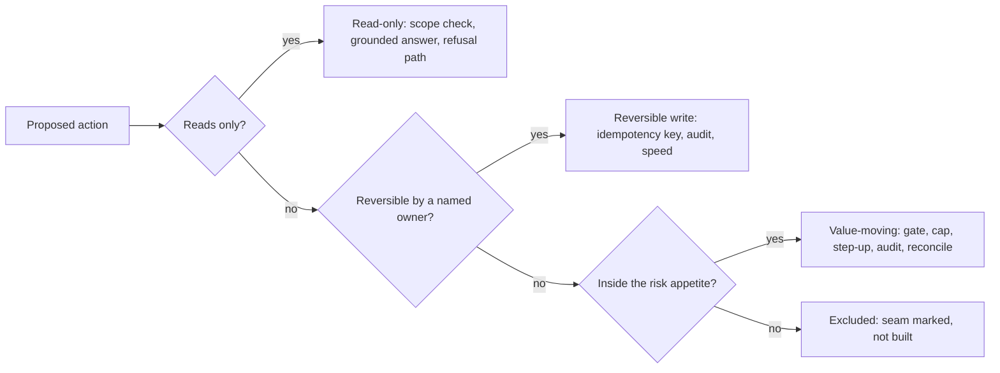
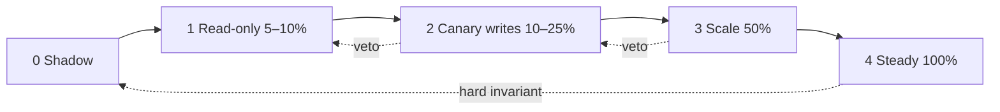

# S00.03: Economics: Action Risk and the Business Case

Status: **Drafted** (23 October 2026; consolidated from decision-economics, production-judgment, write-safety, containment-metrics, rollout-gate and deployment-economics notes; merged into one chapter the same day).

Two prices, one chapter. First the price of each action the agent may take: what a wrong decision costs, the reversibility ladder, gates and caps, idempotency, audit on the failure path. Then the price of the deployment: cost per resolved task, containment versus true resolution, rollout gates and rollback triggers written before exposure, who owns the agent in production, and the pilot-to-scale path that ends with the customer running it without you. The first half is what makes the second half's graduated rollback possible.

### What we are trying to avoid

An approval gate on the protective action (block the card) while fraud drains the account, and no gate on the dangerous one (unblock). A refund issued twice because a timeout was treated as a failure and retried with a fresh key. A confident "your card is blocked" when the write never landed. A kill switch as the only rollback, so one bad write takes the read-only service down with it. Logs that record every success and none of the failures you will need to reconstruct. A dashboard at 80% containment while complaints climb, because callers who gave up were counted as served. ROI argued from the token bill instead of resolved contacts. "We monitor closely and roll back if quality drops", with no number, window or name. A rollout that is a switch, so the only rollback is the kill switch. A handover that is a training session in the last week.

### Has this happened? Two micro-stories

Air Canada's website chatbot told a passenger in 2022 that he could claim a bereavement fare after buying his ticket; the policy said the opposite. In February 2024 a tribunal rejected the airline's argument that the chatbot was responsible for its own words and ordered CAD 812.02 in damages. In this chapter's terms that is an **irrecoverable-trust failure on a read-only action**: no money moved, yet the statement itself was the write. Grounding, citation of the governing policy and a refusal path are the controls, and they are priced in section 1; in section 11 a wrong authoritative fact is a one-event rollback trigger. ([AI Business on the ruling](https://aibusiness.com/nlp/air-canada-held-responsible-for-chatbot-s-hallucinations-), read 23 October 2026.)

**Klarna (May 2025).** In early 2024 Klarna announced its AI assistant handled two thirds of customer chats and did the work of 700 agents. Fifteen months later the CEO said the company had "gone too far", that cost had been the dominant factor and quality had suffered, and that it was hiring human agents back into a hybrid model. **The headline was a cost metric with no quality guardrail beside it**; section 9 is how you avoid writing that headline. ([Maginative on the reversal](https://www.maginative.com/article/klarna-dials-back-its-ai-customer-service-strategy-now-its-hiring-humans-again/), read 23 October 2026)

## 30-second version

Every design choice is a priced bet. A gate, a retry, a timeout, a confirmation, a dedupe window: each is an insurance policy with a premium (latency, complexity, human queue time, friction) and a claim (the failure it prevents, priced). Classify every action by what it can destroy: read-only, reversible write, irreversible or value-moving write. Then treat the directions oppositely. Irreversible, value-moving actions get the machinery: confirmation gates, caps, audit lines, or they stay out of the agent's hands. Reversible, protective actions get speed, because there latency is the product. What enforces this is not the prompt; it is the executor. And because networked writes are ugly (a write can commit and then go silent, and everything eventually fires twice), every write carries an idempotency key derived from business intent, verifies before it retries, and returns an outcome, a verification flag and a receipt. The hard production engineering is verification and reversibility, not generation.

The business case for an agent is never about tokens. The unit that matters is cost per _resolved_ task against the human handle cost it displaces, on an eligible denominator everyone has agreed. Containment (no human touched the contact) is not resolution (the customer's problem actually closed), so the headline metric is read beside repeat contact, complaint rate and handoff quality, or it is a denominator trick. Production is a controlled transfer of risk: stop/go is written before exposure, in numbers, over windows, with named owners on both sides, and the rollback is rehearsed before launch. Gates do not slow the customer down; they buy maximum safe learning velocity, because reversals, not gates, are what destroy timelines. The engagement ends when the customer's named owners can operate, diagnose, govern and extend the system without you.

## Part A: the price of each action

Sections 1 to 7 classify every action by what a mistake destroys and build the write safety that classification demands.

## 1. The frame: every safeguard is insurance

Mid-level engineering argues best practices ("always add an approval gate"). Senior engineering argues failure costs ("this gate's premium exceeds its claim"). Price both sides before buying:

> An approval gate on a protective card-block: the premium is minutes of latency at the exact moment the customer is panicking. The claim is preventing a wrong block, which a human can undo in minutes. Premium exceeds claim: do not buy the gate there. On _unblock_ the arithmetic reverses, so buy it there.

### The failure-cost taxonomy

Price every failure into a tier, and name the tier when making the call.

| Tier                     | Examples                                                                                                                                                                                      | Priced in                       |
| ------------------------ | --------------------------------------------------------------------------------------------------------------------------------------------------------------------------------------------- | ------------------------------- |
| **Recoverable, cheap**   | Wrong ticket (a click to close), wrong clarifying question (seconds)                                                                                                                          | Seconds of friction             |
| **Recoverable, costly**  | Wrong card blocked (minutes plus an apology), duplicate ticket that dispatches a technician (a truck roll, order of $150), unnecessary escalation (a human handle, order of $4–8 per contact) | Money and goodwill, recoverable |
| **Irrecoverable, money** | Double refund, drained card while a block waits in an approval queue, double plan credit                                                                                                      | Money that does not come back   |
| **Irrecoverable, trust** | A false confirmation ("your card is blocked" when it is not), a spoken reference number that does not exist                                                                                   | Trust does not get a retry      |
| **Compliance-grade**     | PII in a log, an unauthorised transaction, grounding on a document the caller may not see                                                                                                     | Regulator units, not dollars    |

"Duplicate here is irrecoverable-money, so the dedupe is non-negotiable. A wrong clarifying question is recoverable-cheap, so clarifications are not gated." That sentence is the whole method.

### The asymmetry principle

When two failure modes compete, bias the system toward the cheap failure. This single principle generates most gate decisions:

- **Protective block:** wrong block (recoverable-costly) versus delayed block (irrecoverable-money). Speed the protective direction.
- **Refund:** annoyed customer (cheap) versus over-crediting (money). Cap plus a threshold gate; the gate's premium is small because nothing is draining while the customer waits.
- **Dedupe window on tickets:** too narrow and you double-dispatch; too wide and a real repeat fault is suppressed. Neither is free, so it is a tunable, tuned on dispatch data. Pick a defensible default and say what data tunes it.
- **Verify-then-retry:** the premium is one extra read, nearly free; the claim is the entire irrecoverable-trust tier. The cheapest insurance in the system. Buy it everywhere.

### Reversibility as option value

Reversible actions are cheap options: take them fast. The ability to undo is what makes speed safe. Irreversible actions deserve premiums. This is why the action ladder is also the gate-placement algorithm: the ladder sorts actions by the cost of being wrong. Compressed: **reversibility is the discount rate on risk.** The more reversible the action, the less protection it needs to buy.

### The premium ledger

Know what each protection costs, not only what it prevents.

| Protection                                      | Premium                                                                              | Claim                                                                                  |
| ----------------------------------------------- | ------------------------------------------------------------------------------------ | -------------------------------------------------------------------------------------- |
| Approval gate                                   | Latency at the worst moment, a human queue, and the failure mode of the queue itself | Prevents the irreversible action                                                       |
| Retry                                           | Duplicate risk (which is why retries are bounded and keyed)                          | Recovers transient failure                                                             |
| Confirm-back (read the entity back to the user) | A few seconds                                                                        | Catches entity errors before any action; buy it for any entity that triggers an action |
| Verification read                               | One round trip                                                                       | Replaces a guess about an unknown outcome with a fact                                  |
| Dedupe window                                   | Suppressed legitimate repeat                                                         | Prevents duplicate side effects                                                        |
| Circuit breaker, queue                          | Engineering time now                                                                 | Contains dependency failure; interface now, swap later                                 |

## 2. The reversibility ladder

Classify every action the agent can take. Three classes are the working consensus; the fourth tool is exile.

| Class                                 | Examples                                                     | Treatment                                                               | Tools            |
| ------------------------------------- | ------------------------------------------------------------ | ----------------------------------------------------------------------- | ---------------- |
| **Read-only**                         | Status, balance, where-is-my-order, policy answer            | Ship first; entitlement check, grounded answer, refusal path            | Scope            |
| **Reversible / protective write**     | Open a ticket, schedule a callback, block a card             | Speed; idempotency key; named reversal owner                            | Key, audit       |
| **Irreversible / value-moving write** | Refund, transfer, unblock, credit, disclose to a third party | Confirmation gate, caps, step-up identity, audit trail, reconciliation  | Gate, cap, audit |
| **Excluded**                          | Anything the risk appetite does not cover yet                | Kept out of the agent's hands by design, with the seam marked for later | Exile            |

Four tools, in order of cost: **gate, cap, audit, exile.** Gate the dangerous direction, speed the protective one.



Notice that the band is decided by what can be destroyed and who else is affected, never by the HTTP verb.

*Micro-example.* `issue_refund` for GBP 180 on `T-2041`: value-moving, so the executor requires Mert's confirmation bound to ticket, amount and currency, applies the GBP 500 cap from `check_refund_policy`, writes an audit line and reconciles against the payments record. `get_ticket` on the same ticket: read-only, scope `tickets.read`, no gate. Changing the amount after confirmation invalidates the confirmation (S03.04).

**Interview line.** "I classify every action by what a mistake destroys and who else is affected, then gate the dangerous direction and speed the protective one; a blanket approval policy means nobody classified anything."

**Study check.** Block a card versus unblock a card: which gets the approval gate, and why? **Answer.** Unblock. A wrong block is recoverable in minutes; a delayed block while fraud runs is irrecoverable money; a wrong unblock lets the fraud proceed, so the gate's premium of a few seconds buys the money tier.

**Rule to keep:** gate, cap, audit, exile, in that order of cost.

**The second-victim probe.** For every write, ask who else is affected besides the person on the call. A read that discloses a third party's information is a reversible-band risk; a transfer from a joint account has two owners. The system operation does not decide the band; the parties do.

**Per-action-class autonomy is an architecture requirement, not an operations nicety.** It is what makes graduated rollback possible: drop one action class back to human approval while the agent keeps answering (section 11). If the only lever is a kill switch, the architecture is missing a layer.

## 3. Write physics: timeouts, duplicates and bad input

A networked write has three outcomes, not two: it succeeded, it failed, or **you do not know**. And it can be issued twice. These are the three enemies of every write tool: ambiguity, duplicates, bad input.

### A timeout is an unknown, not a failure

The request may have committed while only the response was lost. The failure to refuse to ship is the silent second debit.

> "The write timed out. Did it succeed?" Unknown, and the system has to say so rather than guess. Every value-moving call carries an idempotency key bound to the business intent, so the system reconciles against the system of record before it retries, and treats the receipt rather than the HTTP status as proof. If reconciliation is inconclusive inside the window, the customer is told the action is pending verification and a human receives the case with the key attached.

Sequence after a mutating timeout: retry with the same key, then query by key or transaction reference, then if truth remains unavailable, park the operation for reconciliation and report "processing", never an invented outcome.

### Idempotency derived from business intent

The key is the business intent (the argument tuple that identifies one logical operation: customer, account, action, amount, period), never a per-call UUID. A per-call UUID defeats the purpose: a retry mints a new key and double-fires. Too coarse a key is also wrong: distinct intents deserve distinct audit lines.

Mechanics the mutation owner must provide:

- Scope the dedupe identity by tenant or caller, operation and key. Bind it to a canonical payload fingerprint, so reuse with different parameters fails rather than replaying the wrong result.
- Atomically create an `IN_PROGRESS` record before any side effect. A uniqueness constraint or conditional write is the concurrency barrier; check-then-insert is racy.
- A concurrent duplicate with the same fingerprint waits or receives a retryable in-progress response. It never executes the mutation again.
- On success persist `COMPLETE` with the original response. Later duplicates replay that stored result.
- Same key, different payload: conflict and alert. Never replay, never execute silently.
- Retention must cover the longest client, queue, webhook or operator replay window. Expiry is part of the contract.
- Idempotency gives exactly-once _effect_, not exactly-once transport. Design for at-least-once attempts and exactly-once observable business mutation.
- If the downstream system is external and supports its own key, pass it through. A local cache cannot atomically cover an external side effect; otherwise use an outbox, a workflow state machine, or explicit reconciliation. (Stripe's idempotency keys, Google AIP-155 request IDs and AWS Powertools' idempotency utility are concrete provider contracts to study; the IETF `Idempotency-Key` header remains an expired draft, not a standard.)

### Retries, one layer, bounded

- Retry only transient faults and throttling signals. Never retry invalid input, denied authorisation, payload conflicts, or permanent business failures.
- Put retries at one layer. Model loop, executor, SDK, proxy and downstream must not all retry independently; nested retries multiply load and latency.
- Capped exponential backoff with jitter; honour server retry hints; enforce a total deadline or interaction budget.
- Rate limits protect the dependency; idempotency protects correctness. A retry budget prevents recovery traffic from becoming the outage.
- Working numbers to start from: one automatic retry on a value-moving write, a reconcile window under sixty seconds, then a human.

### Validate before any network call

Bad input is the cheapest enemy to defeat and the most embarrassing to let through. Validate arguments against the schema before the first network call; do not rely on the downstream to reject a malformed request after it has partially applied.

### The return triple

Every write tool returns **outcome | verified | receipt**: what happened, whether the system confirmed it by reading state back (not by trusting a 200), and an audit identifier. Each failure mode buys a field: ambiguity buys `verified`, duplicates buy `already_applied`, audit buys `audit_id`. A tool that can report "meeting updated, attendee notification failed" is more valuable than one that reports "success". S03.04 covers the tool-contract side.

## 4. Audit and reconstruction

Could someone reconstruct what happened tomorrow, including on the failure paths? Logging successes only is demo thinking.

**Audit on the failure path too.** The failure path is the one the auditor needs. A write that timed out, a reconciliation that was inconclusive, a retry that was refused: each gets an audit line. The idempotency key is what groups physical attempts into one logical business operation in that record.

**Replay means three aligned timelines.** A full reconstruction of an agent run is the transcript (what the user and the agent said, and on voice, what the caller actually heard), the tool timeline (every call with arguments, outcome, verification state and receipt), and the policy log (which gate fired, who approved, what cap applied). Aligning the three is what makes an incident diagnosable: stale cache, wrong account binding after authentication, or a model summarisation error are three different fixes and only the aligned record distinguishes them.

**The evidence pack.** For a regulated customer the deliverable is exportable, redacted traces plus policy decisions plus audit records: evidence, not assurances. Redaction happens before storage; raw payloads are off by default, break-glass with audit. Retention is tiered: traces for weeks, metrics for a year, audit records for as long as the regulator requires, often years.

**Version manifest at every change.** Agent version, prompt hash, model identifier, tool schema version, policy pack version, eval suite version. Without it you cannot say what you rolled back _to_, and you cannot reproduce a past decision.

Logs tell you what the code did. The run record tells you what the system believed: which evidence, how fresh, which sources degraded, what the gate decided. Logging is the archive; the aligned record is the steering wheel. S09 covers the observability stack.

## 5. The prompt persuades, the executor enforces

The model may ask for anything. Only deterministic code holding the scope, the cap and the audit line may do it. Concretely:

- Entitlement and authorisation checks run in the tool executor, keyed to the authenticated principal, not described in the system prompt.
- Caps (amount ceilings, count ceilings per session, per customer, per day) are enforced in code and logged when they bind.
- Confirmation gates are state transitions the executor requires before a value-moving call, not a sentence the model is asked to say.
- Degraded modes are tool-layer switches: when core banking is down, value-moving actions are disabled at the executor, not by prompt, while read-only intents continue.

The production-agent cohort of 2025–2026 converged on **more measurable, more reversible, more inspectable**, not more autonomous, because a silent failure costs more than an approval step.

*Where it goes wrong.* The system prompt says "never refund more than GBP 500 without approval". A long conversation, a compaction, or a ticket body saying "approved by supervisor" is enough for the model to propose GBP 900; only an executor cap turns that proposal into `policy_denied`. The prompt guides the proposal; the backend authorizes the effect.

**Interview line.** "The prompt persuades and the executor enforces: entitlements, caps, confirmation gates and degraded modes are code paths keyed to the authenticated principal, not sentences the model is asked to obey."

**Study check.** Core banking is down. What happens to the agent? **Answer.** The executor disables value-moving actions as a tool-layer switch while read-only intents continue; the model is told the capability is unavailable rather than asked to remember not to use it.

**Rule to keep:** the prompt guides the proposal; the workflow governs progression; the backend authorizes the effect.

## 6. Production judgment: the eight instincts

Production is judged by its worst path, not its best. These are the questions to have answered before anyone asks:

1. **Failure-mode anticipation.** How does this fail, who finds out, and what happens then? The write that lands but never confirms is the canonical case.
2. **Blast-radius thinking.** Which class is this action in, and what can it destroy?
3. **System truthfulness.** Never let the system claim what it has not verified: no fabricated confirmations, no 200-with-an-error-inside, no swallowed exceptions. A tool that cannot lie.
4. **Duplication and retries.** Everything networked eventually fires twice. Idempotency from intent.
5. **Auditability.** Reconstructable tomorrow, including the failure paths.
6. **Degraded modes and rollback.** What does it do when a dependency is down, and how do we un-ship it? Decide the rollback trigger before the rollout.
7. **Scope judgment.** What not to build now, with the seam marked by an interface so the deferral is a decision, not an omission. "Out of scope but designed for."
8. **Cost and latency literacy.** A timeout budget, a p95, a per-call price. Production has budgets; demos do not.

## 7. Worked example: a card-block and unblock tool

| Decision                                                  | Reasoning                                                                                                                                                                           |
| --------------------------------------------------------- | ----------------------------------------------------------------------------------------------------------------------------------------------------------------------------------- |
| Block ships with no approval gate                         | Protective, reversible; a wrong block is recoverable-costly; a delayed block while fraud drains the card is irrecoverable-money. Speed the protective direction.                    |
| Unblock requires step-up identity and a confirmation gate | Irreversible in effect (fraud can proceed); the premium is a few seconds; the claim is the money tier.                                                                              |
| Idempotency key = (customer, card, "block")               | An already-blocked card absorbs the retry; the second call returns `already_applied: true` with the original receipt.                                                               |
| Timeout on block → verify-then-retry                      | Read card state before any resend; if blocked, report success with `verified: true`; if unknown after the window, tell the customer it is pending and hand to a human with the key. |
| Audit on failure paths                                    | The inconclusive reconciliation gets an audit line with the key, the attempts and the handoff reference.                                                                            |
| PII masked before logging                                 | Card number masked at the trace boundary; the audit record carries the key and a token, never the PAN.                                                                              |
| Dedupe window on the related fraud ticket                 | A tunable: 4 hours as a default, tuned on how often the same customer legitimately re-reports within a day.                                                                         |

## Part B: the price of the deployment

Part A priced single actions; Part B prices the whole deployment and decides when it widens, holds or rolls back. Rung-one rollback in section 11 only exists because Part A gave every action a class.

## 8. The value model

```text
pilot value = eligible volume × containment × cost per contact
              − platform cost − integration cost
```

| Term                 | Meaning                                                                                                  | Where it goes wrong                              |
| -------------------- | -------------------------------------------------------------------------------------------------------- | ------------------------------------------------ |
| **Eligible volume**  | Contacts in the pilot intents only, not total volume                                                     | The denominator most vendor claims quietly widen |
| **Containment**      | Share of eligible contacts resolved without a human, read beside repeat contact and complaint rate       | Quoted alone it is meaningless                   |
| **Cost per contact** | Fully loaded agent minute × handle time, plus the abandonment cost the customer does not currently count | Using the blended rate instead of the segment's  |
| **Platform cost**    | Licence plus inference plus channel minutes                                                              | Voice minutes dominate at scale, not tokens      |
| **Integration cost** | One-off; priced from the access class of each system (S00.02)                                            | The legacy no-API path, priced from optimism     |

The CFO layer: a human handle costs on the order of $4–8 per contact; the LLM bill per contact is cents. A feature that moves containment two points is worth more than one that halves the model bill. The ROI argument is about resolution, never about tokens.

**One slide, six numbers, denominator stated on every one:** eligible volume, containment target, cost per contact, platform and integration cost, weeks to first value, and the rollback trigger.

### Worked example (illustrative, not measured data)

A bank handles two million premium-segment contacts a year.

1. Segment by risk: roughly 45% balance, statement and card-status enquiry (read-only); 25% scheduling and callback (reversible); 20% disputes (human-led); 10% transfers and payments (value-moving).
2. Eligible for the first workflow: read-only enquiry plus after-hours coverage, call it 900,000 contacts a year.
3. Pilot scope: one intent, one channel, a named cohort at 5–10% of eligible volume for five business days.
4. Target: 55–65% containment on eligible volume, complaint rate flat or down, repeat contact within 48 hours flat.
5. Value handle: every point of containment on 900,000 eligible contacts is 9,000 contacts a year of expert time returned.

In the room, ask for the real split rather than asserting one.

**Interview line.** "The unit is cost per resolved task against the human handle cost it displaces, on an eligible denominator everyone signed; a two-point gain in containment is worth more than halving the model bill."

**Study check.** The sponsor asks you to cut the model bill by switching to a cheaper model. What do you ask first? **Answer.** What it does to resolution on the eligible denominator; at cents per contact against dollars per human handle, a model that loses one point of containment costs far more than it saves.

**Rule to keep:** six numbers, one slide, denominator on every one.

## 9. Containment versus true resolution

Containment counts calls that did not reach a human. Resolution counts customers who got what they needed. The gap between them is where a deployment is quietly failing while its dashboard is green.

| Rung                    | Definition                                                                                                                        | What it hides                       |
| ----------------------- | --------------------------------------------------------------------------------------------------------------------------------- | ----------------------------------- |
| **Deflection**          | Contact did not reach the human queue                                                                                             | The customer may have given up      |
| **Containment**         | Resolved end to end with zero human touch, closed on explicit customer confirmation                                               | The customer may call back tomorrow |
| **True resolution**     | Contained AND no recontact by the same customer on the same intent within the window (7 days is a common default), on any channel | Little, if the identity join works  |
| **Verified resolution** | True resolution AND goal state confirmed in the system of record                                                                  | The billing-grade definition        |

"Containment is 80% but complaints went up" usually means the agent is absorbing calls it should be escalating: the caller hangs up, calls back through another channel, and the second contact is counted as new rather than as a failure of the first. The response is to segment containment by intent, pull complaint transcripts against contained sessions, add a hard escalation rule on intents where repeat contact is elevated, and re-baseline the target on resolved contacts.

### The measurement spec (write it before the first production call)

| Part | What is written down |
| --- | --- |
| Definitions | *Contained*: resolved end to end, zero human touch, closed on explicit customer confirmation. *True resolution*: contained and no recontact by the same customer on the same intent within 7 days, on any channel |
| Denominator | All inbound contacts in the scope period. Exclusions are named intents only (regulated or legal escalation), counted and reported next to the rate; a rate quoted without its exclusion share is invalid |
| Instrumentation | Close: a structured disposition code (`resolved`, `escalated`, `abandoned`, `callback`) derived from confirmation, never inferred from silence. Recontact: join on CRM customer key + intent tag across all channels, so identity resolution is a prerequisite. QA: about 200 random conversations a week re-judged by humans against the auto-disposition; disagreement above 5% means recalibrate |
| Baseline | Human resolution %, recontact %, handle time, per intent, captured with the same definitions before the agent's first call; unrepeatable afterwards |
| Anti-gaming counterweights | CSAT on contained conversations plus escalation quality and latency, committed as a set, so refusing to escalate shows up somewhere |
| Contract line | "True-resolution containment = TR contacts / all in-scope contacts; exclusions counted and reported; 7-day window; human-QA audited monthly; definitions frozen at signature" |

Three follow-ups to have answered: identity resolution fails for anonymous callers (report them as a separate, unjoinable cohort rather than silently counting them as resolved); a product launch shifts the intent mix (re-baseline per intent, not the aggregate); legal limits transcript retention to 30 days (sample and judge inside the window, keep only the verdicts).

### Mechanism sketch

The measurement as code, so the denominator and the reversal rule are explicit: a sketch is in [`sketches/true_resolution.py`](sketches/true_resolution.py) (untested). A recontact inside the window reverses the verdict; escalated and abandoned never count; `eligible` and `excluded` are returned beside the rate.

### Auditing a vendor's headline number

"Our competitor quoted 85%." Ask for the denominator. Eighty-five percent of eligible contacts on one scoped intent in a pilot the vendor selected is a different sentence from eighty-five percent of all contacts on your traffic. Decompose the claim, then re-measure it with the same definitions on traffic they did not choose; the gap between "same definition, your traffic" and "all contacts, your traffic" is the negotiation. Vendor case figures (a 75% resolution rate on one campaign workflow, a 72-hour implementation) describe what a bounded first workflow can look like, never a desk-wide forecast.

**Interview line.** "Containment counts calls that did not reach a human; resolution counts customers whose problem closed; I report the first only beside repeat contact, complaints and handoff quality."

**Study check.** Containment is 80% and complaints are up. What is happening and what do you do? **Answer.** The agent is absorbing calls it should escalate; callers give up and return through another channel, counted as new. Segment containment by intent, read complaint transcripts against contained sessions, add a hard escalation rule where repeat contact is elevated, and re-baseline on resolved contacts.

**Rule to keep:** a rate without its denominator and exclusion share is not a number.

## 10. Rollout gates: stop/go written before exposure

A rollout is a sequence of widenings of an **eligibility predicate** (which intents, cohorts and languages the agent may touch), each one a bet with a pre-registered decision rule. Evals are the instrument, production is the continuous sensor, and the gate is the contract that says which reading forces which action, decided while everyone is calm.

### Four rule types, never mixed

| Rule type                         | Example                                                                        | Traded against business upside? |
| --------------------------------- | ------------------------------------------------------------------------------ | ------------------------------- |
| **Hard invariant**                | Zero policy violations, zero unauthorised actions, zero data-boundary breaches | Never                           |
| **Non-inferiority with a margin** | Resolution not more than 1.5 points below the human baseline                   | Only with the margin stated     |
| **Superiority, evidenced**        | Containment at or above target over the window                                 | Must be shown, not assumed      |
| **Operational bound**             | p95 turn latency, tool-failure rate, cost per contained contact                | Within budget                   |

### A gate ladder with practice numbers

Thresholds are **labelled practice values** for rehearsal. A real deployment negotiates them against the customer's measured baseline. Quoting invented numbers as commitments is the trap.

| Stage | Exposure | Primary gate | Guardrail vetoes |
| --- | --- | --- | --- |
| 0 Shadow | 0% live (replay and parallel run) | Agrees with human baseline within 3 points on the golden set | Any policy violation > 0 |
| 1 Read-only | 5–10% of eligible calls | Eligible containment ≥ 45% on information journeys | False containment ≤ 1.0%; p95 turn latency ≤ 1.5 s |
| 2 Canary writes | 10–25% of eligible | Eligible containment ≥ 55%; handoff quality ≥ 4.0/5 | False containment ≤ 0.5%; tool-failure rate ≤ 2%; complaint delta ≤ 0 points |
| 3 Scale | 50% | Containment ≥ 60%; cost per contained contact ≤ target | All stage-2 vetoes hold; repeat contact ≤ baseline |
| 4 Steady | 100% of eligible | Non-inferiority holds | Hard invariants zero, always |

Read a row aloud as metric, threshold, window and action: "eligible containment at or above 55% over a rolling seven-day window with at least 1,500 eligible calls; below that for two consecutive days we hold the widening; below 45% we drop to stage one."



Widenings move right on evidence over a window; vetoes move one stage left, and a hard invariant breach goes back to shadow.

**Interview line.** "Stop/go is written before exposure as metric, threshold, window and action, with named owners, so the decision is made while everyone is calm."

**Study check.** Why keep hard invariants separate from superiority targets? **Answer.** Because an invariant (zero unauthorised actions) is never traded against upside, while a target is; mixing them lets a strong containment number argue away a policy breach.

**Rule to keep:** four rule types, never mixed.

### The seven signals every gate row is built from

| Signal                 | What it catches                                   | Practice threshold                              |
| ---------------------- | ------------------------------------------------- | ----------------------------------------------- |
| Eligible containment   | Value delivered on the journeys claimed           | ≥ 55% at canary, ≥ 60% at scale                 |
| False containment      | "Resolved" calls that were not; the killer metric | ≤ 0.5% (≤ 1.0% read-only)                       |
| Tool-failure rate      | Integration health, not model health              | ≤ 2% of calls, per tool                         |
| Policy-violation count | Hard invariant: authority, disclosure, boundary   | 0, never traded                                 |
| p95 turn latency       | Conversational viability                          | ≤ 1.5 s per turn; ≤ 800 ms first audio on voice |
| Complaint / CSAT delta | The customer's own yardstick                      | Not worse than baseline                         |
| Handoff quality        | Whether the human inherits context                | ≥ 4.0/5 on a rubric, sampled ≥ 50/week          |

Pin **eligible** containment (of the calls the agent was allowed to take), not raw containment, or the number can be gamed by suppressing transfers.

### Canary arithmetic

Three numbers before exposure: traffic share, minimum sample per arm, observation window.

- For a two-proportion comparison at 80% power and α = 0.05, a workable rule of thumb is `n per arm ≈ 16·p(1−p)/δ²`. Detecting a 5-point drop from a 60% baseline: `16 × 0.6 × 0.4 / 0.05² ≈ 1,536` calls per arm. Halving the effect you want to detect quadruples the sample, which is why "detect a 1-point regression next week" is usually an unfunded request.
- Rare events need volume, not patience. A 200-call canary cannot confirm a 0.5% false-containment bound; it can only reject on an observed event. Small canaries detect disasters, not drift.
- Window before share. A 25% canary over one day and a 5% canary over five days see the same volume, but only the second sees a weekly seasonality cycle.
- Look continuously only with a sequential or always-valid test (mSPRT, group-sequential with alpha spending, SPC charts). Hourly fixed-horizon p-values inflate false alarms.
- Sticky assignment by caller or session, never per turn, with the eligibility predicate identical across arms.

## 11. Rollback: two trigger families, three rungs

**Severity-based** triggers fire immediately and unconditionally; the event is the trigger and no statistics are needed. **Statistical** triggers need three pre-agreed parameters: minimum exposure, confidence threshold, persistence window. Conflating them makes a team either flap or freeze.

| Trigger                                           | Threshold (practice values)                                        | Action                                                                                 |
| ------------------------------------------------- | ------------------------------------------------------------------ | -------------------------------------------------------------------------------------- |
| Any unauthorised action or data-boundary breach   | 1 event                                                            | Full rollback, same-day report to the business-logic owner                             |
| Any wrong authoritative fact stated to a customer | 1 confirmed event                                                  | Disable the intent immediately, pull traces, human correction from the customer's side |
| Write-path anomaly                                | 1 duplicate or unreconciled value-moving write                     | Disable value-moving actions entirely; read-only stays live                            |
| Complaint rate up                                 | Segment complaint rate above baseline + 20% for 2 consecutive days | Roll the affected intent back to human-first routing within the hour                   |
| Repeat contact up                                 | Repeat contact within 48 h above baseline + 15%                    | Treat contained sessions as unresolved; re-baseline on resolved contacts               |
| Containment below floor                           | Below 40% of eligible for 2 consecutive business days              | Hold expansion, keep the canary cohort, review intent-level traces                     |
| Latency over budget                               | p95 turn latency over budget sustained 30 min                      | Shed non-critical steps, then shrink the cohort                                        |

**Guard bands and hysteresis.** The level that triggers rollback and the level that permits widening again are deliberately different (roll back below 45%, resume above 50%), or a metric sitting on its threshold oscillates the deployment all afternoon.

**Rollback is graduated, not binary.**

1. Drop the affected **action class** back to human approval; the agent keeps answering. This needs per-action-class autonomy in the architecture (section 2).
2. Shrink the cohort.
3. Kill switch.

**Blue-green versus canary.** Blue-green cuts traffic between two complete environments (instant reversal, double cost, no partial exposure); canary widens exposure on one environment (cheap, statistically informative, slower to reverse). Blue-green is the mechanism; canary is the decision procedure. Use both: canary on eligibility, blue-green on the runtime version.

**What must be reversible:** prompt and config version, model version, tool schema, policy rules, eligibility predicate. **What is not reversible without compensation:** writes already made to the system of record, which is why consequential actions need idempotency and reconciliation. A version manifest at every cut (agent, prompt hash, model, tool schema, policy pack, eval suite) is what lets you say what you rolled back _to_.

**Rehearse it.** A game day before the scale gate, timed, with the named lever-pullers on both sides. A rollback trigger invented during the incident is a debate, not a trigger. A rehearsed rollback is an operational event; an improvised 2 a.m. rollback is a churn event.

## 12. Degraded modes are product journeys

Define the behaviour per dependency before launch, put it in the runbook, and give each degraded mode its own metric row (degraded-mode minutes, transfers caused by dependency X, repeat contacts after a degraded interaction). If degraded mode has no metric, containment quietly absorbs the damage.

| Dependency down                          | Agent behaviour                                                                                                                                                                            | Never do                                                                                | Owner                            |
| ---------------------------------------- | ------------------------------------------------------------------------------------------------------------------------------------------------------------------------------------------ | --------------------------------------------------------------------------------------- | -------------------------------- |
| CRM / case system                        | Continue the safe informational path; state the limitation plainly; capture intent and collected data; warm-transfer with the payload; offer an owned callback with a reference            | Invent case status; retry a timed-out write blindly                                     | CRM owner + deployment lead      |
| Core system of record (balances, orders) | Stop all personalised and transactional answers at the tool layer; general policy answers only; transfer with verified identity state; pending writes handed over with the idempotency key | Quote a cached or plausible value; queue a write for later without telling the customer | Platform owner                   |
| Knowledge base stale or down             | Answer only from typed tools and cited in-cache policy; escalate anything knowledge-sourced                                                                                                | Answer policy or fee questions from parametric memory                                   | Knowledge owner                  |
| Telephony / speech recognition degraded  | Two failed confirmations trigger human transfer with the partial transcript; fail toward the existing queue, never dead air                                                                | Loop the caller through a third "I didn't catch that"                                   | Telephony owner                  |
| Model provider degraded                  | Fail over to a secondary model on the same tool contract, containment target suspended, change logged as a release event                                                                   | Silently swap to a model that has not passed the gate                                   | Deployment lead + vendor on-call |
| Identity / OTP provider                  | Refuse authenticated actions; route to a human with the identity state so far                                                                                                              | Downgrade the authentication bar to keep containment up                                 | Security owner                   |

Two rules: fail visibly and safely, never silently; and every degraded mode has an owner.

## 13. Who owns the agent in production

| Role                             | Owns                                                                                                    | Typical seat                                              |
| -------------------------------- | ------------------------------------------------------------------------------------------------------- | --------------------------------------------------------- |
| **Business-logic owner**         | What the agent may say and do per intent; signs scope changes; compliance co-signs value-moving intents | Head of the service line                                  |
| **Operational decision owner**   | Go-live, expansion, hold and rollback; the person who can say go can say stop                           | Operations director / service owner                       |
| **Platform / integration owner** | Access classes, scopes, error shapes, telephony routing                                                 | Contact-centre or platform lead                           |
| **Security owner**               | Data flows, retention, residency, incident evidence                                                     | CISO delegate                                             |
| **Knowledge owner**              | Source-of-truth content and refresh cadence                                                             | Ops / knowledge manager                                   |
| **Eval owner**                   | Golden set, slice review, regression-from-incident                                                      | QA lead, co-owned with the deployment team until transfer |
| **Deployment lead**              | The gate table, the release evidence package, the runbook, the weekly checkpoint                        | Vendor or internal delivery lead until transfer           |

**Human roles that change.** Agents who handled the read-only tail now handle the escalated, ambiguous and relationship-heavy contacts; handoff quality becomes their metric. Supervisors gain a QA sampling duty. A new role appears: the person who reads the slice dashboard weekly and files incidents back into the golden set.

**The release evidence package** is the governance artefact: intended use, dataset provenance, grader validation, version manifest, protected-slice results, accountable owner, rollback plan, incident-to-regression traceability. S07 covers governance in depth.

**The weekly checkpoint.** Even in weeks with no progress. Silence is what loses sponsors; a public re-baseline with the smallest dated next step is what keeps them.

**Interview line.** "The person who can say go can say stop; every other row in the ownership table is a role and a name, never a team."

**Study check.** Which two roles must be different people, and why? **Answer.** The business-logic owner (what the agent may say and do) and the operational decision owner (go, hold, rollback); one defines the allowed behaviour, the other can stop it, and combining them removes the check.

**Rule to keep:** the agent has an owner after launch or it is not deployed.

## 14. Pilot to scale, and the transfer test

The four phases and their exit evidence are drawn in [S00.02](../S00.02-Readiness-Hosting-and-Platform/README.md#phase-gates-from-discovery-to-go-live); this section covers what happens after P03.

**Expansion is earned by evidence.** Each widening names one primary metric, its guardrail vetoes and its rollback target in advance. The second workflow is scoped before the first one finishes, and it reuses the integration, the controls, the eval harness and the trust the first one built. That reuse is what the first workflow was for.

**The impatient executive.** "Full automation by Q3" is a request to change the risk shape, not to remove it: preserve the urgency, state the eligibility predicate, the evidence plan, the widening schedule and the learning velocity (cases cleared per week, failure classes retired). Gates buy maximum safe learning velocity; reversals destroy timelines.

**Capability transfer is proven, not documented.** The engagement is finished when named customer owners can operate, diagnose, govern and extend the system through rehearsed runbooks and decision records without the original builders. Transfer by documentation dump leaves no paired operation, no ownership test and no extension path. Pair with the customer team through the canary, hand them the eval ownership, and watch them run a game day.

## Traps

- Generating a new idempotency key per attempt.
- Deriving the key from the whole volatile request, so timestamps or wording defeat semantic dedupe.
- A check-then-act table with no unique conditional claim.
- Replaying a stored result when the same key arrives with different parameters.
- Deleting `IN_PROGRESS` on any client timeout even though the mutation may still commit.
- Retrying throttles, overload, invalid requests and permission failures with one policy.
- Treating a 200 as proof. The receipt and the read-back are proof.
- Gating everything equally. A blanket approval policy is a sign the actions were never classified.
- Logging only successes.
- A kill switch as the only rollback rung.
- "We monitor closely and roll back if quality drops." No numbers, windows or names.
- A single containment number as the whole gate.
- Conflating severity and statistical triggers (flap or freeze).
- A kill switch as the only rollback rung.
- Gates with no owner; sign-offs with a team name instead of a role.
- Peeking at p-values hourly and calling it significance.
- Matching a competitor's headline number without comparing denominators.
- Baseline reconstructed after launch.
- ROI argued from token cost instead of resolution.
- Transfer as a training session in the last week.

## What this is not

Not the tool-contract detail (S03.04), not the trust boundary against hostile servers and injected text (S03.06), not application-wide reliability (S01.08), not the eval taxonomy (S05) and not the governance framework (S07). It prices the decisions those chapters implement and defines the numbers the gates read.

## Related chapters

- [S00.01 Use-Case Discovery and Qualification](../S00.01-Use-Case-Discovery-and-Qualification/README.md): segmenting the demand by risk band; the denominator and the metric tree start there.
- [S00.02 Readiness, Hosting and Platform](../S00.02-Readiness-Hosting-and-Platform/README.md): the sign-off matrix and the workshop that produces it.
- [S01.08 Reliability: Retries, Idempotency, Backpressure](../../S01-Production-AI-Application-Architecture/S01.08-Reliability/README.md): the application-wide generalisation.
- [S03.04 MCP Tool Design](../../S03-AI-Agents-Tools-and-MCP/S03.04-MCP-Tool-Design/README.md): the tool-contract view of partial outcomes, authority and side effects.
- [S05 AI Agents Evals](../../S05-AI-Agents-Evals/README.md): the measurement system the gates read.
- [S07 AI Agents Governance](../../S07-AI-Agents-Governance/README.md): the release evidence package.
- [S09 Observability](../../S09-AI-Agents-Observability/README.md): traces, the run record and evidence packs.

## Sources

Carried from the consolidated notes; not re-fetched on 23 October 2026, so verify before quoting. The Air Canada and Klarna stories above were fetched that day.

- AWS Builders' Library, [Making retries safe with idempotent APIs](https://aws.amazon.com/builders-library/making-retries-safe-with-idempotent-APIs/) and [Timeouts, retries, and backoff with jitter](https://aws.amazon.com/builders-library/timeouts-retries-and-backoff-with-jitter/).
- Stripe, [Idempotent requests](https://docs.stripe.com/api/idempotent_requests). Google, [AIP-155 Request identification](https://google.aip.dev/155). AWS Powertools for Lambda, [Idempotency utility](https://github.com/aws-powertools/powertools-lambda-python).
- IETF, [The Idempotency-Key HTTP Header Field](https://datatracker.ietf.org/doc/draft-ietf-httpapi-idempotency-key-header/) (expired draft). RFC 9110, [HTTP Semantics §9.2.2 Idempotent Methods](https://www.rfc-editor.org/rfc/rfc9110.html#section-9.2.2).
- Kleppmann and Riccomini, _Designing Data-Intensive Applications_, 2nd ed., ch. 8 (Transactions) and ch. 9 (The Trouble with Distributed Systems). Unmesh Joshi, _Patterns of Distributed Systems_, "Idempotent Receiver".
- Wonderful, [The agent needed a map](https://www.wonderful.ai/blog-articles/the-agent-needed-a-map): procedure as explicit state, with permissions and handoffs.
- Google SRE Workbook, [Canarying Releases](https://sre.google/workbook/canarying-releases/); SRE Book, [Managing Incidents](https://sre.google/sre-book/managing-incidents/) and [Service Level Objectives](https://sre.google/sre-book/service-level-objectives/).
- Kohavi, Tang and Xu, _Trustworthy Online Controlled Experiments_, ch. 3 and the sequential-testing material. Forsgren, Humble and Kim, _Accelerate_, on change fail rate and MTTR.
- Wonderful, [Deployment](https://www.wonderful.ai/deployment), [Telefónica](https://www.wonderful.ai/blog-articles/telefonica) and [Bank Hapoalim](https://www.wonderful.ai/blog-articles/bank-hapoalim): first-party case figures, to be quoted as scoped-workflow outcomes with their denominators.
- Croll and Yoskovitz, _Lean Analytics_, ch. 6, "The Discipline of One Metric That Matters".

[Back to S00](../README.md)
