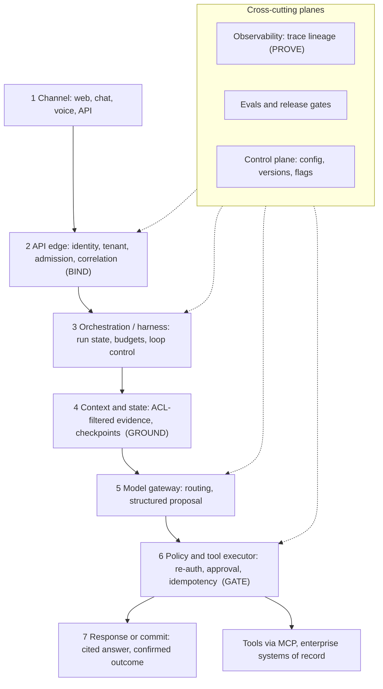

# S01.01: Reference Architecture

Status: **Drafted** (first written pass, 23 October 2026; consolidated from the production-architecture prep contract, the "application anatomy" and "production control architecture" golden answers, and the system-boundaries chapter of the earlier AI Application Architecture book).

The one diagram every later chapter zooms into. The governing rule for the whole section: **an LLM application is ordinary deterministic software with one probabilistic component inside it. The model proposes; services own identity, state, authorization and side effects.**

### What we are trying to avoid

Smeared orchestration, where no single seam owns trust, state, action or evidence. A prompt that is also the permission system. A model that calls the CRM directly because the demo did. A diagram with seven boxes and no statement of which box may trust which. A two-day prototype promoted to a regulated pilot by renaming the environment.

### Has this happened?

The failure is usually quiet: the prototype's single process grows a tool executor, a cache and a retry loop, each added where it was convenient, until the question "where exactly is tenant isolation enforced?" has three partial answers and no complete one. The incident chapter (S01.08) walks a synthetic version of that outcome: a latency spike, duplicate CRM writes and ungrounded answers arriving together from one load event.

## 30-second version

Draw one request from the user's intent through seven logical planes: channel, API edge, orchestration, context and state, model gateway, policy and tool executor, and response or commit. Observability and evals wrap the path; they do not replace a plane. Four moves make the diagram defensible. **Bind** verified identity and tenant to the request itself, not just at the front door. **Ground** the model in application-owned state and permission-filtered evidence. **Gate** model output as an untrusted typed proposal that must pass schema, fresh authorization, bound approval and an idempotent executor before anything changes. **Prove** the outcome with trace lineage that joins request, evidence, approval, receipt and the final system-of-record state. A low-risk assistant may colocate the planes in one service; it must still preserve the ownership contracts.

## Twelve rules to know by heart

1. **The model proposes; deterministic services own identity, durable state, authorization and side effects.** Text in a prompt can never grant permission.
2. **Seven logical planes, two wrappers.** Channel, edge, orchestration, context/state, model gateway, policy/executor, response/commit; observability and evals span all seven.
3. **Bind, Ground, Gate, Prove** is the recall spine. If an answer skips one, it has a hole.
4. **Authority travels with the request.** A merely authenticated request can reach the executor as an anonymous internal call; a bound one cannot. Re-check at the moment of execution.
5. **Retrieval is ACL-filtered evidence, not instruction.** Filter by permission before ranking by relevance; caches, logs and output paths must enforce the same policy.
6. **Four kinds of state have four owners and lifecycles:** request state, tenant session state, durable workflow checkpoints, and system-of-record truth. Provider-managed conversation state is runtime state, not business truth (S01.03).
7. **The executor is the only side-effect gate.** Schema validation, re-authorization, approval bound to exact parameters with an expiry, then idempotent execution (S01.08, S03.04).
8. **Success is not the model saying "done".** It is lineage from request to committed outcome, graded by evals (S05).
9. **Colocation is allowed; smearing is not.** Put planes in one process if the load is small, but keep each contract nameable and testable.
10. **An agent boundary is a systems contract.** A second agent earns its place by measured benefit (context, authority, parallelism, independent review, fault isolation), not by a tidier diagram.
11. **Prototype to pilot is a requirements and evidence review,** not automatically a rewrite and not a promise to keep every component.
12. **Five deterministic failures must pass before expansion:** cross-tenant denial, unauthorized-tool denial, duplicate-request idempotency, model-timeout degradation, and trace-to-outcome reconstruction.

## The one diagram

Read it top down as "what happens to one request?" and across as "who owns this decision?". Every arrow crossing from plane 5 to plane 6 is the trust boundary: output above it is a proposal, below it is an action.

### What each plane owns

| Plane | Owns | Must not own | Zooms into |
|---|---|---|---|
| 1 Channel | Rendering, reconnect, approval UI states | Permission, business truth | S01.02 |
| 2 API edge | Authentication, tenant binding, admission, rate limits, correlation IDs | Business logic | S01.05, S01.08 |
| 3 Orchestration / harness | Run state, step budgets, loop termination, handoffs | Credentials, direct writes to systems of record | S04 |
| 4 Context and state | Session, checkpoints, permission-filtered retrieval, memory | Authority (it stores facts, it does not grant rights) | S01.03, S06 |
| 5 Model gateway | Model selection, fallbacks, structured output, token budgets | Side effects | S01.04, S02 |
| 6 Policy and executor | Schema and semantic validation, re-authorization, approvals, idempotent dispatch, audit record | Deciding what the user "meant" | S03, S08 |
| 7 Response / commit | Cited answers, confirmed outcomes, truthful terminal states | Optimistic "done" before the system of record confirms | S01.02 |
| Observability | Trace lineage, SLIs, cost attribution | Being the only safety control | S09 |
| Evals | Pre-release gates, production sampling, regression fixtures | Replacing hard security invariants | S05 |
| Control plane | Routing config, prompt and tool versions, flags, canaries | Runtime request state | S01.04 |

## Bind, Ground, Gate, Prove

**Bind.** At the edge, derive user, tenant, purpose, rate-limit class and correlation ID from validated credentials. Reject ambiguous authority before the model is ever called. Propagate scoped identity through retrieval and tools and re-check it at execution time. "Tenant" means the isolation partition the request belongs to; inside a single enterprise that may be a business unit, region or data-classification domain, treated with the same rigour as a SaaS customer boundary, because a regulated firm's real isolation lines run inside the company. This is zero-trust guidance applied to an application: trust is not inferred from network location. ([NIST SP 800-207](https://csrc.nist.gov/pubs/sp/800/207/final))

**Ground.** The model works only from state the application owns and from evidence the caller is already permitted to read. Stale, conflicting or insufficient evidence causes clarification, abstention or escalation rather than a confident answer. Keep the four state classes separate (rule 6).

**Gate.** Model output is an untrusted typed proposal. The executor validates schema and semantics, re-authorizes current delegated access, enforces policy, binds any human approval to the exact parameters and an expiry, then executes idempotently with a persisted intent record. Credentials stay out of prompts. Guardrails supplement normal security controls; they do not replace them.

**Prove.** Correlation lineage links edge, evidence, model, approval, tool, receipt and the final system-of-record state so that evidence can reconstruct causal relationships without assuming log timestamps form a total order. Asynchronous or multi-run work may use grouped traces rather than one physical trace. Grade both trajectory and environment outcome; turn selected failures into privacy-reviewed, versioned eval cases; gate releases separately on quality, safety, latency and cost.

## Deciding where a boundary goes

### Agent, deterministic step or tool?

An agent chooses its next action; a deterministic workflow follows application-defined steps; a tool is a bounded capability. Prefer the simplest composition that meets the requirement and move up only on measured benefit. ([Anthropic, Building effective agents](https://www.anthropic.com/engineering/building-effective-agents))

A second agent may earn an independent boundary when it buys one of: a smaller context, a specialised policy or model, independent verification, parallel subtasks, organisational ownership, or fault isolation. Some of these are hard security boundaries only if the runtime enforces them; separate prompts alone do not isolate credentials or memory. Price the seam honestly: duplicated context, extra model calls, coordination delay, more eval cases, correlated failures between "independent" reviewers, and conflict control between parallel writers. Specify the handoff contract (input, output, authority, deadline, cancellation, partial-failure behaviour) before you draw the second box. The decision is an experiment, not a rule: run representative cases through both designs, inject a worker timeout, measure quality, cost and completion time.

### Which components may trust model output?

| Component | May act on model output? | Condition |
|---|---|---|
| Response renderer | Yes, as text | Mark it as model output; never render "action completed" from it |
| Retrieval query builder | Yes, as a query | Permission filter is applied by the retriever, not by the query |
| Tool executor | Only after gating | Schema, re-auth, approval binding, idempotency key from the application |
| System of record | Never directly | Only via the executor's validated, authorized call |
| Eval and trace store | Yes, as data | It records the proposal; it does not enact it |

## From two-day prototype to regulated pilot

The move is a requirements and evidence review. Identify with the customer the data, users, consequential actions and applicable controls. Then, per plane:

- **Identity:** supported enterprise authentication; verified user and workload context preserved through retrieval and execution; delegated authority and workload identity have different lifecycles (S03.03, S08).
- **Tenant isolation:** admission, data access, storage, caches, logs and external tools each need a stated control; do not claim that three named layers each guarantee the others (S01.05).
- **Data handling:** classification, processing locations, retention, deletion, diagnostic capture, approved provider and subprocessor arrangements.
- **Approvals:** bound to the exact action and parameters, expiring, revalidated before execution.
- **Observability and evals:** cross-layer concerns with named owners for prompts, tools, data, incident response and rollback. ([AWS Prescriptive Guidance, enterprise architecture for agentic AI](https://docs.aws.amazon.com/prescriptive-guidance/latest/govern-architect-agentic-ai/enterprise-architecture.html))
- **Operating contract:** what the pilot can safely do, how failure is detected, who can stop it, and an explicit degraded or read-only mode where the workflow supports it. Expand autonomy only on measured evidence; reduce scope if evidence is incomplete.

Preserve prototype code only where it meets the pilot's control and operating requirements. Keep the backend contract clean so the demo frontend can be replaced without rewriting business logic (S01.02).

## The thin vertical slice

The first build is one approval-gated write through the whole path: answer from permissioned knowledge, then perform one CRM or ticket update through a traceable executor. It is done when five deterministic failure tests pass:

1. Cross-tenant request is denied at the edge and again at the executor.
2. A tool the caller lacks scope for is refused, and the refusal is a tool result, not a crash.
3. The same intent submitted twice produces one effect.
4. Model timeout degrades to an honest handoff, not a blank success.
5. One trace reconstructs request, evidence, approval, receipt and system-of-record state.

Only after these pass does a versioned representative and adversarial eval set gate expansion on quality, safety, latency and cost. Hard authorization and duplicate-effect failures stay binary blockers.

## Architecture review checklist

Carried from the earlier book's review chapter and expanded. Use it as a decision record before shipping.

- [ ] Responsibilities and trust boundaries are explicit per plane.
- [ ] Model, data, orchestration and fallback choices have stated trade-offs.
- [ ] Which decisions belong to the model, the application, the platform and a human operator is written down.
- [ ] Where data, identity and execution cross trust boundaries is drawn.
- [ ] Which failures must be isolated rather than propagated is named.
- [ ] Quality, security, latency, cost and recovery paths are testable.
- [ ] Owners and evidence exist for the highest-risk assumptions.
- [ ] One deliberately rejected agent boundary is recorded with the reason.

## Interview probes

Carried from the prep contract; the first two are the chapter's spine questions.

- You are designing a production AI assistant for a regulated enterprise with 10,000 employees. It must answer from permissioned internal knowledge and, after explicit approval, update CRM and ticketing systems. Whiteboard one request end to end, then defend which components may trust model output and how you prove the committed business outcome.
- Your two-day AI prototype is approved for a regulated production pilot. Redesign it across identity, tenant isolation, data handling, human approval, observability, rollout and operational ownership.
- A team proposes a second agent. Decide whether it earns an independent agent boundary or should remain a deterministic step or tool call.
- Retrieval and tools sit in different identity domains. Where exactly is tenant isolation enforced, and what is rechecked at execution?
- An approval resumes after the user's permissions changed. Which stored state is still evidence, and what must be re-authorized?
- Walk me through an app you built: why these architecture choices, and where does it fail? (Narrate in request order, each layer with its why; volunteer the trade-offs; name the failure modes and what breaks first at 10x.)

## What this is not

Not the request lifecycle (S01.02), not the storage design (S01.03), not the tenancy mechanics (S01.05). It fixes the boxes and the ownership rules; the other chapters fill each box.

## Related chapters

- [S01.02 Request Path](../S01.02-Request-Path/README.md): one request through these planes in time.
- [S01.05 Multi-Tenancy and Identity Propagation](../S01.05-Multi-Tenancy-and-Identity-Propagation/README.md): the Bind move in depth.
- [S01.08 Reliability](../S01.08-Reliability/README.md): the Gate move's idempotency and reconciliation contract.
- [S03.04 MCP Tool Design](../../S03-AI-Agents-Tools-and-MCP/S03.04-MCP-Tool-Design/README.md): operation keys, intent records and the executor contract.
- [S00.01 Use-Case Discovery](../../S00-Enterprise-AI-and-Solution-Discovery/S00.01-Use-Case-Discovery-and-Qualification/README.md): where the drivers for this diagram come from.

## Sources

Carried from the prior golden answers; not re-fetched on 23 October 2026, so verify before quoting.

- NIST, [SP 800-207 Zero Trust Architecture](https://csrc.nist.gov/pubs/sp/800/207/final).
- AWS Prescriptive Guidance, [Enterprise architecture for agentic AI](https://docs.aws.amazon.com/prescriptive-guidance/latest/govern-architect-agentic-ai/enterprise-architecture.html).
- Anthropic, [Building effective agents](https://www.anthropic.com/engineering/building-effective-agents) and [Demystifying evals for AI agents](https://www.anthropic.com/engineering/demystifying-evals-for-ai-agents).
- OpenAI, [A practical guide to building AI agents](https://openai.com/business/guides-and-resources/a-practical-guide-to-building-ai-agents/) and [Agents SDK tracing](https://openai.github.io/openai-agents-python/tracing/).

[Back to S01](../README.md)
