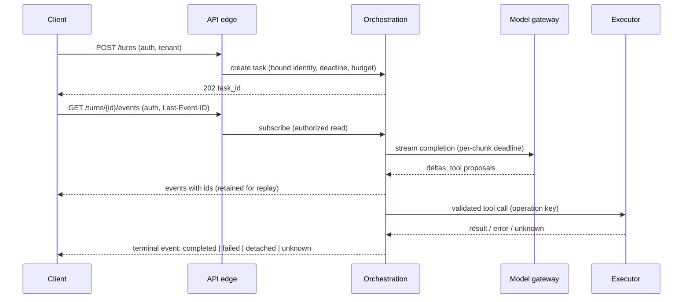

# S01.02: Request Path: Sync, Streaming, Async, Background

Status: **Drafted** (first written pass, 23 October 2026; consolidated from the "Python API boundary", "customer-facing frontend", "provider and serving topology" and "model-provider SDK boundary" golden answers and the application-path integration cluster).

One user request end to end, in time. The governing rule: **a streaming endpoint is a managed task lifecycle, not an async generator.** The in-process semaphore and the generator are implementation pieces; the reliability contract is who may start, read, cancel and resume the task, and what is true when the connection dies.

### What we are trying to avoid

The browser disconnects while the model is streaming and the server keeps doing expensive work nobody will read. A reconnect that silently starts a second generation, or worse, repeats a consequential action. A task ID that works as a cross-tenant access token. A spinner that pretends to be the model thinking. A stream that stalls silently and never errors. A "batch is cheaper" decision made without checking the deadline the business actually has.

### Has this happened?

The application-path cluster's failure branch is exactly the first item above, and it is the default behaviour of most first implementations: cancelling a local coroutine or closing a socket does not prove the provider stopped working. The four-hour outage scenario in S01.08 adds the second: queued work that resumes after the user's approval has expired.

## 30-second version

Pick the request shape from the deadline and the failure contract, not from whether a person is watching. **Sync** for sub-second answers with no side effects. **Streaming** for interactive generation: authenticated task creation, then an authorized subscription with event IDs and a resume position, with the server retaining replayable events or a snapshot. **Async** when the job can outlive the HTTP request: durable job record, polling or notification, explicit deadline, cancellation and fresh authorization before any deferred action executes. **Background or batch** when deadline slack is hours: provider batch windows and separate quotas, per-item identity and result state, resumable collection without duplicate downstream effects. In every shape, distinguish inactivity timeouts from the overall deadline, bound admission at tenant and fleet scope, and decide explicitly whether disconnect cancels or detaches.

## Twelve rules to know by heart

1. **Choose the shape by deadline slack and failure contract.** Machine-to-machine can still be hard-realtime; a human may happily wait for a report.
2. **Authorize task creation, every read of the stream, and cancellation,** each bound to the verified tenant and user. Task identifiers are not bearer tokens.
3. **Disconnect policy is a decision, not a default.** Cancel the computation, or detach it as a resumable job; write it down and test it against the real server and SDK.
4. **Cancellation must be proven upstream.** Close the provider response, release admission ownership exactly once, persist a truthful terminal or detached state.
5. **Resume needs storage.** Server-Sent Events give you event framing and a `Last-Event-ID`; the application must retain replayable events or expose a current snapshot. ([WHATWG, Server-sent events](https://html.spec.whatwg.org/multipage/server-sent-events.html))
6. **Reconnection must never duplicate generation or business actions.** Reconcile task state; do not replay the request.
7. **Two deadlines, not one:** a per-phase or per-chunk inactivity deadline that names the silent stall, and an overall deadline for the task.
8. **Bound admission and buffers.** Tenant and fleet concurrency limits, finite buffers with an explicit overflow policy for slow consumers.
9. **Blocking work leaves the event loop.** Blocking I/O moves to async clients or bounded workers; real CPU work may need separate processes, not another thread.
10. **Streaming latency is measured, not promised.** First visible response and completed-task latency over the customer's actual access path.
11. **The UI renders authoritative state.** Proposed, approved, executing, confirmed, failed and unknown are distinct; "success" follows the system of record, never the click.
12. **Async delivery and batch scheduling are different things.** Async decouples completion from the request; batch adds a provider scheduling contract with its own window, limits and partial-failure semantics. ([OpenAI Batch API](https://developers.openai.com/api/docs/guides/batch))

## The request in time

Each hop carries the correlation ID, the bound identity and the remaining deadline budget. Nothing after the edge re-derives who the caller is from request text.

## Choosing the shape

| Shape | Use when | Contract you owe | Typical failure |
|---|---|---|---|
| Sync request/response | Answer within one short request budget, no consequential side effect | Overall timeout, admission limit, honest error | Provider slowness turns into gateway timeouts and client retries |
| Streaming | Interactive generation, tool progress worth showing | Authorized create and subscribe, event IDs, replay or snapshot, per-chunk deadline, cancel semantics | Disconnect leaves orphaned work; reconnect duplicates |
| Async job | Work may outlive the request; minutes of slack | Durable job record, status API, deadline, cancellation, re-authorization before deferred actions | Approval or context expires before execution |
| Background / batch | Hours of slack; evaluation sets, backfills, offline summaries | Per-item identity and state, provider window and limits, resumable collector, retry only eligible failures | Cheap job misses the business deadline; partial results mishandled |

Interactive and offline traffic should not share one quota or one worker pool; quota isolation protects the interactive path, but the application must also protect its own database, storage and workers.

## The streaming endpoint, concretely

One workable design: an authenticated `POST` creates a turn and returns a task ID; an authorized SSE subscription streams events with IDs. Native `EventSource` cannot set custom headers or use `POST`, so a fetch-based stream may be needed for bearer tokens or request bodies. The server retains events (or a snapshot) long enough for a reconnect to reconcile. ([HTTPX async streaming and resource management](https://www.python-httpx.org/async/))

Cleanup on disconnect or cancel, in order: close the upstream provider response; release the admission slot exactly once; persist the terminal state (`completed`, `failed`, `cancelled`, `detached`, `unknown`). Explicit cancellation authenticates the requester and handles the race where completion and the stop request arrive together.

What the tests must cover before anyone calls it done: auth on create, subscribe and cancel; cross-tenant read denied; disconnect behaviour matches the written policy; per-chunk deadline converts a silent stall into a retryable failure that still surfaces partial output; overall deadline produces a truthful terminal state; slow consumer hits the overflow policy rather than unbounded memory; duplicate create with the same operation key returns the same task.

## The provider call inside the request

The model-gateway hop has its own four mechanisms, each a place where a demo quietly differs from production:

- **Tool-call loop with a bounded round budget.** Branch on message versus tool call; parse arguments defensively; validate against the schema before anything executes; feed validation errors back to the model as tool results. Unknown tools are refused, never dispatched dynamically. The executor is the one place a side effect is allowed (S03.04).
- **Structured output with one repair pass, then fail closed.** Never a silent best-effort parse.
- **Streaming with a per-chunk read deadline** and one clean-restart retry; the failure path always surfaces partial text.
- **Retry classification.** Exponential backoff with jitter on 429 and 5xx only; 4xx is fatal and never retried; retries wrap every call site and share one deadline and attempt budget with the rest of the request (S01.08).

A fallback model is a product capability with its own quality, tool-semantics and data-handling evidence, not a second URL (S01.04).

## The frontend's part of the contract

For a two-day demo, the simplest stack that shows the required journey is right, often Streamlit for a Python-heavy team. It still talks to the browser over a network (WebSockets, in Streamlit's case), so rehearse the deployed path: disconnection, a provider timeout, resetting sample data between runs. Keep credentials server-side, use authorized sample data, and record which limits are deliberate and which requirements would trigger migration. ([Streamlit architecture](https://docs.streamlit.io/develop/concepts/architecture/architecture))

For a pilot, redesign around server-owned identity and task state rather than a framework swap. Enforce session and authorization on the server; keep credentials out of URLs and client-generated claims ([Next.js authentication guidance](https://nextjs.org/docs/app/guides/authentication) does not remove that need). Render the action state machine honestly: an optimistic animation may acknowledge the click, but "written to CRM" appears only after the authoritative confirmation. Test keyboard navigation, focus management and paced announcements against [WCAG 2.2](https://www.w3.org/TR/WCAG22/) rather than announcing every token.

## Interview probes

- Implement and defend an authenticated, tenant-aware async streaming endpoint. Show cancellation, timeouts and backpressure, and explain which work may block the event loop.
- Your two-day demo is moving to a production pilot. Redesign the frontend for authentication, reconnectable streaming, approval states, accessibility and safe failure.
- What frontend would you pick for a two-day customer demo, and what would make you migrate?
- When do you move a workload to a batch or async endpoint instead of realtime?
- Unaided, against a fake transport: build the tool-call loop for two schema-validated tools, structured output with one repair pass, a stream with a per-chunk deadline, and transient-only retries. Then walk it live: why validation precedes execution, why 4xx is never retried, where the silent stall is caught.
- Two tool calls arrive in one response and must run in parallel. What changes in the loop and the message log?
- At 10x traffic, where do rate-limit handling and the shared connection pool live: per call, per client, or at your own front door?

## What this is not

Not the storage of what the request produced (S01.03), not the retry and idempotency contract in full (S01.08), and not the harness loop design (S04). It fixes the lifecycle and the shape decision.

## Related chapters

- [S01.01 Reference Architecture](../S01.01-Reference-Architecture/README.md): the planes this sequence runs through.
- [S01.06 Cost and Latency Budgets](../S01.06-Cost-and-Latency-Budgets/README.md): what the deadlines should be.
- [S01.08 Reliability](../S01.08-Reliability/README.md): retries, idempotency keys and unknown outcomes.
- [S04 Agentic Workflows and Harnesses](../../S04-Agentic-Workflows-and-Harnesses/README.md): background runs and long tasks.

## Sources

Carried from the prior golden answers; not re-fetched on 23 October 2026, so verify before quoting.

- WHATWG, [Server-sent events](https://html.spec.whatwg.org/multipage/server-sent-events.html).
- HTTPX, [Async support](https://www.python-httpx.org/async/).
- OpenAI, [Batch API guide](https://developers.openai.com/api/docs/guides/batch).
- Streamlit, [Architecture](https://docs.streamlit.io/develop/concepts/architecture/architecture). Next.js, [Authentication](https://nextjs.org/docs/app/guides/authentication). W3C, [WCAG 2.2](https://www.w3.org/TR/WCAG22/).

[Back to S01](../README.md)
