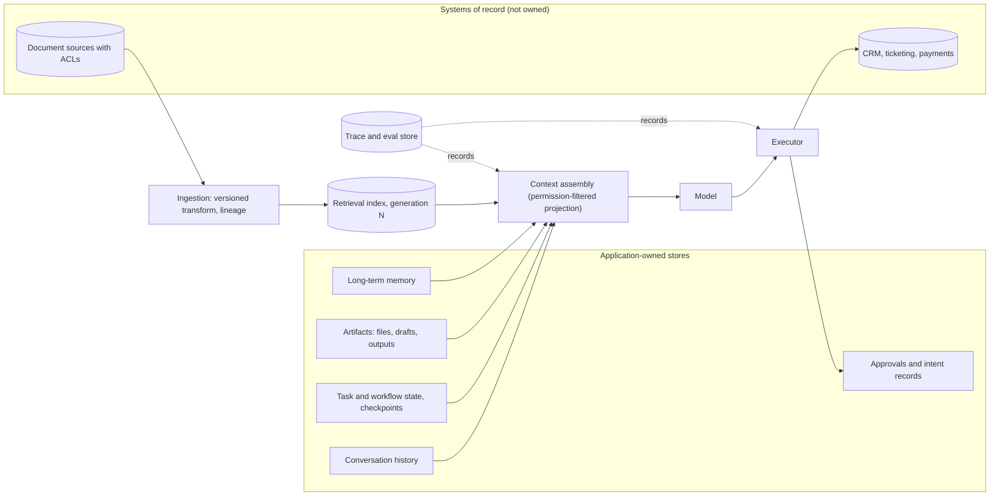

# S01.03: State, Sessions and Storage

Status: **Drafted** (first written pass, 23 October 2026; consolidated from the data-and-state chapter of the earlier AI Application Architecture book, the state-separation parts of the "application anatomy" answers, the agent-state concept notes and the "batch and streaming data path" golden answers).

What the system records versus what the model sees. The governing rule: **state classes have different owners, authorities and lifecycles; the model sees a projection, never the source of truth.**

### What we are trying to avoid

A conversation transcript used as the audit log. An approval stored as a chat message, so it "resumes" after the user's permissions changed. Provider-managed thread state treated as business truth. Memory that remembers across tenants. A re-ingested document that silently overwrites a newer revision because the hash matched. Retention policy discovered by a subject-access request.

### Has this happened?

The regulated-enterprise spine question ends with "an approval resumes after the user's permissions changed: which stored state is still evidence, and what must be re-authorized?" Teams that keep one blob of "conversation state" cannot answer it; teams that separated approvals from transcripts can point at the record.

## 30-second version

Separate at least six stores and name an owner for each: conversation history, task and workflow state, artifacts, approvals and intent records, long-term memory, and the systems of record you never own. For each, define source, schema, authority, key, versioning, retention, access policy and deletion path. Context assembly is a read-side projection over those stores filtered by the caller's permissions; it is not a store itself. Writes to systems of record go only through the executor with an intent record persisted first (S01.08). For ingested documents, identity, content equality and source order are three different facts; lineage records which transform version produced which output generation.

## Twelve rules to know by heart

1. **Four runtime state classes, four owners:** request state, tenant session state, durable workflow checkpoints, system-of-record truth.
2. **Provider-managed conversation or thread state is runtime state,** convenient for continuity, never the business record.
3. **Approvals are records, not messages.** Bound to the exact action and parameters, with an expiry and the authority that was current when granted.
4. **The intent record precedes dispatch.** Persist the business intent, request fingerprint and operation key before any consequential call; append the outcome after.
5. **Context is a projection.** What the model sees is assembled per request from permitted evidence and owned state; it is logged as what it was, not promoted to truth.
6. **Memory is scoped.** Long-term memory is keyed by tenant and user, with its own retention, consent and deletion path; it is evidence to be filtered, not instruction.
7. **Keys carry tenant.** Every row, blob, cache entry and trace is addressable by tenant first (S01.05).
8. **Version everything the model depends on:** prompt, tool definitions, model, retrieval index generation, transform version; record them on the run.
9. **Identity, equality and order are three facts.** A stable document identity plus a content hash detects repeats; only source revision or sequence decides which is current.
10. **Checkpoints align with committed output.** A consumed position is not a durable effect; replay must be safe for the sink. ([Kafka delivery semantics](https://kafka.apache.org/41/design/design/#design_deliverysemantics))
11. **Retention and deletion are designed, not discovered.** Classification, processing location, retention window, diagnostic capture and deletion path per store.
12. **Idempotency remembers intent; reconciliation answers uncertainty outside its coverage.**

## The stores

### Lifecycle table

| Store | Owner | Key | Authority | Retention | Model sees |
|---|---|---|---|---|---|
| Conversation history | Application | tenant, user, conversation, turn | Evidence of what was said | Product policy; purgeable | Recent window, summarised older turns |
| Task / workflow state | Orchestration | tenant, task_id, step | Progress and budgets | Until terminal plus audit window | Current step and budget only |
| Artifacts | Application | tenant, artifact_id, version | Produced outputs | Product policy | References, not raw bytes, unless needed |
| Approvals and intent records | Executor | tenant, operation_id | Authority to act, bound parameters, expiry | Audit window; immutable | Status only |
| Long-term memory | Application | tenant, user, memory_id | Preferences and facts, consented | Consent-bound; deletable | Filtered, labelled as memory |
| Retrieval index | Ingestion | tenant, source, doc_id, revision, generation | Derived evidence | Rebuildable | Permission-filtered chunks with citations |
| Systems of record | The enterprise | Their keys | Truth | Theirs | Never directly; via tools |
| Trace and eval store | Observability | trace_id, span_id, operation_id | Evidence of behaviour | Privacy-reviewed; redacted | Never |

## Sessions and continuity

A session is a tenant-scoped container for continuity, not a security boundary. The identity that created it is re-verified on every request; the session may cache the result of that verification only for as long as the identity provider allows. Multi-device and reconnect cases reconcile against task state by ID, never by replaying the client's view of the transcript.

Hosted agent runtimes offer managed threads, sessions or memory primitives. Use them for continuity where the data-handling terms are approved, and still keep the approval, intent and audit records in stores you control. The pilot question is always "if the provider's thread disappeared, what business fact would we lose?"; the right answer is "none".

## Approvals, intents and the resume problem

Record for each consequential action: operation ID, bound parameters, approver identity, authority snapshot, granted-at and expires-at, and the outcome appended by the executor. When a paused workflow resumes, the executor checks that the approval is unexpired, that the current delegated authority still permits the action, and that the record state has not drifted (expected version or ETag). If the consequential details changed, refresh, re-evaluate policy and obtain renewed confirmation. A separate read immediately before a write does not eliminate the race; enforce the version precondition atomically with the update (S03.04).

## Ingested documents: identity, order and lineage

The retrieval index is derived state, so it must be rebuildable and its correctness must be stated in terms of source facts.

- **Identity:** tenant, source system, stable source identifier.
- **Equality:** content hash detects repeated content; it cannot say whether an old backfill record is newer than a live update.
- **Order:** source revision or sequence decides which revision is current; deletes and permission changes need the same ordering discipline as content.
- **Transform lineage:** parsing, chunking and embedding logic is versioned and shared between backfill and stream; a changed transform version can require reprocessing unchanged content.
- **Generations:** stage a new output generation, catch up concurrent changes, validate counts, known identities and permissions, then publish through a pointer or alias switch with a rollback. A new generation does not guarantee byte-identical embeddings.
- **Progress:** checkpoints record recoverable progress aligned with committed output; a watermark estimates event-time progress and is not proof that no earlier event can arrive, so allowed lateness is a separate policy. ([Beam, watermarks and late data](https://beam.apache.org/documentation/programming-guide/#watermarks-and-late-data))

A hot tenant partition during a backfill is evidence of imbalance, not proof of the wrong key: compare per-partition arrival rate, service cost per record, retries and sink throttling before resharding. If you do split, split at a boundary that preserves per-document ordering, version the assignment, fence obsolete workers and migrate checkpoints with the runtime's supported mechanism. S06 covers retrieval quality; this chapter owns the state contract.

## Interview probes

- An approval resumes after the user's permissions changed. Which stored state is still evidence, and what must be re-authorized?
- Where does agent state live, and how do you keep it private per user and per tenant?
- The customer forbids retention of prompts and retrieved documents. What can you still log, and how do you debug?
- Design a customer document pipeline that combines a partitioned batch backfill with an event stream. Define checkpoints, lineage, schema and quality gates, and replay behaviour.
- During a backfill, one tenant becomes a hot partition while late events and duplicates arrive. Diagnose and design a recovery that preserves correctness and auditability.
- A user's group membership is revoked while an answer is streaming. What happens to the context already assembled, the cached chunks and the answer?

## What this is not

Not the retrieval design (S06), not the memory product design (S04), not the audit-log schema for regulators (S07). It fixes which stores exist, who owns them and what the model is allowed to see.

## Related chapters

- [S01.01 Reference Architecture](../S01.01-Reference-Architecture/README.md): the Ground move.
- [S01.05 Multi-Tenancy and Identity Propagation](../S01.05-Multi-Tenancy-and-Identity-Propagation/README.md): tenant-first keys and cache isolation.
- [S01.08 Reliability](../S01.08-Reliability/README.md): intent records, idempotency and reconciliation.
- [S06 RAG Systems](../../S06-RAG-Systems/README.md): retrieval over the index this chapter keeps honest.

## Sources

Carried from the prior golden answers; not re-fetched on 23 October 2026, so verify before quoting.

- Apache Beam, [Watermarks and late data](https://beam.apache.org/documentation/programming-guide/#watermarks-and-late-data).
- Apache Kafka, [Message delivery semantics](https://kafka.apache.org/41/design/design/#design_deliverysemantics).
- Stripe, [Idempotent requests](https://docs.stripe.com/api/idempotent_requests) for receiver-side intent memory.

[Back to S01](../README.md)
