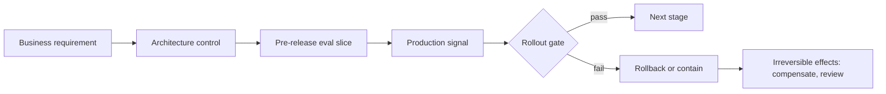

# S01.04: Control Plane: Routing, Config, Versioning, Release

Status: **Drafted** (first written pass, 23 October 2026; consolidated from the "production control architecture", "Git, CI and reproducibility" and "model-provider SDK boundary" golden answers, the production-control integration cluster, and the model-runtime chapter of the earlier AI Application Architecture book).

Everything that changes the system's behaviour without a code deploy, and the gates that decide whether a change ships. The governing rule: **every gate has an owner and a measurable threshold, and the rollback path contains the irreversible effects.**

### What we are trying to avoid

A prompt edited in production by hand. A model upgrade that passed health checks and failed a high-risk policy slice. A fallback model assumed equivalent because it answers. Business KPIs falling while every infrastructure dashboard is green. A Git revert mistaken for an operational rollback when the migration, the external writes and the changed configuration did not revert with it. A fix that passes on the laptop and fails in CI and at the customer.

### Has this happened?

The production-control cluster's failure branch is "business KPIs fall while infrastructure health remains green". That is the normal signature of a silent provider model update or a prompt change: no errors, lower task success. If the only gate is uptime, nobody notices until the customer does.

## 30-second version

Treat prompts, tool definitions, routing policy, feature flags and model choice as versioned configuration promoted through the same pipeline as code, with evals as the release gate. Build a requirement-to-control-to-signal matrix: for each consequential business outcome, the component that controls it, the pre-release evaluation that proves it, the production signal that watches it and the rollback gate that contains it. Route across model tiers by workload and cost, with fallbacks that were evaluated on the same slices as the primary, not assumed equivalent. Promote one identified artifact through environments rather than rebuilding in each; validate configuration at startup without printing secrets. Release in stages: shadow, canary, percentage, with both technical and business signals and a tested rollback that knows which effects it cannot reverse.

## Twelve rules to know by heart

1. **Configuration is code.** Prompts, tool schemas, routing tables, flags and model pins live in version control and are promoted, not edited live.
2. **Record the versions on every run:** prompt, tool set, model, index generation, policy version. Without them a trace cannot be reproduced or attributed.
3. **Evals are the release gate** (S05). Gate separately on quality, safety, latency and cost; hard authorization and duplicate-effect failures stay binary blockers.
4. **Fallback is a product capability.** Its capacity, quality, tool semantics and data handling are tested and approved before the incident, not during it.
5. **Route by workload, then by cost.** Cheap model where quality allows, expensive where it earns its price; per-route, evaluated, with the routing policy itself versioned.
6. **One identified artifact, promoted.** Build once, promote the same digest through dev, staging and production; locked dependencies with hash checking where supported. ([pip, repeatable installs](https://pip.pypa.io/en/stable/topics/repeatable-installs/))
7. **Same image narrows diagnosis; it does not guarantee behaviour.** Architecture, resource limits, networking, locale, clock and external data still differ.
8. **Validate configuration at startup** and name the missing setting safely; never print secret values.
9. **Required checks apply to the exact merge candidate.** Human review and CI may proceed concurrently; the merge waits for both. ([GitHub flow](https://docs.github.com/en/get-started/using-github/github-flow))
10. **Git revert is not operational rollback.** Schema, data, external effects and configuration need their own reversal plan.
11. **Stage the rollout; watch both signal families.** Technical health and business outcome, with a stop condition for each.
12. **Autonomy expands on evidence.** Each widening of scope or permissions is a release with its own gate.

## The requirement-to-control-to-signal matrix

| Requirement | Control | Pre-release evidence | Production signal | Gate owner |
|---|---|---|---|---|
| No cross-tenant disclosure | Tenant-bound retrieval and cache keys | Cross-tenant denial tests pass | Zero cross-tenant reads in trace audit | Security |
| No duplicate CRM writes | Intent record and operation key in executor | Duplicate-intent test yields one effect | Intent-to-effect reconciliation count | Platform |
| Grounded answers | Evidence-required abstention | Grounding eval slice above threshold | Sampled grounding judge, abstention rate | Product and evals |
| p95 within budget | Deadlines, admission, model tier | Latency slice on representative traffic | Event-based latency SLO burn (S01.06) | Platform |
| Business outcome | The whole path | Task-success eval on golden set | Containment or resolution metric with denominator (S00.03) | Product owner |

Every row has an owner and a threshold. A row with a signal and no owner is a dashboard, not a gate.

## Model routing and fallbacks

Routing is a policy over workload class, tenant entitlement, cost tier, latency budget and current health. Write it as versioned configuration, evaluate each route on the slices that matter for it, and log the chosen route on the trace so cost and quality can be attributed per route.

Fallback decisions that must be made before the outage: which capabilities fall back to which model, which degrade to cached or read-only behaviour, which suspend because the fallback has not been evaluated for them (consequential actions usually belong here). A fallback that passes health checks but violates a high-risk policy slice is the scenario to design against. Recovery includes re-evaluation before full traffic returns (S01.08).

Managed-platform access (Bedrock, Vertex, Foundry) and direct provider APIs are also a routing decision with identity, networking, residency and feature-lag consequences; S01.07 covers the placement choice.

## Versioning prompts and tool definitions

A prompt change is a behaviour change. Give prompts and tool schemas versions, review them like code, and run the eval slices that the change could affect: wrong-tool rate and invalid-argument rate for tool-definition changes (S03.04), grounding and refusal slices for system-prompt changes. Keep the previous version deployable. When a provider ships a silent model update and argument quality drops, the tool-call eval in CI is the regression tripwire; without it, the first signal is the business KPI.

## Delivery chain and reproducibility

Small coherent changes on short-lived branches, a PR that states the problem, resulting behaviour and validation, required checks on the exact candidate, then merge. For AI-assisted changes, inspect security boundaries, error handling and generated assumptions, and use tests that distinguish correct behaviour from a plausible-looking implementation; state the AI contribution honestly without treating the agent's explanation as proof.

When a fix passes locally and fails in CI or at the customer, compare actual artifacts and environments before guessing: resolved dependencies and runtime; configuration and identity (which principal, is the secret present and valid, do permissions match the operation); CPU architecture, locale, filesystem, network, resource limits, clock, external data. Reproduce under the closest permitted conditions, change one suspected difference, confirm the symptom moves with it, record the root cause and add the check that catches that drift before the next rollout.

## Release stages

1. **Shadow:** new version runs on real traffic, output recorded, not served. Compare against the current version on the eval slices.
2. **Canary:** small percentage or one tenant that consented; both signal families watched; automatic stop on threshold.
3. **Percentage ramp:** widen with explicit stop conditions and an owner on call.
4. **Full traffic:** previous version still deployable; configuration rollback rehearsed.

Rollback checklist: code or config reverted; model pin restored; prompts and tool schemas restored; index generation pointer restored; schema and data compatibility confirmed; in-flight consequential actions reconciled; customer-visible status updated honestly.

## Interview probes

- Trace one consequential business outcome through its architecture control, pre-release evaluation, production signal and rollback gate.
- Walk me through your git and PR workflow, including how you handle AI-generated code.
- A local fix passes on your laptop but fails in CI and in the customer environment. Diagnose dependency, configuration and secret drift, then design the reproducibility controls.
- The provider ships a silent model update and argument quality drops. What catches it?
- The fallback model passes health checks but violates a high-risk policy slice. What should have been designed in?
- The release passes locally but fails after customer-specific configuration is injected during the demo. Recover without hiding the failure.

## What this is not

Not the eval methodology (S05), not the deployment topology (S01.07), not governance sign-off (S07). It fixes what is versioned, who gates, and how a change moves to and away from production.

## Related chapters

- [S01.07 Deployment Topologies](../S01.07-Deployment-Topologies/README.md): where the artifact runs and the managed-versus-direct access decision.
- [S01.08 Reliability](../S01.08-Reliability/README.md): fallback behaviour during an outage.
- [S05 AI Agents Evals](../../S05-AI-Agents-Evals/README.md): the release gate itself.
- [S03.04 MCP Tool Design](../../S03-AI-Agents-Tools-and-MCP/S03.04-MCP-Tool-Design/README.md): tool-definition evals.

## Sources

Carried from the prior golden answers; not re-fetched on 23 October 2026, so verify before quoting.

- GitHub, [GitHub flow](https://docs.github.com/en/get-started/using-github/github-flow).
- pip, [Repeatable installs](https://pip.pypa.io/en/stable/topics/repeatable-installs/).
- Anthropic, [Demystifying evals for AI agents](https://www.anthropic.com/engineering/demystifying-evals-for-ai-agents).
- Google SRE Book, [Service level objectives](https://sre.google/sre-book/service-level-objectives/).

[Back to S01](../README.md)
