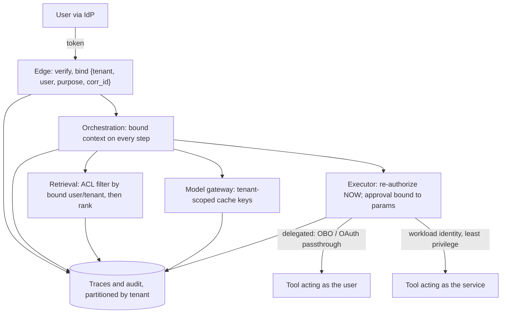

# S01.05: Multi-Tenancy and Identity Propagation

Status: **Drafted** (first written pass, 23 October 2026; consolidated from the Bind move of the "application anatomy" answers, the tenant-isolation, RBAC/ABAC, residency and audit-log concept notes, the private-corpus RAG scenario and the "Python API boundary" answer).

Tenant isolation at every layer, and whose identity a tool call carries. The governing rule: **tenant and identity are bound to the request and re-checked at the point of use; no layer inherits isolation from another, and text never grants permission.**

### What we are trying to avoid

A task ID that reads another tenant's stream. A prompt cache or semantic cache that returns tenant A's answer to tenant B. A retrieval index filtered after ranking, so the excluded document still shaped the answer. An agent whose service account can do everything, acting for a user who could not. Traces and logs that are the one store nobody partitioned. "We isolate at the network, the database and the prompt" offered as if each guaranteed the others.

### Has this happened?

The private-corpus RAG scenario's failure branch is a user whose group membership is revoked while an answer is streaming. Systems that checked permission once at retrieval time keep streaming; systems that bound authority to the request can at least stop, and systems that re-check at the executor refuse the follow-on action.

## 30-second version

Bind verified user, tenant, purpose and correlation to the request at the edge and carry that bound context through orchestration, retrieval, model gateway, executor, caches, storage and traces. Enforce isolation separately at each layer with a control appropriate to it, and test each one; do not let one layer's isolation stand in for another's. Distinguish the user's delegated identity (what this person may do, carried to tools by OAuth passthrough or on-behalf-of exchange) from the agent's own workload identity (what the service may do on its own), because they have different lifecycles and revocation paths. Filter retrieval by permission before ranking. Partition caches, memory, indexes, queues, logs and traces by tenant. Decide residency and retention per tenant and per store. Write audit records that name actor, tenant, tool, bound parameters, decision and approval.

## Twelve rules to know by heart

1. **Bind at the edge, re-check at use.** Authentication at the front door is necessary, not sufficient.
2. **Tenant is the first key component** in every row, blob, cache entry, queue message, memory item, index partition and trace.
3. **No layer inherits isolation.** Admission, data access, storage, caches, logs and external tools each need their own stated and tested control.
4. **Permission before relevance.** Retrieval filters by ACL before it ranks; a document the caller may not see is excluded before context assembly.
5. **Two identities, two lifecycles.** Delegated user authority (short-lived, revocable, scoped) and workload identity (service principal, least privilege). Never let the second silently stand in for the first.
6. **Scopes name capabilities, not endpoints.** Read tools and write tools carry different scopes; a read scope never grants write authority (S03.03).
7. **Text never grants permission.** Instructions in prompts, documents or tool results cannot widen authority; policy checks run in code.
8. **Caches are data stores.** Prompt caches, semantic caches and result caches key on tenant and permission context, or they leak.
9. **Revocation propagates.** Define what happens to open streams, queued work and long-running tasks when authority changes mid-flight.
10. **Residency is a property of a configuration,** not a vendor label: model, region, inference routing, log location and retention per workload (S01.07).
11. **Audit records are tenant-scoped evidence:** actor, tenant, tool, bound parameters, policy decision, approval, outcome, correlation ID. Redacted, access-controlled, tamper-evident.
12. **Tenant inside the enterprise counts.** Business unit, region or data-classification boundaries inside one customer get the same rigour as SaaS tenants.

## Identity through the planes

### Isolation controls per layer

| Layer | Control | Test that proves it |
|---|---|---|
| Admission | Per-tenant concurrency and rate limits; fleet limit | Noisy tenant cannot starve others |
| Session and task | Task IDs authorized against bound tenant on create, read, cancel | Cross-tenant stream read returns denied |
| Retrieval | ACL filter before ranking; index partition or row-level filter | Excluded document absent from context, not just from citations |
| Model gateway | Cache keys include tenant and permission context; no shared semantic cache across tenants | Identical prompt from two tenants yields two cache entries |
| Memory | Keyed by tenant and user; consented; deletable | Deletion request removes memory and its embeddings |
| Executor and tools | Re-authorization at call time; delegated versus workload identity explicit | User lacking scope is refused even though the service account could |
| Storage | Tenant-first keys or separate schemas; encryption per policy | Query without tenant predicate is impossible or fails |
| Queues and workers | Tenant on every message; per-tenant admission into workers | Backfill for one tenant does not block live traffic for others |
| Logs and traces | Partitioned, redacted, access-controlled | Support engineer for tenant A cannot read tenant B's traces |
| Residency | Region pins for model, data, logs | Sample request traced through identity, DNS, network path, processing region and logs |

## Delegated identity versus agent identity

**Delegated identity** carries the user's authority to a tool: OAuth token passthrough where the tool accepts the user's token for its audience, or an on-behalf-of exchange that mints a downstream token for the user with narrower scope. It is short-lived, revocable, and scoped to what the user may do. The executor checks it at the moment of execution because it may have changed since the task started.

**Workload identity** is the agent's own service principal. It exists for things the service legitimately does on its own: reading its configuration, writing its traces, calling a tool that has no user context. Keep it least-privilege and never use it as a convenient substitute when the user's token lacks a scope; that substitution is the classic confused-deputy failure.

For long-running work, define the permission and revocation policy up front: whether a revoked user stops open streams, whether queued actions re-authorize before execution (they must), and what the audit record shows. An approval granted under earlier authority is evidence of intent, not current permission (S01.03). S03.03 builds the OAuth 2.1 mechanics; S08 covers the threat model.

## RBAC, ABAC and where policy is enforced

Roles answer "what kind of user is this"; attributes answer "what about this request, this resource, this tenant, this time". Most AI applications need both: role gives the baseline tool set, attributes (tenant, data classification, residency, amount thresholds) decide the specific call. Separate the policy decision point from the enforcement points, and put enforcement in the executor and the retriever, never in the prompt. The model may be told what it is allowed to do, as a courtesy that reduces wasted calls; the code decides.

## Residency, retention and diagnostics

Per tenant and per store, decide processing region, storage region, log region, retention window, zero-data-retention requirements with providers, and what diagnostic capture is allowed. A customer who forbids retention of prompts and retrieved documents can still be served with redacted traces, hashes of inputs, structured decision records and sampled evals run on consented data. Verify the exact model, region and inference routing configuration; a platform label does not establish residency (S01.07).

## Audit evidence

Minimum schema per consequential action: correlation ID, tenant, actor (user and workload identity), tool and version, bound parameters or their hash, policy decision and policy version, approval record reference, outcome and receipt from the system of record, timestamps. Keep it minimal, access-controlled and tamper-evident; redact credentials and unnecessary personal data. The same record is the input to reconciliation (S01.08) and to regulator-facing evidence (S07).

## Interview probes

- Retrieval and tools sit in different identity domains. Where exactly is tenant isolation enforced, and what is rechecked at execution?
- How do you isolate tenants in a shared model service, and where does a cache leak across tenants?
- How does an agent act safely on a user's behalf? Why short-lived credentials?
- Design an enterprise assistant over private documents with per-user permissions, freshness and evidence-backed answers; source permissions change during the day; no cross-tenant cache leakage.
- A user's group membership is revoked while an answer is streaming. What happens?
- What must an AI audit log capture, and how do you make it tamper-evident?
- The customer demands EU residency. What exactly do you verify, and what does a VPC perimeter not give you?

## What this is not

Not the OAuth implementation (S03.03), not the attack catalogue (S08), not the governance evidence pack (S07). It fixes where identity and tenant are bound, carried and re-checked.

## Related chapters

- [S01.01 Reference Architecture](../S01.01-Reference-Architecture/README.md): the Bind move in the diagram.
- [S01.03 State, Sessions and Storage](../S01.03-State-Sessions-and-Storage/README.md): tenant-first keys and approval records.
- [S03.03 MCP + OAuth 2.1](../../S03-AI-Agents-Tools-and-MCP/S03.03-MCP-OAuth2.1/README.md): delegated identity mechanics.
- [S08 AI Agents Security](../../S08-AI-Agents-Security/README.md): prompt injection, escalation and exfiltration.

## Sources

Carried from the prior golden answers and concept notes; not re-fetched on 23 October 2026, so verify before quoting.

- NIST, [SP 800-207 Zero Trust Architecture](https://csrc.nist.gov/pubs/sp/800/207/final).
- AWS, [Bedrock security](https://docs.aws.amazon.com/bedrock/latest/userguide/security.html). Google Cloud, [VPC Service Controls for Vertex AI](https://docs.cloud.google.com/vertex-ai/docs/general/vpc-service-controls).
- AWS Prescriptive Guidance, [Enterprise architecture for agentic AI](https://docs.aws.amazon.com/prescriptive-guidance/latest/govern-architect-agentic-ai/enterprise-architecture.html).

[Back to S01](../README.md)
