# S01.06: Cost and Latency Budgets

Status: **Drafted** (first written pass, 23 October 2026; consolidated from the "inference observability" golden answers, the inference-systems concept notes on serving metrics, batching, caching, routing and cost per task, and the 10x and 100x scale-defence answers).

Where time and money go per request, and how to set a budget you can defend. The governing rule: **measure which resource grows before you change anything, and define cost and latency per successful task, not per token.**

### What we are trying to avoid

A universal sub-second first-token target applied to every model and task. Separate p99 first-token and p95 token-gap charts offered as proof that the same requests passed both. A mid-stream failure hidden behind HTTP 200. "Horizontal scaling" as the answer to 100x. A batch discount that misses the business deadline. Cost per token quoted when the customer buys resolved tickets.

### Has this happened?

The 100x question is reported from forward-deployed interviews: "your take-home works; what changes at 100x data?" The failing answer scales everything; the passing answer first asks which workload dimensions actually grow (query rate, update rate, document length, permission complexity) and measures the current resource profile.

## 30-second version

Decompose one request into queue wait, prefill (prompt processing), decode (token generation), retrieval, tool calls and application work, and attribute each on the trace. Define SLOs as good events per interaction class: streaming needs timely first output, acceptable pauses and valid completion; non-streaming needs completion within budget; batch needs its deadline. Count incomplete streams, timeouts, overload rejections and cancellations explicitly so the denominator is honest. Alert on error-budget burn rate for sustained customer impact; let an imminent-harm capacity signal page too. Spend levers in order of evidence: prompt and prefix caching, per-route model tiering, batching and async for slack-tolerant work, admission control, then capacity. Report cost per successful task alongside tokens, and model the 10x and 100x cases by naming the first bottleneck and the first measurement.

## Twelve rules to know by heart

1. **Six buckets per request:** queue, prefill, decode, retrieval, tools, application. If the trace cannot split them, the budget cannot be managed.
2. **Vocabulary with units:** time to first token (TTFT), time per output token (TPOT), tokens per second, requests per second, p95 and p99 of each. Tail matters more than mean because users and SLAs live in the tail.
3. **Prefill is compute-bound, decode is memory-bandwidth-bound.** Long prompts cost prefill; long answers cost decode; the two scale differently (T-Inference).
4. **Good events, not percentiles, define the SLO.** Agree eligible population, success predicate, target and window per interaction class.
5. **Joint predicates per request.** A request passes if first token, pauses and completion all met their conditions; do not infer that from separate percentile charts.
6. **Classify terminal outcomes.** Mid-stream error, timeout, overload rejection and user cancellation are distinct; none disappears behind a 200.
7. **Page on burn rate, ticket on slow burn,** with multiwindow alerts and care for low-traffic noise. ([Google SRE Workbook, alerting on SLOs](https://sre.google/workbook/alerting-on-slos/))
8. **Caching is the cheapest latency and cost win** when prefixes repeat: stable system prompt and tool definitions first, variable content last (S02.09).
9. **Route per workload.** Cheap model where quality allows, expensive where it earns its price; verify with evals per route (S01.04).
10. **Batch buys price and quota, not speed.** Use it when deadline slack allows; verify the provider's window, limits and partial-failure behaviour (S01.02).
11. **Cost per successful task is the number the buyer understands.** Tokens, retries, tool calls, retrieval and human escalation all roll into it (S00.03).
12. **At 10x the coupling breaks first,** not the framework: durable queue between ingest and workers, admission control with fast 429s, then model tiering.

## Where a request spends its time

```mermaid
gantt
    title One streaming request (illustrative, not measured)
    dateFormat X
    axisFormat %L ms
    section Edge
    Auth, admission        :0, 20
    section Retrieval
    ACL filter and search  :20, 180
    section Model
    Queue wait             :180, 260
    Prefill (prompt)       :260, 520
    Decode (first token)   :520, 560
    Decode (remaining)     :560, 2400
    section Tools
    Tool call and executor :900, 1300
    section App
    Validation, commit     :2400, 2500
```



The widths are placeholders to show the buckets, not benchmark results. Replace them with your own trace data before quoting anything.

## Defining the SLO

| Interaction class | Good event | Typical budget owner |
|---|---|---|
| Streaming chat | First visible output within T1; no pause longer than T2; valid completion; no mid-stream error | Product with platform |
| Non-streaming API | Valid response within T; no overload rejection counted as success | API owner |
| Tool-using task | Task reaches a truthful terminal state within budget; consequential actions confirmed, not assumed | Product |
| Async job | Completed before its deadline; partial failures surfaced | Workflow owner |
| Batch | All items in a terminal state before the window closes; expired items reported | Data or evals owner |

Set T1 and T2 from the task and the model, not from a slogan. Measure over the customer's actual access path. Keep percentiles as diagnostic views.

## Alerting

Burn rate compares the current bad-event rate with the rate the error budget allows. Fast sustained burn pages; slow deterioration creates a ticket; tiny samples need suppression. Every alert has an owner, a runbook, suppression and a recovery condition. Leading indicators (queue depth, GPU memory, token budget consumption) usually support diagnosis, but an imminent serious failure such as lost redundancy may page before users fail. Test the alerting with injected partial-stream failure, a short harmless burst and a sustained degradation, and verify detection without a page storm.

## Spend levers, in order of evidence

1. **Shorten what you send.** Compact tool results, bounded history, deferred tool loading (S03.05).
2. **Cache the stable prefix.** System prompt and tool definitions first; measure the hit rate and the cost delta rather than assuming the list price (S02.09).
3. **Tier by route.** Classify, extract and draft with a cheaper model where evals allow; reserve the expensive model for the step that needs it.
4. **Move slack-tolerant work to async or batch**, with per-item identity and resumable collection.
5. **Admission control.** Per-tenant and fleet concurrency, fast 429s, bounded buffers; cheaper than capacity and protects the tail.
6. **Capacity and serving shape.** Dedicated versus serverless versus self-hosted, continuous batching, prefix caching at the server (T-Inference).

## Cost per successful task

```
cost_per_successful_task =
    (model_input_cost + model_output_cost + retrieval_cost + tool_cost
     + retry_cost + human_escalation_cost)
    / successful_tasks
```

A successful task is one that reached the agreed outcome with evidence, not one that returned a fluent answer (S00.03 for containment versus true resolution). Report it per route and per tenant, next to the latency SLO, so a cheaper model that lowers success shows up as more expensive.

## The 10x and 100x defence

**10x traffic.** What breaks first is synchronous coupling: inline work and the provider rate limit saturate together. First change: a durable queue between ingest and workers. Second: admission control (semaphore and fast 429s). Third: per-route model tiering to hold the latency budget. The framework and database are usually fine; the model dependency and the coupling around it are the bottleneck.

**100x data.** Ask which dimensions grow, then measure. For an illustrative 1,536-dimensional float32 corpus, one million raw vectors occupy about 6.144 GB before index and metadata overhead; different index families trade memory, build time and recall differently ([Faiss indexes](https://github.com/facebookresearch/faiss/wiki/Faiss-indexes)). Benchmark exact against approximate retrieval at the target query rate, including filtered access and rebuild-while-serving. Keep a regression baseline with critical slices and validate before switching traffic. Change the measured bottleneck first; preserve external contracts where possible and revise them explicitly where the larger workload exposes a real limit. Name the first measurement before each change; when the new bottleneck is a third-party synchronous API with fixed quotas, the answer is queueing and prioritisation, not more replicas.

## Interview probes

- How do you design SLOs and alerting for an LLM inference service?
- Define TTFT and TPOT. Why does p99 matter more than the mean?
- How do you separate model latency from queue latency, and what goes on the dashboard?
- How do you compute cost per task, and when is self-hosting cheaper than an API?
- Your take-home works. Defend what changes, and what stays stable, at 100x data and traffic. Do not answer with generic horizontal scaling.
- The dataset and traffic both grow by one hundred times. What changes first?
- p95 jumps from 1.2 to 9.4 seconds. Which bucket do you look at first, and what would make you look elsewhere?

## What this is not

Not the serving internals (T-Inference covers batching, KV cache, prefix caching and quantisation), not the caching economics in depth (S02.09), not the business case (S00.03). It fixes the budget, the SLO definition and the order of levers.

## Related chapters

- [S01.02 Request Path](../S01.02-Request-Path/README.md): where the deadlines are enforced.
- [S01.04 Control Plane](../S01.04-Control-Plane/README.md): routing policy and model tiers.
- [S02.09 Caching and Batching Economics](../../S02-LLMs/S02.09-Caching-and-Batching-Economics/README.md).
- [T-Inference](../../T-Inference/T00-Inference-Foundations-and-Serving-Economics/README.md): serving internals.

## Sources

Carried from the prior golden answers and concept notes; not re-fetched on 23 October 2026, so verify before quoting.

- Google SRE Workbook, [Alerting on SLOs](https://sre.google/workbook/alerting-on-slos/). Google SRE Book, [Service level objectives](https://sre.google/sre-book/service-level-objectives/).
- Faiss wiki, [Faiss indexes](https://github.com/facebookresearch/faiss/wiki/Faiss-indexes).
- OpenAI, [Batch API guide](https://developers.openai.com/api/docs/guides/batch).

[Back to S01](../README.md)
