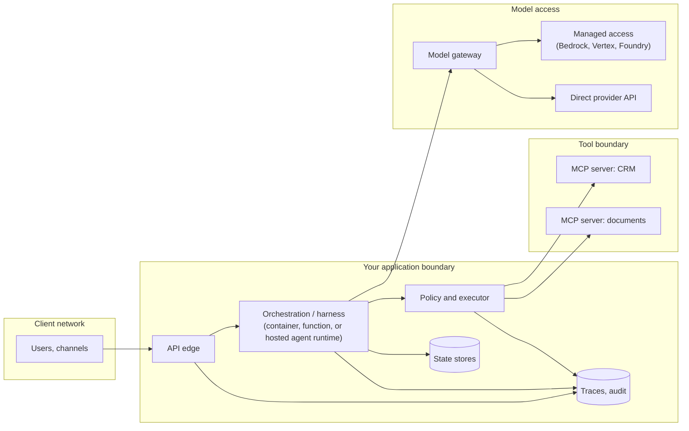

# S01.07: Deployment Topologies

Status: **Drafted** (first written pass, 23 October 2026; consolidated from the "provider and serving topology" and "production-shaped deployment" golden answers, the regulated-provider-placement scenario, the delivery-chain cluster and the model-runtime chapter of the earlier AI Application Architecture book). Platform-specific product details are deliberately kept at the level of the decision; verify current service names and features against vendor documentation before quoting.

Where each plane of the reference architecture runs, and how to choose. The governing rule: **the unit of approval is the workload and its exact configuration, not a platform label; feature lag is measured for the capability you need, not asserted as a vendor rule.**

### What we are trying to avoid

"We use Bedrock, so we are compliant." A VPC perimeter mistaken for private transport, or a private endpoint mistaken for a data-location guarantee. A six-week feature lag discovered after the architecture was approved. An MCP server deployed where the tool's credentials are reachable by every agent in the account. A demo that works on the laptop and fails after customer configuration is injected. A deployment with no health evidence, no rollback steps and no rehearsed failure.

### Has this happened?

The regulated-placement scenario's failure branch is the common one: the selected managed platform trails a required model feature by six weeks. Teams that approved "the platform" are stuck; teams that approved "this model, this region, this feature set, with this exit path" have a decision record to revisit.

## 30-second version

Start from the customer's controls: who may call the model, where requests and logs may be processed, permitted operators, retention, encryption, audit and incident obligations. Build a capability matrix for the specific model and access path: managed cloud access (Bedrock, Vertex, Azure AI Foundry) may reuse cloud IAM, billing and network integration; direct provider APIs may offer features earlier and can also have enterprise identity and private connectivity options. Verify the exact model, region, inference routing, retention and quota contract. Then place the planes: the orchestration and harness as a service you own (containers, functions, or a hosted agent runtime such as Foundry Agent Service or Bedrock AgentCore Runtime), MCP servers close to the systems they front with their own identity and network boundary, state in stores you control, and the model behind a gateway you can route. Deploy one identified artifact with validated configuration, health checks, telemetry, a rehearsed failure mode and a rollback. Record the exit cost.

## Twelve rules to know by heart

1. **Controls first, platform second.** Identity, network, processing location, retention and operations requirements are written before any vendor is named.
2. **Approve the configuration, not the label.** Exact model, region, inference routing (including cross-region fallbacks), logging location, retention, quota.
3. **A VPC perimeter is not private transport,** and a private endpoint is not a residency guarantee. Trace a sample request through identity, DNS, network path, processing region and logs. ([Vertex AI VPC Service Controls](https://docs.cloud.google.com/vertex-ai/docs/general/vpc-service-controls), [Bedrock security](https://docs.aws.amazon.com/bedrock/latest/userguide/security.html))
4. **Measure feature lag for the capability you need:** tool use, streaming, structured output, usage accounting, batch, caching, failover. Do not assume all managed features arrive late or all direct traffic is public.
5. **An existing cloud agreement helps procurement; it does not approve a new data flow.**
6. **Same ticket agent, every topology.** The reference architecture's planes and contracts do not change when the hosting does; only the implementation of each plane does.
7. **MCP servers are services.** Own identity, least-privilege credentials, network boundary, logs; placed near the system they front, never sharing a blast radius with every agent in the account (S03.03).
8. **Hosted agent runtimes host orchestration, not your truth.** Managed sessions, threads and memory are runtime state; approvals, intent records and audit stay in stores you control (S01.03).
9. **One identified artifact, promoted.** Build once; the same digest runs in every environment; configuration validated at startup (S01.04).
10. **Deployment evidence is part of the deliverable:** reachable endpoint, health checks, telemetry, a failure injection that was actually run, rollback steps, a five-minute walkthrough.
11. **Exit cost is explicit.** The decision record names what a migration or reversal would cost: SDK surface, identity integration, network wiring, eval re-runs.
12. **Serving shape follows workload:** realtime, serverless, dedicated or provisioned capacity, batch; interactive and offline traffic do not share a quota.

## Placement of the planes

Network boundaries to draw explicitly: client to edge; application to model access (private connectivity where required); application to each MCP server; MCP server to its system of record. Each crossing names its identity, its encryption and where its logs land.

## Managed versus direct: the decision record

| Dimension | Managed cloud access | Direct provider API | What to verify |
|---|---|---|---|
| Identity | Cloud IAM, existing roles and policies | Provider keys, possibly enterprise SSO | Who can call which model; key rotation; per-tenant attribution |
| Network | Private endpoints and perimeters within the cloud | Public endpoints; private connectivity options vary | Actual path of a request; what the perimeter does and does not cover |
| Residency | Region pins per model; cross-region routing options | Provider-defined processing regions | Exact processing region for this model; log and retention location |
| Features | May trail provider releases for some capabilities | Earliest access to new capabilities | The specific features you need and their availability dates |
| Quotas and capacity | Cloud quotas; provisioned throughput options | Provider rate limits; committed capacity options | Interactive versus batch isolation; burst behaviour |
| Operations | Cloud billing, logging and monitoring integration | Provider dashboards; your own gateway metrics | Usage accounting granularity; outage history and status |
| SDK and behaviour | Cloud SDK surface | Provider SDK surface | Retries, streaming, tool-call semantics, observability parity |
| Exit | Re-wire identity, network, SDK; re-run evals | Same, in reverse | Written exit cost per direction |

The answer begins with customer constraints, keeps trade-offs provider-specific but portable, and makes exit costs explicit. Test operational parity (tool use, streaming, structured output, usage accounting, failover) and task quality on both paths before deciding.

## The same ticket agent on each topology

| Topology | Orchestration runs in | MCP servers run in | Model access | Where the contracts live |
|---|---|---|---|---|
| Azure (Foundry) | Foundry Agent Service, Container Apps or Functions, private networking | Container Apps or AKS near the systems of record, Entra identities | Foundry model endpoints or direct APIs behind a gateway | Your code: executor, intent records, approvals; S03.03b for Entra |
| AWS (Bedrock) | AgentCore Runtime or ECS/Lambda | AgentCore Gateway or ECS near the systems, IAM roles | Bedrock or direct APIs behind a gateway | Same; S03.03c for AgentCore |
| Google (Vertex) | Agent runtime or Cloud Run | Cloud Run near the systems, service accounts | Vertex or direct APIs behind a gateway | Same |
| Self-hosted (Kubernetes) | Deployments with HPA, network policies | Separate deployments and namespaces per system | Self-hosted serving (vLLM and similar) or external APIs behind a gateway | Same; T-Inference for serving |

Product names above are the ones the S01 scope names; treat them as pointers to verify, not as feature claims. The point of the table is that the fourth column does not change.

## Production-shaped deployment of a thin slice

Deliverable for a demo that will be judged as production-shaped: a reachable deployment; validated configuration (startup fails loudly on a missing setting, never prints a secret); health checks that test dependencies, not just the process; telemetry connecting user input, tool calls, policy checks and outcome; a fixed evaluation set with declared pass thresholds; secrets scanning on the repository; a rehearsed degraded mode for dependency failure (CRM timeout during the write path, malformed model output, unsupported intent); rollback steps; and a five-minute walkthrough that names what was proven and what was not.

When configuration drift breaks the demo, recover without hiding the failure: show the validation error, show the fix, and narrate the control that prevents it next time (S01.04).

## Interview probes

- For a regulated enterprise workload, choose between a model provider's direct API and managed access through AWS Bedrock or Google Vertex AI. Defend identity, networking, residency, feature-lag and operations trade-offs.
- Choose direct model API, Bedrock or Vertex for a regulated customer and defend the migration and reversal path; private connectivity is preferred, a new model feature is time-sensitive, audit evidence is mandatory.
- The selected managed platform trails a required model feature by six weeks. What now?
- Build and deploy a production-shaped AI support workflow, then deliver a five-minute walkthrough that proves behaviour, evaluation, observability, safe failure and your ownership of the code.
- Where do your MCP servers run, with what identity, and what can an attacker reach if one is compromised?
- The interviewer changes the data-residency requirement halfway through. What changes in your design, and what does not?

## What this is not

Not the serving-engine choice (T-Inference), not the Kubernetes mechanics (N03), not the identity protocol (S03.03). It fixes the placement decision and the evidence a deployment must carry.

## Related chapters

- [S01.04 Control Plane](../S01.04-Control-Plane/README.md): artifact promotion, configuration and release gates.
- [S01.05 Multi-Tenancy and Identity Propagation](../S01.05-Multi-Tenancy-and-Identity-Propagation/README.md): residency as a configuration property.
- [S03 index](../../S03-AI-Agents-Tools-and-MCP/README.md): S03.03b (Foundry and Entra) and S03.03c (AWS AgentCore) are scoped there but have no chapter yet.
- [T-Inference](../../T-Inference/T00-Inference-Foundations-and-Serving-Economics/README.md): self-hosted serving.

## Sources

Carried from the prior golden answers; not re-fetched on 23 October 2026, so verify before quoting.

- AWS, [Security in Amazon Bedrock](https://docs.aws.amazon.com/bedrock/latest/userguide/security.html).
- Google Cloud, [VPC Service Controls with Vertex AI](https://docs.cloud.google.com/vertex-ai/docs/general/vpc-service-controls).
- pip, [Repeatable installs](https://pip.pypa.io/en/stable/topics/repeatable-installs/).

[Back to S01](../README.md)
