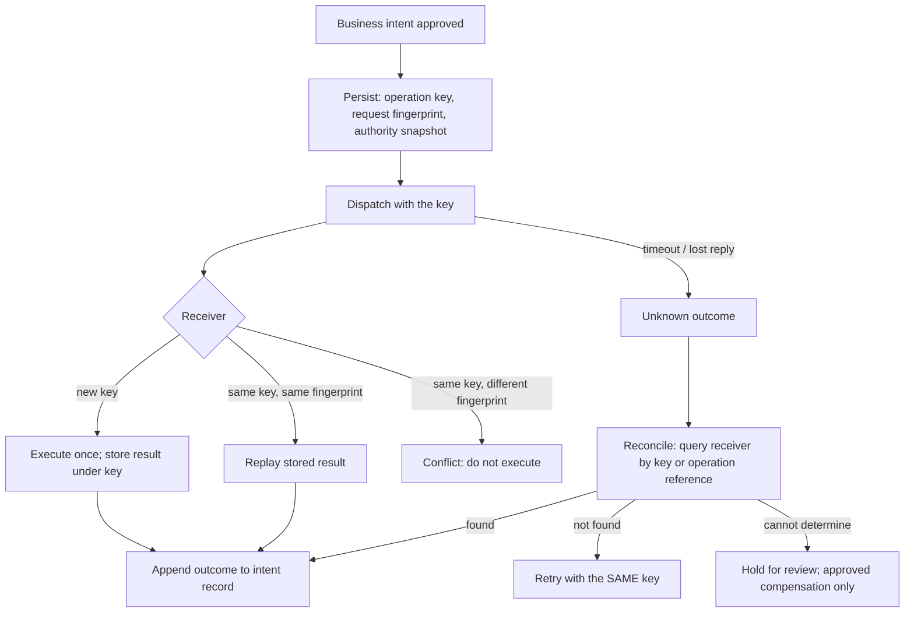

# S01.08: Reliability: Retries, Idempotency, Backpressure

Status: **Drafted** (first written pass, 23 October 2026; consolidated from the "production control architecture" idempotency answer, the webhook-delivery design, the incident-diagnosis and four-hour-outage golden answers, the SDK retry-classification kata, and the reliability-operations chapter of the earlier AI Application Architecture book).

The failure modes of an LLM application and the contracts that contain them. The governing rule: **a timeout means unknown outcome. Idempotency remembers intent; reconciliation answers the uncertainty idempotency cannot cover.**

### What we are trying to avoid

An agent that retried a tool call after a timeout and executed the payment twice. A retry loop in the agent, another in the SDK and a third in the proxy, multiplying attempts. A fallback model routed to during an outage that nobody evaluated. A four-hour outage against a 99.9% SLA met by redefining availability. A cleanup that deletes "duplicate" CRM rows from a trace without checking the system of record. Disabling retries to fix latency and quietly increasing lost updates.

### Has this happened?

The practice incident in the prep contract is a synthetic composite of three real patterns arriving together: p95 jumping from 1.2 to 9.4 seconds, duplicate CRM writes after retries, and answers with no retrieved evidence. The fixture proves it with a runnable unsafe path: losing a committed write's reply and retrying creates two rows, and empty retrieval still produces a confident answer. Both bugs are the default behaviour of a first implementation.

## 30-second version

Classify failures before handling them: transient (429, 5xx, disconnect) gets bounded retries with exponential backoff and jitter; fatal (4xx) is never retried; unknown (timeout, lost reply) is reconciled before anything is repeated. Give retries one owner and one shared deadline and attempt budget across agent, SDK and proxy. For every consequential action, persist the business intent, an immutable request fingerprint and an operation key before dispatch, reuse that key across every retry, redelivery and repeated model proposal, and verify the receiver's idempotency contract (retention, parameter matching, concurrent-request behaviour). A local key table cannot atomically protect an external API; if the receiver lacks idempotency, use a queryable operation reference and reconciliation, or hold the action for review. Bound admission per tenant and per fleet, use finite buffers with an explicit overflow policy, and put per-destination circuit breakers in front of flaky dependencies. Design degraded modes per capability in advance, with truthful status; recovery includes re-evaluation before full traffic. In an incident, contain unsafe writes first, then treat each symptom as a separate hypothesis.

## Twelve rules to know by heart

1. **Three outcomes, not two:** success, failure, unknown. Unknown is reconciled, never retried blind.
2. **Transient-only retries.** Backoff plus jitter on 429 and 5xx; 4xx is fatal; a repeated 4xx is still a 4xx.
3. **One retry owner, one budget.** Agent, SDK and proxy share a total deadline and attempt count; the same operation key on every attempt.
4. **Intent record before dispatch.** Business intent, request fingerprint, operation key, authorization snapshot; outcome appended after. No record, no dispatch. ([Stripe, idempotent requests](https://docs.stripe.com/api/idempotent_requests) as the reference receiver contract)
5. **The receiver's memory decides the guarantee.** Verify retention, parameter comparison and concurrency semantics; never change the request body under the same key.
6. **Local transactions do not cover external effects.** Atomic local state stops competing workers from creating duplicate intents; it cannot make an unrelated payment API exactly-once.
7. **Idempotency and concurrency control are different.** The key stops the same intent executing twice; an expected version or ETag detects that the state acted on has changed (S03.04).
8. **Accept, then deliver.** Durable queue and immediate acknowledgement; a customer's flaky endpoint never holds the ingest path hostage.
9. **Circuit breakers per destination.** One dead endpoint must not eat the fleet; dead-letter and redrive after the window.
10. **Admission before capacity.** Per-tenant and fleet limits, finite buffers, fast rejection with a truthful status; protect the interactive path from offline work.
11. **Fallback is a product capability** with tested capacity, quality, tool semantics and data handling; degraded responses count as available only if the agreed contract says so.
12. **Contain, then diagnose.** Stop unsafe writes, preserve audit evidence, separate the failure planes, confirm causes before repairing, add regression cases for each confirmed failure. ([Google SRE Book, managing incidents](https://sre.google/sre-book/managing-incidents/))

## Failure modes of an LLM application

| Failure | Where it shows | Containment | Prevention |
|---|---|---|---|
| Provider timeout mid-stream | Partial output, hung client | Per-chunk deadline converts to retryable failure; surface partial text | Deadlines per phase and overall (S01.02) |
| Lost reply after commit | Duplicate effect on retry | Treat as unknown; reconcile with receiver | Intent record and operation key; receiver idempotency |
| Rate limit (429) | Burst of retries amplifies load | Backoff with jitter; one retry owner | Admission control; per-route quotas |
| Partial tool failure | "Meeting moved, notification failed" | Tool reports partial outcome explicitly | Tool contracts with defined partial states (S03.04) |
| Malformed model output | Crash or silent bad parse | One repair pass, then fail closed | Schema validation before execution |
| Unknown tool or argument | Dynamic dispatch of nonsense | Refuse; return error to the model | Registry check; validate before execute |
| Slow consumer | Unbounded server memory | Finite buffer with overflow policy | Backpressure design |
| Hot tenant or hot partition | Others starve | Per-tenant admission; isolate the backlog | Partition keys that preserve required ordering (S01.03) |
| Provider outage | Whole capability down | Pre-approved fallback or degraded mode; honest status | Fallback evaluated in advance; outage game day |
| Expired authority on resume | Action executes under stale approval | Re-authorize before deferred execution | Approval records with expiry (S01.03) |

## The idempotency contract, end to end

The model never invents payment or operation identities; the application supplies the key and maps repeated proposals for the same approved intent to the same record. Compensation such as a refund is a separately authorized operation and may not fully undo fees or customer harm.

The toy receiver in the prep fixture stores a tenant-and-case key with a request fingerprint under a lock: lost reply returns unknown, retry replays the committed result, a different payload under the same key is a conflict, and two concurrent requests that both observe an absent key resolve to one resolved and one conflict. It proves the mechanism; it has no cross-process durability or retention guarantee, and that gap is the first thing to name in a defence.

## Durable delivery: the webhook shape

The webhook-delivery design is the reliability pattern in miniature and recurs as an interview screen. Accept the event into a durable queue and return 202 immediately. Delivery workers retry with exponential backoff and jitter across the window (roughly ten attempts from seconds to hours over 24 hours), sign payloads (HMAC), and record every attempt so that lookup is a status row, not a log grep. Per-destination circuit breakers stop one dead endpoint from eating the fleet. Ordering is per customer, best effort, with an explicit sequence number. The receiver contract is at-least-once plus idempotent consumption by event ID. After the window, dead-letter with redrive. The hard case: the receiver commits the event but drops the response; the sender sees unknown, retries, and the receiver's dedupe by event ID is what keeps the effect single.

## Backpressure and admission

Admission limits at tenant and fleet scope, enforced at the edge and again at the worker pool. Finite buffers between producer and consumer with a named overflow policy: reject new work with a truthful status, drop the oldest with a recorded loss, or pause the producer. Separate pools and quotas for interactive and offline traffic. Backfills and batch jobs are admitted per tenant so one large tenant cannot starve the live stream. Fast 429s are cheaper and kinder than slow timeouts.

## Degraded modes and the outage

Availability needs a measurement window, success definition, exclusions and a way to count events. A time-based 99.9% objective over thirty days allows 43.2 minutes of downtime; a four-hour outage counted in full consumes about 5.6 such budgets. A request-weighted objective can differ because traffic varies. Calculate against the actual agreement; do not redefine availability during the incident. ([Google SRE Book, service level objectives](https://sre.google/sre-book/service-level-objectives/))

Before the outage: per capability, decide what falls back (to which evaluated model), what degrades (cached FAQs, queued offline summaries, read-only mode, human handoff) and what suspends (consequential actions whose fallback was never evaluated). During: declare the incident, stop uncontrolled retries, publish truthful status, protect remaining dependencies, route only to pre-approved fallbacks. Queued work needs deadlines, cancellation and fresh authorization before execution; an approval from four hours ago may no longer be valid. In-flight external writes are reconciled, because a missing reply does not prove nothing happened. Recovery uses limited probes and staged traffic return so the backlog does not overwhelm the service, and re-evaluation before full traffic.

## Running the incident

Contain first: disable unsafe automatic retries or move the affected write tool to controlled review; preserve operation IDs; never run a cleanup that destroys audit evidence. Then treat each symptom as a hypothesis with its own evidence path:

- **Latency.** Compare representative traces and distributions by route and tenant with deployment and load changes overlaid; find which bucket grew (queue, retrieval, tools, provider). Nearest-rank p95 from the supplied observations, not an eyeball. ([OpenTelemetry traces](https://opentelemetry.io/docs/concepts/signals/traces/))
- **Duplicate writes.** Join logical intent, attempts and authoritative CRM records. A local trace is not proof that the external write committed; reconciliation and compensation need business approval.
- **Missing evidence.** Check document IDs, permissions, retrieval status and the exact context-assembly path; for evidence-required tasks, missing support must yield abstention or handoff. A source-count metric does not prove grounding.

Confirm causes, repair the controls, reconcile, add regression cases for each confirmed failure, and state the limits of local proof: which provider, identity and semantic-grounding seams the fixture did not exercise. The trap to name: disabling retries improves latency and increases lost updates; separate controls protect separate harms even when one load event exposed them together.

## Interview probes

- An agent retried a tool call after a timeout and the payment executed twice. Where do idempotency keys live, and what else guards side effects?
- The real CRM has no idempotency endpoint. Which uncertain writes must pause for reconciliation?
- Design a webhook-delivery platform: customer ID, JSON payload, destination URL; delivery lookup and retries for roughly 24 hours; destinations are slow or malicious; delivery outcome can be unknown.
- Your primary model provider goes down for four hours and your application carries a 99.9% availability SLA. Walk me through what happens, and what should have been designed in beforehand.
- p95 rises from 1.2 to 9.4 seconds, retries create duplicate CRM writes, and some answers lack retrieved evidence. Isolate each failure plane and define safe recovery.
- A retry fired after the tool side effect landed. Make the executed tool safe.
- How would a process crash change the toy receiver's guarantee?
- Two clients reconnect and replay the same send concurrently. What keeps the visible effect single?

## What this is not

Not the tool-contract details (S03.04 owns operation keys, partial outcomes and the executor's intent record), not observability tooling (S09), not the eval gate (S05). It fixes the failure taxonomy and the contracts that contain each class.

## Related chapters

- [S01.02 Request Path](../S01.02-Request-Path/README.md): deadlines, cancellation and the per-chunk stall.
- [S01.03 State, Sessions and Storage](../S01.03-State-Sessions-and-Storage/README.md): intent and approval records.
- [S01.04 Control Plane](../S01.04-Control-Plane/README.md): fallback policy and release gates.
- [S03.04 MCP Tool Design](../../S03-AI-Agents-Tools-and-MCP/S03.04-MCP-Tool-Design/README.md): the executor contract this chapter generalises.

## Sources

Carried from the prior golden answers; not re-fetched on 23 October 2026, so verify before quoting.

- Stripe, [Idempotent requests](https://docs.stripe.com/api/idempotent_requests).
- Google SRE Book, [Service level objectives](https://sre.google/sre-book/service-level-objectives/), [Managing incidents](https://sre.google/sre-book/managing-incidents/), [Monitoring distributed systems](https://sre.google/sre-book/monitoring-distributed-systems/).
- OpenTelemetry, [Traces](https://opentelemetry.io/docs/concepts/signals/traces/).
- Apache Kafka, [Message delivery semantics](https://kafka.apache.org/41/design/design/#design_deliverysemantics).

[Back to S01](../README.md)
