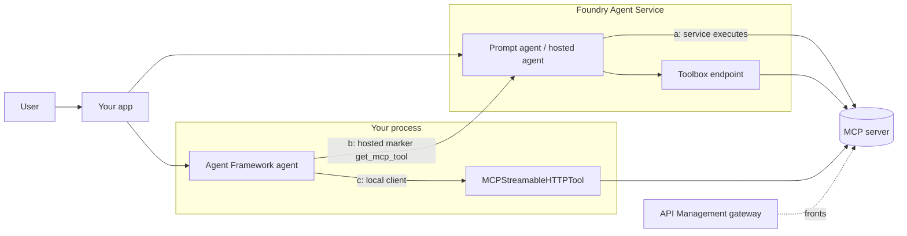
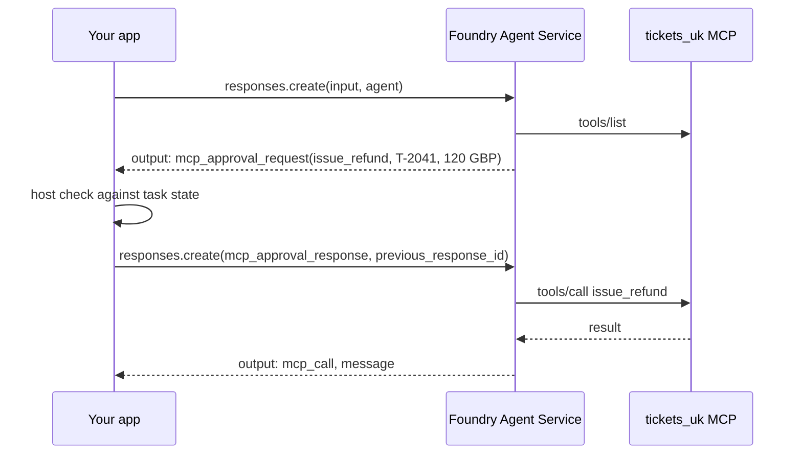
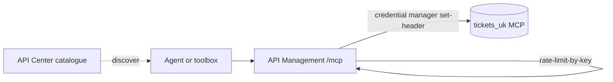
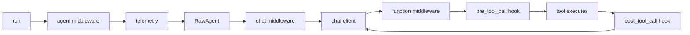

# S03.F: Tools and MCP on Microsoft Foundry, built with Agent Framework

Foundry gives you four ways to put a tool in front of a model: a built-in tool the service runs, a function the client runs, a remote MCP server the service calls, and a toolbox that fronts all of them behind one governed endpoint. Microsoft Agent Framework adds a fifth: your own process as the MCP client. **Every design decision in this chapter comes down to one question: where does the tool call execute, and therefore who holds the credential, the retry, the approval and the trust boundary.**

> *The prompt guides the proposal; the host governs progression; the backend authorizes the effect.* On Foundry, "host" is sometimes the service and sometimes your code. Know which before you ship.

This chapter maps the Foundry capability catalogue onto the S03 ticket system (`get_ticket`, `list_tickets`, `get_policy`, `issue_refund`; Ayşe reads, Mert refunds; regional `tickets_uk_` and `tickets_de_` servers, third-party `fx-rates`), and shows how each capability is built with Agent Framework in Python. Facts come from a crawl of the Microsoft Learn pages on 23 Oct 2026, kept in [`reference/reading-map-2026-10-23.md`](reference/reading-map-2026-10-23.md). Page letters such as B1 or F6 refer to that map. Nothing here has been run; see the status line at the end.

### What we are trying to avoid

A refund tool runs with `require_approval` left at its default and nobody notices the approval item sits unanswered until the run expires. The same MCP server is attached once as a hosted tool and once as a local tool, and the team cannot say which path a trace came from. A toolbox is treated as a firewall when it only routes; the rate limit lives in API Management and was never configured. A user's Microsoft token is forwarded to a third-party MCP server and refused, or worse, accepted. A read tool returns a ticket body carrying instructions, and the Agent Framework agent follows them because tools run without approval by default (G12). An agent with 129 tools fails with `tool_limit_exceeded` in production rather than in review.

### Has this happened?

The platform-neutral incidents that motivate every control here (the GitHub MCP leak, the Supabase ticket exfiltration, EchoLeak) are told with dated sources in [S03.06](../S03-AI-Agents-Tools-and-MCP/S03.06-Client-as-Trust-Boundary/README.md#has-this-happened-three-micro-stories). Each one is a Foundry design question in disguise: the GitHub case is `allowed_tools` and a per-task scope on the connection; Supabase is a `service_role` credential on a project connection where a user-identity passthrough belonged; EchoLeak is a tool result read as authority, which on Agent Framework is a middleware or hook that never got written. No Foundry-specific incident write-up was fetched on 23 Oct 2026, so none is told here.

### What the chapter covers

The three execution locations and how to recognise them in a trace (1). The Foundry tool catalogue and which tools can live in a toolbox (2). The `mcp` tool on Foundry Agent Service: fields, approval loop, limits, background mode (3). Toolbox: what it adds, what it does not, versions, tool search and skills (4). Identity and authentication for tool calls, from a static key to agentic identity (5). Governance and networking: API Management, API Center, private MCP (6). Building an MCP server Foundry can call (7). The Agent Framework side: function tools, hosted and local MCP, approvals, middleware and hooks, exposing an agent as a server (8). How this maps onto S03.03 to S03.06 (9).

### What you have at the end

A capability-to-construct table you can recite, a decision rule for hosted versus local MCP, the approval loop drawn as a sequence, a list of things Toolbox does not do, and three untested sketches in [`sketches/`](sketches/) that show the shape of each build.

## 1. Three places a tool call can execute

### The model to carry

Three arrows reach the MCP server, and only one starts in your process. (a) Foundry executes the call from a prompt agent's `mcp` tool or through a toolbox. (b) Agent Framework's `get_mcp_tool` looks local in code but is a marker the service executes. (c) `MCPStreamableHTTPTool` or `MCPStdioTool` opens the connection from your process. Toolbox sits in front of (a) and (b) as the governed endpoint; API Management sits in front of everything as the gateway.

### What changes with location

| Concern | (a) Service executes | (b) Hosted marker | (c) Local client |
|---|---|---|---|
| Who holds the credential | Project connection | Project connection | Your `header_provider` |
| Who enforces approval | Service emits `mcp_approval_request`; you answer | Same as (a) | Framework `approval_mode`, your code |
| Where S03.06 checks live | Only on the approval answer | Same as (a) | Function middleware and hooks on every call |
| Timeout | 100 s non-streaming, or background mode | Same as (a) | Whatever you set |
| Network path | Agent subnet or data proxy | Same as (a) | Your network |
| Trace shows | `mcp_call` output items | Same as (a) | Framework spans |

*Micro-example.* Ayşe's agent calls `get_ticket("T-2041")`. Under (a) the Responses output contains an `mcp_call` item with the server label `tickets_uk`. Under (c) your OpenTelemetry trace shows a client span from your pod to the server, and your middleware saw the arguments before the call left. The user experience is identical; the audit trail is not.

**Interview line.** "Hosted MCP on Foundry means Foundry invokes your server, it does not host your server, and `get_mcp_tool` in Agent Framework is still that hosted path."

**Study check.** A reviewer asks for a middleware that redacts PII from every tool argument. Which execution location does this force? **Answer.** The local client (c). Under (a) and (b) the service builds the request; your code only sees the approval item, and only for tools that require approval.

Rule to keep: **name the execution location before naming the SDK call.**

## 2. The Foundry tool catalogue

### Tool types and where they can live

Foundry distinguishes built-in tools the service runs, client-executed function calling, and custom tools reached over OpenAPI, MCP or A2A (A2). Toolbox can front some of them and not others (A1).

| Tool | Executes | Toolbox-eligible | Note |
|---|---|---|---|
| File search, code interpreter, Azure AI Search | Service | Yes | `structured_inputs` templates let per-request values vary (A2) |
| Web search (`WebSearchTool`, `WebSearchToolboxTool`) | Service | Yes | Bing data sits outside the Azure compliance boundary (D5) |
| OpenAPI | Service | Yes | Anonymous, connection or managed identity with audience; JSON bodies only (D1) |
| MCP | Service | Yes | The subject of section 3 |
| A2A agent endpoint | Service | Yes | `a2a` 1.0 GA replaces Connected Agents (D3) |
| Function calling | Your client | No | Responses loop, `function_call` to `function_call_output` by `call_id`; 10-minute run expiry (D2) |
| Grounding with Bing, image generation, SharePoint, Fabric data agent, computer use, Azure Functions | Service or your app | No | Direct-only on the agent definition (A1) |
| Tool search, skills, reminder | Toolbox | Toolbox-only | Reminder needs a hosted agent (C5, C6, C8) |

### Limits that bite at design time

An agent holds at most 128 tools (`tool_limit_exceeded`, A6). The service rejects MCP tool schemas that use `anyOf`, `allOf` or multi-type parameters with "Invalid tool schema" (B1). `tool_choice` takes `auto`, `required` or `none` (A3). Availability varies by model and region; A6 carries the matrix, so check it before promising a tool in a region.

*Where it goes wrong.* A team generates MCP tools from a Pydantic model with `Optional[int]`. The schema says `anyOf: [integer, null]` and Foundry refuses the tool. The fix is in S03.04: flatten the schema, one type per parameter, defaults in the description.

**Interview line.** "Toolbox cannot front function calling, so anything client-executed stays on the agent definition."

**Study check.** Ayşe's agent needs `issue_refund` through MCP, Bing grounding and a local Python function. How many places do the tool definitions live? **Answer.** Two. MCP goes on the toolbox or the agent definition; Bing and the local function must be direct on the agent definition.

Rule to keep: **the 128-tool cap and the flat-schema rule are review items, not runtime surprises.**

## 3. The `mcp` tool on Foundry Agent Service

### The fields

| Field | Meaning | Default and advice |
|---|---|---|
| `server_url` | Remote Streamable HTTP endpoint | Must be reachable from the service or the agent subnet |
| `server_label` | Unique name per agent | Several servers per agent, labels must differ |
| `allowed_tools` | Allow-list of tool names | Default is all tools; always pin |
| `require_approval` | `always`, `never`, `{"never":[...]}` or `{"always":[...]}` | Default `always`; exempt reads, never exempt `issue_refund` |
| `project_connection_id` | Connection carrying credentials | Replaces headers in the prompt; six auth types (section 5) |

A sketch of the definition and the loop is in [`sketches/foundry_mcp_tool_approval_loop.py`](sketches/foundry_mcp_tool_approval_loop.py) (untested).

### The approval loop

The service pauses with an `mcp_approval_request` item and resumes only when you send an `mcp_approval_response` chained by `previous_response_id` (B1, A4). The item carries the exact arguments, so bind your confirmation to them: changed arguments invalidate it, approval never overrides policy, and a timeout is an unknown outcome. The first call to an OAuth-backed server can instead return `oauth_consent_request` with `CONSENT_REQUIRED` (`-32006`); the user completes consent and you re-run (B2).

*Micro-example.* Mert asks for a refund on `T-2041`. The approval item says `amount: 120, currency: "GBP"`. Host code compares it with the ticket's recorded amount and Mert's `tickets.refund` scope, then answers `approve: true`. If the model had proposed `EUR`, the same code answers `false` and the model gets the denial as a result, not an exception.

### Time limits and background mode

A non-streaming MCP call must finish within 100 seconds (B1). For longer work the service supports background operations in preview, which needs the server to implement MCP tasks and return the related task id, and a model that supports background mode (`gpt-5.4`/`5.5` at crawl time). Otherwise the synchronous limit applies. Use `background=True` on the response and poll (A4); for toolbox endpoints the consuming harness must also support tasks.

*Where it goes wrong.* A reconciliation tool averages 90 seconds and occasionally 130. In testing it passes; in production one call in ten times out and the model retries with a fresh call. Give the tool an operation key and make the server idempotent before you reach for background mode.

*When not to.* If the tool is a single lookup your own code could make before the model runs, do not wrap it in MCP; put the result in the prompt (S03.05).

**Interview line.** "`require_approval` defaults to always, the approval item carries the arguments, and the answer is chained by `previous_response_id`."

**Study check.** Where should the check that `amount` matches the ticket live, and why not in the system prompt? **Answer.** In the host code that answers the approval item, because the prompt only guides the proposal and the model can be talked out of a prompt rule by a ticket body.

Rule to keep: **approve arguments, never intentions.**

## 4. Toolbox

### What it adds

A toolbox is one managed MCP-compatible endpoint that fronts many tools (A1, C1). The consumer endpoint `/toolboxes/{name}/mcp` serves the `default_version`; `/versions/{v}/mcp` exists for testing, and the first version is auto-promoted. It injects credentials and refreshes tokens from the project connections, applies guardrails through `rai_policy_name` on tool inputs and outputs, emits tracing to Application Insights, and can carry tool search and skills.

| Toolbox gives you | Toolbox does not give you |
|---|---|
| One endpoint, versioned, promote-to-default | Rate limiting or IP restriction (API Management does, E1) |
| Central credential injection and refresh | Execution of your tool code (it routes to your server) |
| `rai_policy_name` guardrails | Enforcement of `require_approval` (the consuming agent does, C1, C3) |
| Tool search over ten-plus tools (C5) | Cross-project skills (same project only, C6) |
| Skills as `skill://{name}` resources | A substitute for backend authorization |

### Tool search: Foundry's answer to S03.05

Enable `{"type":"toolbox_search"}` and the model sees two meta-tools, `tool_search` and `call_tool`, instead of the full list (C5). Search is BM25 over name, description and parameters; `limit` defaults to 5 and caps at 10. You can pin tools, add `additional_search_text`, or expose everything with `"*"`, and the toolbox auto-pins per user. Microsoft recommends it from ten tools. The trade is the one S03.05 measures: fewer tokens per turn against an extra round trip and a retrieval that can miss.

*Micro-example.* The support toolbox holds forty tools across `tickets_uk_`, `tickets_de_`, `fx-rates` and `notifications`. With search on, Ayşe's "what is the refund window for T-2041" turn costs one `tool_search` for "refund policy" that returns `get_policy` and `get_ticket`, then two `call_tool` calls. Pin `get_ticket` so the common first step never depends on retrieval.

### Skills

Skills are versioned, immutable `SKILL.md` files exposed as MCP resources under `skill://`, with an index at `skill://index.json` (C6, F12). They need the `Foundry-Features: Skills=V1Preview` header and live in one project. In Agent Framework a `SkillsProvider` with `MCPSkillsSource` reads them, and `FoundryToolbox.as_skills_provider()` wires a toolbox's skills in one call (F7). A skill is instruction text the model reads, so it is data, never authority.

### Consuming a toolbox

From a prompt agent you add the toolbox like any tool; the scope is `https://ai.azure.com/.default` and `stream=True` is required (C1). From a hosted agent or Agent Framework you use `FoundryToolbox` (Python) or `AddFoundryToolboxes` (.NET), and LangGraph has `AzureAIProjectToolbox` (C3). The `require_approval` setting arrives as `_meta.tool_configuration` on each tool, and your runtime must honour it; a 401 means the caller lacks the `Foundry Agent Consumer` role, a 403 or consent error means the connection behind a tool needs the user to consent. A sketch is in [`sketches/af_foundry_toolbox.py`](sketches/af_foundry_toolbox.py) (untested).

*Where it goes wrong.* A team reads "guardrails at the toolbox level" and removes the refund policy check from the server. `rai_policy_name` screens content; it does not know Mert's scope or the ticket's amount. The backend still authorizes the effect.

**Interview line.** "Toolbox is the governed endpoint, not the gateway and not the executor: it versions, injects credentials and screens content, while approval is enforced by whoever consumes it."

**Study check.** Which three controls from the toolbox table would you still have to add for an internet-facing deployment? **Answer.** Rate limiting and IP restriction in API Management, approval enforcement in the consuming runtime, and authorization in the tool's backend.

Rule to keep: **a toolbox routes and screens; it does not approve or authorize.**

## 5. Identity and authentication for tool calls

### Six connection auth types

Credentials for MCP and toolbox tools live on a project connection, never on the agent definition or in the prompt (B1, C4).

| `authType` | Who the server sees | Use for | Watch out |
|---|---|---|---|
| `none` | Nobody | Public read servers | Anything with writes |
| `custom-keys` | A static key in a header | `fx-rates` with an API key | Rotation is manual |
| `oauth2` | A client the server issued | Partner servers; Foundry-managed connector list or your own app registration | First use returns `CONSENT_REQUIRED`; `offline_access` for refresh |
| `user-entra-token` | The signed-in user, with `audience` | `tickets_uk_` enforcing Ayşe versus Mert | Microsoft-audience tokens cannot go to third-party servers |
| `project-managed-identity` | The project | Internal servers trusting the project as a whole | Loses the user; pair with task state |
| `agentic-identity` | The agent's own Entra service principal | Audited per-agent access | Preview; blueprint plus federated credential (A5) |

Two constraints hold across all of them: the server must be in the same tenant for Entra-based types, and the caller needs the `Foundry Agent Consumer` role (B2, C4). The toolbox forwards `x-agent-foundry-call-id`, which your server should log for correlation (C4).

### Agent identity

An agent identity is an Entra service principal created from a blueprint with a federated credential (A5). Tokens come from a four-stage exchange, and the audience is the downstream resource, never the MCP URL. Shared identities serve development; published identities are per deployed agent. Roles were renamed from "Azure AI" to "Foundry" during 2026, so older docs and scripts disagree with the portal.

*Micro-example.* Ayşe's agent calls `issue_refund` through `tickets_uk_` behind `user-entra-token`. The server sees Ayşe's token, finds no `tickets.refund`, and returns a 403. The agent reports it and offers to hand the ticket to Mert. Switch the connection to `project-managed-identity` and the same call succeeds for everyone, which is the Supabase shape.

### Agent Framework's view

Under the hosted path the connection does the work and your code never sees a token. Under the local path `MCPStreamableHTTPTool` takes `static_headers` or an async `header_provider` (F6); the provider fetches a token per user and per call, which is where S03.03's on-behalf-of exchange runs. A sketch is in [`sketches/af_hosted_vs_local_mcp.py`](sketches/af_hosted_vs_local_mcp.py) (untested).

*Where it goes wrong.* A developer puts `Authorization: Bearer ...` in `headers` of a runtime `structured_inputs` template so each request can vary it. It works, and the token now appears in every request log and trace. Use the connection.

**Interview line.** "Auth lives on the connection: six types, same tenant, audience is the downstream resource, and a Microsoft token never leaves for a third-party server."

**Study check.** Which auth type lets the server enforce the Ayşe/Mert difference without a lookup table of its own? **Answer.** `user-entra-token` with the server's audience; the server reads scopes from the user's token.

Rule to keep: **the identity the server sees is the identity the policy checks; choose it on purpose.**

## 6. Governance and networking

### API Management as the gateway

Govern MCP tools with an AI gateway (E1) routes the agent's MCP traffic through API Management at a URL under `*.azure-api.net/mcp/`. It applies only to new portal-created MCP tools without managed OAuth, at creation time, and it does not log tool traces. What you get: `rate-limit-by-key`, 429 and 403 responses, `X-RateLimit-Remaining`, IP restriction and any inbound policy. Inbound auth is a subscription key or `validate-azure-ad-token`; outbound, credential manager's `get-authorization-context` plus `set-header` injects the downstream credential (E7). API Management can also expose a REST API as an MCP server or pass through an existing one, tools only, Streamable HTTP, SSE deprecated (E4, E5, E6).

The gateway is the only box that counts calls per key, so budget enforcement for `fx-rates` lives there, not in the toolbox.

### Catalogue and networking

API Center acts as the organisation's MCP registry and powers the private tool catalogue in Build, Tools (B4, E8); readers need the Data Reader role. Private MCP servers require Standard agent setup with your own virtual network, the agent subnet delegated to `Microsoft.App/environments` (a `/24` is recommended), and Container Apps with internal ingress on that subnet (B1, E10). A toolbox inherits the project's networking (C7). All tool egress goes through a single-tenant data proxy (E15). E9 holds the per-tool network-isolation matrix; some tools are unsupported in isolated mode, so check it before promising isolation.

*When not to.* A single internal read-only server used by one team does not need API Management in front of it. Add the gateway when you have a third-party server, a per-key budget, or an IP allow-list requirement.

**Interview line.** "Toolbox governs the tool surface, API Management governs the traffic, API Center governs discovery, and the subnet governs the path."

**Study check.** A new MCP tool is created through the SDK with managed OAuth. Does the AI gateway policy apply? **Answer.** No. Gateway routing applies to portal-created tools without managed OAuth, applied at creation.

Rule to keep: **put each control where it is enforced, and the rate limit is enforced in the gateway.**

## 7. Building an MCP server Foundry can call

### Hosting choices

| Host | When | Note |
|---|---|---|
| Azure Container Apps | Default for a Python server with its own lifecycle | Internal ingress for private MCP; tutorial in Python (E13, E14) |
| Azure Functions | Event-shaped tools, MCP bindings | Endpoint `/runtime/webhooks/mcp`, `mcp_extension` system key as `x-functions-key`; tool, resource and prompt triggers (B3, E11, E12) |
| App Service | Existing web app | Built-in MCP authorization preview; Entra lacks dynamic client registration, so pre-register clients; prefer on-behalf-of over pass-through (E16) |
| AKS | You already run a cluster | Nothing Foundry-specific |

### What the server must satisfy

Streamable HTTP, a flat tool schema, responses under 100 seconds unless it implements MCP tasks, and an identity story that matches section 5. Register it in API Center so it shows in the private catalogue. The S03.02 FastMCP server already meets the transport and schema rules once `Optional` parameters are flattened; the S03.03 Keycloak server would need an Entra front or an API Management policy to be reachable under `user-entra-token`.

*Micro-example.* You deploy `tickets_uk_` on Container Apps with internal ingress, register it in API Center, create an `oauth2` connection, and add it to the support toolbox as version 2 before promoting. Ayşe's agent keeps calling version 1 until you promote; a smoke test calls `/versions/2/mcp` first.

**Interview line.** "Container Apps by default, Functions for bindings, internal ingress on the delegated subnet for private, and MCP tasks if any tool runs past 100 seconds."

**Study check.** Why does Foundry's own hosted MCP Server (`mcp.ai.azure.com`) not belong in this table? **Answer.** It is Microsoft's management server for Foundry resources (79 tools, preview, no SLA, no Private Link, B5 to B7), not a place to host yours.

Rule to keep: **design the server for the caller's limits, then register it where the caller looks.**

## 8. The Agent Framework side

### The tool kinds

| Agent Framework construct | Executes | Foundry equivalent | Page |
|---|---|---|---|
| `@tool` function tool | Your process | Function calling (D2), but the framework runs the loop for you | F2 |
| `client.get_mcp_tool(name, url, headers, approval_mode, allowed_tools)` | Service | The `mcp` tool on the agent definition | F5 |
| `MCPStreamableHTTPTool`, `MCPStdioTool`, `MCPWebsocketTool` | Your process | None; this is the path Foundry does not offer | F6 |
| `FoundryToolbox` | Service via toolbox endpoint | Toolbox consumer | F7 |
| `get_a2a_tool()` | Service | A2A tool (D3) | F9 |
| `LocalShellTool`, `DockerShellTool` with `ShellPolicy` | Your environment | None | F8 |
| `FoundryAgent` | Service | Binds to the server-side definition; hosted tools must be on that definition | F10 |

`allowed_tools` has three states on both hosted and local tools: `None` means everything the server lists, `[]` means nothing, a list means exactly those (F5). `function_invocation_configuration` bounds the local loop with `max_iterations`, `max_function_calls`, `max_duration_seconds` and `allow_concurrent_invocation` (F2). `tool_choice` and `ctx.add_tools()` / `remove_tools()` change availability per run (F4), and a context provider can inject tools with `extend_tools(source_id, tools)` (G10).

### Approvals

Tools run without approval by default (G12). `approval_mode="always_require"` makes a run return `user_input_requests` instead of executing; your code calls `to_function_approval_response(True|False)` and re-runs on the same session (F3). This gates locally executed tools, including the local MCP client. Hosted MCP calls follow Foundry's `require_approval` and surface as the service's approval items.

### Where S03.06 checks live

The pipeline is middleware, telemetry, then the chat client's function-invocation loop (G4). Function middleware sees the arguments before and the result after a local tool runs (G5, G6); hooks give `pre_tool_call` and `post_tool_call` that fail closed (G7). Argument checks, result sanitising and disclosure filters from S03.06 go here, and they only fire for locally executed tools. FIDES labels (`SecureAgentConfig`, `accepts_untrusted`) add information-flow tracking on top (G13), and `create_harness_agent(...)` is the S04 harness entry point (G14).

### Exposing an agent as a server

`as_mcp_server()` publishes an Agent Framework agent as an MCP server (F6), which is how a specialist agent becomes a tool for another; the A2A route (`get_a2a_tool`, self-hosted A2A, G16) is the alternative when you want agent semantics rather than tool semantics. MCP sampling in the local client is deprecated with removal by 2027-07-28, so do not design a new server that needs it.

*Where it goes wrong.* The team adds a result sanitiser as function middleware, then switches the ticket server from `MCPStreamableHTTPTool` to `get_mcp_tool` for simpler deployment. The sanitiser never runs again and nothing fails loudly. Record the execution location next to each control in the design doc.

**Interview line.** "Hosted marker or local client is the first decision in Agent Framework, because middleware and approvals only reach the calls your process makes."

**Study check.** `allowed_tools=[]` on a hosted MCP tool: what does the model see? **Answer.** No tools from that server; `None` would have exposed every listed tool.

Rule to keep: **a control bound to a local tool silently disappears when the tool goes hosted.**

## 9. Mapping onto the S03 chapters

| S03 chapter | Foundry construct | Agent Framework construct |
|---|---|---|
| S03.02 functions to MCP tools | Remote MCP via `mcp` tool; flat schema rule | `@tool`, `MCPStreamableHTTPTool`, `as_mcp_server()` |
| S03.03 OAuth 2.1 | Connection auth types, `oauth_consent_request`, agent identity | `header_provider` per user and call |
| S03.03b Foundry and Entra | `user-entra-token`, `agentic-identity`, same-tenant rule | Same connection under the hosted path |
| S03.04 tool design | 128-tool cap, no `anyOf`, `tool_choice` | `@tool` name, description, schema, `result_parser` |
| S03.05 context efficiency | Toolbox tool search, `allowed_tools`, `structured_inputs` | `extend_tools`, `add_tools`/`remove_tools`, compaction (G11) |
| S03.06 trust boundary | `require_approval` and the approval item | `approval_mode`, function middleware, hooks, FIDES |

## End-to-end walkthrough

Mert asks the support agent to refund `T-2041`. The agent is an Agent Framework agent using a local MCP client to `tickets_uk_` behind `user-entra-token`, with a toolbox for `get_policy` and `fx-rates` behind API Management.

| Step | What happens | Control | Evidence |
|---|---|---|---|
| 1 | Run starts; context provider injects task state for `T-2041` | Task state, S03.06 | Provider span with `source_id` |
| 2 | Model calls `tool_search("refund policy")` on the toolbox | Tool search, C5 | `tool_search` result with `get_policy` |
| 3 | `call_tool(get_policy)` through toolbox, then API Management | Gateway rate limit, E1 | `X-RateLimit-Remaining` header in gateway log |
| 4 | Model proposes `issue_refund(T-2041, 120, GBP)` locally | `approval_mode="always_require"`, F3 | `user_input_requests` in the response |
| 5 | Host compares with task state and Mert's scope, approves | Bound confirmation, S03.06 | Approval record with argument hash |
| 6 | Function middleware re-checks currency and cap | Policy as code, G5 | Middleware span, no `isError` |
| 7 | `header_provider` fetches Mert's token; call leaves | `user-entra-token`, B2 | Server log with `x-agent-foundry-call-id` absent (local path) |
| 8 | Server checks `tickets.refund`, writes refund, returns receipt | Backend authorizes the effect | Refund row in the ticket backend |
| 9 | `post_tool_call` hook records the effect in task state | Host-owned state | State diff keyed by task id |
| 10 | Model summarises | Summary is not a receipt | Eval checks the backend row, not the text |

What to notice: steps 4 to 6 exist only because the refund tool is local. Move it to `get_mcp_tool` and steps 4 and 6 collapse into one `mcp_approval_request`, and the middleware check disappears.

## The chapter in eight lines

1. Three execution locations: service, hosted marker, local client; name it first.
2. Hosted MCP means Foundry calls your server; it never hosts it.
3. `require_approval` defaults to always; the approval item carries arguments; answer by `previous_response_id`.
4. Toolbox versions, injects credentials and screens content; it does not rate-limit, execute or approve.
5. Auth lives on the connection, six types, same tenant, audience is the downstream resource.
6. API Management counts and limits; API Center catalogues; the delegated subnet carries private traffic.
7. 128 tools, flat schemas, 100 seconds unless MCP tasks.
8. In Agent Framework, middleware and approvals only reach calls your process makes.

## What you should be able to explain

Which trace item proves a call executed service-side. Why `allowed_tools=None` and `[]` differ. Why a Microsoft-audience token cannot be forwarded to `fx-rates`. What the toolbox does with `require_approval`. When background mode applies and what the server must implement. Where a PII redaction middleware can and cannot run. Which Foundry role a toolbox consumer needs.

## What this is not

Not a tutorial on deploying hosted agents (the `azure-deploy-agent` skill and G15 cover that). Not the eval design for tool calls, which lives in S04. Not a full treatment of A2A, memory search or Durable Task; those pages are listed in the reading map's "linked, not yet fetched" section. Not a claim that any sketch runs.

## Implementation scope and versions

Everything describes the Microsoft Learn pages as crawled on 23 Oct 2026, page dates between 2025-11-05 and 2026-10-21. Agent Framework Python parameter names are from those pages and from general knowledge; the Foundry toolbox integration is beta, agentic identity, tool search, skills, background MCP and the AI gateway are preview. Check the pinned SDK version before relying on any name. The S03.03 server pins `mcp 1.26.0` (MCP 2025-11-25); the 2026-07-28 revision changes the lifecycle and deprecates sampling.

## Further reading

Grouped by purpose; the full map with dates and word counts is in [`reference/reading-map-2026-10-23.md`](reference/reading-map-2026-10-23.md).

Protocol contract on Foundry:
- B1 [Connect agents to MCP servers](https://learn.microsoft.com/en-us/azure/foundry/agents/how-to/tools/model-context-protocol)
- B2 [Set up authentication for MCP tools](https://learn.microsoft.com/en-us/azure/foundry/agents/how-to/mcp-authentication)
- A5 [Agent identity concepts](https://learn.microsoft.com/en-us/azure/foundry/agents/concepts/agent-identity)

Toolbox:
- A1 [What is Toolbox](https://learn.microsoft.com/en-us/azure/foundry/agents/concepts/toolbox-overview)
- C1 [Create and manage a toolbox](https://learn.microsoft.com/en-us/azure/foundry/agents/how-to/tools/toolbox)
- C4 [Toolbox authentication](https://learn.microsoft.com/en-us/azure/foundry/agents/how-to/tools/tool-authentication)
- C5 [Enable tool search](https://learn.microsoft.com/en-us/azure/foundry/agents/how-to/tools/tool-search)
- C6 [Use skills in Foundry](https://learn.microsoft.com/en-us/azure/foundry/agents/how-to/tools/skills)

Governance and hosting:
- E1 [Govern MCP tools by using an AI gateway](https://learn.microsoft.com/en-us/azure/foundry/agents/how-to/tools/governance)
- E7 [Secure access to MCP servers in APIM](https://learn.microsoft.com/en-us/azure/api-management/secure-mcp-servers)
- E9 [Configure network isolation for Foundry](https://learn.microsoft.com/en-us/azure/foundry/how-to/configure-private-link)
- E13 [Choose an Azure service for your MCP server](https://learn.microsoft.com/en-us/azure/container-apps/mcp-choosing-azure-service)

Agent Framework:
- F2 [Function tools](https://learn.microsoft.com/en-us/agent-framework/agents/tools/function-tools)
- F3 [Tool approvals](https://learn.microsoft.com/en-us/agent-framework/agents/tools/tool-approval)
- F5 [Hosted MCP tools](https://learn.microsoft.com/en-us/agent-framework/agents/tools/hosted-mcp-tools)
- F6 [Local MCP tools](https://learn.microsoft.com/en-us/agent-framework/agents/tools/local-mcp-tools)
- F7 [Foundry Toolbox integration](https://learn.microsoft.com/en-us/agent-framework/integrations/by-component/tools/foundry-toolbox)
- G5 [Agent middleware](https://learn.microsoft.com/en-us/agent-framework/concepts/agents/middleware/)
- G7 [Agent hooks](https://learn.microsoft.com/en-us/agent-framework/agents/agent-hooks)
- G12 [Agent safety](https://learn.microsoft.com/en-us/agent-framework/concepts/agents/safety)

Code to read:
- [`sketches/foundry_mcp_tool_approval_loop.py`](sketches/foundry_mcp_tool_approval_loop.py), [`sketches/af_hosted_vs_local_mcp.py`](sketches/af_hosted_vs_local_mcp.py), [`sketches/af_foundry_toolbox.py`](sketches/af_foundry_toolbox.py) (all untested)

Status (23 Oct 2026): design chapter drafted from the reading map; sketches compile but have not been run against Foundry or Agent Framework; no toolbox, connection or gateway has been created.
