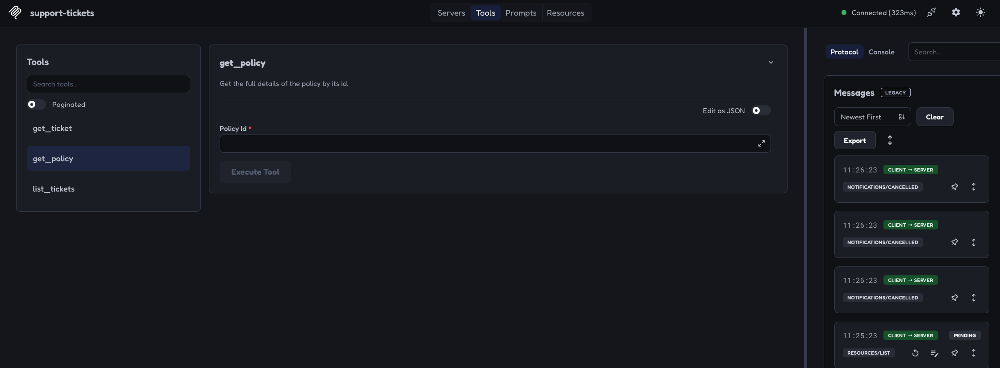

# S03.02: Functions to MCP Tools

## What we are going to build

We will create an MCP server that exposes our Python functions as tools. Each
tool will have a name, a description, and an input schema defining the arguments
it accepts.

We will then connect an agent built with the OpenAI Agents SDK to that server
using `mcp_servers=[ticket_server]`. The SDK discovers the available tools and
supplies their definitions to the model alongside the user's request.

The model chooses an appropriate tool and generates a structured tool call
containing its name and arguments. The SDK sends that call to the MCP server,
which validates the arguments and executes the corresponding Python function.

The server returns the result to the SDK, which passes it back to the model.
The model uses that information to answer the user or request another tool if
needed. We will test the Python functions, the MCP interface, and the agent's
behaviour separately so we can tell which part works and where a problem occurs.

## What this stage teaches

S03.02 answers one question: **how does a natural-language question become a Python
function call, and how does the function's answer get back to the user?**

We build a small support assistant for an imaginary financial company. It can
look up support tickets and refund policies stored in local JSON files. We build
it in layers, and each layer is something you can run and test on its own:

```text
Layer 4  LLM agent        "What is the status of ticket T-1001?"   (src/llm_agent.py)
            │  the model decides which tool to call and with which arguments
            ▼
Layer 3  MCP client       sends a structured call: get_ticket(ticket_id="T-1001")
            │  speaks the Model Context Protocol over stdio
            ▼
Layer 2  MCP server       validates the call and runs the matching wrapper  (src/server.py)
            │  plain Python call
            ▼
Layer 1  Python functions reads data/tickets.json and returns a dict       (src/functions.py)
```

The key idea is separation of concerns. The functions know nothing about MCP.
The server knows nothing about the LLM. The LLM never reads the JSON files. Each
layer has a narrow job, so each layer can be tested without the layers above it.

The prototype only *retrieves* information. It does not issue refunds, change
accounts, or make approval decisions. Those capabilities belong to later stages.

### Vocabulary used in this stage

| Term | Meaning here |
| --- | --- |
| **Function** | Ordinary Python code that takes arguments and returns a value. Layer 1. |
| **Tool** | A function that has been described to an outside client: a name, a description, and an input schema. Layer 2. |
| **Input schema** | A JSON Schema document saying which arguments a tool accepts, their types, and which are required. Generated from Python type hints. |
| **MCP** | The Model Context Protocol. A standard way for a client to ask a server "what tools do you have?" and "run this tool with these arguments". |
| **FastMCP** | The server-building class in the MCP Python SDK. A decorator turns a function into a tool. |
| **Transport** | How client and server exchange messages. We use **stdio**: the client starts the server as a subprocess and talks over its standard input and output. |
| **Client** | Anything that speaks MCP to the server: our pytest session, MCP Inspector, or the OpenAI Agents SDK. |
| **Agent** | An LLM plus instructions plus tools, with a runner that loops between the model and tool calls until the model gives a final answer. Layer 4. |

## Current progress

Status as of 2026-10-14, based on the local workspace and the checks recorded below:

| Work | Status | Evidence and limits |
| --- | --- | --- |
| Ticket and policy functions | Implemented and tested | Three direct function tests, supplemented by MCP tests |
| FastMCP server | Implemented | Three tools discovered and called through MCP |
| Automated MCP tests | Implemented | 13 test cases covering discovery, schemas, calls, filters, and missing inputs |
| Inspector checks | Ticket lookups verified | Screenshots show discovery, an existing ticket, and an unknown ticket |
| OpenAI Agents SDK agent | Implemented; one live run completed | Correct answer and a tool-call log; exact tool arguments were not captured |
| Automated LLM agent tests | Planned | Tool selection and answer grounding still need explicit checks |

The server, agent script, and tests are included with this implementation. The
latest full-source check passed all 16 tests but measured 76.47% coverage, below
the required 80%, because the agent has no automated tests yet.

## Files and responsibilities

| File | Layer | Responsibility |
| --- | --- | --- |
| [src/functions.py](src/functions.py) | 1 | Load fixtures, filter tickets, and find ticket or policy records |
| [src/server.py](src/server.py) | 2 | Register the functions as MCP tools and run the server |
| [src/llm_agent.py](src/llm_agent.py) | 3 and 4 | Connect an OpenAI Agents SDK agent to the server and ask one question |
| [data/tickets.json](data/tickets.json) | data | Eight synthetic ticket records |
| [data/policies.json](data/policies.json) | data | Five synthetic policy records |
| [tests/test_functions.py](tests/test_functions.py) | tests 1 | Call the Python functions directly |
| [tests/test_mcp_server.py](tests/test_mcp_server.py) | tests 2 | Discover and call tools through an MCP client session |
| [docs/evidence/screenshots/](docs/evidence/screenshots/) | evidence | Inspector screenshots from manual checks |

## Local setup and commands

The runs in this log used the shared `.venv` at the repository root. Dependency
installation is described in the [S03 environment instructions](../README.md#python-environment). The stage also has
its own `pyproject.toml` and lockfile, but its dependency declaration does not yet
include the OpenAI Agents SDK. A standalone stage environment is therefore not
yet sufficient for the agent example.

Start from the repository root:

```bash
cd S03-AI-Agents-Tools-and-MCP/S03.02-Functions-to-MCP-Tools
```

Run the following commands from that folder, not from `src`. The functions use
relative paths such as `data/tickets.json`, and the agent launches `src/server.py`.
Using the explicit interpreter path also avoids accidentally using global Python
packages.

| Task | Command |
| --- | --- |
| Function tests | `../../.venv/bin/python -m pytest tests/test_functions.py -v` |
| MCP server tests | `../../.venv/bin/python -m pytest tests/test_mcp_server.py -v` |
| Full S03.02 suite with coverage | `../../.venv/bin/python -m pytest --cov=src --cov-report=term-missing --cov-fail-under=80` |
| Inspector | `npx @modelcontextprotocol/inspector ../../.venv/bin/python src/server.py` |
| LLM agent | `../../.venv/bin/python src/llm_agent.py` |

Inspector uses Node.js/npm through `npx`. The agent reads `OPENAI_API_KEY` from
the environment and makes paid model requests. Keep the key out of source code
and Git. You can check whether it is present without printing it:

```bash
[[ -n "$OPENAI_API_KEY" ]] && echo "API key is set"
```

## Step 1: Write the Python functions

### Why start here

Everything above this layer only *routes* a call. The functions are where the
actual work happens, so they must be correct before anything else matters. They
can be imported and tested in plain Python with no MCP, no server process, and no
API key.

### The data

The fixtures are deliberately small so you can predict every answer by hand.

| Ticket | Status | Customer | Subject |
| --- | --- | --- | --- |
| T-1001 | open | C-42 | Card declined twice |
| T-1002 | closed | C-17 | Change email address |
| T-1003 | open | C-42 | Refund not received |
| T-1004 | pending | C-99 | Statement missing |
| T-1005 | closed | C-07 | Login loop |
| T-1006 | open | C-55 | Disputed charge |
| T-1007 | pending | C-55 | Mobile crash |
| T-1008 | open | C-42 | Address update |

Policies: `POL-REFUND-01` (Refund window), `POL-REFUND-02` (Refund method),
`POL-REFUND-03` (Approval threshold), `POL-DISPUTE-01` (Disputed charges),
`POL-DATA-01` (Customer data).

Keep the fixtures synthetic. Do not add card numbers or national insurance numbers.

### The three functions

| Function | Inputs | Current result |
| --- | --- | --- |
| `list_tickets` | Optional `status` and `customer_id` | A list of summaries containing `id`, `subject`, `status`, `customer_id`, and `created_at` |
| `get_ticket` | `ticket_id` | The full matching record, or `{"error": "not_found", "id": ticket_id}` |
| `get_policy` | `policy_id` | The full matching policy record, or the same missing-record error shape |

Three design decisions are worth noticing, because every later layer depends on them:

1. **Missing records return a value, not an exception.** `get_ticket("NOPE")`
   returns `{"error": "not_found", "id": "NOPE"}`. An exception would surface as a
   protocol-level error over MCP; a dictionary is an ordinary successful result
   that the model can read and explain. Both are valid designs. We chose the
   dictionary so the model can say "that ticket does not exist" instead of
   receiving a stack trace.
2. **`None` means "no filter".** `list_tickets(status=None, customer_id=None)`
   returns everything. When both filters are supplied, a ticket must match both.
   No matches returns an empty list, not an error.
3. **`list_tickets` returns summaries, not full records.** The full record
   includes the body text. A list of eight full records would waste the model's
   context window when it only needs IDs and statuses to decide what to do next.

The `load_json` helper reads the files and remains internal; it is not a tool.
Not every function has to become a tool, and only the ones we decorate do.

The original brief also mentioned possible tag filtering, policy references and
refund-status fields on tickets, and removing sensitive fields. Those are not
implemented guarantees. In particular, `get_ticket` returns the fixture record
as stored; it does not redact fields.

## Step 2: Expose the functions with FastMCP

### Why a protocol at all

An LLM cannot call Python directly. It can only produce text. For a model to
"use" a function, something must:

1. tell the model which functions exist and what arguments they take,
2. parse the model's request to call one,
3. actually run it, and
4. hand the result back to the model.

MCP standardises steps 1 and 3, so any MCP client (Inspector, the OpenAI Agents
SDK, Claude Desktop, and so on) can use our server without custom glue code. The
server is the piece we own; the clients are off-the-shelf.

### Building the server

**FastMCP** is the server-building interface we import from the MCP Python SDK
as `mcp.server.fastmcp`. In `server.py`, this creates the server object:

```python
mcp = FastMCP("support-tickets")
```

`mcp` is the Python variable. `"support-tickets"` is the name reported to clients.
That is why tests use `from server import mcp`.

Each tool is a small wrapper around a function from Step 1:

```python
@mcp.tool()
def get_ticket(ticket_id: str) -> dict:
    """Get the full details of the ticket by its id."""
    return functions.get_ticket(ticket_id)
```

Read this wrapper as three pieces of metadata plus one line of logic:

| Piece | Where it comes from | What the client sees |
| --- | --- | --- |
| Tool name | the function name `get_ticket` | `"name": "get_ticket"` |
| Description | the docstring | `"description": "Get the full details of the ticket by its id."` |
| Input schema | the type hints `ticket_id: str` | `{"type": "object", "properties": {"ticket_id": {"type": "string"}}, "required": ["ticket_id"]}` |
| Logic | the body | nothing; the client only sees the result |

The decorator registers the tool. A regular `#` comment is for source-code
readers; it does not become the tool description. This matters because the
description is the *only* thing a model has to decide when a tool is relevant.
A vague docstring produces a model that picks the wrong tool.

The wrapper delegates to `functions.py`, so the lookup logic stays in one place.
If a tool wrapper contained its own logic, the function tests in Step 3 would no
longer prove the tool is correct.

For the list tool, `status: str | None = None` means the argument accepts a
string or `None` and defaults to `None` when omitted. In the generated schema
this becomes `anyOf: [string, null]` with `default: null` and the field is not
listed under `required`. `-> list[dict]` describes a list of dictionaries as the
return value.

### What the server does during a request

1. A client asks for the available tools. The server returns their names,
   descriptions, and input schemas. (In the logs this is a `ListToolsRequest`.)
2. The client sends a structured call, such as `get_ticket` with
   `{"ticket_id": "T-1001"}`. (A `CallToolRequest`.)
3. FastMCP validates the arguments against the schema and calls the registered
   wrapper. A call with a missing required argument is rejected here and never
   reaches our code.
4. The wrapper calls our Python function, which reads the fixture and returns data.
5. FastMCP serialises the result as MCP content and sends it back to the client.

The server does not interpret natural-language questions. Inspector lets us
choose the call manually; an agent application lets a model choose it.

### Starting the server

```python
if __name__ == "__main__":
    mcp.run(transport="stdio")
```

The guard starts the server only when the file is run directly. Importing
`server` defines the tools without starting the stdio loop, which is what makes
the in-memory tests in Step 3 possible.

With **stdio**, the client launches the server as a subprocess and communicates
through its standard input and output. No HTTP endpoint, port, or network is
needed. The server waits for MCP messages rather than displaying an ordinary
input prompt. One consequence: standard output belongs to the protocol. Anything
else written to stdout, such as a stray `print`, corrupts the message stream.
Logs go to standard error instead.

Our tools currently only read data. Explicit `readOnlyHint` annotations have not
been added. Such annotations describe behaviour to a client; they do not enforce
read-only access and are separate from docstrings.

## Step 3: Verify the functions and tools

### The testing ladder

Each layer gets its own test stage, and each stage answers a different question.
A failure in a higher stage with a passing lower stage tells you exactly which
layer broke.

| Test stage | Layer | Question it answers | How we test | Needs |
| --- | --- | --- | --- | --- |
| 1. Python function tests | 1 | Does the lookup and filtering logic work? | `pytest` calls the functions directly in `test_functions.py` | Python only |
| 2. Automated MCP server tests | 2 | Can a client discover and call the tools correctly? | `pytest` uses an in-memory MCP session in `test_mcp_server.py` | MCP SDK |
| 3. Manual Inspector tests | 2 and 3 | What does a real external client see and get back? | Select tools, enter arguments, inspect responses, capture screenshots | Node.js |
| 4. LLM agent tests | 4 | Does the model choose the right tool and use its result correctly? | OpenAI Agents SDK with natural-language tasks; check tool choices, arguments, and answers | API key, paid calls |

Stages 2 and 3 exercise the same MCP interface. Neither needs an LLM. Stage 2 is
fast and automated; stage 3 is slow and visual. Stage 4 is the only one where a
model is involved, and the only one that is nondeterministic.

### Stage 1: Function tests

The three existing tests check an existing ticket ID, an existing policy ID,
and the count and status of open tickets. They call `functions.py` directly.
The broader edge cases below are covered through MCP.

### Stage 2: Automated MCP server tests

The test file imports the server object and uses
`create_connected_server_and_client_session(mcp)` to connect a client and server
inside the same Python process. Requests still go through MCP, with real
messages and real schema validation, but no separate server process or Inspector
is needed.

A short note on the `async` keywords you will see in these tests. MCP is
message-based: send a request, wait for a response. Python expresses "wait
without blocking everything else" with `async`/`await`:

- `async def` marks a function that can pause while waiting.
- `await session.list_tools()` sends the request and pauses until the reply arrives.
- `async with` opens the connection and closes it when the block ends, even on failure.
- `asyncio_mode = "auto"` in `pyproject.toml` lets pytest run `async def` tests
  without extra markers.

The 13 cases check:

- Exactly the three expected tool names, nonempty descriptions, and input schemas.
- Existing and missing ticket and policy IDs.
- All tickets, each filter separately, both filters together, and no matches.
- Summary fields and rejection of a missing required ticket ID.

Two details of the MCP result shape are worth knowing:

- A tool call returns `result.content`, a list of content blocks, plus
  `result.isError`. Our `not_found` dictionary arrives with `isError` false,
  because the function returned normally. A missing required argument arrives
  with `isError` true, because validation failed before our code ran.
- The installed SDK returns list results as one text content block per ticket.
  The tests decode each block; no matches produces no content blocks. This
  differs from the plain Python function's return value, which is a list.

Use `-v` to see `PASSED` beside each test. Without verbose output, a dot usually
represents a passing test. Pytest reports results in the terminal, not in the
source file.

### Stage 3: Test the server with MCP Inspector

Inspector is an interactive MCP client in the browser. It is the first time our
server is used by a program we did not write, which is the real test of whether
the tool descriptions and schemas make sense on their own. Launch it from S03.02:

```bash
npx @modelcontextprotocol/inspector ../../.venv/bin/python src/server.py
```

The two arguments after `inspector` are the command Inspector will run to start
our server as a subprocess, exactly as any stdio client would. Keep the terminal
running. Connect if needed, then open **Tools**. You should see `get_ticket`,
`get_policy`, and `list_tickets`.



This screenshot demonstrates discovery: the docstring appears as the description
and the parameter becomes an input field. Compare it with the wrapper code in
Step 2 and you can see each piece of metadata land. It does not show a completed call.

Select a tool, fill in its inputs, and click **Execute Tool**. These expected
results refer to the current fixtures:

| Test | Tool and inputs | Expected result |
| --- | --- | --- |
| Existing ticket | `get_ticket`, `ticket_id="T-1001"` | Ticket with subject `Card declined twice` |
| Unknown ticket | `get_ticket`, `ticket_id="DOES-NOT-EXIST"` | `{"error": "not_found", "id": "DOES-NOT-EXIST"}` |
| All tickets | `list_tickets`, omit both filters | Eight summaries |
| Status filter | `list_tickets`, `status="open"` | `T-1001`, `T-1003`, `T-1006`, `T-1008` |
| Both filters | `list_tickets`, `status="open"`, `customer_id="C-42"` | `T-1001`, `T-1003`, `T-1008` |
| No matches | `list_tickets`, `customer_id="DOES-NOT-EXIST"` | No tickets |
| Existing policy | `get_policy`, `policy_id="POL-REFUND-01"` | Policy titled `Refund window` |
| Unknown policy | `get_policy`, `policy_id="DOES-NOT-EXIST"` | The `not_found` dictionary |

Omit unused filters rather than entering an empty string. An empty string is a
value, and no ticket has `status == ""`. In **Edit as JSON**, use `{}` for all
tickets or `{"status": "open"}` for open tickets.

The functions return a `not_found` dictionary normally, so Inspector may label
the MCP call successful while showing `"error": "not_found"` in its data. That
is an expected application result. Inspect the response, not just the success label.

#### Captured results

An existing-ticket call returned the details of `T-1001`:


An unknown-ticket call returned `not_found`:


These two calls are evidenced here. The other rows are manual test instructions,
not a claim that every Inspector case was completed. Stop Inspector with **Ctrl-C**
in its terminal when finished.

## Step 4: Connect an LLM agent

### What changes when a model is the client

Up to now a human chose the tool and typed the arguments. In Step 4 the model
does both. Nothing in the server changes. What is new is the **agent loop**: a
runner that sends the question and the tool definitions to the model, executes
any tool the model asks for, feeds the result back, and repeats until the model
produces a final answer.

```text
Question + instructions + tool definitions → model
Model requests get_ticket(ticket_id="T-1001") → SDK's MCP client
MCP client → server.py wrapper → functions.py → fixture data
Tool result → MCP client → model
Final answer → terminal
```

The model never reads the fixture files. It only sees the tool descriptions and
whatever the tools return. This is the whole point of the design: the model's
knowledge of our data is limited to what our functions choose to expose.

### The script

`src/llm_agent.py` uses the **OpenAI Agents SDK** with `gpt-5.6-luna` and the
MCP server we already built. The agent script and server run locally; the model
runs through the OpenAI API.

The installation package is named `openai-agents`, but Python imports it as
`agents`. It is an installed library, not another file we need to write.

| Component | Job in our script |
| --- | --- |
| `MCPServerStdio` | Launch `src/server.py` using `sys.executable`, the current Python interpreter, and open the MCP connection. This is the SDK's built-in MCP client, the same role Inspector played in Step 3. |
| `Agent` | Define the model, instructions, and available server connections |
| `mcp_servers=[ticket_server]` | Make our server's tools available to the model |
| `Runner.run(...)` | Run the agent loop: model requests, tool calls, and responses |
| `result.final_output` | Hold the final answer printed in the terminal |

Inside the `async with` block, `ticket_server` names the client-side connection.
It is not the `mcp` variable inside `server.py`. Keeping the agent run inside that
block keeps the server subprocess alive while the model uses the tools.

The script currently asks one fixed question:

> What is the status of ticket T-1001?

The instructions tell the model to use tools, not to invent details, and to say
when a record is missing. Instructions shape behaviour but do not guarantee it,
which is why they still need the behavioural tests described below.

### First live run and server logs

Run from S03.02 with the API key exported:

```bash
../../.venv/bin/python src/llm_agent.py
```

The observed run completed successfully. With timestamps and source locations
omitted, its output was:

```text
INFO Processing request of type ListToolsRequest
INFO Processing request of type CallToolRequest
INFO Processing request of type ListToolsRequest
Ticket T-1001 is **open**.
```

Read the log lines against the request sequence from Step 2. `ListToolsRequest`
is the client asking for the tool list, which the SDK does more than once.
`CallToolRequest` is the model's chosen tool being executed. The last line is the
agent's answer, printed by `llm_agent.py`.

For stdio, the server's standard output carries MCP messages. These logs go to
standard error, which the terminal also displays. Keep ordinary debugging prints
out of the server's protocol output.

The run proves a tool call occurred and the answer contained the correct status.
These logs do not identify the tool, arguments, or returned data. We have not yet
captured the evidence needed to assert the exact call shown in the intended flow.

### Agent tests still to write

Give the agent a natural-language task and inspect both its actions and its
answer. For the first case, verify a `get_ticket` call with `T-1001`, the returned
record, and an answer stating that the ticket is open. Exact wording can vary.

Follow with requests for open tickets, a named policy, and an unknown ticket.
Check that arguments match the request and that missing records are reported
without invented facts. A correct final answer alone could be a guess, so it
is not enough evidence of correct tool use.

## Narrate one complete agent call

The following is an illustrative successful path through the existing `src/llm_agent.py`, not a new captured run. The model may choose a different valid sequence. Record the interpreter and installed packages with any trace: the stage lockfile pins MCP 2.3.0, while the shared root environment can differ. See the [S03 protocol baseline](../README.md#protocol-baselines); do not assume v1 initialization messages for every v2 connection.

| Step | Boundary/message | Effect |
|---|---|---|
| 1 | Script starts `src/server.py` with `MCPServerStdio` | Local server process starts; no ticket read yet |
| 2 | SDK connects and obtains tool definitions using its supported protocol path | Host learns the three wrappers and schemas |
| 3 | Runner sends instructions, the fixed T-1001 question and exposed definitions to the model | Model can propose a call; it has not read fixtures |
| 4 | Model proposes `get_ticket(ticket_id="T-1001")` with a model call identifier | Host adapter maps that proposal to an MCP `tools/call` request |
| 5 | MCP request gets a JSON-RPC request ID; server validates and invokes the wrapper | `functions.get_ticket` reads stage-local JSON; no external write |
| 6 | Server returns content under that request ID; adapter associates it with the model call | Runner supplies the observation to the next model request |
| 7 | Model returns its final answer; script prints it and exits the context managers | Connection and subprocess are cleaned up |

A model call ID correlates model-facing messages; the JSON-RPC ID correlates one protocol request/response. Neither is a business **operation key** that deduplicates a write. A ticket ID identifies a record. This read-only stage has no application idempotency implementation. Its missing-ticket function returns `{"error":"not_found",...}` as data; do not automatically label every such payload an MCP `isError` result.

**Dependencies and stopping.** The answer must wait for the ticket result. Independent ticket reads could run in parallel if the host supports it, but this script defines no parallel execution plan. It also sets no explicit application turn, token or wall-time budget; SDK defaults are not a documented application policy. For the later eval, specify those budgets, stop on final output or exhausted budget, and surface unavailable tools/errors rather than loop indefinitely. This is remaining design work, not a claim that these controls exist here.

## What you should be able to explain after S03.02

If you can answer these from memory, the basics are in place.

1. Why do the functions in `functions.py` not import anything from MCP?
2. What three pieces of metadata does `@mcp.tool()` extract from a wrapper, and
   where does each come from?
3. Why does `get_ticket` return a `not_found` dictionary instead of raising?
4. What is the difference between `isError` being true and a result that
   contains `"error": "not_found"`?
5. What does stdio transport mean, and why must the server never `print` to stdout?
6. Why can the tests import `server` without the server starting?
7. What does the OpenAI Agents SDK do that Inspector does not?
8. Why is a correct final answer from the agent not enough evidence on its own?

## Execution log

These are recorded results, not a fresh test run on every README edit.

| Date | Check | Observed result | Limit |
| --- | --- | --- | --- |
| 2026-10-14 | Direct Python and in-memory MCP tests | 16 passed: 3 function cases and 13 MCP cases; 97.5% coverage | This coverage measurement predates `llm_agent.py`. It does not describe coverage of the current full source tree. |
| 2026-10-14 | Inspector discovery and ticket calls | Three tools listed; existing-ticket and missing-ticket results captured above | Early requests stalled; responses appeared after further client activity. The cause was not diagnosed. |
| 2026-10-14 | Live Luna agent | Tool-call request logged; answered that T-1001 is open; process exited successfully | One fixed question; no exact-call trace or automated agent assertion |

## Troubleshooting

| Symptom | What to check |
| --- | --- |
| `Connection closed` after running from `src` | Run from S03.02. Otherwise `src/server.py` resolves to `src/src/server.py`. |
| Packages load from global Homebrew Python | Use `../../.venv/bin/python` explicitly. The shell prompt alone does not prove which interpreter is running. |
| Fixture file not found | Check the working directory; data paths are relative to S03.02. |
| Inspector connects but tools stay blank or time out | Inspect Protocol, Console, and terminal output. Try reconnecting. Connection alone is not a passed test. |
| No visible `PASSED` labels | Run pytest with `-v`; its default output may show dots. |
| API authentication fails | Check the key exported in the launching shell. The S03.02 agent relies on the environment; it does not load a project `.env` file. |
| Server works in tests but breaks under a client | Look for `print` calls in `server.py` or `functions.py`. Stdout is the protocol channel under stdio. |

## Remaining work

The next checks are to inspect the agent's exact tool calls and automate the
agent scenarios. The current script handles one hardcoded question per run;
interactive input and conversation history have not been added.

Before treating S03.02 as independently reproducible, reconcile its stage dependencies
with the shared environment used here. Add meaningful automated agent tests to
bring full-source coverage above the required 80%.

Other gaps from the original brief remain visible: read-only annotations,
descriptions that explain missing-ID behaviour, and a separate server `main()`
function have not been added. The existing startup guard already runs stdio.
Richer refund fields, sensitive-field redaction, and tag filtering would require
separate implementation work.
