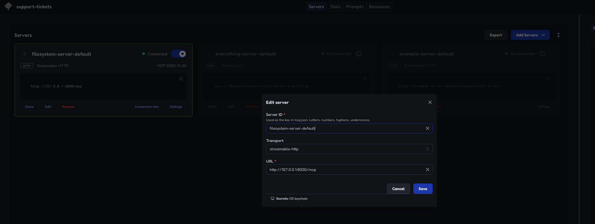
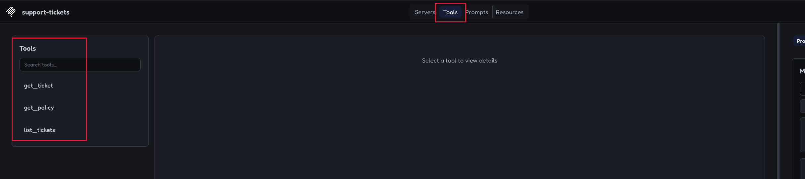
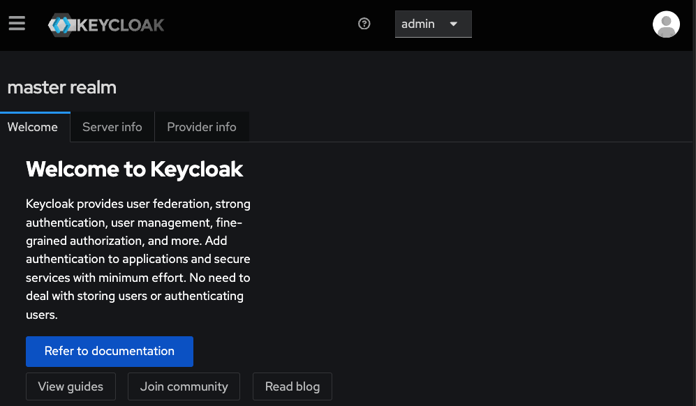
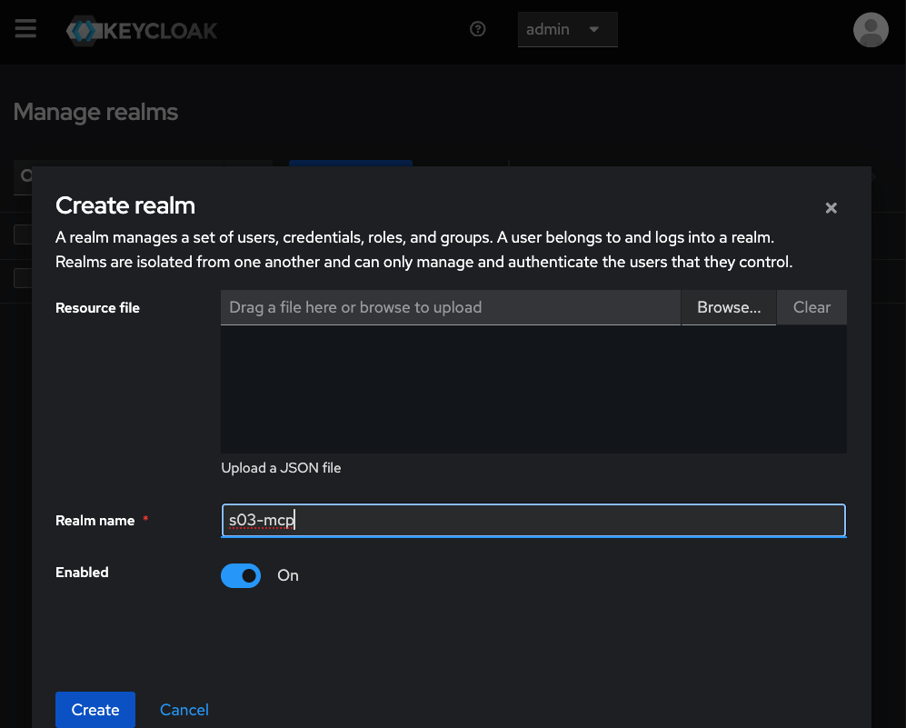
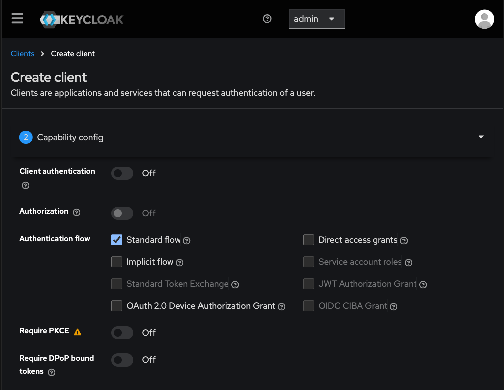
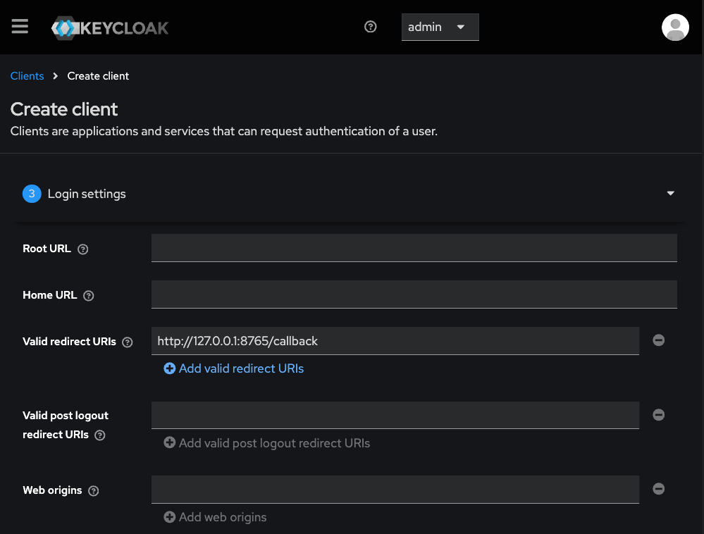
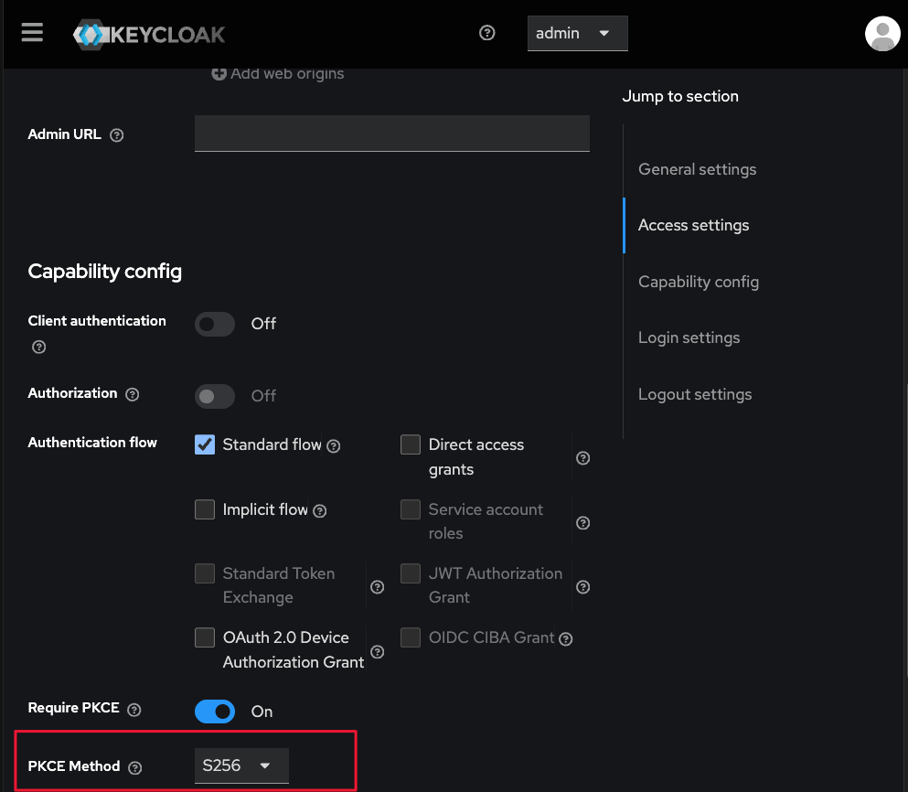
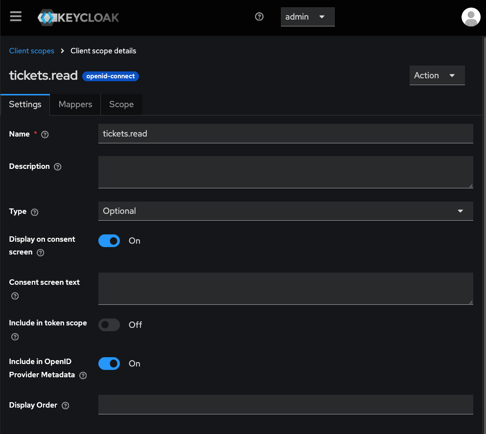
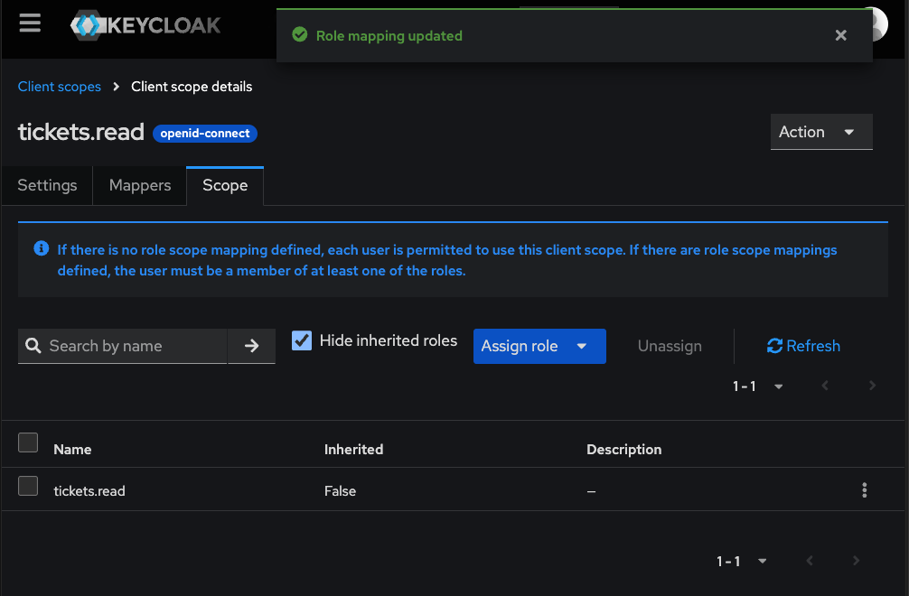
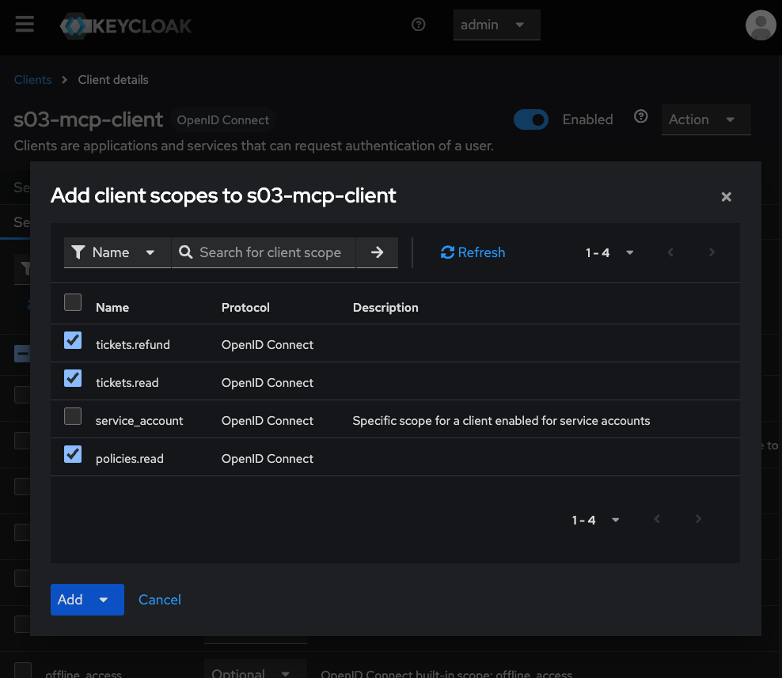

# S03.03: MCP + OAuthv2.1 Authorization for Tools / Resouces Access

## What we are going to build
In S03.01 we built the python functions.
In S03.02 we exposed them as MCP tools through an MCP server we created with FastMCP. 
An LLM Agent was able to discover the capabilities and call / use these tool through the MCP server.

Now in S03.03 we will make the tools to be callable by the right person. 
We will keep the existing tool and add a issue_refund tool, using Ayşe (support agent) and Mert (supervisor) to demonstrate scope enforcement, server side policy checks and human confirmation.

## Authorization acceptance tests

These are planned checks, not completed evidence.

- [ ] No token → HTTP 401 with a protected-resource metadata challenge.
- [ ] Expired access token → HTTP 401; tool does not execute.
- [ ] Invalid signature → HTTP 401; tool does not execute.
- [ ] Wrong audience (`aud`) → HTTP 401; tool does not execute.
- [ ] ID token used as an access token → HTTP 401, even if signed by the trusted authorization server.
- [ ] Ayşe calls issue_refund → HTTP 403 insufficient_scope; no refund recorded.
- [ ] Downstream request → incoming bearer token is never forwarded.

## Methodology 
Start with copying src and data folder of S03.02 to S03.03. 
Then under the server definition (server.py) change stdio to streamable-http. 

```python
if __name__ == "__main__":
    mcp.run(transport="streamable-http")
```
Now run your mcp server...

```bash
S03.03-MCP-OAuth2.1 $ ls
data  docs  README.md  src  tests
S03.03-MCP-OAuth2.1 $ cd src
src $ ls
pycache  check_refund_policy.py  functions.py  llm_agent.py  server.py
src $ python3 server.py
INFO:     Started server process [61225]
INFO:     Waiting for application startup.
StreamableHTTP session manager started
INFO:     Application startup complete.
INFO:     Uvicorn running on http://127.0.0.1:8000 (Press CTRL+C to quit)
INFO:     127.0.0.1:53125 - "GET / HTTP/1.1" 404 Not Found
INFO:     127.0.0.1:53125 - "GET /favicon.ico HTTP/1.1" 404 Not Found
```

Now lets confirm the tools are discoverable with inspector...
On another terminal launch Inspector...

```bash
npx @modelcontextprotocol/inspector   
```
(Make sure you run both from under S03.03... folder)

Edit the server settings and add the url as http://127.0.0.1:8000/mcp and transport to "streamable-http".





You can then either use the Inspector to check / confirm tools are reachable and they work, or you can use the following from cli..


```bash
  npx @modelcontextprotocol/inspector --cli \
    --server-url http://127.0.0.1:8000/mcp \
    --transport http \
    --method tools/call \
    --tool-name get_ticket \
    --tool-arg ticket_id=T-1003
```
```bash
S03-AI-Agents-Tools-and-MCP $ python3 -c "from importlib.metadata import version; print(version('mcp'))"
1.26.0
```


## Tests
```python
python3 -m pytest tests/test_refund_policy.py -q
```


## Configuring MCP Authentication && Authorization

We will be enabling MCP Authentication on the server in small stages:
1. Make the tools accessible over HTTP.
   Done— Connected Inspector and retrieved a ticket.
2. Require a valid token before allowing access.
   This is our current step. We’re adding the server’s token-checking interface.
3. Build the login and token-issuing service.
   This separate authorization server will authenticate Ayşe or Mert and issue their tokens.
4. Replace the temporary verifier with real verification.
   Your MCP server will check the token’s signature, expiry, issuer, and intended audience.
5. Enforce permissions and refund rules.
   Ayşe can read; Mert can also request refunds. Refunds must still pass team, amount, balance, and human-confirmation checks.

We will now move our  MCP server from “any client that connects can call tools” to “only an authenticated user with the right permissions can call tools.”

First, add these three imports near the top of src/server.py:
```python
from mcp.server.auth.provider import AccessToken, TokenVerifier
from mcp.server.auth.settings import AuthSettings
from pydantic import AnyHttpUrl
```

They provide the token-verification interface, authentication settings, and URL validation.
These imports alone do not enable authentication; next, we define a token verifier and connect it to FastMCP.

Next, add this **above** your `mcp = FastMCP(...)` line:

```python
class DenyAllTokenVerifier(TokenVerifier):
    async def verify_token(self, token: str) -> AccessToken | None:
        return None
```

This is a temporary verifier: `None` means **“this token is not accepted.”** It rejects every request to /mcp  until we implement real validation.

**Save the file.** It won’t affect the server until we connect it to FastMCP in the next step.

Next, **connect the verifier to FastMCP**.

Replace:

```python
mcp = FastMCP("support-tickets")
```

with:

```python
mcp = FastMCP(
    "support-tickets",
    token_verifier=DenyAllTokenVerifier(),
    auth=AuthSettings(
        issuer_url=AnyHttpUrl("http://127.0.0.1:9000"),
        resource_server_url=AnyHttpUrl("http://127.0.0.1:8000/mcp"),
        required_scopes=[],
    ),
)
```


This connects three things:

- **`token_verifier`**: our temporary verifier, which rejects every token.
- **`issuer_url`**: the address where we’ll build the authorization server.
- **`resource_server_url`**: the MCP endpoint we’re protecting.

`required_scopes=[]` means we haven’t required specific permissions yet; **a valid token is still required**.

Keep the `DenyAllTokenVerifier` class above this block. **Save the file; next we’ll restart and verify the `401` response.**


Ok, now restart your server...

### Verification: requests without a token are rejected

Run:

```bash
curl -i http://127.0.0.1:8000/mcp
```

Observed response:

```http
HTTP/1.1 401 Unauthorized
date: Fri, 16 Oct 2026 11:37:38 GMT
server: uvicorn
content-type: application/json
content-length: 74
www-authenticate: Bearer error="invalid_token", error_description="Authentication required", resource_metadata="http://127.0.0.1:8000/.well-known/oauth-protected-resource/mcp"

{"error": "invalid_token", "error_description": "Authentication required"}
```

**Result:** The MCP server rejects requests without an access token.
The `WWW-Authenticate` header points clients to the protected-resource
metadata, where they can discover the authorization server.

This verifies the missing-token check. Successful login and real token
validation are not implemented yet.

Then when we follow the metadata link, just like an mcp client would do...


```bash
S03.03-MCP-OAuth2.1 $ curl -s http://127.0.0.1:8000/.well-known/oauth-protected-resource/mcp | python3 -m json.tool
```

```json
{
    "resource": "http://127.0.0.1:8000/mcp",
    "authorization_servers": [
        "http://127.0.0.1:9000/"
    ],
    "scopes_supported": [],
    "bearer_methods_supported": [
        "header"
    ]
}
S03.03-MCP-OAuth2.1 $ 
```

We got a response from the MCP server telling us where the authorization server is.
```
"authorization_servers": [
    "http://127.0.0.1:9000/"
]
```
##  Our Authorization Server - KeyCloak 

Keycloak is an open-source identity and access management platform that provides user login, OAuth authorization, and token issuance. In S03.03, it replaces our planned custom FastAPI authorization server: Ayşe and Mert will log in through Keycloak, and the MCP client will obtain an access token using the authorization-code flow with PKCE. Our FastMCP server will validate that token and enforce the user’s permissions before allowing tool access. Keycloak manages identity and issues tokens; our MCP server remains responsible for refund limits, team ownership, available balance, and human confirmation.

We will run Keycloak locally in a Docker container. 

Launch **keycloak** with its Docker image locally in Docker with...


```bash
docker run --name s03-keycloak \
  -p 127.0.0.1:9000:8080 \
  -e KC_BOOTSTRAP_ADMIN_USERNAME=admin \
  -e KC_BOOTSTRAP_ADMIN_PASSWORD=local-demo-only \
  -v s03-keycloak-data:/opt/keycloak/data \
  quay.io/keycloak/keycloak:26.8.1 \
  start-dev
```

Then start the container...
```bash
(.venv) S03.03-MCP-OAuth2.1 $ docker start s03-keycloak
s03-keycloak
(.venv) S03.03-MCP-OAuth2.1 $
```

Then access keycloak's admin console...
http://127.0.0.1:9000/admin/

Username: admin
Password: local-demo-only



### Create a realm

Open **Manage realms**, then click **Create realm**. Enter `s03-mcp` as the **Realm name**, keep **Enabled** set to **On**, and click **Create**.



Ok, then create X2 users, ayse and mert. Set their passwords through Credentials.

In the s03-mcp realm, open Realm roles → Create role. Create these roles one at a time:
- tickets.read
- policies.read
- tickets.refund

Next micro-task: assign Ayşe her read permissions.
1. Open Users → ayse.
2. Select Role mapping → Assign role.
3. Filter by realm roles if needed.
4. Select:
   - tickets.read
   - policies.read
5. Click Assign.
Done when: both roles appear in Ayşe’s role mappings. Leave tickets.refund unassigned.


Next micro-task: assign Mert all three permissions.
1. Open Users → mert.
2. Select Role mapping → Assign role.
3. Filter by realm roles if needed.
4. Select tickets.read, policies.read, and tickets.refund.
5. Click Assign.

Next micro-task: register our MCP client.
In the s03-mcp realm:
1. Open Clients → Create client.
2. Set Client type to OpenID Connect.
3. Set Client ID to s03-mcp-client.
4. Click Next.
On the capability settings screen:
- Client authentication: Off—a public client without a client secret.
- Authorization: Off.
- Standard flow: On—for authorization code.
- Direct access grants: Off.
- Leave other flows disabled.
Stop on this screen. Next we’ll configure the callback address and require PKCE before testing login.



Click Next to reach Login settings.
We’ll use a local Python OAuth client with this callback address:
http://127.0.0.1:8765/callback
1. Add that exact address under Valid redirect URIs.
2. Leave Root URL, Home URL, Valid post logout redirect URIs, and Web origins blank.
3. Click Save.
The callback is where Keycloak will return the browser after login, carrying an authorization code. We’ll implement that local listener later.
Done when: the client is saved. Next we’ll require PKCE with S256.



### Require PKCE for the MCP client

In Keycloak, open **Clients → s03-mcp-client → Settings**. Under **Capability config**, turn **Require PKCE** on and click **Save**.

PKCE binds the authorization code to the client that initiated the login. The client creates a random verifier and sends its SHA-256 challenge during authorization. When exchanging the code for tokens, it supplies the original verifier, which Keycloak checks. Someone who steals only the authorization code cannot redeem it without that verifier.

Our Python client will use the **S256** challenge method.




**PKCE protects against someone stealing and using your authorization code.**

1. Before login, the client generates a random secret called a **verifier**.
2. It sends Keycloak a SHA-256 hash of that secret—the **challenge**.
3. After login, Keycloak returns an authorization code.
4. To exchange that code for tokens, the client must provide the original verifier.

Keycloak checks that the verifier matches the challenge. **A stolen code alone is therefore insufficient to obtain tokens.**

**Next micro-task:** update your MCP server to point to the Keycloak realm.
In src/server.py, replace:
```bash
issuer_url=AnyHttpUrl("http://127.0.0.1:9000"),
```
with:
```bash
issuer_url=AnyHttpUrl("http://127.0.0.1:9000/realms/s03-mcp"),
```

Keycloak gives each realm its own issuer address. This tells MCP clients to use our s03-mcp realm for authentication.
Save and restart the MCP server. Then verify its discovery metadata:
```bash
(.venv) S03.03-MCP-OAuth2.1 $ 
(.venv) S03.03-MCP-OAuth2.1 $ curl -s http://127.0.0.1:8000/.well-known/oauth-protected-resource/mcp \
  | python3 -m json.tool
{
    "resource": "http://127.0.0.1:8000/mcp",
    "authorization_servers": [
        "http://127.0.0.1:9000/realms/s03-mcp"
    ],
    "scopes_supported": [],
    "bearer_methods_supported": [
        "header"
    ]
}
(.venv) S03.03-MCP-OAuth2.1 $ 
```


Next micro-task: verify Keycloak’s discovery document.
Run:
curl -s http://127.0.0.1:9000/realms/s03-mcp/.well-known/openid-configuration \
  | python3 -m json.tool
Find these four fields:
- issuer — identifies our realm.
- authorization_endpoint — where the client starts browser login.
- token_endpoint — where the client exchanges an authorization code for tokens.
- jwks_uri — where the MCP server obtains public keys to verify token signatures.
Done when: the JSON returns successfully. Paste those four fields here; we’ll use them to connect the login and token verification.


```bash
(.venv) S03.03-MCP-OAuth2.1 $ curl -s http://127.0.0.1:9000/realms/s03-mcp/.well-known/openid-configuration \
  | python3 -m json.tool
{
...
    "mtls_endpoint_aliases": {
        "token_endpoint": "http://127.0.0.1:9000/realms/s03-mcp/protocol/openid-connect/token",
        "revocation_endpoint": "http://127.0.0.1:9000/realms/s03-mcp/protocol/openid-connect/revoke",
        "introspection_endpoint": "http://127.0.0.1:9000/realms/s03-mcp/protocol/openid-connect/token/introspect",
        "device_authorization_endpoint": "http://127.0.0.1:9000/realms/s03-mcp/protocol/openid-connect/auth/device",
        "registration_endpoint": "http://127.0.0.1:9000/realms/s03-mcp/clients-registrations/openid-connect",
        "userinfo_endpoint": "http://127.0.0.1:9000/realms/s03-mcp/protocol/openid-connect/userinfo",
        "pushed_authorization_request_endpoint": "http://127.0.0.1:9000/realms/s03-mcp/protocol/openid-connect/ext/par/request",
        "backchannel_authentication_endpoint": "http://127.0.0.1:9000/realms/s03-mcp/protocol/openid-connect/ext/ciba/auth"
    },
    "authorization_response_iss_parameter_supported": true
}
(.venv) S03.03-MCP-OAuth2.1 $ 
```

**Next micro-task:** create the tickets.read OAuth scope.
In the s03-mcp realm:
1. Open Client scopes from the left navigation—not the tab inside your client.
2. Click Create client scope.
3. Set:
   - Name: tickets.read
   - Type: Optional
   - Protocol: OpenID Connect
   - Include in token scope: On
4. Click Save.
This creates a scope the client can request. It does not yet restrict that scope to authorized users—we’ll connect it to the matching realm role next.
Done when: tickets.read appears in the realm’s client scopes list.



**Next micro-task:** link this OAuth scope to the matching permission role.
Inside the tickets.read client scope:
1. Open the Scope tab.
2. Click Assign role.
3. Filter by realm roles, if needed.
4. Select tickets.read.
5. Click Assign.
This limits use of the client scope to users who have the matching role. Both Ayşe and Mert should qualify.
Done when: tickets.read appears in this client scope’s role mappings.



We create OAuth client scopes under Keycloak’s OpenID Connect protocol and map them to realm roles. This configures access permissions; user authentication happens later during login.


**Next micro-task:** create and restrict the refund scope.
1. Open Client scopes → Create client scope.
2. Set:
   - Name: tickets.refund
   - Type: Optional
   - Protocol: OpenID Connect
   - Include in token scope: On
3. Click Save.
4. Open its Scope tab → Assign role.
5. Select the realm role tickets.refund and click Assign.
Done when: the client scope exists and its Scope tab lists tickets.refund.
Mert has this role; Ayşe does not. We’ll later verify that only Mert receives the requested refund scope in his access token.


**Next micro-task:** attach the three scopes to our client.
1. Open Clients → s03-mcp-client.
2. Select the Client scopes tab.
3. Check whether these scopes already appear:
   - tickets.read
   - policies.read
   - tickets.refund
4. For any missing scopes, click Add client scope, select them, then choose Add → Optional.
Done when: all three appear with Assigned type: Optional.
“Optional” means the client must explicitly request the scope during authorization. The role mappings we configured determine whether the user is eligible to receive it.


