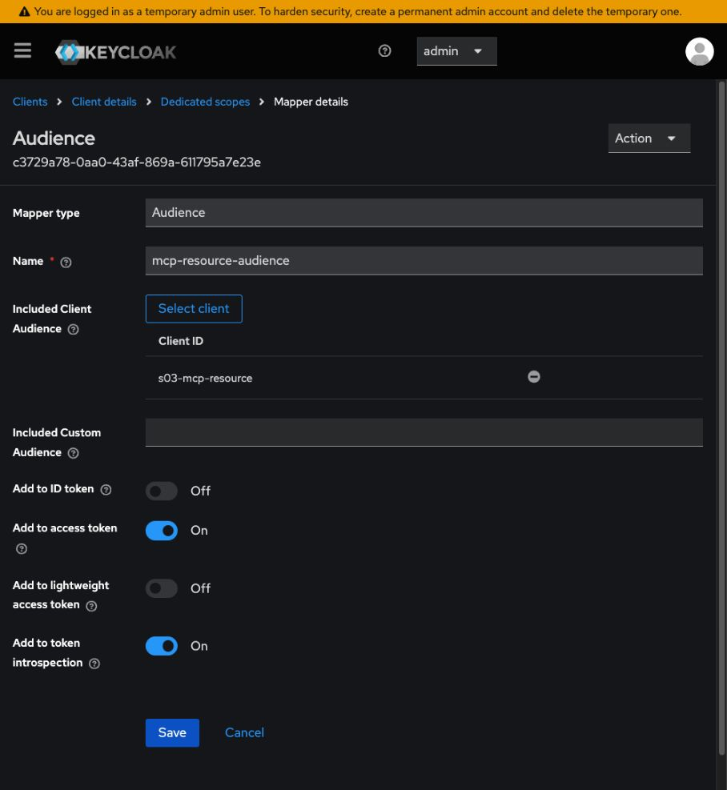

# S03.03: MCP + OAuth 2.1 Authorization for Tool and Resource Access

> **Current checkpoint — 16 October 2026:** Keycloak login and token issuance have been demonstrated. The MCP server now implements JWT validation, per-tool scopes, and simulated refunds with team/balance/limit checks and human confirmation. The stage test suite passes (119 tests; 91% overall coverage). A live Keycloak token now successfully retrieved T-1003 through the authenticated MCP tool; live refund denial/confirmation checks remain. Earlier checkpoint sections below are historical; see the final implementation section for current commands and limitations.

## What we are going to build
In S03.01 we built the python functions.
In S03.02 we exposed them as MCP tools through an MCP server we created with FastMCP. 
An LLM Agent was able to discover the capabilities and call / use these tool through the MCP server.

Now in S03.03 we will make the tools to be callable by the right person. 
We will keep the existing tool and add a issue_refund tool, using Ayşe (support agent) and Mert (supervisor) to demonstrate scope enforcement, server side policy checks and human confirmation.

## Authorization acceptance tests

These are planned acceptance checks. The missing-token response has been observed manually; the complete automated attack suite is not implemented.

- [ ] No token → HTTP 401 with a protected-resource metadata challenge.
- [ ] Expired access token → HTTP 401; tool does not execute.
- [ ] Invalid signature → HTTP 401; tool does not execute.
- [ ] Wrong audience (`aud`) → HTTP 401; tool does not execute.
- [ ] ID token used as an access token → HTTP 401, even if signed by the trusted authorization server.
- [ ] Ayşe calls `issue_refund` → denied for insufficient scope; no refund recorded. Record whether enforcement returns an HTTP 403 challenge or an MCP tool error; do not claim an HTTP status until the implementation is tested.
- [ ] Downstream request → incoming bearer token is never forwarded.

## Methodology 
Start with copying src and data folder of S03.02 to S03.03. 
Then under the server definition (server.py) change stdio to streamable-http. 

```python
if __name__ == "__main__":
    mcp.run(transport="streamable-http")
```
Now run your mcp server...

```bash
S03.03-MCP-OAuth2.1 $ ls
data  docs  README.md  src  tests
S03.03-MCP-OAuth2.1 $ cd src
src $ ls
pycache  check_refund_policy.py  functions.py  llm_agent.py  server.py
src $ python3 server.py
INFO:     Started server process [61225]
INFO:     Waiting for application startup.
StreamableHTTP session manager started
INFO:     Application startup complete.
INFO:     Uvicorn running on http://127.0.0.1:8000 (Press CTRL+C to quit)
INFO:     127.0.0.1:53125 - "GET / HTTP/1.1" 404 Not Found
INFO:     127.0.0.1:53125 - "GET /favicon.ico HTTP/1.1" 404 Not Found
```

Now lets confirm the tools are discoverable with inspector...
On another terminal launch Inspector...

```bash
npx @modelcontextprotocol/inspector   
```
(Make sure you run both from under S03.03... folder)

Edit the server settings and add the url as http://127.0.0.1:8000/mcp and transport to "streamable-http".


You can then either use the Inspector to check / confirm tools are reachable and they work, or you can use the following from cli..


```bash
  npx @modelcontextprotocol/inspector --cli \
    --server-url http://127.0.0.1:8000/mcp \
    --transport http \
    --method tools/call \
    --tool-name get_ticket \
    --tool-arg ticket_id=T-1003
```
```bash
S03-AI-Agents-Tools-and-MCP $ python3 -c "from importlib.metadata import version; print(version('mcp'))"
1.26.0
```


## Tests
```bash
python3 -m pytest tests/test_refund_policy.py -q
```


## Configuring MCP Authentication and Authorization

We will be enabling MCP Authentication on the server in small stages:
1. Make the tools accessible over HTTP.
   Done— Connected Inspector and retrieved a ticket.
2. Require a valid token before allowing access.
   The deny-all boundary is implemented; real token verification is still pending.
3. Configure Keycloak as the login and token-issuing service.
   This separate authorization server will authenticate Ayşe or Mert and issue their tokens.
4. Replace the temporary verifier with real verification.
   Your MCP server will check the token’s signature, expiry, issuer, and intended audience.
5. Enforce permissions and refund rules.
   Ayşe can read; Mert can also request refunds. Refunds must still pass team, amount, balance, and human-confirmation checks.

We will now move our  MCP server from “any client that connects can call tools” to “only an authenticated user with the right permissions can call tools.”

First, add these three imports near the top of src/server.py:
```python
from mcp.server.auth.provider import AccessToken, TokenVerifier
from mcp.server.auth.settings import AuthSettings
from pydantic import AnyHttpUrl
```

They provide the token-verification interface, authentication settings, and URL validation.
These imports alone do not enable authentication; next, we define a token verifier and connect it to FastMCP.

Next, add this **above** your `mcp = FastMCP(...)` line:

```python
class DenyAllTokenVerifier(TokenVerifier):
    async def verify_token(self, token: str) -> AccessToken | None:
        return None
```

This is a temporary verifier: `None` means **“this token is not accepted.”** It rejects every request to /mcp  until we implement real validation.

**Save the file.** It won’t affect the server until we connect it to FastMCP in the next step.

Next, **connect the verifier to FastMCP**.

Replace:

```python
mcp = FastMCP("support-tickets")
```

with:

```python
mcp = FastMCP(
    "support-tickets",
    token_verifier=DenyAllTokenVerifier(),
    auth=AuthSettings(
        issuer_url=AnyHttpUrl("http://127.0.0.1:9000"),
        resource_server_url=AnyHttpUrl("http://127.0.0.1:8000/mcp"),
        required_scopes=[],
    ),
)
```


This connects three things:

- **`token_verifier`**: our temporary verifier, which rejects every token.
- **`issuer_url`**: the address where we’ll build the authorization server.
- **`resource_server_url`**: the MCP endpoint we’re protecting.

`required_scopes=[]` means we haven’t required specific permissions yet; **a valid token is still required**.

Keep the `DenyAllTokenVerifier` class above this block. **Save the file; next we’ll restart and verify the `401` response.**


Ok, now restart your server...

### Verification: requests without a token are rejected

Run:

```bash
curl -i http://127.0.0.1:8000/mcp
```

Observed response:

```http
HTTP/1.1 401 Unauthorized
date: Fri, 16 Oct 2026 11:37:38 GMT
server: uvicorn
content-type: application/json
content-length: 74
www-authenticate: Bearer error="invalid_token", error_description="Authentication required", resource_metadata="http://127.0.0.1:8000/.well-known/oauth-protected-resource/mcp"

{"error": "invalid_token", "error_description": "Authentication required"}
```

**Result:** The MCP server rejects requests without an access token.
The `WWW-Authenticate` header points clients to the protected-resource
metadata, where they can discover the authorization server.

This verifies the missing-token check. Successful login and real token
validation are not implemented yet.

Then when we follow the metadata link, just like an mcp client would do...


```bash
S03.03-MCP-OAuth2.1 $ curl -s http://127.0.0.1:8000/.well-known/oauth-protected-resource/mcp | python3 -m json.tool
```

```json
{
    "resource": "http://127.0.0.1:8000/mcp",
    "authorization_servers": [
        "http://127.0.0.1:9000/"
    ],
    "scopes_supported": [],
    "bearer_methods_supported": [
        "header"
    ]
}
```

We got a response from the MCP server telling us where the authorization server is.
```
"authorization_servers": [
    "http://127.0.0.1:9000/"
]
```
##  Our Authorization Server - KeyCloak 

Keycloak is an open-source identity and access management platform that provides user login, OAuth authorization, and token issuance. In S03.03, it replaces our planned custom FastAPI authorization server: Ayşe and Mert will log in through Keycloak, and the MCP client will obtain an access token using the authorization-code flow with PKCE. Our FastMCP server will validate that token and enforce the user’s permissions before allowing tool access. Keycloak manages identity and issues tokens; our MCP server remains responsible for refund limits, team ownership, available balance, and human confirmation.

We will run Keycloak locally in a Docker container. 

Launch **keycloak** with its Docker image locally in Docker with...


```bash
docker run --name s03-keycloak \
  -p 127.0.0.1:9000:8080 \
  -e KC_BOOTSTRAP_ADMIN_USERNAME=admin \
  -e KC_BOOTSTRAP_ADMIN_PASSWORD=local-demo-only \
  -v s03-keycloak-data:/opt/keycloak/data \
  quay.io/keycloak/keycloak:26.8.1 \
  start-dev --features=resource-indicators
```

`docker run` creates and starts the container. On a later session, if it is stopped, start the existing container (do not repeat `docker run`):
```bash
(.venv) S03.03-MCP-OAuth2.1 $ docker start s03-keycloak
s03-keycloak
(.venv) S03.03-MCP-OAuth2.1 $
```

Then access keycloak's admin console...
http://127.0.0.1:9000/admin/

Username: admin
Password: local-demo-only

These are local development bootstrap credentials only. Keep the port bound to loopback; do not reuse these credentials for a deployed service.


### Create a realm

Open **Manage realms**, then click **Create realm**. Enter `s03-mcp` as the **Realm name**, keep **Enabled** set to **On**, and click **Create**.


### Create the two demo users

Under **Users → Add user**, create `ayse` and `mert`, keeping each enabled. First names are optional display information.
For each user, open **Credentials → Set password**, enter a local demo password, turn **Temporary Off**, and save.
Check **Details → Required user actions**: for the planned immediate-login demo, **Update Password** should not remain pending. If it is pending, the user must either complete the password update at login or set a non-temporary password through Credentials and recheck the action. Do not record user passwords in this README.


In the s03-mcp realm, open Realm roles → Create role. Create these roles one at a time:
- tickets.read
- policies.read
- tickets.refund

Next micro-task: assign Ayşe her read permissions.
1. Open Users → ayse.
2. Select Role mapping → Assign role.
3. Filter by realm roles if needed.
4. Select:
   - tickets.read
   - policies.read
5. Click Assign.
Done when: both roles appear in Ayşe’s role mappings. Leave tickets.refund unassigned.


Next micro-task: assign Mert all three permissions.
1. Open Users → mert.
2. Select Role mapping → Assign role.
3. Filter by realm roles if needed.
4. Select tickets.read, policies.read, and tickets.refund.
5. Click Assign.

Next micro-task: register our MCP client.
In the s03-mcp realm:
1. Open Clients → Create client.
2. Set Client type to OpenID Connect.
3. Set Client ID to s03-mcp-client.
4. Click Next.
On the capability settings screen:
- Client authentication: Off—a public client without a client secret.
- Authorization: Off.
- Standard flow: On—for authorization code.
- Direct access grants: Off.
- Leave other flows disabled.
Stop on this screen. Next we’ll configure the callback address and require PKCE before testing login.


Click Next to reach Login settings.
We’ll use a local Python OAuth client with this callback address:
http://127.0.0.1:8765/callback
1. Add that exact address under Valid redirect URIs.
2. Leave Root URL, Home URL, Valid post logout redirect URIs, and Web origins blank.
3. Click Save.
The callback is where Keycloak will return the browser after login, carrying an authorization code. We’ll implement that local listener later.
Done when: the client is saved. Next we’ll require PKCE with S256.


### Require PKCE for the MCP client

In Keycloak, open **Clients → s03-mcp-client → Settings**. Under **Capability config**, turn **Require PKCE** on, set the newly displayed **PKCE Method** to **S256**, and click **Save**. Reopen Settings to confirm both values persisted.

PKCE binds the authorization code to the client that initiated the login. The client creates a random verifier and sends its SHA-256 challenge during authorization. When exchanging the code for tokens, it supplies the original verifier, which Keycloak checks. Someone who steals only the authorization code cannot redeem it without that verifier.

Our Python client will use the **S256** challenge method.


**PKCE protects against someone stealing and using your authorization code.**

1. Before login, the client generates a random secret called a **verifier**.
2. It sends Keycloak a SHA-256 hash of that secret—the **challenge**.
3. After login, Keycloak returns an authorization code.
4. To exchange that code for tokens, the client must provide the original verifier.

Keycloak checks that the verifier matches the challenge. **A stolen code alone is therefore insufficient to obtain tokens.**

**Next micro-task:** update your MCP server to point to the Keycloak realm.
In src/server.py, replace:
```python
issuer_url=AnyHttpUrl("http://127.0.0.1:9000"),
```
with:
```python
issuer_url=AnyHttpUrl("http://127.0.0.1:9000/realms/s03-mcp"),
```

Keycloak gives each realm its own issuer address. This tells MCP clients to use our s03-mcp realm for authentication.
Save and restart the MCP server. Then verify its discovery metadata:
```bash
(.venv) S03.03-MCP-OAuth2.1 $ 
(.venv) S03.03-MCP-OAuth2.1 $ curl -s http://127.0.0.1:8000/.well-known/oauth-protected-resource/mcp \
  | python3 -m json.tool
{
    "resource": "http://127.0.0.1:8000/mcp",
    "authorization_servers": [
        "http://127.0.0.1:9000/realms/s03-mcp"
    ],
    "scopes_supported": [],
    "bearer_methods_supported": [
        "header"
    ]
}
(.venv) S03.03-MCP-OAuth2.1 $ 
```


### Verify Keycloak discovery

Run:

```bash
curl -s http://127.0.0.1:9000/realms/s03-mcp/.well-known/openid-configuration \
  | python3 -m json.tool
```

The following four fields were present in the observed response (other fields omitted):

```json
{
  "issuer": "http://127.0.0.1:9000/realms/s03-mcp",
  "authorization_endpoint": "http://127.0.0.1:9000/realms/s03-mcp/protocol/openid-connect/auth",
  "token_endpoint": "http://127.0.0.1:9000/realms/s03-mcp/protocol/openid-connect/token",
  "jwks_uri": "http://127.0.0.1:9000/realms/s03-mcp/protocol/openid-connect/certs"
}
```

The issuer identifies our realm; the client uses the authorization and token endpoints; the MCP verifier will obtain public signing keys from jwks_uri. This is metadata, not an access token. Advertised server capabilities do not mean every flow is enabled for our client.

**Next micro-task:** create the tickets.read OAuth scope.
In the s03-mcp realm:
1. Open Client scopes from the left navigation—not the tab inside your client.
2. Click Create client scope.
3. Set:
   - Name: tickets.read
   - Type: Optional
   - Protocol: OpenID Connect
   - Include in token scope: On
4. Click Save.
This creates a scope the client can request. It does not yet restrict that scope to authorized users—we’ll connect it to the matching realm role next.
Done when: tickets.read appears in the realm’s client scopes list.

**Historical screenshot:** the switch below is Off; this is incomplete configuration, not the desired result. Set **Include in token scope On** and save.


**Next micro-task:** link this OAuth scope to the matching permission role.
Inside the tickets.read client scope:
1. Open the Scope tab.
2. Click Assign role.
3. Filter by realm roles, if needed.
4. Select tickets.read.
5. Click Assign.
This limits use of the client scope to users who have the matching role. Both Ayşe and Mert should qualify.
Done when: tickets.read appears in this client scope’s role mappings.


We create OAuth client scopes under Keycloak’s OpenID Connect protocol and map them to realm roles. This configures access permissions; user authentication happens later during login.


### Create and restrict the policies.read scope

1. Open realm **Client scopes → Create client scope**.
2. Set **Name** to `policies.read`, **Type** to **Optional**, **Protocol** to **OpenID Connect**, and **Include in token scope** to **On**.
3. Click **Save**, then reopen Settings and confirm the switch is still On.
4. Open **Scope → Assign role**, filter by realm roles, select `policies.read`, and click **Assign**.
5. Confirm the Scope tab lists exactly the intended `policies.read` role restriction.

Creating the scope, restricting it by a role, and attaching it to a client are three separate operations.

**Next micro-task:** create and restrict the refund scope.
1. Open Client scopes → Create client scope.
2. Set:
   - Name: tickets.refund
   - Type: Optional
   - Protocol: OpenID Connect
   - Include in token scope: On
3. Click Save.
4. Open its Scope tab → Assign role.
5. Select the realm role tickets.refund and click Assign.
Done when: the client scope exists and its Scope tab lists tickets.refund.
Mert has this role; Ayşe does not. We’ll later verify that only Mert receives the requested refund scope in his access token.


**Next micro-task:** attach the three scopes to our client.
1. Open Clients → s03-mcp-client.
2. Select the Client scopes tab.
3. Check whether these scopes already appear:
   - tickets.read
   - policies.read
   - tickets.refund
4. For any missing scopes, click Add client scope, select them, then choose Add → Optional.
Done when: all three appear in **Clients → s03-mcp-client → Client scopes → Setup** with **Assigned type: Optional**. Selecting checkboxes in the add dialog is not enough: click **Add → Optional**, then check every page of the assigned-scopes table.
“Optional” means the client must explicitly request the scope during authorization. The role mappings we configured determine whether the user is eligible to receive it.


### Verify the scope intersection before implementing login

1. Open **Clients → s03-mcp-client → Client scopes → Evaluate**.
2. Select `ayse` and add `tickets.read`, `policies.read`, and `tickets.refund` to **Scope parameter** (keeping `openid` is fine).
3. Open **Generated access token**. Inspect the top-level `scope` string, not just `realm_access.roles`.
4. Repeat with `mert` and the same requested scopes.

Expected custom scopes (built-in scopes may also appear):

| User | Expected custom scopes | Must be absent |
|---|---|---|
| ayse | `tickets.read policies.read` | `tickets.refund` |
| mert | `tickets.read policies.read tickets.refund` | — |

A client scope with no role mappings is permitted for every user. Map each custom scope to its matching role before enabling it in the token. With mappings present, the user must hold at least one mapped role. A realm role and a client scope are different objects even when their names match.

Evaluation is a configuration preview, not proof of browser login, PKCE exchange, or MCP token acceptance. If the scope is missing, check all three: client attachment as Optional, requested scope parameter, and Include in token scope On. Also verify the matching user role and scope role mapping.

## Configuration audit — 16 October 2026

Initial read-only audit of the live Keycloak UI and local stage files. A subsequent user-authorized repair updated the scope settings below; learner code was not changed.

| Area | Observed state |
|---|---|
| Realm | `s03-mcp` exists and is accessible |
| Users | `ayse` and `mert` enabled; both have password credentials |
| User roles | Ayşe has the two read roles; Mert has all three custom roles |
| Password readiness | Both users now have no pending required user actions, verified after the user completed password setup; actual login remains untested |
| Client | Public client: Client authentication Off, Standard flow On, Direct access grants and Implicit flow Off |
| Callback | Exact `http://127.0.0.1:8765/callback`; Web origins blank |
| PKCE | Require PKCE On, method S256, verified in saved settings |
| Scope attachments | All three custom scopes attached to `s03-mcp-client` as Optional |
| Scope token inclusion | **On for all three custom scopes — repaired and saved** |
| Scope role restrictions | All three scopes mapped to their matching realm roles; policies.read and tickets.refund repaired and verified |
| MCP configuration | Streamable HTTP, Keycloak realm issuer, and temporary deny-all verifier present in `src/server.py` |
| MCP live boundary | Fresh request returned HTTP 401 and protected-resource metadata challenge |
| MCP discovery | Fresh response advertises `http://127.0.0.1:9000/realms/s03-mcp`; scopes_supported remains empty |
| Keycloak discovery | Earlier supplied response identifies the realm issuer, auth/token endpoints, JWKS and S256 support |
| Stage dependencies | No stage-local dependency manifest or lockfile found; reproducible setup remains incomplete |
| Agent adapter | Copied `src/llm_agent.py` still uses MCPServerStdio and references S03.02; not yet compatible with this HTTP/OAuth server |

### Scope repair procedure (completed; password action subsequently cleared)

1. Under realm **Client scopes**, open `policies.read` → **Scope → Assign role** and assign the realm role `policies.read`.
2. Repeat for `tickets.refund`, assigning only the realm role `tickets.refund`.
3. For each of the three scopes, open **Settings**, turn **Include in token scope On**, and click **Save**. Reopen to verify persistence.
4. Complete the password readiness step for both users as described above. The audit does not know or test their passwords.
5. Repeat the two-user evaluation and record the actual `scope` strings. The subsequent scope preview check passed for both users; see the results below.

### Subsequent work, not completed evidence

- Pin stage dependencies compatible with the observed MCP SDK 1.26.0. Do not blindly copy a manifest requiring MCP 2.x from another stage.
- Configure MCP token audience/resource binding. The earlier preview had `aud: account`, which is not evidence of a token intended for our MCP resource.
- Implement the local callback client, PKCE S256, state and issuer checks, and real browser authorization-code exchange.
- Replace DenyAllTokenVerifier with JWKS-based validation, including intended audience and access-token versus ID-token checks.
- Enforce per-tool scopes, trusted team membership, refund balance/limit checks, in-memory refund recording and human elicitation.
- Adapt the agent to authenticated Streamable HTTP; run the acceptance tests and record observed results.

The server currently rejects every token. Successful Keycloak setup alone does not enable authenticated MCP tool access.


### Scope repair verification — 16 October 2026

Saved role restrictions for `policies.read` and `tickets.refund`, enabled **Include in token scope** for all three custom scopes, and evaluated both users with the same requested scopes: `openid policies.read tickets.read tickets.refund`.

Observed top-level scope values:

| User | Generated access-token preview: scope |
|---|---|
| ayse | `openid profile tickets.read email policies.read` |
| mert | `openid tickets.refund profile tickets.read email policies.read` |

Ayşe's refund scope is absent; Mert's is present. This verifies the scope configuration preview only. At that earlier checkpoint both previews had `aud: account`. The audience configuration was subsequently completed as described below; a real PKCE login/token exchange remains to be tested.

**Historical password repair instructions (subsequently completed by the user):** Both users had Update Password pending at the initial audit. In **Users → ayse/mert → Credentials → Reset password**, enter a demo password yourself, set **Temporary Off**, and save. Then check **Details → Required user actions**. If Update Password remains, complete that required action through the user's login flow. Password entry and submission must be performed by the user; no passwords were read or changed during the repair.


### Prepare the MCP audience mapper

The access-token previews currently contain `aud: account`. Before the MCP server can accept a token intended for its own resource, we need to configure an appropriate audience and validate it in the server. This is separate from scopes: audience identifies the recipient; scopes identify the granted permissions.

1. In realm **s03-mcp**, open **Clients → s03-mcp-client**.
2. Open **Client scopes → Setup**.
3. Click **s03-mcp-client-dedicated**.
4. The **Mappers** tab opens. At this checkpoint it shows **No mappers** and **Configure a new mapper**.

**Earlier checkpoint:** the dedicated scope's Mappers screen was open with no mapper yet. The next step is to configure the mapper and then inspect a fresh token preview. A static audience mapper alone will not prove complete MCP resource-parameter handling; that remains part of the later OAuth integration checks.

**Password progress:** the user completed the password correction. Both users' Details pages were subsequently checked and contain no required user actions. A real login has not yet been performed for either user.


## Finish Keycloak configuration for the MCP client

### Why there are two client registrations

- **s03-mcp-client** is the public OAuth client: it starts login and exchanges an authorization code with PKCE. Its callback is `http://127.0.0.1:8765/callback`.
- **s03-mcp-resource** represents the API receiving the access token. It is resource-only (`bearerOnly: true`), with interactive login, password grants, implicit flow and service-account flows disabled. Its `resource_url` is `http://127.0.0.1:8000/mcp`.

These are two OAuth roles. Registering the resource does not replace our FastMCP server or make Keycloak execute tools.

### Enable resource indicators

The installed version is **Keycloak 26.8.1**. Its official MCP guide requires the experimental **resource-indicators** feature for processing RFC 8707 `resource` parameters. We enabled only this feature; DCR, CIMD and token exchange are outside this stage.

The fresh-container command earlier in this README now includes `start-dev --features=resource-indicators`.

For the existing container, the migration performed was:

```bash
docker stop s03-keycloak
docker rename s03-keycloak s03-keycloak-before-resource-indicators
docker run -d --name s03-keycloak \
  -p 127.0.0.1:9000:8080 \
  -v s03-keycloak-data:/opt/keycloak/data \
  quay.io/keycloak/keycloak:26.8.1 \
  start-dev --features=resource-indicators
```

This migration is already completed; do not repeat it. The same named data volume preserved the realm, users, passwords and client configuration. The old container remains stopped. It is not a data backup because both containers reference the same volume; never run both against that volume concurrently. Later, `docker start s03-keycloak` retains the new startup flag.

The startup log confirmed `Experimental features enabled: resource-indicators:v1`. This is a local development configuration, not a claim of production readiness.

### Register the MCP resource URL

The `resource_url` attribute is configured through Keycloak's administrative CLI/API, following the official guide. On a fresh setup, authenticate the CLI (enter the existing admin password when prompted):

```bash
docker exec -it s03-keycloak /opt/keycloak/bin/kcadm.sh config credentials \
  --server http://127.0.0.1:8080 --realm master --user admin
```

Then create the resource-only client once:

```bash
docker exec s03-keycloak /opt/keycloak/bin/kcadm.sh create clients \
  -r s03-mcp \
  -s clientId=s03-mcp-resource \
  -s enabled=true \
  -s protocol=openid-connect \
  -s bearerOnly=true \
  -s publicClient=false \
  -s standardFlowEnabled=false \
  -s directAccessGrantsEnabled=false \
  -s implicitFlowEnabled=false \
  -s serviceAccountsEnabled=false \
  -s 'attributes={"resource_url":"http://127.0.0.1:8000/mcp"}'
```

The CLI uses port 8080 inside the container. Clients on the host use port 9000. Do not use the container's internal URL as the issuer expected by our host-side MCP client or verifier.

For an existing registration, inspect/update it rather than creating duplicates. Keep admin CLI session configuration out of Git.

### Add the audience mapper

1. Open **Clients → s03-mcp-client → Client scopes → s03-mcp-client-dedicated → Mappers**.
2. Click **Configure a new mapper → Audience**. If mappers already exist, use **Add mapper → By configuration → Audience**.
3. Set **Name** to `mcp-resource-audience`.
4. Set **Included Client Audience** to `s03-mcp-resource`.
5. Leave **Included Custom Audience** blank.
6. Keep **Add to access token On**, **Add to ID token Off**, and **Add to token introspection On**. Lightweight access tokens remain disabled for this client.
7. Save and reopen the mapper to confirm the values.

A preliminary static custom-URI mapper was replaced with this client-audience mapper when resource indicators were enabled. Use the final values above, not both configurations. The audience mapper makes the resource available to this OAuth client; the resource-indicators feature handles selection of the resource URI during the real OAuth flow.



### Make access tokens explicitly identifiable

Under **Clients → s03-mcp-client → Advanced → Fine grain OpenID Connect configuration**:

1. Set **Access token signature algorithm** to **RS256**.
2. Turn **Use "at+jwt" as access token header type On**.
3. Click the **Save** button for that section.

Both values were read back from the saved client configuration. Our future verifier should allow RS256, verify the signature using the realm JWKS, require the expected issuer and MCP resource audience, and require the `at+jwt` header type. The decoded payload's `typ: Bearer` is different from the JWT header's `typ: at+jwt`. Token type alone is not a substitute for signature, issuer, expiry or audience validation.

ID tokens are for the login client, not the MCP API. The generated ID-token preview has `aud: s03-mcp-client` and payload `typ: ID`; the mapper does not add the MCP audience to ID tokens.

### Final readiness checks and observed results

Both users are enabled, have password credentials, and now show no pending Required user actions. We did not read or change their passwords. The public client remains configured with the exact callback, Standard flow On, PKCE S256 required, Client authentication Off, and Direct access grants/Implicit flow Off.

All three custom scopes are Optional on `s03-mcp-client`, have Include in token scope On, and each is restricted to its same-named realm role.

Requested scope string for both user previews:

```text
openid tickets.read policies.read tickets.refund
```

| Preview | Observed scope string |
|---|---|
| Ayşe | `openid profile tickets.read email policies.read` |
| Mert | `openid tickets.refund profile tickets.read email policies.read` |

The administrator's token-preview endpoint has no real OAuth authorization transaction. Its final `aud` preview lists `s03-mcp-resource` and `account`; it does not demonstrate resource-indicator narrowing. In the real flow, the client must send `resource=http://127.0.0.1:8000/mcp` in **both** authorization and token requests. The official guide describes the resulting audience as the requested resource URI; that must be checked in the actual issued token before enabling MCP access. Do not change the verifier to accept `account` or a preview client ID as a workaround.

HTTP checks performed without logging in or issuing tokens:

| Request | Observed result |
|---|---|
| Registered client/callback, all requested scopes, S256 challenge and correct resource | HTTP 200 with Keycloak login form |
| Same request without PKCE parameters | HTTP 302 to the registered callback with `error=invalid_request` and `Missing parameter: code_challenge_method` |
| Same request with an unregistered callback | HTTP 400 with `Invalid parameter: redirect_uri` |
| Same request with unknown resource URI | HTTP 200 login form; rejection is **not yet proven** before authentication |

A usable login screen and correct previews demonstrate configuration readiness, not a completed user login. The unknown-resource negative test, resource mismatch at code redemption, actual JWT header/signature and final audience require the real PKCE client exchange. They remain explicit integration gates.

### What this stage demonstrates

The same client can request identical scopes for two users and receive different permissions: Ayşe receives read access, while Mert also receives the refund scope. Keycloak determines identity and scope eligibility; it does not decide whether a particular refund satisfies the business rules.

The final demonstration will connect three separate checks:

1. **Authentication and token validity:** Keycloak authenticates the user; the MCP server verifies the resulting access token and its intended audience.
2. **Permission:** the MCP server requires the appropriate scope for each tool. A requested scope is not automatically granted.
3. **Action policy and confirmation:** even Mert's refund permission does not bypass team ownership, available balance, the £500 execution limit or human confirmation.

PKCE protects authorization-code redemption. The exact callback constrains where codes can be returned. The audience limits the intended API. Explicit access-token type helps reject ID tokens. None of these replaces the other checks.

### Handoff to the next implementation step

**Keycloak configuration is ready for the local client integration test.** No successful end-to-end OAuth/MCP access is claimed yet.

The learner's next step is a Python callback client on port 8765 that performs a real authorization-code flow with PKCE S256, validates state and returned issuer, sends the MCP resource parameter in both requests, and inspects the issued token. Test Ayşe and Mert separately, including unknown/mismatched resources. Then implement real MCP token verification and per-tool scope enforcement. The current `DenyAllTokenVerifier` intentionally continues to reject all tokens.

Team membership still needs a trusted source in the policy implementation (for example, a server-owned mapping keyed by verified `sub`); it must never come from a model-provided tool argument. Refund execution and elicitation remain unimplemented application work, not missing Keycloak configuration.

References: [Keycloak MCP integration and resource indicators](https://www.keycloak.org/securing-apps/mcp-authz-server), [Keycloak access-token header configuration](https://www.keycloak.org/2025/04/keycloak-2620-released).


### OAuth client — step 1: define the local connection settings

Create `src/oauth_client.py` and add:

```python
MCP_URL = "http://127.0.0.1:8000/mcp"
EXPECTED_ISSUER = "http://127.0.0.1:9000/realms/s03-mcp"
CLIENT_ID = "s03-mcp-client"
REDIRECT_URI = "http://127.0.0.1:8765/callback"
REQUESTED_SCOPES = "openid tickets.read policies.read tickets.refund"
```

These are public configuration values, not credentials. The expected issuer lets the client check that discovery leads to the intended Keycloak realm. The client ID identifies our public client registration; it does not identify Ayşe or Mert. The callback must exactly match the registered redirect URI. Both users will request the same scopes so we can demonstrate that the granted scopes depend on their roles.

This first step only defines settings: it does not open a login page, receive a token or grant MCP access. Next we will implement discovery, followed by PKCE and a callback listener. Do not add a client secret or user passwords to this file.

Status: settings and discovery are implemented. Step 3 below adds the login and token exchange implementation; the interactive result is still pending.


### OAuth client — step 2: discover the authorization endpoints

`src/oauth_client.py` now performs the discovery step. From this stage directory, with the MCP server and Keycloak running, execute:

```bash
python3 src/oauth_client.py
```

The client requests `/mcp`, expects HTTP 401, reads the Bearer challenge's `resource_metadata` URL, and retrieves that document. It checks the resource matches our MCP URL and the advertised authorization servers include our expected Keycloak realm. It then reads that realm's OpenID Connect discovery document and checks its issuer, PKCE S256 support, and endpoint locations.

The output contains public configuration only:

```json
{
  "resource": "http://127.0.0.1:8000/mcp",
  "issuer": "http://127.0.0.1:9000/realms/s03-mcp",
  "authorization_endpoint": "http://127.0.0.1:9000/realms/s03-mcp/protocol/openid-connect/auth",
  "token_endpoint": "http://127.0.0.1:9000/realms/s03-mcp/protocol/openid-connect/token",
  "jwks_uri": "http://127.0.0.1:9000/realms/s03-mcp/protocol/openid-connect/certs"
}
```

The authorization endpoint starts browser login; the token endpoint will exchange the authorization code; the JWKS endpoint publishes keys for signature verification. Finding these URLs does not authenticate a user or validate a token.

This is a deliberately bounded local teaching client: it requires our existing Bearer challenge, uses Keycloak's appended OIDC discovery URL, and restricts discovered URLs to the configured local services. Redirects are disabled, requests have a timeout, and response size is bounded. It does not yet implement the full generic MCP discovery fallback sequence or arbitrary providers. HTTP here is for the loopback development setup.

Run the focused discovery checks with the standard library:

```bash
PYTHONPATH=src python3 -m unittest discover -s tests -p 'test_oauth_discovery.py'
```

The live discovery flow succeeded against the local services. Negative tests cover incorrect resources/issuers/endpoints, missing challenges, malformed PKCE metadata and unsafe URL paths. At the discovery checkpoint, login and token exchange were pending. Step 3 below now implements those parts. Authenticated MCP access remains pending.

Reference: [MCP authorization and discovery specification](https://modelcontextprotocol.io/specification/2025-11-25/basic/authorization).


### OAuth client — step 3: browser login, PKCE and token exchange

From the stage directory, keep the MCP server and Keycloak running, then execute:

```bash
python3 src/oauth_client.py --login --user ayse
```

The client discovers Keycloak, generates a fresh random PKCE verifier and state, and starts a callback listener bound only to `127.0.0.1:8765`. It then opens Safari at Keycloak's authorization endpoint with `response_type=code`, PKCE S256, the registered callback, requested scopes and `resource=http://127.0.0.1:8000/mcp`.

Sign in as Ayşe using her password directly in the browser. The application never receives the password. `--user ayse` is a login hint, not proof of identity: you can sign in as a different user. `prompt=login` requests a fresh login for each demonstration.

Keycloak redirects to the local callback. The client checks the callback path/host, rejects duplicate parameters, compares state and requires the returned `iss` to equal the configured realm. An invalid callback is rejected while the listener keeps waiting. A validated authorization error ends the attempt. The listener times out after five minutes and closes; rerun the command if needed. If port 8765 is already occupied, close the previous client before retrying.

After a valid code arrives, the client posts it to the discovered token endpoint with the original verifier, client ID, identical redirect URI and the same MCP resource parameter. This is a public client: no client secret is sent. Token endpoint redirects are refused.

On success the terminal prints only `token_received`, `token_type`, `scope` and `expires_in`. It does not print or save authorization codes, access tokens, refresh tokens, ID tokens or the PKCE verifier. Tokens exist only in process memory and are discarded when this demonstration exits. The browser's callback message means the callback arrived; check the terminal for the actual token-exchange result.

Repeat separately for Mert:

```bash
python3 src/oauth_client.py --login --user mert
```

Expected scope difference: Ayşe has `tickets.read` and `policies.read`; Mert additionally has `tickets.refund`. Extra default OIDC scopes may also appear. The real exchange results below show this expected scope difference. A token-response summary does not prove the JWT signature, issuer or audience; those verification checks and the MCP server verifier are the next integration step. ID tokens are not used to authorize MCP calls.

Verification for this implementation: 28 focused checks passed, including the RFC 7636 S256 example, callback state/issuer/duplicate rejection, a real loopback callback test (invalid state followed by valid state), timeout cleanup, consistent resource/verifier in the exchange, and token-free summary output. Combined discovery/login code coverage was 93%. The simulated browser in the automated test does not log in to Keycloak. **The first real browser login and token exchange succeeded; see the observed result below. Mert’s retry also succeeded with the refund scope; see the observed results below.**

```bash
PYTHONPATH=src python3 -m unittest discover -s tests -p 'test_oauth_*.py'
```

References: [PKCE (RFC 7636)](https://www.rfc-editor.org/rfc/rfc7636), [authorization response issuer identification (RFC 9207)](https://www.rfc-editor.org/rfc/rfc9207), [Keycloak resource indicators](https://www.keycloak.org/securing-apps/mcp-authz-server).


### First real login result — 16 October 2026

The user completed the browser login started with `--user ayse`. The callback passed the state/issuer checks and the authorization-code exchange completed successfully:

```json
{
  "token_received": true,
  "token_type": "Bearer",
  "scope": "openid profile tickets.read email policies.read",
  "expires_in": 300
}
```

The returned scope string includes `tickets.read` and `policies.read`, and excludes `tickets.refund`, consistent with Ayşe's intended permissions. `expires_in: 300` means a five-minute access-token lifetime at issuance. This is an actual token-endpoint response, not an administrator's preview. The username was a login hint; the client has not independently verified the token's subject or JWT claims. Tokens were kept in memory and discarded when the client exited.

This verifies the browser callback and PKCE code exchange against our running Keycloak. It does not yet verify the JWT signature/audience, prove authenticated MCP tool access, or establish Mert's real granted scopes. The MCP server still uses `DenyAllTokenVerifier`.


### Second login attempt — refund scope not observed

The login initiated with `--user mert` completed a real token exchange, but returned `scope: "openid profile tickets.read email policies.read"`, token type `Bearer`, and `expires_in: 300`. **`tickets.refund` was absent, so Mert's intended permission result is not yet verified.**

The client supplies a login hint, not a forced identity, and currently does not verify the token subject. This output alone cannot distinguish a login under a different account from a scope-configuration issue. Confirm which account completed this login before changing roles or client scopes. Do not broaden permissions to make this test pass.


### Mert retry — refund scope observed

The fresh login started with `--user mert` completed successfully and returned:

```json
{
  "token_received": true,
  "token_type": "Bearer",
  "scope": "openid tickets.refund profile tickets.read email policies.read",
  "expires_in": 300
}
```

Unlike the preceding attempt, this response includes `tickets.refund` alongside `tickets.read` and `policies.read`. The real token exchanges now demonstrate the expected difference in granted scopes across the two login attempts. The cause of the earlier missing refund scope was not independently established; no permissions were changed for the retry.

The client reports the token endpoint's response and has not yet verified JWT identity, signature, issuer, expiry or audience. Tokens were not printed or persisted. Next implement real token verification on the MCP server and exercise authenticated MCP calls with fresh tokens. `DenyAllTokenVerifier` still rejects every token, and per-tool permissions/refund policies remain to be implemented.


## From granted scopes to MCP tool permissions

So far, we have demonstrated login and token issuance. Both login attempts requested the same application scopes, but Keycloak returned different granted scopes: the Ayşe login result contained read permissions, while the successful Mert retry also contained `tickets.refund`.

| Login result | Application scopes returned | Intended capability |
|---|---|---|
| Ayşe | `tickets.read`, `policies.read` | Read tickets and policies |
| Mert — successful retry | `tickets.read`, `policies.read`, `tickets.refund` | Read tickets and policies, and request refunds |

The other returned scopes, such as `openid`, `profile` and `email`, are separate from these application permissions. `tickets.refund` is a permission name, not a separate refund token. Requesting it does not guarantee that Keycloak grants it: our role-restricted scope configuration determines eligibility.

Precisely, our terminal output shows the `scope` field in Keycloak's token response. We have not yet independently verified the access token's signed claims or used it to execute an MCP tool. The successful Mert retry shows the additional refund scope; it does not show that a refund occurred.

### Next: enforce scopes on the MCP tools

A scope name does not automatically connect to a Python function. Keycloak grants permissions; our MCP server must enforce the relationship between each tool and its required scope.

| MCP tool | Required scope | Planned behavior |
|---|---|---|
| `get_ticket` | `tickets.read` | Reject callers without ticket-read permission |
| `list_tickets` | `tickets.read` | Reject callers without ticket-read permission |
| `get_policy` | `policies.read` | Reject callers without policy-read permission |
| `issue_refund` — still to implement | `tickets.refund` | Reject callers without refund permission, then apply refund rules and human confirmation |

We will implement this in the following order:

1. Replace `DenyAllTokenVerifier` with real Keycloak access-token verification: check the signature using trusted realm keys, allowed signing algorithm, access-token type, expiry, issuer and intended MCP audience.
2. Read the granted scopes from the validated token and require the appropriate scope before a tool calls its underlying function. A username, login hint or model-supplied tool argument must never establish permission.
3. Send fresh tokens with MCP requests and test the outcome: Ayşe can use read tools but cannot execute refunds; Mert has refund permission, subject to the additional checks.
4. For refunds, enforce team ownership, amount limits, available balance and explicit human confirmation before execution. Possessing `tickets.refund` does not bypass these rules.

The flow we have completed is **browser login → token exchange → display granted scopes**. The next flow is **send access token to MCP → validate token → check tool scope → apply action rules → execute if allowed**.

This was the plan before implementation. The implementation below now replaces the deny-all verifier and enforces the scope-to-tool mapping.


## Implemented: validate tokens and enforce tool permissions

The MCP server now uses `KeycloakTokenVerifier` in `src/auth.py`. It fetches signing keys only from our configured realm JWKS URL and checks RS256 signatures, the `at+jwt` access-token header, issuer, MCP resource audience, expiry, issued-at time, subject, client (`azp`) and scope format. Invalid tokens fail closed. Key fetching runs outside the event loop and uses a bounded timeout and short key-set cache. Tokens are never printed. The client sends the access token only to the MCP endpoint in the Authorization header.

Each tool now checks its required scope before calling its underlying function:

| Tool | Scope enforced in server code |
|---|---|
| `get_ticket`, `list_tickets` | `tickets.read` |
| `get_policy` | `policies.read` |
| `issue_refund` | `tickets.refund` |

`AuthSettings.required_scopes` remains empty deliberately: requiring every scope globally would block Ayşe from all tools. Authentication is enforced at the HTTP boundary; individual permissions are enforced at each tool. A missing/invalid token produces HTTP 401. A valid token lacking a tool's scope produces an MCP tool result with `isError: true`, carried by HTTP 200, as verified by the HTTP tests. Seeing a tool listed is not permission to execute it.

### How realm roles, client scopes and Python tools connect

There are two explicit mappings. In Keycloak, a user's **realm roles** determine eligibility for our **client scopes** through each client scope's role scope mappings. In our Python server, each tool explicitly requires a scope from the validated access token. Roles and scopes are separate concepts; using identical names makes this demonstration easier to follow, but matching names alone does not create either mapping.

| User | Assigned application realm roles | Eligible application client scopes |
|---|---|---|
| Ayşe | `tickets.read`, `policies.read` | `tickets.read`, `policies.read` |
| Mert | `tickets.read`, `policies.read`, `tickets.refund` | `tickets.read`, `policies.read`, `tickets.refund` |

These scopes are attached to our client as Optional, so the client requests them during login. Keycloak grants the eligible scopes. In the observed login results, the successful Mert retry included `tickets.refund`, while Ayşe's result did not.

**`require_scope()` is our own application helper, defined in `src/auth.py`.** It is not a built-in function supplied by Keycloak, PyJWT or the MCP SDK. The import in `server.py` refers to this local Python module:

```python
from auth import require_scope
```

Our helper uses the MCP SDK's `get_access_token()` to retrieve the current request's authenticated token context. Our `KeycloakTokenVerifier` has already validated the token and populated its scopes. `require_scope()` checks that this is our verified token, rechecks expiry, and raises a tool error if the required scope is absent.

For example, the ticket tool places the check before the underlying function call:

```python
@mcp.tool()
def get_ticket(ticket_id: str) -> dict:
    """Get a ticket; requires tickets.read."""
    require_scope('tickets.read')
    return functions.get_ticket(ticket_id)
```

The explicit `require_scope('tickets.read')` call ties this MCP tool to the permission. If the scope is missing, `functions.get_ticket()` is never called. The refund tool similarly starts with `require_scope('tickets.refund')`, then applies its separate business and confirmation checks.

The complete chain is **user's realm roles → eligible requested client scopes → scopes in the validated token → explicit tool scope check → underlying function execution**. The MCP tool does not query Keycloak roles on every call or accept permissions from model-supplied arguments. These guards protect calls through the MCP wrappers; they do not turn the underlying Python functions into independently authenticated APIs.

### Reproducible setup and running the demonstration

The stage now has its own `pyproject.toml`, `uv.lock`, and ignored `.venv`, using MCP SDK **1.26.0**. Earlier global environments had different SDK versions; use the stage environment for these commands. From the S03.03 directory:

```bash
uv sync --frozen
uv run --frozen python src/server.py
```

Restart an older server before starting this one on port 8000. In a separate terminal, a fresh login can now call a real MCP tool:

```bash
uv run --frozen python src/oauth_client.py --user ayse --tool get_ticket --ticket-id T-1003
uv run --frozen python src/oauth_client.py --user ayse --tool get_policy --policy-id POL-REFUND-01
uv run --frozen python src/oauth_client.py --user ayse --tool issue_refund --ticket-id T-1003 --amount 100.00
uv run --frozen python src/oauth_client.py --user mert --tool issue_refund --ticket-id T-1003 --amount 100.00
```

`--tool` starts login automatically; `--login` alone still performs only token issuance. The client initializes an authenticated Streamable HTTP MCP session and calls the selected tool. Expected results: Ayşe can read and is denied a refund before any confirmation prompt; Mert can reach confirmation for an eligible refund. Login hints do not force the identity; check the username when signing in.

For Mert's eligible refund, the terminal displays the exact ticket, GBP amount and simulation notice. Type exactly `YES` to approve. Other input declines; EOF cancels. The MCP tool takes no `confirmed` argument as authorization. It requests a form through MCP elicitation and executes only for an accepted response with a strict boolean `confirm: true`. Clients without form elicitation are rejected immediately; unavailable/failed confirmation or a 120-second timeout records no refund.

Elicitation relies on the client actually consulting its human. Our demonstration client does so through terminal input; MCP does not cryptographically prove that an arbitrary third-party client consulted a person. Do not connect an auto-approving client and describe that as human approval.

### Refund policy and trusted identity

`data/principals.json` maps verified Keycloak subject IDs to server-owned teams. Both existing demo users map to `payments`. The server does not accept a team, username or scope from a tool argument. If you recreate the realm/users, update this mapping with their new subject IDs; unknown subjects fail closed for refunds.

The refund policy requires a finite positive amount with at most two decimal places, a maximum of GBP 500 per execution, matching teams and sufficient refundable balance. This demo supports GBP only and performs no currency conversion. The GBP 500 ceiling is a separate demonstration execution rule; the text of `POL-REFUND-03` describes supervisor approval and does not override this ceiling.

| Fixture | Team | Starting refundable balance | Purpose |
|---|---|---|---|
| `T-1003` | payments | GBP 300 | Eligible refund and balance rejection |
| `T-1009` | payments | GBP 1,000 | Requesting GBP 600 isolates the execution-limit rejection |
| `T-1010` | accounts | GBP 300 | Team mismatch for our payments users |

Other tickets remain readable but are not refund-enabled fixtures. Existing ticket/policy file loading now resolves against this stage's directory, so starting the server from `src` does not break data access.

After confirmation, token expiry/scope are checked again. The process-local ledger rechecks balance and records the refund under one lock, preventing overlapping confirmations from overspending. Records are immutable and the ledger replaces its tuple when adding a refund. A successful result says `simulated_refund`, includes a refund ID, amount, currency and remaining balance. **No payment service is called.** Restarting the single-process server resets this in-memory ledger; this is not durable payment processing, a multi-worker ledger or an idempotency implementation.

### Verification and remaining live checks

```bash
uv run --frozen python -m pytest -q
uv run --frozen python -m coverage run --source=src -m pytest -q
uv run --frozen python -m coverage report -m
```

Observed: **119 tests and 24 subtests passed; 91% overall statement coverage**, including the untouched legacy `llm_agent.py` in the coverage denominator. Auth verification and the ledger each reached 100%. Two upstream dependency warnings were emitted (Starlette TestClient deprecation and Pydantic settings forward reference); no tests failed.

Tests use ephemeral RSA keys to exercise real JWT validation and HTTP authentication middleware, MCP initialization/session handling and tool dispatch. Only the signing-key source is substituted. They verify actual ticket content, invalid/expired/wrong-audience HTTP 401 responses, missing tool scopes, team/limit/balance denial, declined/cancelled/unavailable confirmation, expired tokens after confirmation, and concurrent balance protection. The no-elicitation HTTP test also supplies `confirmed: true` and verifies that no refund is recorded. Successful refund execution and confirmation decisions are covered with controlled test responses; these are not claims of a live human-approved refund.

**Remaining live gate:** obtain fresh Keycloak tokens after restarting this server, retrieve a ticket, verify Ayşe's refund denial and exercise Mert's decline/accept flows. Previous real token exchanges proved issuance and returned scopes, but their tokens were discarded. The complete Keycloak-to-tool path is not yet claimed as verified. Unknown/mismatched resource-indicator tests also remain a live integration check.

`src/llm_agent.py` remains the earlier stdio/OpenAI-agent example and is not part of this OAuth demonstration. The new terminal MCP client in `src/mcp_demo.py` performs authenticated calls and asks for human confirmation without an LLM. Adapting the model-driven agent is a separate remaining step; no model calls or payments are made by these tests.


### Live authenticated tool call — verified

The pending client run completed successfully: Keycloak issued a token, the MCP server accepted it through the real verifier, and `get_ticket` returned the actual `T-1003` fixture with `isError: false`. This verifies the live path from browser login through token exchange, signature/issuer/audience validation, the `tickets.read` check and function execution.

Although this run started with `--user ayse`, the returned scope string was `openid tickets.refund profile tickets.read email policies.read`. Therefore this is evidence of a successful read call with a refund-capable token, not proof of an Ayşe-specific read-only login. A login hint does not force identity. No refund tool was called in this run.

Remaining live checks: sign in with the read-only account and observe its refund denial, then exercise the refund-capable account's decline and explicit acceptance paths. Automated tests already cover those decisions, but live human confirmation has not yet been demonstrated. The legacy model-driven agent adapter remains separate work.

## CLI walkthrough: from a rejected request to a real tool result

Run these commands from `S03-AI-Agents-Tools-and-MCP/S03.03-MCP-OAuth2.1`. Keycloak must be running on port 9000. Use the stage-local environment so the CLI and server use the pinned dependencies.

### 1. Start the protected MCP server

If it is not already running, in terminal 1:

```bash
uv sync --frozen
.venv/bin/python src/server.py
```

The server listens at `http://127.0.0.1:8000/mcp`. Do not start a second instance on the same port.

### 2. Demonstrate rejection without a token

In terminal 2:

```bash
curl -i http://127.0.0.1:8000/mcp
```

Observed live response (routine headers omitted):

```http
HTTP/1.1 401 Unauthorized
content-type: application/json
www-authenticate: Bearer error="invalid_token", error_description="Authentication required", resource_metadata="http://127.0.0.1:8000/.well-known/oauth-protected-resource/mcp"

{"error": "invalid_token", "error_description": "Authentication required"}
```

The server rejects the unauthenticated request and tells the client where to discover its authorization server. This request does not execute a tool.

### 3. Log in and call a tool

The actual command used for the completed live read demonstration was:

```bash
.venv/bin/python src/oauth_client.py --user ayse --tool get_ticket --ticket-id T-1003
```

The CLI opens Safari and prints:

```text
Sign in in Safari. Waiting up to five minutes for the callback...
```

After browser sign-in, the client receives the authorization code, exchanges it using PKCE, and sends the access token to the MCP server in the Authorization header. It initializes an MCP session and calls `get_ticket` with `ticket_id="T-1003"`. The token stays in memory; there is no need to copy it into a terminal command.

Observed output from the completed run (unused metadata fields omitted; the tool's JSON text string is shown separately below for readability):

```json
{
  "token_received": true,
  "token_type": "Bearer",
  "scope": "openid tickets.refund profile tickets.read email policies.read",
  "expires_in": 300,
  "tool_result": {
    "isError": false
  }
}
```

The actual tool content was:

```json
{
  "id": "T-1003",
  "customer_id": "C-42",
  "created_at": "2026-10-02T08:00:00+00:00",
  "priority": "urgent",
  "status": "open",
  "subject": "Refund not received",
  "amount_disputed": 300,
  "team": "payments",
  "currency": "GBP",
  "refundable_balance": "300.00"
}
```

`token_received: true` confirms the exchange returned a token. `scope` reports the permissions returned by Keycloak. `expires_in: 300` is its lifetime at issuance. **`tool_result.isError: false` plus the ticket data demonstrates that the function actually ran**, rather than merely showing a token's permissions.

On the server, the successful call passed signature, expiry, issuer, audience and access-token-type verification. Then `require_scope('tickets.read')` allowed `functions.get_ticket('T-1003')` to execute.

Notice that this run returned `tickets.refund` even though the command supplied `--user ayse`. The option is a login hint, not an enforced identity. This transcript demonstrates a successful authenticated read with a refund-capable token; it must not be presented as proof of Ayşe's read-only identity. Verify the username in the browser for the next comparisons.

### 4. Compare read-only and refund-capable users

The following are **commands to run and expected outcomes**, not completed live refund transcripts.

First, sign in explicitly as Ayşe:

```bash
.venv/bin/python src/oauth_client.py --user ayse --tool issue_refund --ticket-id T-1003 --amount 100.00
```

Her token should lack `tickets.refund`. Expect an MCP result with `isError: true` and a message containing `Permission denied: required scope tickets.refund.` No confirmation should be requested and no refund should be recorded. This is a tool permission error for an authenticated request, distinct from the earlier HTTP 401.

Next, sign in explicitly as Mert:

```bash
.venv/bin/python src/oauth_client.py --user mert --tool issue_refund --ticket-id T-1003 --amount 100.00
```

For an eligible request, the client displays a human confirmation prompt:

```text
Simulate refund of GBP 100.00 for ticket T-1003? No real payment will occur.
Type exactly YES to approve; anything else declines:
```

First enter `no` to demonstrate that refund permission alone does not execute the action. Expect `status: not_executed` with `reason: human_confirmation_not_accepted`.

Run the same command again, sign in as Mert, and enter `YES` only if you want to approve this exact simulated refund. Expect `status: simulated_refund`, a generated refund ID, `amount: 100.00`, and `remaining_balance: 200.00` if the server started with GBP 300 and no earlier refunds were recorded. Repeated approved calls consume the remaining balance; restarting this demo server resets the in-memory ledger. No actual payment occurs.

You can also test business-rule denials with Mert, each with a fresh login:

```bash
# GBP 600 exceeds the execution ceiling, even with enough balance.
.venv/bin/python src/oauth_client.py --user mert --tool issue_refund --ticket-id T-1009 --amount 600.00

# T-1010 belongs to accounts; Mert's trusted team is payments.
.venv/bin/python src/oauth_client.py --user mert --tool issue_refund --ticket-id T-1010 --amount 100.00
```

Expect `execution_limit_exceeded` and `team_mismatch`, respectively, before confirmation. Automated tests already exercise these restrictions; record live results after actually running them.

The demonstration connects three separate decisions: **Keycloak grants scopes → the MCP tool checks its required scope → refund policy and human confirmation determine whether this particular action executes.**
