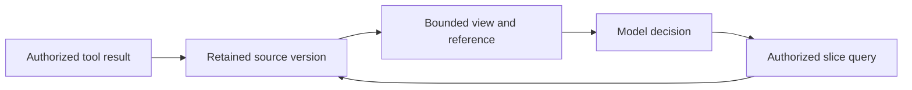

# S03.05 Context Efficiency: Many Tools, Large Results and Long Runs

S03.04 established how to design each tool well. S03.05 asks what happens when there are **many** tools and **large** results. Tool definitions and results exposed to the model consume context. Their size can increase cost and latency and affect accuracy; caching, deferred loading and result filtering change the actual impact. The proposed stage compares three context strategies, then examines result delivery and long-running history separately. The concepts below are design guidance; the experiments and results remain to be built by the learner.

## What we are trying to achieve

By the end of this stage you can answer, with your own numbers rather than opinions:

1. What does a 50-tool catalogue cost per turn, and what does it do to tool selection?
2. When does it pay to stop loading every tool definition up front (tool search), and when does it pay to let the model write code against the tools (code mode)? 
3. How should a tool deliver a result too big to put in the context?
4. Which approach would you pick for a given catalogue size anvd task type, and what evidence would change your mind?
5. How can a long-running agent reduce history without losing constraints, evidence or the status of an action?

This is an engineering trade-off stage. The honest outcome may be "the gap is small for this catalogue", and that is still a result.

## Context is a working set

The model's current input is a selected view of the task, not its permanent record. A larger window gives more capacity, but it does not resolve ambiguous tools, stale evidence or contradictory action status. Measure those failures on the actual task rather than assuming a fixed “safe” context size.

| Component | What belongs here | How growth is controlled |
|---|---|---|
| Instructions and current request | Goal, constraints and relevant policy guidance | Keep essential constraints available; enforce policy outside the prompt |
| Tool definitions | Names, descriptions and schemas currently exposed | Selective loading and clear namespaces |
| Observations | Tool results and retrieved evidence | Filtering, projection, previews and evidence references |
| Recent history | Calls, results and decisions needed for continuity | Bounded history and compaction |
| Task state | Open work, verified facts, operation references | Render from maintained state rather than infer from prose |
| Generation headroom | Space for the next answer and reasoning where applicable | Reserve according to the selected model/API limits |

Budget these components together. If indispensable material alone exceeds the budget, narrow or split the task; silently dropping a constraint is not a valid compression strategy.

## Three independent decisions

1. **Exposure:** which tool definitions should the model see now?
2. **Computation:** should intermediate data pass through the model or be processed in code?
3. **Retention:** which past observations remain in context, and which can be retrieved again?

A/B/C below are experimental configurations, not mutually exclusive architectures. Tool search can load a code API on demand; either direct calling or code mode can use artifacts and compact history. Change one dimension at a time when attributing improvements.

**Delegation as context partitioning.** A regional subagent can receive a narrow toolset and return a typed handoff containing findings, evidence references, unresolved work and action status. This combines the three decisions rather than replacing them. Count all subagent tokens and calls; lost constraints or evidence at handoff can erase the savings. No delegation experiment is required for the minimum build.

## Scenario

Start from the support-ticket contracts proposed in S03.04. That stage is design guidance, not an implemented curated server or eval harness. For this stage, the learner will build a self-contained catalogue of about 5–6 intent-level tools per regional team, using consistent names such as `tickets_uk_get_ticket`. Grow it the way a real organisation would:

- Replicate it for about **8 regional teams** (for example `tickets_uk_`, `tickets_de_`), each with similar but not identical tools.
- Add a third-party **`fx-rates`** server and a **`notifications`** server.
- The result is roughly **50 tools** across several servers, with deliberate near-duplicates across regions.

This is the situation S03.04 section 10 describes ("500 tools across several servers"), at a size you can run on a laptop.

Use one connected investigation: “Check duplicate-charge reports across the UK and German teams, identify confirmed duplicates, and prepare a proposed resolution. Do not issue refunds without confirmation.” A pending authorization is not a second settled charge. This scenario exercises regional discovery, large payment logs, exact amounts and preserved action constraints.

## The three strategies

| | A. All tools in context | B. Tool search | C. Code mode |
|---|---|---|---|
| What the model sees at start | Every tool definition | Custom B starts with `search_tools`; native variants may also expose catalogue metadata | Typed stubs for the tools (or a way to list them) and a code-execution tool |
| How it finds a tool | Reads the full list | Calls `search_tools(query)`; only matches are loaded | Reads stubs, writes code that calls them |
| Where large intermediate data lives | In the context | In the context | In the sandbox; only selected outputs enter context |
| Independent-call execution | Host may fan out calls proposed together | Discover prerequisites, then host may fan out loaded tools | Generated code may fan out through the broker within the same limits |
| Main cost | Definition context and processing cost; near-duplicate confusion | Extra search turn; search can miss | Sandbox, safety, and harder debugging |
| Main idea behind it | Baseline | Select a relevant subset first (the RAG-MCP idea) | Anthropic's "Code execution with MCP" idea |

**Parallel calls are a separate control.** Independent regional reads can run concurrently in A, B or C when the selected runtime supports it; dependent operations must wait for their inputs. Code mode is not automatically the only parallel arm. Hold concurrency, rate limits, timeout and retry budgets constant. Distinguish model turns, tool calls and backend calls; one turn can propose several calls without guaranteeing that the executor runs them concurrently.

### A. All tools in context (baseline)

Expose all ~50 definitions. Run it twice to test **ordering**:

- deterministic order (stable prefix between turns),
- random order each run.

Stable ordering may improve prefix reuse; shuffling can affect both caching and selection. Test these effects separately using seeded orders and cold/warm runs. See “Caching and actual cost” below for verified provider behavior; report measured cached and uncached usage for the selected configuration.

**Catalogue refresh is a different cache.** Listing tools across ten servers costs network round trips, parsing and possibly authentication before any model request. Cache approved catalogues by server identity, authorization scope and contract version; measure listing calls, bytes and startup/refresh latency separately from schema tokens. In the [2025-11-25 tools protocol](https://modelcontextprotocol.io/specification/2025-11-25/server/tools), a server can advertise `listChanged` and send change notifications; choose a bounded refresh policy when notifications are unavailable. Invalidation should trigger review of changed definitions, not automatic trust. The [2026-07-28 revision](https://modelcontextprotocol.io/specification/2026-07-28/server/tools) adds list-cache metadata such as `ttlMs` and `cacheScope`; use it only with compatible implementations and preserve authorization partitioning. A cache hit never replaces invocation authorization.

### B. Tool search

The custom baseline starts with only `search_tools` plus instructions describing the available domains. Build it in two steps:

1. **Substring/keyword match** over tool names and descriptions.
2. **Embedding similarity**, to handle queries that don't share words with the tool.

The host must register or expose the selected definitions for subsequent calls; returning descriptions as text alone does not make new tools callable. Search only the catalogue the caller is permitted to discover, and recheck authorization at invocation. Keep retrieved definitions and their token cost in the trace.

Questions to answer: does the model search before acting? Does it search with the right words? What happens when the right tool isn't returned (the failure mode that matters most)? How many results should come back?

**Two-tier disclosure** is an optional B variant: expose a short directory, then retrieve the selected tool's complete schema and examples before registering it. An application-defined `describe_tool` is not a standard MCP method. Count both directory tokens and detail calls. A cheaper model can route discovery, but compare recall and total cost including misses and retries before adopting it.

**Loading is not necessarily temporary.** Record loaded definition count and tokens at step *n*: a long run can accumulate most of the catalogue. Whether tools can be removed from later requests depends on the provider/runtime. Removing an active definition does not erase earlier descriptions in history; compaction and cache consequences must be measured separately.

### Discovery variants and failure boundaries

Keyword matching is useful for exact regional names and identifiers. Embeddings can match paraphrases but may confuse semantically similar regional tools. A hybrid retriever can combine both candidate lists; it is an optional follow-up if the simpler arms show complementary misses, not a required vector-database project.

**Namespace routing** is a separate comparison: expose a small regional/domain directory, select the relevant namespace, then load its tools. A prefix such as `tickets_uk_` alone does not reduce schema tokens. If both regions are required, the router must admit both. Namespace boundaries are organizational hints, not authorization.

**Native deferred search — documentation checked 21 October 2026.** [Anthropic](https://platform.claude.com/docs/en/agents-and-tools/tool-use/tool-search-tool) provides regex/BM25 search and custom search integration. Its 10-tool/10k-definition-token guidance and suggestion to retain 3–5 hot tools are vendor recommendations, not universal thresholds. [OpenAI](https://developers.openai.com/api/docs/guides/tools-tool-search) supports hosted/client-executed search; its guide specifies GPT-5.4 and later in Responses. Individual deferred functions initially expose names/descriptions; namespaces expose group metadata. Its fewer-than-10-functions namespace suggestion is also a heuristic. Confirm the exact model, API, SDK and hosting platform before running this arm; API support does not establish support in every Foundry or SDK wrapper.

| Failure boundary | Example | What to record |
|---|---|---|
| Discovery | UK tool loaded; required German tool absent | Search query, allowed catalogue, candidates and loaded definitions |
| Selection | Both tools loaded; model chooses UK for a German ticket | Selected tool and task intent |
| Arguments/schema | Correct tool selected; wrong ticket ID or malformed amount | Validation error versus valid syntax with wrong meaning |

A vague schema can contribute to several failures, so record the observed boundary before diagnosing the cause. On a miss, allow one query reformulation and one broader namespace lookup within a fixed budget; if capability remains unavailable, report that limitation. Do not invent a tool or broaden permissions. Reject a stale or invalid definition and reload the exact approved schema before invocation.

### C. Code mode

Give the model typed stubs of the tools and a sandbox. The model writes code that calls the stubs. Calls are **proxied through a trusted host/client broker**. The broker restricts permitted calls and destinations; the tool servers still verify authentication, scopes and business policy. The sandbox has **no direct network access**, with an explicit broker channel for tool calls. Keep credentials outside generated code, bound execution time, memory, call counts and output size, and preserve confirmation and idempotency controls. No direct network access alone does not prevent data leakage through an authorized tool or printed output.

Questions to answer: how much context does it save on multi-step tasks and large results? What new risks appear (code that loops, leaks data, or tries to reach the network)? What does the client still have to enforce? This ties to the authority points in S03.04 section 4 and future security work; no implemented S03.06 stage is assumed here.

**When code mode may not pay off.** A single lookup may gain little while adding runtime overhead. It is most worth testing for fixed loops, joins and aggregations. Writes are possible only through the same enforced authorization, confirmation and retry controls as direct calls. Generated code must pause at a required decision boundary; one approved program is not blanket approval for all later actions. No unverified study percentages are used to claim that code mode always wins or loses.

## Function chaining, interleaved thinking and code mode

These address different parts of the workflow:

- **Function chaining** means successive tool calls can use earlier results.
- **Interleaved thinking** lets a supported reasoning model spend additional internal reasoning tokens between calls before selecting its next action. Chaining is possible without this extra reasoning phase; both modes can produce the same correct sequence.
- **Code mode** lets generated code perform several calls and process their intermediate data before returning selected results to the model. The model does not necessarily inspect or reason between every backend call inside that code.

For example, a task might fetch regional ticket counts, convert amounts to one currency and calculate a total. With direct calls, the model receives intermediate results and chooses subsequent calls. With code mode, code can perform the fixed conversions and aggregation, returning the total and a compact breakdown. If a meaningful decision or confirmation is required, execution must stop and return control rather than silently decide it in code.

OpenAI documents interleaved thinking and preserving reasoning items across tool calls in its [reasoning guide](https://developers.openai.com/api/docs/guides/reasoning). This is model/runtime behavior, not an MCP feature. Hold model, reasoning settings and state-preservation behavior constant across A, B and C; record reasoning-token usage where reported. Otherwise, a change in reasoning effort could be mistaken for a benefit of context strategy. A separate reasoning-mode experiment can come later.

## Evaluation

Implement a stage-local harness using the method in S03.04 section 6; no existing S03.04 harness or “Exercise 3” is assumed:

- About 20 realistic questions across the catalogue: single-tool lookups, multi-region tasks, ambiguous requests, impossible requests, near-duplicate traps, and large-result tasks.
- Known right outcomes, with deterministic end-state checks. Allow equivalent valid paths.
- Development questions to tune, held-out questions for the final comparison.
- Pin model versions, repeat runs, report counts with percentages.

Metrics, for each of A (ordered), A (random), B (substring), B (embeddings) and C:

| Metric | What it reveals |
|---|---|
| Task success | Did it reach the right outcome safely? |
| Cost per successful task | Total measured spend across all attempts divided by successful tasks; undefined when none succeed |
| Schema-token share | Loaded definition tokens / total input tokens over the same requests; separately report catalogue metadata, directories, indexes and stubs to capture all capability-exposure costs |
| Discovery recall@5 | Relevant tools in the first five retrieved candidates / relevant tools for the annotated acceptable solution |
| Peak context and cumulative input | Largest request versus sum of input tokens across requests |
| Wrong-tool rate | The selection problem at scale |
| Failed discovery rate | For B: right tool never surfaced |
| Tokens per task (input, output, cached) | The context-cost problem |
| Calls / turns per task | Count model turns, model-visible calls and underlying backend calls separately |
| Concurrency and critical-path latency | Actual simultaneous calls, configured limit and serial versus concurrent execution under matched limits |
| Catalogue overhead | Listing/refresh calls, bytes, latency and application-cache hits |
| Loaded definitions at step n | Active count and tokens, plus retained definition text in history where measurable |
| Latency | End-to-end time |
| Unauthorized or duplicate side effects | Safety, especially for C |

Use identical backend behavior, fixtures, permissions, task outcomes and execution budgets across strategies. Reset mutable state between independent trials. Fix the shuffled-order seeds and separate cold-cache from warm-cache runs; record provider-reported usage and actual pricing rather than equating cached tokens with free tokens. Count discovery, generated code, tool outputs and reasoning where reported. Track underlying backend calls separately from model-visible calls: one code-execution call can hide many backend requests.

Define failed discovery against the tools needed by an acceptable solution: distinguish retrieval misses from poor search queries or failure to search. Tune the search result limit on development cases. For C, state whether all stubs or only an index are loaded initially and count the loaded text; loading every stub can recreate the definition-cost problem. All strategies should use the same result filtering where applicable, so the baseline is not deliberately wasteful.

For multi-tool tasks, also report whether **all** required tools for at least one acceptable solution were loaded; average recall alone can hide a missing prerequisite. Fix relevance annotations before scoring, and allow documented alternative solutions. Separate first-search recall from eventual discovery after retries. Measure backend errors, recovery calls and artifact reads as well as successful calls.

Treat cost per success as an efficiency metric under correctness and safety constraints, not permission to trade away either. Include search, embedding, code execution and summarization costs where measurable; list excluded costs. With a small task set, report individual counts and latency distributions without presenting unstable tail percentiles as precise estimates.

**TODO:** results table (strategy × model × metric) and the trace-based notes.

## Large-data delivery

A separate step, measured as context cost. Suppose a tool needs to give the model 50,000 log lines. Compare:

| Pattern | How it works | Context cost | Trade-off |
|---|---|---|---|
| Download URL | A resource or result returns a link the user or a downstream step fetches | Small | A link alone does not expose its contents; an authorized retrieval or processing step is required. Any content then shown to the model costs context. Use scoped access and suitable expiry |
| Chunked resource | `logs://app?start=0&count=200` returns a window; the model pages | Bounded per call | Many calls; needs stable ordering and a `complete`/`next` signal |
| Field projection | Filter matching records and return only requested columns | Small when rows are also bounded | Omitted fields must remain recoverable; projection alone does not limit row count |
| Progress plus bounded result delivery | Status notifications while work runs; deliver data through pages or an artifact contract | Status can be small; data cost remains | Progress is not partial-result streaming. Define completeness, cancellation and retrieval separately; see S03.04 section 10 and [MCP progress](https://modelcontextprotocol.io/specification/2025-11-25/basic/utilities/progress) |
| Aggregate tool | `summarize_logs(app, window)` returns counts and top errors | Small | Loses detail; you decide the summary in advance |

**TODO:** measure tokens and task success for each on the same log-analysis questions. Pagination of results (as opposed to listing tools) is covered in S03.04 section 5.

### Optional resource and prompt walkthrough

Specify these alongside the large-data contracts without adding them to the minimum build:

| Capability | Proposed contract | What to demonstrate |
|---|---|---|
| Resource | A versioned URI such as `logs://payments/uk/snapshot-001/preview`, read through `resources/read` | Return an authorized bounded preview with a stable evidence reference; an application query tool retrieves exact slices. A resource URI grants no access, and MCP resource reads do not automatically paginate arbitrary log records |
| Prompt | `investigate_duplicate_charge(ticket_id)` retrieved through `prompts/get` after explicit user selection | Return a short investigation template requesting evidence and preserving the no-refund-without-approval constraint; retrieving it does not run the investigation |

The host decides which retrieved resource content enters model context and applies the same disclosure controls. A server-provided prompt remains attributed external content; it cannot elevate its own authority or override task policy. Count prompt/resource content and retrieval calls in the same token and latency budget. See [MCP resources](https://modelcontextprotocol.io/specification/2025-11-25/server/resources) and [prompts](https://modelcontextprotocol.io/specification/2025-11-25/server/prompts). These are proposed contracts, not registered capabilities in this repository.

### Reduce before summarising

Use the cheapest operation that preserves the needed evidence:

1. **Push down filters:** request the relevant region, time window and payment status from the source.
2. **Project fields:** keep transaction ID, ticket ID, amount, currency and settlement status; omit unrelated metadata.
3. **Aggregate exactly:** compute counts and totals in a query engine or code, with explicit currency and duplicate rules.
4. **Page bounded results:** preserve stable ordering and continuation information.
5. **Retain an artifact reference:** keep authorized original evidence outside context and expose a profile or preview.
6. **Retrieve exact slices:** search or query that artifact when a later question needs more detail.
7. **Summarise where interpretation is needed:** use a model for narrative explanation, retaining references to the supporting evidence.

These operations combine; this is not a compulsory seven-call sequence. A correct aggregate is exact only for its stated query. A summary is lossy, and a silently truncated list must never look complete. For example, do not total all payment attempts as if every attempt settled, or add GBP and EUR amounts without an explicit conversion basis.

### Artifact references and recoverable evidence

A proposed result can carry this illustrative envelope. The hash value is a placeholder; a real implementation computes the full digest of the retained version.

```json
{
  "artifact_id": "payment-log-uk-001",
  "version": "1",
  "integrity": {"algorithm": "sha256", "digest": "<computed digest>"},
  "source": {"system": "payments-uk", "snapshot": "2026-10-21T09:00:00Z"},
  "row_count": 50000,
  "preview": [{"transaction_id": "P-204", "ticket_id": "T-1003", "status": "settled"}],
  "returned_count": 1,
  "truncated": true,
  "omitted_fields": ["processor_response"],
  "expires_at": "2026-10-22T09:00:00Z",
  "next_step": "Use the authorized artifact query operation with this ID and version."
}
```

These are application fields, not mandatory MCP fields. A handle identifies evidence; it does not grant access. Recheck authorization on every read, bind queries to the intended version, and apply a retention policy. A hash detects content mismatch but does not prove that the source was truthful. Expired or inaccessible evidence must produce an explicit unavailable result, not a fabricated reconstruction. A refreshed snapshot is new evidence and must be labelled as such.



**Surprise follow-up:** the initial task asks for duplicate counts, so the preview omits processor responses. Later ask, “What exact processor response accompanied P-204?” The agent should query the retained version and cite that evidence. A summary-only approach may not answer. Measure exact recovery, additional calls/tokens and correct refusal when the artifact has expired; never grant success for a plausible guess.

## Long-running context management

### Why short results can still create long histories

Let the first request contain B tokens and each completed step add d tokens to subsequent requests. If every request retains everything, request i contains `B + (i - 1) × d`. Across n requests, cumulative input is `n × B + d × n × (n - 1) / 2`.

With B = 8,000 and d = 2,000, 10 requests end at 26,000 tokens and cumulatively process 170,000 input tokens. At 50 requests, the last request contains 106,000 and the cumulative total is 2,850,000. This is an arithmetic illustration with constant growth, no compaction and no cache adjustment—not a latency model or a billing estimate. The quadratic cumulative total is different from the linearly growing current window.

### Four ways to reduce history

| Method | What remains | What can go wrong |
|---|---|---|
| Observation masking | Call identity, outcome and evidence reference replace old bulky results | Evidence cannot be recovered if it was never retained or has expired |
| Sliding window | Recent interactions plus explicit enduring constraints | Early decisions disappear unless maintained separately |
| Structured checkpoint | Goal, open work, verified facts, operation status and references | A stale or incomplete checkpoint misrepresents the task |
| Model summary | Compact interpretation of earlier activity with source references | Exact details or unresolved commitments may be omitted or altered |

Reduce new observations before they enter history. Trigger further reduction when measured context approaches a configured budget with room for the next result and generation. Calibrate the budget on the chosen tasks/model; do not treat a fixed percentage of the nominal window as universally reliable. If reduction still leaves too much essential material, split or defer work.

Preserve API message relationships when applying history transformations: do not leave orphan tool results, omit required reasoning items, or arbitrarily edit opaque provider state. Provider-native compaction and application checkpoints are distinct mechanisms; an opaque compacted item is not an inspectable business ledger.

### Context, state and memory

| Store or view | Purpose in the ticket investigation |
|---|---|
| Model context | Selected evidence and instructions for the next decision |
| Task state | Regions checked, unresolved questions, current goal and user constraints |
| Action ledger | Authorized intent, operation ID, pending/completed/unknown outcome and receipt |
| Artifact storage | Versioned payment evidence and exact source slices |
| Longer-term memory | Reusable facts/preferences, with provenance and freshness rules |

A conversation transcript can inform state, but it is not sufficient proof of an external action. Keep trusted execution records separate from model-written notes. Previously recorded authority must be revalidated when acting; a checkpoint does not preserve a permission that has since been revoked.

**Checkpoint walkthrough:** after inspecting UK logs, retain “German investigation pending,” the UK evidence reference and “no refunds without confirmation.” Store the exact transaction IDs and amounts needed next, rather than paraphrasing them. On resumption, rebuild the context from this state and current authorization, then retrieve missing evidence.

If an approved refund timed out before a receipt arrived, record its outcome as unknown. Reconcile through its operation ID or the backend's idempotency contract before any repeat. Never summarize “refund requested” as “refund completed.” Replaying an event log must not blindly re-execute side effects. The detailed execution contract remains in [S03.04 section 4](../S03.04-MCP-Tool-Design/README.md#4-enforce-authority-and-make-retries-safe).

### Optional 30-step investigation

Compare retained history with masking older observations after retaining authorized originals. Use the same task, fixtures, model and budget; keep the recent three completed tool interactions visible as an explicit experimental setting, not a recommended universal threshold. Stop safely if the configured window is exceeded and report it as a failure.

Insert a later request for an exact early detail, a changed user constraint, an expired artifact and an unresolved operation. Score evidence recovery, constraint retention, duplicate effects, peak context and total recovery cost. A structured-checkpoint or model-summary arm is a later extension, not necessary for the initial comparison.

## Caching and actual cost

**Provider behavior checked 21 October 2026.** OpenAI appends discovered definitions to context; editing a previously loaded set invalidates cache reuse from that point. [OpenAI tool search](https://developers.openai.com/api/docs/guides/tools-tool-search). Anthropic keeps deferred definitions out of the system prefix and appends discovered references in history; a deferred definition cannot carry `cache_control`. [Anthropic caching](https://platform.claude.com/docs/en/agents-and-tools/tool-use/tool-use-with-prompt-caching).

These mechanisms preserve an eligible prefix, not a guaranteed cache hit for every request. Retention, routing and provider eligibility still matter. Reordering earlier content or compacting history can alter reusable portions. Cached tokens remain part of the model's context; discounts do not remove distractors or solve stale evidence.

| Cache | Stored value | Correctness boundary |
|---|---|---|
| Prompt cache | Provider computation for reusable input | Provider isolation and matching rules; measure reported hits |
| Tool-result cache | Result of a normalized call | Tenant/principal entitlement, arguments, source version and freshness |
| Retrieval cache | Candidate IDs and rankings | Query, authorized catalogue, index version and filters |

Application cache keys must reflect access boundaries and relevant versions; do not include raw credentials in keys or logs. Revalidate access on retrieval. A cached eligibility answer is not permission to execute a refund against a changed balance. A provider prompt-cache routing key is not a substitute for authorization.

Report total measured spend divided by successful tasks, including failed attempts. Compare at equivalent safety and success criteria. A smaller prompt can still cost more if discovery, regeneration, summarization or repeated cache misses outweigh its savings. For result reduction, use distinct names: `fraction saved = 1 - visible/raw`; `compression factor = raw/visible`. State the units and handle zero denominators explicitly.

## Plan

| Step | Output |
|---|---|
| 1. Build the 50-tool catalogue | Regional servers plus `fx-rates` and `notifications`; naming and prefixes; a script that reports total definition tokens |
| 2. Baseline A and size sweep | Run 10, 50 and approximately 200 tools; keep target tools/tasks fixed and add labelled synthetic distractors. Use seeded ordering. |
| 3. Tool search B | At 50 tools compare keyword, embedding and namespace-routing arms. Add native discovery only after confirming platform support; record unsupported arms honestly. |
| 4. Code mode C | Compare at 50 tools; no direct sandbox network, brokered calls and selected results. Hold the backend contract constant. |
| 5. Large-data patterns | URL, pagination, aggregation and projection; retained evidence and surprise follow-up questions. |
| 6. Cache comparison | Stable ordering, seeded shuffled ordering and append-only discovery; matched cold/warm runs. |
| 7. Results and decision note | Tables, traces and a “when to use which” note; optional 30-step history experiment reported separately. |

**Paper exercises first (see the [S03 exercise plan](../S03-EXERCISE-PLAN.md)):** (1) a sealed prediction sheet, strategy × metric with reasons, written before any build so results can disagree with you; (2) a large-result design for one real tool from your S03.04 exercise, covering the four delivery patterns, the artifact envelope and the follow-up question the aggregate cannot answer. The build below is exercise 3, after S04.

**Minimum viable build:** complete steps 1 and 2, the keyword arm of step 3, the projection arm of step 5, and step 6; publish their results and decision note in step 7. Embeddings, namespace/native discovery, code mode, the other delivery arms and the 30-step investigation are optional follow-ups. Keep the same concurrency policy across the initial comparison.

When implementing later, keep changes reviewable, each with visible evidence such as a token count or trace. Do not run a full cross-product of all experiments. The size sweep, discovery comparison, result comparison and cache comparison answer different questions.

**Safety acceptance cases:** an unauthorized regional tool must not appear through discovery or an application cache; a hostile log line must not authorize a refund or export; expired/stale evidence must be identified; compaction must preserve changed constraints; recovery must not duplicate an external effect. Record denied attempts separately from completed unauthorized effects. These are proposed learner tests, not passing checks claimed by this README.

## What this is not

- Not a claim that one strategy always wins. Tool search can miss the right tool. Code mode adds a sandbox you must secure. All-in-context is fine for small catalogues.
- Not a full security stage. Poisoned descriptions, shadowing and injection deserve separate treatment. This stage must still enforce and test the authorization, isolation and side-effect controls required to compare its strategies safely.
- Not a benchmark. Twenty questions on one catalogue and one or two models is an exploratory comparison.

## What you should be able to explain

**TODO:** fill in after the build. Draft prompts:

1. Why does tool count hurt, and why is it not only a token problem?
2. How does tool search work, and what is its worst failure?
3. What does code mode save, and what must still be enforced outside the sandbox?
4. Which approach for 10 tools, 50 tools, 500 tools, and why?
5. How would you deliver a 50,000-line result to an agent?
6. What would make you change your choice?
7. What must survive compaction, and how would you prove it?
8. Why can fewer tokens still mean higher cost per successful task?
9. How does an artifact reference differ from a summary or an action receipt?

**Interview line (draft):** "I don't pick a context strategy by taste. I take a realistic catalogue, run the same eval with everything loaded, with tool search, and with code mode, and I compare cost per successful task under correctness and safety constraints, then use discovery failures, wrong-tool choices, tokens and latency from the traces to explain the result."

## Learn these principles by heart

> 1. Context is a working set, not the system of record.
> 2. Discovery must succeed before selection can succeed.
> 3. Reduce data while retaining authorized, recoverable evidence.
> 4. Cached tokens still occupy context.
> 5. A summary is not an execution receipt.
> 6. Optimize cost per successful task under correctness and safety constraints.

Know the arguments in these references well enough to explain them with the ticket scenario. Look up changing limits, prices, headers and model lists rather than memorizing them.

| Major reference | Core idea to retain | Recall question |
|---|---|---|
| [Writing effective tools for agents](https://www.anthropic.com/engineering/writing-tools-for-agents) | Tool usability must be evaluated | How do names, arguments and results affect successful use? |
| [Code execution with MCP](https://www.anthropic.com/engineering/code-execution-with-mcp) | Intermediate computation can stay outside model context | Which data can code process without the model reading every row? |
| [Anthropic tool search](https://platform.claude.com/docs/en/agents-and-tools/tool-use/tool-search-tool) | Deferred discovery adds a retrieval dependency | What happens if the required tool is not found? |
| [OpenAI tool search](https://developers.openai.com/api/docs/guides/tools-tool-search) | Group metadata and loaded schemas have different costs | What does the model see before and after discovery? |
| [RAG-MCP](https://arxiv.org/abs/2505.03275) | Select relevant tool descriptions before prompting | How do you separate retrieval quality from tool selection quality? |
| [MCP 2025-11-25 tools](https://modelcontextprotocol.io/specification/2025-11-25/server/tools) and [2026-07-28 release](https://blog.modelcontextprotocol.io/posts/2026-07-28/) | Protocol claims are version-specific | Which behavior belongs to MCP, the host, or the application? |

## Protocol and implementation scope

The S03.02 lockfile pins `mcp==2.3.0`; its installed protocol registry was inspected on 21 October 2026 and supports `2026-07-28` as well as earlier handshake revisions, including `2025-11-25`. SDK support alone does not establish the protocol used by a particular connection: record the actual request/negotiated version. These stages are self-contained, so different pins are not inherently an error.

S03.04 describes MCP 2025-11-25. The S03.03 lockfile pins `mcp==1.26.0`; its installed package was inspected on 21 October 2026 and declares latest protocol `2025-11-25`, with older supported revisions. The [2026-07-28 final release](https://blog.modelcontextprotocol.io/posts/2026-07-28/) introduces a stateless core without the old initialization handshake and adds cacheable list results. Do not copy that lifecycle into the older examples without an explicit migration and compatibility check.

Tool search here is a host/provider or application discovery feature, not a claim that `search_tools` is a standard method of the pinned MCP revision. Artifact fields and checkpoints are application proposals. Before building, record the actual SDK, provider API and protocol revisions used. No dependency migration is part of this chapter update.

## Further reading

The table above is a recall drill; this list is a reference index for implementation and deeper reading. Repeated links are intentional, not additional study requirements.

- [Anthropic: Writing effective tools for agents](https://www.anthropic.com/engineering/writing-tools-for-agents): consolidation, namespacing and token efficiency.
- [Anthropic: Code execution with MCP](https://www.anthropic.com/engineering/code-execution-with-mcp): the idea behind strategy C.
- [RAG-MCP, arXiv:2505.03275](https://arxiv.org/abs/2505.03275): selecting a relevant subset of MCP tools before prompting; the idea behind strategy B.
- [OpenAI: Function calling guide](https://developers.openai.com/api/docs/guides/function-calling): best practices, including a soft suggestion to keep function counts small.
- [S03.04 MCP Tool Design](../S03.04-MCP-Tool-Design/README.md): the tool design, eval method and catalogue notes this stage builds on.

- [Anthropic tool-use caching](https://platform.claude.com/docs/en/agents-and-tools/tool-use/tool-use-with-prompt-caching): deferred definitions and prefix preservation.
- [OpenAI MCP servers](https://developers.openai.com/api/docs/guides/tools-connectors-mcp): provider integration, distinct from implementing a local MCP server.
- [Cloudflare: Code Mode](https://blog.cloudflare.com/code-mode/): an independent statement of strategy C; MCP tools converted to a typed TypeScript API that the model writes code against.
- [MCP Conformance framework](https://github.com/modelcontextprotocol/conformance): protocol conformance is a separate test layer from the agent-level evaluation in this chapter; passing one says nothing about the other.

The source reports supplied the chapter framing; public technical claims are linked to primary sources above. Research performance figures, unverified pricing and universal context thresholds are deliberately omitted. Advanced vector indexes, KV-cache sizing and reference runtimes remain outside this learner chapter.

The design above is a teaching proposal. No comparison results or production guarantees are claimed for S03.05 until the build produces them.
