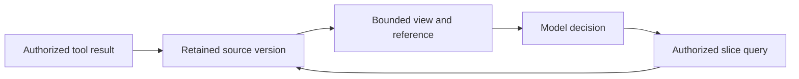

# S03.05 Context Efficiency: Many Tools, Large Results and Long Runs

S03.04 established how to design each tool well. S03.05 asks what happens when there are **many** tools and **large** results. Tool definitions and results exposed to the model consume context. Their size can increase cost and latency and affect accuracy; caching, deferred loading and result filtering change the actual impact. The proposed stage compares three context strategies, then examines result delivery and long-running history separately. The concepts below are design guidance; the experiments and results remain to be built by the learner.

## What we are trying to achieve

The aim is a context that is as small and as useful as we can make it: the few things the model needs for its next decision. Not "compress everything", which loses detail, but "keep the high-signal part in, keep the rest reachable".

To get there we look at what fills the context when an agent uses tools. There are only a handful of sources: the tool definitions we expose, the results tools send back, the instructions and constraints we give the agent, the history of calls and results that piles up over a long task, and the task state the model has to keep track of. Each one grows for a different reason and is controlled in a different way, so the chapter takes them one at a time: what it costs, what happens when it is too big, what cuts it down, and how to measure whether the cut helped.


## Context is a working set

The model's current input is a selected view of the task, not its permanent record. A larger window gives more capacity, but it does not resolve ambiguous tools, stale evidence or contradictory action status. Measure those failures on the actual task rather than assuming a fixed “safe” context size.

| Component | What belongs here | How growth is controlled |
|---|---|---|
| 1. Instructions and current request | Goal, constraints and relevant policy guidance | Keep essential constraints available; enforce policy outside the prompt |
| 2. Tool definitions | Names, descriptions and schemas currently exposed | Selective loading and clear namespaces |
| 3. Observations | Tool results and retrieved evidence | Filtering, projection, previews and evidence references |
| 4. Recent history | Calls, results and decisions needed for continuity | Bounded history and compaction |
| 5. Task state | Open work, verified facts, operation references | Render from maintained state rather than infer from prose |
| 6. Generation Headroom | Space for the next answer and reasoning where applicable | Reserve according to the selected model/API limits |

Budget these components together. If indispensable material alone exceeds the budget, narrow or split the task; silently dropping a constraint is not a valid compression strategy.

This decomposition is the chapter's own. It follows Anthropic's guidance on context engineering (treat context as a finite resource to curate across instructions, tools, retrieved data and history) and the memory-hierarchy framing in the source reports (the window as a cache over durable state), merged into what a tool-using agent actually sends per turn.

### What each part of the working set needs

**Instructions and current request: guide the proposal, enforce in code.** Policy means the business and security rules: who may issue a refund, which team's tickets they may touch, the amount limit, whose approval is required. Keep a one-line hint in the prompt so the model proposes sensibly ("refunds over 500 GBP need supervisor approval; ask before proposing one"). Enforce the rule as **policy as code**: a check in the server or a policy engine that runs at the point of effect, whatever the model proposes and whatever a ticket body claims. In S03.03 that is the scope, team, balance and limit checks inside `issue_refund`; at platform scale it is a policy engine (Cedar on AgentCore, OPA, Azure RBAC plus your own checks) with a decision point and an enforcement point (S03.06, "Where enforcement belongs"). A rule that lives only in the prompt costs tokens on every turn and can be talked out of by hostile text. *The prompt guides the proposal; code decides the effect.*

Keeping constraints in the prompt is itself a cost: tokens on every turn, and still only advice. The practice is to shrink the prompt to the few hints that change the model's next proposal, in a stable cached prefix, and keep each constraint where it is enforced:

| Kind of constraint | Where it lives | How it is kept | Example |
|---|---|---|---|
| Authorization (who may do what) | The token and the server's scope map | Scopes issued by the AS; a `tool → required scope` table in server code (S03.03) | Ayşe lacks `tickets.refund`; the server refuses before the function runs |
| Business policy (limits, ownership, approval thresholds) | Policy as code: server checks or a policy engine | Versioned, unit-tested rules evaluated at the point of effect (Cedar, OPA, or plain Python in `issue_refund`) | 500 GBP limit, team ownership, approval above threshold |
| Per-task constraints (what the user said this time) | The task state record, outside the prompt | Stored by host code when said; rendered into every turn as a short block; survives compaction | "Do not issue refunds without my confirmation", "UK and DE only" |
| Per-tool constraints (how to use this tool) | The tool's description and schema | Loaded only with the tool; enums and bounds in the schema | "Use after `check_refund_eligibility`; amount as a decimal string in ticket currency" |

Two carriers that are not constraints themselves: **error results** deliver the rule at the moment of refusal (`over_limit: refunds above 500 GBP need supervisor approval; call request_approval`), so the model learns it from the result rather than the prompt; and the **approval record** holds a human's consent, bound to ticket, amount, currency and action, stored by the host and rechecked at execution, never in the prompt or a model argument. On Foundry, authorization is Entra roles and the project connection and per-call approval is `require_approval` with the `mcp_approval_request` item; on AgentCore, Cedar policies on the Gateway are the policy-as-code layer. Per-task user constraints are yours to keep in state on both.

*Procedures are instructions too.* A refund runbook or a troubleshooting procedure pasted into the system prompt is the same problem as fifty tool definitions: paid for every turn, mostly irrelevant to the current step, diluting attention. There are several ways to handle it, and the most common is still the simplest: the runbook in the system prompt, accepted as a fixed cost, which is fine while procedures are short. The others move the procedure out of the prompt: encode the fixed sequence inside a curated tool so it never needs rendering (S03.04's answer); store procedures as skills loaded on demand (selective loading at the whole-procedure level); or **selective procedural context**, which applies the tool-search idea at the step level. Model the procedure as a graph: nodes are steps, edges are allowed transitions with their conditions. The host tracks the current node in task state and renders only that node and its neighbours into the prompt: what to do now, the possible next steps, what must be true to move. The rest stays outside the window until the task reaches it. Workflow engines (LangGraph, Durable Task, Agent Framework workflows) already hold the procedure as a graph; whether only the local step is rendered to the model is an application choice on top. The step-level version is an emerging pattern rather than a standard, worth testing where procedures are long and branching.

*What the agent-builder companies do* (product pages and posts read 23 October 2026; marketing-level detail, not architecture docs):

- **Decagon** replaced decision trees with *Agent Operating Procedures*: procedures written in natural language, modelled on the SOPs human agents follow, combined with "code-based logic" for the steps that matter, so that "key validation steps" such as refunds and identity verification run in code. Natural-language procedure for adaptability, code for the consequential checks. [Why we built AOP](https://decagon.ai/blog/why-we-built-aop)
- **Intercom Fin** has *Procedures*: structured step types (Instruction, Condition with IF/ELSE, Run sub-procedure, Handoff, Wait for webhook), drafted from pasted SOPs or built in an editor, each with a short "when to use" trigger description. A procedure starts only when the customer's intent matches its trigger, and Fin can switch to another procedure if intent changes. That trigger-then-load behaviour is selective procedural context at the procedure level. [Fin Procedures](https://www.intercom.com/help/en/articles/13449439)
- **Sierra** builds agents from composable *skills* with goals and guardrails, lets you set how deterministic each workflow is, and tests with simulations; its SDK is described by Ramp as letting them "write customer journeys as code". Procedures as versioned code rather than prompt text. [Sierra Agent SDK](https://sierra.ai/product/agent-sdk)

The shared pattern: procedures live outside the prompt as structured, versioned objects, load when their trigger matches, and hand the consequential steps to code. None of the three publishes how much of a procedure is rendered to the model at a time.

*One procedure, four ways.* The refund procedure has eight steps: identify ticket → verify customer → list payments → apply duplicate rule → check eligibility and limit → request confirmation → issue refund → notify and close. On the turn where the model must decide whether a payment is a duplicate:

| Approach | What the model sees on that turn | Rough size | What breaks |
|---|---|---|---|
| Runbook in the prompt | All eight steps, plus escalation and notification rules it will not need this turn | ~1,200 tokens, every turn | At forty steps the model follows step 6 while the conversation is at step 3; hostile text can talk it past a step |
| Procedure inside a curated tool | One tool, `process_refund_request(ticket_id)`; the eight steps run in code and return `needs_confirmation` or a result | ~150 tokens | Judgement mid-procedure (an ambiguous duplicate) has nowhere to go; code cannot ask the model partway without handing control back |
| Skill loaded on trigger | A one-line index entry until the request matches; then the whole runbook for the rest of the task | ~40 tokens idle, ~1,200 once loaded | Two skills trigger at once; intent changes mid-task and the loaded skill no longer fits |
| Selective procedural context | The current node and its exits: the duplicate rule, "qualifies → check eligibility", "does not → close with reason" | ~150 tokens, every turn | The host's node tracking is wrong (it thinks step 4, the conversation is at step 6), which is why the transition check lives in the runtime |

*The same turn, two prompts.* User: "Is the second 40 EUR payment a duplicate?"

Under the runbook approach the model's instructions contain, among 1,200 tokens: "Step 1: identify the ticket … Step 4: a payment is a duplicate if it shares the order reference and payment method with another settled payment within ten minutes … Step 6: before issuing any refund, request confirmation showing ticket, amount and currency … Step 8: notify the customer using template R-2 …". The model has to find step 4 in that.

Under selective procedural context the instructions contain:

> Current step: **apply duplicate rule**. Rule: a payment is a duplicate if it shares the order reference and payment method with another settled payment within ten minutes. Known: ticket T-2041, payments P-7780 and P-7781 (40.00 EUR each, four minutes apart, order O-5520, same card). Exits: qualifies → *check eligibility and limit*; does not qualify → *close with reason*.

Same rule, one twentieth of the text, and the two exits are the only moves on offer.

*When not to.* A two-step procedure ("look up the order, tell the customer its status") gains nothing from a graph and costs a state machine to maintain; put it in the prompt or in one tool. The graph pays off when procedures are long, branching, or shared across many agents, and when being at the wrong step has consequences. For the ticket case, at the node "verify duplicate" the model sees the duplicate rule and two exits (qualifies → request confirmation; does not → close with reason), and nothing about notification templates or escalation paths until those nodes are reached. Showing the allowed next steps does not enforce them: the runtime checks the transition's prerequisites are recorded, and the backend authorizes the effect. *The prompt guides the proposal; the workflow governs progression; the backend authorizes the effect.*

**Tool definitions: load selectively.** Do not send all 50 definitions on every turn. Three ways, cheapest first: a static per-task filter (`allowed_tools` in Foundry, `tool_filter` in the Agents SDK); namespaces (expose `tickets_uk` and `fx`, not all eight regions); tool search (the model starts with `search_tools` and loads only what it finds; strategy B below). A smaller set is useful only if it still contains what the task needs: the German payment lookup missing from the loaded set is a discovery failure, not a saving.

**Observations: reduce before they enter.** Four operations on one result. `get_ticket("T-1003")` returns 40 fields and a 200-message history:

| Operation | What it does | Example |
|---|---|---|
| Filter | Removes rows | Only messages from the last 30 days; only `status != "closed"` |
| Projection | Removes columns | Return `{ticket_id, region, amount, currency, settlement_status}`; drop `internal_notes`, `processor_response`, message bodies. SQL `SELECT a, b` is projection |
| Preview | Bounded sample with a flag | First 5 of 200 messages plus `"returned": 5, "total": 200, "truncated": true` |
| Evidence reference | Pointer to the full record | `"artifact_id": "ticket-T-1003-v7"`; a later call can query it, so the preview is never mistaken for the whole |

Filtering must keep the fields that decide the case: region, transaction ids, exact amounts, settlement status, approval evidence. These are ordinary database operations applied to tool results; Anthropic's code-execution pattern, OpenAI's MCP result limits and the GitHub MCP server's summary-plus-id results all do them.

**Recent history: bound it, then compact.** Bounded means a rule such as "keep the last three tool interactions in full". Older ones are reduced by one of four methods, cheapest first:

1. **Observation masking**: replace an old 2,000-row result with one line, `called get_tickets(uk) → 2,000 rows, artifact A-12`. Pure code, no model call.
2. **Sliding window**: drop old turns, keep pinned constraints. No model call.
3. **Structured checkpoint**: the host maintains a small record of goal, open items, ids and operation status. No model call if your code keeps it.
4. **Model summary**: an extra model call rewrites old history as prose. Most expensive and lossy; use last, and keep references so facts can be re-fetched.

Providers offer related features, but they are not the same method: Anthropic's context editing that clears old tool results is masking (method 1); OpenAI's Responses compaction replaces older items with an opaque compaction item that carries prior state and reasoning, which is closer to a provider-managed summary (method 4) with its own preservation and inspection properties. Keep them distinct when comparing. Whatever the method, a summary saying "refund completed" is not proof the backend committed it; keep the operation id and verify there.

**Task state: render it in, do not infer it.** Keep a task record outside the prompt, keyed by task id, in a store the host owns: a database row, Redis, or a workflow engine's checkpoint (LangGraph checkpoints, Durable Functions); in memory for a demo, with the caveat that a restart loses it. Split it by who may write. *Effects* (operation status, approvals recorded, refunds committed, balances) are written only by host code from backend evidence, never by the model. *Working notes* (plan, regions checked, open questions, interpretation of the request) are written by the model through `update_task_state` / `get_task_state` tools, so the state is held by the host but updated by a tool call rather than by remembering. *User constraints* ("no refunds without confirmation") are captured by host code at the moment the user says them. Each turn, render the relevant slice into the prompt as a short block: current goal, open items, constraints, the ids and amounts needed next, operation statuses. The model never reconstructs progress from twenty turns of chat, a model claim ("I completed the refund") cannot become verified state, and compaction cannot lose it.

```json
{"regions_checked": ["uk"], "pending": ["de"], "approval": "requested",
 "operations": [{"id": "OP-204", "status": "unknown"}],
 "constraint": "no refunds without confirmation"}
```

is what the host holds; only the slice the next decision needs is rendered.

*Who implements this.* The pattern is what workflow engines already do, applied to an LLM loop. LangGraph is the clearest example: a typed `State` object, nodes that read and return it, a checkpointer that persists it per thread; a tool node writes the backend result into state, the LLM node only proposes. Durable Task / Durable Functions under the Microsoft Agent Framework and Temporal are event-sourced versions: state is rebuilt from recorded events, never from prose. The "model writes notes through tools" half shows up as Claude Code's task-list tools and Anthropic's memory tool, the OpenAI Agents SDK's typed context object that tools mutate, and Manus's rewritten `todo.md`. Platforms keep history for you (Foundry threads, Responses `previous_response_id`, AgentCore Memory) but task state proper is still yours. The write discipline is the part most teams skip: if the model can write anything into state, "I completed the refund" becomes a fact. (Implementations named from general knowledge; check current docs before citing.)

*Implementation sketch (untested, Agents SDK style).* A host-owned `TaskState` dataclass with `constraints` (host-written from the user turn), `notes` (model-written) and `effects` (host-written from backend results), kept in a store keyed by `task_id`; two tools for the model, `update_task_note(key, value)` and `get_task_state()`; the `issue_refund` tool appends `{operation_id, status}` to `effects` from the backend's response, so no tool lets the model set an effect; and a `render(state)` function that puts the goal, constraints, notes and operation statuses into the agent's instructions each turn. Swap the in-memory store for a database row or a LangGraph checkpointer in production, and add a version field for the conditional-write race in S03.04 §4.

**Generation headroom: leave room to finish.** The model's output is produced inside the same window as its input: answer tokens, and reasoning tokens where the model reasons, are appended after the prompt, and input plus output cannot exceed the limit. Fill 198k of a 200k window with definitions and ticket history and the model has 2k to think and answer.

*How much to reserve.* It depends on what the turn produces:

| Turn type | Output needed | Reserve |
|---|---|---|
| A tool call (JSON with arguments) | A few hundred tokens | Small, but a reasoning model may think first |
| Reasoning before a tool call | Thousands to tens of thousands | The one that bites: hidden in the transcript, but it counts against the window |
| Final answer with explanation | 1–4k | Moderate |
| Code-mode script or long report | 4–16k | Large |

Three different numbers are involved. The *hard limit* is the provider's: input plus output cannot exceed the model's window, and the output cap you pass is also bounded. The *output reserve* is the cap you set (`max_tokens` / `max_output_tokens`), which fixes the worst case. The *safety margin* is an application choice, for example keeping input below 70–80% of the window, to leave room for the reserve, for discovered tool definitions appended mid-task, and for estimation error in local token counts; it is a conservative policy, not an API rule. If input plus the reserve would exceed the window, reduce input before the call. Frameworks that compact "when context reaches N% of the window" are applying such a margin. If essential evidence and constraints cannot fit beside the reserve, narrow or split the investigation.

*How the limit is enforced.* By your own code before each model call, or by a provider or framework compaction feature you turn on (listed below); the raw API only rejects a request that is already over the hard limit.

1. **Measure the input**, including the tool definitions, since they are part of the input even on turns that use none. Exact: Anthropic's `messages.count_tokens` endpoint (same messages and tools you are about to send). Local: `tiktoken` with the model's encoding for OpenAI models. Cheap and usually enough as a trigger: the previous turn's `usage.input_tokens` plus what you appended since.
2. **Compare to a budget**: `budget = window × 0.75 − output cap` (use the reasoning budget if it is larger). Hard-code the window per model from its documentation; the API does not return it.
3. **Reduce before sending, in a fixed order**: mask old tool results, drop turns outside the kept window (pinned state stays), re-render state, and only then a model summary. If the pinned material alone exceeds the budget, stop and split the task.

A sketch of this loop is in [`sketches/context_budget.py`](sketches/context_budget.py) (untested; helper functions are stubs).
A worked call on the OpenAI Responses API, with `max_output_tokens`, `reasoning.effort`, the truncation check and the usage fields for cached and reasoning tokens, is in [`sketches/openai_headroom.py`](sketches/openai_headroom.py) (untested).

The call then passes the cap (`max_tokens=MAX_OUTPUT` or `max_output_tokens=`) and checks the stop reason on the way back. Log `usage.input_tokens` per turn; the growth curve is the cumulative cost described under long-running context below.

*Where frameworks do it for you*, so you set a threshold instead of writing the loop: the Claude Agent SDK and Claude Code compact automatically as the context nears the limit; OpenAI Responses offers server-side compaction when a threshold is crossed; LangGraph has `trim_messages` by token count and the summarisation-node pattern; the OpenAI Agents SDK keeps history in sessions and leaves trimming to a hook before `Runner.run`; the Microsoft Agent Framework keeps conversation state in a thread object with pluggable storage and leaves reduction to a chat-history reducer you attach (truncation or summarisation). (Framework behaviour from general knowledge; verify against the version you pin.)

*The parameters.* Two layers: an output cap, and for reasoning models a control on the hidden reasoning. Names differ by provider (from general knowledge as of mid-2026; confirm against the docs of the SDK version you pin):

| Provider | Output cap | Reasoning control | Notes |
|---|---|---|---|
| Anthropic Messages API | `max_tokens` (required) | `thinking: {"type": "enabled", "budget_tokens": N}`; the budget must be below `max_tokens` | Thinking tokens count toward `max_tokens` and are billed as output |
| OpenAI Responses API | `max_output_tokens` | `reasoning: {"effort": "low" / "medium" / "high"}`; effort levels, not a token number | Reasoning tokens count toward the cap and are billed as output; `previous_response_id` carries reasoning items between tool calls |
| OpenAI Chat Completions | `max_completion_tokens` (replaces `max_tokens` for reasoning models) | `reasoning_effort` | Same billing rule |
| Azure OpenAI / Foundry | Same names as the OpenAI API it fronts | Same | Model-dependent; check the deployment's model |
| Microsoft Agent Framework | Chat options on the agent or per run (`max_tokens`, passed through to the underlying client) | Reasoning options passed through to the model client (`reasoning_effort` on OpenAI-backed clients) | The framework forwards to whichever chat client it wraps; the provider's rules on reasoning tokens apply |
| Amazon Bedrock (Anthropic models) | `max_tokens` in the model body; `maxTokens` in the Converse API | `additionalModelRequestFields: {"thinking": {...}}` | Pass-through of the Anthropic parameters |

Three rules that follow:

1. **The cap limits output, not input.** It does not protect against a prompt that is too large; a request whose input alone exceeds the window is rejected. The reserve is enforced by trimming input before sending.
2. **Reasoning tokens are output tokens.** Hidden, billed at output rates, consuming the same cap. High reasoning effort on a 50-turn agent can cost more than the tool definitions you set out to save, which is why the evaluation below holds reasoning settings constant across strategies and records reasoning-token usage where reported.
3. **A truncated answer is a failure to detect.** Check the stop reason (`stop_reason: "max_tokens"` on Anthropic; `status: "incomplete"` with reason `max_output_tokens` on OpenAI). An agent that hits the cap mid-tool-call emits a broken call; treat it like a timeout, not a result.

**Six rules to keep:**

- Instructions: guide the proposal, enforce in code.
- Tools: expose what the task needs, and check nothing needed is missing.
- Observations: keep the deciding fields and a pointer to the rest.
- History: keep decisions, open questions and operation ids, not prose.
- Task state: store it outside, render it in; claims are not state.
- Headroom: reserve room to finish; if it does not fit, split the task.

## Three independent decisions

1. **Exposure:** which tool definitions should the model see now?
2. **Computation:** should intermediate data pass through the model or be processed in code?
3. **Retention:** which past observations remain in context, and which can be retrieved again?

A/B/C below are experimental configurations, not mutually exclusive architectures. Tool search can load a code API on demand; either direct calling or code mode can use artifacts and compact history. Change one dimension at a time when attributing improvements.

**Delegation as context partitioning.** A regional subagent can receive a narrow toolset and return a typed handoff containing findings, evidence references, unresolved work and action status. This combines the three decisions rather than replacing them. Count all subagent tokens and calls; lost constraints or evidence at handoff can erase the savings. No delegation experiment is required for the minimum build.

## Scenario

Start from the support-ticket contracts proposed in S03.04. That stage is design guidance, not an implemented curated server or eval harness. For this stage, the learner will build a self-contained catalogue of about 5–6 intent-level tools per regional team, using consistent names such as `tickets_uk_get_ticket`. Grow it the way a real organisation would:

- Replicate it for about **8 regional teams** (for example `tickets_uk_`, `tickets_de_`), each with similar but not identical tools.
- Add a third-party **`fx-rates`** server and a **`notifications`** server.
- The result is roughly **50 tools** across several servers, with deliberate near-duplicates across regions.

This is the situation S03.04 section 10 describes ("500 tools across several servers"), at a size you can run on a laptop.

Use one connected investigation: “Check duplicate-charge reports across the UK and German teams, identify confirmed duplicates, and prepare a proposed resolution. Do not issue refunds without confirmation.” A pending authorization is not a second settled charge. This scenario exercises regional discovery, large payment logs, exact amounts and preserved action constraints.

## The three strategies

| | A. All tools in context | B. Tool search | C. Code mode |
|---|---|---|---|
| What the model sees at start | Every tool definition | Custom B starts with `search_tools`; native variants may also expose catalogue metadata | Typed stubs for the tools (or a way to list them) and a code-execution tool |
| How it finds a tool | Reads the full list | Calls `search_tools(query)`; only matches are loaded | Reads stubs, writes code that calls them |
| Where large intermediate data lives | In the context | In the context | In the sandbox; only selected outputs enter context |
| Independent-call execution | Host may fan out calls proposed together | Discover prerequisites, then host may fan out loaded tools | Generated code may fan out through the broker within the same limits |
| Main cost | Definition context and processing cost; near-duplicate confusion | Extra search turn; search can miss | Sandbox, safety, and harder debugging |
| Main idea behind it | Baseline | Select a relevant subset first (the RAG-MCP idea) | Anthropic's "Code execution with MCP" idea |

**Parallel calls are a separate control.** Independent regional reads can run concurrently in A, B or C when the selected runtime supports it; dependent operations must wait for their inputs. Code mode is not automatically the only parallel arm. Hold concurrency, rate limits, timeout and retry budgets constant. Distinguish model turns, tool calls and backend calls; one turn can propose several calls without guaranteeing that the executor runs them concurrently.

### A. All tools in context (baseline)

Expose all ~50 definitions. Run it twice to test **ordering**:

- deterministic order (stable prefix between turns),
- random order each run.

Stable ordering may improve prefix reuse; shuffling can affect both caching and selection. Test these effects separately using seeded orders and cold/warm runs. See “Caching and actual cost” below for verified provider behavior; report measured cached and uncached usage for the selected configuration.

**Catalogue refresh is a different cache.** Listing tools across ten servers costs network round trips, parsing and possibly authentication before any model request. Cache approved catalogues by server identity, authorization scope and contract version; measure listing calls, bytes and startup/refresh latency separately from schema tokens. In the [2025-11-25 tools protocol](https://modelcontextprotocol.io/specification/2025-11-25/server/tools), a server can advertise `listChanged` and send change notifications; choose a bounded refresh policy when notifications are unavailable. Invalidation should trigger review of changed definitions, not automatic trust. The [2026-07-28 revision](https://modelcontextprotocol.io/specification/2026-07-28/server/tools) adds list-cache metadata such as `ttlMs` and `cacheScope`; use it only with compatible implementations and preserve authorization partitioning. A cache hit never replaces invocation authorization.

### B. Tool search

The custom baseline starts with only `search_tools` plus instructions describing the available domains. Build it in two steps:

1. **Substring/keyword match** over tool names and descriptions.
2. **Embedding similarity**, to handle queries that don't share words with the tool.

*Micro-example.* The model starts with one tool and a two-line directory:

> Tools: `search_tools(query)`. Domains: tickets (uk, de, fr, …), fx-rates, notifications.

User: "Were there duplicate charges on German ticket T-2041?" The model calls `search_tools("german ticket lookup duplicate charge")`. Keyword search over names and descriptions returns `tickets_de_get_ticket`, `tickets_de_find_tickets`, `tickets_de_list_payments` (and, as a near miss, `tickets_de_get_ticket`'s UK twin, which the host filters out because the query said "German" only if the retriever weights that word; otherwise both come back and the model must choose). The host loads those three definitions into the next request; the other 47 never enter the context. The model then calls `tickets_de_get_ticket("T-2041")` as normal.

*Where it goes wrong.* The same user asks "any double charges for Müller last month?" Keyword search finds nothing with "double" or "Müller" in a description; the right tools are never loaded, and the model either searches again with better words or answers without them. That is the discovery failure the chapter keeps returning to, and the reason for the second retriever: embeddings match "double charge" to "duplicate payment".

The host must register or expose the selected definitions for subsequent calls; returning descriptions as text alone does not make new tools callable. Search only the catalogue the caller is permitted to discover, and recheck authorization at invocation. Keep retrieved definitions and their token cost in the trace.

Questions to answer: does the model search before acting? Does it search with the right words? What happens when the right tool isn't returned (the failure mode that matters most)? How many results should come back?

**Two-tier disclosure** is an optional B variant: expose a short directory, then retrieve the selected tool's complete schema and examples before registering it. An application-defined `describe_tool` is not a standard MCP method. Count both directory tokens and detail calls. A cheaper model can route discovery, but compare recall and total cost including misses and retries before adopting it.

**Loading is not necessarily temporary.** Record loaded definition count and tokens at step *n*: a long run can accumulate most of the catalogue. Whether tools can be removed from later requests depends on the provider/runtime. Removing an active definition does not erase earlier descriptions in history; compaction and cache consequences must be measured separately.

### Discovery variants and failure boundaries

Keyword matching is useful for exact regional names and identifiers. Embeddings can match paraphrases but may confuse semantically similar regional tools. A hybrid retriever can combine both candidate lists; it is an optional follow-up if the simpler arms show complementary misses, not a required vector-database project.

**Namespace routing** is a separate comparison: expose a small regional/domain directory, select the relevant namespace, then load its tools. A prefix such as `tickets_uk_` alone does not reduce schema tokens. If both regions are required, the router must admit both. Namespace boundaries are organizational hints, not authorization.

*Micro-example.* The directory in context is ten lines: `tickets_uk`, `tickets_de`, `tickets_fr`, … `fx`, `notifications`, each with one sentence. User: "Compare open refunds in the UK and Germany." The router (a cheap model call, or a keyword rule on region names) selects `tickets_uk` and `tickets_de`; the host loads their twelve definitions and nothing else. Had the user said "across Europe", the router must admit all eight regional namespaces, and the saving mostly disappears; namespaces help when the task is narrower than the catalogue. And if Ayşe is not allowed to see German tickets, the router selecting `tickets_de` changes nothing: the server still refuses at invocation.

**Native deferred search — documentation checked 21 October 2026.** [Anthropic](https://platform.claude.com/docs/en/agents-and-tools/tool-use/tool-search-tool) provides regex/BM25 search and custom search integration. Its 10-tool/10k-definition-token guidance and suggestion to retain 3–5 hot tools are vendor recommendations, not universal thresholds. [OpenAI](https://developers.openai.com/api/docs/guides/tools-tool-search) supports hosted/client-executed search; its guide specifies GPT-5.4 and later in Responses. Individual deferred functions initially expose names/descriptions; namespaces expose group metadata. Its fewer-than-10-functions namespace suggestion is also a heuristic. Confirm the exact model, API, SDK and hosting platform before running this arm; API support does not establish support in every Foundry or SDK wrapper.

*Micro-example (Anthropic).* All 50 tools are sent in the `tools` array on every request; 47 carry `defer_loading: true`, three hot ones (`tickets_uk_get_ticket`, `fx_rate`, `search_tools` itself) do not. Only those three are in Claude's context at the start. For "duplicate charges on German ticket T-2041", Claude calls the built-in search (BM25 or regex); the API appends a `tool_reference` to `tickets_de_get_ticket` in the conversation and expands it into the full definition before the next model turn. The system-prompt prefix is untouched, so the prompt cache stays valid; a deferred tool cannot carry `cache_control`.

*Micro-example (OpenAI).* The eight regional servers are declared as namespaces on the request, each with `defer_loading` on its functions; the model initially sees only the namespace names and descriptions. On the same question it emits a `tool_search` call; with hosted search OpenAI resolves it and loads the matching functions in the same response, with client-executed search the model stops, your code runs the lookup (where you can apply Ayşe's entitlements) and returns a `tool_search_output`. Loaded definitions are appended at the end of the context, so the prefix cache holds; changing the loaded set later invalidates the cache from that point.

| Failure boundary | Example | What to record |
|---|---|---|
| Discovery | UK tool loaded; required German tool absent | Search query, allowed catalogue, candidates and loaded definitions |
| Selection | Both tools loaded; model chooses UK for a German ticket | Selected tool and task intent |
| Arguments/schema | Correct tool selected; wrong ticket ID or malformed amount | Validation error versus valid syntax with wrong meaning |

A vague schema can contribute to several failures, so record the observed boundary before diagnosing the cause. On a miss, allow one query reformulation and one broader namespace lookup within a fixed budget; if capability remains unavailable, report that limitation. Do not invent a tool or broaden permissions. Reject a stale or invalid definition and reload the exact approved schema before invocation.

### C. Code mode

Give the model typed stubs of the tools and a sandbox. The model writes code that calls the stubs. Calls are **proxied through a trusted host/client broker**. The broker restricts permitted calls and destinations; the tool servers still verify authentication, scopes and business policy. The sandbox has **no direct network access**, with an explicit broker channel for tool calls. Keep credentials outside generated code, bound execution time, memory, call counts and output size, and preserve confirmation and idempotency controls. No direct network access alone does not prevent data leakage through an authorized tool or printed output.

*What a stub is.* A function signature with no real body: name, typed arguments, return type, one-line docstring, generated from the tool's schema. `get_tickets(region: str, status: str) -> list[Ticket]` tells the model what it can call; the body is only a proxy that forwards the call out of the sandbox to the host, which does auth and policy and calls the real MCP server. Stubs are the code-mode equivalent of tool definitions, so they cost context too; load all 50 and the definition-cost problem is back.

*Hypothetical numbers (illustrative, not measured).* Task: "total value of open duplicate-charge tickets across UK and DE, in GBP." Direct calling, done fairly (parallel calls, same projection): the model emits `tickets_uk_find_tickets` and `tickets_de_find_tickets` in one turn, each returning 2,000 projected rows (about 20k tokens each after projection), then `fx_rate`; the model reads 40k tokens of rows, adds amounts, and converts. Three model turns, roughly 45k input tokens on the last one, and an addition the model can get wrong. Without projection or parallel calls the baseline is worse still, but that is a tool-design failure, not a point for code mode. Code mode: the model reads three stubs (about 300 tokens), writes a twelve-line script, one `execute_code` call; the sandbox makes the same three tool calls, sums and converts in code, and returns `{"total_gbp": 41230.50, "count": 37}`. Two model turns, a few thousand input tokens, deterministic arithmetic (deterministic, not automatically right: the script must handle decimal amounts, rounding and the currency rule correctly, which is what the eval's hand-computed totals check). The saving is the 40k of rows that never entered the context, and it grows with row count where direct calling's cost grows with it. For a single `get_ticket("T-1003")` the same setup saves nothing and adds a sandbox round-trip.

Questions to answer, and what to check for each:

| Question | What to check | How |
|---|---|---|
| How much context does it save? | Input tokens on the final turn, cumulative input across the task, model turns, and stub tokens loaded up front; backend calls made inside the sandbox counted separately from model-visible calls | Same twenty questions as A and B; report per task type, since single lookups should show no gain |
| Does it stay correct? | Task success and exact arithmetic on aggregates; whether the script used the right region, status filter and currency | End-state checks and a hand-computed expected total for each aggregate question |
| Does the code loop or run away? | Wall-clock time, CPU and memory, number of backend calls per script, output size | Sandbox limits on execution time, memory, call count and output bytes; a script that hits a limit is a failed trial, not a partial result |
| Can it leak data? | Whether confidential fields appear in the returned result, in printed output, in exception messages, or in a tool argument sent to another server (a search query, a notification body) | A canary value in the fixture (a fake customer id) that must never appear in any output or outbound argument; assert on captured egress |
| Can it reach the network? | Any socket, DNS or HTTP attempt from inside the sandbox other than the broker channel | Run with network disabled and log attempts; a sandbox that can reach the internet is not the configuration being measured |
| Can it hold credentials? | Whether any token or key is readable from inside the script's environment or globals | Grep the sandbox environment; credentials belong to the host, stubs forward calls without them |
| What must the client still enforce? | Authentication and scope on every proxied call; business policy; confirmation for consequential writes; idempotency keys and retry rules; per-call and per-script budgets | Submit a script that calls `issue_refund` without the user's confirmation and one that calls it twice with the same intent; both must be stopped by the host, not by the model's good behaviour |
| Does one approval cover the whole script? | Whether a consequential call inside the script pauses for a bound approval or runs on the strength of the script having been "approved" | A script with a read followed by a refund must stop at the refund and return control; one approved program is not blanket approval |
| Is it debuggable? | Whether the trace shows the script, each proxied call with its arguments and result size, and the sandbox's resource usage | Trace per `execute_code` call with the proxied calls nested under it |

This ties to the authority points in S03.04 section 4 and the trust-boundary work in S03.06; no implemented S03.06 stage is assumed here.

**When code mode may not pay off.** A single lookup may gain little while adding runtime overhead. It is most worth testing for fixed loops, joins and aggregations:

- **Fixed loop.** "Check all eight regions for tickets older than 30 days." Direct calling with parallel calls is one turn of eight calls, but the eight lists still all enter the context for the model to read and combine. In code: `for region in REGIONS: rows += tickets[region].find_tickets(older_than=30)`, one `execute_code` call, one result.
- **Join.** "Which open refunds belong to customers flagged in the fraud list?" Direct calling returns 400 refunds and 1,200 flagged customers and asks the model to match ids by eye. In code: fetch both, `flagged = {c.id for c in customers}`, keep refunds whose `customer_id` is in the set, return the twelve matches.
- **Aggregation.** "Total GBP value of open duplicate-charge tickets across UK and DE." Direct calling, even with parallel calls and projection, reads the rows and adds in the model. In code: sum the amounts per region, convert DE with one `fx_rate` call, return the total and the count.

In each case the model's job shrinks from reading data to writing the rule for reading it, and the arithmetic or matching is done by code: deterministic, and correct only if the script's logic, decimal handling and rounding are. Compare against parallel direct calls with the same projection, never against a serial, unfiltered baseline. Writes are possible only through the same enforced authorization, confirmation and retry controls as direct calls. Generated code must pause at a required decision boundary; one approved program is not blanket approval for all later actions.

*Micro-example.* The model writes:

> find duplicate-charge tickets in DE → for each, `issue_refund(ticket, amount)` → notify the customer

and the user approved "find the duplicates". Without a boundary, the sandbox runs all three steps and issues twelve refunds nobody confirmed. With one, the `issue_refund` stub is marked consequential: on the first call the host suspends the script, returns control to the model with `{"status": "needs_confirmation", "ticket": "T-2041", "amount": "40.00", "currency": "EUR"}`, the user is asked (elicitation, or an approval item on a platform), and only an accepted answer bound to that exact ticket and amount lets the host resume the script, or re-run it from a checkpoint, for that one refund. The next ticket needs its own answer. The script's loop does not get to decide; the host does, one effect at a time. No unverified study percentages are used to claim that code mode always wins or loses.

## Function chaining, interleaved thinking and code mode

These address different parts of the workflow:

- **Function chaining** means successive tool calls can use earlier results.
- **Interleaved thinking** lets a supported reasoning model spend additional internal reasoning tokens between calls before selecting its next action. Chaining is possible without this extra reasoning phase; both modes can produce the same correct sequence.
- **Code mode** lets generated code perform several calls and process their intermediate data before returning selected results to the model. The model does not necessarily inspect or reason between every backend call inside that code.

### Function chaining is the loop, not a setting

Nothing is "enabled". Chaining happens when something runs the model again after a tool result, so the next call can use it. One task, two ways. Task: "What is the GBP value of ticket T-2041's refund?" The ticket is in EUR, so it takes `get_ticket` then `fx_rate`.

*One bare API call.* The model answers with a tool call, `get_ticket("T-2041")`, and stops. If your code does nothing more, there is no answer. Nothing was disabled; you made one call.

*A loop.* Turn 1: the model asks for `get_ticket("T-2041")`; you run it and get `{"amount": 40, "currency": "EUR"}`. Turn 2: you send the question plus that call and result; the model asks for `fx_rate("EUR", "GBP")`, using the currency from turn 1; you run it and get 0.86. Turn 3: the model answers "40 EUR, about 34.40 GBP". The chaining is turn 2 using turn 1's result; it exists because you fed the result back.

*Who writes the loop.*

| Where | Who runs the loop | What you configure |
|---|---|---|
| Raw Anthropic Messages API | You: `stop_reason: "tool_use"` comes back, you append a `tool_result` and call again | Nothing; the loop is your `while` |
| Anthropic SDK tool runner | The SDK | Maximum iterations |
| Raw OpenAI Responses API with function tools | You: a `function_call` item comes back, you return a `function_call_output` with `previous_response_id` | Nothing; your loop |
| OpenAI Responses API with hosted tools (hosted MCP, web search, code interpreter) | OpenAI, server-side, inside one response | `require_approval` for MCP; otherwise automatic |
| OpenAI Agents SDK | `Runner.run()` loops until a final answer | `max_turns` (a small default; check the version), `tool_use_behavior` |
| Foundry Agent Service | The service; it pauses only for an `mcp_approval_request` or `oauth_consent_request` item | `require_approval`, background mode for long runs |
| Microsoft Agent Framework (Python / .NET) | `agent.run()` loops over function and MCP tool calls until a final answer; MCP servers attach as `MCPStreamableHTTPTool` / `MCPStdioTool`; a function-approval middleware can pause the loop for human-in-the-loop | Tool approval mode per tool, maximum iterations via agent options; names vary by release |
| Claude Agent SDK / Claude Code | The SDK | Maximum turns, permission mode |
| LangGraph | The graph you define; `create_react_agent` is a two-node model ↔ tools loop | Recursion limit |

The turn limit is the safety net against a model that chains forever, and the knob that interacts with code mode: one `execute_code` turn can replace ten chained turns. In code mode the same task is one turn: the model writes `t = get_ticket("T-2041"); return t.amount * fx_rate(t.currency, "GBP")`, the sandbox makes both calls, the model receives 34.40.

*Parallel calls within one turn* are a separate feature: most models can emit several tool calls in one response and the SDKs run them concurrently. Anthropic exposes `disable_parallel_tool_use`; OpenAI exposes `parallel_tool_calls`.

Why it matters: when calls do not depend on each other, running them one per turn wastes both time and context. "Check open tickets in all eight regions" done serially is eight model turns, each waiting on a network call, each re-sending the growing context; roughly eight times the latency and eight times the input tokens of the first turn. Done in parallel, the model emits all eight calls in one response, the host runs them concurrently, and the next turn sees all eight results at once: one round of latency, one re-send of context. It only applies when the calls are independent; `get_ticket` then `fx_rate` on its currency is a chain and cannot be parallelised. The eight regional lookups in the scenario are the case where this matters; measure it as its own column, and keep the setting the same across A, B and C so it is not mistaken for a strategy effect.

### Interleaved thinking

Between tool calls, a reasoning model can think: read the result it just received, decide whether it is enough, plan the next call, notice that the EUR amount needs conversion before being reported. Without it, the model goes straight from result to next action with no visible or hidden deliberation. Interleaved thinking is that reasoning phase kept alive across the tool-call loop rather than discarded at each turn.

*How it is enabled.* Model and runtime behaviour, not an MCP feature; names from general knowledge, check the version you pin.

| Provider | How | Notes |
|---|---|---|
| Anthropic Messages API | `thinking: {"type": "enabled", "budget_tokens": N}` on models that support manual thinking budgets; with tool use, thinking blocks are returned and must be passed back unchanged in the next request so reasoning continues across calls | Thinking tokens count toward `max_tokens`; the budget must be below it. The SDK tool runner handles the pass-back. The accepted thinking parameters differ by model generation (newer models may use an effort-style control instead of a manual budget); check the model's page |
| OpenAI Responses API | `reasoning: {"effort": ...}` on a reasoning model; reasoning items are carried between tool calls by `previous_response_id` or by returning the reasoning items in the next `input` | If you rebuild `input` yourself and drop the reasoning items, the model re-reasons from scratch each turn or loses the thread |
| OpenAI Agents SDK | `ModelSettings(reasoning={"effort": ...})`; the Runner carries reasoning items for you | |
| Foundry / Azure OpenAI | Same parameters as the OpenAI API, per deployed model | |
| Microsoft Agent Framework | Set the reasoning option on the chat client or run options; the agent loop carries the provider's reasoning state between calls when the underlying client supports it | Verify per client type (Responses vs Chat Completions backed) |
| Amazon Bedrock (Anthropic models) | `additionalModelRequestFields: {"thinking": {...}}`; pass thinking blocks back as with the native API | |

*What can go wrong without it.* These are failure modes that become more likely, not certainties; a capable model without an explicit reasoning phase can still get them right, which is why reasoning configuration is an experimental variable here. On a multi-step task the model may act on each result without checking it: report 40 as the GBP value without noticing the currency; call the UK tool for a German ticket without reconsidering after the search result; retry a failed call with the same arguments instead of reading the error's next-step hint (S03.04 section 3); propose a refund straight after a read without weighing whether confirmation is needed. Interleaved thinking does not enforce any of these (the host does); it is where the model's own judgement between steps happens, and tasks with branching, error recovery or ambiguity are where its absence is expected to show.

*What goes wrong with it, if unmanaged.* Reasoning tokens are output tokens: hidden, billed at output rates, counted against the cap (see generation headroom). High effort on a fifty-turn agent can cost more than the tool definitions you set out to save, and a reasoning model that re-reasons from scratch each turn because the reasoning items were dropped is the worst of both.

*For the experiment.* Hold model, reasoning settings and reasoning-state preservation constant across strategies A, B and C, and record reasoning-token usage where the API reports it; otherwise a change in reasoning effort is mistaken for a benefit of context strategy. OpenAI documents the mechanics in its [reasoning guide](https://developers.openai.com/api/docs/guides/reasoning). A separate reasoning-mode experiment can come later.

## Evaluation

This evaluation compares context strategies. It reuses the tool-selection, discovery, argument, trajectory and end-state checks defined in [S05.02 Tool-Use and Trajectory Evals](../../S05-AI-Agents-Evals/S05.02-Tool-Use-and-Trajectory-Evals/README.md) and adds the context and cost metrics below; the general taxonomy of tool-use evals lives there, not here.

Implement a stage-local harness using the method in S03.04 section 6; no existing S03.04 harness or “Exercise 3” is assumed:

- About 20 realistic questions across the catalogue: single-tool lookups, multi-region tasks, ambiguous requests, impossible requests, near-duplicate traps, and large-result tasks.
- Known right outcomes, with deterministic end-state checks. Allow equivalent valid paths.
- Development questions to tune, held-out questions for the final comparison.
- Pin model versions, repeat runs, report counts with percentages.

Metrics, for each of A (ordered), A (random), B (substring), B (embeddings) and C:

| Metric | What it reveals |
|---|---|
| Task success | Did it reach the right outcome safely? |
| Cost per successful task | Total measured spend across all attempts divided by successful tasks; undefined when none succeed |
| Schema-token share | Loaded definition tokens / total input tokens over the same requests; separately report catalogue metadata, directories, indexes and stubs to capture all capability-exposure costs |
| Discovery recall@5 | Relevant tools in the first five retrieved candidates / relevant tools for the annotated acceptable solution |
| Peak context and cumulative input | Largest request versus sum of input tokens across requests |
| Wrong-tool rate | The selection problem at scale |
| Failed discovery rate | For B: right tool never surfaced |
| Tokens per task (input, output, cached) | The context-cost problem |
| Calls / turns per task | Count model turns, model-visible calls and underlying backend calls separately |
| Concurrency and critical-path latency | Actual simultaneous calls, configured limit and serial versus concurrent execution under matched limits |
| Catalogue overhead | Listing/refresh calls, bytes, latency and application-cache hits |
| Loaded definitions at step n | Active count and tokens, plus retained definition text in history where measurable |
| Latency | End-to-end time |
| Unauthorized or duplicate side effects | Safety, especially for C |

Use identical backend behavior, fixtures, permissions, task outcomes and execution budgets across strategies. Reset mutable state between independent trials. Fix the shuffled-order seeds and separate cold-cache from warm-cache runs; record provider-reported usage and actual pricing rather than equating cached tokens with free tokens. Count discovery, generated code, tool outputs and reasoning where reported. Track underlying backend calls separately from model-visible calls: one code-execution call can hide many backend requests.

Define failed discovery against the tools needed by an acceptable solution: distinguish retrieval misses from poor search queries or failure to search. Tune the search result limit on development cases. For C, state whether all stubs or only an index are loaded initially and count the loaded text; loading every stub can recreate the definition-cost problem. All strategies should use the same result filtering where applicable, so the baseline is not deliberately wasteful.

For multi-tool tasks, also report whether **all** required tools for at least one acceptable solution were loaded; average recall alone can hide a missing prerequisite. Fix relevance annotations before scoring, and allow documented alternative solutions. Separate first-search recall from eventual discovery after retries. Measure backend errors, recovery calls and artifact reads as well as successful calls.

Treat cost per success as an efficiency metric under correctness and safety constraints, not permission to trade away either. Include search, embedding, code execution and summarization costs where measurable; list excluded costs. With a small task set, report individual counts and latency distributions without presenting unstable tail percentiles as precise estimates.

**TODO:** results table (strategy × model × metric) and the trace-based notes.

## Large-data delivery

A separate step, measured as context cost. Suppose a tool needs to give the model 50,000 log lines. Compare:

| Pattern | How it works | Context cost | Trade-off |
|---|---|---|---|
| Download URL | A resource or result returns a link the user or a downstream step fetches | Small | A link alone does not expose its contents; an authorized retrieval or processing step is required. Any content then shown to the model costs context. Use scoped access and suitable expiry |
| Chunked resource | `logs://app?start=0&count=200` returns a window; the model pages | Bounded per call | Many calls; needs stable ordering and a `complete`/`next` signal |
| Field projection | Filter matching records and return only requested columns | Small when rows are also bounded | Omitted fields must remain recoverable; projection alone does not limit row count |
| Progress plus bounded result delivery | Status notifications while work runs; deliver data through pages or an artifact contract | Status can be small; data cost remains | Progress is not partial-result streaming. Define completeness, cancellation and retrieval separately; see S03.04 section 10 and [MCP progress](https://modelcontextprotocol.io/specification/2025-11-25/basic/utilities/progress) |
| Aggregate tool | `summarize_logs(app, window)` returns counts and top errors | Small | Loses detail; you decide the summary in advance |

**TODO:** measure tokens and task success for each on the same log-analysis questions. Pagination of results (as opposed to listing tools) is covered in S03.04 section 5.

### Optional resource and prompt walkthrough

Specify these alongside the large-data contracts without adding them to the minimum build:

| Capability | Proposed contract | What to demonstrate |
|---|---|---|
| Resource | A versioned URI such as `logs://payments/uk/snapshot-001/preview`, read through `resources/read` | Return an authorized bounded preview with a stable evidence reference; an application query tool retrieves exact slices. A resource URI grants no access, and MCP resource reads do not automatically paginate arbitrary log records |
| Prompt | `investigate_duplicate_charge(ticket_id)` retrieved through `prompts/get` after explicit user selection | Return a short investigation template requesting evidence and preserving the no-refund-without-approval constraint; retrieving it does not run the investigation |

The host decides which retrieved resource content enters model context and applies the same disclosure controls. A server-provided prompt remains attributed external content; it cannot elevate its own authority or override task policy. Count prompt/resource content and retrieval calls in the same token and latency budget. See [MCP resources](https://modelcontextprotocol.io/specification/2025-11-25/server/resources) and [prompts](https://modelcontextprotocol.io/specification/2025-11-25/server/prompts). These are proposed contracts, not registered capabilities in this repository.

### Reduce before summarising

Use the cheapest operation that preserves the needed evidence:

1. **Push down filters:** request the relevant region, time window and payment status from the source.
2. **Project fields:** keep transaction ID, ticket ID, amount, currency and settlement status; omit unrelated metadata.
3. **Aggregate exactly:** compute counts and totals in a query engine or code, with explicit currency and duplicate rules.
4. **Page bounded results:** preserve stable ordering and continuation information.
5. **Retain an artifact reference:** keep authorized original evidence outside context and expose a profile or preview.
6. **Retrieve exact slices:** search or query that artifact when a later question needs more detail.
7. **Summarise where interpretation is needed:** use a model for narrative explanation, retaining references to the supporting evidence.

These operations combine; this is not a compulsory seven-call sequence. A correct aggregate is exact only for its stated query. A summary is lossy, and a silently truncated list must never look complete. For example, do not total all payment attempts as if every attempt settled, or add GBP and EUR amounts without an explicit conversion basis.

### Artifact references and recoverable evidence

A proposed result can carry this illustrative envelope. The hash value is a placeholder; a real implementation computes the full digest of the retained version.

```json
{
  "artifact_id": "payment-log-uk-001",
  "version": "1",
  "integrity": {"algorithm": "sha256", "digest": "<computed digest>"},
  "source": {"system": "payments-uk", "snapshot": "2026-10-21T09:00:00Z"},
  "row_count": 50000,
  "preview": [{"transaction_id": "P-204", "ticket_id": "T-1003", "status": "settled"}],
  "returned_count": 1,
  "truncated": true,
  "omitted_fields": ["processor_response"],
  "expires_at": "2026-10-22T09:00:00Z",
  "next_step": "Use the authorized artifact query operation with this ID and version."
}
```

These are application fields, not mandatory MCP fields. A handle identifies evidence; it does not grant access. Recheck authorization on every read, bind queries to the intended version, and apply a retention policy. A hash detects content mismatch but does not prove that the source was truthful. Expired or inaccessible evidence must produce an explicit unavailable result, not a fabricated reconstruction. A refreshed snapshot is new evidence and must be labelled as such.



**Surprise follow-up:** the initial task asks for duplicate counts, so the preview omits processor responses. Later ask, “What exact processor response accompanied P-204?” The agent should query the retained version and cite that evidence. A summary-only approach may not answer. Measure exact recovery, additional calls/tokens and correct refusal when the artifact has expired; never grant success for a plausible guess.

## Long-running context management

### Why short results can still create long histories

Let the first request contain B tokens and each completed step add d tokens to subsequent requests. If every request retains everything, request i contains `B + (i - 1) × d`. Across n requests, cumulative input is `n × B + d × n × (n - 1) / 2`.

With B = 8,000 and d = 2,000, 10 requests end at 26,000 tokens and cumulatively process 170,000 input tokens. At 50 requests, the last request contains 106,000 and the cumulative total is 2,850,000. This is an arithmetic illustration with constant growth, no compaction and no cache adjustment—not a latency model or a billing estimate. The quadratic cumulative total is different from the linearly growing current window.

### Four ways to reduce history

| Method | What remains | What can go wrong |
|---|---|---|
| Observation masking | Call identity, outcome and evidence reference replace old bulky results | Evidence cannot be recovered if it was never retained or has expired |
| Sliding window | Recent interactions plus explicit enduring constraints | Early decisions disappear unless maintained separately |
| Structured checkpoint | Goal, open work, verified facts, operation status and references | A stale or incomplete checkpoint misrepresents the task |
| Model summary | Compact interpretation of earlier activity with source references | Exact details or unresolved commitments may be omitted or altered |

*The same history, four ways.* Turn 6 of the duplicate-charge investigation. Turns 1–5 were: read T-2041 (projected, 300 tokens), list its payments (20-row preview, 1,500 tokens, artifact `pay-T-2041-v3`), the user adding "and don't touch the French tickets", a `fx_rate` call, and a candidate duplicate found (P-7781). The budget is hit, so the host reduces before turn 6.

- **Observation masking.** The payments preview becomes one line: `list_payments(T-2041) → 61 rows, artifact pay-T-2041-v3`. The ticket read becomes `get_ticket(T-2041) → read, artifact tkt-T-2041-v7`. The user's French-tickets line and the candidate stay. 1,800 tokens become about 80. *Goes wrong when* the artifact was never stored or has expired: the model asks "what was the second payment's settlement time?" and the reference points at nothing.
- **Sliding window.** Keep the last three interactions (fx rate, candidate, and whatever comes next) plus the pinned constraints block. Turns 1–3 drop out entirely. *Goes wrong when* the French-tickets instruction was in turn 3 and nobody copied it into the constraints block: at turn 9 the model happily opens a French ticket. The window is only safe if constraints are captured into state the moment they are said.
- **Structured checkpoint.** The host writes `{goal, regions_checked: [de], constraints: [no refunds without confirmation, exclude fr], candidate: P-7781, evidence: [pay-T-2041-v3], operations: []}` and renders that instead of turns 1–5. *Goes wrong when* the checkpoint was last written at turn 4 and the candidate from turn 5 is missing, or `operations` still says `[]` after a refund actually went through: the model repeats work, or worse, repeats the refund. The checkpoint has to be updated from backend evidence every time an effect happens, not on a schedule.
- **Model summary.** An extra call rewrites turns 1–5 as prose: "Investigated T-2041; found a likely duplicate charge; user wants no refunds without confirmation." *Goes wrong when* the summary drops "exclude French tickets" as a detail, or turns "candidate" into "confirmed duplicate", or writes "refund requested" where the ledger shows nothing. Cheapest to build, most expensive to run, and the only method where the reduction itself can introduce a false fact.

In practice you stack them: mask first (free, lossless if artifacts exist), keep a checkpoint always (so the window can slide safely), and summarise only the prose that has no other home.

Reduce new observations before they enter history. Trigger further reduction when measured context approaches a configured budget with room for the next result and generation. Calibrate the budget on the chosen tasks/model; do not treat a fixed percentage of the nominal window as universally reliable. If reduction still leaves too much essential material, split or defer work.

Preserve API message relationships when applying history transformations: do not leave orphan tool results, omit required reasoning items, or arbitrarily edit opaque provider state. Provider-native compaction and application checkpoints are distinct mechanisms; an opaque compacted item is not an inspectable business ledger.

### Context, state and memory

| Store or view | Purpose in the ticket investigation |
|---|---|
| Model context | Selected evidence and instructions for the next decision |
| Task state | Regions checked, unresolved questions, current goal and user constraints |
| Action ledger | Authorized intent, operation ID, pending/completed/unknown outcome and receipt |
| Artifact storage | Versioned payment evidence and exact source slices |
| Longer-term memory | Reusable facts/preferences, with provenance and freshness rules |

A conversation transcript can inform state, but it is not sufficient proof of an external action. Keep trusted execution records separate from model-written notes. Previously recorded authority must be revalidated when acting; a checkpoint does not preserve a permission that has since been revoked.

**Procedure position as the checkpoint.** When the task follows a procedure graph, the current node is the most compact checkpoint there is: "at *verify duplicate*, prerequisites *ticket read* and *payments listed* recorded, candidate P-7781" survives compaction better than twenty turns of prose, and on resumption the host re-renders that node and its neighbours rather than replaying history.

**Checkpoint walkthrough:** after inspecting UK logs, retain “German investigation pending,” the UK evidence reference and “no refunds without confirmation.” Store the exact transaction IDs and amounts needed next, rather than paraphrasing them. On resumption, rebuild the context from this state and current authorization, then retrieve missing evidence.

If an approved refund timed out before a receipt arrived, record its outcome as unknown. Reconcile through its operation ID or the backend's idempotency contract before any repeat. Never summarize “refund requested” as “refund completed.” Replaying an event log must not blindly re-execute side effects. The detailed execution contract remains in [S03.04 section 4](../S03.04-MCP-Tool-Design/README.md#4-enforce-authority-and-make-retries-safe).

### Optional 30-step investigation

Compare retained history with masking older observations after retaining authorized originals. Use the same task, fixtures, model and budget; keep the recent three completed tool interactions visible as an explicit experimental setting, not a recommended universal threshold. Stop safely if the configured window is exceeded and report it as a failure.

Insert a later request for an exact early detail, a changed user constraint, an expired artifact and an unresolved operation. Score evidence recovery, constraint retention, duplicate effects, peak context and total recovery cost. A structured-checkpoint or model-summary arm is a later extension, not necessary for the initial comparison.

## Caching and actual cost

**Provider behavior checked 21 October 2026.** OpenAI appends discovered definitions to context; editing a previously loaded set invalidates cache reuse from that point. [OpenAI tool search](https://developers.openai.com/api/docs/guides/tools-tool-search). Anthropic keeps deferred definitions out of the system prefix and appends discovered references in history; a deferred definition cannot carry `cache_control`. [Anthropic caching](https://platform.claude.com/docs/en/agents-and-tools/tool-use/tool-use-with-prompt-caching).

These mechanisms preserve an eligible prefix, not a guaranteed cache hit for every request. Retention, routing and provider eligibility still matter. Reordering earlier content or compacting history can alter reusable portions. Cached tokens remain part of the model's context; discounts do not remove distractors or solve stale evidence.

| Cache | Stored value | Correctness boundary |
|---|---|---|
| Prompt cache | Provider computation for reusable input | Provider isolation and matching rules; measure reported hits |
| Tool-result cache | Result of a normalized call | Tenant/principal entitlement, arguments, source version and freshness |
| Retrieval cache | Candidate IDs and rankings | Query, authorized catalogue, index version and filters |

Application cache keys must reflect access boundaries and relevant versions; do not include raw credentials in keys or logs. Revalidate access on retrieval. A cached eligibility answer is not permission to execute a refund against a changed balance. A provider prompt-cache routing key is not a substitute for authorization.

Report total measured spend divided by successful tasks, including failed attempts. Compare at equivalent safety and success criteria. A smaller prompt can still cost more if discovery, regeneration, summarization or repeated cache misses outweigh its savings. For result reduction, use distinct names: `fraction saved = 1 - visible/raw`; `compression factor = raw/visible`. State the units and handle zero denominators explicitly.

## Plan

| Step | Output |
|---|---|
| 1. Build the 50-tool catalogue | Regional servers plus `fx-rates` and `notifications`; naming and prefixes; a script that reports total definition tokens |
| 2. Baseline A and size sweep | Run 10, 50 and approximately 200 tools; keep target tools/tasks fixed and add labelled synthetic distractors. Use seeded ordering. |
| 3. Tool search B | At 50 tools compare keyword, embedding and namespace-routing arms. Add native discovery only after confirming platform support; record unsupported arms honestly. |
| 4. Code mode C | Compare at 50 tools; no direct sandbox network, brokered calls and selected results. Hold the backend contract constant. |
| 5. Large-data patterns | URL, pagination, aggregation and projection; retained evidence and surprise follow-up questions. |
| 6. Cache comparison | Stable ordering, seeded shuffled ordering and append-only discovery; matched cold/warm runs. |
| 7. Results and decision note | Tables, traces and a “when to use which” note; optional 30-step history experiment reported separately. |

**Paper exercises first (see the [S03 exercise plan](../S03-EXERCISE-PLAN.md)):** (1) a sealed prediction sheet, strategy × metric with reasons, written before any build so results can disagree with you; (2) a large-result design for one real tool from your S03.04 exercise, covering the four delivery patterns, the artifact envelope and the follow-up question the aggregate cannot answer. The build below is exercise 3, after S05.

**Minimum viable build:** complete steps 1 and 2, the keyword arm of step 3, the projection arm of step 5, and step 6; publish their results and decision note in step 7. Embeddings, namespace/native discovery, code mode, the other delivery arms and the 30-step investigation are optional follow-ups. Keep the same concurrency policy across the initial comparison.

When implementing later, keep changes reviewable, each with visible evidence such as a token count or trace. Do not run a full cross-product of all experiments. The size sweep, discovery comparison, result comparison and cache comparison answer different questions.

**Safety acceptance cases:** an unauthorized regional tool must not appear through discovery or an application cache; a hostile log line must not authorize a refund or export; expired/stale evidence must be identified; compaction must preserve changed constraints; recovery must not duplicate an external effect. Record denied attempts separately from completed unauthorized effects. These are proposed learner tests, not passing checks claimed by this README.

## What this is not

- Not a claim that one strategy always wins. Tool search can miss the right tool. Code mode adds a sandbox you must secure. All-in-context is fine for small catalogues.
- Not a full security stage. Poisoned descriptions, shadowing and injection deserve separate treatment. This stage must still enforce and test the authorization, isolation and side-effect controls required to compare its strategies safely.
- Not a benchmark. Twenty questions on one catalogue and one or two models is an exploratory comparison.

## What you should be able to explain

**TODO:** fill in after the build. Draft prompts:

1. Why does tool count hurt, and why is it not only a token problem?
2. How does tool search work, and what is its worst failure?
3. What does code mode save, and what must still be enforced outside the sandbox?
4. Which approach for 10 tools, 50 tools, 500 tools, and why?
5. How would you deliver a 50,000-line result to an agent?
6. What would make you change your choice?
7. What must survive compaction, and how would you prove it?
8. Why can fewer tokens still mean higher cost per successful task?
9. How does an artifact reference differ from a summary or an action receipt?

**Interview line (draft):** "I don't pick a context strategy by taste. I take a realistic catalogue, run the same eval with everything loaded, with tool search, and with code mode, and I compare cost per successful task under correctness and safety constraints, then use discovery failures, wrong-tool choices, tokens and latency from the traces to explain the result."

## Learn these principles by heart

> 1. Context is a working set, not the system of record.
> 2. Discovery must succeed before selection can succeed.
> 3. Reduce data while retaining authorized, recoverable evidence.
> 4. Cached tokens still occupy context.
> 5. A summary is not an execution receipt.
> 6. Optimize cost per successful task under correctness and safety constraints.

Know the arguments in these references well enough to explain them with the ticket scenario. Look up changing limits, prices, headers and model lists rather than memorizing them.

| Major reference | Core idea to retain | Recall question |
|---|---|---|
| [Writing effective tools for agents](https://www.anthropic.com/engineering/writing-tools-for-agents) | Tool usability must be evaluated | How do names, arguments and results affect successful use? |
| [Code execution with MCP](https://www.anthropic.com/engineering/code-execution-with-mcp) | Intermediate computation can stay outside model context | Which data can code process without the model reading every row? |
| [Anthropic tool search](https://platform.claude.com/docs/en/agents-and-tools/tool-use/tool-search-tool) | Deferred discovery adds a retrieval dependency | What happens if the required tool is not found? |
| [OpenAI tool search](https://developers.openai.com/api/docs/guides/tools-tool-search) | Group metadata and loaded schemas have different costs | What does the model see before and after discovery? |
| [RAG-MCP](https://arxiv.org/abs/2505.03275) | Select relevant tool descriptions before prompting | How do you separate retrieval quality from tool selection quality? |
| [MCP 2025-11-25 tools](https://modelcontextprotocol.io/specification/2025-11-25/server/tools) and [2026-07-28 release](https://blog.modelcontextprotocol.io/posts/2026-07-28/) | Protocol claims are version-specific | Which behavior belongs to MCP, the host, or the application? |

## Protocol and implementation scope

The S03.02 lockfile pins `mcp==2.3.0`; its installed protocol registry was inspected on 21 October 2026 and supports `2026-07-28` as well as earlier handshake revisions, including `2025-11-25`. SDK support alone does not establish the protocol used by a particular connection: record the actual request/negotiated version. These stages are self-contained, so different pins are not inherently an error.

S03.04 describes MCP 2025-11-25. The S03.03 lockfile pins `mcp==1.26.0`; its installed package was inspected on 21 October 2026 and declares latest protocol `2025-11-25`, with older supported revisions. The [2026-07-28 final release](https://blog.modelcontextprotocol.io/posts/2026-07-28/) introduces a stateless core without the old initialization handshake and adds cacheable list results. Do not copy that lifecycle into the older examples without an explicit migration and compatibility check.

Tool search here is a host/provider or application discovery feature, not a claim that `search_tools` is a standard method of the pinned MCP revision. Artifact fields and checkpoints are application proposals. Before building, record the actual SDK, provider API and protocol revisions used. No dependency migration is part of this chapter update.

## End-to-end walkthrough: one request through the efficient loop

One request, start to finish, with every control from this chapter in the order it fires. Scenario: Mert (supervisor, `tickets.read policies.read tickets.refund`) asks, "Find duplicate charges on German ticket T-2041 and refund the second one if it qualifies. Don't refund anything without asking me." The catalogue is the 50-tool regional set; the host is your own agent loop (Agents SDK style), with Keycloak tokens from S03.03. This is the full loop with every strategy switched on, not the minimum build. The refund here is a *proposed multi-currency workflow*: the S03.03 code as implemented refuses non-GBP tickets and refuses any amount above 500 GBP (its POL-REFUND-04 execution limit), so a EUR refund would need the policy extended first.

| Step | What happens | Which control | What enters the context |
|---|---|---|---|
| 1. Capture the task | Host creates the task record: goal, principal (Mert, from the validated token), and the constraint "no refunds without confirmation", written by host code from the user turn | Task state, host-written constraint | Nothing yet |
| 2. Decide exposure | Host applies the entitlement filter first (only tools Mert's scopes allow are searchable at all), then exposes a hot set of five host-side tools (`search_tools`, `execute_code`, `query_artifact`, `get_task_state`, `update_task_note`) plus `fx_rate`, and a ten-line namespace directory; all regional ticket tools, including `issue_refund`, are deferred | Exposure: filter before search; hot set | ~900 tokens of definitions and directory, in the stable prefix |
| 3. Build the prompt (host, no model call) | Instructions (stable, cached prefix): role, one policy hint matching S03.03 ("refunds are limited to 500 GBP and need a confirmed duplicate; ask before proposing one"), the rendered task-state block; then the user message. Measure input, confirm under budget, set `max_output_tokens` | Headroom budget; stable prefix for caching | Prefix + rendered state + request, a few thousand tokens |
| 4. Model turn 1: discover | Model calls `search_tools("duplicate payments refund german ticket")`; host runs keyword search over the permitted catalogue, returns `tickets_de_get_ticket`, `tickets_de_list_payments` and `tickets_de_issue_refund`, and registers them for the next turn. Trace records the query, candidates, loaded definitions and their tokens | Tool search; discovery recorded | Three more definitions, appended after the prefix (cache intact) |
| 5. Model turn 2: read | Model emits two independent calls in one response: `tickets_de_get_ticket("T-2041")` and `tickets_de_list_payments("T-2041")`; host runs them in parallel; each proxied call carries Mert's token and is scope-checked by the server | Parallel calls; auth at invocation | Results, after step 6 |
| 6. Reduce the results | `list_payments` returns 400 rows; the tool projects to `{transaction_id, amount, currency, status, settled_at}`, filters to the last 90 days, returns the first 20 with `returned: 20, total: 61, truncated: true` and `artifact_id: "pay-T-2041-v3"`. `get_ticket` returns the projected ticket fields, not the message history | Projection, filter, preview, evidence reference | ~1,500 tokens instead of ~12,000 |
| 7. Model turn 3: think, then compute | Interleaved thinking: the model notices two settled payments of 40.00 EUR four minutes apart and one pending authorization, and that the pending one is not a charge. Same amount and close timestamps make a *candidate*, not a duplicate; legitimate repeat purchases look the same. It writes a short script: fetch the full payment list via `query_artifact("pay-T-2041-v3")`, apply the duplicate rule (same order reference and same payment method within ten minutes, as the policy defines it), confirm exactly one qualifying duplicate, convert to GBP. One `execute_code` call | Code mode: sandbox, no network, stubs proxy to host; the duplicate rule lives in policy, not in the model's impression | Stubs (~300 tokens) and a short result: `{"duplicate": "P-7781", "order_ref": "O-5520", "amount": "40.00 EUR", "gbp": "34.40"}` |
| 8. Model turn 4: propose the refund | Model calls `tickets_de_issue_refund("T-2041", "40.00", operation_key="refund-T-2041-P-7781")`, loaded in step 4. Server checks scope, team, balance, the duplicate evidence (order reference) and the limit; all pass. The tool is consequential, so the server elicits confirmation bound to ticket, amount and currency | Policy as code; bound confirmation; the user's constraint from step 1 | A `needs_confirmation` result with the exact action |
| 9. Human decides | Mert answers yes. Server rechecks token expiry and balance, performs a conditional write on the ledger row's version, records the refund with the operation key, attempts the notification | Recheck after confirmation; idempotency; conditional write | Result: `{"status": "refunded", "operation_id": "OP-311", "refund_id": "RF-311", ...}` or `partial_success` if the notification fails |
| 10. Record the effect (host), then model turn 5 | Host writes `{"id": "OP-311", "status": "refunded"}` into the task record's `effects` from the backend result; the model's own words do not touch it. In its next turn the model writes a note via `update_task_note("de_duplicates", "one confirmed, refunded")` | Task state: effects host-written, notes model-written | The next render shows the operation status |
| 11. Compact (host) | The run is at turn 6 with ~9k input; under budget, so nothing is reduced. Had it crossed the budget, the host would mask the step-6 result body to its one-line reference first, then drop old turns, then summarise | Bounded history; reduction in fixed order | Masked results become one line each |
| 12. Model turn 6: answer; host logs | Model reports: ticket, the duplicate transaction, the refund id, the GBP value, and that the notification was sent (or failed and is being retried). Host logs per-turn usage: input, cached, output, reasoning tokens; calls; latency; the trace with proxied backend calls nested under `execute_code` | Observability; the metrics the eval needs | The answer |

What to notice:

- Six model turns (steps 4, 5, 7, 8, the note in 10, and 12); steps 1, 2, 3, 6, 9 and 11 are host code. Every capability the model calls was either in the hot set (step 2) or loaded by search (step 4).
- The 400 payment rows and the roughly 40 unexposed tool definitions never entered the context. That is the whole chapter in one request.
- Every proxied call, including the ones inside the code-mode script, went through the server's scope and policy checks with Mert's token. Nothing in steps 4–7 could have issued a refund.
- The user's constraint was enforced by the elicitation at step 8 and the server's recheck at step 9, not by the model remembering it.
- A lost response at step 9 would be reconciled by the operation key, not retried blind (S03.04 §4).
- If the same request came from Ayşe, step 2's entitlement filter would not expose `issue_refund` at all, and step 8 would be a 403 even if it were somehow called.

The minimum build in the plan above is a subset of this loop: steps 1–6 and 11–12 with keyword search and projection, no code mode. Code mode, native discovery and the artifact query are the extensions. Built after S05.

## Further reading

The table above is a recall drill; this list is a reference index for implementation and deeper reading. Repeated links are intentional, not additional study requirements.

- [Anthropic: Writing effective tools for agents](https://www.anthropic.com/engineering/writing-tools-for-agents): consolidation, namespacing and token efficiency.
- [Anthropic: Code execution with MCP](https://www.anthropic.com/engineering/code-execution-with-mcp): the idea behind strategy C.
- [RAG-MCP, arXiv:2505.03275](https://arxiv.org/abs/2505.03275): selecting a relevant subset of MCP tools before prompting; the idea behind strategy B.
- [OpenAI: Function calling guide](https://developers.openai.com/api/docs/guides/function-calling): best practices, including a soft suggestion to keep function counts small.
- [S03.04 MCP Tool Design](../S03.04-MCP-Tool-Design/README.md): the tool design, eval method and catalogue notes this stage builds on.

- [Anthropic tool-use caching](https://platform.claude.com/docs/en/agents-and-tools/tool-use/tool-use-with-prompt-caching): deferred definitions and prefix preservation.
- [OpenAI MCP servers](https://developers.openai.com/api/docs/guides/tools-connectors-mcp): provider integration, distinct from implementing a local MCP server.
- [Cloudflare: Code Mode](https://blog.cloudflare.com/code-mode/): an independent statement of strategy C; MCP tools converted to a typed TypeScript API that the model writes code against.
- [MCP Conformance framework](https://github.com/modelcontextprotocol/conformance): protocol conformance is a separate test layer from the agent-level evaluation in this chapter; passing one says nothing about the other.

The source reports supplied the chapter framing; public technical claims are linked to primary sources above. Research performance figures, unverified pricing and universal context thresholds are deliberately omitted. Advanced vector indexes, KV-cache sizing and reference runtimes remain outside this learner chapter.

The design above is a teaching proposal. No comparison results or production guarantees are claimed for S03.05 until the build produces them.
