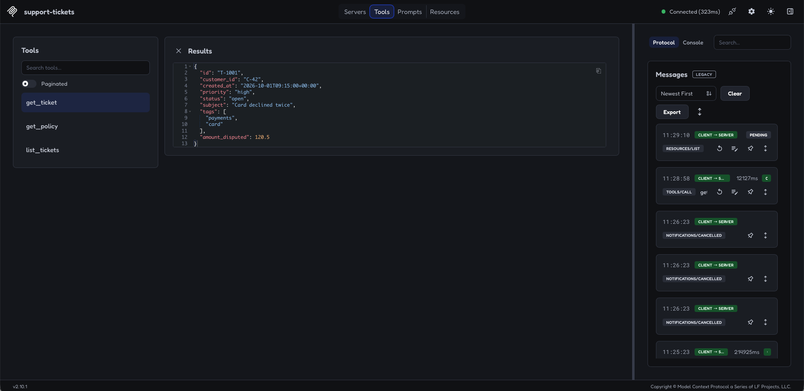
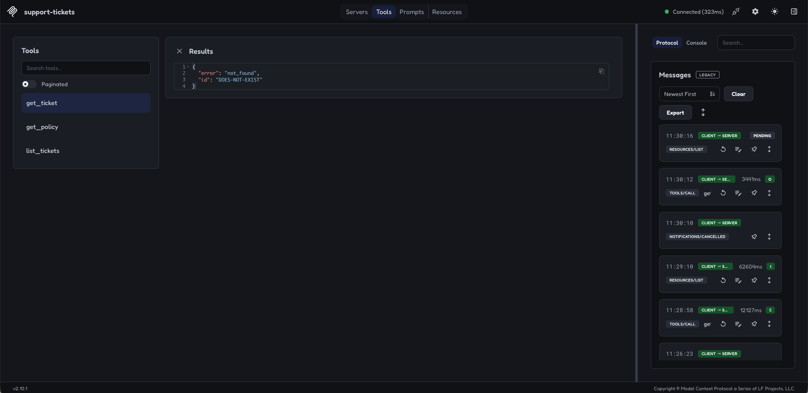

# R1: From Python functions to MCP tools

We are building a small support assistant for an imaginary financial company.
The starting point is simple: look up tickets and refund policies in local JSON
files. We then expose those functions through MCP and connect an LLM that can
choose which tool to call.

This stage is about understanding the whole path from a question to a Python
function and back. The prototype retrieves information; it does not issue
refunds, change accounts, or make approval decisions.

## Current progress

Status as of 2026-10-14, based on the local workspace and the checks recorded below:

| Work | Status | Evidence and limits |
| --- | --- | --- |
| Ticket and policy functions | Implemented and tested | Three direct function tests, supplemented by MCP tests |
| FastMCP server | Implemented | Three tools discovered and called through MCP |
| Automated MCP tests | Implemented | 13 test cases covering discovery, schemas, calls, filters, and missing inputs |
| Inspector checks | Ticket lookups verified | Screenshots show discovery, an existing ticket, and an unknown ticket |
| OpenAI Agents SDK agent | Implemented; one live run completed | Correct answer and a tool-call log; exact tool arguments were not captured |
| Automated LLM agent tests | Planned | Tool selection and answer grounding still need explicit checks |

The server changes, agent script, and test changes are still uncommitted at this
checkpoint. The local work described here is ahead of the published code.

## Files and responsibilities

| File | Responsibility |
| --- | --- |
| [src/functions.py](src/functions.py) | Load fixtures, filter tickets, and find ticket or policy records |
| [src/server.py](src/server.py) | Register the functions as MCP tools and run the server |
| [src/llm_agent.py](src/llm_agent.py) | Connect an OpenAI Agents SDK agent to the server and ask one question |
| [data/tickets.json](data/tickets.json) | Synthetic ticket records |
| [data/policies.json](data/policies.json) | Synthetic policy records |
| [tests/test_functions.py](tests/test_functions.py) | Call the Python functions directly |
| [tests/test_mcp_server.py](tests/test_mcp_server.py) | Discover and call tools through an MCP client session |
| [docs/evidence/screenshots/](docs/evidence/screenshots/) | Inspector screenshots from manual checks |

## Local setup and commands

The runs in this log used the shared `.venv` at the repository root. Dependency
installation is described in the [root README](../README.md). The stage also has
its own `pyproject.toml` and lockfile, but its dependency declaration does not yet
include the OpenAI Agents SDK. A standalone stage environment is therefore not
yet sufficient for the agent example.

Start from the repository root:

```bash
cd r1-functions-to-mcp-tools
```

Run the following commands from that folder, not from `src`. The functions use
relative paths such as `data/tickets.json`, and the agent launches `src/server.py`.
Using the explicit interpreter path also avoids accidentally using global Python
packages.

| Task | Command |
| --- | --- |
| Function tests | `../.venv/bin/python -m pytest tests/test_functions.py -v` |
| MCP server tests | `../.venv/bin/python -m pytest tests/test_mcp_server.py -v` |
| Full R1 suite with coverage | `../.venv/bin/python -m pytest --cov=src --cov-report=term-missing --cov-fail-under=80` |
| Inspector | `npx @modelcontextprotocol/inspector ../.venv/bin/python src/server.py` |
| LLM agent | `../.venv/bin/python src/llm_agent.py` |

Inspector uses Node.js/npm through `npx`. The agent reads `OPENAI_API_KEY` from
the environment and makes paid model requests. Keep the key out of source code
and Git. You can check whether it is present without printing it:

```bash
[[ -n "$OPENAI_API_KEY" ]] && echo "API key is set"
```

## Step 1: Write the Python functions

The functions do the data work. They can be called and tested without MCP or an LLM.

| Function | Inputs | Current result |
| --- | --- | --- |
| `list_tickets` | Optional `status` and `customer_id` | A list of summaries containing `id`, `subject`, `status`, `customer_id`, and `created_at` |
| `get_ticket` | `ticket_id` | The full matching record, or `{"error": "not_found", "id": ticket_id}` |
| `get_policy` | `policy_id` | A dictionary containing the policy's ID, title, and text, or the same missing-record error shape |

For `list_tickets`, `None` means no filter. When both filters are supplied, a
ticket must match both. No matches returns an empty list. The `load_json` helper
reads the files and remains internal; it is not an MCP tool.

The original brief also mentioned possible tag filtering, policy references and
refund-status fields on tickets, and removing sensitive fields. Those are not
implemented guarantees. In particular, `get_ticket` returns the fixture record
as stored; it does not redact fields. Keep the fixtures synthetic and do not add
card numbers or national insurance numbers.

## Step 2: Expose the functions with FastMCP

**FastMCP** is the server-building interface we import from the MCP Python SDK
as `mcp.server.fastmcp`. MCP, the Model Context Protocol, defines how a client
discovers tools and requests their execution.

In `server.py`, this creates the server object:

```python
mcp = FastMCP("support-tickets")
```

`mcp` is the Python variable. `"support-tickets"` is the name reported to clients.
That is why tests use `from server import mcp`.

Each tool has a small wrapper:

```python
@mcp.tool()
def get_ticket(ticket_id: str) -> dict:
    """Get the full details of the ticket by its ID."""
    return functions.get_ticket(ticket_id)
```

The decorator registers the tool. The docstring becomes its description, and
the type hints describe the input and return types. FastMCP uses this metadata
to describe the tool to clients. A regular `#` comment is for source-code readers;
it does not become the tool description.

The wrapper delegates to `functions.py`, so the lookup logic stays in one place.
For the list tool, `status: str | None = None` means the argument accepts a string
or `None` and defaults to `None` when omitted. `-> list[dict]` describes a list
of dictionaries as the return value.

### What the server does during a request

1. A client asks for the available tools. The server returns their names,
   descriptions, and input schemas.
2. The client sends a structured call, such as `get_ticket` with
   `{"ticket_id": "T-1001"}`.
3. FastMCP validates the arguments and calls the registered wrapper.
4. The wrapper calls our Python function, which reads the fixture and returns data.
5. FastMCP packages the result as an MCP response and sends it back to the client.

The server does not interpret natural-language questions. Inspector lets us
choose the call manually; an agent application lets a model choose it.

### Starting the server

```python
if __name__ == "__main__":
    mcp.run(transport="stdio")
```

The guard starts the server when the file is run directly. Importing `server`
defines the tools without starting the stdio loop. This makes imports usable in tests.

With **stdio**, the client launches the server as a subprocess and communicates
through its standard input and output. No HTTP endpoint is needed. The server
waits for MCP messages rather than displaying an ordinary input prompt.

Our tools currently only read data. Explicit `readOnlyHint` annotations have not
been added. Such annotations describe behaviour to a client; they do not enforce
read-only access and are separate from docstrings.

## Step 3: Verify the functions and tools

| Test stage | Question it answers | How we test |
| --- | --- | --- |
| 1. Python function tests | Does the lookup and filtering logic work? | `pytest` calls the functions directly in `test_functions.py`. |
| 2. Automated MCP server tests | Can a client discover and call the tools correctly? | `pytest` uses an initialized in-memory MCP session in `test_mcp_server.py`. |
| 3. Manual Inspector tests | What does a client see, and what do tool calls return? | Select tools, enter arguments, inspect responses, and capture screenshots. |
| 4. LLM agent tests | Does the model choose the right tool and use its result correctly? | Use the OpenAI Agents SDK with natural-language tasks, then check tool choices, arguments, and answers. |

The second and third stages exercise the same MCP interface. Neither needs an LLM.

### Function tests

The three existing tests check an existing ticket ID, an existing policy ID,
and the count and status of open tickets. They call `functions.py` directly.
The broader edge cases below are covered through MCP.

### Automated MCP server tests

The test file imports the server object and uses
`create_connected_server_and_client_session(mcp)` to connect a client and server
inside the same Python process. The helper initializes the MCP session. Requests
still go through MCP, but no separate server process or Inspector is needed.

`async def` lets a test use `await`. `await session.list_tools()` waits for the
response while allowing other asynchronous work to run. `async with` opens the
connection and closes it when the block ends. The stage's `asyncio_mode = "auto"`
lets pytest run these asynchronous tests.

The 13 cases check:

- Exactly the three expected tool names, nonempty descriptions, and input schemas.
- Existing and missing ticket and policy IDs.
- All tickets, each filter separately, both filters together, and no matches.
- Summary fields and rejection of a missing required ticket ID.

The installed SDK returns list results as one text content block per ticket.
The tests decode each block; no matches produces no content blocks. This differs
from the plain Python function's return value, which is a list.

Use `-v` to see `PASSED` beside each test. Without verbose output, a dot usually
represents a passing test. Pytest reports results in the terminal, not in the
source file.

### Test the server with MCP Inspector

Inspector is an interactive MCP client. You choose the tool and arguments yourself.
Launch it from R1:

```bash
npx @modelcontextprotocol/inspector ../.venv/bin/python src/server.py
```

Keep the terminal running. Connect if needed, then open **Tools**. You should see
`get_ticket`, `get_policy`, and `list_tickets`.


This screenshot demonstrates discovery: the docstring appears as the description
and the parameter becomes an input field. It does not show a completed call.

Select a tool, fill in its inputs, and click **Execute Tool**. These expected
results refer to the current fixtures:

| Test | Tool and inputs | Expected result |
| --- | --- | --- |
| Existing ticket | `get_ticket`, `ticket_id="T-1001"` | Ticket with subject `Card declined twice` |
| Unknown ticket | `get_ticket`, `ticket_id="DOES-NOT-EXIST"` | `{"error": "not_found", "id": "DOES-NOT-EXIST"}` |
| All tickets | `list_tickets`, omit both filters | Eight summaries |
| Status filter | `list_tickets`, `status="open"` | `T-1001`, `T-1003`, `T-1006`, `T-1008` |
| Both filters | `list_tickets`, `status="open"`, `customer_id="C-42"` | `T-1001`, `T-1003`, `T-1008` |
| No matches | `list_tickets`, `customer_id="DOES-NOT-EXIST"` | No tickets |
| Existing policy | `get_policy`, `policy_id="POL-REFUND-01"` | Policy titled `Refund window` |
| Unknown policy | `get_policy`, `policy_id="DOES-NOT-EXIST"` | The `not_found` dictionary |

Omit unused filters rather than entering an empty string. In **Edit as JSON**,
use `{}` for all tickets or `{"status": "open"}` for open tickets.

The functions return a `not_found` dictionary normally, so Inspector may label
the MCP call successful while showing `"error": "not_found"` in its data. That
is an expected application result. Inspect the response, not just the success label.

#### Captured results

An existing-ticket call returned the details of `T-1001`:



An unknown-ticket call returned `not_found`:



These two calls are evidenced here. The other rows are manual test instructions,
not a claim that every Inspector case was completed. Stop Inspector with **Ctrl-C**
in its terminal when finished.

## Step 4: Connect an LLM agent

We created `src/llm_agent.py` with the **OpenAI Agents SDK**. It uses
`gpt-5.6-luna` and the MCP server we already built. The agent script and server run
locally; the model runs through the OpenAI API.

The installation package is named `openai-agents`, but Python imports it as
`agents`. It is an installed library, not another file we need to write.

| Component | Job in our script |
| --- | --- |
| `MCPServerStdio` | Launch `src/server.py` using `sys.executable`, the current Python interpreter, and open the MCP connection |
| `Agent` | Define the model, instructions, and available server connections |
| `mcp_servers=[ticket_server]` | Make our server's tools available to the model |
| `Runner.run(...)` | Manage model requests, requested tool calls, and responses |
| `result.final_output` | Hold the final answer printed in the terminal |

Inside the `async with` block, `ticket_server` names the client-side connection.
It is not the `mcp` variable inside `server.py`. Keeping the agent run inside that
block keeps the connection open while the model uses the tools.

The script currently asks one fixed question:

> What is the status of ticket T-1001?

The intended flow is:

```text
Question + instructions + tool definitions → model
Model requests get_ticket(ticket_id="T-1001") → SDK's MCP client
MCP client → server.py wrapper → functions.py → fixture data
Tool result → MCP client → model
Final answer → terminal
```

The SDK discovers the tool definitions and supplies them to the model. The model
chooses a tool and arguments; the runner executes that request through MCP and
returns the result to the model. The model then writes its answer, or requests
another tool if needed. When the run finishes, the script prints the answer and
closes the connection.

The model does not read our fixture files directly. Our Python functions do that.
Instructions tell the model to use tools and avoid invented details, but those
instructions still need behavioural tests.

### First live run and server logs

Run from R1 with the API key exported:

```bash
../.venv/bin/python src/llm_agent.py
```

The observed run completed successfully. With timestamps and source locations
omitted, its output was:

```text
INFO Processing request of type ListToolsRequest
INFO Processing request of type CallToolRequest
INFO Processing request of type ListToolsRequest
Ticket T-1001 is **open**.
```

Server logs are diagnostic messages about requests being processed. `INFO` means
informational activity. `ListToolsRequest` means the client asked for the tool
list; this can happen more than once. `CallToolRequest` means it requested a tool
execution. The last line is the agent's answer, printed by `llm_agent.py`.

For stdio, the server's standard output carries MCP messages. These logs go to
standard error, which the terminal also displays. Keep ordinary debugging prints
out of the server's protocol output.

The run proves a tool call occurred and the answer contained the correct status.
These logs do not identify the tool, arguments, or returned data. We have not yet
captured the evidence needed to assert the exact call shown in the intended flow.

### Agent tests still to write

Give the agent a natural-language task and inspect both its actions and its
answer. For the first case, verify a `get_ticket` call with `T-1001`, the returned
record, and an answer stating that the ticket is open. Exact wording can vary.

Follow with requests for open tickets, a named policy, and an unknown ticket.
Check that arguments match the request and that missing records are reported
without invented facts. A correct final answer alone could be a guess, so it
is not enough evidence of correct tool use.

## Execution log

These are recorded results, not a fresh test run on every README edit.

| Date | Check | Observed result | Limit |
| --- | --- | --- | --- |
| 2026-10-14 | Direct Python and in-memory MCP tests | 16 passed: 3 function cases and 13 MCP cases; 97.5% coverage | This coverage measurement predates `llm_agent.py`. It does not describe coverage of the current full source tree. |
| 2026-10-14 | Inspector discovery and ticket calls | Three tools listed; existing-ticket and missing-ticket results captured above | Early requests stalled; responses appeared after further client activity. The cause was not diagnosed. |
| 2026-10-14 | Live Luna agent | Tool-call request logged; answered that T-1001 is open; process exited successfully | One fixed question; no exact-call trace or automated agent assertion |

## Troubleshooting

| Symptom | What to check |
| --- | --- |
| `Connection closed` after running from `src` | Run from R1. Otherwise `src/server.py` resolves to `src/src/server.py`. |
| Packages load from global Homebrew Python | Use `../.venv/bin/python` explicitly. The shell prompt alone does not prove which interpreter is running. |
| Fixture file not found | Check the working directory; data paths are relative to R1. |
| Inspector connects but tools stay blank or time out | Inspect Protocol, Console, and terminal output. Try reconnecting. Connection alone is not a passed test. |
| No visible `PASSED` labels | Run pytest with `-v`; its default output may show dots. |
| API authentication fails | Check the key exported in the launching shell. The R1 agent relies on the environment; it does not load a project `.env` file. |

## Remaining work

The next checks are to inspect the agent's exact tool calls and automate the
agent scenarios. The current script handles one hardcoded question per run;
interactive input and conversation history have not been added.

Before treating R1 as independently reproducible, reconcile its stage dependencies
with the shared environment used here. Before publishing the implementation,
review and commit the pending code and tests. Documentation edits do not publish
those files automatically.

Other gaps from the original brief remain visible: read-only annotations,
descriptions that explain missing-ID behaviour, and a separate server `main()`
function have not been added. The existing startup guard already runs stdio.
Richer refund fields, sensitive-field redaction, and tag filtering would require
separate implementation work.
